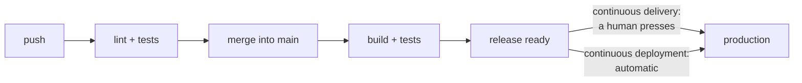
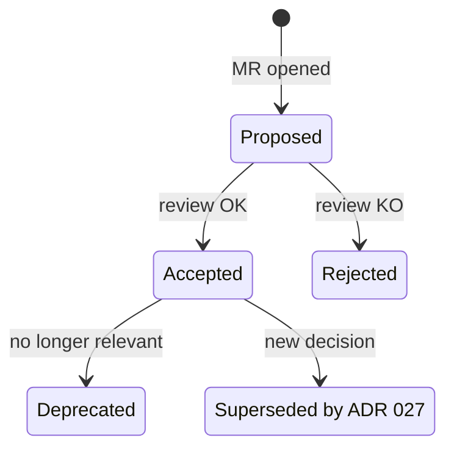
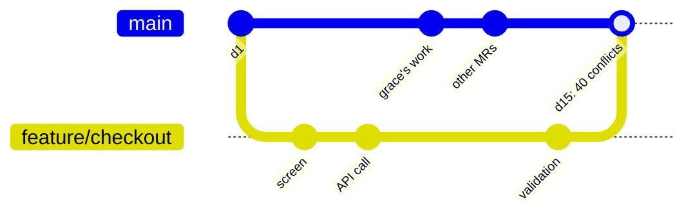
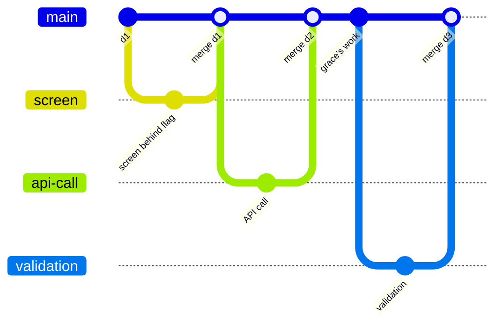
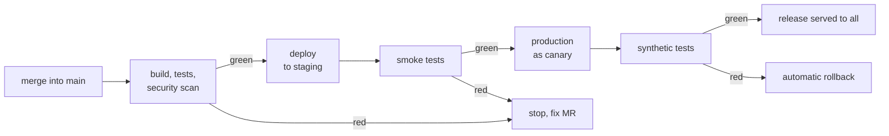
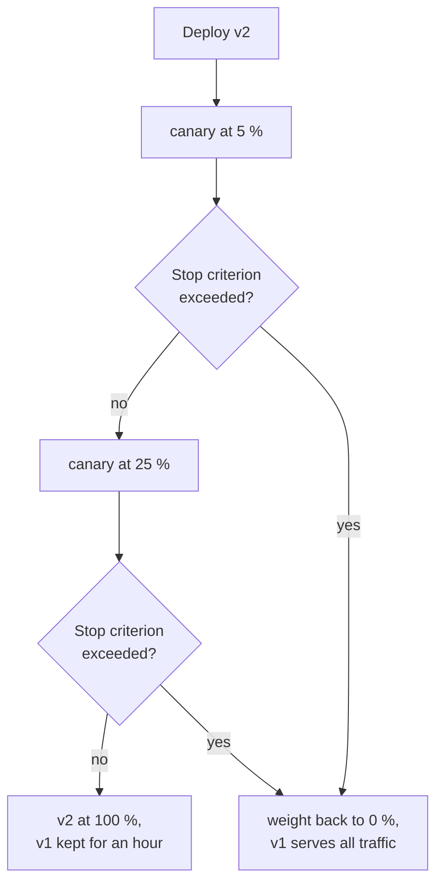
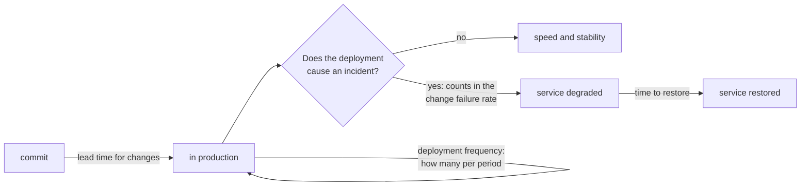
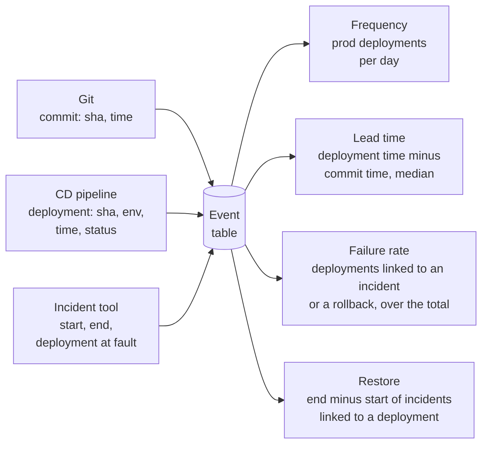
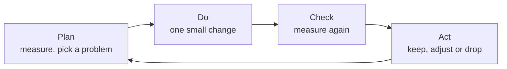

# Delivery and engineering practices

!!! warning "Disclaimer"
    These notes are personal cheat sheets, not a source of truth. They reflect my own understanding and choices: their content remains subjective, despite the quotes and references it contains. It may be incomplete, simplified, inaccurate or outdated. Always check the official documentation before applying it. This content is provided as is, without any warranty: you use it at your own risk.

!!! abstract "Scales"
    The colored badges under the headings say at which scale a notion applies:

    - <span class="pill pill-scope pill-scope-code">Code</span> the classes, functions and modules of one program;
    - <span class="pill pill-scope pill-scope-app">Application</span> one service or application and its internal split;
    - <span class="pill pill-scope pill-scope-system">System</span> several services talking to each other over the network;
    - <span class="pill pill-scope pill-scope-infra">Infrastructure</span> servers, network, zones and clusters, physical or virtual;
    - <span class="pill pill-scope pill-scope-enterprise">Enterprise</span> the whole information system and its organization.

    Details and ambiguous words: [map of scales](architecture.md#map-of-scales).

Delivering means getting a modification of the software all the way to users: a new feature, a bug fix, a dependency upgrade or a configuration change. Take an example: my team adds partial refunds to `orders-service`. This page follows that modification from the idea to production, one step after the other: design it, merge it into the shared code after automated checks, test it, deploy it without manual steps, open it to users little by little, check that it works in production and observe it. Each step has its engineering practice. The page ends with how to measure whether the team delivers well: often, fast and without breaking things. The `orders-service` and `my-api` services are fictitious.

## Terminology

**Continuous integration (CI)**: every change is merged often into the main branch, and a machine automatically runs linting and tests on each push.

**Continuous delivery**: every version that passes the pipeline is **ready** to go to production; a person still decides when. **Continuous deployment**: the same thing, without the human decision: every merge goes to production if all checks are green.

```
continuous integration   push   lint + tests      merge into main
continuous delivery      main   build + tests     version ready    "deploy" button (human)
continuous deployment    main   build + tests     version ready    production (automatic)
```



:material-book-open-variant: Reference docs: [Martin Fowler, "Continuous Integration"](https://martinfowler.com/articles/continuousIntegration.html) (2006, revised 2024); [Martin Fowler, "ContinuousDelivery"](https://martinfowler.com/bliki/ContinuousDelivery.html) (2013)
{ .doc-ref }

**DORA capability**: a practice that studies from the DORA research programme (DevOps Research and Assessment, yearly reports since 2014) link to delivery performance. The badges on this site link to each capability's page on [dora.dev](https://dora.dev/capabilities/).

!!! info "DORA badges"
    A badge such as <a class="pill pill-dora" href="https://dora.dev/capabilities/trunk-based-development/">DORA · Trunk-based development</a> under a heading shows which DORA capability the section illustrates. Clicking it opens its page on dora.dev. List checked on 2026-10-29: 34 capabilities, regrouped and renamed across reports (to check, it changes). Technical design has no dedicated capability: it is attached to <a class="pill pill-dora" href="https://dora.dev/capabilities/loosely-coupled-teams/">DORA · Loosely coupled teams</a> and <a class="pill pill-dora" href="https://dora.dev/capabilities/documentation-quality/">DORA · Documentation quality</a>.

!!! info "Practice badges"
    A grey badge such as <a class="pill pill-practice" href="../livraison/#testing-in-production" title="level 3: it decides without a human">Practice · Production testing · L3</a> shows which of this site's eight engineering practices the section illustrates: [technical design](#design-before-coding), [trunk-based development](#trunk-based-development), [functional testing](#automated-functional-tests), [continuous deployment](#continuous-delivery-and-deployment), [progressive rollout](#progressive-deployment), [production testing](#testing-in-production), [API management](api-rest-async.md#api-management), [observability](observabilite.md). This split into eight is a personal choice to organize these notes, not a DORA list: for the link to DORA research, see each section's DORA badge. When the section shows a specific stage, the badge carries a level, the same for every practice:

    | Level | What it means | Example with production testing |
    |---|---|---|
    | L1 | the practice is in place, even by hand | someone runs a smoke test after each release |
    | L2 | it is automated | the smoke test runs by itself on every deployment |
    | L3 | it decides without a human | a red smoke test triggers the <span class="term" data-term="rollback">rollback</span> |
    | L4 | it is steered by measurement | tests are adjusted from the incidents they caught or missed |

    This scale is a personal simplification, in the spirit of staged maturity models such as CMMI (Software Engineering Institute, first version in 2000). It is not a standard.

## Design before coding

<a class="pill pill-scope pill-scope-app" href="../architecture/#map-of-scales">Scale · Application</a> <a class="pill pill-scope pill-scope-system" href="../architecture/#map-of-scales">Scale · System</a> <span class="pill pill-status pill-status-ok" title="Still valid, checked November 2026">Current · 11/2026</span>

<a class="pill pill-practice" href="../livraison/#design-before-coding">Practice · Technical design</a>
<a class="pill pill-dora" href="https://dora.dev/capabilities/loosely-coupled-teams/">DORA · Loosely coupled teams</a> <a class="pill pill-dora" href="https://dora.dev/capabilities/documentation-quality/">DORA · Documentation quality</a>

**Technical design** answers three questions before any code is written: what to build, how the pieces talk to each other (API contracts, events), and how we will know it works in production (observability, rollback). Two short documents are often enough:

- the **design doc** (or internal RFC): the problem, the options studied, the chosen option, the risks; reviewed before the code;
- the **<span class="term" data-term="adr">ADR</span>** (Architecture Decision Record): one page per decision, kept in the repo, saying why it was chosen.

!!! noob "As noob"
    The design document is the site meeting where we choose between several plans; the ADR is the minutes filed in the binder, saying what was decided and why, for whoever arrives two years later. The one thing to remember: **the design document helps decide, the ADR helps remember why.**

A design doc skeleton with six headings, filled in for a short case (example figures):

```markdown
# orders-service: stop losing orders when payments-service is slow

## Problem
When payments-service takes more than 3 s to answer, orders-service gives up and the order is lost (12 cases last week).

## Options
A. Raise the timeout to 10 s: simple, but blocks orders-service threads during peaks.
B. Save the order as "awaiting payment" before the call, then set it to "paid" when the answer arrives.

## Decision
B: no order is lost, and orders-service no longer blocks on payments-service.

## Risks
An order can stay "awaiting payment" if the answer never comes: a job retries it after 15 min.

## Rollback
Feature flag orders.async-payment: switching it off restores the synchronous call; the new status column is ignored, nothing to migrate.

## Observability
Metric orders_pending_payment (count and age); alert if more than 50 orders have been waiting for more than 15 min.
```

The ADR then keeps the decision alone, in a few lines:

```markdown
# ADR 012: publish paid orders on a queue instead of calling email-service

Status: accepted (2026-03-14)
Context: email-service goes down 2 to 3 times a month (example), and the order fails with it.
Decision: orders-service publishes "order paid"; email-service consumes at its own pace.
Consequences: the email may leave a few seconds late; a DLQ is needed.
```

An ADR is never rewritten: when the decision changes, a new ADR supersedes the old one, and the old one keeps the reasoning of its time.



| Situation | Document |
|---|---|
| my choice commits several teams or several months of work, like making order payment asynchronous | design doc, reviewed before the code |
| in two years, someone will wonder why the team picked a queue over a direct call, and nobody will remember | ADR in the repo |
| I fix a bug or add a small field, without changing the architecture | nothing: the MR description is enough |

An API's contract is set at this step: see [API first](api-rest-async.md#api-first). Source: Michael Nygard, "Documenting Architecture Decisions" (2011).

:material-book-open-variant: Reference docs: [ADR GitHub organization, Architectural Decision Records](https://adr.github.io/) (accessed November 2026); [Malte Ubl, "Design Docs at Google"](https://www.industrialempathy.com/posts/design-docs-at-google/) (2020)
{ .doc-ref }

## Trunk-based development

<a class="pill pill-scope pill-scope-code" href="../architecture/#map-of-scales">Scale · Code</a> <span class="pill pill-status pill-status-ok" title="Still valid, checked November 2026">Current · 11/2026</span>

<a class="pill pill-practice" href="../livraison/#trunk-based-development">Practice · Trunk-based development</a>
<a class="pill pill-dora" href="https://dora.dev/capabilities/trunk-based-development/">DORA · Trunk-based development</a> <a class="pill pill-dora" href="https://dora.dev/capabilities/working-in-small-batches/">DORA · Working in small batches</a>

<span class="term" data-term="trunk-based-development">Trunk-based development</span>: everyone integrates into the main branch (the "trunk") at least once a day, with branches that live one or two days at most. The opposite: <span class="term" data-term="long-lived-branch">long-lived branches</span>, merged after weeks.

!!! noob "As noob"
    It is doing the dishes during the meal rather than once a week: each plate takes a minute, while a week of stacked dishes takes an evening, and a few glasses break on the way. The one thing to remember: **integrating often in small pieces costs less than integrating rarely in big chunks.**

```
long branches   day 1    ada creates feature/checkout
                day 15   merge: 40 conflicting files, 2 days to resolve them
                day 17   integration tests reveal an incompatibility with grace's work

trunk-based     day 1    small MR (the new screen, hidden behind a feature flag), merged
                day 2    small MR (the API call), merged
                ...      every merge is tested with everyone's work, every day
```

The same work drawn as Git branches. With a long-lived branch:



With trunk-based, one-day branches, merged right away:



Unfinished code is hidden behind a <span class="term" data-term="feature-flag">feature flag</span>: it is in production, but switched off. To replace a whole component without a long branch, use an abstraction ("<span class="term" data-term="branch-by-abstraction">branch by abstraction</span>"): an interface, the old and new implementations behind it, and a switch.

!!! noob "As noob"
    A feature flag is the closed door of a room under renovation: the room already exists in the house, but nobody walks in until the door is opened. Branch by abstraction is fitting a standard socket on the wall so the appliance plugged in behind it can be swapped without rewiring. The one thing to remember: **putting code in production and opening it to users become two separate moves.**

```
step 1   PaymentGateway (interface)             orders-service only calls the interface
         └── LegacyPaymentClient                the old implementation, the only one wired

step 2   PaymentGateway
         ├── LegacyPaymentClient                still used in production
         └── NewPaymentClient                   merged in small MRs, not used yet

step 3   flag payments.new-client = on         the switch picks NewPaymentClient
                                                once stable: delete the old one and the flag
```

| Situation | Approach |
|---|---|
| my team already merges every day, and the CI tells within minutes, without false alarms, whether a change breaks something | trunk-based |
| ada has to ship a new payment screen that will take several weeks, but does not want a branch that drifts meanwhile | trunk-based + feature flag |
| my CI takes an hour, or there are few automated tests, so nobody knows whether a merge breaks the trunk | invest in CI first: trunk-based without tests breaks the trunk |
| my open source project receives MRs from outside people I do not know | short branches per MR, mandatory review |

Sources: [trunkbaseddevelopment.com](https://trunkbaseddevelopment.com/) (Paul Hammant, publication date not stated); DORA page "Trunk-based development".

:material-book-open-variant: Reference docs: [Martin Fowler, "BranchByAbstraction"](https://martinfowler.com/bliki/BranchByAbstraction.html) (2014); [Martin Fowler, "Patterns for Managing Source Code Branches"](https://martinfowler.com/articles/branching-patterns.html) (2020)
{ .doc-ref }

## Automated checks before merging

<a class="pill pill-scope pill-scope-code" href="../architecture/#map-of-scales">Scale · Code</a> <a class="pill pill-scope pill-scope-app" href="../architecture/#map-of-scales">Scale · Application</a> <span class="pill pill-status pill-status-ok" title="Still valid, checked November 2026">Current · 11/2026</span>

<a class="pill pill-practice" href="../livraison/#trunk-based-development">Practice · Trunk-based development</a>
<a class="pill pill-dora" href="https://dora.dev/capabilities/continuous-integration/">DORA · Continuous integration</a> <a class="pill pill-dora" href="https://dora.dev/capabilities/code-maintainability/">DORA · Code maintainability</a> <a class="pill pill-dora" href="https://dora.dev/capabilities/pervasive-security/">DORA · Pervasive security</a>

I open an MR, and my team asks a single question: can this change go into the trunk without breaking or exposing anything? Lint and tests answer part of it. Other automated checks cover what they miss: an API key pasted in the code, a module importing a layer it should not know about, a function nobody calls anymore, a generated API client that did not follow the change.

These checks run in two places. First on my machine, at commit time, as <span class="term" data-term="pre-commit-hook">pre-commit hooks</span>: I fix things in ten seconds instead of waiting ten minutes for the CI. Then in the CI, on the whole branch, because a hook can be skipped (`git commit --no-verify`) and only sees the files I commit.

*pre-commit: competes with prek, Husky, lefthook*<br>
*detect-secrets: competes with gitleaks, TruffleHog*<br>
*Bandit: partly competes with Semgrep, SonarQube*<br>
*vulture: complements ruff*
{ .tool-rel }

!!! noob "As noob"
    It is airport security in two steps: I check my bag at home (no liquids, no knife), then the scanner checks everyone anyway. Checking at home saves me from queuing twice; the scanner stays the only check that counts. The takeaway: **the hook saves time, the CI is the authority.**

Example of a commit refused by a hook, with the pre-commit tool:

```
$ git commit -m "feat(orders): partial refund"
trim trailing whitespace.................................Passed
check for added large files..............................Passed
ruff.....................................................Passed
mypy.....................................................Passed
Detect secrets...........................................Failed
- hook id: detect-secrets
ERROR: Potential secrets about to be committed to git repo!
Secret Type: Secret Keyword
Location:    src/orders/refunds.py:12
```

I remove the key, read it from an environment variable, and commit again. Without the hook, the key would have gone into the Git history, visible in every clone.

The families of checks, beyond lint and tests:

| Check | What it catches, for example | Common tools | Where to run it |
|---|---|---|---|
| file hygiene | a forgotten `<<<<<<<` conflict marker, a 200 MB file, Windows line endings | pre-commit-hooks | hook and CI |
| commit message | `fix stuff` instead of `fix(orders): refund rounding` ([Conventional Commits](git.md)) | conventional-pre-commit, commitlint | `commit-msg` hook |
| <span class="term" data-term="secret">secrets</span> | an API key or a private key in the code | gitleaks, detect-secrets | hook and CI |
| <span class="term" data-term="sast">SAST</span> | `subprocess.run(cmd, shell=True)` with user input, `yaml.load` without a safe loader | Bandit (Python, ruff ports part of its rules), Semgrep | hook and CI |
| <span class="term" data-term="dead-code">dead code</span> | a function or a field nobody uses anywhere in the project | vulture (Python), knip (TypeScript) | hook and CI |
| shell scripts | an unquoted variable that breaks on a file name with a space | ShellCheck | hook and CI |
| architecture rules | business code importing the web framework, a low layer importing a high layer | import-linter (Python), dependency-cruiser (JavaScript) | CI |
| <span class="term" data-term="contract-drift">contract drift</span> | the API changed, but the OpenAPI file or the generated client did not follow | regenerate then `git diff --exit-code`, oasdiff | CI |
| vulnerable dependencies | a library with a known vulnerability (CVE) | Trivy, Snyk, with Renovate for the upgrades | CI |
| MR hygiene | a title out of format, an empty description, a 2,000-line MR | Danger | CI |
| overall quality | duplication, coverage of new code | SonarQube and its quality gate | CI |

A single file, `.pre-commit-config.yaml`, lists the hooks and their versions; the CI runs the same file with `pre-commit run --all-files` (or `prek run --all-files`), so the machine and the CI apply exactly the same rules.

| Situation | Choice |
|---|---|
| my team finds out in the CI, ten minutes after pushing, about format errors the editor could have fixed by itself | pre-commit hooks with ruff or Prettier |
| someone already pushed an API key to a repository, and we only saw it three months later in the history | gitleaks or detect-secrets, as a hook and in the CI |
| my team drew layers (api, business, storage), but the code slowly bypasses them, like a business module importing FastAPI | import-linter in the CI, a [fitness function](architecture.md#fitness-functions) |
| my hooks make every commit slow (one minute, example figure), and people skip them with `--no-verify` | keep the fast checks as hooks (format, lint, secrets), leave the slower ones to the CI |
| my repository mixes Python, TypeScript and shell deployment scripts | a single hook manager (pre-commit or prek) that runs each tool |

:material-book-open-variant: Reference docs: [pre-commit](https://pre-commit.com/) (accessed November 2026); [Bandit](https://bandit.readthedocs.io/) (accessed November 2026); [detect-secrets](https://github.com/Yelp/detect-secrets) (accessed November 2026)
{ .doc-ref }

## Automated functional tests

<a class="pill pill-scope pill-scope-app" href="../architecture/#map-of-scales">Scale · Application</a> <a class="pill pill-scope pill-scope-system" href="../architecture/#map-of-scales">Scale · System</a> <span class="pill pill-status pill-status-ok" title="Still valid, checked November 2026">Current · 11/2026</span>

<a class="pill pill-practice" href="../livraison/#automated-functional-tests">Practice · Functional testing</a>
<a class="pill pill-dora" href="https://dora.dev/capabilities/test-automation/">DORA · Test automation</a> <a class="pill pill-dora" href="https://dora.dev/capabilities/continuous-integration/">DORA · Continuous integration</a> <a class="pill pill-dora" href="https://dora.dev/capabilities/test-data-management/">DORA · Test data management</a>

A **functional test** checks a behaviour the user or the business expects ("an empty cart cannot be checked out"), whatever its level: unit, API or E2E. It runs automatically in every MR pipeline, and passing it is the condition to merge.

What makes continuous delivery possible is not the number of tests but their **reliability**. If a test fails one time in ten for no reason, the team gets used to rerunning the pipeline without looking. The day red signals a real bug, nobody pays attention, so the bug ships to production. The details (levels, contracts, test data, flaky tests) are in [Quality and testing](qualite.md).

:material-book-open-variant: Reference docs: [Ham Vocke, "The Practical Test Pyramid"](https://martinfowler.com/articles/practical-test-pyramid.html) (2018)
{ .doc-ref }

## Continuous delivery and deployment

<a class="pill pill-scope pill-scope-system" href="../architecture/#map-of-scales">Scale · System</a> <a class="pill pill-scope pill-scope-infra" href="../architecture/#map-of-scales">Scale · Infrastructure</a> <span class="pill pill-status pill-status-ok" title="Still valid, checked November 2026">Current · 11/2026</span>

<a class="pill pill-practice" href="../livraison/#continuous-delivery-and-deployment">Practice · Continuous deployment</a>
<a class="pill pill-dora" href="https://dora.dev/capabilities/continuous-delivery/">DORA · Continuous delivery</a> <a class="pill pill-dora" href="https://dora.dev/capabilities/deployment-automation/">DORA · Deployment automation</a> <a class="pill pill-dora" href="https://dora.dev/capabilities/streamlining-change-approval/">DORA · Streamlining change approval</a>

<span class="term" data-term="continuous-deployment">Continuous deployment</span> chains everything without manual steps. Automatic checks replace the human approval of each release.

!!! noob "As noob"
    It is an assembly line with a sensor at every station: a faulty part is pulled out by the sensor, not by a supervisor signing off each part by hand. The one thing to remember: **we do not remove the check, we hand it to automated tests that never get tired.**

```
merge into main  10:00
  image build, tests, security scan                  10:00 to 10:08
  automatic deployment to the staging environment    10:09
  smoke tests on staging                             10:10
  production deployment (canary, see below)          10:12
  synthetic tests in production                      10:15
```

The same pipeline seen as a chain of gates: any red check stops the release, nobody pushes it further by hand.



| Situation | Choice |
|---|---|
| my tests are reliable, I can expose a version to part of the traffic, and I roll back in one click (with database migrations in [expand / contract](sql.md#expand-contract), otherwise the rollback breaks) | continuous deployment |
| a regulation, like in banking or healthcare, forces me to keep a record of a person approving each release | continuous delivery: everything is ready, a human presses the button |
| each release waits for a board to meet and review it by hand | replace it with automatic checks: DORA links external approval boards to slower delivery, with no stability gain (to check in the report cited by the page) |

Source: Jez Humble and David Farley, "Continuous Delivery" (2010).

:material-book-open-variant: Reference docs: [Jez Humble, continuousdelivery.com](https://continuousdelivery.com/) (accessed November 2026); [Martin Fowler, "DeploymentPipeline"](https://martinfowler.com/bliki/DeploymentPipeline.html) (2013)
{ .doc-ref }

## Progressive deployment

<a class="pill pill-scope pill-scope-system" href="../architecture/#map-of-scales">Scale · System</a> <a class="pill pill-scope pill-scope-infra" href="../architecture/#map-of-scales">Scale · Infrastructure</a> <span class="pill pill-status pill-status-ok" title="Still valid, checked November 2026">Current · 11/2026</span>

<a class="pill pill-practice" href="../livraison/#progressive-deployment">Practice · Progressive rollout</a>
<a class="pill pill-dora" href="https://dora.dev/capabilities/continuous-delivery/">DORA · Continuous delivery</a> <a class="pill pill-dora" href="https://dora.dev/capabilities/proactive-failure-notification/">DORA · Proactive failure notification</a>

I just deployed a new version of `orders-service` and I am not yet sure it works with real traffic. A progressive deployment shows it to few users first: if it has a bug, only a small share of customers sees it, and I roll back before everyone is hit. Four techniques, often combined:

| Technique | Idea | Rollback |
|---|---|---|
| <span class="term" data-term="feature-flag">Feature flag</span> | the code is deployed switched off, turned on for 1%, then 10%, then everyone | switch the flag off |
| <span class="term" data-term="canary-deployment">Canary</span> | the new version first gets 5% of the traffic, its metrics are compared to the old one's | set the weight back to 0% |
| <span class="term" data-term="blue-green-deployment">Blue-green</span> | two full environments, the new one is tested then all traffic is switched | switch back |
| <span class="term" data-term="dark-launch">Dark launch</span> | the new code runs on real traffic, but its response is not shown | nothing to do, nobody saw it |

!!! noob "As noob"
    The canary is named after the canary miners took down the mine: if it fell ill, everyone went back up before being harmed. Here, the new version first serves a small share of traffic, and we watch before widening. The one thing to remember: **we expose few people first, and decide in advance which signal makes us back off.**

<span class="term" data-term="stop-criteria">Stop criteria</span> are thresholds, written down before starting, beyond which we roll back without debate. A canary applying them (example figures):

```
stop criterion: canary error rate > 2 x the old version's, then weight back to 0%

14:00  canary at 5% of traffic
14:10  check: 0.3% errors vs 0.2% on the old version (1.5 x, below the threshold): continue
14:10  canary at 25%
14:30  check: 0.2% vs 0.2%: continue
14:30  canary at 100%; the old version stays ready for one hour to switch back
```



Trap: at 5% for 10 min there are few requests, and 2 errors out of 300 are enough to double the rate. I add a minimum number of requests before judging.

What to test at each step is detailed in [Testing a canary deployment](qualite.md#testing-a-canary-deployment) and [Testing a blue-green deployment](qualite.md#testing-a-blue-green-deployment). Sources: Danilo Sato, "CanaryRelease" (2014); Martin Fowler, "BlueGreenDeployment" (2010); Pete Hodgson, "Feature Toggles" (2017), all on martinfowler.com.

:material-book-open-variant: Reference docs: [Danilo Sato, "CanaryRelease"](https://martinfowler.com/bliki/CanaryRelease.html) (2014); [Pete Hodgson, "Feature Toggles"](https://martinfowler.com/articles/feature-toggles.html) (2017); [Martin Fowler, "BlueGreenDeployment"](https://martinfowler.com/bliki/BlueGreenDeployment.html) (2010)
{ .doc-ref }

## Testing in production

<a class="pill pill-scope pill-scope-system" href="../architecture/#map-of-scales">Scale · System</a> <a class="pill pill-scope pill-scope-infra" href="../architecture/#map-of-scales">Scale · Infrastructure</a> <span class="pill pill-status pill-status-ok" title="Still valid, checked November 2026">Current · 11/2026</span>

<a class="pill pill-practice" href="../livraison/#testing-in-production">Practice · Production testing</a>
<a class="pill pill-dora" href="https://dora.dev/capabilities/monitoring-and-observability/">DORA · Monitoring and observability</a> <a class="pill pill-dora" href="https://dora.dev/capabilities/proactive-failure-notification/">DORA · Proactive failure notification</a>

All my tests are green in staging, and yet ordering fails in production: a customer has a name with a character staging never saw, or a configuration variable does not have the same value. Some defects only exist with real data, real traffic and real configuration. Testing in production means checking the real system **after** the deployment, without putting users at risk.

!!! noob "As noob"
    It is a road test after the test bench: the bench does not simulate everything (potholes, real weather), but we drive a marked test car, with no passengers. The one thing to remember: **in production, we check with test accounts and test traffic, never at the expense of real users.**

| Technique | Example |
|---|---|
| <span class="term" data-term="synthetic-monitoring">Synthetic tests</span> | a fake customer places an order every 10 minutes with a test card |
| canary analysis | v2's errors compared to v1's on the same traffic |
| <span class="term" data-term="smoke-test">Smoke test</span> after deployment | 5 key requests right after the release |
| <span class="term" data-term="chaos-engineering">Chaos engineering</span> | cutting a dependency on purpose to check the service degrades gracefully |

Safety rules:

- **dedicated test accounts**, flagged as such, excluded from statistics and billing;
- **cleanup** of what the test creates;
- **identifiable test traffic** (a header, an account), so it does not trigger a business alert or skew a dashboard;
- **never** a load test on production without explicit agreement.

Source: Cindy Sridharan, "Testing in Production, the safe way" (2018). Synthetic tests are detailed in [Quality and testing](qualite.md#synthetic-tests).

:material-book-open-variant: Reference docs: [Cindy Sridharan, "Testing in Production, the safe way"](https://copyconstruct.medium.com/testing-in-production-the-safe-way-18ca102d0ef1) (2018); [Google SRE Workbook, Canarying Releases](https://sre.google/workbook/canarying-releases/) (2018)
{ .doc-ref }

## APIs and observability

<a class="pill pill-scope pill-scope-app" href="../architecture/#map-of-scales">Scale · Application</a> <a class="pill pill-scope pill-scope-system" href="../architecture/#map-of-scales">Scale · System</a> <span class="pill pill-status pill-status-ok" title="Still valid, checked November 2026">Current · 11/2026</span>

<a class="pill pill-practice" href="../api-rest-async/#api-management">Practice · API management</a> <a class="pill pill-practice" href="../observabilite/">Practice · Observability</a>
<a class="pill pill-dora" href="https://dora.dev/capabilities/loosely-coupled-teams/">DORA · Loosely coupled teams</a> <a class="pill pill-dora" href="https://dora.dev/capabilities/monitoring-and-observability/">DORA · Monitoring and observability</a>

Two practices keep the system running once in production:

- **governing APIs** as products (contract, versions, gateway, quotas, deprecation): see [API first](api-rest-async.md#api-first), [Versioning](api-rest-async.md#versioning) and [API management](api-rest-async.md#api-management);
- **observing** (logs, metrics, traces, SLOs, alerts on symptoms): see [Observability](observabilite.md).

Without observability, I move my canary to 5% but have no number to tell whether the new version makes more errors than the old one, and my production tests fail without anyone seeing it. Every other practice depends on it.

## Measuring delivery: DORA

<a class="pill pill-scope pill-scope-system" href="../architecture/#map-of-scales">Scale · System</a> <span class="pill pill-status pill-status-ok" title="Still valid, checked November 2026">Current · 11/2026</span>

<a class="pill pill-dora" href="https://dora.dev/capabilities/work-visibility-in-value-stream/">DORA · Visibility of work in the value stream</a>

<span class="term" data-term="dora-metrics">DORA metrics</span> measure the delivery flow of a **team** (never of a person):

| Metric | Question | Example |
|---|---|---|
| deployment frequency | how often do we ship? | 42 production deployments over 30 days |
| change <span class="term" data-term="lead-time">lead time</span> | how long between commit and production? | median: 1 day and 4 h |
| <span class="term" data-term="change-failure-rate">change failure rate</span> | what share of deployments causes an incident or a rollback? | 3 out of 42, that is 7% |
| failed deployment recovery time | how long to get back to normal? | median: 35 min |

!!! noob "As noob"
    It is a car dashboard: two speed dials (frequency, lead time) and two safety dials (failure rate, recovery time). Watching a single dial pushes us to drive fast and badly, or carefully and nowhere. The one thing to remember: **we read speed and stability together, for a team, never for a person.**

Where each metric is measured on the path of a change:



The first two measure **speed**, the last two **stability**. The main message of DORA's research: the best-performing teams are better at both at once; going fast does not have to cost stability. The exact names and a fifth metric (rework rate, added in the 2024 report) have changed across editions (to check on dora.dev). The figures in the table are examples.

**How to measure them**: from events the tools already produce, never by manual entry. Three sources are enough, joined by the commit hash or the deployment id:



```
deploy  sha      env   deployed at       oldest commit     linked incident
d-101   a1b2c3   prod  2026-10-06 10:12  2026-10-05 16:40  none
d-102   d4e5f6   prod  2026-10-06 15:30  2026-10-06 11:02  inc-7, 35 min
d-103   0a9b8c   prod  2026-10-07 09:05  2026-10-06 15:45  none
```

On this extract (example): 3 deployments in 2 days, a lead time of 17 h 32 for d-101, a failure rate of 1 in 3, a restore time of 35 min. Three traps: count production only, require every incident to link the deployment at fault (without it, the failure rate is wrong), and count a rollback as a failure even with no incident declared. Google published the open source [Four Keys](https://github.com/dora-team/fourkeys) project in 2020, which ran this computation from Git and CI webhooks; it has been archived since, but its data model is still a good template.

Source: Nicole Forsgren, Jez Humble and Gene Kim, "Accelerate" (2018), and DORA's "State of DevOps" reports.

:material-book-open-variant: Reference docs: [DORA, "DORA's software delivery metrics: the four keys"](https://dora.dev/guides/dora-metrics-four-keys/) (accessed November 2026); [DORA, Research](https://dora.dev/research/) (accessed November 2026)
{ .doc-ref }

## Measuring developer experience: SPACE and DevEx

<span class="pill pill-status pill-status-ok" title="Still valid, checked November 2026">Current · 11/2026</span>

<a class="pill pill-dora" href="https://dora.dev/capabilities/job-satisfaction/">DORA · Job satisfaction</a> <a class="pill pill-dora" href="https://dora.dev/capabilities/well-being/">DORA · Well-being</a>

**Developer eXperience (DX)** is what developers go through every day: CI speed, documentation clarity, number of interruptions. It is measured with numbers **and** by asking them.

The <span class="term" data-term="space-framework">SPACE</span> framework (2021) reminds that a single metric is never enough. Five dimensions:

| Dimension | Example measure |
|---|---|
| **S**atisfaction and well-being | survey: "I can ship without friction", score out of 5 |
| **P**erformance | change failure rate, user satisfaction |
| **A**ctivity | number of deployments (never alone, never per person) |
| **C**ommunication and collaboration | time to first review of an MR |
| **E**fficiency and flow | CI wait time at p95, uninterrupted focus time |

The <span class="term" data-term="devex-framework">DevEx</span> framework (2023) focuses on three levers, each measurable (example figures):

| Lever | What it is | Measurable example |
|---|---|---|
| **Feedback loop** | how long to know whether my change works | time from push to CI result, median: 25 min, target 10 min |
| **Cognitive load** | how many things I must keep in mind | number of steps to run the project locally the first time: 9, target 2 (one command, one sample file) |
| **Flow state** | how long without interruption | number of 2-hour meeting-free slots per week in the team's calendars: 3, target 6 |

Traps:

- **<span class="term" data-term="goodhart-law">Goodhart's law</span>**: a measure that becomes a target stops being a good measure ("number of commits" produces artificially split commits);
- ranking individuals with these numbers: they are made for teams and systems.

!!! noob "As noob"
    It is the pupil who learns the mock exam answers by heart: the grade goes up, the skill does not. The one thing to remember: **as soon as we reward a number, people improve the number, not what it was meant to measure.**

Sources: Forsgren, Storey, Maddila, Zimmermann, Houck and Butler, "The SPACE of Developer Productivity", ACM Queue (2021); Noda, Storey, Forsgren and Greiler, "DevEx: What Actually Drives Productivity", ACM Queue (2023).

:material-book-open-variant: Reference docs: ["The SPACE of Developer Productivity", ACM Queue](https://queue.acm.org/detail.cfm?id=3454124) (2021); ["DevEx: What Actually Drives Productivity", ACM Queue](https://queue.acm.org/detail.cfm?id=3595878) (2023)
{ .doc-ref }

## Continuous improvement

<span class="pill pill-status pill-status-ok" title="Still valid, checked November 2026">Current · 11/2026</span>

<a class="pill pill-dora" href="https://dora.dev/capabilities/learning-culture/">DORA · Learning culture</a> <a class="pill pill-dora" href="https://dora.dev/capabilities/generative-organizational-culture/">DORA · Generative organizational culture</a>

**Continuous improvement**: small, frequent, measured changes rather than a big reorganisation. The best-known loop is PDCA (Plan, Do, Check, Act), popularised by W. Edwards Deming in the 1950s.



```
Plan    lead time is 5 days, 3 of them waiting for a review (example)
Do      team rule: an MR gets a first review within half a day
Check   4 weeks later: median lead time of 2 days
Act     the rule is kept and written in the contribution guide; next topic: the 25-minute CI
```

After an incident, the <span class="term" data-term="postmortem">postmortem</span> <span class="term" data-term="blameless">without blame</span> looks for what allowed the error, not who made it, and ends with tracked actions. Source: Betsy Beyer et al., "Site Reliability Engineering" (Google, 2016), chapter "Postmortem Culture".

:material-book-open-variant: Reference docs: [The Deming Institute, PDSA Cycle](https://deming.org/explore/pdsa/) (accessed November 2026); [Google SRE book, Postmortem Culture](https://sre.google/sre-book/postmortem-culture/) (2016)
{ .doc-ref }

## Pitfalls to avoid

- **Trunk-based without tests**: I merge into the trunk every day while my CI takes an hour or has few automated tests. Nobody knows whether a merge breaks the trunk, and it ends up broken for everyone. I first invest in a fast, reliable CI ([see Trunk-based development](#trunk-based-development)).
- **A long-lived branch for a big feature**: I keep `feature/checkout` open for fifteen days. The merge brings 40 conflicting files, two days to resolve them, and an incompatibility with a colleague's work. I merge small MRs every day, with unfinished code hidden behind a feature flag.
- **Rerunning the pipeline without looking**: a test fails one time in ten for no reason, and I rerun until green. The day red signals a real bug, nobody pays attention, so the bug reaches production. I fix or isolate the flaky test ([see Automated functional tests](#automated-functional-tests)).
- **An impossible rollback**: I continuously deploy a migration that drops a column. The previous version no longer works, so the rollback breaks right when I need it. I write my migrations as expand / contract ([see Continuous delivery and deployment](#continuous-delivery-and-deployment)).
- **Judging a canary on too little traffic**: at 5 % for 10 minutes, 2 errors out of 300 requests are enough to double the rate, and I roll back on noise. I write the stop criteria before starting, with a minimum number of requests before judging ([see Progressive deployment](#progressive-deployment)).
- **Testing in production without precautions**: I use an ordinary account, I do not clean up what the test creates, and nothing sets my traffic apart. Statistics and billing are skewed, and a business alert fires. I use flagged test accounts, I clean up, and my traffic carries an identifiable header or account ([see Testing in production](#testing-in-production)).
- **A DORA failure rate not linked to deployments**: I count incidents without requiring the link to the deployment at fault, or I also count other environments. The change failure rate is wrong, and the team draws conclusions from a made-up number. I count production only and link each incident to its deployment ([see Measuring delivery](#measuring-delivery-dora)).
- **A number turned into a target**: I set a target on the number of commits, or I rank people with these metrics. People improve the number, with artificially split commits, not their work. I keep these measures for teams and systems, and cross them with a survey ([see SPACE and DevEx](#measuring-developer-experience-space-and-devex)).

## What interviews ask

The typical questions:

- "What is trunk-based development?", "How do you ship a feature that takes several weeks without a long-lived branch?" How I answer: I talk about small MRs merged every day, feature flags and branch by abstraction ([Trunk-based development](#trunk-based-development)).
- "What is the difference between continuous delivery and continuous deployment?" How I answer: I say who presses the button, a human or the automated checks, and when a regulation requires the human ([Continuous delivery and deployment](#continuous-delivery-and-deployment)).
- "Canary, blue-green or feature flag: which one?", "When do you decide to roll back?" How I answer: I compare the techniques and their rollback, then cite stop criteria written before the deployment ([Progressive deployment](#progressive-deployment)), and [Testing a canary deployment](qualite.md#testing-a-canary-deployment) and [A/B testing](donnees-decision.md#ab-testing).
- "What are the DORA metrics, and how do you measure them?", "How do you measure a team's productivity?" How I answer: I cite speed and stability read together, measured from the tools' events, then SPACE and DevEx, never per person ([Measuring delivery: DORA](#measuring-delivery-dora), [Measuring developer experience: SPACE and DevEx](#measuring-developer-experience-space-and-devex)), and [Accelerate](textes-fondateurs.md#forsgren-humble-and-kim-accelerate-2018).
- "Why write an ADR?", "What do you put in a design document?" How I answer: I separate the document used to decide from the ADR that keeps the record of the decision ([Design before coding](#design-before-coding)).
- "Do you test in production?" How I answer: I say yes, with synthetic tests, canary analysis and dedicated test accounts, and I explain the safety rules ([Testing in production](#testing-in-production)).

What makes a good answer: linking speed and stability. Each practice speeds up delivery only if a safety net makes it safe (reliable tests, rollback, measurement), and naming that net shows I have already set it up.

## What to use in which situation

| Situation | I use |
|---|---|
| my team wants to change how several services talk to each other, and the choice commits several teams | a reviewed design doc, then an ADR |
| every merge, after weeks on a branch, brings dozens of conflicts and days to resolve them | trunk-based + feature flags |
| the team fears every release, puts it off as long as possible, then does it together holding its breath | reliable tests, automated deployment, then canary |
| a company rule or a regulation requires a person to approve every release | continuous delivery (everything ready, a human decides) |
| I ship a risky feature, like a new payment method, and want to be able to turn it off without redeploying | feature flag, exposed in steps, with <span class="term" data-term="stop-criteria">stop criteria</span> |
| some bugs only show up in production, with real data or real configuration, never in staging | synthetic tests, canary analysis, test accounts |
| my manager wants to know whether the team ships better than six months ago, with more than a gut feeling | the team's DORA metrics |
| developers complain that "everything is slow", but nobody can say what or how much | SPACE or DevEx: short survey + system measures |
| the same kind of incident comes back every month, and each time it gets fixed without treating the cause | blameless postmortem, tracked actions |

## Sources

- [DORA, list of capabilities (checked on 2026-10-29)](https://dora.dev/capabilities/)
- Nicole Forsgren, Jez Humble and Gene Kim, "Accelerate" (2018)
- Jez Humble and David Farley, "Continuous Delivery" (2010)
- [Paul Hammant, trunkbaseddevelopment.com (publication date not stated)](https://trunkbaseddevelopment.com/)
- [Michael Nygard, "Documenting Architecture Decisions" (2011)](https://cognitect.com/blog/2011/11/15/documenting-architecture-decisions)
- [Cindy Sridharan, "Testing in Production, the safe way" (2018)](https://copyconstruct.medium.com/testing-in-production-the-safe-way-18ca102d0ef1)
- [Forsgren et al., "The SPACE of Developer Productivity", ACM Queue (2021)](https://queue.acm.org/detail.cfm?id=3454124)
- [Noda et al., "DevEx: What Actually Drives Productivity", ACM Queue (2023)](https://queue.acm.org/detail.cfm?id=3595878)
- Betsy Beyer et al., "Site Reliability Engineering" (Google, 2016)
