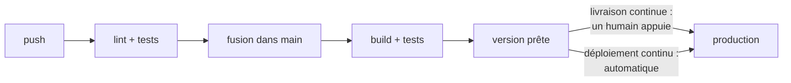
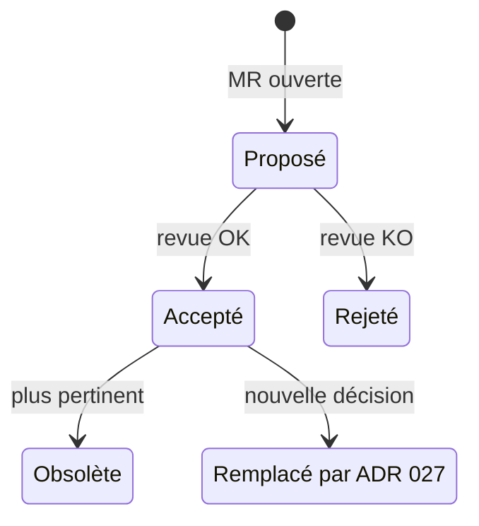
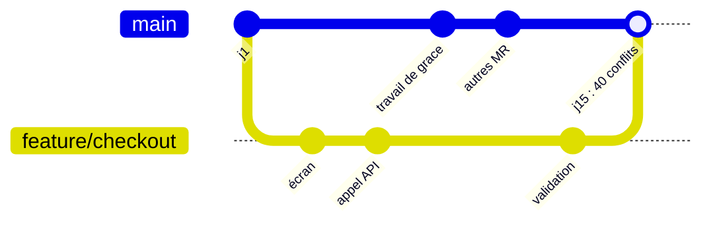
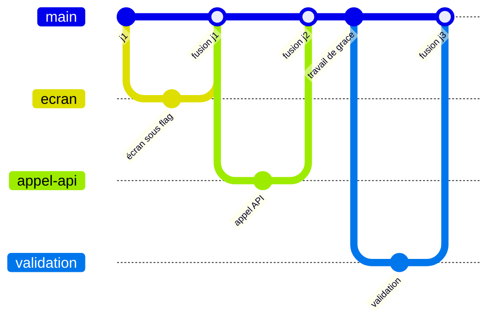
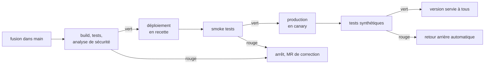
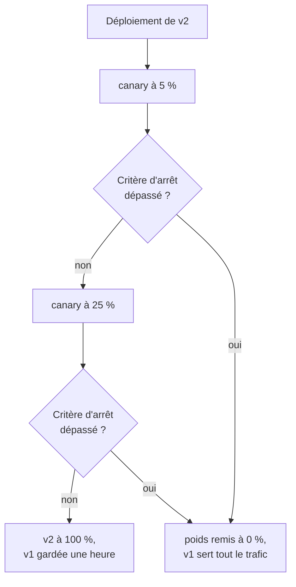
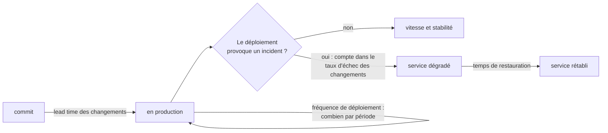
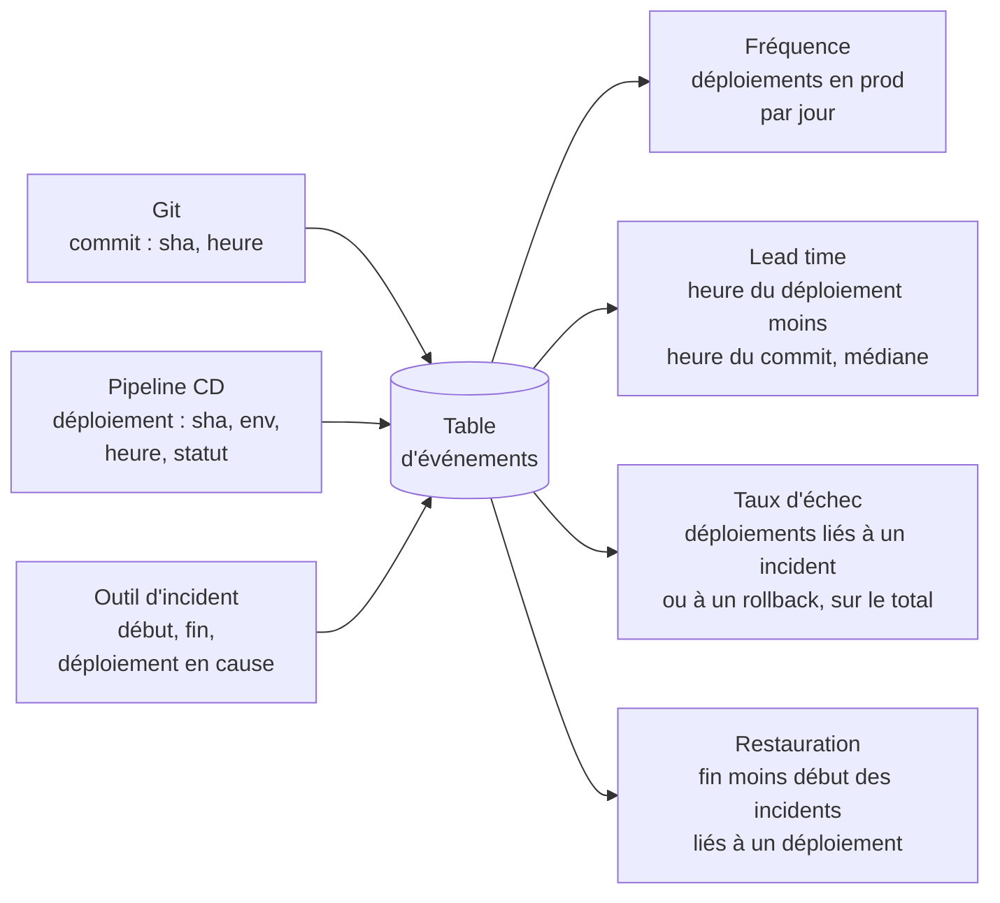
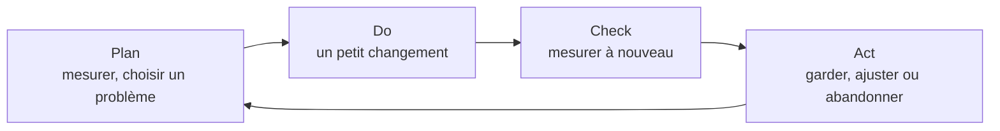

# Livraison et pratiques d'ingénierie

!!! warning "Avertissement"
    Ces notes sont des pense-bêtes personnels, pas une source de vérité. Elles reflètent ma compréhension et mes choix : leur contenu reste subjectif, malgré les citations et les références qu'il contient. Il peut être incomplet, simplifié, inexact ou dépassé. Vérifiez toujours dans la documentation officielle avant de l'appliquer. Ce contenu est fourni tel quel, sans aucune garantie : son utilisation se fait sous votre seule responsabilité.

!!! abstract "Les échelles"
    Les pastilles de couleur sous les titres disent à quelle échelle une notion s'applique :

    - <span class="pill pill-scope pill-scope-code">Code</span> les classes, fonctions et modules d'un programme ;
    - <span class="pill pill-scope pill-scope-app">Application</span> un service ou une application et son découpage interne ;
    - <span class="pill pill-scope pill-scope-system">Système</span> plusieurs services qui communiquent par le réseau ;
    - <span class="pill pill-scope pill-scope-infra">Infrastructure</span> les serveurs, le réseau, les zones et les clusters, physiques ou virtuels ;
    - <span class="pill pill-scope pill-scope-enterprise">Entreprise</span> le système d'information entier et son organisation.

    Détail et mots ambigus : [carte des échelles](architecture.md#carte-des-echelles).

Livrer, c'est faire arriver une modification du logiciel jusqu'aux utilisateurs : une nouvelle fonctionnalité, un correctif de bug, une mise à jour de dépendance ou un changement de configuration. Prenons un exemple : mon équipe ajoute le remboursement partiel dans `orders-service`. Cette page suit cette modification de l'idée jusqu'à la production, une étape après l'autre : la concevoir, l'intégrer au code commun après des contrôles automatiques, la tester, la déployer sans geste manuel, l'ouvrir aux utilisateurs peu à peu, vérifier qu'elle marche en production et l'observer. Chaque étape a sa pratique d'ingénierie. La page finit par la façon de mesurer si l'équipe livre bien : souvent, vite et sans casse. Les services `orders-service` et `my-api` sont fictifs.

## Vocabulaire

**Intégration continue (CI)** : chaque changement est fusionné souvent dans la branche principale, et une machine lance automatiquement le lint et les tests à chaque push.

**Livraison continue** : chaque version qui passe le pipeline est **prête** à partir en production ; une personne décide encore du moment. **Déploiement continu** : la même chose, sans la décision humaine : chaque fusion part en production si tous les contrôles sont verts.

```
intégration continue   push    lint + tests       fusion dans main
livraison continue     main    build + tests      version prête     bouton « déployer » (humain)
déploiement continu    main    build + tests      version prête     production (automatique)
```



:material-book-open-variant: Doc de référence : [Martin Fowler, « Continuous Integration »](https://martinfowler.com/articles/continuousIntegration.html) (2006, révisé en 2024) ; [Martin Fowler, « ContinuousDelivery »](https://martinfowler.com/bliki/ContinuousDelivery.html) (2013)
{ .doc-ref }

**Capability DORA** : une pratique dont les études du programme de recherche DORA (DevOps Research and Assessment, rapports annuels depuis 2014) montrent un lien avec la performance de livraison. Les badges de ce site renvoient à la fiche de chaque capability sur [dora.dev](https://dora.dev/capabilities/).

!!! info "Les badges DORA"
    Un badge comme <a class="pill pill-dora" href="https://dora.dev/capabilities/trunk-based-development/">DORA · Trunk-based development</a> sous un titre indique quelle capability DORA la section illustre. Un clic ouvre sa fiche sur dora.dev. Liste consultée le 29/10/2026 : 34 capabilities, regroupées et renommées au fil des rapports (à vérifier, elle évolue). La conception technique n'a pas de capability dédiée : on la rattache à <a class="pill pill-dora" href="https://dora.dev/capabilities/loosely-coupled-teams/">DORA · Loosely coupled teams</a> et <a class="pill pill-dora" href="https://dora.dev/capabilities/documentation-quality/">DORA · Documentation quality</a>.

!!! info "Les badges de pratique"
    Un badge gris comme <a class="pill pill-practice" href="../livraison/#tester-en-production" title="niveau 3 : elle décide sans humain">Pratique · Tests en production · N3</a> indique laquelle des huit pratiques d'ingénierie de ce site la section illustre : [conception technique](#concevoir-avant-de-coder), [trunk-based development](#trunk-based-development), [tests fonctionnels](#tests-fonctionnels-automatises), [déploiement continu](#livraison-et-deploiement-continus), [déploiement progressif](#deploiement-progressif), [tests en production](#tester-en-production), [API management](api-rest-async.md#api-management), [observabilité](observabilite.md). Ce découpage en huit est un choix personnel pour organiser ces notes, pas une liste DORA : pour le lien avec la recherche DORA, voir le badge DORA de chaque section. Quand la section montre un stade précis, le badge porte un niveau, le même pour toutes les pratiques :

    | Niveau | Ce que ça veut dire | Exemple avec les tests en production |
    |---|---|---|
    | N1 | la pratique est en place, même à la main | quelqu'un lance un smoke test après chaque mise en production |
    | N2 | elle est automatisée | le smoke test tourne seul à chaque déploiement |
    | N3 | elle décide sans humain | un smoke test rouge déclenche le <span class="term" data-term="rollback">retour arrière</span> |
    | N4 | elle est pilotée par la mesure | on ajuste les tests d'après les incidents qu'ils ont évités ou ratés |

    Cette échelle est une simplification personnelle, dans l'esprit des modèles de maturité par niveaux comme CMMI (Software Engineering Institute, première version en 2000). Ce n'est pas un standard.

## Concevoir avant de coder

<a class="pill pill-scope pill-scope-app" href="../architecture/#carte-des-echelles">Échelle · Application</a> <a class="pill pill-scope pill-scope-system" href="../architecture/#carte-des-echelles">Échelle · Système</a> <span class="pill pill-status pill-status-ok" title="Toujours valable, vérifié en novembre 2026">Valable · 11/2026</span>

<a class="pill pill-practice" href="../livraison/#concevoir-avant-de-coder">Pratique · Conception technique</a>
<a class="pill pill-dora" href="https://dora.dev/capabilities/loosely-coupled-teams/">DORA · Loosely coupled teams</a> <a class="pill pill-dora" href="https://dora.dev/capabilities/documentation-quality/">DORA · Documentation quality</a>

La **conception technique** répond, avant d'écrire le code, à trois questions : quoi construire, comment les morceaux se parlent (contrats d'API, événements), et comment on saura que ça marche en production (observabilité, retour arrière). Deux documents courts suffisent souvent :

- le **document de conception** (design doc, ou RFC interne) : le problème, les options étudiées, l'option choisie, les risques ; relu avant le code ;
- l'**<span class="term" data-term="adr">ADR</span>** (Architecture Decision Record) : une page par décision, gardée dans le repo, qui dit pourquoi on a choisi ainsi.

!!! noob "As noob"
    Le document de conception, c'est la réunion de chantier où l'on choisit entre plusieurs plans ; l'ADR, c'est le procès-verbal rangé dans le classeur, qui dit ce qui a été décidé et pourquoi, pour celui qui arrivera dans deux ans. La phrase à retenir : **le document de conception sert à décider, l'ADR sert à se souvenir pourquoi.**

Squelette d'un document de conception en six titres, rempli pour un cas court (chiffres d'exemple) :

```markdown
# orders-service : ne plus perdre de commande quand payments-service est lent

## Problème
Quand payments-service répond en plus de 3 s, orders-service abandonne et la commande est perdue (12 cas la semaine dernière).

## Options
A. Monter le timeout à 10 s : simple, mais bloque les threads d'orders-service pendant les pics.
B. Enregistrer la commande « en attente de paiement » avant l'appel, puis la passer à « payée » quand la réponse arrive.

## Décision
B : aucune commande n'est perdue, et orders-service ne bloque plus sur payments-service.

## Risques
Une commande peut rester « en attente » si la réponse ne vient jamais : une tâche la relance après 15 min.

## Retour arrière
Feature flag orders.async-payment : l'éteindre remet l'appel synchrone ; la nouvelle colonne d'état est ignorée, rien à migrer.

## Observabilité
Métrique orders_pending_payment (nombre et âge) ; alerte si plus de 50 commandes attendent depuis plus de 15 min.
```

L'ADR garde ensuite la décision seule, en quelques lignes :

```markdown
# ADR 012 : publier les commandes payées sur une file plutôt qu'appeler email-service

Statut : accepté (2026-03-14)
Contexte : email-service tombe 2 à 3 fois par mois (exemple), et la commande échoue avec lui.
Décision : orders-service publie « commande payée » ; email-service consomme à son rythme.
Conséquences : l'email peut partir avec quelques secondes de retard ; il faut une DLQ.
```

Un ADR ne se réécrit pas : quand la décision change, on écrit un nouvel ADR qui remplace l'ancien, et l'ancien garde la trace du raisonnement de l'époque.



| Situation | Document |
|---|---|
| mon choix engage plusieurs équipes ou plusieurs mois de travail, comme passer le paiement des commandes en asynchrone | document de conception, relu avant le code |
| dans deux ans, quelqu'un se demandera pourquoi l'équipe a choisi une file plutôt qu'un appel direct, et personne ne s'en souviendra | ADR dans le repo |
| je corrige un bug ou j'ajoute un petit champ, sans rien changer à l'architecture | rien : la description de la MR suffit |

Le contrat d'une API se fixe à cette étape : voir [API first](api-rest-async.md#api-first). Source : Michael Nygard, « Documenting Architecture Decisions » (2011).

:material-book-open-variant: Doc de référence : [ADR GitHub organization, Architectural Decision Records](https://adr.github.io/) (consultée en novembre 2026) ; [Malte Ubl, « Design Docs at Google »](https://www.industrialempathy.com/posts/design-docs-at-google/) (2020)
{ .doc-ref }

## Trunk-based development

<a class="pill pill-scope pill-scope-code" href="../architecture/#carte-des-echelles">Échelle · Code</a> <span class="pill pill-status pill-status-ok" title="Toujours valable, vérifié en novembre 2026">Valable · 11/2026</span>

<a class="pill pill-practice" href="../livraison/#trunk-based-development">Pratique · Trunk-based development</a>
<a class="pill pill-dora" href="https://dora.dev/capabilities/trunk-based-development/">DORA · Trunk-based development</a> <a class="pill pill-dora" href="https://dora.dev/capabilities/working-in-small-batches/">DORA · Working in small batches</a>

Le <span class="term" data-term="trunk-based-development">trunk-based development</span> : tout le monde intègre dans la branche principale (le « tronc ») au moins une fois par jour, avec des branches qui vivent un ou deux jours au plus. L'opposé : des <span class="term" data-term="long-lived-branch">branches longues</span>, fusionnées après des semaines.

!!! noob "As noob"
    C'est faire la vaisselle au fil du repas plutôt qu'une fois par semaine : chaque assiette prend une minute, alors qu'une semaine de vaisselle empilée prend une soirée, et des verres cassent au passage. La phrase à retenir : **intégrer souvent par petits morceaux coûte moins cher qu'intégrer rarement par gros blocs.**

```
branches longues   jour 1   ada crée feature/checkout
                   jour 15  fusion : 40 fichiers en conflit, 2 jours pour les résoudre
                   jour 17  les tests d'intégration révèlent une incompatibilité avec le travail de grace

trunk-based        jour 1   petite MR (le nouvel écran, caché derrière un feature flag), fusionnée
                   jour 2   petite MR (l'appel API), fusionnée
                   ...      chaque fusion est testée avec le travail de tout le monde, tous les jours
```

Le même travail dessiné en branches Git. Avec une branche longue :



En trunk-based, des branches d'un jour, fusionnées tout de suite :



Le code pas fini est caché derrière un <span class="term" data-term="feature-flag">feature flag</span> : il est en production, mais éteint. Pour remplacer un composant entier sans branche longue, on passe par une abstraction (« <span class="term" data-term="branch-by-abstraction">branch by abstraction</span> ») : une interface, l'ancienne et la nouvelle implémentation derrière, et une bascule.

!!! noob "As noob"
    Un feature flag, c'est la porte fermée d'une pièce en travaux : la pièce existe déjà dans la maison, mais personne n'y entre tant qu'on n'a pas ouvert. Branch by abstraction, c'est poser une prise standard au mur pour pouvoir changer l'appareil branché derrière sans refaire l'électricité. La phrase à retenir : **mettre du code en production et l'ouvrir aux utilisateurs deviennent deux gestes séparés.**

```
étape 1   PaymentGateway (interface)             orders-service n'appelle plus que l'interface
          └── LegacyPaymentClient                l'ancienne implémentation, seule branchée

étape 2   PaymentGateway
          ├── LegacyPaymentClient                toujours utilisée en production
          └── NewPaymentClient                   fusionnée par petites MR, pas encore utilisée

étape 3   flag payments.new-client = on         la bascule choisit NewPaymentClient
                                                 une fois stable : suppression de l'ancienne et du flag
```

| Situation | Approche |
|---|---|
| mon équipe fusionne déjà chaque jour, et la CI dit en quelques minutes, sans fausse alerte, si un changement casse quelque chose | trunk-based |
| ada doit livrer un nouvel écran de paiement qui prendra plusieurs semaines, mais ne veut pas d'une branche qui dérive pendant ce temps | trunk-based + feature flag |
| ma CI met une heure, ou il y a peu de tests automatisés, donc personne ne sait si une fusion casse le tronc | d'abord investir dans la CI : le trunk-based sans tests casse le tronc |
| mon projet open source reçoit des MR de gens extérieurs que je ne connais pas | branches courtes par MR, revue obligatoire |

Sources : [trunkbaseddevelopment.com](https://trunkbaseddevelopment.com/) (Paul Hammant, date de publication non indiquée) ; fiche DORA « Trunk-based development ».

:material-book-open-variant: Doc de référence : [Martin Fowler, « BranchByAbstraction »](https://martinfowler.com/bliki/BranchByAbstraction.html) (2014) ; [Martin Fowler, « Patterns for Managing Source Code Branches »](https://martinfowler.com/articles/branching-patterns.html) (2020)
{ .doc-ref }

## Contrôles automatiques avant la fusion

<a class="pill pill-scope pill-scope-code" href="../architecture/#carte-des-echelles">Échelle · Code</a> <a class="pill pill-scope pill-scope-app" href="../architecture/#carte-des-echelles">Échelle · Application</a> <span class="pill pill-status pill-status-ok" title="Toujours valable, vérifié en novembre 2026">Valable · 11/2026</span>

<a class="pill pill-practice" href="../livraison/#trunk-based-development">Pratique · Trunk-based development</a>
<a class="pill pill-dora" href="https://dora.dev/capabilities/continuous-integration/">DORA · Continuous integration</a> <a class="pill pill-dora" href="https://dora.dev/capabilities/code-maintainability/">DORA · Code maintainability</a> <a class="pill pill-dora" href="https://dora.dev/capabilities/pervasive-security/">DORA · Pervasive security</a>

J'ouvre une MR, et mon équipe se pose une seule question : ce changement peut-il entrer dans le tronc sans rien casser ni rien exposer ? Le lint et les tests répondent en partie. D'autres contrôles automatiques couvrent ce qu'ils ne voient pas : une clé d'API collée dans le code, un module qui importe une couche qu'il ne devrait pas connaître, une fonction que plus personne n'appelle, un client d'API généré qui n'a pas suivi le changement.

Ces contrôles tournent à deux endroits. D'abord sur mon poste, au moment du commit, sous forme de <span class="term" data-term="pre-commit-hook">hooks pre-commit</span> : je corrige en dix secondes au lieu d'attendre dix minutes la CI. Puis dans la CI, sur toute la branche, parce qu'un hook se contourne (`git commit --no-verify`) et ne voit que les fichiers que je commite.

*pre-commit : concurrent de prek, Husky, lefthook*<br>
*detect-secrets : concurrent de gitleaks, TruffleHog*<br>
*Bandit : concurrent en partie de Semgrep, SonarQube*<br>
*vulture : complémentaire de ruff*
{ .tool-rel }

!!! noob "As noob"
    C'est le contrôle à l'aéroport en deux temps : je vérifie mon sac à la maison (pas de liquide, pas de couteau), puis le portique contrôle quand même tout le monde. La vérification à la maison m'évite de refaire la queue ; le portique reste le seul contrôle qui compte. La phrase à retenir : **le hook fait gagner du temps, la CI fait foi.**

Exemple de commit refusé par un hook, avec l'outil pre-commit :

```
$ git commit -m "feat(orders): remboursement partiel"
trim trailing whitespace.................................Passed
check for added large files..............................Passed
ruff.....................................................Passed
mypy.....................................................Passed
Detect secrets...........................................Failed
- hook id: detect-secrets
ERROR: Potential secrets about to be committed to git repo!
Secret Type: Secret Keyword
Location:    src/orders/refunds.py:12
```

Je retire la clé, je la lis depuis une variable d'environnement, et je commite à nouveau. Sans le hook, la clé serait partie dans l'historique Git, visible dans chaque clone.

Les familles de contrôles, au-delà du lint et des tests :

| Contrôle | Ce qu'il attrape, par exemple | Outils courants | Où le lancer |
|---|---|---|---|
| hygiène des fichiers | un marqueur de conflit `<<<<<<<` oublié, un fichier de 200 Mo, des fins de ligne Windows | pre-commit-hooks | hook et CI |
| message de commit | `fix stuff` au lieu de `fix(orders): arrondi du remboursement` ([Conventional Commits](git.md)) | conventional-pre-commit, commitlint | hook `commit-msg` |
| <span class="term" data-term="secret">secrets</span> | une clé d'API ou une clé privée dans le code | gitleaks, detect-secrets | hook et CI |
| <span class="term" data-term="sast">SAST</span> | `subprocess.run(cmd, shell=True)` avec une entrée utilisateur, `yaml.load` sans chargeur sûr | Bandit (Python, ruff reprend une partie de ses règles), Semgrep | hook et CI |
| <span class="term" data-term="dead-code">code mort</span> | une fonction ou un champ que plus personne n'utilise dans tout le projet | vulture (Python), knip (TypeScript) | hook et CI |
| scripts shell | une variable sans guillemets qui casse sur un nom de fichier avec une espace | ShellCheck | hook et CI |
| règles d'architecture | le code métier qui importe le framework web, une couche basse qui importe une couche haute | import-linter (Python), dependency-cruiser (JavaScript) | CI |
| <span class="term" data-term="contract-drift">dérive de contrat</span> | l'API a changé, mais le fichier OpenAPI ou le client généré n'a pas suivi | régénérer puis `git diff --exit-code`, oasdiff | CI |
| dépendances vulnérables | une bibliothèque avec une faille connue (CVE) | Trivy, Snyk, avec Renovate pour les mises à jour | CI |
| hygiène de la MR | un titre hors format, une description vide, une MR de 2 000 lignes | Danger | CI |
| qualité globale | duplication, couverture du nouveau code | SonarQube et sa quality gate | CI |

Un seul fichier, `.pre-commit-config.yaml`, liste les hooks et leurs versions ; la CI lance le même fichier avec `pre-commit run --all-files` (ou `prek run --all-files`), donc le poste et la CI appliquent exactement les mêmes règles.

| Situation | Choix |
|---|---|
| mon équipe découvre en CI, dix minutes après le push, des erreurs de format que l'éditeur aurait pu corriger seul | hooks pre-commit avec ruff ou Prettier |
| quelqu'un a déjà poussé une clé d'API dans un dépôt, et on ne l'a vue que trois mois plus tard dans l'historique | gitleaks ou detect-secrets, en hook et en CI |
| mon équipe a dessiné des couches (api, métier, stockage), mais le code les contourne peu à peu, comme un module métier qui importe FastAPI | import-linter dans la CI, une [fitness function](architecture.md#fitness-functions) |
| mes hooks rendent chaque commit lent (une minute, chiffre d'exemple), et les gens les sautent avec `--no-verify` | garder en hook les contrôles rapides (format, lint, secrets), laisser les plus lents à la CI |
| mon dépôt mélange Python, TypeScript et des scripts shell de déploiement | un seul gestionnaire de hooks (pre-commit ou prek) qui lance chaque outil |

:material-book-open-variant: Doc de référence : [pre-commit](https://pre-commit.com/) (consultée en novembre 2026) ; [Bandit](https://bandit.readthedocs.io/) (consultée en novembre 2026) ; [detect-secrets](https://github.com/Yelp/detect-secrets) (consultée en novembre 2026)
{ .doc-ref }

## Tests fonctionnels automatisés

<a class="pill pill-scope pill-scope-app" href="../architecture/#carte-des-echelles">Échelle · Application</a> <a class="pill pill-scope pill-scope-system" href="../architecture/#carte-des-echelles">Échelle · Système</a> <span class="pill pill-status pill-status-ok" title="Toujours valable, vérifié en novembre 2026">Valable · 11/2026</span>

<a class="pill pill-practice" href="../livraison/#tests-fonctionnels-automatises">Pratique · Tests fonctionnels</a>
<a class="pill pill-dora" href="https://dora.dev/capabilities/test-automation/">DORA · Test automation</a> <a class="pill pill-dora" href="https://dora.dev/capabilities/continuous-integration/">DORA · Continuous integration</a> <a class="pill pill-dora" href="https://dora.dev/capabilities/test-data-management/">DORA · Test data management</a>

Un **test fonctionnel** vérifie un comportement attendu par l'utilisateur ou le métier (« un panier vide ne peut pas être validé »), quel que soit son niveau : unitaire, API ou E2E. Il tourne automatiquement dans chaque pipeline de MR, et sa réussite est la condition pour fusionner.

Ce qui rend la livraison continue possible, ce n'est pas le nombre de tests mais leur **fiabilité**. Si un test échoue une fois sur dix sans raison, l'équipe prend l'habitude de relancer le pipeline sans regarder. Le jour où le rouge signale un vrai bug, personne n'y prête attention, donc le bug part en production. Le détail (niveaux, contrats, données de test, tests instables) est dans [Qualité et tests](qualite.md).

:material-book-open-variant: Doc de référence : [Ham Vocke, « The Practical Test Pyramid »](https://martinfowler.com/articles/practical-test-pyramid.html) (2018)
{ .doc-ref }

## Livraison et déploiement continus

<a class="pill pill-scope pill-scope-system" href="../architecture/#carte-des-echelles">Échelle · Système</a> <a class="pill pill-scope pill-scope-infra" href="../architecture/#carte-des-echelles">Échelle · Infrastructure</a> <span class="pill pill-status pill-status-ok" title="Toujours valable, vérifié en novembre 2026">Valable · 11/2026</span>

<a class="pill pill-practice" href="../livraison/#livraison-et-deploiement-continus">Pratique · Déploiement continu</a>
<a class="pill pill-dora" href="https://dora.dev/capabilities/continuous-delivery/">DORA · Continuous delivery</a> <a class="pill pill-dora" href="https://dora.dev/capabilities/deployment-automation/">DORA · Deployment automation</a> <a class="pill pill-dora" href="https://dora.dev/capabilities/streamlining-change-approval/">DORA · Streamlining change approval</a>

Le <span class="term" data-term="continuous-deployment">déploiement continu</span> enchaîne tout sans geste manuel. Les contrôles automatiques remplacent la validation humaine de chaque mise en production.

!!! noob "As noob"
    C'est une chaîne de fabrication avec un capteur à chaque poste : une pièce défectueuse est écartée par le capteur, pas par un chef qui signe chaque pièce à la main. La phrase à retenir : **on ne supprime pas le contrôle, on le confie à des tests automatiques qui ne se fatiguent pas.**

```
fusion dans main  10:00
  build de l'image, tests, analyse de sécurité          10:00 à 10:08
  déploiement automatique sur l'environnement de recette 10:09
  smoke tests sur la recette                             10:10
  déploiement en production (canary, voir plus bas)      10:12
  tests synthétiques en production                       10:15
```

Le même pipeline vu comme une chaîne de portes : chaque contrôle rouge arrête la version, personne ne la pousse plus loin à la main.



| Situation | Choix |
|---|---|
| mes tests sont fiables, je sais exposer une version à une partie du trafic, et je reviens en arrière en un clic (avec des migrations de base en [expand / contract](sql.md#expand-contract), sinon le retour arrière casse) | déploiement continu |
| une réglementation, comme dans la banque ou la santé, m'oblige à garder la trace d'une personne qui a validé chaque mise en production | livraison continue : tout est prêt, un humain appuie sur le bouton |
| chaque mise en production attend qu'un comité se réunisse et la relise à la main | à remplacer par des contrôles automatiques : DORA associe les comités d'approbation externes à une livraison plus lente, sans gain de stabilité (à vérifier dans le rapport cité par la fiche) |

Source : Jez Humble et David Farley, « Continuous Delivery » (2010).

:material-book-open-variant: Doc de référence : [Jez Humble, continuousdelivery.com](https://continuousdelivery.com/) (consultée en novembre 2026) ; [Martin Fowler, « DeploymentPipeline »](https://martinfowler.com/bliki/DeploymentPipeline.html) (2013)
{ .doc-ref }

## Déploiement progressif

<a class="pill pill-scope pill-scope-system" href="../architecture/#carte-des-echelles">Échelle · Système</a> <a class="pill pill-scope pill-scope-infra" href="../architecture/#carte-des-echelles">Échelle · Infrastructure</a> <span class="pill pill-status pill-status-ok" title="Toujours valable, vérifié en novembre 2026">Valable · 11/2026</span>

<a class="pill pill-practice" href="../livraison/#deploiement-progressif">Pratique · Déploiement progressif</a>
<a class="pill pill-dora" href="https://dora.dev/capabilities/continuous-delivery/">DORA · Continuous delivery</a> <a class="pill pill-dora" href="https://dora.dev/capabilities/proactive-failure-notification/">DORA · Proactive failure notification</a>

Je viens de déployer une nouvelle version de `orders-service` et je ne suis pas encore sûr qu'elle marche avec le vrai trafic. Un déploiement progressif la montre d'abord à peu d'utilisateurs : si elle a un bug, seule une petite partie des clients le voit, et je reviens en arrière avant que tout le monde soit touché. Quatre techniques, souvent combinées :

| Technique | Idée | Retour arrière |
|---|---|---|
| <span class="term" data-term="feature-flag">Feature flag</span> | le code est déployé éteint, on l'allume pour 1 %, puis 10 %, puis tous | éteindre le flag |
| <span class="term" data-term="canary-deployment">Canary</span> | la nouvelle version reçoit d'abord 5 % du trafic, on compare ses métriques à l'ancienne | remettre le poids à 0 % |
| <span class="term" data-term="blue-green-deployment">Blue-green</span> | deux environnements complets, on teste le nouveau puis on bascule tout | rebasculer |
| <span class="term" data-term="dark-launch">Dark launch</span> | le nouveau code tourne sur le vrai trafic, mais sa réponse n'est pas montrée | rien à faire, personne ne l'a vue |

!!! noob "As noob"
    Le canary tire son nom du canari que les mineurs descendaient dans la mine : s'il allait mal, tout le monde remontait avant d'être touché. Ici, la nouvelle version sert d'abord une petite part du trafic, et on regarde avant d'élargir. La phrase à retenir : **on expose peu de monde d'abord, et on décide à l'avance quel signal fait reculer.**

Les <span class="term" data-term="stop-criteria">critères d'arrêt</span> sont les seuils, écrits avant de commencer, au-delà desquels on revient en arrière sans débattre. Un canary qui les applique (chiffres d'exemple) :

```
critère d'arrêt : taux d'erreur du canary > 2 x celui de l'ancienne version, alors poids remis à 0 %

14:00  canary à 5 % du trafic
14:10  bilan : 0,3 % d'erreurs contre 0,2 % sur l'ancienne version (1,5 x, sous le seuil) : on continue
14:10  canary à 25 %
14:30  bilan : 0,2 % contre 0,2 % : on continue
14:30  canary à 100 % ; l'ancienne version reste prête une heure pour rebasculer
```



Piège : à 5 % pendant 10 min, il y a peu de requêtes, et 2 erreurs sur 300 suffisent à doubler le taux. Ajouter un nombre minimal de requêtes avant de juger.

Ce qu'on teste à chaque étape est détaillé dans [Tester un déploiement canary](qualite.md#tester-un-deploiement-canary) et [Tester un déploiement blue-green](qualite.md#tester-un-deploiement-blue-green). Sources : Danilo Sato, « CanaryRelease » (2014) ; Martin Fowler, « BlueGreenDeployment » (2010) ; Pete Hodgson, « Feature Toggles » (2017), tous sur martinfowler.com.

:material-book-open-variant: Doc de référence : [Danilo Sato, « CanaryRelease »](https://martinfowler.com/bliki/CanaryRelease.html) (2014) ; [Pete Hodgson, « Feature Toggles »](https://martinfowler.com/articles/feature-toggles.html) (2017) ; [Martin Fowler, « BlueGreenDeployment »](https://martinfowler.com/bliki/BlueGreenDeployment.html) (2010)
{ .doc-ref }

## Tester en production

<a class="pill pill-scope pill-scope-system" href="../architecture/#carte-des-echelles">Échelle · Système</a> <a class="pill pill-scope pill-scope-infra" href="../architecture/#carte-des-echelles">Échelle · Infrastructure</a> <span class="pill pill-status pill-status-ok" title="Toujours valable, vérifié en novembre 2026">Valable · 11/2026</span>

<a class="pill pill-practice" href="../livraison/#tester-en-production">Pratique · Tests en production</a>
<a class="pill pill-dora" href="https://dora.dev/capabilities/monitoring-and-observability/">DORA · Monitoring and observability</a> <a class="pill pill-dora" href="https://dora.dev/capabilities/proactive-failure-notification/">DORA · Proactive failure notification</a>

Tous mes tests sont verts en recette, et pourtant la commande échoue en production : un client a un nom avec un caractère que la recette n'avait jamais vu, ou une variable de configuration n'a pas la même valeur. Certains défauts n'existent qu'avec les vraies données, le vrai trafic et la vraie configuration. Tester en production, c'est vérifier le vrai système **après** le déploiement, sans mettre les utilisateurs en danger.

!!! noob "As noob"
    C'est l'essai d'une voiture sur la vraie route après le banc d'essai : le banc ne simule pas tout (nids-de-poule, vraie météo), mais on roule avec une voiture d'essai identifiée, sans passagers. La phrase à retenir : **en production, on vérifie avec des comptes et du trafic de test, jamais aux dépens des vrais utilisateurs.**

| Technique | Exemple |
|---|---|
| <span class="term" data-term="synthetic-monitoring">Tests synthétiques</span> | un faux client passe une commande toutes les 10 minutes avec une carte de test |
| analyse canary | les erreurs de v2 comparées à celles de v1 sur le même trafic |
| <span class="term" data-term="smoke-test">Smoke test</span> après déploiement | 5 requêtes clés juste après la mise en production |
| <span class="term" data-term="chaos-engineering">Chaos engineering</span> | couper volontairement une dépendance pour vérifier que le service se dégrade proprement |

Règles de sécurité :

- **comptes de test dédiés**, marqués comme tels, exclus des statistiques et de la facturation ;
- **nettoyage** de ce que le test crée ;
- **trafic de test identifiable** (un en-tête, un compte), pour ne pas déclencher d'alerte métier ou fausser un tableau de bord ;
- **jamais** de test de charge sur la production sans accord explicite.

Source : Cindy Sridharan, « Testing in Production, the safe way » (2018). Les tests synthétiques sont détaillés dans [Qualité et tests](qualite.md#tests-synthetiques).

:material-book-open-variant: Doc de référence : [Cindy Sridharan, « Testing in Production, the safe way »](https://copyconstruct.medium.com/testing-in-production-the-safe-way-18ca102d0ef1) (2018) ; [Google SRE Workbook, Canarying Releases](https://sre.google/workbook/canarying-releases/) (2018)
{ .doc-ref }

## API et observabilité

<a class="pill pill-scope pill-scope-app" href="../architecture/#carte-des-echelles">Échelle · Application</a> <a class="pill pill-scope pill-scope-system" href="../architecture/#carte-des-echelles">Échelle · Système</a> <span class="pill pill-status pill-status-ok" title="Toujours valable, vérifié en novembre 2026">Valable · 11/2026</span>

<a class="pill pill-practice" href="../api-rest-async/#api-management">Pratique · API management</a> <a class="pill pill-practice" href="../observabilite/">Pratique · Observabilité</a>
<a class="pill pill-dora" href="https://dora.dev/capabilities/loosely-coupled-teams/">DORA · Loosely coupled teams</a> <a class="pill pill-dora" href="https://dora.dev/capabilities/monitoring-and-observability/">DORA · Monitoring and observability</a>

Deux pratiques tiennent le système une fois en production :

- **gouverner les API** comme des produits (contrat, versions, passerelle, quotas, retrait des anciennes versions) : voir [API first](api-rest-async.md#api-first), [Versionner](api-rest-async.md#versionner) et [API management](api-rest-async.md#api-management) ;
- **observer** (logs, métriques, traces, SLO, alertes sur les symptômes) : voir [Observabilité](observabilite.md).

Sans observabilité, je passe mon canary à 5 % mais je n'ai aucun chiffre pour savoir si la nouvelle version fait plus d'erreurs que l'ancienne, et mes tests en production échouent sans que personne le voie. C'est la pratique dont dépendent toutes les autres.

## Mesurer la livraison : DORA

<a class="pill pill-scope pill-scope-system" href="../architecture/#carte-des-echelles">Échelle · Système</a> <span class="pill pill-status pill-status-ok" title="Toujours valable, vérifié en novembre 2026">Valable · 11/2026</span>

<a class="pill pill-dora" href="https://dora.dev/capabilities/work-visibility-in-value-stream/">DORA · Visibility of work in the value stream</a>

Les <span class="term" data-term="dora-metrics">métriques DORA</span> mesurent le flux de livraison d'une **équipe** (jamais d'une personne) :

| Métrique | Question | Exemple de calcul |
|---|---|---|
| fréquence de déploiement | à quelle fréquence livre-t-on ? | 42 déploiements en production sur 30 jours |
| <span class="term" data-term="lead-time">lead time</span> des changements | combien de temps entre le commit et la production ? | médiane : 1 jour et 4 h |
| <span class="term" data-term="change-failure-rate">taux d'échec des changements</span> | quelle part des déploiements provoque un incident ou un retour arrière ? | 3 sur 42, soit 7 % |
| temps de restauration après un déploiement raté | combien de temps pour revenir à la normale ? | médiane : 35 min |

!!! noob "As noob"
    C'est le tableau de bord d'une voiture : deux cadrans de vitesse (fréquence, lead time) et deux de sécurité (taux d'échec, temps de restauration). Regarder un seul cadran pousse à rouler vite et mal, ou prudemment et nulle part. La phrase à retenir : **on lit la vitesse et la stabilité ensemble, pour une équipe, jamais pour une personne.**

Où se mesure chaque métrique sur le chemin d'un changement :



Les deux premières mesurent la **vitesse**, les deux dernières la **stabilité**. Le message principal de la recherche DORA : les équipes les plus performantes sont meilleures sur les deux à la fois ; aller vite ne se paie pas forcément en stabilité. Les noms exacts et une cinquième métrique (taux de retravail, ajoutée dans le rapport 2024) ont évolué selon les éditions (à vérifier sur dora.dev). Les chiffres du tableau sont des exemples.

**Comment les mesurer** : à partir d'événements que les outils produisent déjà, jamais par une saisie à la main. Trois sources suffisent, reliées par le hash du commit ou l'identifiant du déploiement :



```
deploy  sha      env   déployé à         commit le plus ancien  incident lié
d-101   a1b2c3   prod  2026-10-06 10:12  2026-10-05 16:40       aucun
d-102   d4e5f6   prod  2026-10-06 15:30  2026-10-06 11:02       inc-7, 35 min
d-103   0a9b8c   prod  2026-10-07 09:05  2026-10-06 15:45       aucun
```

Sur cet extrait (exemple) : 3 déploiements en 2 jours, un lead time de 17 h 32 pour d-101, un taux d'échec de 1 sur 3, une restauration de 35 min. Trois pièges : ne compter que la production, exiger sur chaque incident le lien vers le déploiement en cause (sans lui, le taux d'échec est faux), et compter un rollback comme un échec même sans incident déclaré. Google a publié en 2020 le projet open source [Four Keys](https://github.com/dora-team/fourkeys), qui faisait ce calcul à partir des webhooks de Git et de la CI ; il est archivé depuis, mais son schéma de données reste un bon modèle.

Source : Nicole Forsgren, Jez Humble et Gene Kim, « Accelerate » (2018), et les rapports « State of DevOps » de DORA.

:material-book-open-variant: Doc de référence : [DORA, « DORA's software delivery metrics: the four keys »](https://dora.dev/guides/dora-metrics-four-keys/) (consultée en novembre 2026) ; [DORA, Research](https://dora.dev/research/) (consultée en novembre 2026)
{ .doc-ref }

## Mesurer l'expérience développeur : SPACE et DevEx

<span class="pill pill-status pill-status-ok" title="Toujours valable, vérifié en novembre 2026">Valable · 11/2026</span>

<a class="pill pill-dora" href="https://dora.dev/capabilities/job-satisfaction/">DORA · Job satisfaction</a> <a class="pill pill-dora" href="https://dora.dev/capabilities/well-being/">DORA · Well-being</a>

La **Developer eXperience (DX)** désigne ce que vivent les développeurs au quotidien : la vitesse de la CI, la clarté de la doc, le nombre d'interruptions. Elle se mesure avec des chiffres **et** en leur demandant.

Le cadre <span class="term" data-term="space-framework">SPACE</span> (2021) rappelle qu'une seule métrique ne suffit jamais. Cinq dimensions :

| Dimension | Exemple de mesure |
|---|---|
| **S**atisfaction et bien-être | enquête : « je peux livrer sans friction », note sur 5 |
| **P**erformance | taux d'incidents des changements, satisfaction des utilisateurs |
| **A**ctivité | nombre de déploiements (jamais seul, jamais par personne) |
| **C**ommunication et collaboration | délai de première revue d'une MR |
| **E**fficacité et flux | temps d'attente de la CI au p95, temps de concentration sans interruption |

Le cadre <span class="term" data-term="devex-framework">DevEx</span> (2023) se concentre sur trois leviers, chacun mesurable (chiffres d'exemple) :

| Levier | Ce que c'est | Exemple mesurable |
|---|---|---|
| **Boucle de retour** | combien de temps pour savoir si mon changement marche | temps entre le push et le résultat de la CI, médiane : 25 min, objectif 10 min |
| **Charge cognitive** | combien de choses je dois avoir en tête | nombre d'étapes pour lancer le projet en local la première fois : 9, objectif 2 (une commande, un fichier d'exemple) |
| **État de concentration** | combien de temps sans interruption | nombre de plages de 2 h sans réunion par semaine dans les agendas de l'équipe : 3, objectif 6 |

Pièges :

- la **<span class="term" data-term="goodhart-law">loi de Goodhart</span>** : une mesure qui devient un objectif cesse d'être une bonne mesure (« nombre de commits » produit des commits découpés artificiellement) ;
- classer les individus avec ces chiffres : ils sont faits pour les équipes et les systèmes.

!!! noob "As noob"
    C'est l'élève qui apprend par cœur les réponses de l'examen blanc : sa note monte, son niveau non. La phrase à retenir : **dès qu'on récompense un chiffre, les gens améliorent le chiffre, pas ce qu'il devait mesurer.**

Sources : Forsgren, Storey, Maddila, Zimmermann, Houck et Butler, « The SPACE of Developer Productivity », ACM Queue (2021) ; Noda, Storey, Forsgren et Greiler, « DevEx: What Actually Drives Productivity », ACM Queue (2023).

:material-book-open-variant: Doc de référence : [« The SPACE of Developer Productivity », ACM Queue](https://queue.acm.org/detail.cfm?id=3454124) (2021) ; [« DevEx: What Actually Drives Productivity », ACM Queue](https://queue.acm.org/detail.cfm?id=3595878) (2023)
{ .doc-ref }

## Amélioration continue

<span class="pill pill-status pill-status-ok" title="Toujours valable, vérifié en novembre 2026">Valable · 11/2026</span>

<a class="pill pill-dora" href="https://dora.dev/capabilities/learning-culture/">DORA · Learning culture</a> <a class="pill pill-dora" href="https://dora.dev/capabilities/generative-organizational-culture/">DORA · Generative organizational culture</a>

L'**amélioration continue** : de petits changements fréquents, mesurés, plutôt qu'une grande réorganisation. La boucle la plus connue est PDCA (Plan, Do, Check, Act), popularisée par W. Edwards Deming dans les années 1950.



```
Plan    le lead time est de 5 jours, dont 3 à attendre une revue (exemple)
Do      règle d'équipe : une MR reçoit une première revue dans la demi-journée
Check   4 semaines plus tard : lead time médian de 2 jours
Act     la règle est gardée et écrite dans le guide de contribution ; prochain point : la CI de 25 min
```

Après un incident, le <span class="term" data-term="postmortem">postmortem</span> <span class="term" data-term="blameless">sans recherche de coupable</span> cherche ce qui a permis l'erreur, pas qui l'a faite, et finit par des actions suivies. Source : Betsy Beyer et al., « Site Reliability Engineering » (Google, 2016), chapitre « Postmortem Culture ».

:material-book-open-variant: Doc de référence : [The Deming Institute, PDSA Cycle](https://deming.org/explore/pdsa/) (consultée en novembre 2026) ; [Google SRE book, Postmortem Culture](https://sre.google/sre-book/postmortem-culture/) (2016)
{ .doc-ref }

## Pièges à éviter

- **Le trunk-based sans tests** : je fusionne tous les jours dans le tronc alors que ma CI met une heure ou compte peu de tests automatisés. Personne ne sait si une fusion casse le tronc, et il finit par casser pour tout le monde. J'investis d'abord dans une CI rapide et fiable ([voir Trunk-based development](#trunk-based-development)).
- **Une branche longue pour une grosse fonctionnalité** : je garde `feature/checkout` ouverte quinze jours. La fusion apporte 40 fichiers en conflit, deux jours pour les résoudre, et une incompatibilité avec le travail d'une collègue. Je fusionne de petites MR chaque jour, le code pas fini caché derrière un feature flag.
- **Relancer le pipeline sans regarder** : un test échoue une fois sur dix sans raison, et je relance jusqu'au vert. Le jour où le rouge signale un vrai bug, personne n'y prête attention, donc le bug part en production. Je corrige ou j'isole le test instable ([voir Tests fonctionnels automatisés](#tests-fonctionnels-automatises)).
- **Un retour arrière impossible** : je déploie en continu une migration qui supprime une colonne. L'ancienne version ne fonctionne plus, donc le retour arrière casse au moment où j'en ai besoin. J'écris mes migrations en expand / contract ([voir Livraison et déploiement continus](#livraison-et-deploiement-continus)).
- **Juger un canary sur trop peu de trafic** : à 5 % pendant 10 minutes, 2 erreurs sur 300 requêtes suffisent à doubler le taux, et je reviens en arrière sur du bruit. J'écris les critères d'arrêt avant de commencer, avec un nombre minimal de requêtes avant de juger ([voir Déploiement progressif](#deploiement-progressif)).
- **Tester en production sans précaution** : j'utilise un compte ordinaire, je ne nettoie pas ce que le test crée, et rien ne distingue mon trafic. Les statistiques et la facturation sont faussées, et une alerte métier se déclenche. J'utilise des comptes de test marqués, je nettoie, et mon trafic porte un en-tête ou un compte identifiable ([voir Tester en production](#tester-en-production)).
- **Un taux d'échec DORA sans lien avec le déploiement** : je compte les incidents sans exiger le lien vers le déploiement en cause, ou je compte aussi les autres environnements. Le taux d'échec des changements est faux, et l'équipe tire des conclusions d'un chiffre inventé. Je ne compte que la production et je relie chaque incident à son déploiement ([voir Mesurer la livraison](#mesurer-la-livraison-dora)).
- **Un chiffre devenu objectif** : je fixe un objectif sur le nombre de commits, ou je classe les personnes avec ces métriques. Les gens améliorent le chiffre, avec des commits découpés artificiellement, pas leur travail. Je garde ces mesures pour les équipes et les systèmes, et je les croise avec une enquête ([voir SPACE et DevEx](#mesurer-lexperience-developpeur-space-et-devex)).

## Ce qu'on demande en entretien

Les questions typiques :

- « Qu'est-ce que le trunk-based development ? », « Comment livres-tu une fonctionnalité de plusieurs semaines sans branche longue ? » Pour répondre : je parle de petites MR fusionnées chaque jour, de feature flag et de branch by abstraction ([Trunk-based development](#trunk-based-development)).
- « Quelle différence entre livraison continue et déploiement continu ? » Pour répondre : je dis qui appuie sur le bouton, un humain ou les contrôles automatiques, et quand une réglementation impose l'humain ([Livraison et déploiement continus](#livraison-et-deploiement-continus)).
- « Canary, blue-green ou feature flag : lequel choisir ? », « Quand décides-tu de revenir en arrière ? » Pour répondre : je compare les techniques et leur retour arrière, puis je cite des critères d'arrêt écrits avant le déploiement ([Déploiement progressif](#deploiement-progressif)), et [Tester un déploiement canary](qualite.md#tester-un-deploiement-canary) et [A/B testing](donnees-decision.md#ab-testing).
- « Quelles sont les métriques DORA, et comment les mesures-tu ? », « Comment mesurer la productivité d'une équipe ? » Pour répondre : je cite vitesse et stabilité lues ensemble, mesurées à partir des événements des outils, puis SPACE et DevEx, jamais par personne ([Mesurer la livraison : DORA](#mesurer-la-livraison-dora), [Mesurer l'expérience développeur : SPACE et DevEx](#mesurer-lexperience-developpeur-space-et-devex)), et [Accelerate](textes-fondateurs.md#forsgren-humble-et-kim-accelerate-2018).
- « Pourquoi écrire un ADR ? », « Que mets-tu dans un document de conception ? » Pour répondre : je distingue le document qui sert à décider de l'ADR qui garde la trace de la décision ([Concevoir avant de coder](#concevoir-avant-de-coder)).
- « Teste-t-on en production ? » Pour répondre : je dis oui, avec des tests synthétiques, une analyse canary et des comptes de test dédiés, et j'explique les règles de sécurité ([Tester en production](#tester-en-production)).

Ce qui fait une bonne réponse : relier vitesse et stabilité. Chaque pratique accélère la livraison seulement si un filet la rend sûre (tests fiables, retour arrière, mesure), et nommer ce filet montre qu'on l'a déjà mis en place.

## Quoi utiliser dans quelle situation

| Situation | J'utilise |
|---|---|
| mon équipe veut changer la façon dont plusieurs services se parlent, et ce choix engage plusieurs équipes | document de conception relu, puis un ADR |
| chaque fusion, après des semaines sur une branche, apporte des dizaines de conflits et des jours pour les résoudre | trunk-based + feature flags |
| l'équipe a peur de chaque mise en production, la repousse le plus longtemps possible, puis la fait à plusieurs en retenant son souffle | tests fiables, déploiement automatisé, puis canary |
| une règle de mon entreprise ou une réglementation impose qu'une personne valide chaque mise en production | livraison continue (tout est prêt, un humain décide) |
| je livre une fonctionnalité risquée, comme un nouveau moyen de paiement, et je veux pouvoir la couper sans redéployer | feature flag, exposée par paliers, avec <span class="term" data-term="stop-criteria">critères d'arrêt</span> |
| des bugs n'apparaissent qu'en production, avec les vraies données ou la vraie configuration, jamais en recette | tests synthétiques, analyse canary, comptes de test |
| mon manager veut savoir si l'équipe livre mieux qu'il y a six mois, avec autre chose qu'une impression | les métriques DORA de l'équipe |
| les développeurs se plaignent que « tout est lent », mais personne ne sait dire quoi ni combien | SPACE ou DevEx : enquête courte + mesures système |
| le même genre d'incident revient tous les mois, et on corrige à chaque fois sans traiter la cause | postmortem sans coupable, actions suivies |

## Sources

- [DORA, liste des capabilities (consultée le 29/10/2026)](https://dora.dev/capabilities/)
- Nicole Forsgren, Jez Humble et Gene Kim, « Accelerate » (2018)
- Jez Humble et David Farley, « Continuous Delivery » (2010)
- [Paul Hammant, trunkbaseddevelopment.com (date de publication non indiquée)](https://trunkbaseddevelopment.com/)
- [Michael Nygard, « Documenting Architecture Decisions » (2011)](https://cognitect.com/blog/2011/11/15/documenting-architecture-decisions)
- [Cindy Sridharan, « Testing in Production, the safe way » (2018)](https://copyconstruct.medium.com/testing-in-production-the-safe-way-18ca102d0ef1)
- [Forsgren et al., « The SPACE of Developer Productivity », ACM Queue (2021)](https://queue.acm.org/detail.cfm?id=3454124)
- [Noda et al., « DevEx: What Actually Drives Productivity », ACM Queue (2023)](https://queue.acm.org/detail.cfm?id=3595878)
- Betsy Beyer et al., « Site Reliability Engineering » (Google, 2016)
