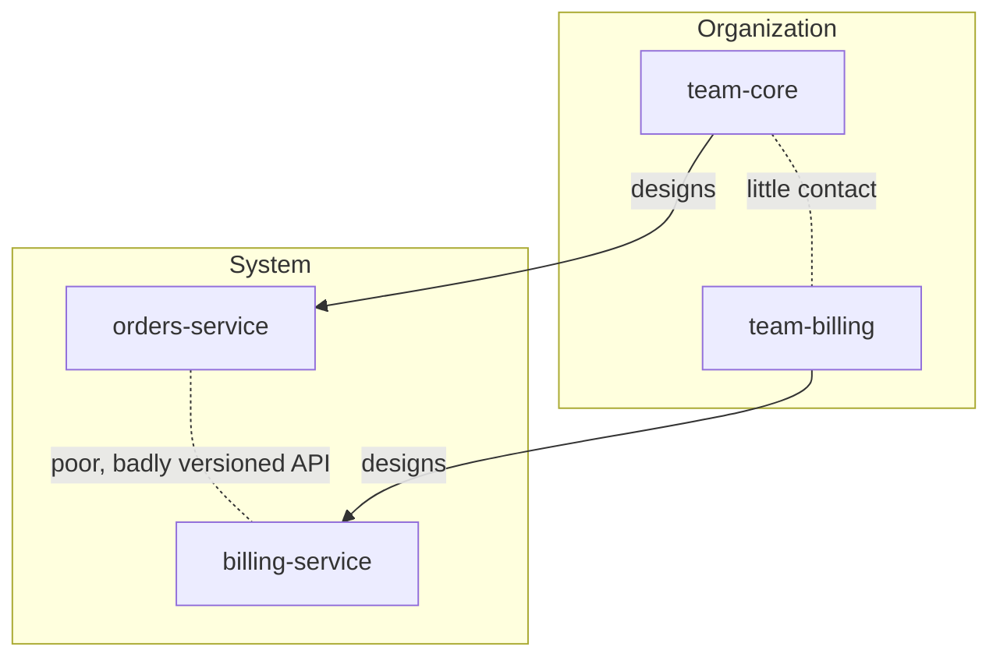
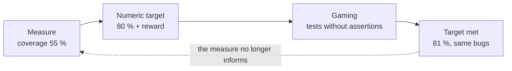
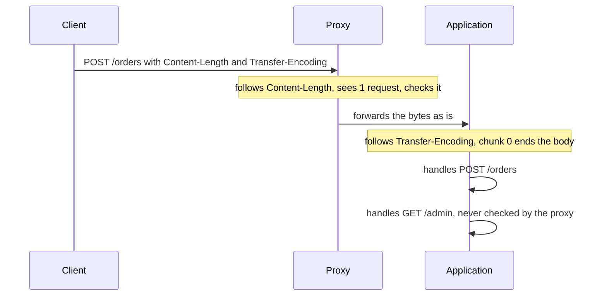
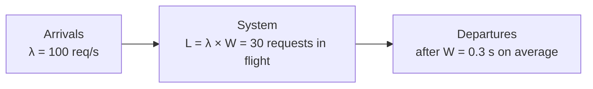

# Eponymous laws and principles

!!! warning "Disclaimer"
    These notes are personal cheat sheets, not a source of truth. They reflect my own understanding and choices: their content remains subjective, despite the quotes and references it contains. It may be incomplete, simplified, inaccurate or outdated. Always check the official documentation before applying it. This content is provided as is, without any warranty: you use it at your own risk.

!!! abstract "Scales"
    The colored badges under the headings say at which scale a notion applies:

    - <span class="pill pill-scope pill-scope-code">Code</span> the classes, functions and modules of one program;
    - <span class="pill pill-scope pill-scope-app">Application</span> one service or application and its internal split;
    - <span class="pill pill-scope pill-scope-system">System</span> several services talking to each other over the network;
    - <span class="pill pill-scope pill-scope-infra">Infrastructure</span> servers, network, zones and clusters, physical or virtual;
    - <span class="pill pill-scope pill-scope-enterprise">Enterprise</span> the whole information system and its organization.

    Details and ambiguous words: [map of scales](architecture.md#map-of-scales).

In meetings, code reviews or interviews, someone always ends up saying "that's Conway's law" or "careful, Goodhart". These phrases sum up, in one name, an observation everyone has already lived through. This page gathers the most quoted ones, each with: the statement in one sentence, its origin, an example in software, what it implies in practice and the way people misquote it.

The services (`my-api`, `orders-service`, `billing-service`), the teams (`team-core`) and the people (`ada`, `grace`) are fictitious. All numbers in the examples are examples unless stated otherwise. The original texts behind several of these laws are presented in [Founding texts](textes-fondateurs.md), and the ones about how teams work are picked up in [Company culture](culture-entreprise.md).

## Terminology

**<span class="term" data-term="eponymous-law">Eponymous law</span>**: a rule named after a person, often the one who stated it, sometimes the one it was attributed to afterwards. They are almost never laws in the physical sense: they are observations, models or quips.

**<span class="term" data-term="heuristic-rule">Heuristic</span>**: a rule of thumb that quickly gives an often correct answer, with no guarantee. "Adding people to a late project makes it later" is a heuristic: true in most cases, false in some.

**<span class="term" data-term="cognitive-bias">Cognitive bias</span>**: a systematic reasoning error that everyone makes the same way. Underestimating how long a task takes is one.

Three families to tell apart before quoting a law:

| Family | Example | What I can expect from it |
|---|---|---|
| mathematical model | Amdahl, Little, USL | a checkable calculation, under precise assumptions |
| empirical observation | Conway, Lehman, Pareto | a frequent trend, to confirm on my own data |
| quip or aphorism | Murphy, Hofstadter, Zawinski | a useful reminder, not a proof |

| I want to... | I remember... |
|---|---|
| I want to quote a law in a meeting to back my opinion, like "that's Conway's law" when the team discusses splitting a service | the family first: a calculation is not argued like a quip |
| I have to make a real decision based on a law, for example turning down extra people on a late project because of Brooks | the origin and its limits, not only the famous sentence |

## Organization and teams

<a class="pill pill-scope pill-scope-system" href="../architecture/#map-of-scales">Scale · System</a> <a class="pill pill-scope pill-scope-enterprise" href="../architecture/#map-of-scales">Scale · Enterprise</a>

### Conway's law

**Statement**: a system ends up reproducing the communication structure of the organization that designs it.

!!! noob "As noob"
    If two teams only talk once a month, their two services will exchange the bare minimum, through a rigid interface: the code ends up drawing the org chart. The takeaway: **to change the architecture for good, also look at who talks to whom.**

**Origin**: Melvin Conway, "How Do Committees Invent?", Datamation, April 1968.



**In practice**: I want `orders-service` and `billing-service` to evolve independently? I give them to two separate teams, with a clear interface between them. So I split teams along the target architecture (the inverse Conway maneuver, Matthew Skelton and Manuel Pais, "Team Topologies", 2019). Full version in [Architecture](architecture.md#conways-law).

**Misuse**: treating it as fate ("nothing we can do") or believing a reorganization is enough, while the existing code keeps the shape of the old organization for years.

:material-book-open-variant: Reference docs: [Melvin Conway, How Do Committees Invent?](https://www.melconway.com/Home/Committees_Paper.html) (1968)
{ .doc-ref }

### Brooks's law

**Statement**: adding people to a late software project makes it later.

**Origin**: Frederick Brooks, "The Mythical Man-Month" (1975). Brooks himself calls it an outrageous oversimplification in the 1995 anniversary edition.

```
communication channels = n × (n - 1) / 2
4 people  :  6 channels
8 people  : 28 channels
newcomer  : 2 to 4 weeks before being useful (example), while taking time from a veteran
```

<div class="diagram-grid"><figure><svg viewBox="0 0 100 100" role="img" aria-label="3 people: 3 channels"><line class="set" style="stroke-width:0.8" x1="50.0" y1="14.0" x2="81.2" y2="68.0"/><line class="set" style="stroke-width:0.8" x1="50.0" y1="14.0" x2="18.8" y2="68.0"/><line class="set" style="stroke-width:0.8" x1="81.2" y1="68.0" x2="18.8" y2="68.0"/><circle class="layer layer-3" cx="50.0" cy="14.0" r="5"/><circle class="layer layer-3" cx="81.2" cy="68.0" r="5"/><circle class="layer layer-3" cx="18.8" cy="68.0" r="5"/></svg><figcaption>3 people: 3 channels</figcaption></figure><figure><svg viewBox="0 0 100 100" role="img" aria-label="4 people: 6 channels"><line class="set" style="stroke-width:0.8" x1="50.0" y1="14.0" x2="86.0" y2="50.0"/><line class="set" style="stroke-width:0.8" x1="50.0" y1="14.0" x2="50.0" y2="86.0"/><line class="set" style="stroke-width:0.8" x1="50.0" y1="14.0" x2="14.0" y2="50.0"/><line class="set" style="stroke-width:0.8" x1="86.0" y1="50.0" x2="50.0" y2="86.0"/><line class="set" style="stroke-width:0.8" x1="86.0" y1="50.0" x2="14.0" y2="50.0"/><line class="set" style="stroke-width:0.8" x1="50.0" y1="86.0" x2="14.0" y2="50.0"/><circle class="layer layer-3" cx="50.0" cy="14.0" r="5"/><circle class="layer layer-3" cx="86.0" cy="50.0" r="5"/><circle class="layer layer-3" cx="50.0" cy="86.0" r="5"/><circle class="layer layer-3" cx="14.0" cy="50.0" r="5"/></svg><figcaption>4 people: 6 channels</figcaption></figure><figure><svg viewBox="0 0 100 100" role="img" aria-label="6 people: 15 channels"><line class="set" style="stroke-width:0.8" x1="50.0" y1="14.0" x2="81.2" y2="32.0"/><line class="set" style="stroke-width:0.8" x1="50.0" y1="14.0" x2="81.2" y2="68.0"/><line class="set" style="stroke-width:0.8" x1="50.0" y1="14.0" x2="50.0" y2="86.0"/><line class="set" style="stroke-width:0.8" x1="50.0" y1="14.0" x2="18.8" y2="68.0"/><line class="set" style="stroke-width:0.8" x1="50.0" y1="14.0" x2="18.8" y2="32.0"/><line class="set" style="stroke-width:0.8" x1="81.2" y1="32.0" x2="81.2" y2="68.0"/><line class="set" style="stroke-width:0.8" x1="81.2" y1="32.0" x2="50.0" y2="86.0"/><line class="set" style="stroke-width:0.8" x1="81.2" y1="32.0" x2="18.8" y2="68.0"/><line class="set" style="stroke-width:0.8" x1="81.2" y1="32.0" x2="18.8" y2="32.0"/><line class="set" style="stroke-width:0.8" x1="81.2" y1="68.0" x2="50.0" y2="86.0"/><line class="set" style="stroke-width:0.8" x1="81.2" y1="68.0" x2="18.8" y2="68.0"/><line class="set" style="stroke-width:0.8" x1="81.2" y1="68.0" x2="18.8" y2="32.0"/><line class="set" style="stroke-width:0.8" x1="50.0" y1="86.0" x2="18.8" y2="68.0"/><line class="set" style="stroke-width:0.8" x1="50.0" y1="86.0" x2="18.8" y2="32.0"/><line class="set" style="stroke-width:0.8" x1="18.8" y1="68.0" x2="18.8" y2="32.0"/><circle class="layer layer-3" cx="50.0" cy="14.0" r="5"/><circle class="layer layer-3" cx="81.2" cy="32.0" r="5"/><circle class="layer layer-3" cx="81.2" cy="68.0" r="5"/><circle class="layer layer-3" cx="50.0" cy="86.0" r="5"/><circle class="layer layer-3" cx="18.8" cy="68.0" r="5"/><circle class="layer layer-3" cx="18.8" cy="32.0" r="5"/></svg><figcaption>6 people: 15 channels</figcaption></figure><figure><svg viewBox="0 0 100 100" role="img" aria-label="8 people: 28 channels"><line class="set" style="stroke-width:0.8" x1="50.0" y1="14.0" x2="75.5" y2="24.5"/><line class="set" style="stroke-width:0.8" x1="50.0" y1="14.0" x2="86.0" y2="50.0"/><line class="set" style="stroke-width:0.8" x1="50.0" y1="14.0" x2="75.5" y2="75.5"/><line class="set" style="stroke-width:0.8" x1="50.0" y1="14.0" x2="50.0" y2="86.0"/><line class="set" style="stroke-width:0.8" x1="50.0" y1="14.0" x2="24.5" y2="75.5"/><line class="set" style="stroke-width:0.8" x1="50.0" y1="14.0" x2="14.0" y2="50.0"/><line class="set" style="stroke-width:0.8" x1="50.0" y1="14.0" x2="24.5" y2="24.5"/><line class="set" style="stroke-width:0.8" x1="75.5" y1="24.5" x2="86.0" y2="50.0"/><line class="set" style="stroke-width:0.8" x1="75.5" y1="24.5" x2="75.5" y2="75.5"/><line class="set" style="stroke-width:0.8" x1="75.5" y1="24.5" x2="50.0" y2="86.0"/><line class="set" style="stroke-width:0.8" x1="75.5" y1="24.5" x2="24.5" y2="75.5"/><line class="set" style="stroke-width:0.8" x1="75.5" y1="24.5" x2="14.0" y2="50.0"/><line class="set" style="stroke-width:0.8" x1="75.5" y1="24.5" x2="24.5" y2="24.5"/><line class="set" style="stroke-width:0.8" x1="86.0" y1="50.0" x2="75.5" y2="75.5"/><line class="set" style="stroke-width:0.8" x1="86.0" y1="50.0" x2="50.0" y2="86.0"/><line class="set" style="stroke-width:0.8" x1="86.0" y1="50.0" x2="24.5" y2="75.5"/><line class="set" style="stroke-width:0.8" x1="86.0" y1="50.0" x2="14.0" y2="50.0"/><line class="set" style="stroke-width:0.8" x1="86.0" y1="50.0" x2="24.5" y2="24.5"/><line class="set" style="stroke-width:0.8" x1="75.5" y1="75.5" x2="50.0" y2="86.0"/><line class="set" style="stroke-width:0.8" x1="75.5" y1="75.5" x2="24.5" y2="75.5"/><line class="set" style="stroke-width:0.8" x1="75.5" y1="75.5" x2="14.0" y2="50.0"/><line class="set" style="stroke-width:0.8" x1="75.5" y1="75.5" x2="24.5" y2="24.5"/><line class="set" style="stroke-width:0.8" x1="50.0" y1="86.0" x2="24.5" y2="75.5"/><line class="set" style="stroke-width:0.8" x1="50.0" y1="86.0" x2="14.0" y2="50.0"/><line class="set" style="stroke-width:0.8" x1="50.0" y1="86.0" x2="24.5" y2="24.5"/><line class="set" style="stroke-width:0.8" x1="24.5" y1="75.5" x2="14.0" y2="50.0"/><line class="set" style="stroke-width:0.8" x1="24.5" y1="75.5" x2="24.5" y2="24.5"/><line class="set" style="stroke-width:0.8" x1="14.0" y1="50.0" x2="24.5" y2="24.5"/><circle class="layer layer-3" cx="50.0" cy="14.0" r="5"/><circle class="layer layer-3" cx="75.5" cy="24.5" r="5"/><circle class="layer layer-3" cx="86.0" cy="50.0" r="5"/><circle class="layer layer-3" cx="75.5" cy="75.5" r="5"/><circle class="layer layer-3" cx="50.0" cy="86.0" r="5"/><circle class="layer layer-3" cx="24.5" cy="75.5" r="5"/><circle class="layer layer-3" cx="14.0" cy="50.0" r="5"/><circle class="layer layer-3" cx="24.5" cy="24.5" r="5"/></svg><figcaption>8 people: 28 channels</figcaption></figure></div>

**In practice**: my project is late and someone offers me more people. I start by cutting scope or moving the date. If I do add someone, I do it early, on a well isolated part, with prepared <span class="term" data-term="onboarding">onboarding</span>: otherwise the newcomer keeps a senior busy for weeks and the delay grows.

**Misuse**: refusing any reinforcement on principle. Help that arrives early, on a task that splits well (documentation, tests, tooling), often speeds the project up.

:material-book-open-variant: Reference docs: [Wikipedia, Brooks's law](https://en.wikipedia.org/wiki/Brooks%27s_law) (accessed November 2026)
{ .doc-ref }

### Parkinson's law

**Statement**: work expands to fill the time available for its completion.

**Origin**: Cyril Northcote Parkinson, article in The Economist, November 1955. In his book "Parkinson's Law" (1957) he also describes the law of triviality: a committee spends more time on the bike shed than on the nuclear plant, hence the word "bikeshedding" (Poul-Henning Kamp, FreeBSD mailing list, 1999).

```
2-week sprint, task estimated at 3 days
days 1 to 3  : the feature works
days 4 to 10 : "while we're at it" refactoring, options, polish
```

**In practice**: I set short deadlines and a clear end criterion (definition of done), otherwise a 3-day task fills the whole sprint. In review, I spot bikeshedding: 40 comments on a variable name, none on the data schema.

**Misuse**: using it to impose unrealistic deadlines. Extra time is not always wasted: it also absorbs the unexpected.

:material-book-open-variant: Reference docs: [Wikipedia, Parkinson's law](https://en.wikipedia.org/wiki/Parkinson%27s_law) (accessed November 2026); [Wikipedia, Law of triviality](https://en.wikipedia.org/wiki/Law_of_triviality) (accessed November 2026)
{ .doc-ref }

### Peter principle

**Statement**: in a hierarchy, every employee tends to be promoted until reaching their level of incompetence.

**Origin**: Laurence J. Peter and Raymond Hull, "The Peter Principle" (1969), a satirical book. A study on salespeople (Benson, Li and Shue, "Promotions and the Peter Principle", 2019, to check) finds a measurable effect: the best salespeople, once promoted, become weaker managers.

```
ada, best developer of team-core  ──  promoted to manager
skill assessed : code
skill required : hiring, arbitrating, growing others
```

**In practice**: my best developer wants to grow, without necessarily becoming a manager. I provide technical tracks (staff, principal) parallel to management, so that growing does not mean changing jobs.

**Misuse**: using it to mock a specific manager. It is a critique of promotion criteria, not of people.

:material-book-open-variant: Reference docs: [Wikipedia, Peter principle](https://en.wikipedia.org/wiki/Peter_principle) (accessed November 2026)
{ .doc-ref }

### Price's law

**Statement**: the square root of the number of contributors produces half of the work.

**Origin**: Derek J. de Solla Price, "Little Science, Big Science" (1963), about scientific publications.

```
100 contributors to a repository : ~10 make half of the commits
400 contributors                 : ~20 make half of the commits
```

[Take with caution: the law was stated for bibliometrics, empirical checks are mixed, and commit counts measure work poorly.]

**In practice**: a hint to spot concentrated knowledge, to cross with the bus factor below.

**Misuse**: using it to rank individuals or justify "keeping the 10% who matter". That is an open door to Goodhart's law.

:material-book-open-variant: Reference docs: [Wikipedia, Derek J. de Solla Price](https://en.wikipedia.org/wiki/Derek_J._de_Solla_Price) (accessed November 2026)
{ .doc-ref }

### Bus factor

**Statement**: the smallest number of people who, if they left the project (hit by a bus, or a truck in "truck factor"), would block it.

**Origin**: an expression from the 1990s, uncertain attribution (to check). Avelino et al., "A Novel Approach for Estimating Truck Factors" (2016), find a <span class="term" data-term="bus-factor">bus factor</span> of 1 or 2 on most of the 133 popular GitHub projects studied (to check).

```
$ git shortlog -sn --since="1 year" -- billing/
   412  ada
     9  grace
     3  bot
bus factor of billing/: 1
```

**In practice**: if ada is the only one who knows `billing/`, I get a second person working on it: <span class="term" data-term="pair-programming">pair programming</span>, rotating <span class="term" data-term="code-review">code review</span>, shared on-call, runbooks. I measure it on the critical parts, not on the whole repository.

**Misuse**: believing a documentation page raises the bus factor. It goes up when a second person has already fixed a bug in that code.

:material-book-open-variant: Reference docs: [Avelino et al., A Novel Approach for Estimating Truck Factors](https://arxiv.org/abs/1604.06766) (2016)
{ .doc-ref }

## Estimation and projects

### Hofstadter's law

**Statement**: it always takes longer than you expect, even when you take into account Hofstadter's law.

**Origin**: Douglas Hofstadter, "Gödel, Escher, Bach" (1979), about chess programs.

```
estimate                           : 2 weeks
"careful" estimate with a Hofstadter margin : 3 weeks
actual                             : 5 weeks
```

**In practice**: I give a range rather than a single date, I compare my past estimates with the real durations, and I deliver in small slices so I see early that things are slipping and can correct.

**Misuse**: turning it into an excuse to stop estimating. The quip says the margin is not enough, not that estimating is useless.

:material-book-open-variant: Reference docs: [Wikipedia, Hofstadter's law](https://en.wikipedia.org/wiki/Hofstadter%27s_law) (accessed November 2026)
{ .doc-ref }

### Ninety-ninety rule

**Statement**: the first 90% of the code accounts for the first 90% of the development time, and the remaining 10% accounts for the other 90%.

**Origin**: Tom Cargill (Bell Labs), quoted by Jon Bentley in his "Programming Pearls" column, Communications of the ACM, September 1985.

```
weeks 1 to 4 : the happy path works, demo succeeds  ("90% done")
weeks 5 to 8 : errors, retries, migration, permissions, logs, docs
total        : 180% of the planned time
```

**In practice**: a successful happy path demo does not mean "almost done". As soon as I estimate, I list the invisible work (error handling, <span class="term" data-term="migration">migration</span>, observability), otherwise it shows up at the end of the project and blows the schedule.

**Misuse**: using it to double every estimate without looking at what is really missing.

:material-book-open-variant: Reference docs: [Wikipedia, Ninety-ninety rule](https://en.wikipedia.org/wiki/Ninety-ninety_rule) (accessed November 2026)
{ .doc-ref }

### Pareto principle (80/20)

**Statement**: a small share of the causes produces the largest share of the effects, often around 20% for 80%.

**Origin**: Vilfredo Pareto, "Cours d'économie politique" (1896), on land distribution in Italy. The name <span class="term" data-term="pareto-principle">Pareto principle</span> comes from Joseph Juran, in the 1940s and 1950s (to check).

```
orders-service, bugs over the last 12 months (example)
module          share of code   share of bugs
checkout        15%             62%
promotions      10%             21%
the rest        75%             17%
```

**In practice**: I cannot test or refactor everything, so I triage before acting. Tests, refactoring and monitoring go first to the few modules that concentrate the incidents, like `checkout` in the example above.

**Misuse**: taking 80/20 as an exact figure, or concluding that the remaining 80% does not matter. The real ratio may be 70/30 or 95/5: it is measured.

:material-book-open-variant: Reference docs: [Wikipedia, Pareto principle](https://en.wikipedia.org/wiki/Pareto_principle) (accessed November 2026)
{ .doc-ref }

### Planning fallacy

**Statement**: people underestimate the time and cost of their own projects, even knowing that similar projects overran.

**Origin**: Daniel Kahneman and Amos Tversky, "Intuitive Prediction: Biases and Corrective Procedures" (1979). The remedy proposed later is <span class="term" data-term="reference-class-forecasting">reference class forecasting</span> (Kahneman and Dan Lovallo, 1993; Bent Flyvbjerg, 2006).

```
inside view  : "the migration takes 3 sprints, we know the code"
outside view : our last 5 migrations took 4, 6, 5, 9 and 7 sprints
corrected estimate : 6 sprints, the median of past cases
```

**In practice**: start from the real durations of similar projects, then adjust, rather than adding up tasks. It is the basis of <span class="term" data-term="throughput-forecasting">throughput forecasting</span>: I count the tickets actually finished per week, instead of adding up estimates.

```
throughput, last 6 weeks : 6, 9, 8, 7, 10, 8 tickets finished (median 8)
remaining                : 40 tickets
forecast                 : 40 / 8 = about 5 weeks
range                    : 4 to 7 weeks (40 / 10 and 40 / 6, rounded)
sum of estimates         : 3 weeks (forgets surprises, reviews, interruptions)
```

The figures are examples. Measured throughput already contains everything estimates forget; give the range instead of a single date.

**Misuse**: reading laziness or bad faith into it. The <span class="term" data-term="planning-fallacy">planning fallacy</span> also hits experts, it is a <span class="term" data-term="cognitive-bias">cognitive bias</span>, not a moral flaw.

:material-book-open-variant: Reference docs: [Wikipedia, Planning fallacy](https://en.wikipedia.org/wiki/Planning_fallacy) (accessed November 2026); [Wikipedia, Reference class forecasting](https://en.wikipedia.org/wiki/Reference_class_forecasting) (accessed November 2026)
{ .doc-ref }

## Measurement

### Goodhart's law

**Statement**: when a measure becomes a target, it ceases to be a good measure.

!!! noob "As noob"
    If I pay a lumberjack per tree felled, they will fell the smallest ones. The number used to go up because the work was well done; once it becomes the goal, people find ways to push it up without doing the work. The takeaway: **a number that gets rewarded stops telling the truth.**

**Origin**: Charles Goodhart, economist, in papers on monetary policy presented in 1975: "any observed statistical regularity will tend to collapse once pressure is placed upon it for control purposes". The famous sentence is by the anthropologist Marilyn Strathern, "Improving ratings: audit in the British University system" (1997).

```
target : 80% code coverage on my-api
result : coverage goes from 55% to 81% in a month
reality: 120 tests added without assertions, not one extra bug caught
```



**In practice**: I follow several indicators that balance each other, so nobody can inflate one without damaging the other (throughput and failure rate, like the <span class="term" data-term="dora-metrics">DORA metrics</span>). I measure teams and systems, never people.

**Misuse**: concluding that nothing should be measured. The problem is the numeric target tied to a reward, not the measure.

:material-book-open-variant: Reference docs: [Wikipedia, Goodhart's law](https://en.wikipedia.org/wiki/Goodhart%27s_law) (accessed November 2026)
{ .doc-ref }

### Campbell's law

**Statement**: the more a quantitative indicator is used for decision-making, the more it is subject to corruption pressures and distorts the process it was meant to monitor.

**Origin**: Donald T. Campbell, "Assessing the Impact of Planned Social Change" (1976, published in a journal in 1979).

```
target : fewer than 3 major incidents per quarter
effect : incidents get declared "minor", postmortems disappear
in the end: fewer incidents counted, as many outages, less learning
```

**In practice**: Goodhart says the measure loses its value, Campbell adds that it damages the work itself. Before setting a numeric target, ask how it could be reached without improving anything.

**Misuse**: quoting it to refuse any transparency. Sharing a measure without turning it into an individual target stays healthy.

:material-book-open-variant: Reference docs: [Wikipedia, Campbell's law](https://en.wikipedia.org/wiki/Campbell%27s_law) (accessed November 2026)
{ .doc-ref }

## Software and APIs

<a class="pill pill-scope pill-scope-code" href="../architecture/#map-of-scales">Scale · Code</a> <a class="pill pill-scope pill-scope-system" href="../architecture/#map-of-scales">Scale · System</a>

<a class="pill pill-practice" href="../api-rest-async/#api-management">Practice · API management</a>

### Hyrum's law

**Statement**: with a sufficient number of users of an API, it does not matter what you promise in the contract: all observable behaviors of your system will be depended on by somebody.

!!! noob "As noob"
    A restaurant reorders the dishes on its menu without changing the dishes: the regular who always ordered "the third one on the list" gets something else. Nobody promised that order, but someone relied on it. The takeaway: **what my API actually does matters as much as what it promises.**

**Origin**: Hyrum Wright, engineer at Google, stated around 2012 (date to check), published on hyrumslaw.com and popularized by "Software Engineering at Google" (2020).

```python
# Avoid: billing-service depends on the error text of orders-service, outside the contract
if "insufficient stock" in response.json()["detail"]:
    retry_later()
# orders-service fixes a typo in the message: billing-service breaks
```

**In practice**: a client can depend on anything it sees, even outside the contract, like `billing-service` reading the text of an error message. So any visible change is potentially a <span class="term" data-term="breaking-change">breaking change</span>. Publish stable error codes, randomize what must not be relied on (key order, for example, so that no client can depend on it), and prepare <span class="term" data-term="deprecation">deprecations</span> with an inventory of real usages. Details in [Developer experience](devx.md).

```go
// Good: Go randomizes map order, so no client can rely on it
m := map[string]int{"a": 1, "b": 2, "c": 3}
for k := range m {
    fmt.Print(k) // "bca" on one run, "acb" on the next: Go shuffles the order on purpose
}
```

**Misuse**: making it a reason to never change anything. It says change has a cost, not that it is forbidden.

:material-book-open-variant: Reference docs: [Hyrum Wright, Hyrum's Law](https://www.hyrumslaw.com/) (publication date not stated)
{ .doc-ref }

### Robustness principle (Postel's law)

<span class="pill pill-status pill-status-obsolete" title="Replaced by RFC 9413 (2023): clearly reject what violates the specification; only the conservative sending half still holds">Obsolete · 11/2026</span>

**Statement**: be conservative in what you send and liberal in what you accept.

!!! noob "As noob"
    It is a teacher who accepts every badly written paper and guesses what the student meant: handy at the time, but students never learn to write properly, and two teachers end up guessing differently. Being tolerant on input makes a system robust in the short term and fragile in the long term, hence the critique in RFC 9413. The takeaway: **clearly rejecting invalid input protects better than guessing it.**

**Origin**: Jon Postel, RFC 760 (IP specification, January 1980), repeated in RFC 761 (TCP, 1980). Official critique: Martin Thomson and David Schinazi, RFC 9413 "Maintaining Robust Protocols" (June 2023), after Eric Allman, "The Robustness Principle Reconsidered", ACM Queue (2011).

```
a proxy accepts a malformed header and fixes it its own way
the server behind it reads it differently
two different readings of the same request: an open door to "request smuggling"
```

**<span class="term" data-term="request-smuggling">Request smuggling</span>**: two servers in a row, a proxy then the application, split the same HTTP request differently. What the proxy sees as the body of a single request, the application reads as the start of a second request, which thus escapes the proxy's checks.

```
POST /orders HTTP/1.1
Content-Length: 30
Transfer-Encoding: chunked

0

GET /admin HTTP/1.1

proxy       : follows Content-Length, sees one POST request and lets it through
application : follows Transfer-Encoding, the "0" chunk ends the body,
              then reads "GET /admin" as a second request nobody checked
```



The fix: reject any request carrying both headers or an ambiguous header, instead of "guessing".

**In practice**: the "conservative when sending" half still holds. The "liberal when receiving" half is debated today: RFC 9413 recommends rejecting clearly what violates the specification, so errors get fixed instead of becoming the norm. Between two versions of an API, keep the reasonable form: a client ignores unknown fields (<span class="term" data-term="tolerant-reader">tolerant reader</span>), but refuses what is invalid.

**Misuse**: invoking it to silently accept everything. Each tolerance becomes an observable behavior, hence a dependency (Hyrum).

:material-book-open-variant: Reference docs: [RFC 9413, Maintaining Robust Protocols](https://www.rfc-editor.org/rfc/rfc9413) (2023); [PortSwigger Web Security Academy, HTTP request smuggling](https://portswigger.net/web-security/request-smuggling) (accessed November 2026)
{ .doc-ref }

### Kernighan's law

**Statement**: debugging is twice as hard as writing the code; so if you write the code as cleverly as possible, you are by definition not smart enough to debug it.

**Origin**: Brian Kernighan and P. J. Plauger, "The Elements of Programming Style" (first edition in 1974, the quote is often tied to the second edition of 1978, to check).

```python
# Avoid: clever, but everything sits on one line that is hard to debug
r = {k: v for d in ds for k, v in d.items() if v and not k.startswith("_")}

# Good: debuggable, one step per line
result = {}
for d in ds:
    for key, value in d.items():
        if value and not key.startswith("_"):
            result[key] = value
```

**In practice**: in review, "I don't understand this line" is a sufficient argument: if the reviewer does not understand it today, whoever has to debug it later will not either. Readability comes before brevity.

**Misuse**: refusing any abstraction or language feature in the name of simplicity. A simple comprehension is not "too clever".

:material-book-open-variant: Reference docs: [Wikipedia, The Elements of Programming Style](https://en.wikipedia.org/wiki/The_Elements_of_Programming_Style) (accessed November 2026)
{ .doc-ref }

### Gall's law

**Statement**: a complex system that works is invariably found to have evolved from a simple system that worked; a complex system designed from scratch never works and cannot be patched up to make it work.

**Origin**: John Gall, "General Systemantics" (1975), often reissued under the title "Systemantics".

```
v1 : a monolith, one database, one deployment a day          (works)
v2 : billing-service extracted when the team doubles         (works)
counterexample: 12 microservices, an event bus and a service mesh on day 1
```

**In practice**: I start small and evolve: I ship a working vertical slice before generalizing, like the v1 monolith above. It is the argument for "monolith first" and the defense against the <span class="term" data-term="second-system-effect">second-system effect</span>.

**Misuse**: refusing any upfront design. Gall talks about what works, not about what is improvised: a simple system is designed too.

:material-book-open-variant: Reference docs: [Wikipedia, John Gall](https://en.wikipedia.org/wiki/John_Gall_%28author%29) (accessed November 2026)
{ .doc-ref }

### Lehman's laws

**Statement**: software used in the real world must keep changing or become progressively less useful, and its complexity grows unless work is done to reduce it.

**Origin**: Meir M. Lehman, from studies of IBM's OS/360: first laws in 1974, eight laws in total by 1996. Reference paper: "Programs, Life Cycles, and Laws of Software Evolution", Proceedings of the IEEE (1980).

```
year   features   dependencies   build time   (example)
2022   40         35             4 min
2024   65         80             11 min
2026   90         140            23 min   (no simplification work)
```

**In practice**: without any simplification work, the build goes from 4 to 23 minutes in four years, as in the example. So I reserve time for <span class="term" data-term="technical-debt">technical debt</span> continuously, not as a once-a-year "big cleanup". Stable software without maintenance does not exist as long as it has users.

**Misuse**: applying them to all code. Lehman separates "E" programs (embedded in the real world) from "S" programs (fixed specification, like a sort function), which can stay unchanged.

:material-book-open-variant: Reference docs: [Wikipedia, Lehman's laws of software evolution](https://en.wikipedia.org/wiki/Lehman%27s_laws_of_software_evolution) (accessed November 2026)
{ .doc-ref }

### Zawinski's law

**Statement**: every program attempts to expand until it can read mail; those programs which cannot so expand are replaced by ones which can.

**Origin**: Jamie Zawinski, developer at Netscape, 1990s (exact date to check). The Jargon File lists it as the "Law of Software Envelopment".

```
ticketing tool, v1 : tickets
v3 : + comments + notifications
v6 : + built-in chat + wiki + dashboards + AI
```

**In practice**: users spend their time communicating and collaborating, so every product is tempted to grow in that direction, like the ticketing tool that ends up with a built-in chat. I keep a list of what my product will not do.

**Misuse**: taking it literally. The point is not email, it is scope creep.

:material-book-open-variant: Reference docs: [The Jargon File, Zawinski's Law](http://www.catb.org/jargon/html/Z/Zawinskis-Law.html) (version 4.4.8, 2004)
{ .doc-ref }

### Linus's law

**Statement**: given enough eyeballs, all bugs are shallow.

**Origin**: Eric S. Raymond, "The Cathedral and the Bazaar" (essay in 1997, book in 1999), who named it in honor of Linus Torvalds.

```
Heartbleed (CVE-2014-0160), OpenSSL
bug introduced in 2011 and released in 2012, found in April 2014 (dates to check)
open source code, used everywhere, reviewed by very few people
```

**In practice**: <span class="term" data-term="open-source">open source</span> code can be reviewed by anyone, but nothing guarantees that someone actually does, as Heartbleed showed. For a critical dependency, I check how many active maintainers it has.

**Misuse**: assuming a popular project is necessarily safe. The eyeballs must look at the right code, and that takes time and funding.

:material-book-open-variant: Reference docs: [Eric S. Raymond, The Cathedral and the Bazaar](http://www.catb.org/~esr/writings/cathedral-bazaar/) (1997)
{ .doc-ref }

### Wirth's law

**Statement**: software is getting slower more rapidly than hardware is becoming faster.

**Origin**: Niklaus Wirth, "A Plea for Lean Software", IEEE Computer, February 1995. Wirth himself attributes it to Martin Reiser.

```
text editor, 1995 : ~5 MB of memory
text editor, 2026 : ~500 MB of memory (example, an app bundling a browser)
perceived startup time : comparable
```

**In practice**: without a safeguard, my app grows a little with every release and nobody notices. A performance budget (load time, memory, bundle size) checked in CI stops that slow drift. Example rule: the front bundle stays under 250 KB, otherwise the pipeline fails.

```yaml
# Good: size budget checked in CI, the pipeline fails above 250 KB
perf-budget:
  script:
    - npm run build
    - size=$(wc -c < dist/main.js)
    - test "$size" -le 250000 || { echo "bundle is $size bytes, budget 250 KB"; exit 1; }
```

**Misuse**: condemning every abstraction. What I lose in resources I often gain in development time; the question is whether the trade is worth it.

:material-book-open-variant: Reference docs: [Wikipedia, Wirth's law](https://en.wikipedia.org/wiki/Wirth%27s_law) (accessed November 2026)
{ .doc-ref }

### Murphy's law

**Statement**: anything that can go wrong will go wrong.

**Origin**: attributed to Edward A. Murphy Jr., an engineer on US Air Force rocket sled tests around 1949. Accounts differ on the exact sentence and its author (to check).

```
"that case never happens"
1 request in 1,000,000 × 50,000,000 requests a month = 50 times a month
```

**In practice**: at scale, the rare becomes daily: a one-in-a-million case happens 50 times a month when I serve 50 million requests. So I test error paths, I set <span class="term" data-term="timeout">timeouts</span>, I rehearse failures (<span class="term" data-term="chaos-engineering">chaos engineering</span>, recovery drills). Chaos engineering means causing a controlled failure on purpose to check a resilience hypothesis:

```
hypothesis  : if a billing-service pod dies, orders-service answers an error within 2 s
experiment  : in staging, kubectl delete pod billing-service-7f9c-abcde
measurement : POST /orders returns 503 in 1.2 s, no half-created order
conclusion  : hypothesis holds; a request hanging for 30 s would have revealed a missing timeout
```

**Misuse**: a fatalism that prevents prioritizing. Anything can go wrong, but protect first what has the largest impact.

:material-book-open-variant: Reference docs: [Wikipedia, Murphy's law](https://en.wikipedia.org/wiki/Murphy%27s_law) (accessed November 2026); [Principles of Chaos Engineering](https://principlesofchaos.org/) (2019)
{ .doc-ref }

## Performance and capacity

<a class="pill pill-scope pill-scope-system" href="../architecture/#map-of-scales">Scale · System</a> <a class="pill pill-scope pill-scope-infra" href="../architecture/#map-of-scales">Scale · Infrastructure</a>

### Amdahl's law

**Statement**: the speedup gained by parallelizing is capped by the part of the work that stays sequential.

!!! noob "As noob"
    Ten cooks peel much faster than one, but the roast still takes an hour in the oven. Adding cooks shortens the part that can be shared, never the oven. The takeaway: **the minimum time is the part that cannot be shared.**

**Origin**: Gene Amdahl, "Validity of the Single Processor Approach to Achieving Large Scale Computing Capabilities", AFIPS Spring Joint Computer Conference (1967). The formula was written later from his argument.

```
S(N) = 1 / ((1 - p) + p / N)        p = parallelizable share, N = number of cores

p = 0.9 :  N = 10   S ≈ 5.3
           N = 100  S ≈ 9.2
           N = ∞    S = 10   (ceiling = 1 / (1 - p))
```

<figure class="diagram"><svg viewBox="0 0 320 210" role="img" aria-label="Amdahl's law: speedup by parallel fraction p"><line class="set" x1="36" y1="170" x2="300" y2="170"/><line class="set" x1="36" y1="170" x2="36" y2="12"/><text x="36" y="181" text-anchor="middle">1</text><text x="88.8" y="181" text-anchor="middle">4</text><text x="141.6" y="181" text-anchor="middle">16</text><text x="194.4" y="181" text-anchor="middle">64</text><text x="247.2" y="181" text-anchor="middle">256</text><text x="300" y="181" text-anchor="middle">1024</text><text x="32" y="173" text-anchor="end">0</text><text x="32" y="133.5" text-anchor="end">5</text><text x="32" y="94" text-anchor="end">10</text><text x="32" y="54.5" text-anchor="end">15</text><text x="32" y="15" text-anchor="end">20</text><text x="168.0" y="194" text-anchor="middle">Number of cores N (log scale)</text><text x="10" y="91.0" text-anchor="middle" transform="rotate(-90 10 91.0)">Speedup S(N)</text><polyline class="set" points="36,162.1 42.6,160.7 49.2,159.1 55.8,157.2 62.4,155 69,152.4 75.6,149.5 82.2,146.2 88.8,142.5 95.4,138.4 102,133.8 108.6,128.7 115.2,123.2 121.8,117.3 128.4,111 135,104.5 141.6,97.8 148.2,90.9 154.8,84.1 161.4,77.4 168,70.9 174.6,64.6 181.2,58.7 187.8,53.2 194.4,48.2 201,43.6 207.6,39.4 214.2,35.7 220.8,32.4 227.4,29.5 234,27 240.6,24.8 247.2,22.9 253.8,21.3 260.4,19.9 267,18.7 273.6,17.7 280.2,16.8 286.8,16 293.4,15.4 300,14.9"/><text x="298" y="10.9" text-anchor="end">p = 0.95</text><polyline class="set" style="stroke-dasharray:5 3" points="36,162.1 42.6,160.8 49.2,159.3 55.8,157.6 62.4,155.6 69,153.5 75.6,151.1 82.2,148.5 88.8,145.7 95.4,142.7 102,139.5 108.6,136.2 115.2,132.8 121.8,129.4 128.4,126 135,122.7 141.6,119.4 148.2,116.4 154.8,113.5 161.4,110.8 168,108.3 174.6,106.1 181.2,104.1 187.8,102.3 194.4,100.7 201,99.4 207.6,98.1 214.2,97.1 220.8,96.2 227.4,95.4 234,94.7 240.6,94.2 247.2,93.7 253.8,93.3 260.4,92.9 267,92.6 273.6,92.4 280.2,92.2 286.8,92 293.4,91.8 300,91.7"/><text x="298" y="87.7" text-anchor="end">p = 0.9</text><polyline class="set" style="stroke-dasharray:2 2" points="36,162.1 42.6,161.4 49.2,160.7 55.8,160.1 62.4,159.5 69,158.9 75.6,158.3 82.2,157.8 88.8,157.4 95.4,156.9 102,156.6 108.6,156.2 115.2,156 121.8,155.7 128.4,155.5 135,155.3 141.6,155.1 148.2,155 154.8,154.9 161.4,154.8 168,154.7 174.6,154.6 181.2,154.5 187.8,154.5 194.4,154.4 201,154.4 207.6,154.4 214.2,154.3 220.8,154.3 227.4,154.3 234,154.3 240.6,154.3 247.2,154.3 253.8,154.3 260.4,154.2 267,154.2 273.6,154.2 280.2,154.2 286.8,154.2 293.4,154.2 300,154.2"/><text x="298" y="150.2" text-anchor="end">p = 0.5</text></svg><figcaption>Amdahl's law: speedup by parallel fraction p</figcaption></figure>

**In practice**: before adding machines, I find the part that cannot be shared (a lock, a single database, a CI step that cannot run in parallel): it sets the ceiling, and <span class="term" data-term="amdahls-law">Amdahl's law</span> tells me where it is.

**Misuse**: applying it to a workload that grows with the machines. That is the case Gustafson describes.

:material-book-open-variant: Reference docs: [Wikipedia, Amdahl's law](https://en.wikipedia.org/wiki/Amdahl%27s_law) (accessed November 2026)
{ .doc-ref }

### Gustafson's law

**Statement**: if the problem size grows with the number of processors, the speedup can keep growing almost linearly.

**Origin**: John L. Gustafson, "Reevaluating Amdahl's Law", Communications of the ACM (May 1988).

```
S(N) = N - s × (N - 1)        s = sequential share measured on the parallel system

s = 0.1 :  N = 10   S = 9.1
           N = 100  S = 90.1
```

**In practice**: Amdahl answers "how much faster for the same work?", Gustafson "how much more work in the same time?". Serving more customers with more servers is closer to Gustafson, speeding up a fixed batch to Amdahl.

**Misuse**: seeing it as a refutation of Amdahl. Both are right, they do not ask the same question.

:material-book-open-variant: Reference docs: [Wikipedia, Gustafson's law](https://en.wikipedia.org/wiki/Gustafson%27s_law) (accessed November 2026)
{ .doc-ref }

### Little's law

**Statement**: the average number of items in a system equals the throughput multiplied by the average time spent in it (L = λW).

!!! noob "As noob"
    A bar where customers arrive at 10 per hour and stay 2 hours on average holds about 20 people. If service slows down and they stay 3 hours, there will be 30, without a single extra customer coming in. The takeaway: **at the same throughput, when latency goes up, the number of requests in flight goes up with it, and that is what exhausts resources.**

**Origin**: John D. C. Little, "A Proof for the Queuing Formula: L = λW", Operations Research (1961).

```
100 requests/s × 0.3 s = 30 requests in flight
latency rises to 3 s: 300 requests in flight, the pool of 50 connections saturates
```



**In practice**: I use it to size connection pools and workers, and to understand why a short <span class="term" data-term="timeout">timeout</span> protects: it stops slow requests from piling up until the pool is exhausted. It also holds for a team's work in progress: fewer tickets open at once, tickets finished faster. Full version in [Architecture](architecture.md#littles-law).

**Misuse**: applying it over an unstable period (peak, startup). It describes averages on a stable system.

:material-book-open-variant: Reference docs: [Wikipedia, Little's law](https://en.wikipedia.org/wiki/Little%27s_law) (accessed November 2026)
{ .doc-ref }

### Universal Scalability Law (USL)

**Statement**: when you add machines, throughput grows more and more slowly because of contention, then drops because of coordination cost.

!!! noob "As noob"
    I add people to a meeting: at first, more people means more progress; then everyone has to wait for their turn to speak (contention); then everyone has to agree with everyone else (coordination), and the meeting gets less done than with five. The takeaway: **past a certain number of machines, adding more lowers throughput: I measure to find that peak.**

**Origin**: Neil Gunther, introduced in 1993, developed in "Guerrilla Capacity Planning" (2007).

```
C(N) = N / (1 + α(N - 1) + βN(N - 1))     α = contention, β = coordination
α = 0.05, β = 0.001 (example): peak around N = sqrt((1 - α) / β) ≈ 31 instances
beyond that, adding instances lowers throughput
```

<figure class="diagram"><svg viewBox="0 0 320 210" role="img" aria-label="USL compared with Amdahl (α = 0.05, β = 0.001, example)"><line class="set" x1="36" y1="170" x2="300" y2="170"/><line class="set" x1="36" y1="170" x2="36" y2="12"/><text x="38.6" y="181" text-anchor="middle">1</text><text x="88.8" y="181" text-anchor="middle">20</text><text x="141.6" y="181" text-anchor="middle">40</text><text x="194.4" y="181" text-anchor="middle">60</text><text x="247.2" y="181" text-anchor="middle">80</text><text x="300" y="181" text-anchor="middle">100</text><text x="32" y="173" text-anchor="end">0</text><text x="32" y="133.5" text-anchor="end">5</text><text x="32" y="94" text-anchor="end">10</text><text x="32" y="54.5" text-anchor="end">15</text><text x="32" y="15" text-anchor="end">20</text><text x="168.0" y="194" text-anchor="middle">Number of instances N</text><text x="10" y="91.0" text-anchor="middle" transform="rotate(-90 10 91.0)">Relative throughput C(N)</text><polyline class="set" style="stroke-dasharray:2 2" points="38.6,162.1 88.8,12"/><text x="92.8" y="20">linear</text><polyline class="set" style="stroke-dasharray:5 3" points="38.6,162.1 41.3,155 43.9,148.5 46.6,142.5 49.2,137.1 51.8,132.1 54.5,127.5 57.1,123.2 59.8,119.2 62.4,115.5 65,112.1 67.7,108.8 70.3,105.8 73,103 75.6,100.3 78.2,97.8 80.9,95.4 83.5,93.1 86.2,91 88.8,89 91.4,87 94.1,85.2 96.7,83.5 99.4,81.8 102,80.2 104.6,78.7 107.3,77.3 109.9,75.9 112.6,74.5 115.2,73.3 117.8,72 120.5,70.9 123.1,69.7 125.8,68.6 128.4,67.6 131,66.6 133.7,65.6 136.3,64.7 139,63.8 141.6,62.9 144.2,62 146.9,61.2 149.5,60.4 152.2,59.7 154.8,58.9 157.4,58.2 160.1,57.5 162.7,56.8 165.4,56.1 168,55.5 170.6,54.9 173.3,54.3 175.9,53.7 178.6,53.1 181.2,52.6 183.8,52 186.5,51.5 189.1,51 191.8,50.5 194.4,50 197,49.5 199.7,49.1 202.3,48.6 205,48.2 207.6,47.7 210.2,47.3 212.9,46.9 215.5,46.5 218.2,46.1 220.8,45.7 223.4,45.4 226.1,45 228.7,44.6 231.4,44.3 234,43.9 236.6,43.6 239.3,43.3 241.9,42.9 244.6,42.6 247.2,42.3 249.8,42 252.5,41.7 255.1,41.4 257.8,41.1 260.4,40.9 263,40.6 265.7,40.3 268.3,40.1 271,39.8 273.6,39.5 276.2,39.3 278.9,39 281.5,38.8 284.2,38.6 286.8,38.3 289.4,38.1 292.1,37.9 294.7,37.7 297.4,37.4 300,37.2"/><text x="298" y="32.2" text-anchor="end">Amdahl (β = 0)</text><polyline class="set" points="38.6,162.1 41.3,155 43.9,148.6 46.6,142.8 49.2,137.6 51.8,133 54.5,128.8 57.1,125 59.8,121.7 62.4,118.7 65,116 67.7,113.6 70.3,111.5 73,109.6 75.6,108 78.2,106.5 80.9,105.2 83.5,104 86.2,103.1 88.8,102.2 91.4,101.4 94.1,100.8 96.7,100.3 99.4,99.8 102,99.5 104.6,99.2 107.3,98.9 109.9,98.8 112.6,98.7 115.2,98.6 117.8,98.6 120.5,98.6 123.1,98.7 125.8,98.8 128.4,98.9 131,99.1 133.7,99.3 136.3,99.5 139,99.7 141.6,99.9 144.2,100.2 146.9,100.5 149.5,100.8 152.2,101.1 154.8,101.4 157.4,101.7 160.1,102 162.7,102.4 165.4,102.7 168,103.1 170.6,103.4 173.3,103.8 175.9,104.1 178.6,104.5 181.2,104.9 183.8,105.2 186.5,105.6 189.1,106 191.8,106.3 194.4,106.7 197,107.1 199.7,107.5 202.3,107.8 205,108.2 207.6,108.6 210.2,108.9 212.9,109.3 215.5,109.7 218.2,110 220.8,110.4 223.4,110.8 226.1,111.1 228.7,111.5 231.4,111.8 234,112.2 236.6,112.5 239.3,112.9 241.9,113.2 244.6,113.6 247.2,113.9 249.8,114.3 252.5,114.6 255.1,114.9 257.8,115.3 260.4,115.6 263,115.9 265.7,116.2 268.3,116.5 271,116.9 273.6,117.2 276.2,117.5 278.9,117.8 281.5,118.1 284.2,118.4 286.8,118.7 289.4,119 292.1,119.3 294.7,119.6 297.4,119.9 300,120.2"/><text x="298" y="115.2" text-anchor="end">USL</text><circle class="hit" cx="117.8" cy="98.6" r="3"/><text x="117.8" y="91.6" text-anchor="middle">peak N ≈ 31</text></svg><figcaption>USL compared with Amdahl (α = 0.05, β = 0.001, example)</figcaption></figure>


**In practice**: measure throughput at 1, 2, 4, 8 instances, fit α and β, and derive the peak before ordering servers. The <span class="term" data-term="usl">USL</span> generalizes Amdahl (β = 0 gives back Amdahl).

**Misuse**: extrapolating far from three measurement points. The coefficients change as soon as the architecture changes.

:material-book-open-variant: Reference docs: [Wikipedia, Neil J. Gunther](https://en.wikipedia.org/wiki/Neil_J._Gunther) (accessed November 2026)
{ .doc-ref }

### Moore's law

<span class="pill pill-status pill-status-obsolete" title="Outdated: doubling has slowed since the 2010s and clock speed has plateaued, gains now come from parallelism">Obsolete · 11/2026</span>

**Statement**: the number of transistors on a chip doubles at a regular interval.

**Origin**: Gordon Moore, "Cramming More Components onto Integrated Circuits", Electronics (April 1965): doubling every year. He revised it in 1975: doubling every two years. The often quoted "18 months" comes from someone else at Intel, David House (to check).

```
doubling every 2 years over 20 years: 2^10 ≈ 1,000 times more transistors
```

**In practice**: it is an observation about the industry that became a roadmap target. The pace has slowed since the 2010s and processor clock speed has plateaued since the mid-2000s: gains come from parallelism, hence from Amdahl.

**Misuse**: counting on hardware to catch up with slow code (see Wirth), or presenting it as a law of physics.

:material-book-open-variant: Reference docs: [Wikipedia, Moore's law](https://en.wikipedia.org/wiki/Moore%27s_law) (accessed November 2026)
{ .doc-ref }

## Decision

### Chesterton's fence

**Statement**: do not remove a fence until you know why it was put up.

**Origin**: G. K. Chesterton, "The Thing" (1929), chapter "The Drift from Domesticity".

```python
# Example: a Chesterton fence, an odd line with no explanation
time.sleep(0.2)  # nobody knows why
```
```
$ git log -S "time.sleep(0.2)" --oneline
3f2a9c1 fix: the provider API refuses more than 5 calls per second
```

**In practice**: I come across a rule, a config or a strange piece of code and want to remove it. I first find out why it is there: `git log`, linked ticket, a question to the team. If nobody knows, I remove it in reversible steps.

**Misuse**: using it to never remove anything. <span class="term" data-term="chestertons-fence">Chesterton's fence</span> asks me to look for the reason, not to find one at all costs.

:material-book-open-variant: Reference docs: [Wikipedia, Chesterton's fence](https://en.wikipedia.org/wiki/Chesterton%27s_fence) (accessed November 2026)
{ .doc-ref }

### Hanlon's razor

**Statement**: never attribute to malice that which is adequately explained by stupidity (or, more charitably, by error).

**Origin**: Robert J. Hanlon, submitted to Arthur Bloch's "Murphy's Law Book Two" (1980). Close phrasings exist earlier, including Robert Heinlein in 1941 (to check).

```
Monday 9 am: main is broken by a merge from grace
malicious reading : "she never tests anything"
Hanlon reading    : CI did not run the integration tests on that branch
```

**In practice**: it is the spirit of blameless postmortems: look for what made the error easy, not for a culprit.

**Misuse**: calling a colleague's mistake "stupidity". The useful version replaces "stupidity" with "missing context".

:material-book-open-variant: Reference docs: [Wikipedia, Hanlon's razor](https://en.wikipedia.org/wiki/Hanlon%27s_razor) (accessed November 2026)
{ .doc-ref }

### Occam's razor

**Statement**: among several explanations, prefer the one that makes the fewest assumptions.

**Origin**: attributed to William of Ockham, 14th century. The phrase "entities must not be multiplied beyond necessity" does not appear as such in his writings: it is from John Punch (1639, to check).

```
symptom: my-api returns 500s since 10:02
hypothesis A: coordinated attack + load balancer bug + memory bit flip
hypothesis B: the 10:00 deployment
check B first
```

**In practice**: when something breaks, I start with the most recent change, like the 10:00 deployment. When designing, I pick the simplest solution that covers the need.

**Misuse**: confusing "simple" with "familiar", or stopping the investigation at the first plausible explanation without checking it.

:material-book-open-variant: Reference docs: [Wikipedia, Occam's razor](https://en.wikipedia.org/wiki/Occam%27s_razor) (accessed November 2026)
{ .doc-ref }

### Sturgeon's law

**Statement**: ninety percent of everything is crud.

**Origin**: Theodore Sturgeon, science fiction writer, answering critics of the genre, around 1957; published in Venture Science Fiction in 1958 (to check).

```
200 candidate npm packages to parse dates
most of them: abandoned, untested, a single maintainer
a handful   : maintained, documented, used everywhere
```

**In practice**: the mediocre majority does not disqualify a whole field (a language, a tool, generative AI). I judge on the best examples, and I filter dependencies (maintenance, license, tests).

**Misuse**: using it to belittle other people's work. It applies to our own code too.

:material-book-open-variant: Reference docs: [Wikipedia, Sturgeon's law](https://en.wikipedia.org/wiki/Sturgeon%27s_law) (accessed November 2026)
{ .doc-ref }

### Cunningham's law

**Statement**: the best way to get the right answer on the internet is not to ask a question; it's to post the wrong answer.

**Origin**: attributed to Ward Cunningham (inventor of the wiki) by Steven McGeady, around 2010 (to check). Cunningham said he was not its author: it is a case of misattributed quote.

```
question asked in a meeting: "who knows how the my-api cache works?"  silence
draft ADR posted: "the cache expires after 1 h"  three corrections in 10 minutes
```

**In practice**: an open question in a meeting often gets silence, an imperfect draft gets corrections. So I share an ADR or an internal RFC early, even incomplete.

**Misuse**: posting errors on purpose. It works once, then nobody trusts what I write.

:material-book-open-variant: Reference docs: [Wikimedia Meta-Wiki, Cunningham's Law](https://meta.wikimedia.org/wiki/Cunningham%27s_Law) (accessed November 2026)
{ .doc-ref }

### Dunning-Kruger effect

**Statement**: people with low skill in a field tend to overestimate their level, and the most skilled tend to slightly underestimate theirs.

**Origin**: Justin Kruger and David Dunning, "Unskilled and Unaware of It", Journal of Personality and Social Psychology (1999).

```
test quartile    self-assessment (percentile rank)   actual rank   (shape of the results, example numbers)
lowest           ~60                                  ~12
highest          ~75                                  ~85
```

[Take with caution: part of the effect is explained by a statistical artifact (regression to the mean, "better than average" effect), according to several papers including Nuhfer et al. (2016) and Gignac and Zajenkowski (2020). The "Mount Stupid" curve that circulates is not in the paper. See also the <span class="term" data-term="replication-crisis">replication crisis</span> in psychology.]

**In practice**: outside feedback (code review, pairing, measurements) beats self-assessment, for everyone.

**Misuse**: using it to disqualify someone in a meeting. It is a statistical, debated result about groups, not a diagnosis of a person.

:material-book-open-variant: Reference docs: [Wikipedia, Dunning-Kruger effect](https://en.wikipedia.org/wiki/Dunning%E2%80%93Kruger_effect) (accessed November 2026)
{ .doc-ref }

## Pitfalls to avoid

- **Quoting a law as proof**: I drop "that's Conway's law" or "Murphy" to close a debate. A quip does not carry the weight of a calculation, and the discussion stops before anyone has looked at our own data. I first say which family the law belongs to ([see Terminology](#terminology)), then I check it against our case.
- **Attaching a numeric target to a measure**: management demands 80% code coverage, and I see tests without assertions coming. The number goes up, quality does not. I track several indicators that balance each other and I measure teams, never individuals ([see Goodhart's law](#goodharts-law)).
- **Adding servers without looking for the part that cannot be shared**: `my-api` is slow, so I double the instances. If everything goes through a single lock or a single database, throughput plateaus, then drops with the coordination cost. I look for the bottleneck first, then measure throughput at 1, 2, 4, 8 instances ([see Amdahl's law](#amdahls-law)).
- **Silently accepting everything on input**: my API fixes malformed requests instead of refusing them. Two components end up reading the same request differently (an open door to request smuggling), and each tolerance becomes a dependency I can no longer remove. I clearly reject what is invalid ([see Robustness principle](#robustness-principle-postels-law)).
- **Applying Brooks one way or the other without thinking**: I add three people right before delivery, or I refuse any reinforcement on principle. In the first case, each newcomer ties up a veteran for weeks; in the second, I deprive myself of useful help on a task that splits well. I cut scope first, and if I add someone, I do it early, on an isolated part ([see Brooks's law](#brookss-law)).
- **Counting on hardware to catch up with slow code**: I tell myself next year's machines will absorb the slowness. Moore's law is slowing and my app grows a little with each version without anyone noticing. I set a performance budget checked in CI ([see Wirth's law](#wirths-law)).
- **Removing an odd line without finding out why it is there**: I delete a `time.sleep(0.2)` that looks useless. The provider API starts refusing our calls again above 5 per second. I run `git log -S`, read the linked ticket, ask the team, then remove it in reversible steps ([see Chesterton's fence](#chestertons-fence)).
- **Aiming a law at a person**: I quote Dunning-Kruger, Peter or "stupidity" about a colleague. The meeting turns into a trial and nobody dares report their mistakes anymore. These laws describe groups and criteria, not people: I talk about missing context ([see Hanlon's razor](#hanlons-razor)).

## What interviews ask

The typical questions:

- "Do you know Conway's law? How does it relate to splitting into microservices?", "We add two developers to your late project, what do you think?" How I answer: I cite the inverse Conway maneuver, which shapes teams after the wanted architecture, and I recall that reinforcement only helps if it arrives early ([Conway's law](#conways-law), [Brooks's law](#brookss-law)).
- "How do you estimate a feature?", "Why do our projects always overrun?" How I answer: I give a range rather than a date, and I start from the actual durations of past projects rather than a sum of tasks ([Hofstadter's law](#hofstadters-law), [Ninety-ninety rule](#ninety-ninety-rule), [Planning fallacy](#planning-fallacy)).
- "Should we set a code coverage target?", "Which indicators would you track for a team?" How I answer: I pick indicators that balance each other, and never an individual target ([Goodhart's law](#goodharts-law), [Campbell's law](#campbells-law)).
- "How do you evolve an API without breaking its clients?", "Should your API accept a slightly malformed request?" How I answer: I assume every visible behaviour is used by someone, I keep error codes stable and I clearly refuse invalid input ([Hyrum's law](#hyrums-law), [Robustness principle](#robustness-principle-postels-law), and [Versioning](api-rest-async.md#versioning)).
- "Why does doubling the servers not double throughput?", "How do you size a connection pool?" How I answer: I look for the share of work that stays sequential and the coordination cost between servers, then I size the pool from throughput and response time ([Amdahl's law](#amdahls-law), [Universal Scalability Law](#universal-scalability-law-usl), [Little's law](#littles-law)).
- "You find a piece of code nobody understands, do you delete it?" How I answer: I first find out why it is there, then remove it in reversible steps ([Chesterton's fence](#chestertons-fence)).

What makes a good answer: give the law in one sentence, a concrete example, then its limit or its misuse. Quoting the name alone proves nothing.

## What to quote in which situation

| I want to... | I quote... |
|---|---|
| I have to explain why two services exchange their data so poorly, while their two teams hardly ever talk to each other | Conway's law |
| someone proposes adding three people to my late project, right before the delivery date | Brooks's law |
| a review or a meeting drags on about a detail, like a variable name, and nobody talks about the data schema | Parkinson's law of triviality (bikeshedding) |
| my team wants its best developers to grow without becoming managers, instead of promoting ada to manager because she codes well | Peter principle |
| a single person knows a critical module, like ada for `billing/`, and everything stalls when she is away | bus factor, Price's law |
| I am asked for a precise delivery date and would rather give a range, with some margin | Hofstadter's law, planning fallacy |
| after a successful demo, someone announces the feature is "almost done", while error handling and the migration are still to do | ninety-ninety rule |
| I have little time to test or refactor and must pick the modules where it pays off most, like the one that concentrates most of the bugs | Pareto principle, measured on our data |
| management imposes a number to hit, like 80% code coverage or rising velocity, and I can see the tests without assertions coming | Goodhart's and Campbell's laws |
| I want to remove a field from my API slowly, after listing who really uses it, not all at once | Hyrum's law |
| my API receives malformed requests and I want to refuse them with a clear error, instead of guessing what the client meant | RFC 9413 (critique of Postel) |
| in review, I come across a very clever line I do not understand, and I want to ask for a simpler version | Kernighan's law |
| my team starts a project with 12 microservices and an event bus from day 1, while a monolith or a minimal v1 would do | Gall's law |
| I want time in every sprint for technical debt, instead of a big cleanup once a year, because the build gets slower year after year | Lehman's laws |
| I am asked to add a feature unrelated to my tool's purpose, like a built-in chat in a ticketing tool | Zawinski's law |
| my project depends on a critical open source library and I want to check it has real active maintainers, without assuming many people have reviewed it | Linus's law and its Heartbleed counterexample |
| my front end gets heavier with every release and I want a limit checked in CI, like a bundle that must stay under 250 KB | Wirth's law |
| I am told "that case never happens" and still want time to test errors or cause controlled failures | Murphy's law |
| someone wants to fix slowness by adding servers, while part of the work goes through a single lock or a single database | Amdahl's law and the USL |
| I have to pick the size of a connection pool, or my team has too many tickets open at once and finishes none of them | Little's law |
| someone wants to delete a rule or a strange piece of code, like a `time.sleep(0.2)`, without knowing why it is there | Chesterton's fence |
| after an outage, the discussion drifts toward a culprit, like grace who broke main, instead of looking for what made the error easy | Hanlon's razor |
| `my-api` returns 500 errors and the team already imagines an attack, while a deployment just went out | Occam's razor |
| I want feedback on a document, but my open question in a meeting gets no reaction | Cunningham's law, with a real draft |

## Sources

- [Melvin Conway, "How Do Committees Invent?", Datamation (1968)](https://www.melconway.com/Home/Committees_Paper.html)
- Frederick P. Brooks Jr., "The Mythical Man-Month", anniversary edition (1975, 1995)
- [C. Northcote Parkinson, "Parkinson's Law", The Economist (1955)](https://www.economist.com/news/1955/11/19/parkinsons-law)
- Laurence J. Peter and Raymond Hull, "The Peter Principle" (1969)
- Alan Benson, Danielle Li and Kelly Shue, "Promotions and the Peter Principle", Quarterly Journal of Economics (2019, to check)
- Derek J. de Solla Price, "Little Science, Big Science" (1963)
- [Guilherme Avelino et al., "A Novel Approach for Estimating Truck Factors", ICPC (2016)](https://arxiv.org/abs/1604.06766)
- Douglas Hofstadter, "Gödel, Escher, Bach" (1979)
- Jon Bentley, "Programming Pearls", Communications of the ACM (September 1985)
- Daniel Kahneman and Amos Tversky, "Intuitive Prediction: Biases and Corrective Procedures", TIMS Studies in Management Science (1979)
- Bent Flyvbjerg, "From Nobel Prize to Project Management: Getting Risks Right", Project Management Journal (2006)
- Charles Goodhart, "Problems of Monetary Management: The U.K. Experience" (1975, published in 1981)
- Marilyn Strathern, "Improving ratings: audit in the British University system", European Review (1997)
- Donald T. Campbell, "Assessing the Impact of Planned Social Change" (1976)
- [Hyrum Wright, "Hyrum's Law" (publication date not given)](https://www.hyrumslaw.com/)
- [Jon Postel, RFC 760, "DoD Standard Internet Protocol" (1980)](https://www.rfc-editor.org/rfc/rfc760)
- [Martin Thomson and David Schinazi, RFC 9413, "Maintaining Robust Protocols" (2023)](https://www.rfc-editor.org/rfc/rfc9413)
- [Eric Allman, "The Robustness Principle Reconsidered", ACM Queue (2011)](https://queue.acm.org/detail.cfm?id=1999945)
- Brian Kernighan and P. J. Plauger, "The Elements of Programming Style" (1974, 2nd edition 1978)
- John Gall, "General Systemantics" (1975)
- M. M. Lehman, "Programs, Life Cycles, and Laws of Software Evolution", Proceedings of the IEEE (1980)
- [Eric S. Raymond, "The Cathedral and the Bazaar" (1997, book in 1999)](http://www.catb.org/~esr/writings/cathedral-bazaar/)
- [The Heartbleed Bug (2014)](https://heartbleed.com/)
- Niklaus Wirth, "A Plea for Lean Software", IEEE Computer (1995)
- Gene Amdahl, "Validity of the Single Processor Approach to Achieving Large Scale Computing Capabilities", AFIPS (1967)
- John L. Gustafson, "Reevaluating Amdahl's Law", Communications of the ACM (1988)
- John D. C. Little, "A Proof for the Queuing Formula: L = λW", Operations Research (1961)
- Neil Gunther, "Guerrilla Capacity Planning" (2007)
- Gordon E. Moore, "Cramming More Components onto Integrated Circuits", Electronics (1965)
- G. K. Chesterton, "The Thing" (1929)
- Arthur Bloch, "Murphy's Law Book Two" (1980)
- Justin Kruger and David Dunning, "Unskilled and Unaware of It", Journal of Personality and Social Psychology (1999)
- [Edward Nuhfer et al., "Random Number Simulations Reveal How Random Noise Affects the Measurements and Graphical Portrayals of Self-Assessed Competency", Numeracy (2016)](https://doi.org/10.5038/1936-4660.9.1.4)
- Gilles E. Gignac and Marcin Zajenkowski, "The Dunning-Kruger effect is (mostly) a statistical artefact", Intelligence (2020)
