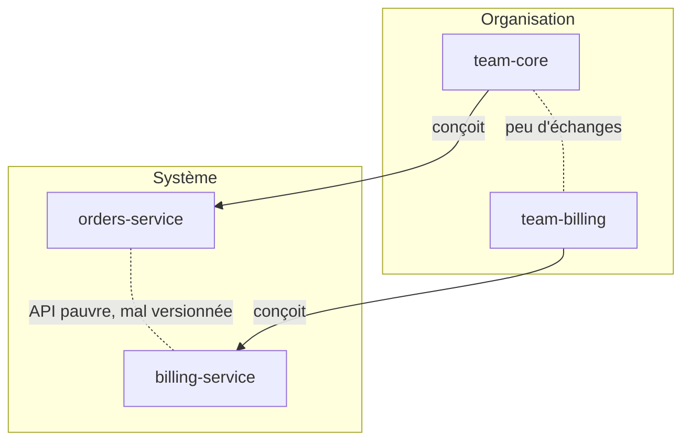
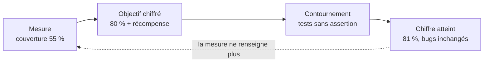
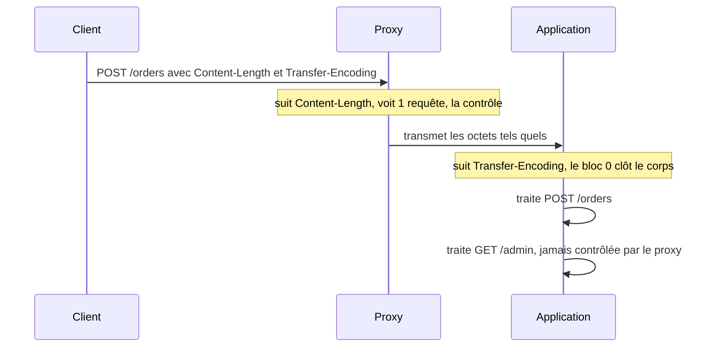
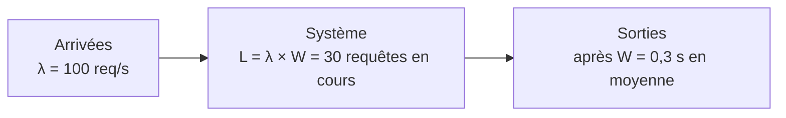

# Lois et principes éponymes

!!! warning "Avertissement"
    Ces notes sont des pense-bêtes personnels, pas une source de vérité. Elles reflètent ma compréhension et mes choix : leur contenu reste subjectif, malgré les citations et les références qu'il contient. Il peut être incomplet, simplifié, inexact ou dépassé. Vérifiez toujours dans la documentation officielle avant de l'appliquer. Ce contenu est fourni tel quel, sans aucune garantie : son utilisation se fait sous votre seule responsabilité.

!!! abstract "Les échelles"
    Les pastilles de couleur sous les titres disent à quelle échelle une notion s'applique :

    - <span class="pill pill-scope pill-scope-code">Code</span> les classes, fonctions et modules d'un programme ;
    - <span class="pill pill-scope pill-scope-app">Application</span> un service ou une application et son découpage interne ;
    - <span class="pill pill-scope pill-scope-system">Système</span> plusieurs services qui communiquent par le réseau ;
    - <span class="pill pill-scope pill-scope-infra">Infrastructure</span> les serveurs, le réseau, les zones et les clusters, physiques ou virtuels ;
    - <span class="pill pill-scope pill-scope-enterprise">Entreprise</span> le système d'information entier et son organisation.

    Détail et mots ambigus : [carte des échelles](architecture.md#carte-des-echelles).

En réunion, en revue de code ou en entretien, quelqu'un finit toujours par dire « c'est la loi de Conway » ou « attention, Goodhart ». Ces phrases résument en un nom une observation que tout le monde a déjà vécue. Cette page rassemble les plus citées, avec pour chacune : l'énoncé en une phrase, son origine, un exemple dans le logiciel, ce qu'elle implique en pratique et la façon dont on la cite à tort.

Les services (`my-api`, `orders-service`, `billing-service`), les équipes (`team-core`) et les personnes (`ada`, `grace`) sont fictifs. Tous les chiffres des exemples sont des exemples, sauf mention contraire. Les textes d'origine de plusieurs de ces lois sont présentés dans [Textes fondateurs](textes-fondateurs.md), et celles qui touchent au fonctionnement des équipes sont reprises dans [Culture d'entreprise](culture-entreprise.md).

## Vocabulaire

**<span class="term" data-term="eponymous-law">Loi éponyme</span>** : une règle qui porte le nom d'une personne, souvent celle qui l'a formulée, parfois celle à qui on l'a attribuée après coup. Ce ne sont presque jamais des lois au sens physique : ce sont des observations, des modèles ou des boutades.

**<span class="term" data-term="heuristic-rule">Heuristique</span>** : une règle pratique qui donne vite une réponse souvent juste, sans garantie. « Ajouter des gens à un projet en retard le retarde » est une heuristique : vraie dans la plupart des cas, fausse dans certains.

**<span class="term" data-term="cognitive-bias">Biais cognitif</span>** : une erreur de raisonnement systématique, que tout le monde fait de la même façon. Sous-estimer la durée d'une tâche en est un.

Trois familles à distinguer avant de citer une loi :

| Famille | Exemple | Ce qu'on peut en attendre |
|---|---|---|
| modèle mathématique | Amdahl, Little, USL | un calcul vérifiable, sous des hypothèses précises |
| observation empirique | Conway, Lehman, Pareto | une tendance fréquente, à confirmer sur ses propres données |
| boutade ou aphorisme | Murphy, Hofstadter, Zawinski | un rappel utile, pas une preuve |

| Je veux... | Je retiens... |
|---|---|
| je veux citer une loi en réunion pour appuyer mon avis, comme « c'est la loi de Conway » quand on parle de découper un service | la famille d'abord : un calcul ne se discute pas comme une boutade |
| je dois prendre une vraie décision en m'appuyant sur une loi, par exemple refuser un renfort sur un projet en retard au nom de Brooks | l'origine et ses limites, pas seulement la phrase célèbre |

## Organisation et équipes

<a class="pill pill-scope pill-scope-system" href="../architecture/#carte-des-echelles">Échelle · Système</a> <a class="pill pill-scope pill-scope-enterprise" href="../architecture/#carte-des-echelles">Échelle · Entreprise</a>

### Loi de Conway

**Énoncé** : un système finit par reproduire la structure de communication de l'organisation qui le conçoit.

!!! noob "As noob"
    Si deux équipes ne se parlent qu'une fois par mois, leurs deux services ne s'échangeront que le strict minimum, par une interface rigide : le code finit par dessiner l'organigramme. La phrase à retenir : **pour changer l'architecture durablement, on regarde aussi qui parle à qui.**

**Origine** : Melvin Conway, « How Do Committees Invent? », Datamation, avril 1968.



**En pratique** : je veux que `orders-service` et `billing-service` évoluent chacun de son côté ? Je les confie à deux équipes distinctes, avec une interface claire entre elles. On découpe donc les équipes selon l'architecture visée (la manœuvre de Conway inverse, Matthew Skelton et Manuel Pais, « Team Topologies », 2019). Version complète dans [Architecture](architecture.md#loi-de-conway).

**Mauvais usage** : en faire une fatalité (« on ne peut rien y faire ») ou croire qu'une réorganisation suffit, alors que le code existant garde la forme de l'ancienne organisation pendant des années.

:material-book-open-variant: Doc de référence : [Melvin Conway, How Do Committees Invent?](https://www.melconway.com/Home/Committees_Paper.html) (1968)
{ .doc-ref }

### Loi de Brooks

**Énoncé** : ajouter des personnes à un projet logiciel en retard le retarde encore plus.

**Origine** : Frederick Brooks, « The Mythical Man-Month » (1975). Brooks lui-même la qualifie de simplification excessive dans l'édition anniversaire de 1995.

```
canaux de communication = n × (n - 1) / 2
4 personnes  :  6 canaux
8 personnes  : 28 canaux
nouvel arrivant : 2 à 4 semaines avant d'être utile (exemple), en occupant un ancien
```

<div class="diagram-grid"><figure><svg viewBox="0 0 100 100" role="img" aria-label="3 personnes : 3 canaux"><line class="set" style="stroke-width:0.8" x1="50.0" y1="14.0" x2="81.2" y2="68.0"/><line class="set" style="stroke-width:0.8" x1="50.0" y1="14.0" x2="18.8" y2="68.0"/><line class="set" style="stroke-width:0.8" x1="81.2" y1="68.0" x2="18.8" y2="68.0"/><circle class="layer layer-3" cx="50.0" cy="14.0" r="5"/><circle class="layer layer-3" cx="81.2" cy="68.0" r="5"/><circle class="layer layer-3" cx="18.8" cy="68.0" r="5"/></svg><figcaption>3 personnes : 3 canaux</figcaption></figure><figure><svg viewBox="0 0 100 100" role="img" aria-label="4 personnes : 6 canaux"><line class="set" style="stroke-width:0.8" x1="50.0" y1="14.0" x2="86.0" y2="50.0"/><line class="set" style="stroke-width:0.8" x1="50.0" y1="14.0" x2="50.0" y2="86.0"/><line class="set" style="stroke-width:0.8" x1="50.0" y1="14.0" x2="14.0" y2="50.0"/><line class="set" style="stroke-width:0.8" x1="86.0" y1="50.0" x2="50.0" y2="86.0"/><line class="set" style="stroke-width:0.8" x1="86.0" y1="50.0" x2="14.0" y2="50.0"/><line class="set" style="stroke-width:0.8" x1="50.0" y1="86.0" x2="14.0" y2="50.0"/><circle class="layer layer-3" cx="50.0" cy="14.0" r="5"/><circle class="layer layer-3" cx="86.0" cy="50.0" r="5"/><circle class="layer layer-3" cx="50.0" cy="86.0" r="5"/><circle class="layer layer-3" cx="14.0" cy="50.0" r="5"/></svg><figcaption>4 personnes : 6 canaux</figcaption></figure><figure><svg viewBox="0 0 100 100" role="img" aria-label="6 personnes : 15 canaux"><line class="set" style="stroke-width:0.8" x1="50.0" y1="14.0" x2="81.2" y2="32.0"/><line class="set" style="stroke-width:0.8" x1="50.0" y1="14.0" x2="81.2" y2="68.0"/><line class="set" style="stroke-width:0.8" x1="50.0" y1="14.0" x2="50.0" y2="86.0"/><line class="set" style="stroke-width:0.8" x1="50.0" y1="14.0" x2="18.8" y2="68.0"/><line class="set" style="stroke-width:0.8" x1="50.0" y1="14.0" x2="18.8" y2="32.0"/><line class="set" style="stroke-width:0.8" x1="81.2" y1="32.0" x2="81.2" y2="68.0"/><line class="set" style="stroke-width:0.8" x1="81.2" y1="32.0" x2="50.0" y2="86.0"/><line class="set" style="stroke-width:0.8" x1="81.2" y1="32.0" x2="18.8" y2="68.0"/><line class="set" style="stroke-width:0.8" x1="81.2" y1="32.0" x2="18.8" y2="32.0"/><line class="set" style="stroke-width:0.8" x1="81.2" y1="68.0" x2="50.0" y2="86.0"/><line class="set" style="stroke-width:0.8" x1="81.2" y1="68.0" x2="18.8" y2="68.0"/><line class="set" style="stroke-width:0.8" x1="81.2" y1="68.0" x2="18.8" y2="32.0"/><line class="set" style="stroke-width:0.8" x1="50.0" y1="86.0" x2="18.8" y2="68.0"/><line class="set" style="stroke-width:0.8" x1="50.0" y1="86.0" x2="18.8" y2="32.0"/><line class="set" style="stroke-width:0.8" x1="18.8" y1="68.0" x2="18.8" y2="32.0"/><circle class="layer layer-3" cx="50.0" cy="14.0" r="5"/><circle class="layer layer-3" cx="81.2" cy="32.0" r="5"/><circle class="layer layer-3" cx="81.2" cy="68.0" r="5"/><circle class="layer layer-3" cx="50.0" cy="86.0" r="5"/><circle class="layer layer-3" cx="18.8" cy="68.0" r="5"/><circle class="layer layer-3" cx="18.8" cy="32.0" r="5"/></svg><figcaption>6 personnes : 15 canaux</figcaption></figure><figure><svg viewBox="0 0 100 100" role="img" aria-label="8 personnes : 28 canaux"><line class="set" style="stroke-width:0.8" x1="50.0" y1="14.0" x2="75.5" y2="24.5"/><line class="set" style="stroke-width:0.8" x1="50.0" y1="14.0" x2="86.0" y2="50.0"/><line class="set" style="stroke-width:0.8" x1="50.0" y1="14.0" x2="75.5" y2="75.5"/><line class="set" style="stroke-width:0.8" x1="50.0" y1="14.0" x2="50.0" y2="86.0"/><line class="set" style="stroke-width:0.8" x1="50.0" y1="14.0" x2="24.5" y2="75.5"/><line class="set" style="stroke-width:0.8" x1="50.0" y1="14.0" x2="14.0" y2="50.0"/><line class="set" style="stroke-width:0.8" x1="50.0" y1="14.0" x2="24.5" y2="24.5"/><line class="set" style="stroke-width:0.8" x1="75.5" y1="24.5" x2="86.0" y2="50.0"/><line class="set" style="stroke-width:0.8" x1="75.5" y1="24.5" x2="75.5" y2="75.5"/><line class="set" style="stroke-width:0.8" x1="75.5" y1="24.5" x2="50.0" y2="86.0"/><line class="set" style="stroke-width:0.8" x1="75.5" y1="24.5" x2="24.5" y2="75.5"/><line class="set" style="stroke-width:0.8" x1="75.5" y1="24.5" x2="14.0" y2="50.0"/><line class="set" style="stroke-width:0.8" x1="75.5" y1="24.5" x2="24.5" y2="24.5"/><line class="set" style="stroke-width:0.8" x1="86.0" y1="50.0" x2="75.5" y2="75.5"/><line class="set" style="stroke-width:0.8" x1="86.0" y1="50.0" x2="50.0" y2="86.0"/><line class="set" style="stroke-width:0.8" x1="86.0" y1="50.0" x2="24.5" y2="75.5"/><line class="set" style="stroke-width:0.8" x1="86.0" y1="50.0" x2="14.0" y2="50.0"/><line class="set" style="stroke-width:0.8" x1="86.0" y1="50.0" x2="24.5" y2="24.5"/><line class="set" style="stroke-width:0.8" x1="75.5" y1="75.5" x2="50.0" y2="86.0"/><line class="set" style="stroke-width:0.8" x1="75.5" y1="75.5" x2="24.5" y2="75.5"/><line class="set" style="stroke-width:0.8" x1="75.5" y1="75.5" x2="14.0" y2="50.0"/><line class="set" style="stroke-width:0.8" x1="75.5" y1="75.5" x2="24.5" y2="24.5"/><line class="set" style="stroke-width:0.8" x1="50.0" y1="86.0" x2="24.5" y2="75.5"/><line class="set" style="stroke-width:0.8" x1="50.0" y1="86.0" x2="14.0" y2="50.0"/><line class="set" style="stroke-width:0.8" x1="50.0" y1="86.0" x2="24.5" y2="24.5"/><line class="set" style="stroke-width:0.8" x1="24.5" y1="75.5" x2="14.0" y2="50.0"/><line class="set" style="stroke-width:0.8" x1="24.5" y1="75.5" x2="24.5" y2="24.5"/><line class="set" style="stroke-width:0.8" x1="14.0" y1="50.0" x2="24.5" y2="24.5"/><circle class="layer layer-3" cx="50.0" cy="14.0" r="5"/><circle class="layer layer-3" cx="75.5" cy="24.5" r="5"/><circle class="layer layer-3" cx="86.0" cy="50.0" r="5"/><circle class="layer layer-3" cx="75.5" cy="75.5" r="5"/><circle class="layer layer-3" cx="50.0" cy="86.0" r="5"/><circle class="layer layer-3" cx="24.5" cy="75.5" r="5"/><circle class="layer layer-3" cx="14.0" cy="50.0" r="5"/><circle class="layer layer-3" cx="24.5" cy="24.5" r="5"/></svg><figcaption>8 personnes : 28 canaux</figcaption></figure></div>

**En pratique** : mon projet est en retard et on me propose du renfort. Je commence par réduire le périmètre ou décaler la date. Si j'ajoute quelqu'un, je le fais tôt, sur une partie bien isolée, avec un <span class="term" data-term="onboarding">onboarding</span> préparé : sinon le nouvel arrivant occupe un ancien pendant des semaines et le retard grandit.

**Mauvais usage** : refuser tout renfort par principe. Un renfort arrivé tôt, sur une tâche découpable (documentation, tests, outillage), accélère souvent le projet.

:material-book-open-variant: Doc de référence : [Wikipédia, Brooks's law](https://en.wikipedia.org/wiki/Brooks%27s_law) (consultée en novembre 2026)
{ .doc-ref }

### Loi de Parkinson

**Énoncé** : le travail s'étend jusqu'à remplir le temps disponible pour l'accomplir.

**Origine** : Cyril Northcote Parkinson, article dans The Economist, novembre 1955. Dans son livre « Parkinson's Law » (1957), il décrit aussi la loi de futilité : un comité passe plus de temps sur l'abri à vélos que sur la centrale nucléaire, d'où le mot « bikeshedding » (Poul-Henning Kamp, liste de diffusion FreeBSD, 1999).

```
sprint de 2 semaines, tâche estimée à 3 jours
jours 1 à 3  : la fonctionnalité marche
jours 4 à 10 : refactoring « pendant qu'on y est », options, polish
```

**En pratique** : je donne des échéances courtes et un critère de fin clair (définition de « fini »), sinon une tâche de 3 jours remplit tout le sprint. En revue, je repère le bikeshedding : 40 commentaires sur un nom de variable, aucun sur le schéma de données.

**Mauvais usage** : s'en servir pour imposer des délais irréalistes. Le temps en trop n'est pas toujours perdu : il absorbe aussi les imprévus.

:material-book-open-variant: Doc de référence : [Wikipédia, Parkinson's law](https://en.wikipedia.org/wiki/Parkinson%27s_law) (consultée en novembre 2026) ; [Wikipédia, Law of triviality](https://en.wikipedia.org/wiki/Law_of_triviality) (consultée en novembre 2026)
{ .doc-ref }

### Principe de Peter

**Énoncé** : dans une hiérarchie, chacun tend à être promu jusqu'à atteindre son niveau d'incompétence.

**Origine** : Laurence J. Peter et Raymond Hull, « The Peter Principle » (1969), un livre satirique. Une étude sur des vendeurs (Benson, Li et Shue, « Promotions and the Peter Principle », 2019, à vérifier) trouve un effet mesurable : les meilleurs vendeurs promus deviennent des managers moins bons.

```
ada, meilleure développeuse de team-core  ──  promue manager
compétence évaluée : le code
compétence demandée : recruter, arbitrer, faire grandir les autres
```

**En pratique** : ma meilleure développeuse veut progresser, sans forcément devenir manager. Je prévois des filières techniques (staff, principal) parallèles au management, pour qu'évoluer ne veuille pas dire changer de métier.

**Mauvais usage** : l'utiliser pour se moquer d'un manager en particulier. C'est une critique des critères de promotion, pas des personnes.

:material-book-open-variant: Doc de référence : [Wikipédia, Peter principle](https://en.wikipedia.org/wiki/Peter_principle) (consultée en novembre 2026)
{ .doc-ref }

### Loi de Price

**Énoncé** : la racine carrée du nombre de contributeurs produit la moitié du travail.

**Origine** : Derek J. de Solla Price, « Little Science, Big Science » (1963), à propos des publications scientifiques.

```
100 contributeurs à un dépôt  : ~10 font la moitié des commits
400 contributeurs             : ~20 font la moitié des commits
```

[À prendre avec précaution : la loi a été formulée pour la bibliométrie, les vérifications empiriques sont mitigées et le nombre de commits mesure mal le travail.]

**En pratique** : une indication pour repérer une concentration du savoir, à croiser avec le bus factor ci-dessous.

**Mauvais usage** : s'en servir pour classer les individus ou justifier de « garder les 10 % qui comptent ». C'est la porte ouverte à la loi de Goodhart.

:material-book-open-variant: Doc de référence : [Wikipédia, Derek J. de Solla Price](https://en.wikipedia.org/wiki/Derek_J._de_Solla_Price) (consultée en novembre 2026)
{ .doc-ref }

### Bus factor

**Énoncé** : le nombre minimal de personnes qui, si elles disparaissaient du projet (le bus, ou le camion dans « truck factor »), le bloqueraient.

**Origine** : expression des années 1990, attribution incertaine (à vérifier). Avelino et al., « A Novel Approach for Estimating Truck Factors » (2016), trouvent un <span class="term" data-term="bus-factor">bus factor</span> de 1 ou 2 sur la majorité des 133 projets GitHub populaires étudiés (à vérifier).

```
$ git shortlog -sn --since="1 year" -- billing/
   412  ada
     9  grace
     3  bot
bus factor de billing/ : 1
```

**En pratique** : si ada est la seule à connaître `billing/`, je fais travailler une deuxième personne dessus : <span class="term" data-term="pair-programming">programmation en binôme</span>, <span class="term" data-term="code-review">revue de code</span> tournante, astreinte partagée, runbooks. Je le mesure sur les parties critiques, pas sur tout le dépôt.

**Mauvais usage** : croire qu'une page de documentation remonte le bus factor. Il monte quand une deuxième personne a déjà corrigé un bug dans ce code.

:material-book-open-variant: Doc de référence : [Avelino et al., A Novel Approach for Estimating Truck Factors](https://arxiv.org/abs/1604.06766) (2016)
{ .doc-ref }

## Estimation et projets

### Loi de Hofstadter

**Énoncé** : ça prend toujours plus de temps que prévu, même en tenant compte de la loi de Hofstadter.

**Origine** : Douglas Hofstadter, « Gödel, Escher, Bach » (1979), à propos des programmes d'échecs.

```
estimation           : 2 semaines
estimation « prudente » avec marge Hofstadter : 3 semaines
réel                 : 5 semaines
```

**En pratique** : je donne une fourchette plutôt qu'une date unique, je compare mes estimations passées aux durées réelles, et je livre par petites tranches pour voir tôt que ça dérape et corriger.

**Mauvais usage** : en faire une excuse pour ne plus estimer du tout. La boutade dit que la marge ne suffit pas, pas que l'estimation est inutile.

:material-book-open-variant: Doc de référence : [Wikipédia, Hofstadter's law](https://en.wikipedia.org/wiki/Hofstadter%27s_law) (consultée en novembre 2026)
{ .doc-ref }

### Règle des 90-90

**Énoncé** : les premiers 90 % du code prennent 90 % du temps, et les 10 % restants prennent les autres 90 %.

**Origine** : Tom Cargill (Bell Labs), citée par Jon Bentley dans sa chronique « Programming Pearls », Communications of the ACM, septembre 1985.

```
semaine 1 à 4 : le cas nominal marche, démo réussie  (« 90 % fini »)
semaine 5 à 8 : erreurs, reprises, migration, droits, logs, doc
total         : 180 % du temps prévu
```

**En pratique** : une démo réussie du cas nominal ne veut pas dire « presque fini ». Dès l'estimation, je liste le travail invisible (gestion d'erreurs, <span class="term" data-term="migration">migration</span>, observabilité), sinon il apparaît en fin de projet et fait déborder le planning.

**Mauvais usage** : l'utiliser pour gonfler chaque estimation par deux sans regarder ce qui manque vraiment.

:material-book-open-variant: Doc de référence : [Wikipédia, Ninety-ninety rule](https://en.wikipedia.org/wiki/Ninety-ninety_rule) (consultée en novembre 2026)
{ .doc-ref }

### Principe de Pareto (80/20)

**Énoncé** : une petite part des causes produit la plus grande part des effets, souvent autour de 20 % pour 80 %.

**Origine** : Vilfredo Pareto, « Cours d'économie politique » (1896), sur la répartition des terres en Italie. Le nom de <span class="term" data-term="pareto-principle">principe de Pareto</span> vient de Joseph Juran, dans les années 1940 et 1950 (à vérifier).

```
orders-service, bugs des 12 derniers mois (exemple)
module          part du code   part des bugs
checkout        15 %           62 %
promotions      10 %           21 %
le reste        75 %           17 %
```

**En pratique** : je ne peux pas tout tester ni tout refactorer, alors je trie avant d'agir. Les tests, le refactoring et la surveillance vont d'abord aux quelques modules qui concentrent les incidents, comme `checkout` dans l'exemple ci-dessus.

**Mauvais usage** : prendre 80/20 pour un chiffre exact, ou conclure que les 80 % restants ne comptent pas. Le ratio réel peut être 70/30 ou 95/5 : il se mesure.

:material-book-open-variant: Doc de référence : [Wikipédia, Pareto principle](https://en.wikipedia.org/wiki/Pareto_principle) (consultée en novembre 2026)
{ .doc-ref }

### Erreur de planification

**Énoncé** : on sous-estime la durée et le coût de ses propres projets, même en sachant que les projets semblables ont débordé.

**Origine** : Daniel Kahneman et Amos Tversky, « Intuitive Prediction: Biases and Corrective Procedures » (1979). Le remède proposé ensuite est la <span class="term" data-term="reference-class-forecasting">prévision par classe de référence</span> (Kahneman et Dan Lovallo, 1993 ; Bent Flyvbjerg, 2006).

```
vue de l'intérieur : « la migration prend 3 sprints, on connaît le code »
vue de l'extérieur : nos 5 dernières migrations ont pris 4, 6, 5, 9 et 7 sprints
estimation corrigée : 6 sprints, avec la médiane des cas passés
```

**En pratique** : partir des durées réelles des projets semblables, puis ajuster, plutôt que d'additionner des tâches. C'est la base de la <span class="term" data-term="throughput-forecasting">prévision par débit</span> : on compte les tickets réellement terminés par semaine, au lieu d'additionner des estimations.

```
débit des 6 dernières semaines : 6, 9, 8, 7, 10, 8 tickets terminés (médiane 8)
reste à faire                  : 40 tickets
prévision                      : 40 / 8 = environ 5 semaines
fourchette                     : 4 à 7 semaines (40 / 10 et 40 / 6, arrondi)
somme des estimations          : 3 semaines (oublie les imprévus, les revues, les interruptions)
```

Les chiffres sont des exemples. Le débit mesuré contient déjà tout ce que les estimations oublient ; la fourchette se donne au lieu d'une date unique.

**Mauvais usage** : y voir de la paresse ou de la mauvaise foi. L'<span class="term" data-term="planning-fallacy">erreur de planification</span> touche aussi les experts, c'est un <span class="term" data-term="cognitive-bias">biais cognitif</span>, pas un défaut moral.

:material-book-open-variant: Doc de référence : [Wikipédia, Planning fallacy](https://en.wikipedia.org/wiki/Planning_fallacy) (consultée en novembre 2026) ; [Wikipédia, Reference class forecasting](https://en.wikipedia.org/wiki/Reference_class_forecasting) (consultée en novembre 2026)
{ .doc-ref }

## Mesure

### Loi de Goodhart

**Énoncé** : quand une mesure devient un objectif, elle cesse d'être une bonne mesure.

!!! noob "As noob"
    Si je paie un bûcheron au nombre d'arbres coupés, il coupera les plus petits. Le chiffre montait parce que le travail était bien fait ; dès qu'il devient le but, on trouve des façons de le faire monter sans faire le travail. La phrase à retenir : **un chiffre qu'on récompense cesse de dire la vérité.**

**Origine** : Charles Goodhart, économiste, dans des articles sur la politique monétaire présentés en 1975 : « toute régularité statistique observée tend à s'effondrer dès qu'on s'appuie dessus pour piloter ». La phrase célèbre est de l'anthropologue Marilyn Strathern, « Improving ratings: audit in the British University system » (1997).

```
objectif : 80 % de couverture de code sur my-api
résultat : la couverture passe de 55 % à 81 % en un mois
réalité  : 120 tests ajoutés sans assertion, aucun bug de plus détecté
```



**En pratique** : je suis plusieurs indicateurs qui se contrebalancent, pour qu'on ne puisse pas en gonfler un sans abîmer l'autre (débit et taux d'échec, comme les <span class="term" data-term="dora-metrics">métriques DORA</span>). Je mesure des équipes et des systèmes, jamais des personnes.

**Mauvais usage** : en conclure qu'il ne faut rien mesurer. Le problème vient de l'objectif chiffré attaché à une récompense, pas de la mesure.

:material-book-open-variant: Doc de référence : [Wikipédia, Goodhart's law](https://en.wikipedia.org/wiki/Goodhart%27s_law) (consultée en novembre 2026)
{ .doc-ref }

### Loi de Campbell

**Énoncé** : plus un indicateur chiffré sert à prendre des décisions, plus il est soumis à des pressions qui le corrompent et déforment le processus qu'il devait observer.

**Origine** : Donald T. Campbell, « Assessing the Impact of Planned Social Change » (1976, publié en revue en 1979).

```
objectif : moins de 3 incidents majeurs par trimestre
effet    : les incidents sont déclarés « mineurs », les postmortems disparaissent
au final : moins d'incidents comptés, autant de pannes, moins d'apprentissage
```

**En pratique** : Goodhart dit que la mesure perd sa valeur, Campbell ajoute qu'elle abîme le travail lui-même. Avant de fixer un objectif chiffré, se demander comment on pourrait l'atteindre sans rien améliorer.

**Mauvais usage** : la citer pour refuser toute transparence. Partager une mesure sans en faire un objectif individuel reste sain.

:material-book-open-variant: Doc de référence : [Wikipédia, Campbell's law](https://en.wikipedia.org/wiki/Campbell%27s_law) (consultée en novembre 2026)
{ .doc-ref }

## Logiciel et API

<a class="pill pill-scope pill-scope-code" href="../architecture/#carte-des-echelles">Échelle · Code</a> <a class="pill pill-scope pill-scope-system" href="../architecture/#carte-des-echelles">Échelle · Système</a>

<a class="pill pill-practice" href="../api-rest-async/#api-management">Pratique · API management</a>

### Loi de Hyrum

**Énoncé** : avec assez d'utilisateurs d'une API, peu importe ce que promet le contrat : tout comportement observable finira par être utilisé par quelqu'un.

!!! noob "As noob"
    Un restaurant change l'ordre des plats sur sa carte, sans toucher aux plats : l'habitué qui commandait « le troisième de la liste » reçoit autre chose. Personne n'avait promis cet ordre, mais quelqu'un en dépendait. La phrase à retenir : **ce que mon API fait vraiment compte autant que ce qu'elle promet.**

**Origine** : Hyrum Wright, ingénieur chez Google, formulée vers 2012 (date à vérifier), publiée sur hyrumslaw.com et popularisée par « Software Engineering at Google » (2020).

```python
# À éviter : billing-service dépend du texte d'erreur de orders-service, hors contrat
if "stock insuffisant" in response.json()["detail"]:
    retry_later()
# orders-service corrige une faute de frappe dans le message : billing-service casse
```

**En pratique** : un client peut dépendre de tout ce qu'il voit, même hors contrat, comme `billing-service` qui lit le texte d'un message d'erreur. Toute modification visible est donc potentiellement une <span class="term" data-term="breaking-change">rupture</span>. On publie des codes d'erreur stables, on randomise ce qui ne doit pas être figé (ordre des clés, par exemple, pour qu'aucun client ne puisse s'y fier), et on prépare les <span class="term" data-term="deprecation">retraits annoncés</span> avec un inventaire des usages réels. Détails dans [Expérience développeur](devx.md).

```go
// Bien : Go rend l'ordre d'une map aléatoire, aucun client ne peut s'y fier
m := map[string]int{"a": 1, "b": 2, "c": 3}
for k := range m {
    fmt.Print(k) // "bca" à une exécution, "acb" à la suivante : Go mélange l'ordre exprès
}
```

**Mauvais usage** : en faire une raison pour ne jamais rien changer. Elle dit que changer a un coût, pas que c'est interdit.

:material-book-open-variant: Doc de référence : [Hyrum Wright, Hyrum's Law](https://www.hyrumslaw.com/) (date de publication non indiquée)
{ .doc-ref }

### Principe de robustesse (loi de Postel)

<span class="pill pill-status pill-status-obsolete" title="Remplacé par RFC 9413 (2023) : rejeter clairement ce qui viole la spécification ; seule la moitié « conservateur à l'envoi » reste valable">Obsolète · 11/2026</span>

**Énoncé** : être conservateur dans ce qu'on envoie et libéral dans ce qu'on accepte.

!!! noob "As noob"
    C'est un professeur qui accepte toutes les copies mal écrites et devine ce que l'élève voulait dire : sur le moment, c'est pratique, mais les élèves n'apprennent jamais à bien écrire, et deux professeurs finissent par deviner différemment. Être tolérant à la réception rend le système robuste à court terme et fragile à long terme, d'où la critique de RFC 9413. La phrase à retenir : **refuser clairement une entrée invalide protège mieux que la deviner.**

**Origine** : Jon Postel, RFC 760 (spécification d'IP, janvier 1980), repris dans RFC 761 (TCP, 1980). Critique officielle : Martin Thomson et David Schinazi, RFC 9413 « Maintaining Robust Protocols » (juin 2023), après Eric Allman, « The Robustness Principle Reconsidered », ACM Queue (2011).

```
un proxy accepte un en-tête mal formé et le corrige à sa façon
le serveur derrière l'interprète autrement
deux lectures différentes de la même requête : porte ouverte au « request smuggling »
```

Le **<span class="term" data-term="request-smuggling">request smuggling</span>** (contrebande de requête) : deux serveurs à la suite, un proxy puis l'application, découpent différemment la même requête HTTP. Ce que le proxy voit comme le corps d'une seule requête, l'application le lit comme le début d'une deuxième requête, qui échappe ainsi aux contrôles du proxy.

```
POST /orders HTTP/1.1
Content-Length: 30
Transfer-Encoding: chunked

0

GET /admin HTTP/1.1

proxy       : suit Content-Length, voit une seule requête POST et la laisse passer
application : suit Transfer-Encoding, le bloc « 0 » termine le corps,
              puis lit « GET /admin » comme une deuxième requête jamais contrôlée
```



La parade : rejeter toute requête qui porte les deux en-têtes ou un en-tête ambigu, au lieu de « deviner ».

**En pratique** : le côté « conservateur à l'envoi » reste valable. Le côté « libéral à la réception » est aujourd'hui discuté : la RFC 9413 recommande de rejeter clairement ce qui viole la spécification, pour que les erreurs se corrigent au lieu de devenir la norme. Entre deux versions d'une API, on garde la forme raisonnable : un client ignore les champs inconnus (<span class="term" data-term="tolerant-reader">lecteur tolérant</span>), mais refuse ce qui est invalide.

**Mauvais usage** : l'invoquer pour tout accepter en silence. Chaque tolérance devient un comportement observable, donc une dépendance (Hyrum).

:material-book-open-variant: Doc de référence : [RFC 9413, Maintaining Robust Protocols](https://www.rfc-editor.org/rfc/rfc9413) (2023) ; [PortSwigger Web Security Academy, HTTP request smuggling](https://portswigger.net/web-security/request-smuggling) (consultée en novembre 2026)
{ .doc-ref }

### Loi de Kernighan

**Énoncé** : déboguer est deux fois plus difficile qu'écrire le code ; si on écrit le code le plus astucieux possible, on n'est donc pas assez astucieux pour le déboguer.

**Origine** : Brian Kernighan et P. J. Plauger, « The Elements of Programming Style » (première édition en 1974, la citation est souvent rattachée à la deuxième édition de 1978, à vérifier).

```python
# À éviter : astucieux, mais tout tient sur une ligne difficile à déboguer
r = {k: v for d in ds for k, v in d.items() if v and not k.startswith("_")}

# Bien : débogable, une étape par ligne
result = {}
for d in ds:
    for key, value in d.items():
        if value and not key.startswith("_"):
            result[key] = value
```

**En pratique** : en revue, « je ne comprends pas cette ligne » est un argument suffisant : si le relecteur ne la comprend pas aujourd'hui, celui qui devra la déboguer plus tard non plus. La lisibilité passe avant la concision.

**Mauvais usage** : refuser toute abstraction ou toute fonctionnalité du langage au nom de la simplicité. Une compréhension de liste simple n'est pas « trop astucieuse ».

:material-book-open-variant: Doc de référence : [Wikipédia, The Elements of Programming Style](https://en.wikipedia.org/wiki/The_Elements_of_Programming_Style) (consultée en novembre 2026)
{ .doc-ref }

### Loi de Gall

**Énoncé** : un système complexe qui fonctionne a toujours évolué à partir d'un système simple qui fonctionnait ; un système complexe conçu d'un coup ne marche jamais et ne se répare pas.

**Origine** : John Gall, « General Systemantics » (1975), souvent réédité sous le titre « Systemantics ».

```
v1 : un monolithe, une base, un déploiement par jour          (marche)
v2 : on extrait billing-service quand l'équipe double         (marche)
contre-exemple : 12 microservices, un bus d'événements et un service mesh dès le jour 1
```

**En pratique** : je commence petit et je fais évoluer : je livre une tranche verticale qui marche avant de généraliser, comme le monolithe de la v1 ci-dessus. C'est l'argument du « monolithe d'abord » et la défense contre l'<span class="term" data-term="second-system-effect">effet second système</span>.

**Mauvais usage** : refuser toute conception initiale. Gall parle de ce qui fonctionne, pas de ce qui est improvisé : un système simple se conçoit aussi.

:material-book-open-variant: Doc de référence : [Wikipédia, John Gall](https://en.wikipedia.org/wiki/John_Gall_%28author%29) (consultée en novembre 2026)
{ .doc-ref }

### Lois de Lehman

**Énoncé** : un logiciel utilisé dans le monde réel doit changer en permanence ou devenir de moins en moins utile, et sa complexité augmente tant qu'on ne travaille pas activement à la réduire.

**Origine** : Meir M. Lehman, à partir d'études sur l'OS/360 d'IBM : premières lois en 1974, huit lois au total en 1996. Article de référence : « Programs, Life Cycles, and Laws of Software Evolution », Proceedings of the IEEE (1980).

```
année   fonctionnalités   dépendances   temps de build   (exemple)
2022    40                35            4 min
2024    65                80            11 min
2026    90                140           23 min   (aucun chantier de simplification)
```

**En pratique** : sans effort de simplification, le build passe de 4 à 23 minutes en quatre ans, comme dans l'exemple. Je réserve donc du temps à la <span class="term" data-term="technical-debt">dette technique</span> en continu, pas en « grand nettoyage » une fois par an. Un logiciel stable sans maintenance n'existe pas tant qu'il a des utilisateurs.

**Mauvais usage** : les appliquer à tout code. Lehman distingue les programmes « E » (immergés dans le monde réel) des programmes « S » (spécification fixe, comme une fonction de tri), qui peuvent rester inchangés.

:material-book-open-variant: Doc de référence : [Wikipédia, Lehman's laws of software evolution](https://en.wikipedia.org/wiki/Lehman%27s_laws_of_software_evolution) (consultée en novembre 2026)
{ .doc-ref }

### Loi de Zawinski

**Énoncé** : tout programme tend à s'étendre jusqu'à savoir lire des e-mails ; ceux qui n'y arrivent pas sont remplacés par ceux qui y arrivent.

**Origine** : Jamie Zawinski, développeur chez Netscape, années 1990 (date exacte à vérifier). Le Jargon File la cite comme « Law of Software Envelopment ».

```
outil de tickets, v1 : des tickets
v3 : + commentaires + notifications
v6 : + chat intégré + wiki + tableaux de bord + IA
```

**En pratique** : les utilisateurs passent leur temps à communiquer et à collaborer, donc chaque produit est tenté de grossir dans cette direction, comme l'outil de tickets qui finit avec un chat intégré. Je garde une liste de ce que mon produit ne fera pas.

**Mauvais usage** : la prendre au pied de la lettre. Le sujet n'est pas l'e-mail, c'est la dérive du périmètre.

:material-book-open-variant: Doc de référence : [The Jargon File, Zawinski's Law](http://www.catb.org/jargon/html/Z/Zawinskis-Law.html) (version 4.4.8, 2004)
{ .doc-ref }

### Loi de Linus

**Énoncé** : avec assez d'yeux, tous les bugs sont superficiels.

**Origine** : Eric S. Raymond, « The Cathedral and the Bazaar » (essai de 1997, livre en 1999), qui la nomme en l'honneur de Linus Torvalds.

```
Heartbleed (CVE-2014-0160), OpenSSL
bug introduit en 2011 et publié en 2012, découvert en avril 2014 (dates à vérifier)
code open source, utilisé partout, relu par très peu de personnes
```

**En pratique** : un code <span class="term" data-term="open-source">open source</span> peut être relu par tout le monde, mais rien ne garantit que quelqu'un le relit vraiment, comme l'a montré Heartbleed. Pour une dépendance critique, je regarde combien de mainteneurs actifs elle a.

**Mauvais usage** : supposer qu'un projet populaire est forcément sûr. Les yeux doivent regarder le bon code, et ça demande du temps et du financement.

:material-book-open-variant: Doc de référence : [Eric S. Raymond, The Cathedral and the Bazaar](http://www.catb.org/~esr/writings/cathedral-bazaar/) (1997)
{ .doc-ref }

### Loi de Wirth

**Énoncé** : le logiciel ralentit plus vite que le matériel n'accélère.

**Origine** : Niklaus Wirth, « A Plea for Lean Software », IEEE Computer, février 1995. Wirth l'attribue lui-même à Martin Reiser.

```
éditeur de texte, 1995 : ~5 Mo de mémoire
éditeur de texte, 2026 : ~500 Mo de mémoire (exemple, application embarquant un navigateur)
temps de démarrage ressenti : comparable
```

**En pratique** : sans garde-fou, mon appli grossit un peu à chaque version et personne ne le remarque. Un budget de performance (temps de chargement, mémoire, taille du bundle) vérifié en CI empêche cette dérive lente. Exemple de règle : le bundle front reste sous 250 Ko, sinon le pipeline échoue.

```yaml
# Bien : budget de taille vérifié en CI, le pipeline échoue au-delà de 250 Ko
perf-budget:
  script:
    - npm run build
    - size=$(wc -c < dist/main.js)
    - test "$size" -le 250000 || { echo "bundle de $size octets, budget 250 Ko"; exit 1; }
```

**Mauvais usage** : condamner toute abstraction. Ce qu'on perd en ressources, on le gagne souvent en temps de développement ; la question est de savoir si l'échange vaut le coût.

:material-book-open-variant: Doc de référence : [Wikipédia, Wirth's law](https://en.wikipedia.org/wiki/Wirth%27s_law) (consultée en novembre 2026)
{ .doc-ref }

### Loi de Murphy

**Énoncé** : tout ce qui peut mal tourner tournera mal.

**Origine** : attribuée à Edward A. Murphy Jr., ingénieur sur des essais de traîneau-fusée de l'US Air Force vers 1949. Les récits divergent sur la phrase exacte et son auteur (à vérifier).

```
« ce cas n'arrive jamais »
1 requête sur 1 000 000 × 50 000 000 requêtes par mois = 50 fois par mois
```

**En pratique** : à grande échelle, le rare devient quotidien : un cas sur un million arrive 50 fois par mois quand je sers 50 millions de requêtes. Je teste donc les cas d'erreur, je pose des <span class="term" data-term="timeout">timeouts</span>, je répète les pannes (<span class="term" data-term="chaos-engineering">chaos engineering</span>, exercices de reprise). Le chaos engineering consiste à provoquer volontairement une panne contrôlée pour vérifier une hypothèse de résilience :

```
hypothèse   : si un pod de billing-service tombe, orders-service répond une erreur en moins de 2 s
expérience  : en staging, kubectl delete pod billing-service-7f9c-abcde
mesure      : POST /orders renvoie 503 en 1,2 s, aucune commande à moitié créée
conclusion  : hypothèse tenue ; une requête bloquée 30 s aurait révélé un timeout manquant
```

**Mauvais usage** : un fatalisme qui empêche de prioriser. Tout peut mal tourner, mais on protège d'abord ce dont l'impact est le plus grand.

:material-book-open-variant: Doc de référence : [Wikipédia, Murphy's law](https://en.wikipedia.org/wiki/Murphy%27s_law) (consultée en novembre 2026) ; [Principles of Chaos Engineering](https://principlesofchaos.org/) (2019)
{ .doc-ref }

## Performance et capacité

<a class="pill pill-scope pill-scope-system" href="../architecture/#carte-des-echelles">Échelle · Système</a> <a class="pill pill-scope pill-scope-infra" href="../architecture/#carte-des-echelles">Échelle · Infrastructure</a>

### Loi d'Amdahl

**Énoncé** : le gain de vitesse obtenu en parallélisant est plafonné par la part du travail qui reste séquentielle.

!!! noob "As noob"
    Dix cuisiniers épluchent bien plus vite qu'un seul, mais le rôti met toujours une heure au four. Ajouter des cuisiniers raccourcit la partie qui se partage, jamais le four. La phrase à retenir : **le temps minimum, c'est la partie qu'on ne peut pas partager.**

**Origine** : Gene Amdahl, « Validity of the Single Processor Approach to Achieving Large Scale Computing Capabilities », AFIPS Spring Joint Computer Conference (1967). La formule a été écrite plus tard à partir de son argument.

```
S(N) = 1 / ((1 - p) + p / N)        p = part parallélisable, N = nombre de cœurs

p = 0,9 :  N = 10   S ≈ 5,3
           N = 100  S ≈ 9,2
           N = ∞    S = 10   (plafond = 1 / (1 - p))
```

<figure class="diagram"><svg viewBox="0 0 320 210" role="img" aria-label="Loi d'Amdahl : accélération selon la part parallélisable p"><line class="set" x1="36" y1="170" x2="300" y2="170"/><line class="set" x1="36" y1="170" x2="36" y2="12"/><text x="36" y="181" text-anchor="middle">1</text><text x="88.8" y="181" text-anchor="middle">4</text><text x="141.6" y="181" text-anchor="middle">16</text><text x="194.4" y="181" text-anchor="middle">64</text><text x="247.2" y="181" text-anchor="middle">256</text><text x="300" y="181" text-anchor="middle">1024</text><text x="32" y="173" text-anchor="end">0</text><text x="32" y="133.5" text-anchor="end">5</text><text x="32" y="94" text-anchor="end">10</text><text x="32" y="54.5" text-anchor="end">15</text><text x="32" y="15" text-anchor="end">20</text><text x="168.0" y="194" text-anchor="middle">Nombre de cœurs N (échelle log)</text><text x="10" y="91.0" text-anchor="middle" transform="rotate(-90 10 91.0)">Accélération S(N)</text><polyline class="set" points="36,162.1 42.6,160.7 49.2,159.1 55.8,157.2 62.4,155 69,152.4 75.6,149.5 82.2,146.2 88.8,142.5 95.4,138.4 102,133.8 108.6,128.7 115.2,123.2 121.8,117.3 128.4,111 135,104.5 141.6,97.8 148.2,90.9 154.8,84.1 161.4,77.4 168,70.9 174.6,64.6 181.2,58.7 187.8,53.2 194.4,48.2 201,43.6 207.6,39.4 214.2,35.7 220.8,32.4 227.4,29.5 234,27 240.6,24.8 247.2,22.9 253.8,21.3 260.4,19.9 267,18.7 273.6,17.7 280.2,16.8 286.8,16 293.4,15.4 300,14.9"/><text x="298" y="10.9" text-anchor="end">p = 0,95</text><polyline class="set" style="stroke-dasharray:5 3" points="36,162.1 42.6,160.8 49.2,159.3 55.8,157.6 62.4,155.6 69,153.5 75.6,151.1 82.2,148.5 88.8,145.7 95.4,142.7 102,139.5 108.6,136.2 115.2,132.8 121.8,129.4 128.4,126 135,122.7 141.6,119.4 148.2,116.4 154.8,113.5 161.4,110.8 168,108.3 174.6,106.1 181.2,104.1 187.8,102.3 194.4,100.7 201,99.4 207.6,98.1 214.2,97.1 220.8,96.2 227.4,95.4 234,94.7 240.6,94.2 247.2,93.7 253.8,93.3 260.4,92.9 267,92.6 273.6,92.4 280.2,92.2 286.8,92 293.4,91.8 300,91.7"/><text x="298" y="87.7" text-anchor="end">p = 0,9</text><polyline class="set" style="stroke-dasharray:2 2" points="36,162.1 42.6,161.4 49.2,160.7 55.8,160.1 62.4,159.5 69,158.9 75.6,158.3 82.2,157.8 88.8,157.4 95.4,156.9 102,156.6 108.6,156.2 115.2,156 121.8,155.7 128.4,155.5 135,155.3 141.6,155.1 148.2,155 154.8,154.9 161.4,154.8 168,154.7 174.6,154.6 181.2,154.5 187.8,154.5 194.4,154.4 201,154.4 207.6,154.4 214.2,154.3 220.8,154.3 227.4,154.3 234,154.3 240.6,154.3 247.2,154.3 253.8,154.3 260.4,154.2 267,154.2 273.6,154.2 280.2,154.2 286.8,154.2 293.4,154.2 300,154.2"/><text x="298" y="150.2" text-anchor="end">p = 0,5</text></svg><figcaption>Loi d'Amdahl : accélération selon la part parallélisable p</figcaption></figure>

**En pratique** : avant d'ajouter des machines, je cherche la partie qui ne se partage pas (un verrou, une base unique, une étape de CI non parallélisable) : c'est elle qui fixe le plafond, et la <span class="term" data-term="amdahls-law">loi d'Amdahl</span> dit où il se trouve.

**Mauvais usage** : l'appliquer à une charge qui grandit avec les machines. C'est le cas que décrit Gustafson.

:material-book-open-variant: Doc de référence : [Wikipédia, Amdahl's law](https://en.wikipedia.org/wiki/Amdahl%27s_law) (consultée en novembre 2026)
{ .doc-ref }

### Loi de Gustafson

**Énoncé** : si la taille du problème grandit avec le nombre de processeurs, le gain peut continuer à croître presque linéairement.

**Origine** : John L. Gustafson, « Reevaluating Amdahl's Law », Communications of the ACM (mai 1988).

```
S(N) = N - s × (N - 1)        s = part séquentielle mesurée sur le système parallèle

s = 0,1 :  N = 10   S = 9,1
           N = 100  S = 90,1
```

**En pratique** : Amdahl répond à « combien plus vite pour le même travail ? », Gustafson à « combien plus de travail dans le même temps ? ». Servir plus de clients avec plus de serveurs relève plutôt de Gustafson, accélérer un batch fixe d'Amdahl.

**Mauvais usage** : y voir une réfutation d'Amdahl. Les deux sont justes, elles ne posent pas la même question.

:material-book-open-variant: Doc de référence : [Wikipédia, Gustafson's law](https://en.wikipedia.org/wiki/Gustafson%27s_law) (consultée en novembre 2026)
{ .doc-ref }

### Loi de Little

**Énoncé** : le nombre moyen d'éléments dans un système est égal au débit multiplié par le temps moyen passé dedans (L = λW).

!!! noob "As noob"
    Un bar où les clients arrivent à 10 par heure et restent 2 heures en moyenne contient environ 20 personnes. Si le service ralentit et qu'ils restent 3 heures, il y en aura 30, sans qu'un seul client de plus soit venu. La phrase à retenir : **à débit égal, quand la latence monte, le nombre de requêtes en cours monte avec elle, et c'est lui qui sature les ressources.**

**Origine** : John D. C. Little, « A Proof for the Queuing Formula: L = λW », Operations Research (1961).

```
100 requêtes/s × 0,3 s = 30 requêtes en cours
la latence passe à 3 s : 300 requêtes en cours, le pool de 50 connexions sature
```



**En pratique** : je m'en sers pour dimensionner les pools de connexions et les workers, et pour comprendre pourquoi un <span class="term" data-term="timeout">timeout</span> court protège : il empêche les requêtes lentes de s'accumuler jusqu'à saturer le pool. Elle vaut aussi pour le travail en cours d'une équipe : moins de tickets ouverts en même temps, des tickets finis plus vite. Version complète dans [Architecture](architecture.md#loi-de-little).

**Mauvais usage** : l'appliquer sur une période instable (pic, démarrage). Elle décrit des moyennes sur un système stable.

:material-book-open-variant: Doc de référence : [Wikipédia, Little's law](https://en.wikipedia.org/wiki/Little%27s_law) (consultée en novembre 2026)
{ .doc-ref }

### Loi d'échelle universelle (USL)

**Énoncé** : quand on ajoute des machines, le débit croît de moins en moins vite à cause de la contention, puis baisse à cause du coût de coordination.

!!! noob "As noob"
    J'ajoute des personnes à une réunion : au début, plus de monde fait avancer ; puis il faut attendre son tour de parole (contention) ; puis chacun doit se mettre d'accord avec chacun (coordination), et la réunion avance moins qu'à cinq. La phrase à retenir : **au-delà d'un certain nombre de machines, en ajouter fait baisser le débit : on mesure pour trouver ce pic.**

**Origine** : Neil Gunther, introduite en 1993, développée dans « Guerrilla Capacity Planning » (2007).

```
C(N) = N / (1 + α(N - 1) + βN(N - 1))     α = contention, β = coordination
α = 0,05, β = 0,001 (exemple) : pic vers N = racine((1 - α) / β) ≈ 31 instances
au-delà, ajouter des instances fait baisser le débit
```

<figure class="diagram"><svg viewBox="0 0 320 210" role="img" aria-label="USL comparée à Amdahl (α = 0,05, β = 0,001, exemple)"><line class="set" x1="36" y1="170" x2="300" y2="170"/><line class="set" x1="36" y1="170" x2="36" y2="12"/><text x="38.6" y="181" text-anchor="middle">1</text><text x="88.8" y="181" text-anchor="middle">20</text><text x="141.6" y="181" text-anchor="middle">40</text><text x="194.4" y="181" text-anchor="middle">60</text><text x="247.2" y="181" text-anchor="middle">80</text><text x="300" y="181" text-anchor="middle">100</text><text x="32" y="173" text-anchor="end">0</text><text x="32" y="133.5" text-anchor="end">5</text><text x="32" y="94" text-anchor="end">10</text><text x="32" y="54.5" text-anchor="end">15</text><text x="32" y="15" text-anchor="end">20</text><text x="168.0" y="194" text-anchor="middle">Nombre d'instances N</text><text x="10" y="91.0" text-anchor="middle" transform="rotate(-90 10 91.0)">Débit relatif C(N)</text><polyline class="set" style="stroke-dasharray:2 2" points="38.6,162.1 88.8,12"/><text x="92.8" y="20">linéaire</text><polyline class="set" style="stroke-dasharray:5 3" points="38.6,162.1 41.3,155 43.9,148.5 46.6,142.5 49.2,137.1 51.8,132.1 54.5,127.5 57.1,123.2 59.8,119.2 62.4,115.5 65,112.1 67.7,108.8 70.3,105.8 73,103 75.6,100.3 78.2,97.8 80.9,95.4 83.5,93.1 86.2,91 88.8,89 91.4,87 94.1,85.2 96.7,83.5 99.4,81.8 102,80.2 104.6,78.7 107.3,77.3 109.9,75.9 112.6,74.5 115.2,73.3 117.8,72 120.5,70.9 123.1,69.7 125.8,68.6 128.4,67.6 131,66.6 133.7,65.6 136.3,64.7 139,63.8 141.6,62.9 144.2,62 146.9,61.2 149.5,60.4 152.2,59.7 154.8,58.9 157.4,58.2 160.1,57.5 162.7,56.8 165.4,56.1 168,55.5 170.6,54.9 173.3,54.3 175.9,53.7 178.6,53.1 181.2,52.6 183.8,52 186.5,51.5 189.1,51 191.8,50.5 194.4,50 197,49.5 199.7,49.1 202.3,48.6 205,48.2 207.6,47.7 210.2,47.3 212.9,46.9 215.5,46.5 218.2,46.1 220.8,45.7 223.4,45.4 226.1,45 228.7,44.6 231.4,44.3 234,43.9 236.6,43.6 239.3,43.3 241.9,42.9 244.6,42.6 247.2,42.3 249.8,42 252.5,41.7 255.1,41.4 257.8,41.1 260.4,40.9 263,40.6 265.7,40.3 268.3,40.1 271,39.8 273.6,39.5 276.2,39.3 278.9,39 281.5,38.8 284.2,38.6 286.8,38.3 289.4,38.1 292.1,37.9 294.7,37.7 297.4,37.4 300,37.2"/><text x="298" y="32.2" text-anchor="end">Amdahl (β = 0)</text><polyline class="set" points="38.6,162.1 41.3,155 43.9,148.6 46.6,142.8 49.2,137.6 51.8,133 54.5,128.8 57.1,125 59.8,121.7 62.4,118.7 65,116 67.7,113.6 70.3,111.5 73,109.6 75.6,108 78.2,106.5 80.9,105.2 83.5,104 86.2,103.1 88.8,102.2 91.4,101.4 94.1,100.8 96.7,100.3 99.4,99.8 102,99.5 104.6,99.2 107.3,98.9 109.9,98.8 112.6,98.7 115.2,98.6 117.8,98.6 120.5,98.6 123.1,98.7 125.8,98.8 128.4,98.9 131,99.1 133.7,99.3 136.3,99.5 139,99.7 141.6,99.9 144.2,100.2 146.9,100.5 149.5,100.8 152.2,101.1 154.8,101.4 157.4,101.7 160.1,102 162.7,102.4 165.4,102.7 168,103.1 170.6,103.4 173.3,103.8 175.9,104.1 178.6,104.5 181.2,104.9 183.8,105.2 186.5,105.6 189.1,106 191.8,106.3 194.4,106.7 197,107.1 199.7,107.5 202.3,107.8 205,108.2 207.6,108.6 210.2,108.9 212.9,109.3 215.5,109.7 218.2,110 220.8,110.4 223.4,110.8 226.1,111.1 228.7,111.5 231.4,111.8 234,112.2 236.6,112.5 239.3,112.9 241.9,113.2 244.6,113.6 247.2,113.9 249.8,114.3 252.5,114.6 255.1,114.9 257.8,115.3 260.4,115.6 263,115.9 265.7,116.2 268.3,116.5 271,116.9 273.6,117.2 276.2,117.5 278.9,117.8 281.5,118.1 284.2,118.4 286.8,118.7 289.4,119 292.1,119.3 294.7,119.6 297.4,119.9 300,120.2"/><text x="298" y="115.2" text-anchor="end">USL</text><circle class="hit" cx="117.8" cy="98.6" r="3"/><text x="117.8" y="91.6" text-anchor="middle">pic N ≈ 31</text></svg><figcaption>USL comparée à Amdahl (α = 0,05, β = 0,001, exemple)</figcaption></figure>


**En pratique** : mesurer le débit à 1, 2, 4, 8 instances, ajuster α et β, et en déduire le pic avant de commander des serveurs. La <span class="term" data-term="usl">USL</span> généralise Amdahl (β = 0 redonne Amdahl).

**Mauvais usage** : extrapoler loin à partir de trois points de mesure. Les coefficients changent dès que l'architecture change.

:material-book-open-variant: Doc de référence : [Wikipédia, Neil J. Gunther](https://en.wikipedia.org/wiki/Neil_J._Gunther) (consultée en novembre 2026)
{ .doc-ref }

### Loi de Moore

<span class="pill pill-status pill-status-obsolete" title="Dépassée : le doublement ralentit depuis les années 2010 et la fréquence stagne, le gain vient désormais du parallélisme">Obsolète · 11/2026</span>

**Énoncé** : le nombre de transistors sur une puce double à intervalle régulier.

**Origine** : Gordon Moore, « Cramming More Components onto Integrated Circuits », Electronics (avril 1965) : doublement chaque année. Il révise en 1975 : doublement tous les deux ans. Les « 18 mois » souvent cités viennent d'une autre personne chez Intel, David House (à vérifier).

```
doublement tous les 2 ans sur 20 ans : 2^10 ≈ 1 000 fois plus de transistors
```

**En pratique** : c'est une observation sur l'industrie, devenue un objectif de feuille de route. Le rythme ralentit depuis les années 2010 et la fréquence des processeurs stagne depuis le milieu des années 2000 : le gain vient du parallélisme, donc d'Amdahl.

**Mauvais usage** : compter sur le matériel pour rattraper un code lent (voir Wirth), ou la présenter comme une loi physique.

:material-book-open-variant: Doc de référence : [Wikipédia, Moore's law](https://en.wikipedia.org/wiki/Moore%27s_law) (consultée en novembre 2026)
{ .doc-ref }

## Décision

### Barrière de Chesterton

**Énoncé** : ne retire pas une barrière tant que tu ne sais pas pourquoi elle a été posée.

**Origine** : G. K. Chesterton, « The Thing » (1929), chapitre « The Drift from Domesticity ».

```python
# Exemple : une barrière de Chesterton, une ligne étrange sans explication
time.sleep(0.2)  # personne ne sait pourquoi
```
```
$ git log -S "time.sleep(0.2)" --oneline
3f2a9c1 fix: l'API du fournisseur refuse plus de 5 appels par seconde
```

**En pratique** : je tombe sur une règle, une config ou un bout de code étrange et je veux le supprimer. Je cherche d'abord pourquoi il est là : `git log`, ticket lié, question à l'équipe. Si personne ne sait, je le retire par étapes réversibles.

**Mauvais usage** : s'en servir pour ne jamais rien retirer. La <span class="term" data-term="chestertons-fence">barrière de Chesterton</span> demande de chercher la raison, pas de la trouver à tout prix.

:material-book-open-variant: Doc de référence : [Wikipédia, Chesterton's fence](https://en.wikipedia.org/wiki/Chesterton%27s_fence) (consultée en novembre 2026)
{ .doc-ref }

### Rasoir de Hanlon

**Énoncé** : n'attribue pas à la malveillance ce que la bêtise (ou plus charitablement, l'erreur) suffit à expliquer.

**Origine** : Robert J. Hanlon, proposé pour « Murphy's Law Book Two » d'Arthur Bloch (1980). Des formulations proches existent avant, dont Robert Heinlein en 1941 (à vérifier).

```
lundi 9 h : main est cassée par un merge de grace
lecture malveillante : « elle ne teste jamais rien »
lecture Hanlon      : la CI n'a pas lancé les tests d'intégration sur cette branche
```

**En pratique** : c'est l'esprit des postmortems sans reproche : on cherche ce qui a rendu l'erreur facile, pas un coupable.

**Mauvais usage** : appeler « bêtise » une erreur de collègue. La version utile remplace « bêtise » par « contexte manquant ».

:material-book-open-variant: Doc de référence : [Wikipédia, Hanlon's razor](https://en.wikipedia.org/wiki/Hanlon%27s_razor) (consultée en novembre 2026)
{ .doc-ref }

### Rasoir d'Ockham

**Énoncé** : entre plusieurs explications, préférer celle qui fait le moins d'hypothèses.

**Origine** : attribué à Guillaume d'Ockham, XIVe siècle. La formule « il ne faut pas multiplier les entités sans nécessité » n'apparaît pas telle quelle dans ses écrits : elle est de John Punch (1639, à vérifier).

```
symptôme : my-api renvoie des 500 depuis 10 h 02
hypothèse A : attaque coordonnée + bug du load balancer + bit flip mémoire
hypothèse B : le déploiement de 10 h 00
on vérifie B d'abord
```

**En pratique** : quand quelque chose casse, je commence par le changement le plus récent, comme le déploiement de 10 h 00. En conception, je choisis la solution la plus simple qui couvre le besoin.

**Mauvais usage** : confondre « simple » et « familier », ou arrêter l'enquête à la première explication plausible sans la vérifier.

:material-book-open-variant: Doc de référence : [Wikipédia, Occam's razor](https://en.wikipedia.org/wiki/Occam%27s_razor) (consultée en novembre 2026)
{ .doc-ref }

### Loi de Sturgeon

**Énoncé** : 90 % de tout est médiocre.

**Origine** : Theodore Sturgeon, écrivain de science-fiction, répondant aux critiques du genre, vers 1957 ; publiée dans Venture Science Fiction en 1958 (à vérifier).

```
200 dépendances npm candidates pour parser des dates
la plupart : abandonnées, sans tests, un seul mainteneur
une poignée : maintenues, documentées, utilisées partout
```

**En pratique** : la majorité médiocre ne disqualifie pas un domaine entier (un langage, un outil, l'IA générative). On juge sur les meilleurs exemples, et on filtre les dépendances (maintenance, licence, tests).

**Mauvais usage** : l'utiliser pour dénigrer le travail des autres. Elle s'applique aussi à notre propre code.

:material-book-open-variant: Doc de référence : [Wikipédia, Sturgeon's law](https://en.wikipedia.org/wiki/Sturgeon%27s_law) (consultée en novembre 2026)
{ .doc-ref }

### Loi de Cunningham

**Énoncé** : le meilleur moyen d'obtenir la bonne réponse sur internet n'est pas de poser une question, mais de publier une mauvaise réponse.

**Origine** : attribuée à Ward Cunningham (inventeur du wiki) par Steven McGeady, vers 2010 (à vérifier). Cunningham a dit ne pas en être l'auteur : c'est un cas de citation mal attribuée.

```
question posée en réunion : « qui sait comment marche le cache de my-api ? »  silence
brouillon d'ADR posté : « le cache expire après 1 h »  trois corrections en 10 minutes
```

**En pratique** : une question ouverte en réunion reçoit souvent un silence, un brouillon imparfait reçoit des corrections. Je partage donc tôt un ADR ou une RFC interne, même incomplet.

**Mauvais usage** : publier exprès des erreurs. Ça marche une fois, puis plus personne ne fait confiance à ce qu'on écrit.

:material-book-open-variant: Doc de référence : [Wikimedia Meta-Wiki, Cunningham's Law](https://meta.wikimedia.org/wiki/Cunningham%27s_Law) (consultée en novembre 2026)
{ .doc-ref }

### Effet Dunning-Kruger

**Énoncé** : les personnes peu compétentes dans un domaine tendent à surestimer leur niveau, et les plus compétentes à le sous-estimer légèrement.

**Origine** : Justin Kruger et David Dunning, « Unskilled and Unaware of It », Journal of Personality and Social Psychology (1999).

```
quartile au test     auto-évaluation (rang percentile)   rang réel   (forme des résultats, chiffres d'exemple)
le plus faible       ~60                                  ~12
le plus fort         ~75                                  ~85
```

[À prendre avec précaution : une partie de l'effet s'explique par un artefact statistique (régression vers la moyenne, effet « meilleur que la moyenne »), selon plusieurs travaux dont Nuhfer et al. (2016) et Gignac et Zajenkowski (2020). La courbe en « montagne de la stupidité » qui circule n'est pas dans l'article. Voir aussi la <span class="term" data-term="replication-crisis">crise de la réplication</span> en psychologie.]

**En pratique** : un retour extérieur (revue de code, binôme, mesures) vaut mieux qu'une auto-évaluation, pour tout le monde.

**Mauvais usage** : l'utiliser pour disqualifier quelqu'un en réunion. C'est un résultat statistique sur des groupes, discuté, pas un diagnostic sur une personne.

:material-book-open-variant: Doc de référence : [Wikipédia, Dunning-Kruger effect](https://en.wikipedia.org/wiki/Dunning%E2%80%93Kruger_effect) (consultée en novembre 2026)
{ .doc-ref }

## Pièges à éviter

- **Citer une loi comme une preuve** : je lance « c'est la loi de Conway » ou « Murphy » pour clore un débat. Une boutade n'a pas la force d'un calcul, et la discussion s'arrête sans que personne ait regardé nos propres données. Je dis d'abord de quelle famille relève la loi ([voir Vocabulaire](#vocabulaire)), puis je la confronte à notre cas.
- **Attacher un objectif chiffré à une mesure** : la direction exige 80 % de couverture de code, et je vois arriver des tests sans assertion. Le chiffre monte, la qualité non. Je suis plusieurs indicateurs qui se contrebalancent et je mesure des équipes, jamais des personnes ([voir Loi de Goodhart](#loi-de-goodhart)).
- **Ajouter des serveurs sans chercher la partie qui ne se partage pas** : `my-api` est lente, je double les instances. Si tout passe par un seul verrou ou une seule base, le débit plafonne, puis baisse avec le coût de coordination. Je cherche d'abord le goulot, puis je mesure le débit à 1, 2, 4, 8 instances ([voir Loi d'Amdahl](#loi-damdahl)).
- **Tout accepter en silence à la réception** : mon API corrige les requêtes mal formées au lieu de les refuser. Deux composants finissent par lire la même requête différemment (porte ouverte au request smuggling), et chaque tolérance devient une dépendance que je ne pourrai plus retirer. Je refuse clairement ce qui est invalide ([voir Principe de robustesse](#principe-de-robustesse-loi-de-postel)).
- **Appliquer Brooks dans un sens ou dans l'autre sans réfléchir** : j'ajoute trois personnes juste avant la livraison, ou je refuse tout renfort par principe. Dans le premier cas, chaque nouvel arrivant occupe un ancien pendant des semaines ; dans le second, je me prive d'une aide utile sur une tâche découpable. Je réduis d'abord le périmètre, et si j'ajoute quelqu'un, je le fais tôt, sur une partie isolée ([voir Loi de Brooks](#loi-de-brooks)).
- **Compter sur le matériel pour rattraper un code lent** : je me dis que les machines de l'an prochain absorberont la lenteur. La loi de Moore ralentit et mon appli grossit un peu à chaque version sans que personne le remarque. Je pose un budget de performance vérifié en CI ([voir Loi de Wirth](#loi-de-wirth)).
- **Supprimer une ligne étrange sans chercher pourquoi elle est là** : je retire un `time.sleep(0.2)` qui semble inutile. L'API du fournisseur recommence à refuser nos appels au-delà de 5 par seconde. Je lance `git log -S`, je lis le ticket lié, je demande à l'équipe, puis je retire par étapes réversibles ([voir Barrière de Chesterton](#barriere-de-chesterton)).
- **Viser une personne avec une loi** : je cite Dunning-Kruger, Peter ou « bêtise » à propos d'un collègue. La réunion tourne au procès et plus personne n'ose signaler ses erreurs. Ces lois décrivent des groupes et des critères, pas des personnes : je parle de contexte manquant ([voir Rasoir de Hanlon](#rasoir-de-hanlon)).

## Ce qu'on demande en entretien

Les questions typiques :

- « Connais-tu la loi de Conway ? Quel lien avec le découpage en microservices ? », « On ajoute deux développeurs à ton projet en retard, qu'en penses-tu ? » Pour répondre : je cite la manœuvre de Conway inverse, qui dessine les équipes selon l'architecture voulue, et je rappelle qu'un renfort n'aide que s'il arrive tôt ([Loi de Conway](#loi-de-conway), [Loi de Brooks](#loi-de-brooks)).
- « Comment estimes-tu une fonctionnalité ? », « Pourquoi nos projets dépassent-ils toujours ? » Pour répondre : je donne une fourchette plutôt qu'une date, et je pars des durées réelles de projets passés plutôt que de la somme des tâches ([Loi de Hofstadter](#loi-de-hofstadter), [Règle des 90-90](#regle-des-90-90), [Erreur de planification](#erreur-de-planification)).
- « Faut-il fixer un objectif de couverture de code ? », « Quels indicateurs suivrais-tu pour une équipe ? » Pour répondre : je choisis des indicateurs qui se contrebalancent, et jamais d'objectif individuel ([Loi de Goodhart](#loi-de-goodhart), [Loi de Campbell](#loi-de-campbell)).
- « Comment faire évoluer une API sans casser ses clients ? », « Ton API doit-elle accepter une requête un peu mal formée ? » Pour répondre : je pars du principe que tout comportement visible est utilisé par quelqu'un, je garde des codes d'erreur stables et je refuse clairement ce qui est invalide ([Loi de Hyrum](#loi-de-hyrum), [Principe de robustesse](#principe-de-robustesse-loi-de-postel), et [Versionner](api-rest-async.md#versionner)).
- « Pourquoi doubler les serveurs ne double-t-il pas le débit ? », « Comment dimensionner un pool de connexions ? » Pour répondre : je cherche la part du travail qui reste séquentielle et le coût de coordination entre serveurs, puis je dimensionne le pool à partir du débit et du temps de réponse ([Loi d'Amdahl](#loi-damdahl), [Loi d'échelle universelle](#loi-dechelle-universelle-usl), [Loi de Little](#loi-de-little)).
- « Tu trouves un bout de code que personne ne comprend, tu le supprimes ? » Pour répondre : je cherche d'abord pourquoi il est là, puis je le retire par étapes réversibles ([Barrière de Chesterton](#barriere-de-chesterton)).

Ce qui fait une bonne réponse : donner la loi en une phrase, un exemple concret, puis sa limite ou son mauvais usage. Citer le nom seul ne prouve rien.

## Quoi citer dans quelle situation

| Je veux... | Je cite... |
|---|---|
| je dois expliquer pourquoi deux services s'échangent si mal leurs données, alors que leurs deux équipes ne se parlent presque jamais | loi de Conway |
| on propose d'ajouter trois personnes à mon projet en retard, juste avant la date de livraison | loi de Brooks |
| une revue ou une réunion s'éternise sur un détail, comme le nom d'une variable, et personne ne parle du schéma de données | loi de futilité de Parkinson (bikeshedding) |
| mon équipe veut que ses meilleurs développeurs puissent progresser sans devenir managers, au lieu de promouvoir ada manager parce qu'elle code bien | principe de Peter |
| une seule personne connaît un module critique, comme ada pour `billing/`, et tout bloque quand elle est absente | bus factor, loi de Price |
| on me demande une date de livraison précise et je veux plutôt donner une fourchette, avec de la marge | loi de Hofstadter, erreur de planification |
| après une démo réussie, quelqu'un annonce la fonctionnalité « presque finie », alors que la gestion d'erreurs et la migration restent à faire | règle des 90-90 |
| j'ai peu de temps pour tester ou refactorer et je dois choisir les modules où ça rapportera le plus, comme celui qui concentre la plupart des bugs | principe de Pareto, mesuré sur nos données |
| ma direction impose un chiffre à atteindre, comme 80 % de couverture de code ou une vélocité en hausse, et je vois venir les tests sans assertion | lois de Goodhart et de Campbell |
| je veux retirer un champ de mon API lentement, après avoir recensé qui l'utilise vraiment, et pas d'un coup | loi de Hyrum |
| mon API reçoit des requêtes mal formées et je veux les refuser avec une erreur claire, au lieu de deviner ce que le client voulait dire | RFC 9413 (critique de Postel) |
| en revue, je tombe sur une ligne très astucieuse que je ne comprends pas, et je veux demander une version plus simple | loi de Kernighan |
| mon équipe démarre un projet avec 12 microservices et un bus d'événements dès le jour 1, alors qu'un monolithe ou une v1 minimale suffirait | loi de Gall |
| je veux du temps à chaque sprint pour la dette technique, au lieu d'un grand nettoyage une fois par an, parce que le build ralentit d'année en année | lois de Lehman |
| on me demande d'ajouter à mon outil une fonctionnalité sans rapport avec son but, comme un chat intégré dans un outil de tickets | loi de Zawinski |
| mon projet dépend d'une bibliothèque open source critique et je veux vérifier qu'elle a de vrais mainteneurs actifs, sans supposer que beaucoup de gens l'ont relue | loi de Linus et son contre-exemple Heartbleed |
| mon front s'alourdit à chaque version et je veux une limite vérifiée en CI, comme un bundle qui doit rester sous 250 Ko | loi de Wirth |
| on me répond « ce cas n'arrive jamais » et je veux quand même du temps pour tester les erreurs ou provoquer des pannes contrôlées | loi de Murphy |
| quelqu'un veut régler la lenteur en ajoutant des serveurs, alors qu'une partie du travail passe par un seul verrou ou une seule base | lois d'Amdahl et USL |
| je dois choisir la taille d'un pool de connexions, ou mon équipe a trop de tickets ouverts en même temps et n'en finit aucun | loi de Little |
| quelqu'un veut supprimer une règle ou un bout de code étrange, comme un `time.sleep(0.2)`, sans savoir pourquoi il est là | barrière de Chesterton |
| après une panne, la discussion glisse vers un coupable, comme grace qui a cassé main, au lieu de chercher ce qui a rendu l'erreur facile | rasoir de Hanlon |
| `my-api` renvoie des erreurs 500 et l'équipe imagine déjà une attaque, alors qu'un déploiement vient de partir | rasoir d'Ockham |
| je veux des retours sur un document, mais ma question ouverte en réunion ne fait réagir personne | loi de Cunningham, avec un vrai brouillon |

## Sources

- [Melvin Conway, « How Do Committees Invent? », Datamation (1968)](https://www.melconway.com/Home/Committees_Paper.html)
- Frederick P. Brooks Jr., « The Mythical Man-Month », édition anniversaire (1975, 1995)
- [C. Northcote Parkinson, « Parkinson's Law », The Economist (1955)](https://www.economist.com/news/1955/11/19/parkinsons-law)
- Laurence J. Peter et Raymond Hull, « The Peter Principle » (1969)
- Alan Benson, Danielle Li et Kelly Shue, « Promotions and the Peter Principle », Quarterly Journal of Economics (2019, à vérifier)
- Derek J. de Solla Price, « Little Science, Big Science » (1963)
- [Guilherme Avelino et al., « A Novel Approach for Estimating Truck Factors », ICPC (2016)](https://arxiv.org/abs/1604.06766)
- Douglas Hofstadter, « Gödel, Escher, Bach » (1979)
- Jon Bentley, « Programming Pearls », Communications of the ACM (septembre 1985)
- Daniel Kahneman et Amos Tversky, « Intuitive Prediction: Biases and Corrective Procedures », TIMS Studies in Management Science (1979)
- Bent Flyvbjerg, « From Nobel Prize to Project Management: Getting Risks Right », Project Management Journal (2006)
- Charles Goodhart, « Problems of Monetary Management: The U.K. Experience » (1975, publié en 1981)
- Marilyn Strathern, « Improving ratings: audit in the British University system », European Review (1997)
- Donald T. Campbell, « Assessing the Impact of Planned Social Change » (1976)
- [Hyrum Wright, « Hyrum's Law » (date de publication non indiquée)](https://www.hyrumslaw.com/)
- [Jon Postel, RFC 760, « DoD Standard Internet Protocol » (1980)](https://www.rfc-editor.org/rfc/rfc760)
- [Martin Thomson et David Schinazi, RFC 9413, « Maintaining Robust Protocols » (2023)](https://www.rfc-editor.org/rfc/rfc9413)
- [Eric Allman, « The Robustness Principle Reconsidered », ACM Queue (2011)](https://queue.acm.org/detail.cfm?id=1999945)
- Brian Kernighan et P. J. Plauger, « The Elements of Programming Style » (1974, 2e édition 1978)
- John Gall, « General Systemantics » (1975)
- M. M. Lehman, « Programs, Life Cycles, and Laws of Software Evolution », Proceedings of the IEEE (1980)
- [Eric S. Raymond, « The Cathedral and the Bazaar » (1997, livre en 1999)](http://www.catb.org/~esr/writings/cathedral-bazaar/)
- [The Heartbleed Bug (2014)](https://heartbleed.com/)
- Niklaus Wirth, « A Plea for Lean Software », IEEE Computer (1995)
- Gene Amdahl, « Validity of the Single Processor Approach to Achieving Large Scale Computing Capabilities », AFIPS (1967)
- John L. Gustafson, « Reevaluating Amdahl's Law », Communications of the ACM (1988)
- John D. C. Little, « A Proof for the Queuing Formula: L = λW », Operations Research (1961)
- Neil Gunther, « Guerrilla Capacity Planning » (2007)
- Gordon E. Moore, « Cramming More Components onto Integrated Circuits », Electronics (1965)
- G. K. Chesterton, « The Thing » (1929)
- Arthur Bloch, « Murphy's Law Book Two » (1980)
- Justin Kruger et David Dunning, « Unskilled and Unaware of It », Journal of Personality and Social Psychology (1999)
- [Edward Nuhfer et al., « Random Number Simulations Reveal How Random Noise Affects the Measurements and Graphical Portrayals of Self-Assessed Competency », Numeracy (2016)](https://doi.org/10.5038/1936-4660.9.1.4)
- Gilles E. Gignac et Marcin Zajenkowski, « The Dunning-Kruger effect is (mostly) a statistical artefact », Intelligence (2020)
