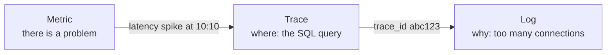
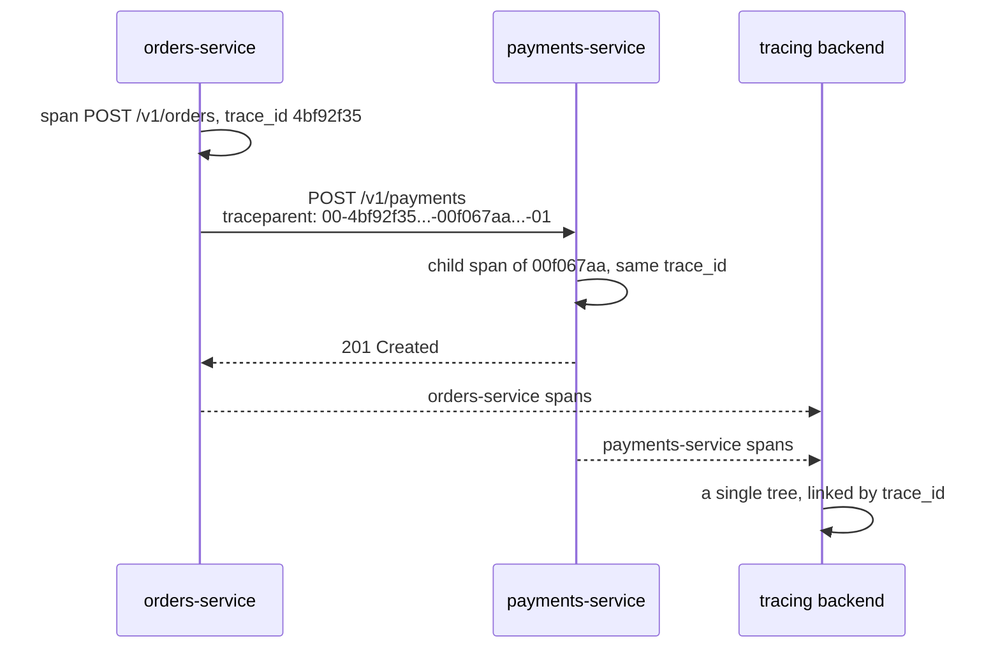
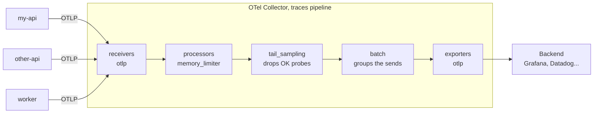
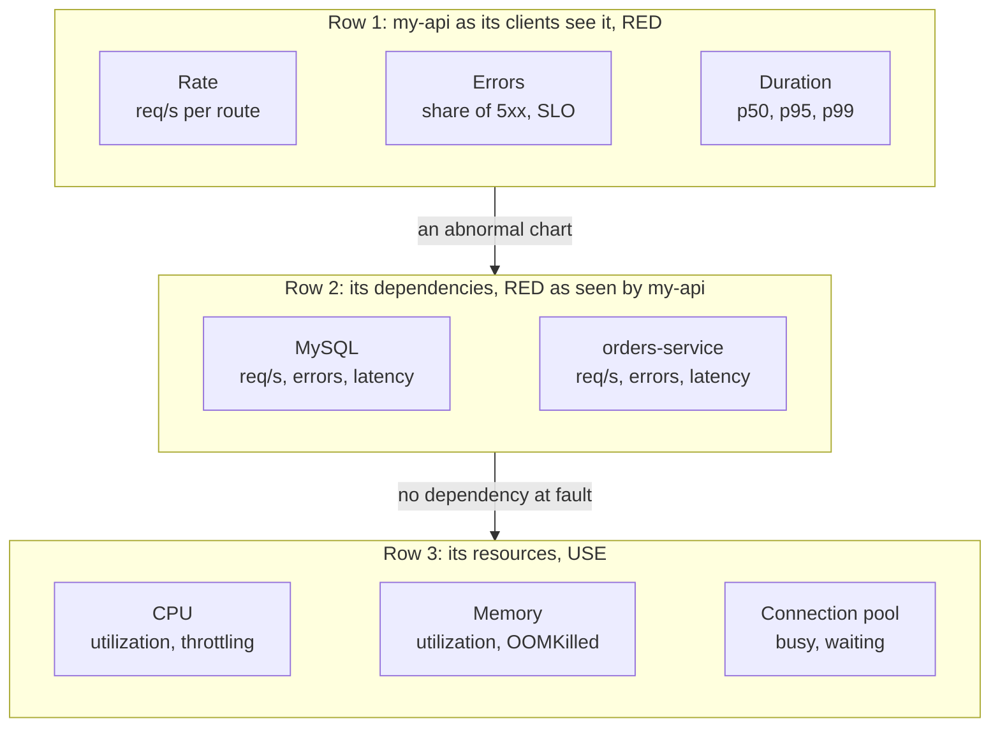
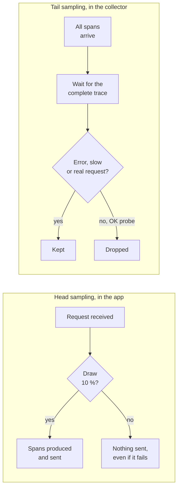
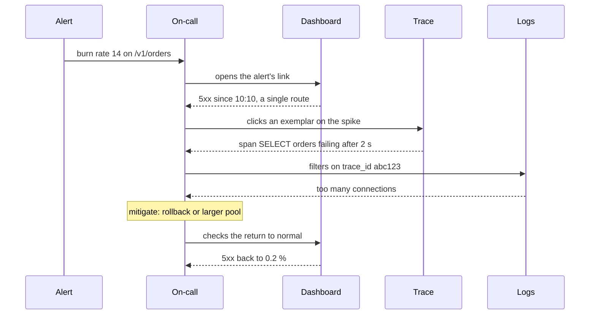
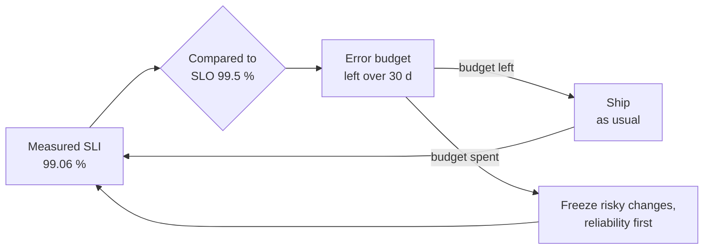
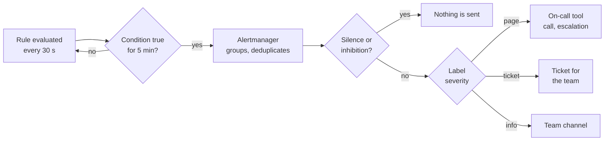

# Observability

!!! warning "Disclaimer"
    These notes are personal cheat sheets, not a source of truth. They reflect my own understanding and choices: their content remains subjective, despite the quotes and references it contains. It may be incomplete, simplified, inaccurate or outdated. Always check the official documentation before applying it. This content is provided as is, without any warranty: you use it at your own risk.

!!! abstract "Scales"
    The colored badges under the headings say at which scale a notion applies:

    - <span class="pill pill-scope pill-scope-code">Code</span> the classes, functions and modules of one program;
    - <span class="pill pill-scope pill-scope-app">Application</span> one service or application and its internal split;
    - <span class="pill pill-scope pill-scope-system">System</span> several services talking to each other over the network;
    - <span class="pill pill-scope pill-scope-infra">Infrastructure</span> servers, network, zones and clusters, physical or virtual;
    - <span class="pill pill-scope pill-scope-enterprise">Enterprise</span> the whole information system and its organization.

    Details and ambiguous words: [map of scales](architecture.md#map-of-scales).

<span class="term" data-term="observability">Observability</span> is the ability to understand what is happening inside an application from what it produces: its <span class="term" data-term="log">logs</span>, its <span class="term" data-term="metric">metrics</span> and its <span class="term" data-term="trace-distributed">traces</span>. It helps answer "does it work?" quickly and, when it does not, "where" and "why". These ideas apply everywhere, on <span class="term" data-term="kubernetes">Kubernetes</span> as well as on a plain <span class="term" data-term="virtual-machine">virtual machine</span>.

The page follows the order of an investigation: the three signals, then traces in detail, how to collect them, how to reduce their volume, and how to turn them into objectives and <span class="term" data-term="alert-monitoring">alerts</span>. It ends with a case study.

The business routes and the numbers are examples. `my-api` is a fictitious service. The terms API, route and HTTP codes are defined on the [Kubernetes](kubernetes.md#terminology) page.

:material-swap-horizontal: The tools mentioned on this page: which ones replace each other, which ones combine? See [Complementary or competing](outils.md#complementary-or-competing).
{ .doc-ref }

## Terminology

### Latency
The time between sending a <span class="term" data-term="http-request">request</span> and receiving the response. `120 ms` of <span class="term" data-term="latency">latency</span>: the response arrives 0.12 seconds after the request.


## The three signals

<a class="pill pill-scope pill-scope-system" href="../architecture/#map-of-scales">Scale · System</a> <a class="pill pill-scope pill-scope-infra" href="../architecture/#map-of-scales">Scale · Infrastructure</a> <span class="pill pill-status pill-status-ok" title="Still valid, checked November 2026">Current · 11/2026</span>

<a class="pill pill-practice" href="../observabilite/" title="level 2: it is automated">Practice · Observability · L2</a>
<a class="pill pill-dora" href="https://dora.dev/capabilities/monitoring-and-observability/">DORA · Monitoring and observability</a>


Example question: "why is my-api slow this morning?"

| Signal   | What it answers                                   |
|----------|---------------------------------------------------|
| <span class="term" data-term="metric">Metric</span>   | "average <span class="term" data-term="latency">latency</span> went from 50 ms to 2 s"          |
| <span class="term" data-term="trace-distributed">Trace</span>    | "the <span class="term" data-term="db-query">SQL query</span> is taking 1.9 s"                   |
| <span class="term" data-term="log">Log</span>      | "MySQL: too many connections"                     |

Usual order of an investigation: the metric says **that there is** a problem, the trace says **where**, the log says **why**.

!!! noob "As noob"
    It is a visit to the doctor: the thermometer (the metric) says I have a fever, the scan (the trace) shows which organ is affected, and my account of the week (the log) explains what happened. The one thing to remember: **the metric alerts, the trace locates, the log explains.**



:material-book-open-variant: Reference docs: [OpenTelemetry, Signals](https://opentelemetry.io/docs/concepts/signals/) (accessed November 2026)
{ .doc-ref }

### Log
A line of text written by the app at a given moment.

```json
{"time": "2026-10-20T10:00:10Z", "level": "ERROR", "msg": "MySQL connection refused", "pod": "my-api-7f9c-abcde"}
```

:material-book-open-variant: Reference docs: [OpenTelemetry, Logs](https://opentelemetry.io/docs/concepts/signals/logs/) (accessed November 2026)
{ .doc-ref }

### Metric
A number measured over time.

```
time    requests/s   error rate      CPU
10:00   120          0.1%            35%
10:05   118          0.1%            36%
10:10   125          12%             90%
```

:material-book-open-variant: Reference docs: [OpenTelemetry, Metrics](https://opentelemetry.io/docs/concepts/signals/metrics/) (accessed November 2026)
{ .doc-ref }

### Metric types
<span class="pill pill-status pill-status-ok" title="Still valid, checked November 2026">Current · 11/2026</span>

A metric has a type, which tells how to read it. Three types cover almost everything (names in Prometheus format):

| Type        | What it measures                                  | Example                          | How to read it                           |
|-------------|---------------------------------------------------|----------------------------------|------------------------------------------|
| Counter     | a total that only goes up (reset to 0 on restart) | `http_requests_total`            | look at its rate: requests per second    |
| Gauge       | an instant value, which goes up and down          | `memory_bytes`                   | look at the value itself                 |
| Histogram   | a spread of values across ranges (buckets)        | `http_request_duration_seconds`  | derive percentiles from it (p95)         |

```
http_requests_total{route="/v1/orders", status="500"}   1,204
memory_bytes{pod="my-api-7f9c-abcde"}                   268,435,456

http_request_duration_seconds_bucket{le="0.1"}   940    (940 requests under 100 ms)
http_request_duration_seconds_bucket{le="0.5"}   990
http_request_duration_seconds_bucket{le="1"}    1,000
http_request_duration_seconds_count             1,000
```
Buckets are cumulative: each one counts the requests faster than its `le` bound. The tool estimates the [p95 latency](#p95-latency) from them, and the precision depends on the chosen bounds.

Trap: I add a `user_id` label to `http_requests_total` to know who is calling. Each distinct value of a label creates one more series, so I get one series per user, millions in total, and storage explodes (a cardinality problem). I keep labels with few possible values (route, HTTP code, pod) and put the user identifier in logs or traces.

:material-book-open-variant: Reference docs: [Prometheus, Metric types](https://prometheus.io/docs/concepts/metric_types/) (accessed November 2026); [Prometheus, Metric and label naming](https://prometheus.io/docs/practices/naming/) (accessed November 2026)
{ .doc-ref }

## Traces in detail

<a class="pill pill-scope pill-scope-system" href="../architecture/#map-of-scales">Scale · System</a>

### Trace
The full path of a <span class="term" data-term="http-request">request</span>, end to end. It is made of <span class="term" data-term="span">spans</span>.

!!! noob "As noob"
    A trace is parcel tracking: each step (drop-off, sorting, truck, delivery) is a span with its time and duration, and the tracking number (the trace ID) links every step of the same parcel. The one thing to remember: **a trace tells the journey of a single request, step by step.**

```
Trace abc123 (a call to /readyz)
└─ span 1 : GET /readyz        12 ms
   └─ span 2 : MySQL connection        4 ms
      └─ span 3 : SELECT 1             1 ms
```

The same trace drawn on a timeline, as tracing tools show it (each bar is a span, offset by its start):

```mermaid
gantt
  title Trace abc123, GET /readyz, in milliseconds
  dateFormat x
  axisFormat %L
  section my-api
  span 1, GET /readyz       : 0, 12
  span 2, MySQL connection  : 3, 7
  span 3, SELECT 1          : 5, 6
```



:material-book-open-variant: Reference docs: [OpenTelemetry, Traces](https://opentelemetry.io/docs/concepts/signals/traces/) (accessed November 2026)
{ .doc-ref }

### Span
One step of a trace.

```
name:       SELECT 1
trace_id:   abc123
span_id:    s3
parent_id:  s2
duration:   1 ms
status:     OK
```

A readiness probe every 10 s, with 3 spans each time, makes 8,640 traces but 25,920 spans per day and per <span class="term" data-term="pod">pod</span>.

### Trace ID
The <span class="term" data-term="trace-id">identifier</span> shared by all the spans of the same trace, it is what links them together.

```
span s1  trace_id abc123   GET /readyz
span s2  trace_id abc123   MySQL connection
span s3  trace_id abc123   SELECT 1
span s9  trace_id def456   GET /livez   (another trace)
```

### Parent / child span
The <span class="term" data-term="parent-span">parent</span> is the span that triggers the other one.

```
s1  GET /readyz      parent: none (root span)
s2  MySQL connection        parent: s1
s3  SELECT 1                parent: s2
```

### Propagation across services
<span class="pill pill-status pill-status-ok" title="Still valid, checked November 2026">Current · 11/2026</span>

A trace is only "end to end" if the `trace_id` travels from one service to the next. It goes in a standard <span class="term" data-term="http-header">HTTP header</span>, `traceparent`, defined by W3C Trace Context (W3C Recommendation from 2021, to check): `00-<trace-id>-<parent-span-id>-<flags>`.

!!! noob "As noob"
    It is a patient's file number moving from reception to radiology: if reception forgets to pass it on, radiology opens a new file and nobody connects the two. The one thing to remember: **without the `traceparent` passed along, each service starts its own trace and the journey is cut.**

```
orders-service calls payments-service:

POST /v1/payments HTTP/1.1
Host: payments-service
traceparent: 00-4bf92f3577b34da6a3ce929d0e0e4736-00f067aa0ba902b7-01
             │  │                                │                └ flags (01 = trace sampled)
             │  │                                └ span_id of the calling span (in orders-service)
             │  └ trace_id, 32 hex characters, the same everywhere
             └ format version
```

The same exchange seen as a sequence: each service creates its spans, and the header carries the link.



payments-service reads the header, keeps the same `trace_id` and creates its spans as children of the calling span. The <span class="term" data-term="observability-backend">backend</span> stitches both pieces into a single tree:

```
Trace 4bf92f35... (POST /v1/orders)
└─ orders-service    POST /v1/orders            310 ms
   ├─ orders-service    INSERT orders              8 ms
   └─ orders-service    POST payments-service    280 ms   (span_id 00f067aa0ba902b7)
      └─ payments-service  POST /v1/payments     270 ms   (parent: 00f067aa0ba902b7)
         └─ payments-service  bank call          250 ms
```

<span class="term" data-term="opentelemetry">OpenTelemetry</span> <span class="term" data-term="instrumentation">instrumentation</span> injects the header into outgoing calls and reads it on incoming calls, with no code to write. A message put on a queue (Kafka, RabbitMQ) carries it the same way in its own headers, and the consumer picks up the trace. Trap: if a single service in the middle of the chain is not instrumented, or if a home-made HTTP client does not copy the header, the trace splits into two unrelated traces. I then see the request stop in one service, and another trace start out of nowhere in the next one.

:material-book-open-variant: Reference docs: [W3C, Trace Context](https://www.w3.org/TR/trace-context/) (W3C Recommendation, 2021); [OpenTelemetry, Context propagation](https://opentelemetry.io/docs/concepts/context-propagation/) (accessed November 2026)
{ .doc-ref }

## Collect and browse

<a class="pill pill-scope pill-scope-infra" href="../architecture/#map-of-scales">Scale · Infrastructure</a>

### Instrumentation
<span class="pill pill-status pill-status-ok" title="Still valid, checked November 2026">Current · 11/2026</span>

The code, often a library, that automatically creates the <span class="term" data-term="span">spans</span> in the app. It traces every <span class="term" data-term="endpoint">route</span>, <span class="term" data-term="probe">probes</span> included, without telling them apart from real <span class="term" data-term="network-traffic">traffic</span>.

```python
# Example: automatic instrumentation, every FastAPI route becomes a span
from opentelemetry.instrumentation.fastapi import FastAPIInstrumentor

FastAPIInstrumentor.instrument_app(app)
```

:material-book-open-variant: Reference docs: [OpenTelemetry, Instrumentation](https://opentelemetry.io/docs/concepts/instrumentation/) (accessed November 2026)
{ .doc-ref }

### OpenTelemetry (OTel)
<span class="pill pill-status pill-status-ok" title="Still valid, checked November 2026">Current · 11/2026</span>

*OpenTelemetry: complements Datadog, Prometheus, Tempo, Loki*
{ .tool-rel }

The <span class="term" data-term="open-source">open source</span> standard, born in 2019, for producing and shipping logs, metrics and traces. It does not depend on any tool: the same <span class="term" data-term="instrumentation">instrumentation</span> can send to Grafana, Datadog, Honeycomb or another tool.

:material-book-open-variant: Reference docs: [OpenTelemetry, What is OpenTelemetry?](https://opentelemetry.io/docs/what-is-opentelemetry/) (accessed November 2026)
{ .doc-ref }

### Collector (OTel Collector)
<span class="pill pill-status pill-status-ok" title="Still valid, checked November 2026">Current · 11/2026</span>

An intermediate service that receives traces from the apps, can filter or transform them, then sends them to the <span class="term" data-term="observability-backend">backend</span>.

```
my-api     ──┐
other-api  ──┼──  OTel Collector  ──  Grafana / Datadog
worker     ──┘    (filters, samples)
```
A rule set in the <span class="term" data-term="otel-collector">collector</span> applies to every service that goes through it.

Inside, the collector is a **pipeline** with three stages, declared in its configuration: *receivers* receive, *processors* transform, *exporters* send.



:material-book-open-variant: Reference docs: [OpenTelemetry, Collector](https://opentelemetry.io/docs/collector/) (accessed November 2026); [Collector, Configuration](https://opentelemetry.io/docs/collector/configuration/) (accessed November 2026)
{ .doc-ref }

### Observability backend
The tool where we browse the data. Examples: Grafana (Tempo, Loki), Datadog, Honeycomb.

### APM (Application Performance Monitoring)
The part of the backend dedicated to app traces and performance.

```
Service my-api, last 24 h
route                 calls     p95 latency   errors
GET /readyz    8,640     15 ms         0
GET /livez     2,880     3 ms          0
GET /v1/orders/{id}   410       120 ms        2
```

### A dashboard for one service: RED and USE
<span class="pill pill-status pill-status-ok" title="Still valid, checked November 2026">Current · 11/2026</span>

One dashboard per service answers in a few seconds "is my-api fine, and if not, on which side?". Two grids avoid piling up fifty charts in no order:

- **RED** (Tom Wilkie, 2018), for anything that receives requests: **R**ate (requests per second), **E**rrors (share of failed requests), **D**uration (p50, p95, p99 latency).
- **USE** (Brendan Gregg, 2012), for each resource: **U**tilization (share of time it is busy), **S**aturation (work waiting), **E**rrors (errors of the resource itself).

The four golden signals of Google's SRE book (2016: latency, traffic, errors, saturation) combine both. The dashboard reads top to bottom, from symptom to cause:



**When**: as soon as a service has on-call or an SLO; it is the page an alert's link opens. **Why**: without a common grid, every dashboard is different, and the person woken up loses time understanding the page before understanding the outage. The cost: exposing metrics for each dependency and each resource. **How**: one template shared by every service, the RED row on top with the SLO, a dozen charts at most; anything never used during an incident moves to another dashboard.

:material-book-open-variant: Reference docs: [Brendan Gregg, The USE Method](https://www.brendangregg.com/usemethod.html) (2012); [Tom Wilkie, The RED Method](https://grafana.com/blog/2018/08/02/the-red-method-how-to-instrument-your-services/) (2018)
{ .doc-ref }

## Measuring latency

<a class="pill pill-scope pill-scope-system" href="../architecture/#map-of-scales">Scale · System</a>

### p95 latency
<span class="pill pill-status pill-status-ok" title="Still valid, checked November 2026">Current · 11/2026</span>

95% of <span class="term" data-term="http-request">requests</span> are faster than this value. More telling than the average, which hides slow requests.

!!! noob "As noob"
    Let us picture 100 customers at a counter: the average mixes those served in one minute with those who waited an hour, and describes nobody. The p95 answers "95 customers out of 100 were served in under how long?". The one thing to remember: **the average hides the worst-served customers, the p95 brings them out.**

```
100 requests: 94 at 15 ms, 6 at 900 ms
average : 68 ms   (looks like no real request)
p50     : 15 ms   (the "typical" request)
p95     : 900 ms  (what the unluckiest 5% experience)
```

:material-book-open-variant: Reference docs: [Prometheus, Histograms and summaries](https://prometheus.io/docs/practices/histograms/) (accessed November 2026); [Google SRE book, Service Level Objectives](https://sre.google/sre-book/service-level-objectives/) (2016)
{ .doc-ref }

## Sampling

<a class="pill pill-scope pill-scope-system" href="../architecture/#map-of-scales">Scale · System</a> <a class="pill pill-scope pill-scope-infra" href="../architecture/#map-of-scales">Scale · Infrastructure</a>

### Sampling
<span class="pill pill-status pill-status-ok" title="Still valid, checked November 2026">Current · 11/2026</span>

Keeping only part of the <span class="term" data-term="trace-distributed">traces</span> to reduce volume and cost.

!!! noob "As noob"
    It is an opinion poll: instead of asking the whole country, we ask a sample, for far less money. Limit: a rare case (one error in a thousand) can slip through, hence tail sampling below. The one thing to remember: **we keep part of the traces to pay less, at the risk of missing rare cases.**

```
10,000 traces received, sampling at 10%, 1,000 traces kept
```

:material-book-open-variant: Reference docs: [OpenTelemetry, Sampling](https://opentelemetry.io/docs/concepts/sampling/) (accessed November 2026)
{ .doc-ref }

### Head sampling
<span class="pill pill-status pill-status-ok" title="Still valid, checked November 2026">Current · 11/2026</span>

The decision is made at the start of the <span class="term" data-term="http-request">request</span>, before knowing how it will end. An error can therefore be thrown away.

```
1,000 requests, head sampling at 10%
900 OK      : ~90 kept
100 errors  : ~10 kept, ~90 lost
```

### Tail sampling
<span class="pill pill-status pill-status-ok" title="Still valid, checked November 2026">Current · 11/2026</span>

The decision is made at the end, once the trace is complete, in the <span class="term" data-term="otel-collector">collector</span>.

!!! noob "As noob"
    Head sampling is picking at the cinema entrance which viewers we will interview; tail sampling is picking at the exit, once we know who hated the film. The one thing to remember: **tail sampling keeps errors and slow requests, at the cost of waiting for each trace to finish in the collector.**

```
trace                 status  duration  decision
GET /readyz    OK      12 ms     dropped (normal probe)
GET /readyz    ERROR   5 s       kept    (failing probe)
GET /livez     OK      2 ms      dropped (normal probe)
GET /v1/orders/42     OK      120 ms    kept    (real request)
```

Both decisions side by side:



Tail sampling costs more: to know whether a trace ends in an error, the collector must hold every trace in memory for a few seconds. And if I run several collector instances, all spans of a given trace must reach the same one, otherwise none of them sees the complete trace.

:material-book-open-variant: Reference docs: [Tail Sampling Processor](https://github.com/open-telemetry/opentelemetry-collector-contrib/tree/main/processor/tailsamplingprocessor) (accessed November 2026)
{ .doc-ref }

### Which filtering for which need

| I want to... | I use |
|---|---|
| never keep a trace for a <span class="term" data-term="endpoint">route</span> I do not care about, even when it fails | exclusion in the <span class="term" data-term="instrumentation">instrumentation</span> |
| pay less for storage by keeping, for example, one trace in ten at random, even if some errors get lost along the way | <span class="term" data-term="head-sampling">head sampling</span> |
| stop seeing thousands of successful <span class="term" data-term="probe">probes</span>, but keep the trace of a failing probe, the one that explains why a pod was restarted | <span class="term" data-term="tail-sampling">tail sampling</span> in the collector |
| write the rule once, and have it apply to every service without touching their code | collector (tail sampling or filter) |

### Noise
Data that takes up space but brings nothing: it costs storage and hides the useful data. Example: thousands of successful <span class="term" data-term="health-check">health check</span> traces around a few real requests.

## Linking the signals together

<a class="pill pill-scope pill-scope-system" href="../architecture/#map-of-scales">Scale · System</a>

### Log and trace correlation
<span class="pill pill-status pill-status-ok" title="Still valid, checked November 2026">Current · 11/2026</span>

If each <span class="term" data-term="log">log</span> line carries the `trace_id` of the current request, we go from a slow <span class="term" data-term="trace-distributed">trace</span> straight to the logs of that exact request, instead of searching through millions of lines.

```json
{"level": "ERROR", "msg": "MySQL connection refused", "trace_id": "abc123", "span_id": "s3"}
```
```
trace abc123, span s3 "SELECT 1" in error
  logs filtered on trace_id = abc123: "MySQL connection refused"
```
<span class="term" data-term="opentelemetry">OpenTelemetry</span> libraries can add the `trace_id` to logs automatically.

:material-book-open-variant: Reference docs: [OpenTelemetry, Logs](https://opentelemetry.io/docs/concepts/signals/logs/) (accessed November 2026)
{ .doc-ref }

### Exemplars
<span class="pill pill-status pill-status-ok" title="Still valid, checked November 2026">Current · 11/2026</span>

An <span class="term" data-term="exemplar">exemplar</span> is a link set on a <span class="term" data-term="metric">metric</span> point that points to a real trace from that moment. On a <span class="term" data-term="latency">latency</span> chart that climbs at 10:10, we click the spike and open a slow request from 10:10.

!!! noob "As noob"
    It is a pin stuck on a spike of the graph, with a label saying "here is a real request from that moment". The one thing to remember: **an exemplar leads from a point on a curve to the trace that explains it, in one click.**

:material-book-open-variant: Reference docs: [OpenTelemetry, Metrics Data Model, Exemplars](https://opentelemetry.io/docs/specs/otel/metrics/data-model/#exemplars) (accessed November 2026)
{ .doc-ref }

### From the alert to the cause
<span class="pill pill-status pill-status-ok" title="Still valid, checked November 2026">Current · 11/2026</span>

During an incident, these links form a path we follow in order. Example: my-api's burn rate alert fires at 10:12.



Each arrow assumes a link set up in advance: the dashboard address in the alert, exemplars on the metrics, the `trace_id` in the logs. Without them, each step becomes a manual search, at the moment time matters most.

:material-book-open-variant: Reference docs: [Google SRE book, Effective Troubleshooting](https://sre.google/sre-book/effective-troubleshooting/) (2016)
{ .doc-ref }

## Objectives and alerts

<a class="pill pill-scope pill-scope-system" href="../architecture/#map-of-scales">Scale · System</a>

<a class="pill pill-practice" href="../observabilite/" title="level 4: it is steered by measurement">Practice · Observability · L4</a>
<a class="pill pill-dora" href="https://dora.dev/capabilities/proactive-failure-notification/">DORA · Proactive failure notification</a>


### SLI, SLO, error budget
<span class="pill pill-status pill-status-ok" title="Still valid, checked November 2026">Current · 11/2026</span>

- **<span class="term" data-term="sli">SLI</span> (indicator)**: what we actually measure, a ratio between good requests and all requests. A "good" request is defined in advance. Example: on `/v1/orders`, answered without a 5xx error and in under 300 ms.
- **<span class="term" data-term="slo">SLO</span> (objective)**: the target the SLI must reach over a time window. Example: 99.5% over 30 days. The SLI is an observation, the SLO an internal promise.
- **<span class="term" data-term="error-budget">Error budget</span>**: what the objective allows us to miss. 99.5% over 30 days leaves 0.5% of failed requests, about 3 h 36 min of total downtime per month.

!!! noob "As noob"
    The error budget is a stock of jokers for the month: a 99.5% SLO gives me the right to fail 0.5% of requests. While jokers remain, we ship and take risks; once they are gone, we stop risky changes and fix things. The one thing to remember: **the error budget turns reliability into a quantity we spend to ship.**

```
SLI = good requests / total requests
from the 1st to the 12th: 800,000 requests, 792,500 without 5xx and under 300 ms
SLI = 792,500 / 800,000 = 99.06%   (below the 99.5% SLO)
```

```
SLO 99.5% over 30 days, 2,000,000 requests
budget: 10,000 failed requests
already used by the 12th of the month: 7,500 (75%)
decision: slow down risky production releases until the end of the month
```

From SLI to decision, the loop described in the Google SRE Workbook:



:material-book-open-variant: Reference docs: [Google SRE Workbook, Implementing SLOs](https://sre.google/workbook/implementing-slos/) (2018); [Error Budget Policy](https://sre.google/workbook/error-budget-policy/) (2018)
{ .doc-ref }

### Burn rate
<span class="pill pill-status pill-status-ok" title="Still valid, checked November 2026">Current · 11/2026</span>

The burn rate tells how fast the error budget is going, compared with the "right" pace. Burn rate 1: the budget runs out exactly at the end of the 30 days. Burn rate 10: it runs out in 3 days (30 / 10). It can also be computed as the observed error rate divided by the tolerated rate (0.5% for a 99.5% SLO).

!!! noob "As noob"
    It is fuel consumption on a trip: at burn rate 1, the tank runs dry right on arrival; at burn rate 10, I break down a tenth of the way. The one thing to remember: **we alert on how fast the budget melts, not only on how much is left.**

```
budget 10,000 failed requests over 30 days
right pace (burn rate 1)     : ~333 failed per day, 4,000 by the 12th
actual by the 12th           : 7,500 failed
burn rate = 7,500 / 4,000 = ~1.9   (budget empty around the 16th, not the 30th)
burn rate 10                 : 5% errors, ~3,333 failed per day, budget empty in 3 days
```

A typical alert combines two windows: a long one, so nobody gets woken up by a spike of a few seconds, and a short one, so the alert stops as soon as the problem is fixed. Values suggested by the Google SRE Workbook, chapter "Alerting on SLOs" (2018, to check):

| Condition                                         | Budget used              | Action             |
|---------------------------------------------------|--------------------------|--------------------|
| burn rate > 14.4 over 1 h **and** over 5 min      | 2% in 1 hour             | page on-call       |
| burn rate > 6 over 6 h **and** over 30 min        | 5% in 6 hours            | page on-call       |
| burn rate > 1 over 3 days **and** over 6 h        | 10% in 3 days            | ticket, no page    |

At 14.4, the 30-day budget would be empty in just over 2 days.

:material-book-open-variant: Reference docs: [Google SRE Workbook, Alerting on SLOs](https://sre.google/workbook/alerting-on-slos/) (2018)
{ .doc-ref }

### SLA and tolerated downtime (ITA)
<span class="pill pill-status pill-status-ok" title="Still valid, checked November 2026">Current · 11/2026</span>

- **<span class="term" data-term="sla">SLA</span> (agreement)**: the written commitment to a client, with a consequence when it is not met (service credit, penalty). It is always looser than the SLO, so the team is alerted well before it has to pay.
- **<span class="term" data-term="ita">ITA</span> (tolerated downtime, from the French "indisponibilité tolérée")**: the same percentage turned into total downtime over the period. It is the form the business and on-call people understand: "we are allowed 43 minutes of outage this month". The acronym is less common than SLA (to check depending on the organisation); we also meet MTD (maximum tolerable downtime) or RTO, which talk about the length of a single outage, not a total.

```
SLA (client contract)   99.5% per month   ITA 3 h 36 min    10% credit beyond that
SLO (internal target)   99.9% per month   ITA 43 min 12 s   alert, freeze on risky changes
SLI measured this month 99.93%            30 min of outage  SLO met, SLA met
```

| Availability | ITA over 30 days | ITA over a year (365 days) |
|--------------|------------------|----------------------------|
| 99%          | 7 h 12 min       | 3 d 15 h 36 min            |
| 99.5%        | 3 h 36 min       | 1 d 19 h 48 min            |
| 99.9%        | 43 min 12 s      | 8 h 45 min 36 s            |
| 99.95%       | 21 min 36 s      | 4 h 22 min 48 s            |
| 99.99%       | 4 min 19 s       | 52 min 34 s                |

Each extra "9" divides the ITA by 10. At 99.99%, a single failed 5-minute release is enough to break the month.

Two traps:

- **dependencies multiply**: a service that calls two 99.9% dependencies in series cannot promise better than about 99.8% (0.999 x 0.999), before even counting its own outages;
- **the contract defines what counts**: an SLA often excludes announced maintenance or outages caused by the client. Read its definition of downtime before comparing it to the SLI.

| Need | Notion |
|---|---|
| I want to know what really happened, for example what share of requests on `/v1/orders` answered without a 5xx error and in under 300 ms this month | SLI |
| my team wants to decide on its own when to ship and when to stop and fix things, based on a numeric target | SLO and error budget |
| I promise a client a service level in writing, with a credit or a penalty if it is not met | SLA |
| the business or on-call does not think in percentages and wants to know how many minutes of outage are allowed this month | ITA |

:material-book-open-variant: Reference docs: [Google SRE book, Availability Table](https://sre.google/sre-book/availability-table/) (2016)
{ .doc-ref }

### Alert on symptoms, not on causes
<span class="pill pill-status pill-status-ok" title="Still valid, checked November 2026">Current · 11/2026</span>

A good <span class="term" data-term="alert-monitoring">alert</span> describes what the user experiences, and someone must be able to act on it.

!!! noob "As noob"
    A fire alarm goes off when there is smoke in the room, not every time someone turns the oven on. The one thing to remember: **we wake someone up for what users experience, not for an internal number going up.**

| Alert                                          | Good or bad       | Why                                                |
|------------------------------------------------|-------------------|----------------------------------------------------|
| "CPU at 85%"                                   | bad               | often no visible effect, wakes people up for nothing |
| "5% of payments failing for 10 min"            | good              | direct user impact, clear action                   |
| "the error budget is burning 10 times too fast" (burn rate of 10) | good             | warns before the SLO is broken                     |
| "a <span class="term" data-term="pod">pod</span> restarted"                              | bad on its own    | <span class="term" data-term="kubernetes">Kubernetes</span> already fixed it, track it as a trend   |

:material-book-open-variant: Reference docs: [Google SRE book, Monitoring Distributed Systems](https://sre.google/sre-book/monitoring-distributed-systems/) (2016)
{ .doc-ref }

### Routing an alert to the right person
<span class="pill pill-status pill-status-ok" title="Still valid, checked November 2026">Current · 11/2026</span>

Between the rule and the person woken up, an alert goes through three filters. Prometheus evaluates the rule at a fixed interval, and the condition must hold for a duration (`for`) to avoid false starts. Alertmanager then groups similar alerts, removes duplicates, applies silences (an announced maintenance) and inhibitions (if the whole cluster is down, do not also send one alert per service). Finally it picks the receiver from the alert's labels.



```yaml
# Example: by default, alerts grouped to the team channel
route:
  receiver: team-core-chat
  group_by: [alertname, service]
  group_wait: 30s
  repeat_interval: 4h
  # Example: severity page to on-call, ticket to the team's tickets
  routes:
    - matchers: ['severity="page"']
      receiver: on-call-pager
    - matchers: ['severity="ticket"']
      receiver: team-core-tickets
```

The `severity` label is set in the rule, not in the tool: the team that writes the alert decides whether it wakes someone up. What happens when nobody answers is configured in the on-call tool (see [the escalation policy](incidents.md#sustainable-on-call)).

:material-book-open-variant: Reference docs: [Prometheus, Alerting rules](https://prometheus.io/docs/prometheus/latest/configuration/alerting_rules/) (accessed November 2026); [Prometheus, Alertmanager](https://prometheus.io/docs/alerting/latest/alertmanager/) (accessed November 2026)
{ .doc-ref }

## Case study: Kubernetes probe noise

<a class="pill pill-scope pill-scope-infra" href="../architecture/#map-of-scales">Scale · Infrastructure</a>


*Kubernetes: competes with Cloud Run; complements Docker, Helm, Argo CD*
{ .tool-rel }

[Kubernetes probes](kubernetes.md#probe) call the service every 10 to 30 seconds, day and night. The <span class="term" data-term="instrumentation">instrumentation</span> traces them like real <span class="term" data-term="network-traffic">traffic</span>. On a lightly used service, they end up making up almost all the <span class="term" data-term="trace-distributed">traces</span>.

```
my-api: readiness every 10 s (3 spans), liveness every 30 s (1 span)

env       spans 24 h   of which probes   share
prod      40,000       39,990            99.9%
staging   40,000       39,995            99.9%
dev       60,000       40,000            67%
```
These numbers are examples, computed from the probe rate above. In dev, the 20,000 <span class="term" data-term="span">spans</span> of the real requests are drowned in the <span class="term" data-term="telemetry-noise">noise</span>.

Why not simply exclude `/readyz` and `/livez` in the instrumentation: we would also lose the trace of a slow or failing <span class="term" data-term="probe">probe</span>, the one that explains why Kubernetes removed or restarted a <span class="term" data-term="pod">pod</span>.

The solution: **<span class="term" data-term="tail-sampling">tail sampling</span> in the <span class="term" data-term="otel-collector">collector</span>**. It sees each finished trace and decides:
```
GET /readyz   OK      12 ms   dropped
GET /readyz   ERROR   5 s     kept
GET /v1/orders/42    OK      120 ms  kept
```
And since the rule lives in the collector, it applies to every service at once.

## Pitfalls to avoid

- **A high-cardinality label**: I add a `user_id` label to `http_requests_total`, so I get one series per user and storage explodes. I keep labels with few values (route, HTTP code, pod) and put the user ID in logs or traces ([see Metric types](#metric-types)).
- **Following the average latency**: I watch the average, so slow requests vanish in the calculation and nobody sees what the unluckiest users go through. I look at the p95, and the p99 for extreme cases ([see p95 latency](#p95-latency)).
- **An uninstrumented service in the middle of the chain**: a service or a home-made HTTP client does not copy the `traceparent` header, so the trace splits into two unrelated traces. I instrument every service, and check that the header also travels in messages ([see Propagation across services](#propagation-across-services)).
- **Head sampling to cut volume**: I keep one trace in ten at random, from the start of the request, so I also throw away nine errors in ten. I use tail sampling in the collector, which keeps errors and slow requests ([see Tail sampling](#tail-sampling)).
- **Excluding probes in the instrumentation**: I remove `/readyz` and `/livez` from traces to cut the noise, so I lose the trace of the failing probe, the one that explains why a pod was restarted. I only drop successful probes, through tail sampling in the collector ([see the case study](#case-study-kubernetes-probe-noise)).
- **Logs without a `trace_id`**: my logs do not carry the trace ID, so during an incident I search by hand through millions of lines, just when time matters most. I let OpenTelemetry add the `trace_id` to every line ([see Log and trace correlation](#log-and-trace-correlation)).
- **Alerting on a cause**: I wake the on-call person for "CPU at 85%", often with no visible effect, so the team gets used to ignoring alerts. I alert on what the user experiences, or on a burn rate ([see Alert on symptoms](#alert-on-symptoms-not-on-causes)).
- **An SLA as tight as the SLO**: I promise the customer the same percentage as my internal objective, so the team is only alerted when it already has to pay. I keep the SLA looser than the SLO ([see SLA and tolerated downtime](#sla-and-tolerated-downtime-ita)).

## What interviews ask

The typical questions:

- "What is the difference between logs, metrics and traces?", "Where do you start an investigation?" How I answer: I say that the metric shows there is a problem, the trace where it is, the log why ([The three signals](#the-three-signals)).
- "Why the p95 rather than the average?", "What is a cardinality problem?" How I answer: I give a worked example where the average looks like no real request, then the `user_id` label ([p95 latency](#p95-latency), [Metric types](#metric-types)).
- "How does a trace follow a request from one service to the next?" How I answer: I cite the `traceparent` header, injected and read by the instrumentation ([Propagation across services](#propagation-across-services)).
- "Head or tail sampling?", "How do you cut the cost of traces without losing errors?" How I answer: I compare when the decision is made, and what tail sampling costs in collector memory ([Tail sampling](#tail-sampling)).
- "SLI, SLO, SLA: what is the difference?", "What is a good alert?" How I answer: I separate measurement, internal objective and contract, then I alert on the burn rate and on symptoms ([SLI, SLO, error budget](#sli-slo-error-budget), [Burn rate](#burn-rate), [Alert on symptoms](#alert-on-symptoms-not-on-causes)).
- "An alert fires at night: how do you get from the alert to the cause?" How I answer: I follow the path dashboard, exemplar, trace, logs, thanks to the links set up in advance ([From the alert to the cause](#from-the-alert-to-the-cause)).

What makes a good answer: follow the order of a real investigation with example figures (a latency spike at 10:10, a trace, a log), and say what each choice costs: storage, collector memory, alerts that wake people for nothing.
