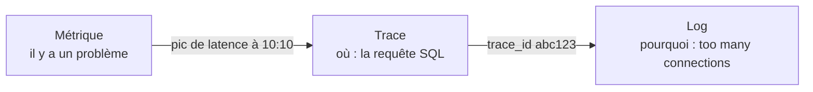
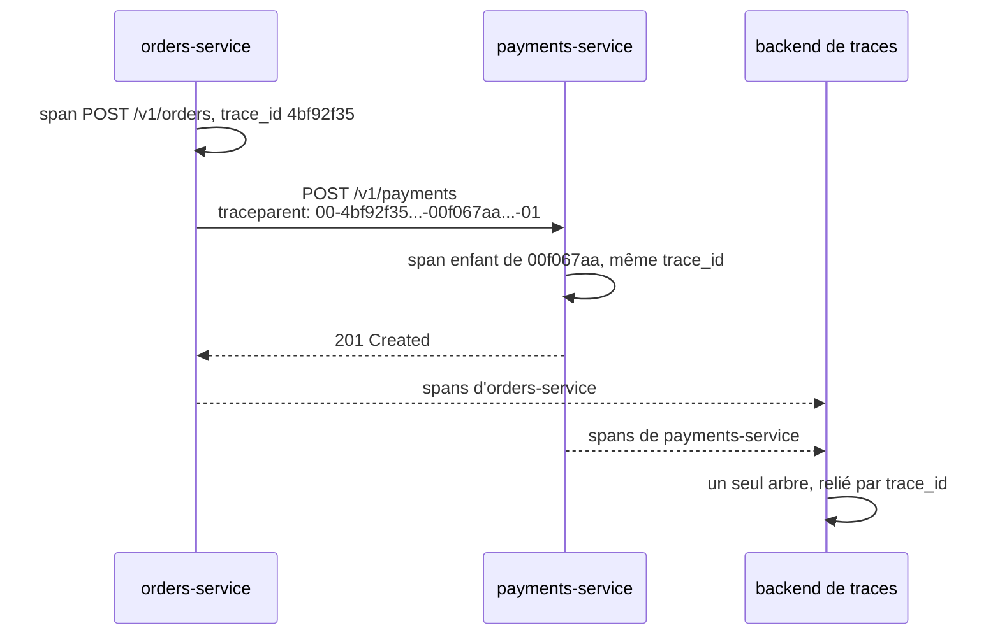
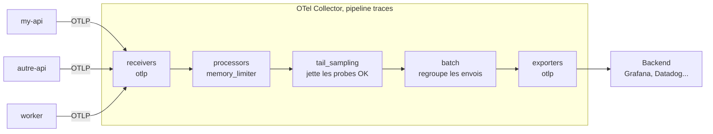
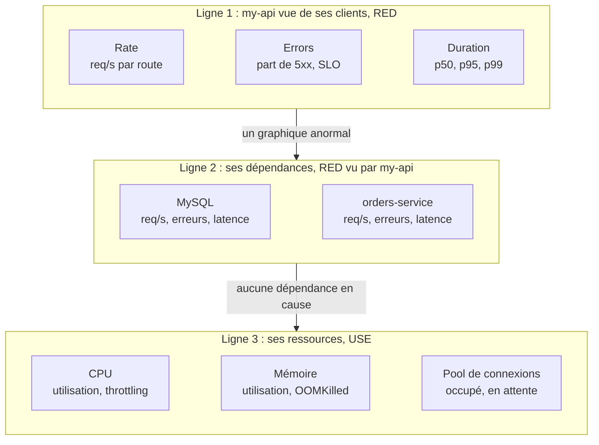
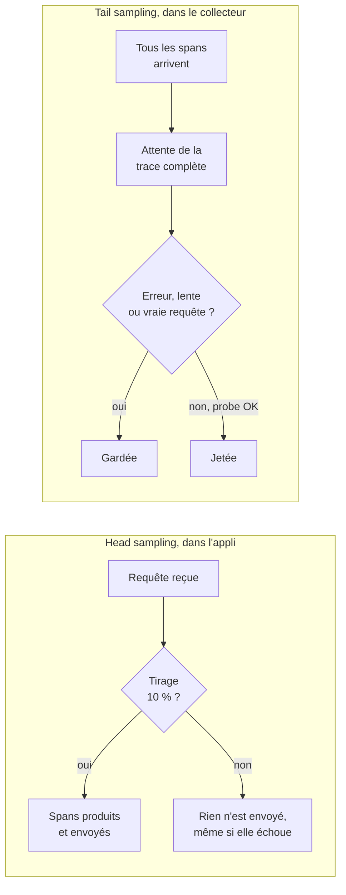
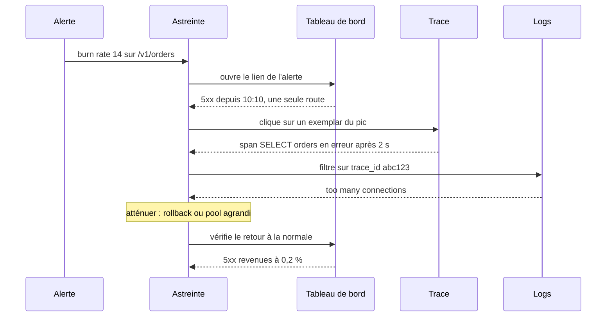
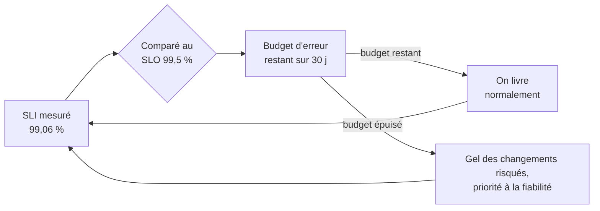
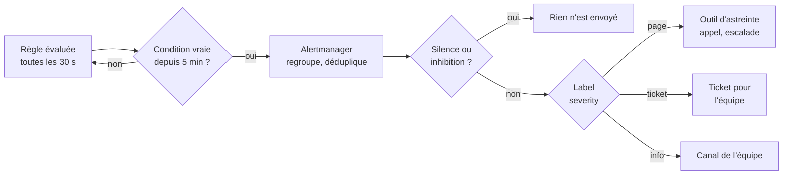

# Observabilité

!!! warning "Avertissement"
    Ces notes sont des pense-bêtes personnels, pas une source de vérité. Elles reflètent ma compréhension et mes choix : leur contenu reste subjectif, malgré les citations et les références qu'il contient. Il peut être incomplet, simplifié, inexact ou dépassé. Vérifiez toujours dans la documentation officielle avant de l'appliquer. Ce contenu est fourni tel quel, sans aucune garantie : son utilisation se fait sous votre seule responsabilité.

!!! abstract "Les échelles"
    Les pastilles de couleur sous les titres disent à quelle échelle une notion s'applique :

    - <span class="pill pill-scope pill-scope-code">Code</span> les classes, fonctions et modules d'un programme ;
    - <span class="pill pill-scope pill-scope-app">Application</span> un service ou une application et son découpage interne ;
    - <span class="pill pill-scope pill-scope-system">Système</span> plusieurs services qui communiquent par le réseau ;
    - <span class="pill pill-scope pill-scope-infra">Infrastructure</span> les serveurs, le réseau, les zones et les clusters, physiques ou virtuels ;
    - <span class="pill pill-scope pill-scope-enterprise">Entreprise</span> le système d'information entier et son organisation.

    Détail et mots ambigus : [carte des échelles](architecture.md#carte-des-echelles).

L'<span class="term" data-term="observability">observabilité</span>, c'est la capacité à comprendre ce qui se passe dans une application à partir de ce qu'elle produit : ses <span class="term" data-term="log">logs</span>, ses <span class="term" data-term="metric">métriques</span> et ses <span class="term" data-term="trace-distributed">traces</span>. Elle sert à répondre vite à « est-ce que ça marche ? » et, quand ça ne marche pas, à « où » et « pourquoi ». Ces notions valent partout, sur <span class="term" data-term="kubernetes">Kubernetes</span> comme sur une simple <span class="term" data-term="virtual-machine">machine virtuelle</span>.

La page suit l'ordre d'une enquête : les trois signaux, puis le détail des traces, la façon de les collecter, de réduire leur volume, et comment en tirer des objectifs et des <span class="term" data-term="alert-monitoring">alertes</span>. Elle finit par un cas concret.

Les routes métier et les chiffres sont des exemples. `my-api` est un service fictif. Les termes API, route et codes HTTP sont définis dans la page [Kubernetes](kubernetes.md#vocabulaire).

:material-swap-horizontal: Les outils cités dans cette page : lesquels se remplacent, lesquels se combinent ? Voir [Complémentaires ou concurrents](outils.md#complementaires-ou-concurrents).
{ .doc-ref }

## Vocabulaire

### Latence
Le temps entre l'envoi d'une <span class="term" data-term="http-request">requête</span> et la réception de la réponse. `120 ms` de <span class="term" data-term="latency">latence</span> : la réponse arrive 0,12 seconde après la demande.


## Les trois signaux

<a class="pill pill-scope pill-scope-system" href="../architecture/#carte-des-echelles">Échelle · Système</a> <a class="pill pill-scope pill-scope-infra" href="../architecture/#carte-des-echelles">Échelle · Infrastructure</a> <span class="pill pill-status pill-status-ok" title="Toujours valable, vérifié en novembre 2026">Valable · 11/2026</span>

<a class="pill pill-practice" href="../observabilite/" title="niveau 2 : elle est automatisée">Pratique · Observabilité · N2</a>
<a class="pill pill-dora" href="https://dora.dev/capabilities/monitoring-and-observability/">DORA · Monitoring and observability</a>


Exemple de question : « pourquoi my-api est lente ce matin ? »

| Signal   | Ce qu'il répond                                   |
|----------|---------------------------------------------------|
| <span class="term" data-term="metric">Métrique</span> | « la <span class="term" data-term="latency">latence</span> moyenne est passée de 50 ms à 2 s »  |
| <span class="term" data-term="trace-distributed">Trace</span>    | « c'est la <span class="term" data-term="db-query">requête SQL</span> qui prend 1,9 s »          |
| <span class="term" data-term="log">Log</span>      | « MySQL: too many connections »                   |

Ordre habituel d'une enquête : la métrique dit **qu'il y a** un problème, la trace dit **où**, le log dit **pourquoi**.

!!! noob "As noob"
    C'est une consultation médicale : le thermomètre (la métrique) dit que j'ai de la fièvre, l'examen (la trace) montre quel organe est touché, et mon récit de la semaine (le log) explique ce qui s'est passé. La phrase à retenir : **la métrique alerte, la trace localise, le log explique.**



:material-book-open-variant: Doc de référence : [OpenTelemetry, Signals](https://opentelemetry.io/docs/concepts/signals/) (consultée en novembre 2026)
{ .doc-ref }

### Log
Une ligne de texte écrite par l'appli à un instant donné.

```json
{"time": "2026-10-20T10:00:10Z", "level": "ERROR", "msg": "MySQL connection refused", "pod": "my-api-7f9c-abcde"}
```

:material-book-open-variant: Doc de référence : [OpenTelemetry, Logs](https://opentelemetry.io/docs/concepts/signals/logs/) (consultée en novembre 2026)
{ .doc-ref }

### Métrique
Un chiffre mesuré dans le temps.

```
heure   requêtes/s   taux d'erreur   CPU
10:00   120          0,1 %           35 %
10:05   118          0,1 %           36 %
10:10   125          12 %            90 %
```

:material-book-open-variant: Doc de référence : [OpenTelemetry, Metrics](https://opentelemetry.io/docs/concepts/signals/metrics/) (consultée en novembre 2026)
{ .doc-ref }

### Types de métriques
<span class="pill pill-status pill-status-ok" title="Toujours valable, vérifié en novembre 2026">Valable · 11/2026</span>

Une métrique a un type, qui dit comment la lire. Trois types couvrent presque tout (noms au format Prometheus) :

| Type        | Ce qu'il mesure                                   | Exemple                          | Comment le lire                          |
|-------------|---------------------------------------------------|----------------------------------|------------------------------------------|
| Counter     | un total qui ne fait que monter (remis à 0 au redémarrage) | `http_requests_total`   | on regarde sa vitesse : requêtes par seconde |
| Gauge       | une valeur instantanée, qui monte et descend      | `memory_bytes`                   | on regarde la valeur elle-même           |
| Histogram   | une répartition de valeurs dans des tranches (buckets) | `http_request_duration_seconds` | on en tire des percentiles (p95)        |

```
http_requests_total{route="/v1/orders", status="500"}   1 204
memory_bytes{pod="my-api-7f9c-abcde"}                   268 435 456

http_request_duration_seconds_bucket{le="0.1"}   940    (940 requêtes en moins de 100 ms)
http_request_duration_seconds_bucket{le="0.5"}   990
http_request_duration_seconds_bucket{le="1"}    1 000
http_request_duration_seconds_count             1 000
```
Les buckets sont cumulés : chacun compte les requêtes plus rapides que sa borne `le`. C'est à partir d'eux que l'outil estime la [latence p95](#latence-p95), et la précision dépend des bornes choisies.

Piège : j'ajoute un label `user_id` à `http_requests_total` pour savoir qui appelle. Chaque valeur différente d'un label crée une série de plus, donc j'obtiens une série par utilisateur, des millions au total, et le stockage explose (problème de cardinalité). Je garde des labels aux valeurs peu nombreuses (route, code HTTP, pod) et je mets l'identifiant de l'utilisateur dans les logs ou les traces.

:material-book-open-variant: Doc de référence : [Prometheus, Metric types](https://prometheus.io/docs/concepts/metric_types/) (consultée en novembre 2026) ; [Prometheus, Metric and label naming](https://prometheus.io/docs/practices/naming/) (consultée en novembre 2026)
{ .doc-ref }

## Les traces en détail

<a class="pill pill-scope pill-scope-system" href="../architecture/#carte-des-echelles">Échelle · Système</a>

### Trace
Le parcours complet d'une <span class="term" data-term="http-request">requête</span>, de bout en bout. Elle est composée de <span class="term" data-term="span">spans</span>.

!!! noob "As noob"
    Une trace, c'est le suivi d'un colis : chaque étape (dépôt, tri, camion, livraison) est un span avec son heure et sa durée, et le numéro de suivi (le trace ID) relie toutes les étapes du même colis. La phrase à retenir : **une trace raconte le voyage d'une seule requête, étape par étape.**

```
Trace abc123 (un appel à /readyz)
└─ span 1 : GET /readyz        12 ms
   └─ span 2 : connexion MySQL         4 ms
      └─ span 3 : SELECT 1             1 ms
```

La même trace dessinée sur une ligne de temps, comme dans les outils de traces (chaque barre est un span, décalée selon son début) :

```mermaid
gantt
  title Trace abc123, GET /readyz, en millisecondes
  dateFormat x
  axisFormat %L
  section my-api
  span 1, GET /readyz      : 0, 12
  span 2, connexion MySQL  : 3, 7
  span 3, SELECT 1         : 5, 6
```



:material-book-open-variant: Doc de référence : [OpenTelemetry, Traces](https://opentelemetry.io/docs/concepts/signals/traces/) (consultée en novembre 2026)
{ .doc-ref }

### Span
Une étape d'une trace.

```
name:       SELECT 1
trace_id:   abc123
span_id:    s3
parent_id:  s2
duration:   1 ms
status:     OK
```

Une readiness probe toutes les 10 s, avec 3 spans à chaque fois, fait 8 640 traces mais 25 920 spans par jour et par <span class="term" data-term="pod">pod</span>.

### Trace ID
L'<span class="term" data-term="trace-id">identifiant</span> partagé par tous les spans d'une même trace, c'est ce qui les relie entre eux.

```
span s1  trace_id abc123   GET /readyz
span s2  trace_id abc123   connexion MySQL
span s3  trace_id abc123   SELECT 1
span s9  trace_id def456   GET /livez   (autre trace)
```

### Span parent / enfant
Le <span class="term" data-term="parent-span">parent</span> est le span qui déclenche l'autre.

```
s1  GET /readyz      parent: aucun (span racine)
s2  connexion MySQL         parent: s1
s3  SELECT 1                parent: s2
```

### Propagation entre services
<span class="pill pill-status pill-status-ok" title="Toujours valable, vérifié en novembre 2026">Valable · 11/2026</span>

Une trace n'est « de bout en bout » que si le `trace_id` voyage d'un service à l'autre. Il passe dans un <span class="term" data-term="http-header">en-tête HTTP</span> standard, `traceparent`, défini par W3C Trace Context (Recommandation W3C de 2021, à vérifier) : `00-<trace-id>-<parent-span-id>-<flags>`.

!!! noob "As noob"
    C'est le numéro de dossier d'un patient qui passe de l'accueil à la radiologie : si l'accueil oublie de le transmettre, la radiologie ouvre un nouveau dossier et plus personne ne fait le lien. La phrase à retenir : **sans le `traceparent` transmis, chaque service démarre sa propre trace et le parcours se coupe.**

```
orders-service appelle payments-service :

POST /v1/payments HTTP/1.1
Host: payments-service
traceparent: 00-4bf92f3577b34da6a3ce929d0e0e4736-00f067aa0ba902b7-01
             │  │                                │                └ flags (01 = trace échantillonnée)
             │  │                                └ span_id du span appelant (dans orders-service)
             │  └ trace_id, 32 caractères hexadécimaux, le même partout
             └ version du format
```

Le même échange vu comme une séquence : chaque service crée ses spans, et l'en-tête porte le lien.



payments-service lit l'en-tête, garde le même `trace_id` et crée ses spans comme enfants du span appelant. Le <span class="term" data-term="observability-backend">backend</span> recolle les deux morceaux en un seul arbre :

```
Trace 4bf92f35... (POST /v1/orders)
└─ orders-service    POST /v1/orders            310 ms
   ├─ orders-service    INSERT orders              8 ms
   └─ orders-service    POST payments-service    280 ms   (span_id 00f067aa0ba902b7)
      └─ payments-service  POST /v1/payments     270 ms   (parent : 00f067aa0ba902b7)
         └─ payments-service  appel banque       250 ms
```

L'<span class="term" data-term="instrumentation">instrumentation</span> <span class="term" data-term="opentelemetry">OpenTelemetry</span> injecte l'en-tête dans les appels sortants et le lit sur les appels entrants, sans code à écrire. Un message posé dans une file (Kafka, RabbitMQ) le transporte de la même façon dans ses propres en-têtes, et le consommateur reprend la trace. Piège : si un seul service au milieu de la chaîne n'est pas instrumenté, ou si un client HTTP maison ne recopie pas l'en-tête, la trace se coupe en deux traces sans lien. Je vois alors la requête s'arrêter dans un service, et une autre trace démarrer de nulle part dans le suivant.

:material-book-open-variant: Doc de référence : [W3C, Trace Context](https://www.w3.org/TR/trace-context/) (Recommandation W3C, 2021) ; [OpenTelemetry, Context propagation](https://opentelemetry.io/docs/concepts/context-propagation/) (consultée en novembre 2026)
{ .doc-ref }

## Collecter et consulter

<a class="pill pill-scope pill-scope-infra" href="../architecture/#carte-des-echelles">Échelle · Infrastructure</a>

### Instrumentation
<span class="pill pill-status pill-status-ok" title="Toujours valable, vérifié en novembre 2026">Valable · 11/2026</span>

Le code, souvent une bibliothèque, qui crée automatiquement les <span class="term" data-term="span">spans</span> dans l'appli. Elle trace toutes les <span class="term" data-term="endpoint">routes</span>, <span class="term" data-term="probe">probes</span> comprises, sans faire la différence avec du vrai <span class="term" data-term="network-traffic">trafic</span>.

```python
# Exemple : instrumentation automatique, chaque route FastAPI devient un span
from opentelemetry.instrumentation.fastapi import FastAPIInstrumentor

FastAPIInstrumentor.instrument_app(app)
```

:material-book-open-variant: Doc de référence : [OpenTelemetry, Instrumentation](https://opentelemetry.io/docs/concepts/instrumentation/) (consultée en novembre 2026)
{ .doc-ref }

### OpenTelemetry (OTel)
<span class="pill pill-status pill-status-ok" title="Toujours valable, vérifié en novembre 2026">Valable · 11/2026</span>

*OpenTelemetry : complémentaire de Datadog, Prometheus, Tempo, Loki*
{ .tool-rel }

Le standard <span class="term" data-term="open-source">open source</span>, né en 2019, pour produire et transporter les logs, les métriques et les traces. Il ne dépend d'aucun outil : la même <span class="term" data-term="instrumentation">instrumentation</span> peut envoyer vers Grafana, Datadog, Honeycomb ou un autre outil.

:material-book-open-variant: Doc de référence : [OpenTelemetry, What is OpenTelemetry?](https://opentelemetry.io/docs/what-is-opentelemetry/) (consultée en novembre 2026)
{ .doc-ref }

### Collecteur (OTel Collector)
<span class="pill pill-status pill-status-ok" title="Toujours valable, vérifié en novembre 2026">Valable · 11/2026</span>

Un service intermédiaire qui reçoit les traces des applis, peut les filtrer ou les transformer, puis les envoie au <span class="term" data-term="observability-backend">backend</span>.

```
my-api     ──┐
autre-api  ──┼──  OTel Collector  ──  Grafana / Datadog
worker     ──┘    (filtre, échantillonne)
```
Une règle posée dans le <span class="term" data-term="otel-collector">collecteur</span> s'applique à tous les services qui passent par lui.

À l'intérieur, le collecteur est un **pipeline** en trois étages, déclarés dans sa configuration : les *receivers* reçoivent, les *processors* transforment, les *exporters* envoient.



:material-book-open-variant: Doc de référence : [OpenTelemetry, Collector](https://opentelemetry.io/docs/collector/) (consultée en novembre 2026) ; [Collector, Configuration](https://opentelemetry.io/docs/collector/configuration/) (consultée en novembre 2026)
{ .doc-ref }

### Backend d'observabilité
L'outil où on consulte les données. Exemples : Grafana (Tempo, Loki), Datadog, Honeycomb.

### APM (Application Performance Monitoring)
La partie du backend dédiée aux traces et aux performances des applis.

```
Service my-api, dernières 24 h
route                 appels    latence p95   erreurs
GET /readyz    8 640     15 ms         0
GET /livez     2 880     3 ms          0
GET /v1/orders/{id}   410       120 ms        2
```

### Tableau de bord d'un service : RED et USE
<span class="pill pill-status pill-status-ok" title="Toujours valable, vérifié en novembre 2026">Valable · 11/2026</span>

Un tableau de bord par service répond en quelques secondes à « est-ce que my-api va bien, et sinon, de quel côté ? ». Deux grilles évitent d'empiler cinquante graphiques sans ordre :

- **RED** (Tom Wilkie, 2018), pour tout ce qui reçoit des requêtes : **R**ate (requêtes par seconde), **E**rrors (part des requêtes en erreur), **D**uration (latence p50, p95, p99).
- **USE** (Brendan Gregg, 2012), pour chaque ressource : **U**tilization (part du temps où elle est occupée), **S**aturation (travail en attente), **E**rrors (erreurs de la ressource elle-même).

Les quatre signaux dorés du livre SRE de Google (2016 : latence, trafic, erreurs, saturation) réunissent les deux. Le tableau se lit de haut en bas, du symptôme vers la cause :



**Quand** : dès qu'un service a une astreinte ou un SLO ; c'est la page qu'ouvre le lien d'une alerte. **Pourquoi** : sans grille commune, chaque tableau de bord est différent, et la personne réveillée perd du temps à comprendre la page avant de comprendre la panne. Le coût : exposer des métriques pour chaque dépendance et chaque ressource. **Comment** : un modèle partagé par tous les services, la ligne RED en haut avec le SLO, une dizaine de graphiques au plus ; ce qui ne sert jamais pendant un incident part dans un autre tableau.

:material-book-open-variant: Doc de référence : [Brendan Gregg, The USE Method](https://www.brendangregg.com/usemethod.html) (2012) ; [Tom Wilkie, The RED Method](https://grafana.com/blog/2018/08/02/the-red-method-how-to-instrument-your-services/) (2018)
{ .doc-ref }

## Mesurer la latence

<a class="pill pill-scope pill-scope-system" href="../architecture/#carte-des-echelles">Échelle · Système</a>

### Latence p95
<span class="pill pill-status pill-status-ok" title="Toujours valable, vérifié en novembre 2026">Valable · 11/2026</span>

95 % des <span class="term" data-term="http-request">requêtes</span> sont plus rapides que cette valeur. Plus parlant que la moyenne, qui cache les requêtes lentes.

!!! noob "As noob"
    Imaginons 100 clients à un guichet : la moyenne mélange ceux servis en une minute et ceux qui ont attendu une heure, et ne décrit personne. Le p95 répond à « 95 clients sur 100 ont été servis en moins de combien ? ». La phrase à retenir : **la moyenne cache les clients les plus mal servis, le p95 les fait apparaître.**

```
100 requêtes : 94 à 15 ms, 6 à 900 ms
moyenne : 68 ms   (ne ressemble à aucune requête réelle)
p50     : 15 ms   (la requête « typique »)
p95     : 900 ms  (ce que vivent les 5 % les plus malchanceux)
```

:material-book-open-variant: Doc de référence : [Prometheus, Histograms and summaries](https://prometheus.io/docs/practices/histograms/) (consultée en novembre 2026) ; [Google SRE book, Service Level Objectives](https://sre.google/sre-book/service-level-objectives/) (2016)
{ .doc-ref }

## Échantillonnage

<a class="pill pill-scope pill-scope-system" href="../architecture/#carte-des-echelles">Échelle · Système</a> <a class="pill pill-scope pill-scope-infra" href="../architecture/#carte-des-echelles">Échelle · Infrastructure</a>

### Sampling (échantillonnage)
<span class="pill pill-status pill-status-ok" title="Toujours valable, vérifié en novembre 2026">Valable · 11/2026</span>

Garder seulement une partie des <span class="term" data-term="trace-distributed">traces</span> pour réduire le volume et le coût.

!!! noob "As noob"
    C'est un sondage : au lieu d'interroger tout le pays, on interroge un échantillon, pour bien moins cher. Limite : un cas rare (une erreur sur mille) peut passer entre les mailles, d'où le tail sampling plus bas. La phrase à retenir : **on garde une partie des traces pour payer moins, au risque de rater les cas rares.**

```
10 000 traces reçues, sampling à 10 %, 1 000 traces gardées
```

:material-book-open-variant: Doc de référence : [OpenTelemetry, Sampling](https://opentelemetry.io/docs/concepts/sampling/) (consultée en novembre 2026)
{ .doc-ref }

### Head sampling
<span class="pill pill-status pill-status-ok" title="Toujours valable, vérifié en novembre 2026">Valable · 11/2026</span>

La décision se prend au début de la <span class="term" data-term="http-request">requête</span>, avant de savoir comment elle va se terminer. Une erreur peut donc être jetée.

```
1 000 requêtes, head sampling à 10 %
900 OK      : ~90 gardées
100 erreurs : ~10 gardées, ~90 perdues
```

### Tail sampling
<span class="pill pill-status pill-status-ok" title="Toujours valable, vérifié en novembre 2026">Valable · 11/2026</span>

La décision se prend à la fin, une fois la trace complète, dans le <span class="term" data-term="otel-collector">collecteur</span>.

!!! noob "As noob"
    Le head sampling, c'est choisir à l'entrée du cinéma quels spectateurs on interrogera ; le tail sampling, c'est choisir à la sortie, une fois qu'on sait qui a détesté le film. La phrase à retenir : **le tail sampling garde les erreurs et les lenteurs, au prix d'attendre la fin de chaque trace dans le collecteur.**

```
trace                 statut  durée   décision
GET /readyz    OK      12 ms   jetée   (probe normale)
GET /readyz    ERROR   5 s     gardée  (probe en échec)
GET /livez     OK      2 ms    jetée   (probe normale)
GET /v1/orders/42     OK      120 ms  gardée  (vraie requête)
```

Les deux décisions côte à côte :



Le tail sampling coûte plus cher : pour savoir si une trace finit en erreur, le collecteur doit garder toutes les traces en mémoire quelques secondes. Et si j'ai plusieurs instances du collecteur, tous les spans d'une même trace doivent arriver à la même, sinon aucune ne voit la trace complète.

:material-book-open-variant: Doc de référence : [Tail Sampling Processor](https://github.com/open-telemetry/opentelemetry-collector-contrib/tree/main/processor/tailsamplingprocessor) (consultée en novembre 2026)
{ .doc-ref }

### Quel filtrage pour quel besoin

| Je veux... | J'utilise |
|---|---|
| ne jamais garder de trace pour une <span class="term" data-term="endpoint">route</span> qui ne m'intéresse pas, même quand elle échoue | exclusion dans l'<span class="term" data-term="instrumentation">instrumentation</span> |
| payer moins de stockage en gardant, par exemple, une trace sur dix au hasard, quitte à perdre des erreurs au passage | <span class="term" data-term="head-sampling">head sampling</span> |
| ne plus voir les milliers de <span class="term" data-term="probe">probes</span> réussies, mais garder la trace d'une probe en échec, celle qui explique pourquoi un pod a été redémarré | <span class="term" data-term="tail-sampling">tail sampling</span> dans le collecteur |
| écrire la règle une seule fois, et qu'elle s'applique à tous les services sans toucher à leur code | collecteur (tail sampling ou filtre) |

### Bruit
Des données qui prennent de la place mais n'apportent rien : elles coûtent en stockage et cachent les données utiles. Exemple : des milliers de traces de <span class="term" data-term="health-check">health checks</span> réussis autour de quelques vraies requêtes.

## Relier les signaux entre eux

<a class="pill pill-scope pill-scope-system" href="../architecture/#carte-des-echelles">Échelle · Système</a>

### Corrélation logs et traces
<span class="pill pill-status pill-status-ok" title="Toujours valable, vérifié en novembre 2026">Valable · 11/2026</span>

Si chaque ligne de <span class="term" data-term="log">log</span> porte le `trace_id` de la requête en cours, on passe d'une <span class="term" data-term="trace-distributed">trace</span> lente directement aux logs de cette requête précise, au lieu de chercher dans des millions de lignes.

```json
{"level": "ERROR", "msg": "MySQL connection refused", "trace_id": "abc123", "span_id": "s3"}
```
```
trace abc123, span s3 « SELECT 1 » en erreur
  logs filtrés sur trace_id = abc123 : « MySQL connection refused »
```
Les bibliothèques <span class="term" data-term="opentelemetry">OpenTelemetry</span> savent ajouter le `trace_id` aux logs automatiquement.

:material-book-open-variant: Doc de référence : [OpenTelemetry, Logs](https://opentelemetry.io/docs/concepts/signals/logs/) (consultée en novembre 2026)
{ .doc-ref }

### Exemplars
<span class="pill pill-status pill-status-ok" title="Toujours valable, vérifié en novembre 2026">Valable · 11/2026</span>

Un <span class="term" data-term="exemplar">exemplar</span> est un lien posé sur un point d'une <span class="term" data-term="metric">métrique</span> vers une trace réelle de ce moment. Sur un graphique de <span class="term" data-term="latency">latence</span> qui grimpe à 10:10, on clique sur le pic et on ouvre une requête lente de 10:10.

!!! noob "As noob"
    C'est une punaise plantée sur un pic du graphique, avec une étiquette « voici une vraie requête de ce moment-là ». La phrase à retenir : **un exemplar fait passer d'un point de courbe à la trace qui l'explique, en un clic.**

:material-book-open-variant: Doc de référence : [OpenTelemetry, Metrics Data Model, Exemplars](https://opentelemetry.io/docs/specs/otel/metrics/data-model/#exemplars) (consultée en novembre 2026)
{ .doc-ref }

### De l'alerte à la cause
<span class="pill pill-status pill-status-ok" title="Toujours valable, vérifié en novembre 2026">Valable · 11/2026</span>

Pendant un incident, ces liens forment un chemin qu'on suit dans l'ordre. Exemple : l'alerte de burn rate de my-api sonne à 10:12.



Chaque flèche suppose un lien posé à l'avance : l'adresse du tableau de bord dans l'alerte, des exemplars sur les métriques, le `trace_id` dans les logs. Sans eux, chaque étape devient une recherche à la main, au moment où le temps compte le plus.

:material-book-open-variant: Doc de référence : [Google SRE book, Effective Troubleshooting](https://sre.google/sre-book/effective-troubleshooting/) (2016)
{ .doc-ref }

## Objectifs et alertes

<a class="pill pill-scope pill-scope-system" href="../architecture/#carte-des-echelles">Échelle · Système</a>

<a class="pill pill-practice" href="../observabilite/" title="niveau 4 : elle est pilotée par la mesure">Pratique · Observabilité · N4</a>
<a class="pill pill-dora" href="https://dora.dev/capabilities/proactive-failure-notification/">DORA · Proactive failure notification</a>


### SLI, SLO, budget d'erreur
<span class="pill pill-status pill-status-ok" title="Toujours valable, vérifié en novembre 2026">Valable · 11/2026</span>

- **<span class="term" data-term="sli">SLI</span> (indicateur)** : ce qu'on mesure réellement, un ratio entre les bonnes requêtes et toutes les requêtes. Une « bonne » requête est définie à l'avance. Exemple : sur `/v1/orders`, répondue sans erreur 5xx et en moins de 300 ms.
- **<span class="term" data-term="slo">SLO</span> (objectif)** : la cible que le SLI doit atteindre sur une fenêtre de temps. Exemple : 99,5 % sur 30 jours. Le SLI est un constat, le SLO une promesse interne.
- **<span class="term" data-term="error-budget">Budget d'erreur</span>** : ce que l'objectif autorise à rater. 99,5 % sur 30 jours laisse 0,5 % de requêtes ratées, soit environ 3 h 36 d'indisponibilité totale par mois.

!!! noob "As noob"
    Le budget d'erreur, c'est une réserve de jokers pour le mois : un SLO à 99,5 % me donne le droit de rater 0,5 % des requêtes. Tant qu'il reste des jokers, on livre et on prend des risques ; quand ils sont épuisés, on arrête les changements risqués et on répare. La phrase à retenir : **le budget d'erreur transforme la fiabilité en une quantité qu'on dépense pour livrer.**

```
SLI = bonnes requêtes / total des requêtes
du 1er au 12 : 800 000 requêtes, 792 500 sans 5xx et en moins de 300 ms
SLI = 792 500 / 800 000 = 99,06 %   (sous le SLO de 99,5 %)
```

```
SLO 99,5 % sur 30 jours, 2 000 000 de requêtes
budget : 10 000 requêtes ratées
déjà consommé au 12 du mois : 7 500 (75 %)
décision : on ralentit les mises en prod risquées jusqu'à la fin du mois
```

Du SLI à la décision, la boucle que décrit le Google SRE Workbook :



:material-book-open-variant: Doc de référence : [Google SRE Workbook, Implementing SLOs](https://sre.google/workbook/implementing-slos/) (2018) ; [Error Budget Policy](https://sre.google/workbook/error-budget-policy/) (2018)
{ .doc-ref }

### Burn rate (vitesse de consommation du budget)
<span class="pill pill-status pill-status-ok" title="Toujours valable, vérifié en novembre 2026">Valable · 11/2026</span>

Le burn rate dit à quelle vitesse le budget d'erreur part, comparé au rythme « juste ». Burn rate 1 : le budget est épuisé pile à la fin des 30 jours. Burn rate 10 : il est épuisé en 3 jours (30 / 10). Il se calcule aussi comme le taux d'erreur observé divisé par le taux toléré (0,5 % pour un SLO à 99,5 %).

!!! noob "As noob"
    C'est la consommation d'essence pendant un trajet : à burn rate 1, le réservoir se vide pile à l'arrivée ; à burn rate 10, je tombe en panne au dixième du chemin. La phrase à retenir : **on alerte sur la vitesse à laquelle le budget fond, pas seulement sur ce qu'il en reste.**

```
budget 10 000 requêtes ratées sur 30 jours
rythme juste (burn rate 1)   : ~333 ratées par jour, 4 000 au 12 du mois
réel au 12 du mois           : 7 500 ratées
burn rate = 7 500 / 4 000 = ~1,9   (budget vide vers le 16, pas le 30)
burn rate 10                 : 5 % d'erreurs, ~3 333 ratées par jour, budget vide en 3 jours
```

Une alerte typique combine deux fenêtres : une longue, pour ne pas réveiller quelqu'un sur un pic de quelques secondes, et une courte, pour que l'alerte s'arrête dès que le problème est réglé. Valeurs proposées par le Google SRE Workbook, chapitre « Alerting on SLOs » (2018, à vérifier) :

| Condition                                         | Budget consommé          | Action             |
|---------------------------------------------------|--------------------------|--------------------|
| burn rate > 14,4 sur 1 h **et** sur 5 min         | 2 % en 1 heure           | page l'astreinte   |
| burn rate > 6 sur 6 h **et** sur 30 min           | 5 % en 6 heures          | page l'astreinte   |
| burn rate > 1 sur 3 jours **et** sur 6 h          | 10 % en 3 jours          | ticket, pas de page |

À 14,4, le budget de 30 jours serait vide en un peu plus de 2 jours.

:material-book-open-variant: Doc de référence : [Google SRE Workbook, Alerting on SLOs](https://sre.google/workbook/alerting-on-slos/) (2018)
{ .doc-ref }

### SLA et indisponibilité tolérée (ITA)
<span class="pill pill-status pill-status-ok" title="Toujours valable, vérifié en novembre 2026">Valable · 11/2026</span>

- **<span class="term" data-term="sla">SLA</span> (accord)** : l'engagement écrit envers un client, avec une conséquence s'il n'est pas tenu (avoir, pénalité). Il est toujours plus lâche que le SLO, pour que l'équipe soit alertée bien avant de devoir payer.
- **<span class="term" data-term="ita">ITA</span> (indisponibilité tolérée)** : le même pourcentage traduit en durée de panne cumulée sur la période. C'est la forme que comprennent le métier et l'astreinte : « on a droit à 43 minutes de panne ce mois-ci ». Le sigle est moins répandu que SLA (à vérifier selon les organisations) ; on croise aussi DMIA (durée maximale d'interruption admissible) ou RTO, qui parlent de la durée d'une seule panne, pas d'un cumul.

```
SLA (contrat client)    99,5 % par mois   ITA 3 h 36 min    avoir de 10 % au-delà
SLO (objectif interne)  99,9 % par mois   ITA 43 min 12 s   alerte, gel des changements risqués
SLI mesuré ce mois-ci   99,93 %           30 min de panne   SLO tenu, SLA tenu
```

| Disponibilité | ITA sur 30 jours | ITA sur un an (365 jours) |
|---------------|------------------|---------------------------|
| 99 %          | 7 h 12 min       | 3 j 15 h 36 min           |
| 99,5 %        | 3 h 36 min       | 1 j 19 h 48 min           |
| 99,9 %        | 43 min 12 s      | 8 h 45 min 36 s           |
| 99,95 %       | 21 min 36 s      | 4 h 22 min 48 s           |
| 99,99 %       | 4 min 19 s       | 52 min 34 s               |

Chaque « 9 » de plus divise l'ITA par 10. À 99,99 %, une seule mise en production ratée de 5 minutes suffit à casser le mois.

Deux pièges :

- **les dépendances se multiplient** : un service qui appelle en série deux dépendances à 99,9 % ne peut pas promettre mieux qu'environ 99,8 % (0,999 x 0,999), avant même ses propres pannes ;
- **le contrat définit ce qui compte** : un SLA exclut souvent les maintenances annoncées ou les pannes causées par le client. Lire sa définition de l'indisponibilité avant de le comparer au SLI.

| Besoin | Notion |
|---|---|
| je veux savoir ce qui s'est vraiment passé, par exemple quelle part des requêtes sur `/v1/orders` a répondu sans erreur 5xx et en moins de 300 ms ce mois-ci | SLI |
| mon équipe veut décider elle-même quand livrer et quand s'arrêter pour réparer, à partir d'une cible chiffrée | SLO et budget d'erreur |
| je promets par écrit un niveau de service à un client, avec un avoir ou une pénalité s'il n'est pas tenu | SLA |
| le métier ou l'astreinte ne parle pas en pourcentages et veut savoir combien de minutes de panne on a le droit d'avoir ce mois-ci | ITA |

:material-book-open-variant: Doc de référence : [Google SRE book, Availability Table](https://sre.google/sre-book/availability-table/) (2016)
{ .doc-ref }

### Alerter sur les symptômes, pas sur les causes
<span class="pill pill-status pill-status-ok" title="Toujours valable, vérifié en novembre 2026">Valable · 11/2026</span>

Une bonne <span class="term" data-term="alert-monitoring">alerte</span> décrit ce que vit l'utilisateur, et quelqu'un doit pouvoir agir dessus.

!!! noob "As noob"
    Une alarme incendie sonne quand il y a de la fumée dans la pièce, pas chaque fois que quelqu'un allume le four. La phrase à retenir : **on réveille quelqu'un pour ce que vivent les utilisateurs, pas pour un chiffre interne qui monte.**

| Alerte                                         | Bonne ou mauvaise | Pourquoi                                           |
|------------------------------------------------|-------------------|----------------------------------------------------|
| « CPU à 85 % »                                 | mauvaise          | souvent sans effet visible, réveille pour rien     |
| « 5 % des paiements en erreur depuis 10 min »  | bonne             | impact utilisateur direct, action claire           |
| « le budget d'erreur se consomme 10 fois trop vite » (burn rate de 10) | bonne       | prévient avant que le SLO soit cassé               |
| « un <span class="term" data-term="pod">pod</span> a redémarré »                         | mauvaise seule    | <span class="term" data-term="kubernetes">Kubernetes</span> l'a déjà réparé, à suivre en tendance   |

:material-book-open-variant: Doc de référence : [Google SRE book, Monitoring Distributed Systems](https://sre.google/sre-book/monitoring-distributed-systems/) (2016)
{ .doc-ref }

### Router une alerte vers la bonne personne
<span class="pill pill-status pill-status-ok" title="Toujours valable, vérifié en novembre 2026">Valable · 11/2026</span>

Entre la règle et la personne réveillée, une alerte passe trois filtres. Prometheus évalue la règle à intervalle fixe, et la condition doit tenir pendant une durée (`for`) pour éviter les faux départs. Alertmanager regroupe ensuite les alertes semblables, supprime les doublons, applique les silences (une maintenance annoncée) et les inhibitions (si tout le cluster est tombé, ne pas envoyer en plus une alerte par service). Il choisit enfin le destinataire d'après les labels de l'alerte.



```yaml
# Exemple : par défaut, alertes groupées vers le canal de l'équipe
route:
  receiver: team-core-chat
  group_by: [alertname, service]
  group_wait: 30s
  repeat_interval: 4h
  # Exemple : severity page vers l'astreinte, ticket vers les tickets de l'équipe
  routes:
    - matchers: ['severity="page"']
      receiver: on-call-pager
    - matchers: ['severity="ticket"']
      receiver: team-core-tickets
```

Le label `severity` est posé dans la règle, pas dans l'outil : c'est l'équipe qui écrit l'alerte qui décide si elle réveille quelqu'un. Ce qui se passe quand personne ne répond se règle dans l'outil d'astreinte (voir [la politique d'escalade](incidents.md#une-astreinte-soutenable)).

:material-book-open-variant: Doc de référence : [Prometheus, Alerting rules](https://prometheus.io/docs/prometheus/latest/configuration/alerting_rules/) (consultée en novembre 2026) ; [Prometheus, Alertmanager](https://prometheus.io/docs/alerting/latest/alertmanager/) (consultée en novembre 2026)
{ .doc-ref }

## Cas concret : le bruit des probes Kubernetes

<a class="pill pill-scope pill-scope-infra" href="../architecture/#carte-des-echelles">Échelle · Infrastructure</a>


*Kubernetes : concurrent de Cloud Run ; complémentaire de Docker, Helm, Argo CD*
{ .tool-rel }

Les [probes Kubernetes](kubernetes.md#probe-sonde) appellent le service toutes les 10 à 30 secondes, jour et nuit. L'<span class="term" data-term="instrumentation">instrumentation</span> les trace comme du vrai <span class="term" data-term="network-traffic">trafic</span>. Sur un service peu utilisé, elles finissent par représenter presque toutes les <span class="term" data-term="trace-distributed">traces</span>.

```
my-api : readiness toutes les 10 s (3 spans), liveness toutes les 30 s (1 span)

env       spans 24 h   dont probes   part
prod      40 000       39 990        99,9 %
staging   40 000       39 995        99,9 %
dev       60 000       40 000        67 %
```
Ces chiffres sont des exemples, calculés à partir du rythme des probes ci-dessus. En dev, les 20 000 <span class="term" data-term="span">spans</span> des vraies requêtes sont noyés dans le <span class="term" data-term="telemetry-noise">bruit</span>.

Pourquoi ne pas simplement exclure `/readyz` et `/livez` dans l'instrumentation : on perdrait aussi la trace d'une <span class="term" data-term="probe">probe</span> lente ou en échec, celle qui explique pourquoi Kubernetes a retiré ou redémarré un <span class="term" data-term="pod">pod</span>.

La solution : du **<span class="term" data-term="tail-sampling">tail sampling</span> dans le <span class="term" data-term="otel-collector">collecteur</span>**. Il voit chaque trace terminée et décide :
```
GET /readyz   OK      12 ms   jetée
GET /readyz   ERROR   5 s     gardée
GET /v1/orders/42    OK      120 ms  gardée
```
Et comme la règle vit dans le collecteur, elle s'applique à tous les services d'un coup.

## Pièges à éviter

- **Un label à forte cardinalité** : j'ajoute un label `user_id` à `http_requests_total`, donc j'obtiens une série par utilisateur et le stockage explose. Je garde des labels aux valeurs peu nombreuses (route, code HTTP, pod) et je mets l'identifiant de l'utilisateur dans les logs ou les traces ([voir Types de métriques](#types-de-metriques)).
- **Suivre la latence moyenne** : je surveille la moyenne, donc les requêtes lentes disparaissent dans le calcul et personne ne voit ce que vivent les plus malchanceux. Je regarde le p95, et le p99 pour les cas extrêmes ([voir Latence p95](#latence-p95)).
- **Un service non instrumenté au milieu de la chaîne** : un service ou un client HTTP maison ne recopie pas l'en-tête `traceparent`, donc la trace se coupe en deux traces sans lien. J'instrumente chaque service, et je vérifie que l'en-tête passe aussi dans les messages ([voir Propagation entre services](#propagation-entre-services)).
- **Du head sampling pour réduire le volume** : je garde une trace sur dix au hasard, dès le début de la requête, donc je jette aussi neuf erreurs sur dix. Je fais du tail sampling dans le collecteur, qui garde les erreurs et les lenteurs ([voir Tail sampling](#tail-sampling)).
- **Exclure les probes dans l'instrumentation** : je retire `/readyz` et `/livez` des traces pour couper le bruit, donc je perds la trace de la probe en échec, celle qui explique pourquoi un pod a été redémarré. Je jette seulement les probes réussies, par tail sampling dans le collecteur ([voir le cas concret](#cas-concret-le-bruit-des-probes-kubernetes)).
- **Des logs sans `trace_id`** : mes logs ne portent pas l'identifiant de la trace, donc pendant un incident je cherche à la main dans des millions de lignes, au moment où le temps compte le plus. Je laisse OpenTelemetry ajouter le `trace_id` à chaque ligne ([voir Corrélation logs et traces](#correlation-logs-et-traces)).
- **Alerter sur une cause** : je réveille l'astreinte pour « CPU à 85 % », souvent sans effet visible, donc l'équipe s'habitue à ignorer les alertes. J'alerte sur ce que vit l'utilisateur, ou sur un burn rate ([voir Alerter sur les symptômes](#alerter-sur-les-symptomes-pas-sur-les-causes)).
- **Un SLA aussi serré que le SLO** : je promets au client le même pourcentage que mon objectif interne, donc l'équipe n'est alertée qu'au moment où elle doit déjà payer. Je garde le SLA plus lâche que le SLO ([voir SLA et indisponibilité tolérée](#sla-et-indisponibilite-toleree-ita)).

## Ce qu'on demande en entretien

Les questions typiques :

- « Quelle différence entre logs, métriques et traces ? », « Par quoi commences-tu une enquête ? » Pour répondre : je dis que la métrique montre qu'il y a un problème, la trace où il est, le log pourquoi ([Les trois signaux](#les-trois-signaux)).
- « Pourquoi le p95 plutôt que la moyenne ? », « Qu'est-ce qu'un problème de cardinalité ? » Pour répondre : je donne un exemple chiffré où la moyenne ne ressemble à aucune requête, puis le label `user_id` ([Latence p95](#latence-p95), [Types de métriques](#types-de-metriques)).
- « Comment une trace suit-elle une requête d'un service à l'autre ? » Pour répondre : je cite l'en-tête `traceparent`, injecté et lu par l'instrumentation ([Propagation entre services](#propagation-entre-services)).
- « Head ou tail sampling ? », « Comment réduire le coût des traces sans perdre les erreurs ? » Pour répondre : je compare le moment de la décision, et ce que coûte le tail sampling en mémoire du collecteur ([Tail sampling](#tail-sampling)).
- « SLI, SLO, SLA : quelle différence ? », « Qu'est-ce qu'une bonne alerte ? » Pour répondre : je distingue constat, objectif interne et contrat, puis j'alerte sur le burn rate et sur les symptômes ([SLI, SLO, budget d'erreur](#sli-slo-budget-derreur), [Burn rate](#burn-rate-vitesse-de-consommation-du-budget), [Alerter sur les symptômes](#alerter-sur-les-symptomes-pas-sur-les-causes)).
- « Une alerte sonne la nuit : comment passes-tu de l'alerte à la cause ? » Pour répondre : je suis le chemin tableau de bord, exemplar, trace, logs, grâce aux liens posés à l'avance ([De l'alerte à la cause](#de-lalerte-a-la-cause)).

Ce qui fait une bonne réponse : suivre l'ordre d'une vraie enquête avec des chiffres d'exemple (un pic de latence à 10:10, une trace, un log), et dire ce que chaque choix coûte : stockage, mémoire du collecteur, alertes qui réveillent pour rien.
