# Tech tools landscape

!!! warning "Disclaimer"
    These notes are personal cheat sheets, not a source of truth. They reflect my own understanding and choices: their content remains subjective, despite the quotes and references it contains. It may be incomplete, simplified, inaccurate or outdated. Always check the official documentation before applying it. This content is provided as is, without any warranty: you use it at your own risk.

!!! abstract "Scales"
    The colored badges under the headings say at which scale a notion applies:

    - <span class="pill pill-scope pill-scope-code">Code</span> the classes, functions and modules of one program;
    - <span class="pill pill-scope pill-scope-app">Application</span> one service or application and its internal split;
    - <span class="pill pill-scope pill-scope-system">System</span> several services talking to each other over the network;
    - <span class="pill pill-scope pill-scope-infra">Infrastructure</span> servers, network, zones and clusters, physical or virtual;
    - <span class="pill pill-scope pill-scope-enterprise">Enterprise</span> the whole information system and its organization.

    Details and ambiguous words: [map of scales](architecture.md#map-of-scales).

A mid-sized company often runs **two tools for the same job**: RabbitMQ and Kafka, PostgreSQL and BigQuery, Playwright and pytest. That is not necessarily a mess: each tool is good at one specific case. This page lists the most common tools by family, each with a definition and a small example, then a quick comparison and an "I want... I use..." table.

The services `orders-service`, `catalog-service`, `report-service` and `email-service` are fictitious.

## Terminology

**Managed tool** (or "managed service"): the cloud provider runs the tool for me (upgrades, backups, scaling). I pay for usage, I run no server. Example: Google Pub/Sub, BigQuery.

**Self-hosted**: the team installs and operates the tool itself, often in Kubernetes. More control, more work. Example: RabbitMQ in a cluster.

**Throughput**: how much data or how many requests go through per second. **Latency**: how long a single request waits. A truck has high throughput and high latency, a motorbike the opposite.

**p99**: the latency under which 99% of requests complete. "p99 = 5 ms" means one request in a hundred waits more than 5 ms.

**Vendor lock-in**: the cost of leaving a tool, because my code and data depend on its specifics.

## Reading the mini benchmarks

!!! info "Written on 2026-10-23"
    Versions, features and figures on this page date from this writing. They age quickly.

Comparisons use stars (★ to ★★★) for an order of magnitude, plus a few published figures. A published benchmark depends on hardware, configuration and scenario, and is often written by the vendor of one of the tools. Each figure therefore states its reliability. The only benchmark that really counts is the one run on my own workload.

## Messaging: RabbitMQ, Kafka, Pub/Sub

<a class="pill pill-scope pill-scope-system" href="../architecture/#map-of-scales">Scale · System</a> <a class="pill pill-scope pill-scope-infra" href="../architecture/#map-of-scales">Scale · Infrastructure</a>

I have a service that must notify other services, but they are not always up at the same moment: if one restarts right then, it misses the message. A **broker** fixes that: it is an intermediary that receives messages from one service, keeps them, and hands them to the others when they are ready. For example, `orders-service` announces a paid order, and `email-service` gets it even if it was stopped when the order was announced. The basics (<span class="term" data-term="at-least-once">at-least-once</span>, <span class="term" data-term="idempotency">idempotency</span>, <span class="term" data-term="dead-letter-queue">DLQ</span>, <span class="term" data-term="outbox-pattern">outbox</span>) are in [REST and async APIs](api-rest-async.md).

### RabbitMQ

<span class="pill pill-status pill-status-ok" title="Still valid, checked November 2026">Current · 11/2026</span>

*RabbitMQ: partly competes with Pub/Sub, SQS; complements Kafka*
{ .tool-rel }

A **message queue**. A message is a task to do: a consumer takes it, processes it, acknowledges it (*ack*), and the message **is gone**. RabbitMQ routes finely: an **exchange** receives the message and sends it to one or more queues according to rules (routing key, pattern).

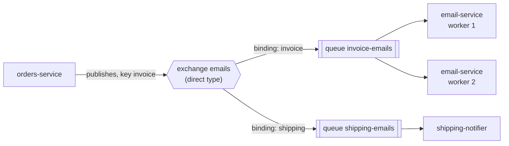
Example: sending 10,000 invoice emails. Each email is a task. Add <span class="term" data-term="worker">workers</span> to go faster, each email is sent only once, a failing email goes to the DLQ after three attempts.

:material-book-open-variant: Reference docs: [RabbitMQ, AMQP 0-9-1 Model Explained](https://www.rabbitmq.com/tutorials/amqp-concepts) (accessed November 2026)
{ .doc-ref }

### Kafka

<span class="pill pill-status pill-status-ok" title="Still valid, checked November 2026">Current · 11/2026</span>

*Kafka: partly competes with Pub/Sub; complements RabbitMQ, Strimzi*
{ .tool-rel }

A distributed **event log**. A message is not a task but a **fact** ("order 42 was paid") appended to the end of a log, and **kept** (for days, or forever). Each consumer reads at its own pace and remembers its position (**offset**). The log is split into **<span class="term" data-term="kafka-partition">partitions</span>**: order is guaranteed within a partition, and reading is parallel across partitions.

!!! noob "As noob"
    Kafka is more like a ship's logbook than a mailbox: each event is written after the previous one, nothing is erased before the retention period ends, and each reader keeps its own bookmark (the offset). Two readers can read the same logbook without getting in each other's way, and a newcomer can start again from page one. The takeaway: **reading a Kafka message does not consume it, it only moves my bookmark.**

```
topic "orders" partition 0 : [created 41] [paid 41] [created 42] [paid 42] ...
                                                      ^                ^
                                  report-service (offset 2)   email-service (offset 4)
```
Example: `OrderPaid` is read by billing, by the data warehouse and by fraud detection, each at its own pace. A new service arriving tomorrow can **replay** the whole history from the start. With RabbitMQ, that message would already be gone.

Consumers join **groups** (*consumer groups*). Within a group, each partition is read by a single member: the work is shared out. Two different groups each read the whole topic, without getting in each other's way.

!!! noob "As noob"
    A consumer group is a team of mail carriers sharing the streets of a district (the partitions): each street has only one carrier at a time. Another team (another group) does its own full round, on its side. The takeaway: **within a group the work is shared, across groups everyone gets everything; and with more carriers than streets, the extra ones sit idle.**

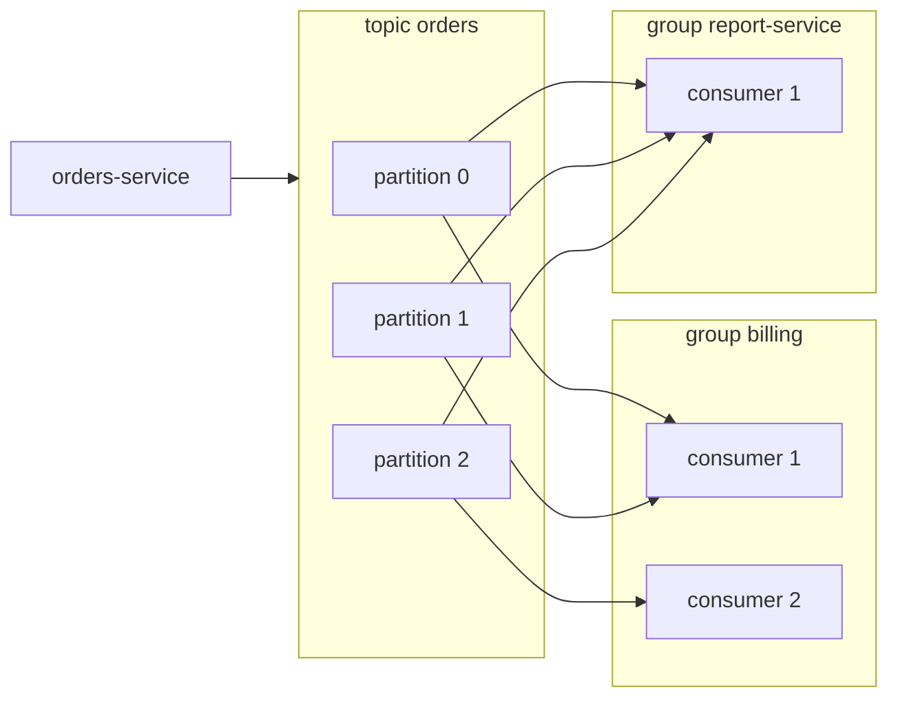

**<span class="term" data-term="kafka-connect">Kafka Connect</span>** and **<span class="term" data-term="debezium">Debezium</span>**: ready-made connectors. Debezium reads the changes of a database (<span class="term" data-term="cdc">CDC</span>, *change data capture*) and publishes them to Kafka without touching the application code.

Example: a Debezium connector that follows the `public.orders` table of a PostgreSQL database. It is sent to Kafka Connect with `curl -X POST -H 'Content-Type: application/json' -d @orders-cdc.json http://kafka-connect:8083/connectors`.
```json
{
  "name": "orders-cdc",
  "config": {
    "connector.class": "io.debezium.connector.postgresql.PostgresConnector",
    "plugin.name": "pgoutput",
    "database.hostname": "orders-db",
    "database.port": "5432",
    "database.user": "debezium",
    "database.password": "${file:/secrets/db.properties:password}",
    "database.dbname": "orders",
    "topic.prefix": "orders-db",
    "table.include.list": "public.orders"
  }
}
```
Each `INSERT`, `UPDATE` or `DELETE` becomes a message in the `orders-db.public.orders` topic (prefix, schema, table). For a created order (simplified content, the exact envelope depends on the converter):
```json
{
  "before": null,
  "after": { "id": 42, "customer_id": "cust-ada", "status": "CREATED" },
  "source": { "connector": "postgresql", "db": "orders", "table": "orders" },
  "op": "c",
  "ts_ms": 1792496000000
}
```
`op` is `c` (create), `u` (update), `d` (delete) or `r` (read from the initial snapshot). Option names to check in the Debezium documentation for the version.

:material-book-open-variant: Reference docs: [Apache Kafka, Documentation](https://kafka.apache.org/documentation/) (accessed November 2026); [Debezium, PostgreSQL connector](https://debezium.io/documentation/reference/stable/connectors/postgresql.html) (accessed November 2026)
{ .doc-ref }

### Google Pub/Sub

<span class="pill pill-status pill-status-ok" title="Still valid, checked November 2026">Current · 11/2026</span>

*Pub/Sub: partly competes with RabbitMQ, Kafka, SQS*
{ .tool-rel }

Google Cloud's **managed** <span class="term" data-term="message-broker">broker</span>. A publisher publishes to a **topic**, each **subscription** gets a copy. No server, no partition to tune, automatic scaling. Order is only guaranteed with an **ordering key**, and an optional <span class="term" data-term="exactly-once">exactly-once</span> mode exists ([Google documentation](https://cloud.google.com/pubsub/docs/subscription-overview), read in October 2026). Default <span class="term" data-term="message-retention">retention</span> is 7 days, extendable (to check depending on configuration).

```bash
gcloud pubsub topics publish order-events --message='{"order_id": 42}' --ordering-key=42
```
Example: a file dropped in a bucket triggers a Pub/Sub message, which wakes up a processing service that can even scale to zero instances when there is nothing to do.

Each subscription gets its own copy of the message, and delivers it by *pull* (the service fetches) or *push* (Pub/Sub calls a URL):

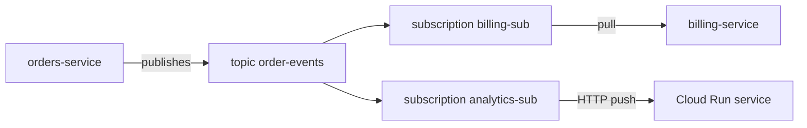

:material-book-open-variant: Reference docs: [Google Cloud, Pub/Sub overview](https://cloud.google.com/pubsub/docs/overview) (accessed November 2026)
{ .doc-ref }

### Comparison

| Criterion                       | RabbitMQ                    | Kafka                          | Pub/Sub                        |
|---------------------------------|-----------------------------|--------------------------------|--------------------------------|
| Model                           | task queue                  | event log                      | topic + subscriptions          |
| Message after reading           | deleted                     | kept, replayable               | deleted after <span class="term" data-term="message-ack">ack</span> (limited replay) |
| Fine routing                    | ★★★                         | ★                              | ★ (simple filters)             |
| Very high throughput            | ★★                          | ★★★                            | ★★★ (managed)                  |
| Low latency at low load         | ★★★                         | ★★                             | ★★                             |
| Operational effort              | medium                      | high                           | almost none                    |
| Ordering                        | per queue, single consumer  | per partition                  | per ordering key               |

Published figures ([Confluent benchmark, 2020](https://www.confluent.io/blog/kafka-fastest-messaging-system/)):

| Measure                        | Kafka     | RabbitMQ (mirrored queues) | Source reliability |
|--------------------------------|-----------|----------------------------|--------------------|
| Peak throughput                | 605 MB/s  | 38 MB/s                    | [Take with caution: published by Confluent, Kafka's commercial vendor, 2020 hardware] |
| <span class="term" data-term="p99">p99</span> latency                    | 5 ms at 200 MB/s | 1 ms at 30 MB/s     | [Take with caution: same source, and the compared loads differ] |

What it really says: Kafka absorbs far more volume, RabbitMQ answers faster as long as the load stays moderate.

### Why keep both
RabbitMQ and Kafka do not answer the same question. RabbitMQ: "who does this task?". Kafka: "what happened, and who wants to know, even later?". A company that has tasks to distribute **and** event streams to share often keeps both.

| I want...                                                     | I use...      |
|---------------------------------------------------------------|---------------|
| I have a big pile of tasks to do once each, like 10,000 invoice emails, to spread across several workers, with retries and a DLQ for the ones that fail | RabbitMQ |
| I want to send each message to a different queue depending on its type, like invoice emails on one side and shipping emails on the other | RabbitMQ |
| several teams want to learn about the same event, like "order 42 was paid", each at its own pace, and a service added later must be able to replay the history | Kafka |
| other systems must follow every change in a database without touching the application code, like the data warehouse copying the orders table (CDC) | Kafka + Debezium |
| I am on Google Cloud and want to pass messages without installing or watching any server | Pub/Sub |
| an event, like a file dropped in a bucket, must wake up a <span class="term" data-term="serverless">serverless</span> service that stays at zero instances the rest of the time | Pub/Sub |


### Observing a queue's health
My team wants to know whether messages are processed on time. A healthy queue drains as fast as it fills. The signal to watch is the **backlog**: the number of waiting messages (*depth* in RabbitMQ, *lag* in Kafka, meaning the gap between the last written offset and the group's offset) and the age of the oldest waiting message. If the backlog grows, consumers are slower than producers: work is processed late (invoice emails go out long after the payment), then the broker's retention or memory eventually saturates.

| Broker   | Where to read the backlog | What to look at |
|----------|---------------------------|-----------------|
| RabbitMQ | `rabbitmqctl list_queues name messages_ready messages_unacknowledged consumers`, or the management UI | ready messages, messages taken but not yet acknowledged, number of consumers |
| Kafka    | `kafka-consumer-groups.sh --describe --group billing` | `LAG` column per partition (`LOG-END-OFFSET` minus `CURRENT-OFFSET`) |
| Pub/Sub  | the subscription's Cloud Monitoring metrics | `num_undelivered_messages`, `oldest_unacked_message_age` |

Kafka example (simplified columns): a single partition falls behind, so the group is not slow everywhere.
```
$ kafka-consumer-groups.sh --bootstrap-server kafka:9092 --describe --group billing
GROUP    TOPIC   PARTITION  CURRENT-OFFSET  LOG-END-OFFSET  LAG
billing  orders  0          1200            1210            10
billing  orders  1          1180            9180            8000
```

When the backlog grows, trace the cause before adding machines:

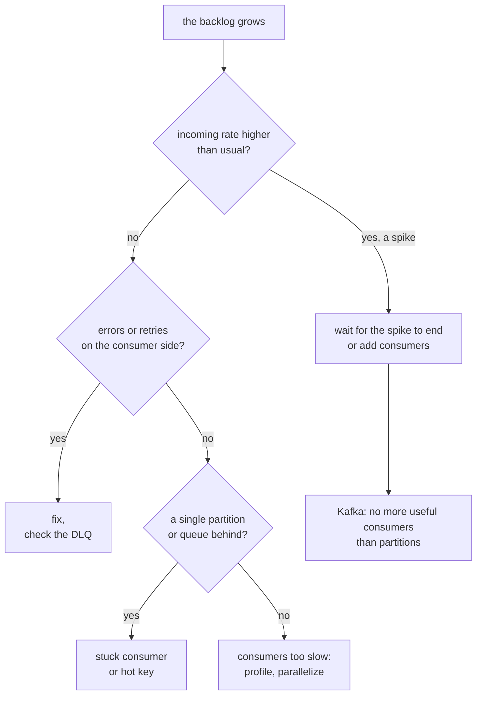
Alert on the age of the oldest message rather than on a raw count: 10,000 waiting messages are normal for a service that processes 5,000 per second, not for one that processes 10.

:material-book-open-variant: Reference docs: [RabbitMQ, Monitoring](https://www.rabbitmq.com/docs/monitoring) (accessed November 2026); [Apache Kafka, Monitoring](https://kafka.apache.org/42/operations/monitoring/) (Kafka 4.2); [Google Cloud, Monitor Pub/Sub](https://cloud.google.com/pubsub/docs/monitoring) (accessed November 2026)
{ .doc-ref }

## Cache: Redis

<a class="pill pill-scope pill-scope-system" href="../architecture/#map-of-scales">Scale · System</a> <a class="pill pill-scope pill-scope-infra" href="../architecture/#map-of-scales">Scale · Infrastructure</a> <span class="pill pill-status pill-status-ok" title="Still valid, checked November 2026">Current · 11/2026</span>


*Redis: complements PostgreSQL, MySQL*
{ .tool-rel }

My service keeps rereading data that is slow to get, like a product page, and every read makes the user wait. **Redis** is an **in-memory** <span class="term" data-term="key-value-store">key-value</span> store: very fast (sub-millisecond reads, a common order of magnitude), but bounded by RAM. It is used as a **cache** (a temporary copy of that slow data), and also for counters, locks, sessions or simple queues.

```bash
SET catalog:product:42 '{"title":"Lamp"}' EX 300   # expires in 300 s
GET catalog:product:42
INCR rate-limit:ada:2026-10-23T10:15               # rate-limit counter
```
Example: `catalog-service` takes 200 ms to build a product page. It stores it in Redis for 5 minutes: following calls answer in 1 ms. The trap: cached data can be stale, it must be <span class="term" data-term="cache-invalidation">invalidated</span> when the source changes.

The most common pattern is called *cache-aside*: the service reads the cache first, and fills it itself when the data is not there.

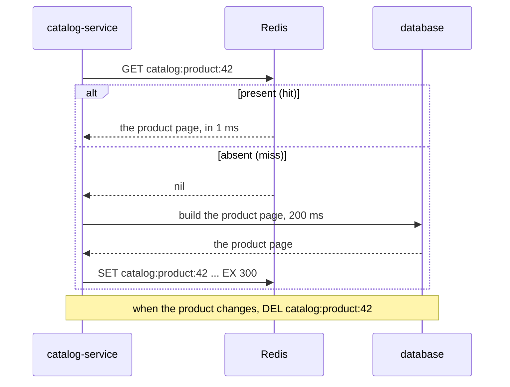

| Criterion                | Redis                      | In-process cache              | Database        |
|--------------------------|----------------------------|-------------------------------|-----------------|
| Speed                    | ★★★                        | ★★★                           | ★               |
| Shared across instances  | yes                        | no (each <span class="term" data-term="pod">pod</span> has its copy)    | yes             |
| Survives a restart       | depends on configuration   | no                            | yes             |
| <span class="term" data-term="source-of-truth">Source of truth</span>          | never                      | never                         | yes             |

| I want...                                            | I use...                        |
|------------------------------------------------------|---------------------------------|
| a slow read, like the product page that takes 200 ms to build, is requested by every pod of the service | Redis |
| all pods must share the same counter or the same lock, like a per-client <span class="term" data-term="rate-limit">rate limit</span> that every pod must respect | Redis |
| I often reread a small reference table that rarely changes, like the list of countries | in-process cache |
| I cannot afford to lose the data, like a paid order | a database, not Redis |


**Observing the cache.** A cache is judged by its **hit ratio**: the share of reads served by Redis without going to the source. Redis counts hits, misses and evicted keys since it started:
```
$ redis-cli INFO stats | grep -E 'keyspace_hits|keyspace_misses|evicted_keys'
keyspace_hits:950000
keyspace_misses:50000
evicted_keys:1200
```
Hit ratio = 950,000 / (950,000 + 50,000) = 95% (example values). The counters reset on restart: compare two readings a few minutes apart rather than the total.

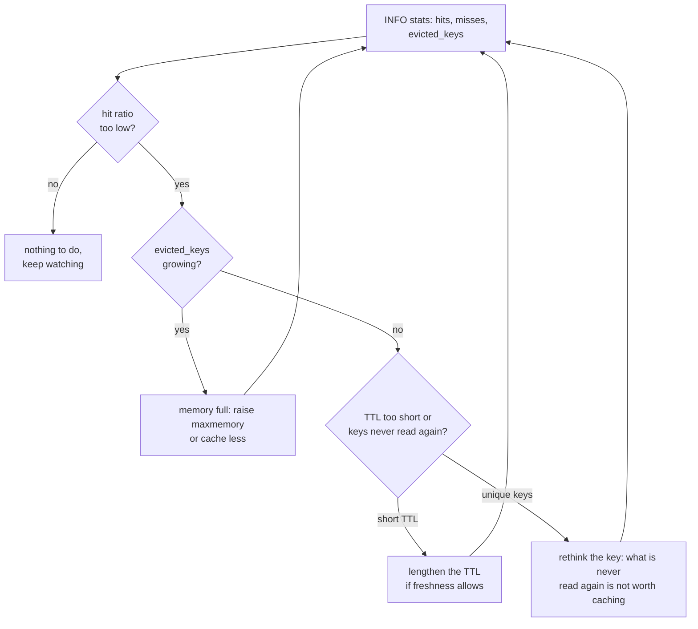

:material-book-open-variant: Reference docs: [Redis, Docs](https://redis.io/docs/latest/) (accessed November 2026); [Microsoft Azure Architecture Center, Cache-Aside pattern](https://learn.microsoft.com/en-us/azure/architecture/patterns/cache-aside) (accessed November 2026); [Redis, INFO](https://redis.io/docs/latest/commands/info/) (accessed November 2026)
{ .doc-ref }

## Databases: PostgreSQL, MySQL, BigQuery

<a class="pill pill-scope pill-scope-system" href="../architecture/#map-of-scales">Scale · System</a> <a class="pill pill-scope pill-scope-infra" href="../architecture/#map-of-scales">Scale · Infrastructure</a>

**OLTP** (*online transaction processing*): many small fast reads and writes, those of an application (create an order). **OLAP** (*online analytical processing*): few queries, but huge ones, for analysis (revenue per country over 5 years). The queries themselves are in [SQL](sql.md).

!!! noob "As noob"
    OLTP is a shop's till: thousands of small receipts a day, each one must go through at once and without error. OLAP is the accountant at year end rereading every receipt to find out what sold best: few questions, but each one goes through the whole history. The takeaway: **a database built for the till is not built for the annual report, and the other way round.**

### PostgreSQL and MySQL

<span class="pill pill-status pill-status-ok" title="Still valid, checked November 2026">Current · 11/2026</span>

*PostgreSQL: competes with MySQL, MariaDB; partly competes with MongoDB; complements Redis, PgBouncer, BigQuery, Elasticsearch*<br>
*MySQL: competes with PostgreSQL, MariaDB; complements Redis, ProxySQL, Vitess*
{ .tool-rel }

Two open source **relational** OLTP databases: tables, joins, <span class="term" data-term="db-transaction">transactions</span>. PostgreSQL is richer (<span class="term" data-term="jsonb">JSONB</span>, advanced types, extensions, stricter constraints). MySQL (and its cousin MariaDB) is historically very common with PHP, simple and fast on classic reads.

```sql
-- Example: PostgreSQL, search an indexed JSON column
SELECT id FROM orders WHERE metadata @> '{"channel": "mobile"}';
```

:material-book-open-variant: Reference docs: [PostgreSQL, Documentation](https://www.postgresql.org/docs/current/) (version 18, 2025); [MySQL, Reference Manual](https://dev.mysql.com/doc/refman/8.4/en/) (MySQL 8.4)
{ .doc-ref }

### BigQuery

<span class="pill pill-status pill-status-ok" title="Still valid, checked November 2026">Current · 11/2026</span>

*BigQuery: competes with Snowflake, Databricks, ClickHouse; complements PostgreSQL, dbt*
{ .tool-rel }

Google's managed **data warehouse**: OLAP, **columnar** storage, billions of rows read in seconds. I pay mostly for the volume read, not the number of queries. Bad at OLTP: not made to update a row on every click.

```sql
-- Good: costs only the volume of the columns read, never SELECT *
SELECT country, SUM(total_cents) / 100 AS revenue
FROM analytics.orders
WHERE DATE(created_at) >= '2026-01-01'
GROUP BY country;
```

| Criterion                   | PostgreSQL | MySQL | BigQuery           |
|-----------------------------|------------|-------|--------------------|
| Application transactions    | ★★★        | ★★★   | ★                  |
| Analysis over billions of rows | ★       | ★     | ★★★                |
| SQL and type richness       | ★★★        | ★★    | ★★★ (own dialect)  |
| Operations                  | to manage (or Cloud SQL) | to manage (or Cloud SQL) | none |
| Cost model                  | server     | server | volume read       |

| I want...                                              | I use...                      |
|--------------------------------------------------------|-------------------------------|
| I am creating a new service and it needs its database | PostgreSQL |
| I maintain an old PHP application that already runs on MySQL | MySQL, the one already there |
| my team wants dashboards over the whole history, like revenue per country over 5 years | BigQuery |
| analysts want the production database's data in BigQuery, without anyone copying tables by hand | CDC (Debezium, Datastream) or a scheduled export |

:material-book-open-variant: Reference docs: [Google Cloud, BigQuery overview](https://cloud.google.com/bigquery/docs/introduction) (accessed November 2026)
{ .doc-ref }

### Schema migrations: Flyway, Liquibase, Alembic

<span class="pill pill-status pill-status-ok" title="Still valid, checked November 2026">Current · 11/2026</span>


*Flyway: competes with Liquibase, Alembic*<br>
*Liquibase: competes with Flyway, Alembic*<br>
*Alembic: competes with Flyway, Liquibase; complements SQLAlchemy*
{ .tool-rel }

My team adds a `status` column to the `orders` table: the change must reach every environment, in the right order, without missing one. A <span class="term" data-term="schema-migration">schema migration</span> is a versioned file that moves the database from one schema version to the next (add a column, an index). The tool records in a database table which migrations already ran, and applies only the new ones. Techniques for migrating without downtime are in [SQL](sql.md).

**When**: as soon as a database lives longer than a prototype and exists in several environments. **Why**: no more `ALTER TABLE` run by hand in prod and forgotten in staging. Each environment knows where it stands, and the migration is reviewed in the MR along with the code that needs it. Cost: a migration already applied is never edited, I write a new one.

```
db/migration/
├─ V1__create_orders.sql
├─ V2__add_orders_status.sql
└─ V3__index_orders_customer_id.sql
```
```bash
flyway migrate
```

| Tool       | Written in                       | Fits                                              |
|------------|----------------------------------|---------------------------------------------------|
| Flyway     | numbered SQL files               | teams that want plain SQL, Java world             |
| Liquibase  | XML, YAML, JSON or SQL (*changesets*) | several database engines, described rollbacks, Java world |
| Alembic    | Python, generated from SQLAlchemy models | Python projects using SQLAlchemy          |

Frameworks often ship their own (Django, Rails, Doctrine in PHP, Prisma): keep the framework's one.

:material-book-open-variant: Reference docs: [Flyway, Documentation](https://documentation.red-gate.com/flyway) (accessed November 2026); [Alembic, Documentation](https://alembic.sqlalchemy.org/) (accessed November 2026)
{ .doc-ref }

## Search and documents: Elasticsearch, MongoDB

<a class="pill pill-scope pill-scope-system" href="../architecture/#map-of-scales">Scale · System</a> <a class="pill pill-scope pill-scope-infra" href="../architecture/#map-of-scales">Scale · Infrastructure</a> <span class="pill pill-status pill-status-ok" title="Still valid, checked November 2026">Current · 11/2026</span>


*Elasticsearch: competes with OpenSearch; complements PostgreSQL*<br>
*MongoDB: partly competes with PostgreSQL*
{ .tool-rel }

**Elasticsearch** (and its open source fork **OpenSearch**): a **full-text search** engine. It splits text into words, tolerates typos, ranks results by relevance and computes aggregations ("how many results per genre"). It is not a <span class="term" data-term="source-of-truth">source of truth</span>: I copy into it data that lives elsewhere.

*OpenSearch: competes with Elasticsearch*
{ .tool-rel }


```json
GET /products/_search
{ "query": { "match": { "title": { "query": "desk lamb", "fuzziness": "AUTO" } } } }
```
Example: a catalog search bar finds "desk lamp" despite the typo, in 20 ms over millions of items. With `LIKE '%lamb%'` in SQL, nothing comes out, and the query scans the whole table.

**MongoDB**: a **document** database. Each record is a JSON document, with no schema enforced by the database. Handy when each item has a different shape, tricky when I need joins and transactions across several collections.

```js
// Example: insert a free-form document, then search a nested field
db.products.insertOne({ _id: 42, title: "Lamp", options: { colors: ["black", "white"] } })
db.products.find({ "options.colors": "black" })
```

| Criterion                       | PostgreSQL            | MongoDB               | Elasticsearch          |
|---------------------------------|-----------------------|-----------------------|------------------------|
| Source of truth                 | ★★★                   | ★★★                   | ★ (copy)               |
| Full-text search, typos         | ★★ (`tsvector`)       | ★★                    | ★★★                    |
| Joins, transactions             | ★★★                   | ★                     | ★                      |
| Data of varying shape           | ★★ (JSONB)            | ★★★                   | ★★                     |

| I want...                                                    | I use...                                      |
|--------------------------------------------------------------|-----------------------------------------------|
| my users type searches with typos, like "desk lamb", and want to filter by category or price | Elasticsearch or OpenSearch, fed from the database |
| each item has a different shape, like products whose options vary (colors for a lamp, sizes for a t-shirt) | MongoDB, or a JSONB column in PostgreSQL |
| my data points to itself and must change together, like an order, its lines and its payment | PostgreSQL |

:material-book-open-variant: Reference docs: [Elastic, Docs](https://www.elastic.co/docs) (accessed November 2026); [MongoDB, Manual](https://www.mongodb.com/docs/manual/) (accessed November 2026)
{ .doc-ref }

## Orchestration and automation: n8n, Airflow, Temporal, Argo Workflows

<a class="pill pill-scope pill-scope-system" href="../architecture/#map-of-scales">Scale · System</a>

!!! info "Written on 2026-11-04"
    Licenses, versions and project statuses quoted as of this date, to check.

I have a job made of several steps that take time, and if one fails halfway, I want neither to rerun everything by hand nor to lose track of what happened. An **orchestrator** chains those steps, retries the ones that fail and keeps the history of every run. The four tools in this section answer four different needs: wiring tools together without code, scheduling data processing, making a business process crash-proof, chaining containers in Kubernetes.

| Signal                                                                   | Lead             |
|--------------------------------------------------------------------------|------------------|
| my team wants every new ticket to post a message in Slack and fill a spreadsheet, without writing a service | n8n |
| a data pipeline runs every night, and the load step must wait for the extraction to finish | Airflow |
| each order or each customer goes through a process lasting hours or days, like "charge, wait 3 days, ask for a review" | Temporal |
| I have heavy steps, each in its own container, like generating reports in parallel, and a Kubernetes cluster already exists | Argo Workflows |
| I just have one isolated script to run every night, with no step before or after | a Kubernetes CronJob, nothing more |

### n8n: automation with (almost) no code

<span class="pill pill-status pill-status-ok" title="Still valid, checked November 2026">Current · 11/2026</span>


*n8n: competes with Zapier; partly competes with Airflow, Temporal*
{ .tool-rel }

**When**: wiring SaaS tools together (form, chat, spreadsheet, CRM, internal API) for a team task, and changing it quickly, non-developers included. Not for critical business logic: a drawn workflow is hard to test and to review in an MR (it is one big JSON file), and throughput stays modest.

**Why**: a <span class="term" data-term="low-code">low-code</span> tool. What would take a small service (receive a <span class="term" data-term="webhook">webhook</span>, call two APIs, handle errors) is drawn in ten minutes. Cost: the logic lives outside the code repository, and someone must own the instance. "Fair-code" license (*Sustainable Use License*): free to self-host for internal use, but not open source in the strict sense (to check). SaaS equivalents: Zapier, Make.

*Zapier: competes with n8n*
{ .tool-rel }


**How**: I chain **nodes** in a visual editor. Each node receives the previous node's data.

```
Webhook (POST /new-bug)
└─ IF priority = "P1"
   ├─ true : Slack, message in #incidents
   └─ false: Google Sheets, append a row to the backlog
```

The workflow exports to JSON, to store in Git to keep a history.

:material-book-open-variant: Reference docs: [n8n, Docs](https://docs.n8n.io/) (accessed November 2026)
{ .doc-ref }

### Airflow: scheduled data pipelines

<span class="pill pill-status pill-status-ok" title="Still valid, checked November 2026">Current · 11/2026</span>


*Airflow: competes with Dagster, Prefect; partly competes with Temporal, Argo Workflows; complements dbt, Spark*
{ .tool-rel }

**When**: scheduled <span class="term" data-term="batch-processing">batch</span> processing (extract, transform, load) with dependencies between steps and the need to rerun a past day. Not for reacting in real time to an event, nor for a per-customer business process.

**Why**: replaces a pile of crons waiting on each other with a visible graph, per-task retry and catch-up of missed days (*backfill*). Cost: a scheduler, a database and workers to run (or a managed offer such as Cloud Composer). Created at Airbnb in 2014, an Apache project, version 3 released in 2025 (to check).

**How**: a **DAG** (graph of steps) in Python describes the order.

```python
# Example: DAG run every day at 3 am, extract then load
with DAG("daily_revenue", schedule="0 3 * * *", start_date=datetime(2026, 1, 1), catchup=False):
    extract = PythonOperator(task_id="extract", python_callable=extract_orders)
    load = PythonOperator(task_id="load", python_callable=load_to_warehouse)
    extract >> load
```

:material-book-open-variant: Reference docs: [Apache Airflow, Documentation](https://airflow.apache.org/docs/) (accessed November 2026)
{ .doc-ref }

### Temporal: durable execution

<span class="pill pill-status pill-status-ok" title="Still valid, checked November 2026">Current · 11/2026</span>


*Temporal: partly competes with Airflow, Argo Workflows*
{ .tool-rel }

**When**: a long, per-entity business process (an order, a subscription, a sign-up) that chains calls to other services, waits for days, and must never stop halfway. Not for batch data processing, nor for a single call with a retry.

**Why**: <span class="term" data-term="durable-execution">durable execution</span>. Temporal records every completed step: if the server restarts, the workflow resumes exactly where it was, with no hand-written state table or cron. Cost: a Temporal cluster (or the Temporal Cloud SaaS) and a strong constraint: workflow code must be deterministic (no system clock or direct network call, everything goes through *activities*). Comes from Cadence, created at Uber (dates to check).

!!! noob "As noob"
    Temporal keeps a logbook filled in after each completed step: if the cook changes mid-service, the replacement reads the logbook, sees "paid, waiting 3 days", and carries on from there without charging a second time. That is why the workflow code must be predictable: on restart, Temporal replays it, copying the results written in the logbook instead of making the calls again. The takeaway: **a workflow never starts over, it resumes from the last recorded step.**

**How**:

```python
# Example: durable workflow, payment, 3-day wait, then review email
@workflow.defn
class OrderWorkflow:
    @workflow.run
    async def run(self, order_id: int) -> None:
        await workflow.execute_activity(charge_payment, order_id, start_to_close_timeout=timedelta(minutes=1))
        await workflow.sleep(timedelta(days=3))
        await workflow.execute_activity(send_review_email, order_id, start_to_close_timeout=timedelta(minutes=1))
```
Example: "charge, wait 3 days, send a review request". If the worker dies during those 3 days, another one picks up at wake-up, and the payment is not replayed.

:material-book-open-variant: Reference docs: [Temporal, Docs](https://docs.temporal.io/) (accessed November 2026)
{ .doc-ref }

### Argo Workflows: container steps in Kubernetes

<span class="pill pill-status pill-status-ok" title="Still valid, checked November 2026">Current · 11/2026</span>


*Argo Workflows: partly competes with Airflow, Temporal; complements Kubernetes*<br>
*Kubernetes: competes with Cloud Run; complements Docker, Helm, Argo CD*
{ .tool-rel }

**When**: heavy steps, each in its own image (model training, report generation, parallel processing), on a Kubernetes cluster that already exists. Not without Kubernetes, and not for per-customer business logic (Temporal). Not to be confused with [Argo CD](kubernetes.md#argo-cd-git-decides-what-runs), which deploys.

**Why**: each step is a <span class="term" data-term="pod">pod</span>, with its own resources and image: parallelism and isolation come from Kubernetes. Cost: everything is written in YAML, more verbose than a Python DAG. A CNCF project, graduated with the Argo family (to check).

**How**:

```yaml
# Example: Argo workflow as a DAG, render waits for extract to finish
apiVersion: argoproj.io/v1alpha1
kind: Workflow
metadata:
  generateName: nightly-report-
spec:
  entrypoint: main
  templates:
    - name: main
      dag:
        tasks:
          - name: extract
            template: step
            arguments:
              parameters:
                - name: cmd
                  value: extract
          - name: render
            dependencies: [extract]
            template: step
            arguments:
              parameters:
                - name: cmd
                  value: render
    # Example: the shared step template, a container that receives the command
    - name: step
      inputs:
        parameters:
          - name: cmd
      container:
        image: report-service:1.4.0
        args: ["{{inputs.parameters.cmd}}"]
```

:material-book-open-variant: Reference docs: [Argo Workflows, Documentation](https://argo-workflows.readthedocs.io/) (accessed November 2026)
{ .doc-ref }

### Comparison

| Criterion                      | n8n                    | Airflow                          | Temporal                              | Argo Workflows          | Cron + script     |
|--------------------------------|------------------------|----------------------------------|---------------------------------------|-------------------------|-------------------|
| Typical case                   | wiring SaaS tools      | batch data, every night          | business process per order, per customer | container steps      | simple, isolated task |
| Written in                     | visual editor (JSON)   | Python                           | code (Python, Go, Java, TS...)        | YAML                    | anything          |
| Recovery after a crash         | ★                      | ★★ (per task)                    | ★★★ (to the exact step)               | ★★ (per step)           | ★                 |
| History and retry              | ★★                     | ★★★                              | ★★★                                   | ★★★                     | ★                 |
| Reviewed in an MR like code    | ★                      | ★★★                              | ★★★                                   | ★★★                     | ★★                |
| Operating cost                 | low                    | medium                           | medium to high                        | medium (if the cluster exists) | low        |

| I want...                                                     | I use...       |
|---------------------------------------------------------------|----------------|
| my team wants to automate a task across SaaS tools, like copying every received form into the CRM, without writing or maintaining a service | n8n (or Zapier, Make) |
| I must extract yesterday's orders, transform them, then load them into the warehouse, at a fixed time | Airflow |
| a business process per order or per subscription lasts a long time and must never stop halfway, even if a server restarts | Temporal |
| I chain heavy steps in containers, like a model training run, in a Kubernetes cluster | Argo Workflows |
| I run a script every night that depends on no other step | a Kubernetes CronJob |

## File storage: buckets

<a class="pill pill-scope pill-scope-infra" href="../architecture/#map-of-scales">Scale · Infrastructure</a> <span class="pill pill-status pill-status-ok" title="Still valid, checked November 2026">Current · 11/2026</span>

My application produces files, like product photos or test reports, and I want to put them neither in the database nor on the disk of a server that may disappear. A **bucket** (Google Cloud Storage, Amazon S3) stores **objects**: a file plus its metadata, under a key (`products/42/photo.jpg`). Almost unlimited, cheap, reachable over HTTP. Not a disk: I do not edit a file in place, I replace it.

```bash
gcloud storage cp report.html gs://my-test-reports/2026-10-23/report.html
```
Example: CI HTML test reports go to a bucket, the database only keeps the link.

| I want...                                         | I use...                           |
|---------------------------------------------------|------------------------------------|
| I must keep files, like product photos, audio files or the CI's HTML reports | bucket |
| I must search my data and change it, like moving an order to the "shipped" status | database |
| a job needs a working file that can disappear at the end, like an archive unpacked just long enough to read it | the container's local disk |

:material-book-open-variant: Reference docs: [Google Cloud Storage, Product overview](https://cloud.google.com/storage/docs/introduction) (accessed November 2026); [Amazon S3, User Guide](https://docs.aws.amazon.com/AmazonS3/latest/userguide/Welcome.html) (accessed November 2026)
{ .doc-ref }

## Containers and deployment: Docker, Kubernetes, Helm, Argo CD, Cloud Run

<a class="pill pill-scope pill-scope-infra" href="../architecture/#map-of-scales">Scale · Infrastructure</a> <span class="pill pill-status pill-status-ok" title="Still valid, checked November 2026">Current · 11/2026</span>


*Docker: complements Kubernetes, Helm*<br>
*Cloud Run: competes with Kubernetes; complements Docker*<br>
*Helm: partly competes with Kustomize; complements Argo CD, Kubernetes*<br>
*Argo CD: competes with Flux; complements Helm, Kubernetes*
{ .tool-rel }

What Docker, Helm, Argo CD and Cloud Run do, with a `Dockerfile` and the path of a deployment, is explained in [Containers, Kubernetes and deployment](kubernetes.md#building-and-deploying-docker-helm-argo-cd-cloud-run). Here, only the choice.

| Criterion                    | Kubernetes + Helm + Argo CD | Cloud Run          | `kubectl apply` from CI      |
|------------------------------|-----------------------------|--------------------|------------------------------|
| Fine control                 | ★★★                         | ★                  | ★★                           |
| Simplicity                   | ★                           | ★★★                | ★★                           |
| Traceability (who deployed what) | ★★★ (Git history)       | ★★                 | ★ (CI logs)                  |
| Idle cost                    | <span class="term" data-term="node-k8s">nodes</span> paid all the time     | close to zero      | nodes paid all the time      |

:material-book-open-variant: Reference docs: [Kubernetes, Documentation](https://kubernetes.io/docs/home/) (accessed November 2026); [Google Cloud Run, Documentation](https://cloud.google.com/run/docs) (accessed November 2026)
{ .doc-ref }

## Infrastructure as code: Terraform, OpenTofu, Terragrunt, Pulumi, Crossplane, Ansible, Packer

<a class="pill pill-scope pill-scope-infra" href="../architecture/#map-of-scales">Scale · Infrastructure</a>

!!! info "Written on 2026-11-04"
    Licenses, acquisitions and project statuses quoted as of this date, to check.

My team creates its buckets, databases and permissions by clicking in the cloud console: afterwards, nobody knows who changed what, or how to do the same thing again in staging. <span class="term" data-term="infrastructure-as-code">Infrastructure as code</span> (IaC) describes infrastructure (buckets, databases, networks, permissions, machines) in versioned files, instead of clicking in a console.

**When**: as soon as a resource must exist in several environments, be recreated after an incident, or be reviewed before it changes. Not for a throwaway one-hour test in a sandbox project.

**Why**: the console keeps neither the history nor the reason for a change, and two "identical" environments end up diverging. Gain: every change goes through an MR, replays identically, and is reviewed before being applied. Cost: learning the tool, and managing its <span class="term" data-term="iac-state">state</span>.

These tools do not all do the same thing: most **create cloud resources** (Terraform, OpenTofu, Pulumi, Crossplane), one **configures the inside of machines** (Ansible), one **builds machine images** (Packer), one **organizes** the others (Terragrunt).

### Terraform and OpenTofu: the declarative standard

<span class="pill pill-status pill-status-ok" title="Still valid, checked November 2026">Current · 11/2026</span>


*Terraform: competes with OpenTofu, Pulumi; partly competes with Crossplane; complements Terragrunt, Packer, Ansible*<br>
*OpenTofu: competes with Terraform, Pulumi; complements Terragrunt*
{ .tool-rel }

**Terraform** (HashiCorp) reads HCL files, compares them with what exists, and applies the difference. In 2023, HashiCorp moved Terraform to the BSL license (no longer open source in the strict sense), and the community created the **OpenTofu** fork, hosted by the Linux Foundation, compatible with the same files. HashiCorp was then acquired by IBM (closed in 2025, to check).

**When**: the default choice to create cloud resources, at one or several providers. OpenTofu when the license matters (a commercial product built on it) or for a feature only it offers, such as state encryption (to check).

**How**:

```hcl
# Example: bucket whose files are deleted after 90 days
resource "google_storage_bucket" "test_reports" {
  name     = "my-test-reports"
  location = "EU"
  lifecycle_rule {
    condition { age = 90 }
    action { type = "Delete" }
  }
}
```
```bash
terraform plan
terraform apply
```
`plan` shows what will change without touching anything, `apply` applies it (`tofu plan` and `tofu apply` with OpenTofu). Example: the MR that creates a bucket shows its `plan` as a comment: the review is about the real infrastructure change.

The state (`terraform.tfstate`) remembers what Terraform created. It lives in a shared bucket, with a lock, never in Git (it sometimes holds secrets). A change made by hand in the console creates a <span class="term" data-term="configuration-drift">drift</span> that the next `plan` shows, and that `apply` overwrites.

!!! noob "As noob"
    Terraform code is the blueprint of the house; the state is the builder's inventory, which records what was already built and where each room is. `plan` compares the blueprint, the inventory and the actual house, then lists the work to do. The takeaway: **losing or damaging the state makes Terraform forget what it manages: guard it like a database.**

`plan` compares three things: the code, the state, and what really exists.

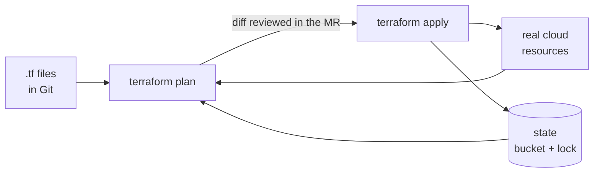

:material-book-open-variant: Reference docs: [HashiCorp, Terraform Docs](https://developer.hashicorp.com/terraform/docs) (accessed November 2026); [OpenTofu, Docs](https://opentofu.org/docs/) (accessed November 2026)
{ .doc-ref }

### Terragrunt: not repeating myself across environments

<span class="pill pill-status pill-status-ok" title="Still valid, checked November 2026">Current · 11/2026</span>


*Terragrunt: complements Terraform, OpenTofu*
{ .tool-rel }

**When**: many environments or regions reusing the same Terraform modules with a few different values, and `backend` blocks copied everywhere. Not for a single environment: one more layer for nothing.

**Why**: Terraform alone pushes me to copy the state and provider configuration into every folder. Terragrunt (Gruntwork) generates it, and runs a command across several folders in the order of their dependencies. Cost: one more tool to learn and run in CI.

**How**:

```
infra/
├─ terragrunt.hcl
├─ staging/
│  └─ reports-bucket/terragrunt.hcl
└─ prod/
   └─ reports-bucket/terragrunt.hcl
```
```hcl
# Example: prod config that reuses the bucket module and only sets its inputs
include "root" {
  path = find_in_parent_folders()
}

terraform {
  source = "../../modules/bucket"
}

inputs = {
  name     = "my-test-reports-prod"
  location = "EU"
}
```
The root file holds the state configuration once. The command to plan everything at once was renamed across versions (`run-all plan`, then `run --all plan`, to check).

:material-book-open-variant: Reference docs: [Terragrunt, Docs](https://terragrunt.gruntwork.io/docs/) (accessed November 2026)
{ .doc-ref }

### Pulumi: the same in a real language

<span class="pill pill-status pill-status-ok" title="Still valid, checked November 2026">Current · 11/2026</span>


*Pulumi: competes with Terraform, OpenTofu*
{ .tool-rel }

**When**: a developer team that prefers TypeScript, Python or Go over HCL, and needs loops, functions or unit tests on its infrastructure. Not if the team already knows Terraform: modules and online help are far more plentiful on the Terraform side.

**Why**: logic (one bucket per customer in a list, for instance) is written with the language, its tests and its editor. Cost: overly "clever" infrastructure code becomes hard to review, and the state lives in Pulumi Cloud or a bucket to configure.

**How**:

```python
import pulumi_gcp as gcp

# Example: a Python loop creates one bucket per team
for team in ["team-core", "team-data"]:
    gcp.storage.Bucket(f"{team}-reports", location="EU")
```
```bash
pulumi preview
pulumi up
```

:material-book-open-variant: Reference docs: [Pulumi, Docs](https://www.pulumi.com/docs/) (accessed November 2026)
{ .doc-ref }

### Crossplane: infrastructure driven by Kubernetes

<span class="pill pill-status pill-status-ok" title="Still valid, checked November 2026">Current · 11/2026</span>


*Crossplane: partly competes with Terraform; complements Kubernetes*
{ .tool-rel }

**When**: a platform team that wants teams to request a database or a bucket the way they request a Deployment, in YAML in Git, applied by [Argo CD](kubernetes.md#argo-cd-git-decides-what-runs). Not without Kubernetes, nor for a small team: the setup is heavy.

**Why**: Crossplane is a set of [operators](kubernetes.md#kubernetes-operators-strimzi) that create cloud resources and **fix them continuously**: a manual change is undone within minutes, without waiting for an `apply`. With its *compositions*, the platform exposes a simple resource ("a size M PostgreSQL database") hiding fifty parameters. Cost: one more API to design and maintain, and debugging that goes through `kubectl describe`. A CNCF project (status to check).

!!! noob "As noob"
    Terraform is a contractor I call in for a job: it does the work, then leaves, and only notices a manual change on its next visit. Crossplane is a caretaker who stays on site: it keeps comparing what exists with what is declared, and puts things back as soon as it sees a gap. The takeaway: **Terraform fixes things on the next `apply`, Crossplane fixes them all the time.**

**How** (API group to check per provider and version):

```yaml
# Example: a bucket described as a Kubernetes resource
apiVersion: storage.gcp.upbound.io/v1beta1
kind: Bucket
metadata:
  name: my-test-reports
spec:
  forProvider:
    location: EU
  providerConfigRef:
    name: default
```

:material-book-open-variant: Reference docs: [Crossplane, Docs](https://docs.crossplane.io/) (accessed November 2026)
{ .doc-ref }

### Ansible: configuring the inside of machines

<span class="pill pill-status pill-status-ok" title="Still valid, checked November 2026">Current · 11/2026</span>


*Ansible: complements Terraform, Packer*
{ .tool-rel }

**When**: installing packages, dropping configuration files, restarting services on <span class="term" data-term="virtual-machine">virtual machines</span> or physical servers. Not for creating cloud resources (Terraform does it better), nor for applications already running in containers (the Docker image carries their configuration).

**Why**: replaces SSH scripts run by hand on ten servers. Ansible connects over SSH, with no agent to install, and its modules are <span class="term" data-term="idempotency">idempotent</span>: rerunning the playbook changes nothing if everything is already in place. Cost: no state, so what was removed from the playbook is not undone on the machines. Maintained by Red Hat.

!!! noob "As noob"
    An idempotent task is like the rule "the door must be closed" rather than "close the door": checking it ten times changes nothing if it is already closed. A playbook written with the standard modules describes a state to reach in the same way, and can be rerun safely. Limit: Ansible does not remember what it did before. The takeaway: **rerunning breaks nothing, but removing a line from the playbook undoes nothing on the machine.**

**How**:

```yaml
# Example: playbook that installs nginx then starts it
- name: reverse proxy
  hosts: web
  become: true
  tasks:
    - name: install nginx
      ansible.builtin.apt:
        name: nginx
        state: present
    - name: start nginx
      ansible.builtin.service:
        name: nginx
        state: started
        enabled: true
```
```bash
ansible-playbook -i inventory.ini proxy.yml --check
ansible-playbook -i inventory.ini proxy.yml
```
`--check` shows what would change, without doing anything.

:material-book-open-variant: Reference docs: [Ansible, Documentation](https://docs.ansible.com/) (accessed November 2026)
{ .doc-ref }

### Packer: building machine images

<span class="pill pill-status pill-status-ok" title="Still valid, checked November 2026">Current · 11/2026</span>


*Packer: complements Terraform, Ansible*
{ .tool-rel }

**When**: virtual machines that must start fast and all identical (CI runners, machine groups that grow on their own). Not for containerized applications: the Docker image already plays that role.

**Why**: instead of installing packages when each machine boots (slow, and it can fail if a package repository is down), I build a ready-to-use <span class="term" data-term="machine-image">machine image</span> once. Cost: an image build chain to keep up to date (security patches). HashiCorp, same BSL license as Terraform.

**How**:

```hcl
# Example: the source, the base image and the name of the image produced
source "googlecompute" "runner" {
  project_id          = "my-project"
  zone                = "europe-west1-b"
  source_image_family = "debian-12"
  image_name          = "ci-runner-v1-4-0"
  ssh_username        = "packer"
}

# Example: the build, which installs git and Docker in the image
build {
  sources = ["source.googlecompute.runner"]
  provisioner "shell" {
    inline = ["sudo apt-get update", "sudo apt-get install -y git docker.io"]
  }
}
```
```bash
packer build runner.pkr.hcl
```
Ansible can be the `provisioner` instead of the shell script: Packer builds, Ansible configures, Terraform creates the machines from the image.

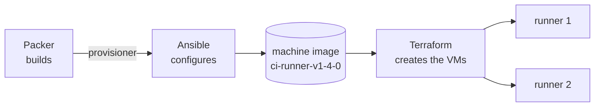

:material-book-open-variant: Reference docs: [HashiCorp, Packer Docs](https://developer.hashicorp.com/packer/docs) (accessed November 2026)
{ .doc-ref }

### Comparison

| Criterion                    | Terraform / OpenTofu | Terragrunt          | Pulumi               | Crossplane               | Ansible              | Packer               |
|------------------------------|----------------------|---------------------|----------------------|--------------------------|----------------------|----------------------|
| Role                         | create cloud resources | organize Terraform | create cloud resources | create and fix continuously | configure machines | build images     |
| Written in                   | HCL                  | HCL                 | TS, Python, Go, C#...| YAML (Kubernetes)        | YAML                 | HCL                  |
| Keeps a state                | yes (file)           | Terraform's         | yes                  | yes (in the cluster)     | no                   | no                   |
| Fixes drift on its own       | ★ (at next `apply`)  | ★                   | ★                    | ★★★                      | ★ (if rerun)         | not applicable       |
| Community, modules           | ★★★                  | ★★                  | ★★                   | ★★                       | ★★★                  | ★★                   |
| Ease of entry                | ★★                   | ★★                  | ★★                   | ★ (heavy)                | ★★★                  | ★★★                  |

| I want...                                                 | I use...                                      |
|-----------------------------------------------------------|-----------------------------------------------|
| my team wants to create and change its buckets, databases and networks through a reviewed MR, and be able to recreate everything identically | Terraform (or OpenTofu) |
| I build a commercial product on top of my IaC tool, and its license must be strictly open source | OpenTofu |
| I have ten environments reusing the same modules with a few different values, and I no longer want to copy the configuration into every folder | Terragrunt on top of Terraform |
| my developer team wants to write infrastructure in TypeScript or Python, with loops and tests, like creating one bucket per team from a list | Pulumi |
| my platform team wants the other teams to request a database or a bucket in YAML in Git, the way they request a Deployment | Crossplane |
| I must install and configure software on virtual machines, like nginx on ten servers | Ansible |
| my virtual machines must boot fast and all identical, like CI runners | Packer |
| my application runs in Kubernetes and I want to deploy or update it | Helm and Argo CD, not Terraform |

## Secrets: Vault

<a class="pill pill-scope pill-scope-app" href="../architecture/#map-of-scales">Scale · Application</a> <a class="pill pill-scope pill-scope-infra" href="../architecture/#map-of-scales">Scale · Infrastructure</a> <span class="pill pill-status pill-status-ok" title="Still valid, checked November 2026">Current · 11/2026</span>


*Vault: competes with the clouds' secret managers*
{ .tool-rel }

**Vault** (HashiCorp): a **secrets vault**. Passwords, <span class="term" data-term="api-key">API keys</span> and certificates are stored encrypted, with per-application permissions and an access history. It can also generate temporary secrets (a database account valid for one hour). Managed equivalents: Google Secret Manager, AWS Secrets Manager. A manager like **1Password** is meant for humans.

**When**: as soon as an application or CI needs a secret. Never a plaintext secret in Git, nor in a Terraform file.

```bash
vault kv get -field=password secret/prod/my-api/database
```

| I want...                                                 | I use...                                      |
|-----------------------------------------------------------|-----------------------------------------------|
| my application or my CI needs a secret, like the database password, and it must never appear in plain text in Git | Vault, or the cloud's secret manager |
| people on the team must share a password, like the one for a shared tool account | 1Password or equivalent |

:material-book-open-variant: Reference docs: [HashiCorp, Vault Docs](https://developer.hashicorp.com/vault/docs) (accessed November 2026)
{ .doc-ref }

## API gateway: KrakenD, nginx

<a class="pill pill-scope pill-scope-system" href="../architecture/#map-of-scales">Scale · System</a> <a class="pill pill-scope pill-scope-infra" href="../architecture/#map-of-scales">Scale · Infrastructure</a> <span class="pill pill-status pill-status-ok" title="Still valid, checked November 2026">Current · 11/2026</span>


*KrakenD: competes with Kong, Apigee; complements nginx, Envoy*
{ .tool-rel }

I have several services behind the same address, and each one should check the caller's token and slow down abuse: with no shared point, every team recodes these checks its own way. An **API gateway** is the single entry point in front of those services: it checks the token, <span class="term" data-term="rate-limit">limits the rate</span>, routes to the right service, and can merge several responses.

!!! noob "As noob"
    The API gateway is the front desk of an office building: I show my badge once at the entrance, the desk checks it, slows down visitors who are too pushy and points me to the right floor. The services behind it do not each have to reinvent these checks. The takeaway: **one door for the shared checks, services that only deal with their own business.**

**KrakenD**: declarative gateway (one JSON file), <span class="term" data-term="stateless">stateless</span>, very fast, able to aggregate several backend calls into one response.

```json
{
  "endpoint": "/v1/orders/{id}",
  "backend": [{ "host": ["http://orders-service"], "url_pattern": "/orders/{id}" }]
}
```

**nginx**: general-purpose web server and <span class="term" data-term="reverse-proxy">reverse proxy</span>. Serves static files, does routing and <span class="term" data-term="tls-termination">TLS termination</span>. Often used as the **<span class="term" data-term="ingress">Ingress</span>** in Kubernetes.

An **Ingress** is a Kubernetes object that describes how HTTP traffic from outside the cluster is routed to internal services, based on the domain name and the path. An **Ingress controller** (nginx, Traefik, the cloud provider's own) reads these objects and does the actual routing. Example: `api.example.com/orders` goes to orders-service.
```yaml
# Example: routes api.example.com/orders to orders-service
apiVersion: networking.k8s.io/v1
kind: Ingress
metadata:
  name: orders
spec:
  ingressClassName: nginx
  rules:
    - host: api.example.com
      http:
        paths:
          - path: /orders
            pathType: Prefix
            backend:
              service:
                name: orders-service
                port:
                  number: 80
```
The ingress-nginx project and the Ingress API itself are giving way to the Kubernetes **Gateway API** for new deployments (timeline to check).

A common chain, from the outside to the services:

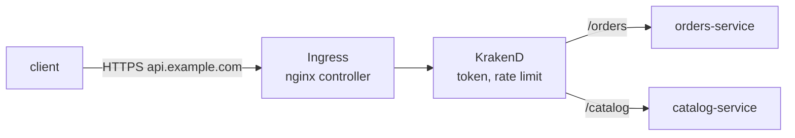

| Criterion                       | KrakenD       | nginx         |
|---------------------------------|---------------|---------------|
| Aggregate several backends      | ★★★           | ★             |
| <span class="term" data-term="jwt">JWT</span> validation, rate limiting   | ★★★ built in  | ★★ (modules)  |
| Serve static files              | no            | ★★★           |
| General use                     | ★             | ★★★           |

| I want...                                            | I use...      |
|------------------------------------------------------|---------------|
| clients call several of my APIs, and I want a single entry point that checks the token and limits the rate for all of them | KrakenD |
| I must serve a static front end, like a compiled React app, or put a reverse proxy in front of a service | nginx |

:material-book-open-variant: Reference docs: [KrakenD, Docs](https://www.krakend.io/docs/) (accessed November 2026); [Kubernetes, Ingress](https://kubernetes.io/docs/concepts/services-networking/ingress/) (accessed November 2026); [Kubernetes Gateway API](https://gateway-api.sigs.k8s.io/) (accessed November 2026)
{ .doc-ref }

### Reverse proxies: nginx, Caddy, Traefik, Envoy

<span class="pill pill-status pill-status-ok" title="Still valid, checked November 2026">Current · 11/2026</span>


*nginx: competes with Caddy, Traefik, Envoy; complements KrakenD*<br>
*Caddy: competes with nginx, Traefik, Envoy*<br>
*Traefik: competes with nginx, Caddy, Envoy*<br>
*Envoy: competes with nginx, Caddy, Traefik; complements Istio*
{ .tool-rel }

!!! info "Written on 2026-11-04"
    Features and project statuses quoted as of this date, to check.

A reverse proxy receives requests on behalf of the services, terminates HTTPS and forwards them to the right service. The four common ones do not target the same case.

- **nginx** (2004): the generalist, fast, heavily documented. Static configuration in a file, reloaded by hand. HTTPS certificates are obtained on the side (certbot for instance).
- **Caddy**: **automatic** HTTPS by default. It obtains and renews certificates on its own (Let's Encrypt or ZeroSSL) for every declared domain. Very short configuration, ideal for a small server.
- **Traefik**: **configures itself** from what is running: Docker labels or Kubernetes objects. A container that starts with the right label is routed without touching the configuration. Often used as an Ingress controller.
- **Envoy** (created at Lyft, CNCF): a high-performance proxy designed to be **driven by a control plane** through an API, rather than written by hand. It is the engine of Istio and many gateways (Envoy Gateway, Contour). Rich in <span class="term" data-term="observability">observability</span>, <span class="term" data-term="circuit-breaker">circuit breakers</span> and retries.

*Istio: competes with Linkerd; complements Envoy*
{ .tool-rel }


The same site with Caddy, HTTPS included:
```
# Example: reverse proxy to orders-service, HTTPS handled by Caddy
api.example.com {
    reverse_proxy orders-service:8080
}
```

| Criterion                        | nginx       | Caddy        | Traefik             | Envoy                 |
|----------------------------------|-------------|--------------|---------------------|-----------------------|
| Automatic HTTPS                  | ★ (separate tool) | ★★★    | ★★★                 | ★ (through the control plane) |
| Dynamic configuration            | ★           | ★★ (API)     | ★★★ (Docker, Kubernetes) | ★★★ (xDS API)    |
| Simplicity for a small server    | ★★          | ★★★          | ★★                  | ★                     |
| Service mesh, fine internal traffic | ★        | ★            | ★★                  | ★★★                   |

| I want...                                                      | I use...                     |
|----------------------------------------------------------------|------------------------------|
| I want to serve a static front end or run a classic proxy, with the best-known and most documented tool | nginx |
| I have a small server and want HTTPS without dealing with getting or renewing certificates | Caddy |
| my Docker containers or Kubernetes services come and go, and I want them routed as soon as they start, without touching the configuration | Traefik |
| I want a service mesh, or a gateway whose configuration is pushed by a control plane rather than written by hand | Envoy (through Istio or Envoy Gateway) |

:material-book-open-variant: Reference docs: [nginx, Documentation](https://nginx.org/en/docs/) (accessed November 2026); [Envoy, Docs](https://www.envoyproxy.io/docs) (accessed November 2026)
{ .doc-ref }

## CI/CD and code quality: GitLab CI, SonarQube, Renovate

<a class="pill pill-scope pill-scope-code" href="../architecture/#map-of-scales">Scale · Code</a> <span class="pill pill-status pill-status-ok" title="Still valid, checked November 2026">Current · 11/2026</span>


*GitLab CI: competes with GitHub Actions, Jenkins*<br>
*SonarQube: partly competes with Semgrep*<br>
*Renovate: competes with Dependabot; complements Snyk, Trivy*
{ .tool-rel }

**CI** (continuous integration): on every push, a machine builds and tests the code. **CD** (continuous delivery): it then ships it.

**GitLab CI**: the CI built into GitLab, described in `.gitlab-ci.yml`. Its GitHub equivalent is **GitHub Actions**.

*GitHub Actions: competes with GitLab CI, Jenkins*
{ .tool-rel }


```yaml
# Example: GitLab CI job that runs pytest and publishes the JUnit report
test:
  stage: test
  image: python:3.12
  script:
    - pip install -r requirements.txt
    - pytest --junitxml=report.xml
  artifacts:
    reports:
      junit: report.xml
```

**SonarQube**: <span class="term" data-term="static-analysis">static code analysis</span> (likely bugs, vulnerabilities, duplication, coverage) with a **<span class="term" data-term="quality-gate">quality gate</span>** that blocks the <span class="term" data-term="merge-request">MR</span> when a threshold is missed. The conditions apply to **new code** (what the MR adds or changes), so a team is not blocked by existing debt. Example conditions, close to the default "Sonar way" profile (thresholds to check):

| Condition on new code              | Failure threshold (example) |
|------------------------------------|-----------------------------|
| line coverage                      | under 80 %                  |
| duplicated lines                   | over 3 %                    |
| new blocker or critical issue      | at least 1                  |
| security hotspots reviewed         | under 100 %                 |

A single failing condition is enough: the quality gate turns "Failed", the SonarQube CI job fails and the MR cannot be merged.

**Renovate** (or Dependabot): automatically opens MRs to update dependencies. A typical MR is titled `Update dependency requests to v2.32.3` (or `chore(deps): update dependency requests to v2.32.3` with conventional commits) and contains the library's release notes; CI runs on it like on any MR. Sample configuration (automerge of minor versions, human review of majors): [Large-scale migrations](devx.md#large-scale-migrations).

*Dependabot: competes with Renovate*
{ .tool-rel }


| Criterion                  | GitLab CI                  | GitHub Actions             |
|----------------------------|----------------------------|----------------------------|
| Repository integration     | ★★★ (if code on GitLab)    | ★★★ (if code on GitHub)    |
| Template reuse             | `include`, CI components   | marketplace actions        |
| Fully self-hosted          | ★★★                        | ★★                         |

| I want...                                           | I use...                         |
|-----------------------------------------------------|----------------------------------|
| I want tests to run on their own on every MR, so nothing broken gets merged | the forge's CI (GitLab CI) |
| I want an MR to be unmergeable if its new code is poorly covered by tests or contains a vulnerability | SonarQube and its quality gate |
| my project's dependencies age because nobody thinks of updating them | Renovate |

:material-book-open-variant: Reference docs: [GitLab, CI/CD](https://docs.gitlab.com/ci/) (accessed November 2026); [SonarQube Server, Quality gates](https://docs.sonarsource.com/sonarqube-server/latest/quality-standards-administration/managing-quality-gates/introduction-to-quality-gates/) (accessed November 2026); [Renovate, Docs](https://docs.renovatebot.com/) (accessed November 2026)
{ .doc-ref }

## Feature flags: Unleash

<a class="pill pill-scope pill-scope-app" href="../architecture/#map-of-scales">Scale · Application</a> <span class="pill pill-status pill-status-ok" title="Still valid, checked November 2026">Current · 11/2026</span>


*Unleash: competes with LaunchDarkly*
{ .tool-rel }

My team wants to ship a new checkout flow without forcing it on everyone at once, and be able to stop it fast if it causes trouble. A **feature flag** is a switch in the code, driven from a UI, that turns a feature on without redeploying: for a share of users, for a country, or for the internal team. **Unleash** is an open source feature flag tool (<span class="term" data-term="saas">SaaS</span> alternatives: LaunchDarkly, Flagsmith).

*LaunchDarkly: competes with Unleash*
{ .tool-rel }


```python
# Example: new flow if the flag is on for this user, otherwise the old one
if unleash.is_enabled("new-checkout", context={"userId": "ada"}):
    return new_checkout(cart)
return old_checkout(cart)
```
Example: the new checkout is deployed switched off, turned on for 5% of customers, then 100%. If something goes wrong, it is switched off in one click, without a <span class="term" data-term="rollback">rollback</span>.

The testing trap: each flag doubles the possible journeys. Test both positions while the flag exists, and remove the flag (and the old code) once the feature is stable.

| I want...                                                    | I use...                             |
|--------------------------------------------------------------|--------------------------------------|
| I want to ship a new flow switched off, then turn it on for 5% of customers, then for everyone | a feature flag (Unleash) |
| a feature misbehaves in production and I must cut it right away, without waiting for a redeploy | a feature flag |
| a setting never changes once in production, like the database address | an <span class="term" data-term="environment-variable">environment variable</span> |

:material-book-open-variant: Reference docs: [Unleash, Docs](https://docs.getunleash.io/) (accessed November 2026); [Pete Hodgson, Feature Toggles](https://martinfowler.com/articles/feature-toggles.html) (2017)
{ .doc-ref }

## Observability: Datadog, Prometheus and Grafana, OpenTelemetry

<a class="pill pill-scope pill-scope-system" href="../architecture/#map-of-scales">Scale · System</a> <a class="pill pill-scope pill-scope-infra" href="../architecture/#map-of-scales">Scale · Infrastructure</a> <span class="pill pill-status pill-status-ok" title="Still valid, checked November 2026">Current · 11/2026</span>


*OpenTelemetry: complements Datadog, Prometheus, Tempo, Loki*<br>
*Datadog: competes with the Prometheus + Grafana + Tempo + Loki stack; complements OpenTelemetry*<br>
*Prometheus: competes with Datadog; complements Grafana, Alertmanager, OpenTelemetry*<br>
*Grafana: competes with Datadog; complements Prometheus, Tempo, Loki*
{ .tool-rel }

The concepts (logs, metrics, traces, SLOs) are in [Observability](observabilite.md).

**OpenTelemetry**: a **standard** and libraries to produce logs, metrics and traces, independently of the tool that stores them. **Datadog**: all-in-one SaaS platform (<span class="term" data-term="apm">APM</span>, logs, RUM, alerts). **Prometheus** collects metrics, **Grafana** displays them: the classic open source stack.

!!! noob "As noob"
    OpenTelemetry is the standard power socket: the application produces its logs, metrics and traces in a common format, and any compatible tool (Datadog, Grafana or another) can plug into it. Changing tools means changing the appliance, not rewiring the house. The takeaway: **instrument once with the standard, then pick or change the storage tool later.**

```python
from opentelemetry import trace

# Example: the call to save_order is measured in a create_order span
tracer = trace.get_tracer("orders-service")
with tracer.start_as_current_span("create_order"):
    save_order()
```
Example: instrumenting with OpenTelemetry lets me switch storage platform later without touching the code.

| Criterion                  | Datadog                | Prometheus + Grafana   |
|----------------------------|------------------------|------------------------|
| Getting started            | ★★★                    | ★★                     |
| Cost at high volume        | high (per ingested volume) | infrastructure to pay for and run |
| All in one (APM, RUM, logs) | ★★★                   | ★ (tools to add)       |
| <span class="term" data-term="vendor-lock-in">Vendor lock-in</span>             | strong (lower with OpenTelemetry) | low         |

| I want...                                                | I use...                   |
|----------------------------------------------------------|----------------------------|
| I want to instrument my code once, and be able to change storage tool later without touching it again | OpenTelemetry |
| my team wants APM, logs and alerts in one place, without operating any server | a SaaS platform (Datadog or another) |
| I want open source metrics and dashboards, and I accept running the infrastructure | Prometheus + Grafana |

:material-book-open-variant: Reference docs: [OpenTelemetry, Docs](https://opentelemetry.io/docs/) (accessed November 2026); [Prometheus, Overview](https://prometheus.io/docs/introduction/overview/) (accessed November 2026)
{ .doc-ref }

## Authentication: Auth0, Keycloak

<a class="pill pill-scope pill-scope-system" href="../architecture/#map-of-scales">Scale · System</a> <span class="pill pill-status pill-status-ok" title="Still valid, checked November 2026">Current · 11/2026</span>


*Auth0: competes with Keycloak, Okta*<br>
*Keycloak: competes with Auth0, Okta*
{ .tool-rel }

My applications need accounts and a login page, and I do not want to store or check passwords myself in every service. An **identity provider** (*IdP*) manages accounts and login and issues tokens. OAuth and <span class="term" data-term="openid-connect">OIDC</span> details are in [Security](securite.md).

**Auth0**: SaaS IdP (acquired by Okta). **Keycloak**: open source, self-hosted IdP.

*Okta: competes with Auth0, Keycloak*
{ .tool-rel }


| Criterion               | Auth0              | Keycloak            |
|-------------------------|--------------------|---------------------|
| Getting started         | ★★★                | ★★                  |
| Cost                    | per active user    | infrastructure      |
| Customization           | ★★ (Actions)       | ★★★                 |
| Operations              | none               | mine                |

| I want...                                             | I use...      |
|-------------------------------------------------------|---------------|
| I want reliable login quickly, without running or updating an identity server | Auth0 |
| I want to keep accounts in-house, or I have so many active users that a per-user price would cost more than my own server | Keycloak |

:material-book-open-variant: Reference docs: [Auth0, Docs](https://auth0.com/docs) (accessed November 2026); [Keycloak, Documentation](https://www.keycloak.org/documentation) (accessed November 2026)
{ .doc-ref }

## Testing: pytest, Bruno, Playwright, k6, Checkly

<a class="pill pill-scope pill-scope-code" href="../architecture/#map-of-scales">Scale · Code</a> <a class="pill pill-scope pill-scope-app" href="../architecture/#map-of-scales">Scale · Application</a> <a class="pill pill-scope pill-scope-system" href="../architecture/#map-of-scales">Scale · System</a>

The concepts (pyramid, contracts, <span class="term" data-term="flaky-test">flaky tests</span>) are in [Quality and testing](qualite.md).

### pytest

<span class="pill pill-status pill-status-ok" title="Still valid, checked November 2026">Current · 11/2026</span>

*pytest: competes with unittest; complements Testcontainers*
{ .tool-rel }

The reference Python test framework: `test_*` functions, plain `assert`, **fixtures** to prepare data ([examples](qualite.md#testing-vocabulary)). Ideal for API tests.

```python
# Example: a pytest test, the api_client fixture is injected
def test_get_order_returns_200(api_client):
    response = api_client.get("/orders/42")
    assert response.status_code == 200
```

:material-book-open-variant: Reference docs: [pytest, Documentation](https://docs.pytest.org/en/stable/) (accessed November 2026)
{ .doc-ref }

### Postman, Bruno

<span class="pill pill-status pill-status-ok" title="Still valid, checked November 2026">Current · 11/2026</span>

*Bruno: competes with Postman*<br>
*Postman: competes with Bruno*
{ .tool-rel }

Two **API clients** to send requests by hand, organize them in collections and replay them. **Postman**: the most widespread, collections stored in its cloud. **Bruno**: open source, collections as text files in the Git repository, so reviewed in MRs with the code.

```
# orders/get-order.bru
get {
  url: {{baseUrl}}/orders/42
}
assert {
  res.status: eq 200
}
```

| I want...                                              | I use...                          |
|--------------------------------------------------------|-----------------------------------|
| I want to try an API by hand and share request examples with the team | Bruno (in the repository) or Postman |
| I want API tests that run in CI and block the MR when a response changes | <span class="term" data-term="pytest">pytest</span> |

:material-book-open-variant: Reference docs: [Bruno, Docs](https://docs.usebruno.com/) (accessed November 2026); [Postman, Docs](https://learning.postman.com/docs/) (accessed November 2026)
{ .doc-ref }

### Playwright, Cypress, Selenium

<span class="pill pill-status pill-status-ok" title="Still valid, checked November 2026">Current · 11/2026</span>

*Playwright: competes with Cypress, Selenium; complements Checkly*<br>
*Cypress: competes with Playwright, Selenium*<br>
*Selenium: competes with Playwright, Cypress*
{ .tool-rel }

Three **end-to-end** (E2E) testing tools that drive a real browser.

```ts
// Example: Playwright test that opens the page and checks the heading
test("ada sees her order", async ({ page }) => {
  await page.goto("/orders/42");
  await expect(page.getByRole("heading", { name: "Order 42" })).toBeVisible();
});
```

| Criterion                       | Playwright             | Cypress                 | Selenium                 |
|---------------------------------|------------------------|-------------------------|--------------------------|
| Browsers                        | Chromium, Firefox, WebKit | Chromium, Firefox (WebKit experimental) | all, via WebDriver |
| Auto-waiting                    | ★★★                    | ★★★                     | ★ (to code)              |
| Free parallelism                | ★★★ built in           | ★ (paid or hand-rolled) | ★★ (Grid)                |
| Multiple tabs, domains          | ★★★                    | ★                       | ★★★                      |
| Languages                       | TS, Python, Java, .NET | JS/TS                   | almost all               |

| Measure (one simple test, 20 runs) | Playwright | Selenium | Cypress | Source reliability |
|------------------------------------|------------|----------|---------|--------------------|
| Mean duration                      | ~4.5 s     | ~4.6 s   | ~9.4 s  | [Take with caution: a single very short scenario, where Cypress startup weighs heavily ([Better Stack](https://betterstack.com/community/comparisons/playwright-cypress-puppeteer-selenium-comparison/), publication date not stated)] |

:material-book-open-variant: Reference docs: [Playwright, Docs](https://playwright.dev/docs/intro) (accessed November 2026); [Cypress, Docs](https://docs.cypress.io/) (accessed November 2026); [Selenium, Documentation](https://www.selenium.dev/documentation/) (accessed November 2026)
{ .doc-ref }

### k6, JMeter, Locust

<span class="pill pill-status pill-status-ok" title="Still valid, checked November 2026">Current · 11/2026</span>

*k6: competes with JMeter, Locust, Gatling*<br>
*JMeter: competes with k6, Locust, Gatling*<br>
*Locust: competes with k6, JMeter, Gatling*
{ .tool-rel }

Three **load testing** tools: simulate hundreds of <span class="term" data-term="virtual-user">virtual users</span> (VUs) to measure latency and errors.

```js
// Example: 50 VUs for 1 min, failing if the p95 exceeds 300 ms
import http from "k6/http";
export const options = { vus: 50, duration: "1m", thresholds: { http_req_duration: ["p(95)<300"] } };
export default () => http.get("https://staging.example.com/orders/42");
```

| Criterion                       | k6                 | JMeter               | Locust          |
|---------------------------------|--------------------|----------------------|-----------------|
| Script                          | JavaScript, as code | GUI, XML            | Python          |
| Thresholds that fail the CI     | ★★★ native         | ★★ (plugins)         | ★★              |
| Memory per VU                   | low                | high (one Java thread per VU) | medium |
| Exotic protocols                | ★★                 | ★★★                  | ★★              |

Memory: several comparisons find k6 between 2 and 8 times leaner than JMeter for the same number of VUs [Take with caution: non-reproduced sources, figures that vary widely with Java heap settings and scenario ([QAInsights](https://qainsights.com/?p=9380), publication date not stated)].

| I want...                                                | I use...      |
|----------------------------------------------------------|---------------|
| I want to test an API or a backend scenario, and my team writes Python | pytest |
| I want to check that my web UI works on several browsers, like Chromium, Firefox and WebKit | Playwright |
| I already have a Cypress or Selenium suite that works well | Cypress or Selenium, whichever is in place |
| I want a load test stored in the repository, that fails the CI if latency goes over a threshold | k6 |
| I want a load test and my team prefers writing Python | Locust |

:material-book-open-variant: Reference docs: [Grafana k6, Docs](https://grafana.com/docs/k6/latest/) (accessed November 2026); [Apache JMeter, User Manual](https://jmeter.apache.org/usermanual/index.html) (accessed November 2026); [Locust, Docs](https://docs.locust.io/) (accessed November 2026)
{ .doc-ref }

### Synthetic tests: Checkly

<span class="pill pill-status pill-status-ok" title="Still valid, checked November 2026">Current · 11/2026</span>

*Checkly: complements Playwright*
{ .tool-rel }

My site can break in production while every CI test was green, for example because an external payment service goes down during the night. A **synthetic test** runs in a loop in production, like a fake user, and raises an alert if a vital journey breaks (full definition in [Quality and testing](qualite.md#synthetic-tests)).

**Checkly**: a SaaS synthetic testing platform whose tests are standard **Playwright**. The same code can therefore serve in CI and in production monitoring. It follows the *monitoring as code* approach: tests and their frequency are described in the repository, and the CI deploys them with the Checkly CLI.

```ts
// checkly.config.ts
// Example: checks run every 10 min from two regions
import { defineConfig } from "checkly";

export default defineConfig({
  projectName: "my-app synthetics",
  logicalId: "my-app-synthetics",
  checks: {
    frequency: 10,
    locations: ["eu-west-3", "eu-central-1"],
    browserChecks: { testMatch: "synthetics/**/*.spec.ts" },
  },
});
```
```bash
npx checkly test     # runs the checks once, from Checkly's runners
npx checkly deploy   # publishes them: they then run every 10 min
```

Example: the <span class="term" data-term="e2e-test">E2E</span> suite's `login.spec.ts` imports the same login function as the checks. If the login page changes, the CI breaks both at the same time, instead of letting a forgotten copy break silently in production.

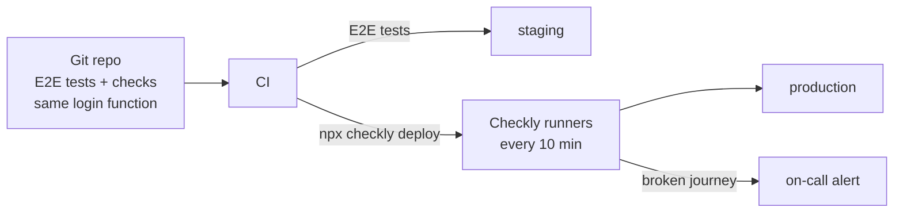

Checkly's runners live at Checkly, not in my network: they cannot reach the internal secret vault. The <span class="term" data-term="service-account">robot account</span>'s credentials are therefore copied into Checkly's environment variables **at deploy time**, by the CI.

| Criterion                              | Checkly                       | Datadog Synthetics            | Playwright scheduled in CI    |
|----------------------------------------|-------------------------------|-------------------------------|-------------------------------|
| Writing tests                          | Playwright code               | recorder in the UI (plus API) | Playwright code               |
| Reusing the E2E suite                  | ★★★                           | ★                             | ★★★                           |
| Running from several regions           | ★★★                           | ★★★                           | ★ (wherever the CI runs)      |
| Alerts and <span class="term" data-term="on-call">on-call</span>                     | ★★★ built in                  | ★★★ built in                  | ★ (to build)                  |
| Versioned in Git                       | ★★★ (*monitoring as code*)    | ★★ (Terraform possible)       | ★★★                           |

Capabilities as seen in the vendors' documentation in October 2026 (to check, they change quickly).

| I want...                                                          | I use...                        |
|--------------------------------------------------------------------|---------------------------------|
| I want to monitor prod with the same Playwright tests as the CI, so I do not maintain two copies | Checkly |
| I want synthetic tests without writing code, and my team already pays for the observability platform | Datadog Synthetics |
| I just want a check now and then, with no alerts and no runs from several regions | a scheduled Playwright job in CI |

:material-book-open-variant: Reference docs: [Checkly, Docs](https://www.checklyhq.com/docs/) (accessed November 2026)
{ .doc-ref }

## Developer tooling: mise, uv, ruff, yarn

<a class="pill pill-scope pill-scope-code" href="../architecture/#map-of-scales">Scale · Code</a> <span class="pill pill-status pill-status-ok" title="Still valid, checked November 2026">Current · 11/2026</span>


*ruff: replaces flake8, black; complements mypy*<br>
*uv: competes with pip, Poetry, pdm; complements mise*<br>
*mise: competes with asdf; complements uv*<br>
*yarn: competes with npm, pnpm*
{ .tool-rel }

**<span class="term" data-term="mise">mise</span>**: installs and pins tool versions per project (Python 3.12, Node 22) and runs tasks. Replaces `pyenv`, `nvm` and `asdf` in one go.

*asdf: competes with mise*
{ .tool-rel }


```toml
# mise.toml
# Example: the project's tool versions and a test task
[tools]
python = "3.12"
node = "22"

[tasks.test]
run = "pytest"
```

**Python package managers**: `pip` (installs), **PDM**, **Poetry** and **<span class="term" data-term="uv">uv</span>** (install, pin versions in a <span class="term" data-term="lockfile">lockfile</span>, manage the environment). uv is written in Rust and announced as 10 to 100 times faster than pip [Take with caution: vendor's own figures, Astral ([uv README](https://github.com/astral-sh/uv), read in October 2026)].

*pip: competes with uv, Poetry, pdm*<br>
*Poetry: competes with uv, pip, pdm*
{ .tool-rel }


**ruff**: Python linter and formatter in Rust, replaces flake8, isort and black [Take with caution: speed announced by the vendor, Astral, "10 to 100 times faster" ([ruff README](https://github.com/astral-sh/ruff), read in October 2026)]. **mypy**: checks types.

*flake8: replaced by ruff*<br>
*mypy: complements ruff*
{ .tool-rel }


**JavaScript package managers**: `npm` (ships with Node), **yarn** and **pnpm** (faster, pnpm saves disk space by sharing packages).

*npm: competes with yarn, pnpm*<br>
*pnpm: competes with npm, yarn*
{ .tool-rel }


| I want...                                           | I use...                       |
|-----------------------------------------------------|--------------------------------|
| the whole team and the CI must have the same Python and Node version, to avoid "works on my machine" | mise |
| I am starting a Python project and want dependency versions locked in a lockfile | uv (or PDM, Poetry if already in place) |
| I want to find simple mistakes and format my Python code with a single tool | ruff |
| I want to know before running that a function gets the wrong type, like a string instead of a number | mypy |
| I have several JavaScript packages in one repository (a <span class="term" data-term="monorepo">monorepo</span>), like a front end and a shared library | yarn or pnpm (workspaces) |

:material-book-open-variant: Reference docs: [mise](https://mise.jdx.dev/) (accessed November 2026); [uv](https://docs.astral.sh/uv/) (accessed November 2026); [Ruff](https://docs.astral.sh/ruff/) (accessed November 2026)
{ .doc-ref }

## Collaboration: Jira, Confluence, Slack, Backstage

<a class="pill pill-scope pill-scope-enterprise" href="../architecture/#map-of-scales">Scale · Enterprise</a> <span class="pill pill-status pill-status-ok" title="Still valid, checked November 2026">Current · 11/2026</span>


*Jira: complements Confluence, Slack*<br>
*Confluence: complements Jira*
{ .tool-rel }

**Jira**: ticket and sprint tracking. **Confluence**: team wiki. **Slack**: instant messaging. **Backstage**: open source developer portal (created by Spotify) that lists every service, its owners and its documentation, and offers templates to create a new service.

```yaml
# catalog-info.yaml, at the root of the repository, read by Backstage
# Example: the service's entry in the catalog, with its owning team
apiVersion: backstage.io/v1alpha1
kind: Component
metadata:
  name: orders-service
spec:
  type: service
  owner: team-core
  lifecycle: production
```

| I want...                                              | I use...                    |
|--------------------------------------------------------|-----------------------------|
| I want to track the team's work and bugs, who does what and where it stands | Jira |
| a decision or a procedure must stay easy to find for a long time, like the steps for a production release | Confluence, or docs in the repository |
| I have a quick question for a colleague that needs no lasting record | Slack |
| I am looking for who owns a service and where its docs are, like the team in charge of `orders-service` | Backstage |

:material-book-open-variant: Reference docs: [Backstage, What is Backstage?](https://backstage.io/docs/overview/what-is-backstage) (accessed November 2026)
{ .doc-ref }

## Tech radar: Thoughtworks, BYOR, Zalando, AOE, CNCF

<a class="pill pill-scope pill-scope-enterprise" href="../architecture/#map-of-scales">Scale · Enterprise</a> <span class="pill pill-status pill-status-ok" title="Still valid, checked in November 2026">Current · 11/2026</span>

*Thoughtworks Technology Radar: complements CNCF Technology Radar, company radar*<br>
*BYOR: competes with Zalando tech-radar, AOE Technology Radar, Backstage Tech Radar plugin*
{ .tool-rel }

My team is torn between two contract testing tools, and another team just picked a third one without telling anyone. A **<span class="term" data-term="tech-radar">tech radar</span>** answers this problem: a map of technologies, each placed in a ring that says what to do with it (adopt it, try it, study it or avoid it), with a few sentences explaining why. The justification is what makes a radar worth reading, not the ring alone.

There are two families of tools: **public radars**, which give the opinion of outside experts, and **generators**, which draw my company's radar. Who decides the rings in a company, and how often, is explained in [Architecture: company tech radar](architecture.md#company-tech-radar). The personal radar, for my own tech watch, is in [Tech watch](veille.md#why-when-and-how).

!!! info "Written on 2026-11-12"
    Volume numbers, ring names and the state of the open source projects change. Check them again before quoting them.

### Public radars

| Radar | Who writes it | Pace | Rings | What I find there |
|---|---|---|---|---|
| [Thoughtworks Technology Radar](https://www.thoughtworks.com/radar) (since 2010, volume 35 in November 2026) | the Technology Advisory Board: about twenty senior technologists at Thoughtworks | twice a year | Adopt, Trial, Assess, Caution (the last ring was called Hold, "proceed with caution", at least until volume 30 in April 2024; date of the renaming to check) | an argued opinion on each entry, filed in one of four quadrants: Techniques, Platforms, Tools, Languages & Frameworks; the archive shows how an entry moved from one volume to the next |
| [CNCF Technology Radar](https://radar.cncf.io/) (since June 2020) | the end user companies of the CNCF community | one edition per theme: continuous delivery, observability, secrets... | Adopt, Trial, Assess, sometimes Hold depending on the edition | what companies really run in production in the cloud native ecosystem |
| [Zalando Tech Radar](https://opensource.zalando.com/tech-radar/) (public since 2016) | Zalando's principal engineers community | as decisions are made | Adopt, Trial, Assess, Hold | a real company radar, with its quadrants Languages, Infrastructure, Datastores, Data Management |
| [AOE Technology Radar](https://www.aoe.com/techradar/) (creation date to check) | the company AOE | as decisions are made | Adopt, Trial, Assess, Hold | another company radar, with the history of each entry |

A public radar gives one company's opinion on **its** context: Thoughtworks says so in its FAQ, its radar reflects the experience of its teams at its clients, without claiming to cover the whole market. I use it to open a discussion, not to settle it.

### Drawing my company's radar

| Tool | What it is | When to pick it |
|---|---|---|
| [BYOR, Build Your Own Radar](https://www.thoughtworks.com/radar/byor) (Thoughtworks, open source) | draws a radar from a Google Sheet, a CSV or a JSON file | a first radar in an hour, with nothing to host; online, it enforces the standard ring and quadrant names, a local install lets me change them and keep the radar private |
| [Zalando tech-radar](https://github.com/zalando/tech-radar) (open source, MIT licence) | an HTML page, a JavaScript library and a configuration file: a static radar to host myself | a simple radar, on any static hosting |
| [AOE Technology Radar](https://github.com/AOEpeople/aoe_technology_radar) (open source generator) | a static site generator: one Markdown file per entry, versioned in Git, with the history of moves, a search and a dashboard | a radar kept like code, every change reviewed in a merge request |
| [Backstage Tech Radar plugin](https://github.com/backstage/community-plugins/tree/main/workspaces/tech-radar) | shows the radar in the developer portal, next to the service catalog; it reuses Zalando's drawing | a company that already runs Backstage |

Example: the CSV file BYOR reads, one line per entry (fictitious content):

```
name,ring,quadrant,isNew,description
Testcontainers,adopt,tools,FALSE,"Throwaway databases in integration tests, used by every team since 2025."
Consumer-driven contracts,trial,techniques,TRUE,"Trial between orders-service and billing-service, to extend if it holds for three months."
Bruno,assess,tools,TRUE,"API collections versioned in Git, to compare with Postman."
Selenium,hold,tools,FALSE,"No new project: Playwright covers our needs with fewer flaky tests."
```

| I want to... | I use... |
|---|---|
| I want to know whether a tool everyone talks about is mature enough, before bringing it to my team, like a new testing framework | Thoughtworks Technology Radar, and the entry's history in the archive |
| I work on Kubernetes and want to know what other companies really run in production, like for managing secrets | CNCF Technology Radar |
| my company wants to publish its technical choices quickly, for a first workshop, without building anything | BYOR with a Google Sheet |
| I want every ring change reviewed in a merge request and kept in history, like code | AOE generator, or Zalando tech-radar with its configuration in Git |
| my teams already look up their services in Backstage and I want the radar in the same place | Backstage Tech Radar plugin |
| I want to follow my own tech watch, not the company's | a personal radar ([Tech watch](veille.md#why-when-and-how)) |

:material-book-open-variant: Reference docs: [Thoughtworks, Technology Radar FAQ](https://www.thoughtworks.com/radar/faq) (accessed November 2026); [Neal Ford, "Build your own Technology Radar"](https://www.thoughtworks.com/insights/blog/build-your-own-technology-radar) (2016)
{ .doc-ref }

## Complementary or competing

The pages mention many tools. Two tools can be:

- <span class="pill pill-rel pill-rel-compete">competing</span>: they do the same job, I pick **one** (Playwright or Cypress);
- <span class="pill pill-rel pill-rel-complement">complementary</span>: they do different jobs that fit together, I **combine** them (Prometheus and Grafana);
- <span class="pill pill-rel pill-rel-overlap">overlapping</span>: they partly overlap, the choice depends on the need (Airflow and Temporal).

!!! noob "As noob"
    A cordless drill and a cordless screwdriver are **competing**: to drive a screw, one is enough. A drill and wall plugs are **complementary**: I need both to hang a shelf. The question to ask about two tools: **do they do the same move, or two moves that follow each other?**

!!! info "Written in November 2026"
    Tools change fast and step on each other's toes (a tool adds another one's feature, a fork appears). Check again before a decision.

Along a delivery chain, each step is **complementary** to the next one; inside a single box, the tools separated by "or" are **competing**:

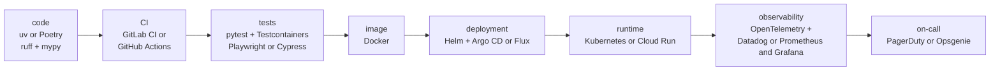

### Messaging, cache and databases

| Tools | Relation | In practice |
|---|---|---|
| RabbitMQ, Kafka, Pub/Sub, SQS | <span class="pill pill-rel pill-rel-overlap">overlapping</span> | same family (moving messages), but not the same model: RabbitMQ and SQS hand out tasks, Kafka keeps a replayable event log, Pub/Sub sits in between and is managed by Google |
| RabbitMQ + Kafka | <span class="pill pill-rel pill-rel-complement">complementary</span> | common in the same system: Kafka for business facts shared with several teams, RabbitMQ for tasks done once (see [Why keep both](#why-keep-both)) |
| Kafka + Strimzi | <span class="pill pill-rel pill-rel-complement">complementary</span> | Strimzi is an operator that installs and runs Kafka inside Kubernetes: it does not replace it |
| PostgreSQL, MySQL / MariaDB | <span class="pill pill-rel pill-rel-compete">competing</span> | two general-purpose relational databases: pick one per service (MariaDB is a fork of MySQL) |
| PostgreSQL + Redis | <span class="pill pill-rel pill-rel-complement">complementary</span> | the database holds the truth, Redis holds a fast, disposable copy (cache, sessions, counters) |
| PostgreSQL + BigQuery, Snowflake, ClickHouse, Databricks | <span class="pill pill-rel pill-rel-complement">complementary</span> | the transactional database serves the application, the warehouse serves analytics; the warehouses compete with each other |
| PostgreSQL + Elasticsearch / OpenSearch | <span class="pill pill-rel pill-rel-complement">complementary</span> | the database stays the source, the search engine is an index fed from it; Elasticsearch and OpenSearch (its fork) compete |
| PostgreSQL, MongoDB | <span class="pill pill-rel pill-rel-overlap">overlapping</span> | MongoDB stores documents, so does PostgreSQL with `jsonb`: competing for variable data, rarely both for the same data |
| PgBouncer, ProxySQL | <span class="pill pill-rel pill-rel-complement">complementary</span> | not competing: one pooler per engine (PgBouncer for PostgreSQL, ProxySQL for MySQL), placed in front of the database |
| Vitess, Citus, CockroachDB, YugabyteDB, Spanner | <span class="pill pill-rel pill-rel-overlap">overlapping</span> | Vitess (MySQL) and Citus (PostgreSQL) shard a known database; distributed SQL (CockroachDB, YugabyteDB, Spanner) replaces the database: same problem, two approaches |
| Flyway, Liquibase, Alembic, Doctrine Migrations, Prisma Migrate | <span class="pill pill-rel pill-rel-compete">competing</span> | one migration tool per database, often the one that comes with the project's ORM |
| SQLAlchemy + Alembic | <span class="pill pill-rel pill-rel-complement">complementary</span> | Alembic is the migration tool built for SQLAlchemy: the ORM describes the models, Alembic evolves the schema |

### Orchestration and data

| Tools | Relation | In practice |
|---|---|---|
| n8n, Zapier | <span class="pill pill-rel pill-rel-compete">competing</span> | tool-to-tool automation with visual blocks; n8n can be self-hosted, Zapier cannot |
| Airflow, Dagster, Prefect | <span class="pill pill-rel pill-rel-compete">competing</span> | three data pipeline schedulers: keep one |
| Airflow, Temporal, Argo Workflows | <span class="pill pill-rel pill-rel-overlap">overlapping</span> | all of them chain steps, but Airflow targets scheduled data batches, Temporal long and reliable business processes, Argo Workflows container steps inside Kubernetes |
| Airflow + dbt + Spark | <span class="pill pill-rel pill-rel-complement">complementary</span> | Airflow decides **when** to run, dbt writes the SQL transformations, Spark computes over large volumes |
| Fivetran, Airbyte | <span class="pill pill-rel pill-rel-compete">competing</span> | two tools that copy data into the warehouse (the E and L of ELT) |
| Fivetran / Airbyte + dbt | <span class="pill pill-rel pill-rel-complement">complementary</span> | one loads the raw data, the other transforms it inside the warehouse: the classic ELT split |

### Containers, deployment and scaling

| Tools | Relation | In practice |
|---|---|---|
| Docker + Kubernetes + Helm + Argo CD | <span class="pill pill-rel pill-rel-complement">complementary</span> | a chain: Docker builds the image, Helm describes the deployment, Argo CD applies it from Git, Kubernetes runs it |
| Argo CD, Flux | <span class="pill pill-rel pill-rel-compete">competing</span> | two GitOps tools: pick one per cluster |
| Helm, Kustomize | <span class="pill pill-rel pill-rel-overlap">overlapping</span> | two ways to vary manifests per environment (templates or overlays); they can be combined, but it is rarely worth it |
| Kubernetes (GKE), Cloud Run | <span class="pill pill-rel pill-rel-compete">competing</span> | for a simple service, Cloud Run avoids running a cluster; for many services talking to each other, Kubernetes |
| HPA + KEDA | <span class="pill pill-rel pill-rel-complement">complementary</span> | KEDA creates and drives an HPA from events (queue size) and adds scaling to zero |
| KEDA, Knative | <span class="pill pill-rel pill-rel-overlap">overlapping</span> | both can scale to zero: KEDA for queue consumers, Knative for HTTP services |
| Karpenter, Cluster Autoscaler | <span class="pill pill-rel pill-rel-compete">competing</span> | two ways to add nodes: enable only one |
| HPA / KEDA + Karpenter | <span class="pill pill-rel pill-rel-complement">complementary</span> | the first adds pods, the second adds the machines to host them |

### Infrastructure, network and gateways

| Tools | Relation | In practice |
|---|---|---|
| Terraform, OpenTofu, Pulumi | <span class="pill pill-rel pill-rel-compete">competing</span> | three tools to create infrastructure; OpenTofu is an open fork of Terraform (2023), Pulumi does it in a real programming language |
| Terraform / OpenTofu + Terragrunt | <span class="pill pill-rel pill-rel-complement">complementary</span> | Terragrunt wraps Terraform so that the same configuration is not repeated across environments |
| Terraform, Crossplane | <span class="pill pill-rel pill-rel-overlap">overlapping</span> | same goal (creating cloud resources); Crossplane does it continuously from Kubernetes, Terraform at each `apply` |
| Packer + Terraform + Ansible | <span class="pill pill-rel pill-rel-complement">complementary</span> | Packer builds the machine image, Terraform creates the machine, Ansible configures what runs inside it |
| KrakenD, Kong, Apigee | <span class="pill pill-rel pill-rel-compete">competing</span> | three API gateways (keys, quotas, aggregation) |
| nginx, Caddy, Traefik, Envoy | <span class="pill pill-rel pill-rel-compete">competing</span> | four reverse proxies: put one in front of the services |
| API gateway + reverse proxy | <span class="pill pill-rel pill-rel-complement">complementary</span> | the reverse proxy (or the Ingress) terminates HTTPS and routes, the gateway enforces the API rules |
| Istio, Linkerd | <span class="pill pill-rel pill-rel-compete">competing</span> | two service meshes (mTLS and routing between services); Istio is built on Envoy |

### CI, code quality and tooling

| Tools | Relation | In practice |
|---|---|---|
| GitLab CI, GitHub Actions, Jenkins | <span class="pill pill-rel pill-rel-compete">competing</span> | I keep the CI of my code forge, unless I have a specific need |
| Renovate, Dependabot | <span class="pill pill-rel pill-rel-compete">competing</span> | two bots that open dependency update MRs |
| Renovate + Snyk / Trivy | <span class="pill pill-rel pill-rel-complement">complementary</span> | Renovate updates, Snyk or Trivy tell which versions have a known vulnerability (Snyk and Trivy overlap with each other) |
| SonarQube, Semgrep | <span class="pill pill-rel pill-rel-overlap">overlapping</span> | both do static analysis; SonarQube targets quality and coverage, Semgrep custom security rules: often both |
| ruff, flake8 + black | <span class="pill pill-rel pill-rel-compete">competing</span> | ruff alone replaces the linter (flake8) and the formatter (black) |
| ruff + mypy | <span class="pill pill-rel pill-rel-complement">complementary</span> | ruff checks style and simple mistakes, mypy checks types |
| pre-commit, prek, Husky, lefthook | <span class="pill pill-rel pill-rel-compete">competing</span> | four Git hook managers; prek reads the same `.pre-commit-config.yaml` as pre-commit |
| gitleaks, detect-secrets, TruffleHog | <span class="pill pill-rel pill-rel-compete">competing</span> | three secret detectors for the code and the Git history |
| Bandit, Semgrep, SonarQube | <span class="pill pill-rel pill-rel-overlap">overlapping</span> | Bandit looks for security flaws in Python code, Semgrep and SonarQube cover several languages; ruff ports part of Bandit's rules |
| ruff + vulture | <span class="pill pill-rel pill-rel-complement">complementary</span> | ruff flags an unused import in one file, vulture looks for code nothing calls across the whole project |
| ESLint + Prettier | <span class="pill pill-rel pill-rel-complement">complementary</span> | ESLint finds mistakes, Prettier formats; disable ESLint's formatting rules so they do not contradict each other |
| uv, pip, Poetry, pdm | <span class="pill pill-rel pill-rel-compete">competing</span> | one Python dependency manager per project |
| mise, asdf | <span class="pill pill-rel pill-rel-compete">competing</span> | two tool version managers; mise also reads asdf's files |
| mise + uv | <span class="pill pill-rel pill-rel-complement">complementary</span> | mise pins the Python and tool versions, uv installs the project's dependencies (uv can also install Python: decide as a team) |
| npm, yarn, pnpm | <span class="pill pill-rel pill-rel-compete">competing</span> | one JavaScript package manager per repository, the one whose lockfile is committed |

### Observability and on-call

| Tools | Relation | In practice |
|---|---|---|
| OpenTelemetry + any backend | <span class="pill pill-rel pill-rel-complement">complementary</span> | OpenTelemetry produces and carries the signals, it does not store them: it feeds Datadog as well as Prometheus, Tempo or Loki |
| Datadog, Prometheus + Grafana + Tempo + Loki | <span class="pill pill-rel pill-rel-compete">competing</span> | an all-in-one paid platform, or an open stack to run myself: I pick one of the two |
| Prometheus + Grafana | <span class="pill pill-rel pill-rel-complement">complementary</span> | Prometheus stores the metrics, Grafana displays them; Tempo (traces) and Loki (logs) complete the same stack |
| Prometheus + Alertmanager + PagerDuty / Opsgenie | <span class="pill pill-rel pill-rel-complement">complementary</span> | Prometheus evaluates the rule, Alertmanager groups and routes, PagerDuty or Opsgenie (competing) wake up the right person |

### Testing

| Tools | Relation | In practice |
|---|---|---|
| pytest, unittest | <span class="pill pill-rel pill-rel-compete">competing</span> | two Python test runners; pytest can also run tests written with unittest |
| Playwright, Cypress, Selenium | <span class="pill pill-rel pill-rel-compete">competing</span> | three browser testing tools: one per project |
| k6, JMeter, Locust, Gatling | <span class="pill pill-rel pill-rel-compete">competing</span> | load testing tools; the choice mostly follows the team's language |
| Bruno, Postman | <span class="pill pill-rel pill-rel-compete">competing</span> | two API clients to explore and replay requests |
| Playwright + Checkly | <span class="pill pill-rel pill-rel-complement">complementary</span> | Checkly replays Playwright scripts in production every N minutes: the same test serves in CI and in monitoring |
| pytest + Testcontainers | <span class="pill pill-rel pill-rel-complement">complementary</span> | pytest runs the tests, Testcontainers starts a real, disposable database or broker for them |
| Pact + Microcks / Prism | <span class="pill pill-rel pill-rel-complement">complementary</span> | Pact checks the contract between two services; Microcks and Prism (competing with each other) serve a fake partner built from the contract |
| Allure, ReportPortal | <span class="pill pill-rel pill-rel-compete">competing</span> | two test reporting and history tools |
| Gherkin + pytest-bdd / Cucumber | <span class="pill pill-rel pill-rel-complement">complementary</span> | Gherkin is the scenario language, pytest-bdd or Cucumber run them |

### Identity, flags, collaboration and AI

| Tools | Relation | In practice |
|---|---|---|
| Auth0, Keycloak, Okta | <span class="pill pill-rel pill-rel-compete">competing</span> | three identity providers: Keycloak is self-hosted, Auth0 and Okta are paid services |
| Unleash, LaunchDarkly | <span class="pill pill-rel pill-rel-compete">competing</span> | two feature flag platforms |
| Vault, cloud secret managers | <span class="pill pill-rel pill-rel-compete">competing</span> | a central secrets vault, or the one of the cloud in use |
| Jira + Confluence + Slack + Backstage | <span class="pill pill-rel pill-rel-complement">complementary</span> | tickets, documentation, chat, service portal: each has its own role |
| Claude Code, Cursor, GitHub Copilot | <span class="pill pill-rel pill-rel-compete">competing</span> | AI coding assistants; some teams use two (one in the editor, one in the terminal) |
| AI assistant + MCP servers | <span class="pill pill-rel pill-rel-complement">complementary</span> | MCP is a protocol: it plugs tools into any compatible assistant |
| Thoughtworks Technology Radar + company radar | <span class="pill pill-rel pill-rel-complement">complementary</span> | the public radar gives the industry's opinion, the company's says what is supported where I work |
| BYOR, Zalando tech-radar, AOE Technology Radar, Backstage plugin | <span class="pill pill-rel pill-rel-compete">competing</span> | four ways to draw the same company radar; pick one |

## Pitfalls to avoid

- **Trusting the vendor's benchmark**: I pick a tool on a figure published by its vendor, on hardware and a scenario that are not mine, so the tool disappoints once plugged into my real load. I measure on my own load before deciding ([see Reading the mini benchmarks](#reading-the-mini-benchmarks)).
- **Confusing a task queue with an event log**: I broadcast a business fact like "order 42 was paid" through RabbitMQ, so the service added the following month cannot replay the history, the message is already gone. I keep RabbitMQ for tasks done once, and Kafka for facts to keep ([see Why keep both](#why-keep-both)).
- **Adding machines when the lag grows**: I add Kafka consumers without looking for the cause, so the extra ones beyond the number of partitions sit idle, and the stuck partition stays stuck. I first trace back to the cause (spike, errors, hot partition), and I alert on the age of the oldest message rather than on a raw count ([see Observing a queue's health](#observing-a-queues-health)).
- **Making Redis the source of truth**: I keep data I cannot afford to lose, like a paid order, only in the cache, so it disappears on restart or when Redis evicts keys for lack of memory. The database keeps the truth, Redis a copy that I invalidate when the source changes ([see Cache: Redis](#cache-redis)).
- **Using BigQuery as an application database**: I update a row on every click or run `SELECT *` queries, so the application crawls and the bill climbs, since I pay for the volume read. BigQuery is for analysis, PostgreSQL or MySQL for the application ([see Databases](#databases-postgresql-mysql-bigquery)).
- **Editing a migration already applied**: I fix the `V2__add_orders_status.sql` file after it ran in staging, so the tool, which records it as already applied, does not run it again, and the environments drift apart. I write a new migration ([see Schema migrations](#schema-migrations-flyway-liquibase-alembic)).
- **Mishandling the Terraform state**: I store `terraform.tfstate` in Git or fix a resource by hand in the console, so secrets leak into the repository, or the next `apply` overwrites my fix. The state goes in a shared bucket with a lock, and every change goes through an MR with its `plan` ([see Terraform and OpenTofu](#terraform-and-opentofu-the-declarative-standard)).
- **Letting feature flags live on**: I keep a flag months after the full production rollout, so each flag doubles the paths to test and the old code lingers. I test both positions while the flag exists, then I delete the flag and the old code ([see Feature flags: Unleash](#feature-flags-unleash)).

## What interviews ask

The typical questions:

- "What is the difference between RabbitMQ and Kafka?", "Why would a company keep both?" How I answer: I contrast a task queue that deletes the message after the ack with an event log kept and replayable by several groups ([Why keep both](#why-keep-both)).
- "How do you know a consumer is falling behind?", "What do you do when the lag grows?" How I answer: I look at the lag and the age of the oldest message, then I look for the cause before adding consumers ([Observing a queue's health](#observing-a-queues-health)).
- "When do you add a cache, and how do you handle invalidation?" How I answer: I describe the cache-aside pattern, the TTL, the hit rate, and a database that stays the source of truth ([Cache: Redis](#cache-redis)).
- "PostgreSQL or BigQuery?", "Why not search the catalogue with a `LIKE`?" How I answer: I contrast OLTP and OLAP, then I suggest a search engine fed from the database ([Databases](#databases-postgresql-mysql-bigquery), [Search and documents](#search-and-documents-elasticsearch-mongodb)).
- "Terraform or Pulumi?", "What is the Terraform state, and where do you store it?" How I answer: I contrast declarative HCL with a real language, then I keep the state in a bucket with a lock, never in Git ([Terraform and OpenTofu](#terraform-and-opentofu-the-declarative-standard)).
- "Playwright, Cypress or Selenium?", "How do you test a feature behind a feature flag?" How I answer: I go through the criteria of the table (browsers, auto-waiting, parallelism), then I test both flag positions while the flag exists ([Playwright, Cypress, Selenium](#playwright-cypress-selenium), [Feature flags: Unleash](#feature-flags-unleash)).

- "Do you know the Technology Radar?", "How does your company choose its technologies?" How I answer: I describe the four rings and the justification of each entry, then I tell apart the public radar, which opens the discussion, from the company radar, which says what is supported where I work ([Tech radar](#tech-radar-thoughtworks-byor-zalando-aoe-cncf), [Architecture: company tech radar](architecture.md#company-tech-radar)).

What makes a good answer: start from the need, not the tool, so I name the problem, the tool that solves it, what it costs (operations, licence, vendor lock-in) and the case where I would not pick it.

## Summary

| Family           | Tools                            | Question to ask                                             |
|------------------|----------------------------------|-------------------------------------------------------------|
| Messaging        | RabbitMQ, Kafka, Pub/Sub         | a task to do once, or a fact to keep and broadcast?         |
| Cache            | Redis                            | shared across pods, and can stale data be tolerated?        |
| Database         | PostgreSQL, MySQL, BigQuery      | small transactions, or big analyses?                        |
| Schema migrations | Flyway, Liquibase, Alembic      | plain SQL, several engines, or Python models?               |
| Search           | Elasticsearch, MongoDB           | search in text, or store documents of varying shape?        |
| Orchestration    | n8n, Airflow, Temporal, Argo Workflows | wiring tools, data batch, long business process, or containers? |
| Files            | bucket (GCS, S3)                 | is it a file or data that gets queried?                     |
| Deployment       | Docker, Kubernetes, Helm, Argo CD, Cloud Run | many services, or one small one?                |
| Infrastructure as code | Terraform, OpenTofu, Terragrunt, Pulumi, Crossplane, Ansible, Packer | creating resources, configuring machines, or building images? |
| Secrets          | Vault                            | who can access which secret, and where is it logged?        |
| Gateway and proxy | KrakenD, nginx, Caddy, Traefik, Envoy | APIs to secure and aggregate, simple HTTPS, dynamic routing, or service mesh? |
| CI and quality   | GitLab CI, SonarQube, Renovate   | what must be blocked before merge?                          |
| Feature flags    | Unleash                          | can a feature be cut without redeploying?                   |
| Observability    | OpenTelemetry, Datadog, Prometheus, Grafana | who runs the platform, and at what volume cost?  |
| Identity         | Auth0, Keycloak                  | buy or operate?                                             |
| Testing          | pytest, Playwright, k6, Checkly  | API, UI, load, or production monitoring?                    |
| Dev tooling      | mise, uv, ruff, yarn             | how to guarantee the same environment for everyone?         |
| Tech radar       | Thoughtworks, CNCF, BYOR, Zalando, AOE | the industry's opinion, or the choices supported in my company? |

## Sources

- [Benchmarking Apache Kafka, Apache Pulsar, and RabbitMQ, Confluent (2020)](https://www.confluent.io/blog/kafka-fastest-messaging-system/)
- [Pub/Sub subscription overview, Google Cloud (read in October 2026)](https://cloud.google.com/pubsub/docs/subscription-overview)
- [Playwright vs Puppeteer vs Cypress vs Selenium, Better Stack (publication date not stated)](https://betterstack.com/community/comparisons/playwright-cypress-puppeteer-selenium-comparison/)
- [Cypress vs Selenium vs Playwright vs Puppeteer speed comparison, Checkly (2021, to check)](https://www.checklyhq.com/blog/cypress-vs-selenium-vs-playwright-vs-puppeteer-speed-comparison/)
- [k6 vs JMeter, QAInsights (publication date not stated)](https://qainsights.com/?p=9380)
- [Checkly documentation (read in October 2026)](https://www.checklyhq.com/docs/)
- [Datadog Synthetic Monitoring documentation (read in October 2026)](https://docs.datadoghq.com/synthetics/)
- [OpenTofu fork announcement, Linux Foundation (September 2023)](https://www.linuxfoundation.org/press/announcing-opentofu)
- [Terragrunt documentation (read in November 2026)](https://terragrunt.gruntwork.io/docs/)
- [Pulumi documentation (read in November 2026)](https://www.pulumi.com/docs/)
- [Crossplane documentation (read in November 2026)](https://docs.crossplane.io/)
- [Ansible documentation (read in November 2026)](https://docs.ansible.com/)
- [Packer documentation (read in November 2026)](https://developer.hashicorp.com/packer/docs)
- [n8n documentation and Sustainable Use License (read in November 2026)](https://docs.n8n.io/sustainable-use-license/)
- [Temporal documentation (read in November 2026)](https://docs.temporal.io/)
- [Argo Workflows documentation (read in November 2026)](https://argo-workflows.readthedocs.io/)
- [Flyway documentation (read in November 2026)](https://documentation.red-gate.com/flyway), [Liquibase](https://docs.liquibase.com/), [Alembic](https://alembic.sqlalchemy.org/)
- [Caddy documentation, automatic HTTPS (read in November 2026)](https://caddyserver.com/docs/automatic-https)
- [Thoughtworks, Technology Radar FAQ (read in November 2026)](https://www.thoughtworks.com/radar/faq)
- [Neal Ford, "Build your own Technology Radar", Thoughtworks (2016, reposted from a 2013 post)](https://www.thoughtworks.com/insights/blog/build-your-own-technology-radar)
- [Thoughtworks, Build Your Own Radar, GitHub repository (read in November 2026)](https://github.com/thoughtworks/build-your-own-radar)
- [CNCF, "Introducing the CNCF Technology Radar" (June 2020)](https://www.cncf.io/blog/2020/06/12/introducing-the-cncf-technology-radar/)
- [Zalando, tech-radar, GitHub repository (read in November 2026)](https://github.com/zalando/tech-radar)
- [AOE, Technology Radar generator, GitHub repository (read in November 2026)](https://github.com/AOEpeople/aoe_technology_radar)
- [Backstage, Tech Radar plugin (read in November 2026)](https://github.com/backstage/community-plugins/tree/main/workspaces/tech-radar)
- [Traefik documentation (read in November 2026)](https://doc.traefik.io/traefik/), [Envoy](https://www.envoyproxy.io/docs)
