# Panorama des outils techniques

!!! warning "Avertissement"
    Ces notes sont des pense-bêtes personnels, pas une source de vérité. Elles reflètent ma compréhension et mes choix : leur contenu reste subjectif, malgré les citations et les références qu'il contient. Il peut être incomplet, simplifié, inexact ou dépassé. Vérifiez toujours dans la documentation officielle avant de l'appliquer. Ce contenu est fourni tel quel, sans aucune garantie : son utilisation se fait sous votre seule responsabilité.

!!! abstract "Les échelles"
    Les pastilles de couleur sous les titres disent à quelle échelle une notion s'applique :

    - <span class="pill pill-scope pill-scope-code">Code</span> les classes, fonctions et modules d'un programme ;
    - <span class="pill pill-scope pill-scope-app">Application</span> un service ou une application et son découpage interne ;
    - <span class="pill pill-scope pill-scope-system">Système</span> plusieurs services qui communiquent par le réseau ;
    - <span class="pill pill-scope pill-scope-infra">Infrastructure</span> les serveurs, le réseau, les zones et les clusters, physiques ou virtuels ;
    - <span class="pill pill-scope pill-scope-enterprise">Entreprise</span> le système d'information entier et son organisation.

    Détail et mots ambigus : [carte des échelles](architecture.md#carte-des-echelles).

Une entreprise de taille moyenne utilise souvent **deux outils pour le même rôle** : RabbitMQ et Kafka, PostgreSQL et BigQuery, Playwright et pytest. Ce n'est pas forcément du désordre : chaque outil est bon dans un cas précis. Cette page présente les outils les plus répandus par famille, avec pour chacun une définition, un petit exemple, puis une comparaison rapide et un tableau « je veux... j'utilise... ».

Les services `orders-service`, `catalog-service`, `report-service` et `email-service` sont fictifs.

## Vocabulaire

**Outil managé** (ou « service managé ») : le fournisseur cloud fait tourner l'outil à ma place (mises à jour, sauvegardes, montée en charge). Je paie à l'usage, je ne gère pas de serveur. Exemple : Google Pub/Sub, BigQuery.

**Auto-hébergé** (*self-hosted*) : l'équipe installe et opère l'outil elle-même, souvent dans Kubernetes. Plus de contrôle, plus de travail. Exemple : RabbitMQ dans un cluster.

**Débit** (*throughput*) : combien de données ou de requêtes passent par seconde. **Latence** : combien de temps attend une seule requête. Un camion a un gros débit et une forte latence, une moto l'inverse.

**p99** : la latence sous laquelle passent 99 % des requêtes. « p99 = 5 ms » veut dire qu'une requête sur cent attend plus de 5 ms.

**Verrouillage fournisseur** (*vendor lock-in*) : le coût de quitter un outil, parce que mon code et mes données dépendent de ses spécificités.

## Lire les mini benchmarks

!!! info "Rédigé le 23/10/2026"
    Les versions, fonctionnalités et chiffres de cette page datent de cette rédaction. Ils vieillissent vite.

Les comparaisons utilisent des étoiles (★ à ★★★) pour un ordre de grandeur, et quelques chiffres publiés. Un benchmark publié dépend du matériel, de la configuration et du scénario, et il est souvent écrit par l'éditeur d'un des outils. Chaque chiffre porte donc sa fiabilité. Le seul benchmark qui compte vraiment est celui fait sur ma propre charge.

## Messagerie : RabbitMQ, Kafka, Pub/Sub

<a class="pill pill-scope pill-scope-system" href="../architecture/#carte-des-echelles">Échelle · Système</a> <a class="pill pill-scope pill-scope-infra" href="../architecture/#carte-des-echelles">Échelle · Infrastructure</a>

J'ai un service qui doit prévenir d'autres services, mais ceux-ci ne sont pas toujours disponibles au même moment : si l'un redémarre pile à ce moment-là, il rate le message. Un **broker** règle ça : c'est un intermédiaire qui reçoit les messages d'un service, les garde, et les distribue aux autres quand ils sont prêts. Par exemple, `orders-service` annonce une commande payée, et `email-service` la reçoit même s'il était arrêté quand elle a été annoncée. Les bases (<span class="term" data-term="at-least-once">at-least-once</span>, <span class="term" data-term="idempotency">idempotence</span>, <span class="term" data-term="dead-letter-queue">DLQ</span>, <span class="term" data-term="outbox-pattern">outbox</span>) sont dans [API REST et asynchrone](api-rest-async.md).

### RabbitMQ

<span class="pill pill-status pill-status-ok" title="Toujours valable, vérifié en novembre 2026">Valable · 11/2026</span>

*RabbitMQ : concurrent en partie de Pub/Sub, SQS ; complémentaire de Kafka*
{ .tool-rel }

Une **file de tâches** (*message queue*). Un message est une tâche à faire : un consommateur le prend, le traite, le confirme (*ack*), et le message **disparaît**. RabbitMQ sait router finement : un **exchange** reçoit le message et l'envoie vers une ou plusieurs files selon des règles (clé de routage, motif).

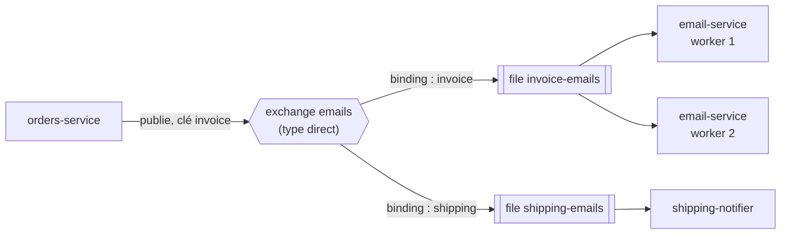
Exemple : envoyer 10 000 e-mails de facture. Chaque e-mail est une tâche. On ajoute des <span class="term" data-term="worker">workers</span> pour aller plus vite, chaque e-mail n'est envoyé qu'une fois, un e-mail en échec part en DLQ après trois essais.

:material-book-open-variant: Doc de référence : [RabbitMQ, AMQP 0-9-1 Model Explained](https://www.rabbitmq.com/tutorials/amqp-concepts) (consultée en novembre 2026)
{ .doc-ref }

### Kafka

<span class="pill pill-status pill-status-ok" title="Toujours valable, vérifié en novembre 2026">Valable · 11/2026</span>

*Kafka : concurrent en partie de Pub/Sub ; complémentaire de RabbitMQ, Strimzi*
{ .tool-rel }

Un **journal d'événements** (*log*) distribué. Un message n'est pas une tâche mais un **fait** (« la commande 42 a été payée ») écrit à la fin d'un journal, et **conservé** (des jours, ou pour toujours). Chaque consommateur lit à son rythme et retient sa position (**offset**). Le journal est découpé en **<span class="term" data-term="kafka-partition">partitions</span>** : l'ordre est garanti dans une partition, et on lit en parallèle en ayant plusieurs partitions.

!!! noob "As noob"
    Kafka ressemble au registre de bord d'un bateau plus qu'à une boîte aux lettres : chaque événement s'écrit à la suite du précédent, rien n'est effacé avant la fin de la durée de conservation, et chaque lecteur garde son propre marque-page (l'offset). Deux lecteurs lisent donc le même registre sans se gêner, et un nouveau venu peut repartir de la première page. La phrase à retenir : **lire un message Kafka ne le consomme pas, ça avance seulement mon marque-page.**

```
topic "orders" partition 0 : [créée 41] [payée 41] [créée 42] [payée 42] ...
                                                     ^                ^
                                 report-service (offset 2)   email-service (offset 4)
```
Exemple : `OrderPaid` est lu par la facturation, par l'entrepôt de données et par la détection de fraude, chacun à son rythme. Un nouveau service arrivé demain peut **relire** tout l'historique depuis le début. Avec RabbitMQ, ce message aurait déjà disparu.

Les consommateurs se rangent en **groupes** (*consumer groups*). Dans un groupe, chaque partition est lue par un seul membre : le travail se répartit. Deux groupes différents lisent chacun tout le topic, sans se gêner.

!!! noob "As noob"
    Un groupe de consommateurs, c'est une équipe de facteurs qui se partage les rues d'un quartier (les partitions) : chaque rue n'a qu'un facteur à la fois. Une autre équipe (un autre groupe) fait sa propre tournée complète, de son côté. La phrase à retenir : **dans un groupe on se partage le travail, entre groupes chacun reçoit tout ; et s'il y a plus de facteurs que de rues, ceux en trop attendent sans rien faire.**

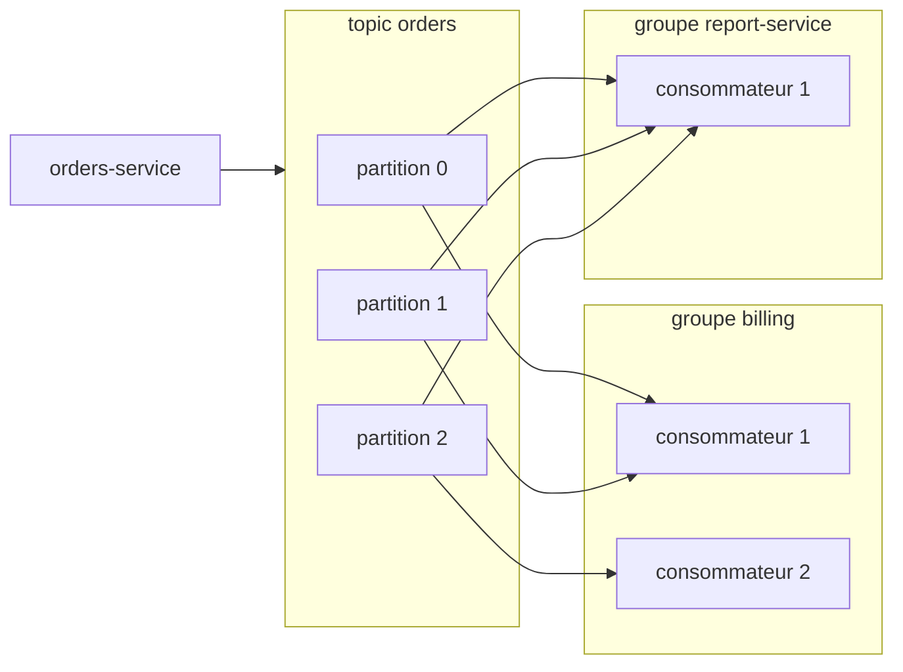

**<span class="term" data-term="kafka-connect">Kafka Connect</span>** et **<span class="term" data-term="debezium">Debezium</span>** : connecteurs prêts à l'emploi. Debezium lit les changements d'une base (<span class="term" data-term="cdc">CDC</span>, *change data capture*) et les publie dans Kafka sans toucher au code de l'application.

Exemple : un connecteur Debezium qui suit la table `public.orders` d'une base PostgreSQL. On l'envoie à Kafka Connect avec `curl -X POST -H 'Content-Type: application/json' -d @orders-cdc.json http://kafka-connect:8083/connectors`.
```json
{
  "name": "orders-cdc",
  "config": {
    "connector.class": "io.debezium.connector.postgresql.PostgresConnector",
    "plugin.name": "pgoutput",
    "database.hostname": "orders-db",
    "database.port": "5432",
    "database.user": "debezium",
    "database.password": "${file:/secrets/db.properties:password}",
    "database.dbname": "orders",
    "topic.prefix": "orders-db",
    "table.include.list": "public.orders"
  }
}
```
Chaque `INSERT`, `UPDATE` ou `DELETE` devient un message dans le topic `orders-db.public.orders` (préfixe, schéma, table). Pour une commande créée (contenu simplifié, l'enveloppe exacte dépend du convertisseur) :
```json
{
  "before": null,
  "after": { "id": 42, "customer_id": "cust-ada", "status": "CREATED" },
  "source": { "connector": "postgresql", "db": "orders", "table": "orders" },
  "op": "c",
  "ts_ms": 1792496000000
}
```
`op` vaut `c` (création), `u` (modification), `d` (suppression) ou `r` (lecture de l'instantané initial). Noms d'options à vérifier dans la documentation Debezium selon la version.

:material-book-open-variant: Doc de référence : [Apache Kafka, Documentation](https://kafka.apache.org/documentation/) (consultée en novembre 2026) ; [Debezium, PostgreSQL connector](https://debezium.io/documentation/reference/stable/connectors/postgresql.html) (consultée en novembre 2026)
{ .doc-ref }

### Google Pub/Sub

<span class="pill pill-status pill-status-ok" title="Toujours valable, vérifié en novembre 2026">Valable · 11/2026</span>

*Pub/Sub : concurrent en partie de RabbitMQ, Kafka, SQS*
{ .tool-rel }

Le <span class="term" data-term="message-broker">broker</span> **managé** de Google Cloud. Un éditeur publie sur un **topic**, chaque **abonnement** (*subscription*) reçoit une copie. Pas de serveur, pas de partition à régler, montée en charge automatique. L'ordre n'est garanti que si on utilise une **clé d'ordre** (*ordering key*), et un mode <span class="term" data-term="exactly-once">exactly-once</span> existe en option ([documentation Google](https://cloud.google.com/pubsub/docs/subscription-overview), consultée en octobre 2026). La <span class="term" data-term="message-retention">rétention</span> par défaut est de 7 jours, extensible (à vérifier selon la configuration).

```bash
gcloud pubsub topics publish order-events --message='{"order_id": 42}' --ordering-key=42
```
Exemple : un fichier déposé dans un bucket déclenche un message Pub/Sub, qui réveille un service de traitement qui peut même tomber à zéro instance quand il n'y a rien à faire.

Chaque abonnement reçoit sa propre copie du message, et la livre en *pull* (le service vient chercher) ou en *push* (Pub/Sub appelle une URL) :

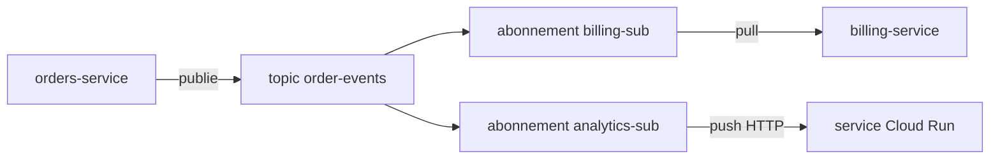

:material-book-open-variant: Doc de référence : [Google Cloud, Pub/Sub overview](https://cloud.google.com/pubsub/docs/overview) (consultée en novembre 2026)
{ .doc-ref }

### Comparaison

| Critère                         | RabbitMQ                    | Kafka                          | Pub/Sub                        |
|---------------------------------|-----------------------------|--------------------------------|--------------------------------|
| Modèle                          | file de tâches              | journal d'événements           | topic + abonnements            |
| Message après lecture           | supprimé                    | conservé, relisible            | supprimé après <span class="term" data-term="message-ack">ack</span> (relecture limitée) |
| Routage fin                     | ★★★                         | ★                              | ★ (filtres simples)            |
| Débit très élevé                | ★★                          | ★★★                            | ★★★ (managé)                   |
| Latence faible à faible charge  | ★★★                         | ★★                             | ★★                             |
| Effort d'exploitation           | moyen                       | élevé                          | quasi nul                      |
| Ordre                           | par file, un seul consommateur | par partition               | par clé d'ordre                |

Chiffres publiés ([benchmark Confluent, 2020](https://www.confluent.io/blog/kafka-fastest-messaging-system/)) :

| Mesure                         | Kafka     | RabbitMQ (files en miroir) | Fiabilité de la source |
|--------------------------------|-----------|----------------------------|------------------------|
| Débit maximal                  | 605 Mo/s  | 38 Mo/s                    | [À prendre avec précaution : publié par Confluent, l'éditeur commercial de Kafka, matériel de 2020] |
| Latence <span class="term" data-term="p99">p99</span>                    | 5 ms à 200 Mo/s | 1 ms à 30 Mo/s       | [À prendre avec précaution : même source, et les charges comparées ne sont pas les mêmes] |

Ce que ça dit vraiment : Kafka encaisse beaucoup plus de volume, RabbitMQ répond plus vite tant que la charge reste modérée.

### Pourquoi avoir les deux
RabbitMQ et Kafka ne répondent pas à la même question. RabbitMQ : « qui fait cette tâche ? ». Kafka : « que s'est-il passé, et qui veut le savoir, même plus tard ? ». Une entreprise qui a des tâches à répartir **et** des flux d'événements à partager garde souvent les deux.

| Je veux...                                                      | J'utilise...  |
|-----------------------------------------------------------------|---------------|
| j'ai une grosse pile de tâches à faire chacune une seule fois, comme 10 000 e-mails de facture, à répartir entre plusieurs workers, avec de nouveaux essais et une DLQ pour celles qui échouent | RabbitMQ |
| je veux envoyer chaque message vers une file différente selon son type, comme les e-mails de facture d'un côté et ceux d'expédition de l'autre | RabbitMQ |
| plusieurs équipes veulent apprendre le même événement, comme « la commande 42 a été payée », chacune à son rythme, et un service ajouté plus tard doit pouvoir relire l'historique | Kafka |
| d'autres systèmes doivent suivre chaque changement d'une base sans toucher au code de l'application, comme l'entrepôt de données qui recopie la table des commandes (CDC) | Kafka + Debezium |
| je suis sur Google Cloud et je veux faire passer des messages sans installer ni surveiller de serveur | Pub/Sub |
| un événement, comme un fichier déposé dans un bucket, doit réveiller un service <span class="term" data-term="serverless">serverless</span> qui reste à zéro instance le reste du temps | Pub/Sub |


### Observer la santé d'une file
Mon équipe veut savoir si les messages sont traités à temps. Une file en bonne santé se vide aussi vite qu'elle se remplit. Le signal à suivre est le **retard** : le nombre de messages en attente (*depth* chez RabbitMQ, *lag* chez Kafka, c'est-à-dire l'écart entre le dernier offset écrit et l'offset du groupe) et l'âge du plus vieux message en attente. Si le retard monte, les consommateurs vont moins vite que les producteurs : les traitements arrivent en retard (les e-mails de facture partent bien après le paiement), puis la rétention ou la mémoire du broker finit par saturer.

| Broker   | Où lire le retard | Ce qu'on regarde |
|----------|-------------------|------------------|
| RabbitMQ | `rabbitmqctl list_queues name messages_ready messages_unacknowledged consumers`, ou l'interface de management | messages prêts, messages pris mais pas encore confirmés, nombre de consommateurs |
| Kafka    | `kafka-consumer-groups.sh --describe --group billing` | colonne `LAG` par partition (`LOG-END-OFFSET` moins `CURRENT-OFFSET`) |
| Pub/Sub  | métriques Cloud Monitoring de l'abonnement | `num_undelivered_messages`, `oldest_unacked_message_age` |

Exemple Kafka (colonnes simplifiées) : une seule partition décroche, le groupe n'est donc pas lent partout.
```
$ kafka-consumer-groups.sh --bootstrap-server kafka:9092 --describe --group billing
GROUP    TOPIC   PARTITION  CURRENT-OFFSET  LOG-END-OFFSET  LAG
billing  orders  0          1200            1210            10
billing  orders  1          1180            9180            8000
```

Quand le retard monte, on remonte vers la cause avant d'ajouter des machines :

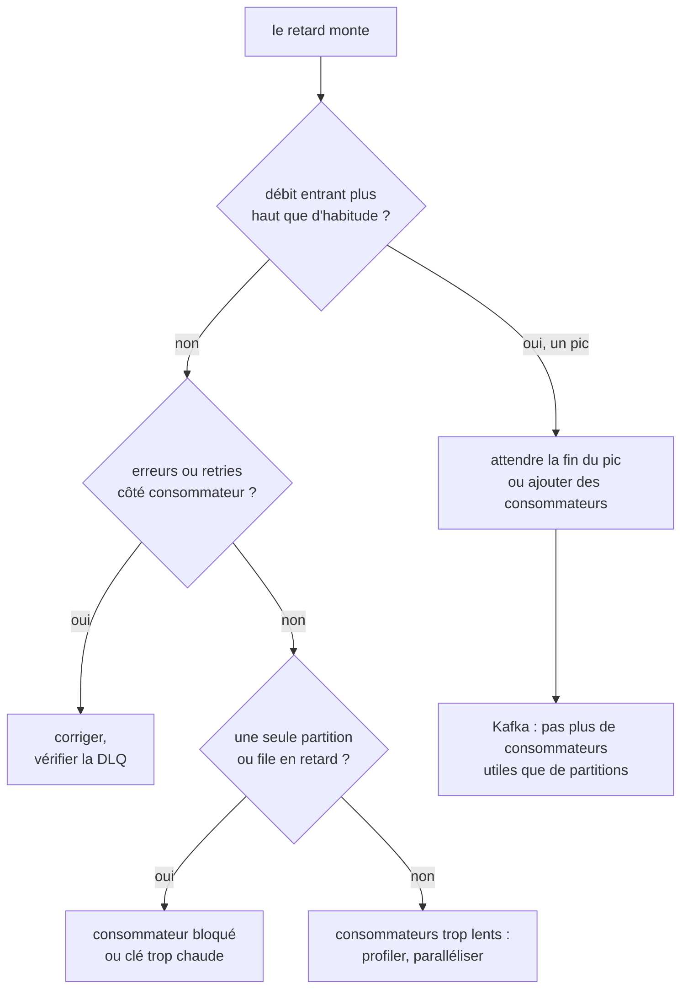
Alerter sur l'âge du plus vieux message plutôt que sur un nombre brut : 10 000 messages en attente sont normaux pour un service qui en traite 5 000 par seconde, pas pour un service qui en traite 10.

:material-book-open-variant: Doc de référence : [RabbitMQ, Monitoring](https://www.rabbitmq.com/docs/monitoring) (consultée en novembre 2026) ; [Apache Kafka, Monitoring](https://kafka.apache.org/42/operations/monitoring/) (Kafka 4.2) ; [Google Cloud, Monitor Pub/Sub](https://cloud.google.com/pubsub/docs/monitoring) (consultée en novembre 2026)
{ .doc-ref }

## Cache : Redis

<a class="pill pill-scope pill-scope-system" href="../architecture/#carte-des-echelles">Échelle · Système</a> <a class="pill pill-scope pill-scope-infra" href="../architecture/#carte-des-echelles">Échelle · Infrastructure</a> <span class="pill pill-status pill-status-ok" title="Toujours valable, vérifié en novembre 2026">Valable · 11/2026</span>


*Redis : complémentaire de PostgreSQL, MySQL*
{ .tool-rel }

Mon service relit sans cesse une donnée lente à obtenir, comme la fiche d'un produit, et chaque lecture fait attendre l'utilisateur. **Redis** est une base **en mémoire** de type <span class="term" data-term="key-value-store">clé-valeur</span> : très rapide (lecture en moins d'une milliseconde, ordre de grandeur courant), mais limitée par la RAM. On l'utilise comme **cache** (une copie temporaire de cette donnée lente à obtenir), et aussi pour des compteurs, des verrous, des sessions ou des files simples.

```bash
SET catalog:product:42 '{"title":"Lampe"}' EX 300   # expire dans 300 s
GET catalog:product:42
INCR rate-limit:ada:2026-10-23T10:15                # compteur de limite de débit
```
Exemple : `catalog-service` met 200 ms à construire la fiche d'un produit. Il la met dans Redis 5 minutes : les appels suivants répondent en 1 ms. Le piège : la donnée en cache peut être périmée, il faut l'<span class="term" data-term="cache-invalidation">invalider</span> quand la source change.

Le motif le plus courant s'appelle *cache-aside* : le service lit d'abord le cache, et le remplit lui-même quand la donnée n'y est pas.

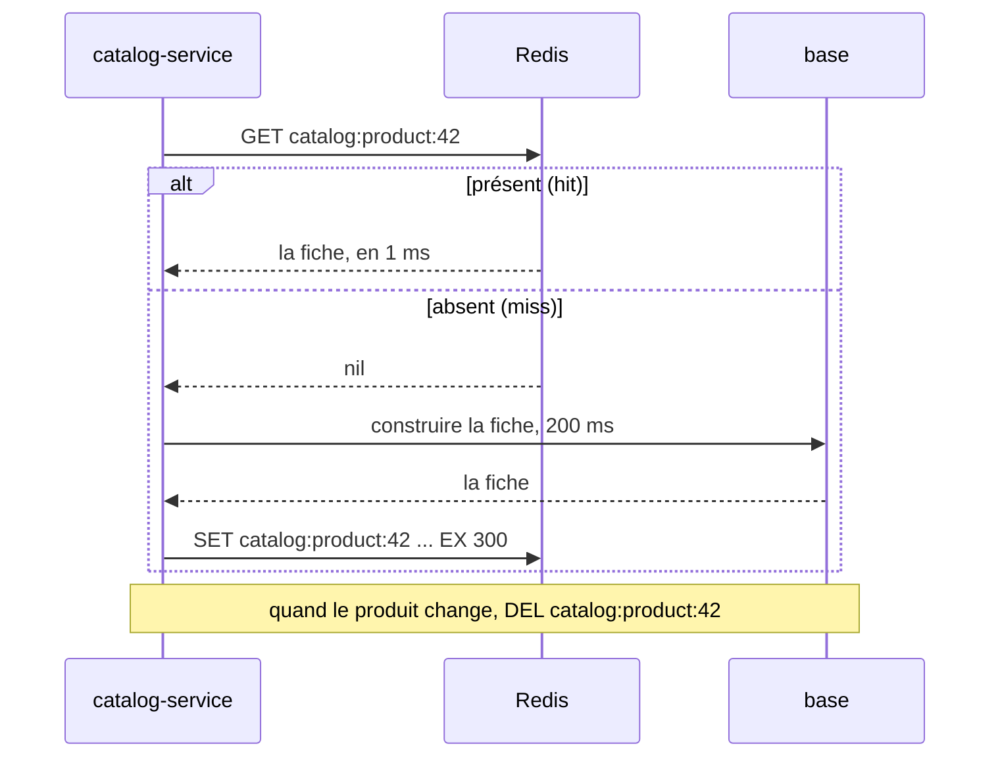

| Critère                  | Redis                      | Cache dans la mémoire du service | Base de données |
|--------------------------|----------------------------|----------------------------------|-----------------|
| Vitesse                  | ★★★                        | ★★★                              | ★               |
| Partagé entre instances  | oui                        | non (chaque <span class="term" data-term="pod">pod</span> a sa copie)      | oui             |
| Survit à un redémarrage  | selon configuration        | non                              | oui             |
| <span class="term" data-term="source-of-truth">Source de vérité</span>         | jamais                     | jamais                           | oui             |

| Je veux...                                          | J'utilise...                        |
|-----------------------------------------------------|-------------------------------------|
| une lecture lente, comme la fiche produit qui met 200 ms à se construire, est demandée par tous les pods du service | Redis |
| tous les pods doivent partager le même compteur ou le même verrou, comme une <span class="term" data-term="rate-limit">limite de débit</span> par client que chaque pod doit respecter | Redis |
| je relis souvent une petite table de référence qui change rarement, comme la liste des pays | cache en mémoire du service |
| je ne peux pas me permettre de perdre la donnée, comme une commande payée | une base de données, pas Redis |


**Observer le cache.** Un cache se juge à son **taux de hit** : la part des lectures servies par Redis sans aller à la source. Redis compte les hits, les misses et les clés évincées depuis son démarrage :
```
$ redis-cli INFO stats | grep -E 'keyspace_hits|keyspace_misses|evicted_keys'
keyspace_hits:950000
keyspace_misses:50000
evicted_keys:1200
```
Taux de hit = 950 000 / (950 000 + 50 000) = 95 % (valeurs d'exemple). Les compteurs repartent de zéro au redémarrage : comparer deux relevés à quelques minutes d'écart plutôt que le total.

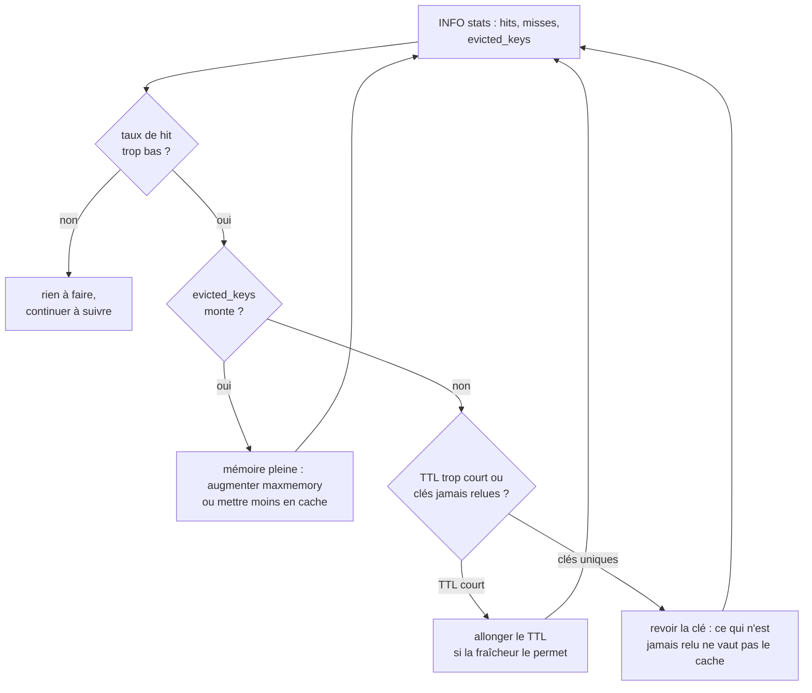

:material-book-open-variant: Doc de référence : [Redis, Docs](https://redis.io/docs/latest/) (consultée en novembre 2026) ; [Microsoft Azure Architecture Center, Cache-Aside pattern](https://learn.microsoft.com/en-us/azure/architecture/patterns/cache-aside) (consultée en novembre 2026) ; [Redis, INFO](https://redis.io/docs/latest/commands/info/) (consultée en novembre 2026)
{ .doc-ref }

## Bases de données : PostgreSQL, MySQL, BigQuery

<a class="pill pill-scope pill-scope-system" href="../architecture/#carte-des-echelles">Échelle · Système</a> <a class="pill pill-scope pill-scope-infra" href="../architecture/#carte-des-echelles">Échelle · Infrastructure</a>

**OLTP** (*online transaction processing*) : beaucoup de petites lectures et écritures rapides, celles d'une application (créer une commande). **OLAP** (*online analytical processing*) : peu de requêtes, mais énormes, pour analyser (chiffre d'affaires par pays sur 5 ans). Les requêtes elles-mêmes sont dans [SQL](sql.md).

!!! noob "As noob"
    L'OLTP, c'est la caisse d'un magasin : des milliers de petits tickets par jour, chacun doit passer tout de suite et sans erreur. L'OLAP, c'est le comptable en fin d'année qui relit tous les tickets pour savoir ce qui s'est le mieux vendu : peu de questions, mais chacune parcourt tout l'historique. La phrase à retenir : **une base faite pour la caisse n'est pas faite pour le bilan, et l'inverse.**

### PostgreSQL et MySQL

<span class="pill pill-status pill-status-ok" title="Toujours valable, vérifié en novembre 2026">Valable · 11/2026</span>

*PostgreSQL : concurrent de MySQL, MariaDB ; concurrent en partie de MongoDB ; complémentaire de Redis, PgBouncer, BigQuery, Elasticsearch*<br>
*MySQL : concurrent de PostgreSQL, MariaDB ; complémentaire de Redis, ProxySQL, Vitess*
{ .tool-rel }

Deux bases **relationnelles** OLTP open source : tables, jointures, <span class="term" data-term="db-transaction">transactions</span>. PostgreSQL est plus riche (<span class="term" data-term="jsonb">JSONB</span>, types avancés, extensions, contraintes plus strictes). MySQL (et son cousin MariaDB) est historiquement très répandu avec PHP, simple et rapide sur les lectures classiques.

```sql
-- Exemple : PostgreSQL, chercher dans une colonne JSON indexée
SELECT id FROM orders WHERE metadata @> '{"channel": "mobile"}';
```

:material-book-open-variant: Doc de référence : [PostgreSQL, Documentation](https://www.postgresql.org/docs/current/) (version 18, 2025) ; [MySQL, Reference Manual](https://dev.mysql.com/doc/refman/8.4/en/) (MySQL 8.4)
{ .doc-ref }

### BigQuery

<span class="pill pill-status pill-status-ok" title="Toujours valable, vérifié en novembre 2026">Valable · 11/2026</span>

*BigQuery : concurrent de Snowflake, Databricks, ClickHouse ; complémentaire de PostgreSQL, dbt*
{ .tool-rel }

L'**entrepôt de données** (*data warehouse*) managé de Google : OLAP, stockage en **colonnes**, des milliards de lignes lues en quelques secondes. On paie surtout au volume lu, pas au nombre de requêtes. Mauvais pour l'OLTP : pas fait pour mettre à jour une ligne à chaque clic.

```sql
-- Bien : ne coûte que le volume des colonnes lues, jamais de SELECT *
SELECT country, SUM(total_cents) / 100 AS revenue
FROM analytics.orders
WHERE DATE(created_at) >= '2026-01-01'
GROUP BY country;
```

| Critère                     | PostgreSQL | MySQL | BigQuery           |
|-----------------------------|------------|-------|--------------------|
| Transactions applicatives   | ★★★        | ★★★   | ★                  |
| Analyse sur des milliards de lignes | ★  | ★     | ★★★                |
| Richesse SQL et types       | ★★★        | ★★    | ★★★ (dialecte propre) |
| Exploitation                | à gérer (ou Cloud SQL) | à gérer (ou Cloud SQL) | aucune |
| Modèle de coût              | serveur    | serveur | volume lu         |

| Je veux...                                              | J'utilise...                  |
|---------------------------------------------------------|-------------------------------|
| je crée un nouveau service et il lui faut sa base | PostgreSQL |
| je maintiens une application PHP ancienne qui tourne déjà sur MySQL | MySQL, celui déjà en place |
| mon équipe veut des tableaux de bord sur tout l'historique, comme le chiffre d'affaires par pays sur 5 ans | BigQuery |
| les analystes veulent retrouver dans BigQuery les données de la base de production, sans que personne recopie les tables à la main | CDC (Debezium, Datastream) ou export planifié |

:material-book-open-variant: Doc de référence : [Google Cloud, BigQuery overview](https://cloud.google.com/bigquery/docs/introduction) (consultée en novembre 2026)
{ .doc-ref }

### Migrations de schéma : Flyway, Liquibase, Alembic

<span class="pill pill-status pill-status-ok" title="Toujours valable, vérifié en novembre 2026">Valable · 11/2026</span>


*Flyway : concurrent de Liquibase, Alembic*<br>
*Liquibase : concurrent de Flyway, Alembic*<br>
*Alembic : concurrent de Flyway, Liquibase ; complémentaire de SQLAlchemy*
{ .tool-rel }

Mon équipe ajoute une colonne `status` à la table `orders` : la modification doit arriver dans chaque environnement, dans le bon ordre, sans en oublier un. Une <span class="term" data-term="schema-migration">migration de schéma</span> est un fichier versionné qui fait passer la base d'une version de schéma à la suivante (ajouter une colonne, un index). L'outil note dans une table de la base quelles migrations sont déjà passées, et n'applique que les nouvelles. Les techniques pour migrer sans coupure sont dans [SQL](sql.md).

**Quand** : dès qu'une base vit plus longtemps qu'un prototype et existe en plusieurs environnements. **Pourquoi** : fini le `ALTER TABLE` lancé à la main en prod et oublié en staging. Chaque environnement sait où il en est, et la migration est relue en MR avec le code qui en a besoin. Coût : une migration déjà appliquée ne se modifie plus, on en écrit une nouvelle.

```
db/migration/
├─ V1__create_orders.sql
├─ V2__add_orders_status.sql
└─ V3__index_orders_customer_id.sql
```
```bash
flyway migrate
```

| Outil      | Écrit en                         | Adapté à                                          |
|------------|----------------------------------|---------------------------------------------------|
| Flyway     | fichiers SQL numérotés           | équipes qui veulent écrire du SQL simple, monde Java |
| Liquibase  | XML, YAML, JSON ou SQL (*changesets*) | plusieurs moteurs de base, retours arrière décrits, monde Java |
| Alembic    | Python, généré depuis les modèles SQLAlchemy | projets Python avec SQLAlchemy           |

Les frameworks ont souvent le leur (Django, Rails, Doctrine en PHP, Prisma) : on garde celui du framework.

:material-book-open-variant: Doc de référence : [Flyway, Documentation](https://documentation.red-gate.com/flyway) (consultée en novembre 2026) ; [Alembic, Documentation](https://alembic.sqlalchemy.org/) (consultée en novembre 2026)
{ .doc-ref }

## Recherche et documents : Elasticsearch, MongoDB

<a class="pill pill-scope pill-scope-system" href="../architecture/#carte-des-echelles">Échelle · Système</a> <a class="pill pill-scope pill-scope-infra" href="../architecture/#carte-des-echelles">Échelle · Infrastructure</a> <span class="pill pill-status pill-status-ok" title="Toujours valable, vérifié en novembre 2026">Valable · 11/2026</span>


*Elasticsearch : concurrent de OpenSearch ; complémentaire de PostgreSQL*<br>
*MongoDB : concurrent en partie de PostgreSQL*
{ .tool-rel }

**Elasticsearch** (et son fork open source **OpenSearch**) : un moteur de **recherche plein texte**. Il découpe les textes en mots, tolère les fautes de frappe, classe les résultats par pertinence et calcule des agrégations (« combien de résultats par genre »). Ce n'est pas une <span class="term" data-term="source-of-truth">source de vérité</span> : on y recopie des données qui vivent ailleurs.

*OpenSearch : concurrent de Elasticsearch*
{ .tool-rel }


```json
GET /products/_search
{ "query": { "match": { "title": { "query": "lampe bureu", "fuzziness": "AUTO" } } } }
```
Exemple : la barre de recherche d'un catalogue trouve « lampe de bureau » malgré la faute, en 20 ms sur des millions de fiches. Avec `LIKE '%bureu%'` en SQL, rien ne sort, et la requête parcourt toute la table.

**MongoDB** : une base **documentaire**. Chaque enregistrement est un document JSON, sans schéma imposé par la base. Pratique quand chaque élément a une forme différente, piégeux quand on a besoin de jointures et de transactions sur plusieurs collections.

```js
// Exemple : insérer un document de forme libre, puis chercher dans un champ imbriqué
db.products.insertOne({ _id: 42, title: "Lampe", options: { colors: ["noir", "blanc"] } })
db.products.find({ "options.colors": "noir" })
```

| Critère                         | PostgreSQL            | MongoDB               | Elasticsearch          |
|---------------------------------|-----------------------|-----------------------|------------------------|
| Source de vérité                | ★★★                   | ★★★                   | ★ (copie)              |
| Recherche plein texte, fautes   | ★★ (`tsvector`)       | ★★                    | ★★★                    |
| Jointures, transactions         | ★★★                   | ★                     | ★                      |
| Données de forme variable       | ★★ (JSONB)            | ★★★                   | ★★                     |

| Je veux...                                                   | J'utilise...                                  |
|--------------------------------------------------------------|-----------------------------------------------|
| mes utilisateurs tapent des recherches avec des fautes, comme « lampe bureu », et veulent filtrer par catégorie ou par prix | Elasticsearch ou OpenSearch, alimenté depuis la base |
| chaque élément a une forme différente, comme des produits dont les options varient (des couleurs pour une lampe, des tailles pour un t-shirt) | MongoDB, ou une colonne JSONB dans PostgreSQL |
| mes données se référencent entre elles et doivent changer ensemble, comme une commande, ses lignes et son paiement | PostgreSQL |

:material-book-open-variant: Doc de référence : [Elastic, Docs](https://www.elastic.co/docs) (consultée en novembre 2026) ; [MongoDB, Manual](https://www.mongodb.com/docs/manual/) (consultée en novembre 2026)
{ .doc-ref }

## Orchestration et automatisation : n8n, Airflow, Temporal, Argo Workflows

<a class="pill pill-scope pill-scope-system" href="../architecture/#carte-des-echelles">Échelle · Système</a>

!!! info "Rédigé le 04/11/2026"
    Licences, versions et statuts de projets cités à cette date, à vérifier.

J'ai un travail fait de plusieurs étapes qui prennent du temps, et si l'une échoue au milieu, je ne veux ni tout relancer à la main ni perdre la trace de ce qui s'est passé. Un **orchestrateur** enchaîne ces étapes, relance celles qui échouent et garde l'historique de chaque exécution. Les quatre outils de cette section répondent à quatre besoins différents : relier des outils sans coder, planifier des traitements de données, rendre un processus métier increvable, enchaîner des conteneurs dans Kubernetes.

| Signal                                                                   | Piste            |
|--------------------------------------------------------------------------|------------------|
| mon équipe veut que chaque nouveau ticket poste un message dans Slack et remplisse un tableur, sans écrire de service | n8n |
| un pipeline de données tourne chaque nuit, et l'étape de chargement doit attendre la fin de l'extraction | Airflow |
| chaque commande ou chaque client suit un processus qui dure des heures ou des jours, comme « payer, attendre 3 jours, demander un avis » | Temporal |
| j'ai des étapes lourdes, chacune dans son conteneur, comme générer des rapports en parallèle, et un cluster Kubernetes existe déjà | Argo Workflows |
| j'ai juste un script isolé à lancer chaque nuit, sans étape avant ni après | un CronJob Kubernetes, rien de plus |

### n8n : l'automatisation sans (presque) coder

<span class="pill pill-status pill-status-ok" title="Toujours valable, vérifié en novembre 2026">Valable · 11/2026</span>


*n8n : concurrent de Zapier ; concurrent en partie de Airflow, Temporal*
{ .tool-rel }

**Quand** : relier des outils SaaS entre eux (formulaire, messagerie, tableur, CRM, API interne) pour une tâche d'équipe, et la faire évoluer vite, y compris par des non-développeurs. Pas pour de la logique métier critique : un workflow dessiné se teste et se relit mal en MR (c'est un gros fichier JSON), et le débit reste modeste.

**Pourquoi** : outil <span class="term" data-term="low-code">low-code</span>. Ce qui prendrait un petit service (recevoir un <span class="term" data-term="webhook">webhook</span>, appeler deux API, gérer les erreurs) se dessine en dix minutes. Coût : la logique vit hors du dépôt de code, et il faut une personne responsable de l'instance. Licence « fair-code » (*Sustainable Use License*) : auto-hébergeable gratuitement pour un usage interne, mais pas open source au sens strict (à vérifier). Équivalents SaaS : Zapier, Make.

*Zapier : concurrent de n8n*
{ .tool-rel }


**Comment** : on enchaîne des **nœuds** dans un éditeur visuel. Chaque nœud reçoit les données du précédent.

```
Webhook (POST /new-bug)
└─ IF priority = "P1"
   ├─ vrai : Slack, message dans #incidents
   └─ faux : Google Sheets, ajouter une ligne au backlog
```

Le workflow s'exporte en JSON, à ranger dans Git pour garder un historique.

:material-book-open-variant: Doc de référence : [n8n, Docs](https://docs.n8n.io/) (consultée en novembre 2026)
{ .doc-ref }

### Airflow : les pipelines de données planifiés

<span class="pill pill-status pill-status-ok" title="Toujours valable, vérifié en novembre 2026">Valable · 11/2026</span>


*Airflow : concurrent de Dagster, Prefect ; concurrent en partie de Temporal, Argo Workflows ; complémentaire de dbt, Spark*
{ .tool-rel }

**Quand** : des traitements <span class="term" data-term="batch-processing">par lots</span> planifiés (extraire, transformer, charger) avec des dépendances entre étapes et besoin de relancer une journée passée. Pas pour réagir en temps réel à un événement, ni pour un processus métier par client.

**Pourquoi** : remplace une pile de crons qui s'attendent les uns les autres par un graphe visible, avec relance par tâche et rattrapage des jours manqués (*backfill*). Coût : un planificateur, une base et des workers à exploiter (ou une offre managée comme Cloud Composer). Créé chez Airbnb en 2014, projet Apache, version 3 sortie en 2025 (à vérifier).

**Comment** : un **DAG** (graphe d'étapes) en Python décrit l'ordre.

```python
# Exemple : DAG lancé chaque jour à 3 h, extract puis load
with DAG("daily_revenue", schedule="0 3 * * *", start_date=datetime(2026, 1, 1), catchup=False):
    extract = PythonOperator(task_id="extract", python_callable=extract_orders)
    load = PythonOperator(task_id="load", python_callable=load_to_warehouse)
    extract >> load
```

:material-book-open-variant: Doc de référence : [Apache Airflow, Documentation](https://airflow.apache.org/docs/) (consultée en novembre 2026)
{ .doc-ref }

### Temporal : l'exécution durable

<span class="pill pill-status pill-status-ok" title="Toujours valable, vérifié en novembre 2026">Valable · 11/2026</span>


*Temporal : concurrent en partie de Airflow, Argo Workflows*
{ .tool-rel }

**Quand** : un processus métier long et par entité (une commande, un abonnement, une inscription) qui enchaîne des appels à d'autres services, attend des jours, et ne doit jamais s'arrêter à moitié. Pas pour un traitement de données par lots, ni pour un simple appel avec retry.

**Pourquoi** : l'<span class="term" data-term="durable-execution">exécution durable</span>. Temporal enregistre chaque étape terminée : si le serveur redémarre, le workflow reprend exactement où il en était, sans table d'état ni cron écrits à la main. Coût : un cluster Temporal (ou l'offre SaaS Temporal Cloud) et une contrainte forte : le code du workflow doit être déterministe (pas d'heure système ni d'appel réseau direct, tout passe par des *activities*). Issu de Cadence, créé chez Uber (à vérifier pour les dates).

!!! noob "As noob"
    Temporal tient un carnet de bord rempli après chaque étape terminée : si le cuisinier change en plein service, le remplaçant lit le carnet, voit « payé, en attente de 3 jours », et reprend là, sans faire payer une deuxième fois. C'est pour ça que le code du workflow doit être prévisible : au redémarrage, Temporal le rejoue en recopiant les résultats notés dans le carnet au lieu de refaire les appels. La phrase à retenir : **un workflow ne recommence jamais de zéro, il reprend à la dernière étape notée.**

**Comment** :

```python
# Exemple : workflow durable, paiement, attente de 3 jours, puis mail d'avis
@workflow.defn
class OrderWorkflow:
    @workflow.run
    async def run(self, order_id: int) -> None:
        await workflow.execute_activity(charge_payment, order_id, start_to_close_timeout=timedelta(minutes=1))
        await workflow.sleep(timedelta(days=3))
        await workflow.execute_activity(send_review_email, order_id, start_to_close_timeout=timedelta(minutes=1))
```
Exemple : « payer, attendre 3 jours, envoyer une demande d'avis ». Si le worker tombe pendant les 3 jours, un autre reprend au réveil, et le paiement n'est pas rejoué.

:material-book-open-variant: Doc de référence : [Temporal, Docs](https://docs.temporal.io/) (consultée en novembre 2026)
{ .doc-ref }

### Argo Workflows : des étapes en conteneurs dans Kubernetes

<span class="pill pill-status pill-status-ok" title="Toujours valable, vérifié en novembre 2026">Valable · 11/2026</span>


*Argo Workflows : concurrent en partie de Airflow, Temporal ; complémentaire de Kubernetes*<br>
*Kubernetes : concurrent de Cloud Run ; complémentaire de Docker, Helm, Argo CD*
{ .tool-rel }

**Quand** : des étapes lourdes, chacune dans sa propre image (entraînement de modèle, génération de rapports, traitements parallèles), sur un cluster Kubernetes qui existe déjà. Pas sans Kubernetes, et pas pour une logique métier par client (Temporal). À ne pas confondre avec [Argo CD](kubernetes.md#argo-cd-git-decide-de-ce-qui-tourne), qui déploie.

**Pourquoi** : chaque étape est un <span class="term" data-term="pod">pod</span>, avec ses propres ressources et son image : le parallélisme et l'isolation viennent de Kubernetes. Coût : tout s'écrit en YAML, plus verbeux qu'un DAG Python. Projet de la CNCF, diplômé avec la famille Argo (à vérifier).

**Comment** :

```yaml
# Exemple : workflow Argo en DAG, render attend la fin d'extract
apiVersion: argoproj.io/v1alpha1
kind: Workflow
metadata:
  generateName: nightly-report-
spec:
  entrypoint: main
  templates:
    - name: main
      dag:
        tasks:
          - name: extract
            template: step
            arguments:
              parameters:
                - name: cmd
                  value: extract
          - name: render
            dependencies: [extract]
            template: step
            arguments:
              parameters:
                - name: cmd
                  value: render
    # Exemple : le modèle d'étape commun, un conteneur qui reçoit la commande
    - name: step
      inputs:
        parameters:
          - name: cmd
      container:
        image: report-service:1.4.0
        args: ["{{inputs.parameters.cmd}}"]
```

:material-book-open-variant: Doc de référence : [Argo Workflows, Documentation](https://argo-workflows.readthedocs.io/) (consultée en novembre 2026)
{ .doc-ref }

### Comparaison

| Critère                        | n8n                    | Airflow                          | Temporal                              | Argo Workflows          | Cron + script     |
|--------------------------------|------------------------|----------------------------------|---------------------------------------|-------------------------|-------------------|
| Cas typique                    | relier des outils SaaS | données par lots, chaque nuit    | processus métier par commande, par client | étapes en conteneurs | tâche simple et isolée |
| Écrit en                       | éditeur visuel (JSON)  | Python                           | code (Python, Go, Java, TS...)        | YAML                    | n'importe quoi    |
| Reprise après panne            | ★                      | ★★ (par tâche)                   | ★★★ (au pas près)                     | ★★ (par étape)          | ★                 |
| Historique et relance          | ★★                     | ★★★                              | ★★★                                   | ★★★                     | ★                 |
| Relu en MR comme du code       | ★                      | ★★★                              | ★★★                                   | ★★★                     | ★★                |
| Coût d'exploitation            | faible                 | moyen                            | moyen à élevé                         | moyen (si cluster déjà là) | faible         |

| Je veux...                                                    | J'utilise...   |
|---------------------------------------------------------------|----------------|
| mon équipe veut automatiser une tâche entre outils SaaS, comme copier chaque formulaire reçu dans le CRM, sans écrire ni maintenir de service | n8n (ou Zapier, Make) |
| je dois extraire les commandes de la veille, les transformer puis les charger dans l'entrepôt, à heure fixe | Airflow |
| un processus métier par commande ou par abonnement dure longtemps et ne doit jamais s'arrêter à moitié, même si un serveur redémarre | Temporal |
| j'enchaîne des étapes lourdes en conteneurs, comme un entraînement de modèle, dans un cluster Kubernetes | Argo Workflows |
| je lance un script chaque nuit, qui ne dépend d'aucune autre étape | un CronJob Kubernetes |

## Stockage de fichiers : buckets

<a class="pill pill-scope pill-scope-infra" href="../architecture/#carte-des-echelles">Échelle · Infrastructure</a> <span class="pill pill-status pill-status-ok" title="Toujours valable, vérifié en novembre 2026">Valable · 11/2026</span>

Mon application produit des fichiers, comme des photos produit ou des rapports de tests, et je ne veux les mettre ni dans la base ni sur le disque d'un serveur qui peut disparaître. Un **bucket** (Google Cloud Storage, Amazon S3) stocke des **objets** : un fichier plus ses métadonnées, sous une clé (`products/42/photo.jpg`). Quasi illimité, peu cher, accessible par HTTP. Pas un disque : on ne modifie pas un fichier en place, on le remplace.

```bash
gcloud storage cp report.html gs://my-test-reports/2026-10-23/report.html
```
Exemple : les rapports HTML de tests de la CI vont dans un bucket, la base ne garde que le lien.

| Je veux...                                        | J'utilise...                       |
|---------------------------------------------------|------------------------------------|
| je dois garder des fichiers, comme des photos produit, des fichiers audio ou les rapports HTML de la CI | bucket |
| je dois chercher dans mes données et les modifier, comme passer une commande au statut « expédiée » | base de données |
| un traitement a besoin d'un fichier de travail qui peut disparaître à la fin, comme une archive décompressée le temps de la lire | disque local du conteneur |

:material-book-open-variant: Doc de référence : [Google Cloud Storage, Product overview](https://cloud.google.com/storage/docs/introduction) (consultée en novembre 2026) ; [Amazon S3, User Guide](https://docs.aws.amazon.com/AmazonS3/latest/userguide/Welcome.html) (consultée en novembre 2026)
{ .doc-ref }

## Conteneurs et déploiement : Docker, Kubernetes, Helm, Argo CD, Cloud Run

<a class="pill pill-scope pill-scope-infra" href="../architecture/#carte-des-echelles">Échelle · Infrastructure</a> <span class="pill pill-status pill-status-ok" title="Toujours valable, vérifié en novembre 2026">Valable · 11/2026</span>


*Docker : complémentaire de Kubernetes, Helm*<br>
*Cloud Run : concurrent de Kubernetes ; complémentaire de Docker*<br>
*Helm : concurrent en partie de Kustomize ; complémentaire de Argo CD, Kubernetes*<br>
*Argo CD : concurrent de Flux ; complémentaire de Helm, Kubernetes*
{ .tool-rel }

Ce que font Docker, Helm, Argo CD et Cloud Run, avec un `Dockerfile` et le chemin d'un déploiement, est expliqué dans [Conteneurs, Kubernetes et déploiement](kubernetes.md#construire-et-deployer-docker-helm-argo-cd-cloud-run). Ici, seulement le choix.

| Critère                      | Kubernetes + Helm + Argo CD | Cloud Run          | `kubectl apply` depuis la CI |
|------------------------------|-----------------------------|--------------------|------------------------------|
| Contrôle fin                 | ★★★                         | ★                  | ★★                           |
| Simplicité                   | ★                           | ★★★                | ★★                           |
| Traçabilité (qui a déployé quoi) | ★★★ (historique Git)    | ★★                 | ★ (logs CI)                  |
| Coût à vide                  | <span class="term" data-term="node-k8s">nœuds</span> payés en permanence   | proche de zéro     | nœuds payés en permanence    |

:material-book-open-variant: Doc de référence : [Kubernetes, Documentation](https://kubernetes.io/docs/home/) (consultée en novembre 2026) ; [Google Cloud Run, Documentation](https://cloud.google.com/run/docs) (consultée en novembre 2026)
{ .doc-ref }

## Infrastructure as code : Terraform, OpenTofu, Terragrunt, Pulumi, Crossplane, Ansible, Packer

<a class="pill pill-scope pill-scope-infra" href="../architecture/#carte-des-echelles">Échelle · Infrastructure</a>

!!! info "Rédigé le 04/11/2026"
    Licences, rachats et statuts de projets cités à cette date, à vérifier.

Mon équipe crée ses buckets, bases et droits en cliquant dans la console du cloud : ensuite, personne ne sait qui a changé quoi, ni comment refaire la même chose en staging. L'<span class="term" data-term="infrastructure-as-code">infrastructure as code</span> (IaC) décrit l'infrastructure (buckets, bases, réseaux, droits, machines) dans des fichiers versionnés, au lieu de cliquer dans une console.

**Quand** : dès qu'une ressource doit exister dans plusieurs environnements, être recréée après un incident, ou être relue avant d'être changée. Pas pour un essai jetable d'une heure dans un projet bac à sable.

**Pourquoi** : la console ne garde ni l'historique ni la raison d'un changement, et deux environnements « identiques » finissent par diverger. Gain : chaque changement passe en MR, se rejoue à l'identique, et se relit avant d'être appliqué. Coût : apprendre l'outil, et gérer son <span class="term" data-term="iac-state">état</span>.

Ces outils ne font pas tous la même chose : la plupart **créent des ressources cloud** (Terraform, OpenTofu, Pulumi, Crossplane), un **configure l'intérieur des machines** (Ansible), un **fabrique des images de machines** (Packer), un **organise** les autres (Terragrunt).

### Terraform et OpenTofu : le standard déclaratif

<span class="pill pill-status pill-status-ok" title="Toujours valable, vérifié en novembre 2026">Valable · 11/2026</span>


*Terraform : concurrent de OpenTofu, Pulumi ; concurrent en partie de Crossplane ; complémentaire de Terragrunt, Packer, Ansible*<br>
*OpenTofu : concurrent de Terraform, Pulumi ; complémentaire de Terragrunt*
{ .tool-rel }

**Terraform** (HashiCorp) lit des fichiers HCL, compare avec ce qui existe, et applique la différence. En 2023, HashiCorp a passé Terraform sous licence BSL (plus open source au sens strict), et la communauté a créé le fork **OpenTofu**, hébergé par la Linux Foundation, compatible avec les mêmes fichiers. HashiCorp a ensuite été racheté par IBM (finalisé en 2025, à vérifier).

**Quand** : le choix par défaut pour créer des ressources cloud, chez un ou plusieurs fournisseurs. OpenTofu quand la licence compte (produit commercial construit dessus) ou pour une fonctionnalité qu'il est seul à proposer, comme le chiffrement de l'état (à vérifier).

**Comment** :

```hcl
# Exemple : bucket dont les fichiers sont supprimés après 90 jours
resource "google_storage_bucket" "test_reports" {
  name     = "my-test-reports"
  location = "EU"
  lifecycle_rule {
    condition { age = 90 }
    action { type = "Delete" }
  }
}
```
```bash
terraform plan
terraform apply
```
`plan` montre ce qui va changer sans rien toucher, `apply` l'applique (`tofu plan` et `tofu apply` avec OpenTofu). Exemple : la MR qui crée un bucket montre son `plan` en commentaire : la revue porte sur le changement réel d'infrastructure.

L'état (`terraform.tfstate`) mémorise ce que Terraform a créé. Il se range dans un bucket partagé, avec un verrou, jamais dans Git (il contient parfois des secrets). Un changement fait à la main dans la console crée une <span class="term" data-term="configuration-drift">dérive</span> que le prochain `plan` affiche, et que `apply` écrase.

!!! noob "As noob"
    Le code Terraform, c'est le plan de la maison ; l'état, c'est l'inventaire de l'entrepreneur, qui note ce qu'il a déjà construit et où se trouve chaque pièce. `plan` compare le plan, l'inventaire et la maison réelle, puis liste les travaux à faire. La phrase à retenir : **perdre ou abîmer l'état, c'est faire oublier à Terraform ce qu'il gère : on le protège comme une base de données.**

`plan` compare trois choses : le code, l'état, et ce qui existe vraiment.

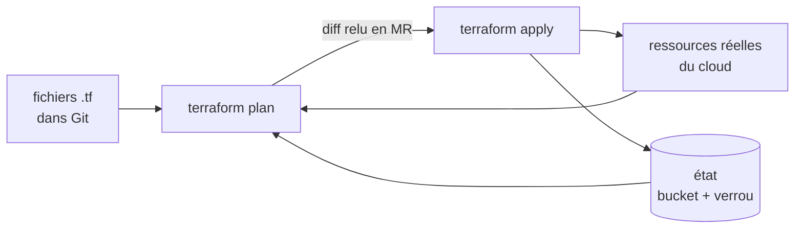

:material-book-open-variant: Doc de référence : [HashiCorp, Terraform Docs](https://developer.hashicorp.com/terraform/docs) (consultée en novembre 2026) ; [OpenTofu, Docs](https://opentofu.org/docs/) (consultée en novembre 2026)
{ .doc-ref }

### Terragrunt : ne pas se répéter entre environnements

<span class="pill pill-status pill-status-ok" title="Toujours valable, vérifié en novembre 2026">Valable · 11/2026</span>


*Terragrunt : complémentaire de Terraform, OpenTofu*
{ .tool-rel }

**Quand** : beaucoup d'environnements ou de régions qui reprennent les mêmes modules Terraform avec quelques valeurs différentes, et des blocs `backend` copiés partout. Pas pour un seul environnement : une couche de plus pour rien.

**Pourquoi** : Terraform seul pousse à copier la configuration de l'état et des fournisseurs dans chaque dossier. Terragrunt (Gruntwork) la génère, et lance une commande sur plusieurs dossiers dans l'ordre de leurs dépendances. Coût : un outil de plus à apprendre et à faire tourner en CI.

**Comment** :

```
infra/
├─ terragrunt.hcl
├─ staging/
│  └─ reports-bucket/terragrunt.hcl
└─ prod/
   └─ reports-bucket/terragrunt.hcl
```
```hcl
# Exemple : config prod qui réutilise le module bucket et ne fixe que ses entrées
include "root" {
  path = find_in_parent_folders()
}

terraform {
  source = "../../modules/bucket"
}

inputs = {
  name     = "my-test-reports-prod"
  location = "EU"
}
```
Le fichier racine porte une seule fois la configuration de l'état. La commande pour tout planifier d'un coup a changé de nom selon les versions (`run-all plan`, puis `run --all plan`, à vérifier).

:material-book-open-variant: Doc de référence : [Terragrunt, Docs](https://terragrunt.gruntwork.io/docs/) (consultée en novembre 2026)
{ .doc-ref }

### Pulumi : la même chose dans un vrai langage

<span class="pill pill-status pill-status-ok" title="Toujours valable, vérifié en novembre 2026">Valable · 11/2026</span>


*Pulumi : concurrent de Terraform, OpenTofu*
{ .tool-rel }

**Quand** : une équipe de développeurs qui préfère TypeScript, Python ou Go au HCL, et a besoin de boucles, de fonctions ou de tests unitaires sur son infrastructure. Pas si l'équipe maîtrise déjà Terraform : les modules et l'aide en ligne sont bien plus nombreux côté Terraform.

**Pourquoi** : la logique (créer un bucket par client d'une liste, par exemple) s'écrit avec le langage, ses tests et son éditeur. Coût : un code d'infrastructure trop « malin » devient difficile à relire, et l'état vit dans Pulumi Cloud ou un bucket à configurer.

**Comment** :

```python
import pulumi_gcp as gcp

# Exemple : une boucle Python crée un bucket par équipe
for team in ["team-core", "team-data"]:
    gcp.storage.Bucket(f"{team}-reports", location="EU")
```
```bash
pulumi preview
pulumi up
```

:material-book-open-variant: Doc de référence : [Pulumi, Docs](https://www.pulumi.com/docs/) (consultée en novembre 2026)
{ .doc-ref }

### Crossplane : l'infrastructure pilotée par Kubernetes

<span class="pill pill-status pill-status-ok" title="Toujours valable, vérifié en novembre 2026">Valable · 11/2026</span>


*Crossplane : concurrent en partie de Terraform ; complémentaire de Kubernetes*
{ .tool-rel }

**Quand** : une équipe plateforme qui veut que les équipes demandent une base ou un bucket comme elles demandent un Deployment, en YAML dans Git, appliqué par [Argo CD](kubernetes.md#argo-cd-git-decide-de-ce-qui-tourne). Pas sans Kubernetes, ni pour une petite équipe : la mise en place est lourde.

**Pourquoi** : Crossplane est un ensemble d'[opérateurs](kubernetes.md#operateurs-kubernetes-strimzi) qui créent les ressources cloud et les **corrigent en continu** : une modification à la main est défaite en quelques minutes, sans attendre un `apply`. Avec ses *compositions*, la plateforme expose une ressource simple (« une base PostgreSQL de taille M ») qui cache cinquante paramètres. Coût : une API de plus à concevoir et maintenir, et un débogage qui passe par `kubectl describe`. Projet de la CNCF (statut à vérifier).

!!! noob "As noob"
    Terraform est un artisan qu'on fait venir pour un chantier : il fait les travaux puis repart, et ne remarque une modification faite à la main qu'à sa visite suivante. Crossplane est un gardien qui reste sur place : il compare sans arrêt ce qui existe à ce qui est déclaré, et remet en état dès qu'il voit un écart. La phrase à retenir : **Terraform corrige au prochain `apply`, Crossplane corrige tout le temps.**

**Comment** (groupe d'API à vérifier selon le fournisseur et la version) :

```yaml
# Exemple : un bucket décrit comme une ressource Kubernetes
apiVersion: storage.gcp.upbound.io/v1beta1
kind: Bucket
metadata:
  name: my-test-reports
spec:
  forProvider:
    location: EU
  providerConfigRef:
    name: default
```

:material-book-open-variant: Doc de référence : [Crossplane, Docs](https://docs.crossplane.io/) (consultée en novembre 2026)
{ .doc-ref }

### Ansible : configurer l'intérieur des machines

<span class="pill pill-status pill-status-ok" title="Toujours valable, vérifié en novembre 2026">Valable · 11/2026</span>


*Ansible : complémentaire de Terraform, Packer*
{ .tool-rel }

**Quand** : installer des paquets, déposer des fichiers de configuration, redémarrer des services sur des <span class="term" data-term="virtual-machine">machines virtuelles</span> ou des serveurs physiques. Pas pour créer des ressources cloud (Terraform le fait mieux), ni pour des applications qui tournent déjà en conteneurs (l'image Docker porte leur configuration).

**Pourquoi** : remplace les scripts SSH lancés à la main sur dix serveurs. Ansible se connecte en SSH, sans agent à installer, et ses modules sont <span class="term" data-term="idempotency">idempotents</span> : relancer le playbook ne change rien si tout est déjà en place. Coût : pas d'état, donc ce qui a été retiré du playbook n'est pas défait sur les machines. Maintenu par Red Hat.

!!! noob "As noob"
    Une tâche idempotente ressemble à la consigne « la porte doit être fermée » plutôt qu'à « ferme la porte » : la vérifier dix fois ne change rien si elle l'est déjà. Un playbook écrit avec les modules standards décrit ainsi un état à atteindre, et se relance sans crainte. Limite : Ansible ne se souvient pas de ce qu'il a fait avant. La phrase à retenir : **relancer ne casse rien, mais retirer une ligne du playbook ne défait rien sur la machine.**

**Comment** :

```yaml
# Exemple : playbook qui installe nginx puis le démarre
- name: reverse proxy
  hosts: web
  become: true
  tasks:
    - name: install nginx
      ansible.builtin.apt:
        name: nginx
        state: present
    - name: start nginx
      ansible.builtin.service:
        name: nginx
        state: started
        enabled: true
```
```bash
ansible-playbook -i inventory.ini proxy.yml --check
ansible-playbook -i inventory.ini proxy.yml
```
`--check` montre ce qui changerait, sans rien faire.

:material-book-open-variant: Doc de référence : [Ansible, Documentation](https://docs.ansible.com/) (consultée en novembre 2026)
{ .doc-ref }

### Packer : fabriquer des images de machines

<span class="pill pill-status pill-status-ok" title="Toujours valable, vérifié en novembre 2026">Valable · 11/2026</span>


*Packer : complémentaire de Terraform, Ansible*
{ .tool-rel }

**Quand** : des machines virtuelles qui doivent démarrer vite et toutes identiques (runners de CI, groupes de machines qui s'agrandissent seuls). Pas pour des applications en conteneurs : l'image Docker joue déjà ce rôle.

**Pourquoi** : au lieu d'installer les paquets au démarrage de chaque machine (lent, et qui peut échouer si un dépôt de paquets tombe), on fabrique une fois une <span class="term" data-term="machine-image">image de machine</span> prête à l'emploi. Coût : une chaîne de fabrication d'images à tenir à jour (correctifs de sécurité). HashiCorp, même licence BSL que Terraform.

**Comment** :

```hcl
# Exemple : la source, l'image de base et le nom de l'image produite
source "googlecompute" "runner" {
  project_id          = "my-project"
  zone                = "europe-west1-b"
  source_image_family = "debian-12"
  image_name          = "ci-runner-v1-4-0"
  ssh_username        = "packer"
}

# Exemple : la construction, qui installe git et Docker dans l'image
build {
  sources = ["source.googlecompute.runner"]
  provisioner "shell" {
    inline = ["sudo apt-get update", "sudo apt-get install -y git docker.io"]
  }
}
```
```bash
packer build runner.pkr.hcl
```
Ansible peut servir de `provisioner` à la place du script shell : Packer fabrique, Ansible configure, Terraform crée les machines à partir de l'image.

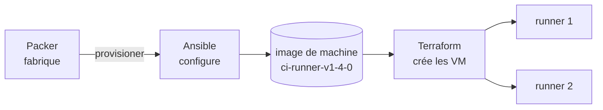

:material-book-open-variant: Doc de référence : [HashiCorp, Packer Docs](https://developer.hashicorp.com/packer/docs) (consultée en novembre 2026)
{ .doc-ref }

### Comparaison

| Critère                      | Terraform / OpenTofu | Terragrunt          | Pulumi               | Crossplane               | Ansible              | Packer               |
|------------------------------|----------------------|---------------------|----------------------|--------------------------|----------------------|----------------------|
| Rôle                         | créer des ressources cloud | organiser Terraform | créer des ressources cloud | créer et corriger en continu | configurer des machines | fabriquer des images |
| Écrit en                     | HCL                  | HCL                 | TS, Python, Go, C#...| YAML (Kubernetes)        | YAML                 | HCL                  |
| Garde un état                | oui (fichier)        | celui de Terraform  | oui                  | oui (dans le cluster)    | non                  | non                  |
| Corrige la dérive seul       | ★ (au prochain `apply`) | ★                | ★                    | ★★★                      | ★ (si relancé)       | sans objet           |
| Communauté, modules          | ★★★                  | ★★                  | ★★                   | ★★                       | ★★★                  | ★★                   |
| Ticket d'entrée              | ★★                   | ★★                  | ★★                   | ★ (lourd)                | ★★★                  | ★★★                  |

| Je veux...                                                | J'utilise...                                  |
|-----------------------------------------------------------|-----------------------------------------------|
| mon équipe veut créer et modifier ses buckets, bases et réseaux en passant par une MR relue, et pouvoir tout recréer à l'identique | Terraform (ou OpenTofu) |
| je construis un produit commercial au-dessus de mon outil d'IaC, et sa licence doit être open source au sens strict | OpenTofu |
| j'ai dix environnements qui reprennent les mêmes modules avec quelques valeurs différentes, et je ne veux plus copier la configuration dans chaque dossier | Terragrunt par-dessus Terraform |
| mon équipe de développeurs veut écrire l'infrastructure en TypeScript ou Python, avec des boucles et des tests, comme créer un bucket par équipe d'une liste | Pulumi |
| mon équipe plateforme veut que les autres équipes demandent une base ou un bucket en YAML dans Git, comme elles demandent un Deployment | Crossplane |
| je dois installer et configurer des logiciels sur des machines virtuelles, comme nginx sur dix serveurs | Ansible |
| mes machines virtuelles doivent démarrer vite et toutes identiques, comme des runners de CI | Packer |
| mon application tourne dans Kubernetes et je veux la déployer ou la mettre à jour | Helm et Argo CD, pas Terraform |

## Secrets : Vault

<a class="pill pill-scope pill-scope-app" href="../architecture/#carte-des-echelles">Échelle · Application</a> <a class="pill pill-scope pill-scope-infra" href="../architecture/#carte-des-echelles">Échelle · Infrastructure</a> <span class="pill pill-status pill-status-ok" title="Toujours valable, vérifié en novembre 2026">Valable · 11/2026</span>


*Vault : concurrent de les gestionnaires de secrets des clouds*
{ .tool-rel }

**Vault** (HashiCorp) : un **coffre à secrets**. Les mots de passe, <span class="term" data-term="api-key">clés d'API</span> et certificats y sont stockés chiffrés, avec des droits par application et un historique des accès. Il sait aussi générer des secrets temporaires (un compte de base valable une heure). Équivalents managés : Google Secret Manager, AWS Secrets Manager. Un gestionnaire comme **1Password** sert, lui, aux humains.

**Quand** : dès qu'une application ou la CI a besoin d'un secret. Jamais un secret en clair dans Git, ni dans un fichier Terraform.

```bash
vault kv get -field=password secret/prod/my-api/database
```

| Je veux...                                                | J'utilise...                                  |
|-----------------------------------------------------------|-----------------------------------------------|
| mon application ou ma CI a besoin d'un secret, comme le mot de passe de la base, et il ne doit jamais apparaître en clair dans Git | Vault, ou le gestionnaire de secrets du cloud |
| des personnes de l'équipe doivent partager un mot de passe, comme celui d'un compte d'outil commun | 1Password ou équivalent |

:material-book-open-variant: Doc de référence : [HashiCorp, Vault Docs](https://developer.hashicorp.com/vault/docs) (consultée en novembre 2026)
{ .doc-ref }

## Passerelle d'API : KrakenD, nginx

<a class="pill pill-scope pill-scope-system" href="../architecture/#carte-des-echelles">Échelle · Système</a> <a class="pill pill-scope pill-scope-infra" href="../architecture/#carte-des-echelles">Échelle · Infrastructure</a> <span class="pill pill-status pill-status-ok" title="Toujours valable, vérifié en novembre 2026">Valable · 11/2026</span>


*KrakenD : concurrent de Kong, Apigee ; complémentaire de nginx, Envoy*
{ .tool-rel }

J'ai plusieurs services derrière une même adresse, et chacun devrait vérifier le jeton de l'appelant et freiner les abus : sans point commun, chaque équipe recode ces contrôles à sa façon. Une **passerelle d'API** (*API gateway*) est la porte d'entrée unique devant ces services : elle vérifie le jeton, <span class="term" data-term="rate-limit">limite le débit</span>, route vers le bon service, et peut fusionner plusieurs réponses.

!!! noob "As noob"
    La passerelle d'API, c'est l'accueil d'un immeuble de bureaux : on montre son badge une fois à l'entrée, l'accueil vérifie, freine les visiteurs trop pressants et indique le bon étage. Les services derrière n'ont pas à réinventer ces contrôles chacun de son côté. La phrase à retenir : **une seule porte pour les contrôles communs, des services qui ne s'occupent que de leur métier.**

**KrakenD** : passerelle déclarative (un fichier JSON), <span class="term" data-term="stateless">sans état</span>, très rapide, qui sait agréger plusieurs appels backend en une réponse.

```json
{
  "endpoint": "/v1/orders/{id}",
  "backend": [{ "host": ["http://orders-service"], "url_pattern": "/orders/{id}" }]
}
```

**nginx** : serveur web et <span class="term" data-term="reverse-proxy">reverse proxy</span> généraliste. Sert des fichiers statiques, fait du routage et de la <span class="term" data-term="tls-termination">terminaison TLS</span>. Souvent utilisé comme **<span class="term" data-term="ingress">Ingress</span>** dans Kubernetes.

Un **Ingress** est un objet Kubernetes qui décrit comment le trafic HTTP venu de l'extérieur du cluster est routé vers les services internes, selon le nom de domaine et le chemin. Un **contrôleur d'Ingress** (nginx, Traefik, celui du fournisseur cloud) lit ces objets et fait le routage réel. Exemple : `api.example.com/orders` part vers orders-service.
```yaml
# Exemple : route api.example.com/orders vers orders-service
apiVersion: networking.k8s.io/v1
kind: Ingress
metadata:
  name: orders
spec:
  ingressClassName: nginx
  rules:
    - host: api.example.com
      http:
        paths:
          - path: /orders
            pathType: Prefix
            backend:
              service:
                name: orders-service
                port:
                  number: 80
```
Le projet ingress-nginx et l'API Ingress elle-même cèdent la place à la **Gateway API** de Kubernetes pour les nouveaux déploiements (calendrier à vérifier).

Une chaîne courante, de l'extérieur vers les services :

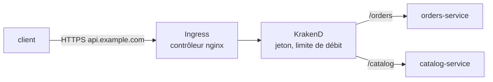

| Critère                         | KrakenD     | nginx         |
|---------------------------------|-------------|---------------|
| Agréger plusieurs backends      | ★★★         | ★             |
| Validation <span class="term" data-term="jwt">JWT</span>, limite de débit | ★★★ intégré | ★★ (modules)  |
| Servir des fichiers statiques   | non         | ★★★           |
| Usage général                   | ★           | ★★★           |

| Je veux...                                           | J'utilise...  |
|------------------------------------------------------|---------------|
| des clients appellent plusieurs de mes API, et je veux une seule entrée qui vérifie le jeton et limite le débit pour toutes | KrakenD |
| je dois servir un front statique, comme une appli React compilée, ou placer un reverse proxy devant un service | nginx |

:material-book-open-variant: Doc de référence : [KrakenD, Docs](https://www.krakend.io/docs/) (consultée en novembre 2026) ; [Kubernetes, Ingress](https://kubernetes.io/docs/concepts/services-networking/ingress/) (consultée en novembre 2026) ; [Kubernetes Gateway API](https://gateway-api.sigs.k8s.io/) (consultée en novembre 2026)
{ .doc-ref }

### Reverse proxies : nginx, Caddy, Traefik, Envoy

<span class="pill pill-status pill-status-ok" title="Toujours valable, vérifié en novembre 2026">Valable · 11/2026</span>


*nginx : concurrent de Caddy, Traefik, Envoy ; complémentaire de KrakenD*<br>
*Caddy : concurrent de nginx, Traefik, Envoy*<br>
*Traefik : concurrent de nginx, Caddy, Envoy*<br>
*Envoy : concurrent de nginx, Caddy, Traefik ; complémentaire de Istio*
{ .tool-rel }

!!! info "Rédigé le 04/11/2026"
    Fonctionnalités et statuts de projets cités à cette date, à vérifier.

Un reverse proxy reçoit les requêtes à la place des services, termine le HTTPS et les transmet au bon service. Les quatre courants ne visent pas le même cas.

- **nginx** (2004) : le généraliste, rapide, très documenté. Configuration statique dans un fichier, rechargée à la main. Les certificats HTTPS s'obtiennent à côté (certbot par exemple).
- **Caddy** : HTTPS **automatique** par défaut. Il obtient et renouvelle seul les certificats (Let's Encrypt ou ZeroSSL) pour chaque domaine déclaré. Configuration très courte, idéale pour un petit serveur.
- **Traefik** : se configure **tout seul** à partir de ce qui tourne : labels Docker ou objets Kubernetes. Un conteneur qui démarre avec le bon label est routé sans toucher à la configuration. Souvent utilisé comme contrôleur d'Ingress.
- **Envoy** (créé chez Lyft, CNCF) : proxy de haute performance pensé pour être **piloté par un plan de contrôle** via API, plutôt qu'écrit à la main. C'est le moteur d'Istio et de nombreuses passerelles (Envoy Gateway, Contour). Riche en <span class="term" data-term="observability">observabilité</span>, <span class="term" data-term="circuit-breaker">circuit breakers</span> et retries.

*Istio : concurrent de Linkerd ; complémentaire de Envoy*
{ .tool-rel }


Le même site en Caddy, HTTPS compris :
```
# Exemple : reverse proxy vers orders-service, HTTPS géré par Caddy
api.example.com {
    reverse_proxy orders-service:8080
}
```

| Critère                          | nginx       | Caddy        | Traefik             | Envoy                 |
|----------------------------------|-------------|--------------|---------------------|-----------------------|
| HTTPS automatique                | ★ (outil à côté) | ★★★     | ★★★                 | ★ (via le plan de contrôle) |
| Configuration dynamique          | ★           | ★★ (API)     | ★★★ (Docker, Kubernetes) | ★★★ (API xDS)    |
| Simplicité pour un petit serveur | ★★          | ★★★          | ★★                  | ★                     |
| Service mesh, trafic interne fin | ★           | ★            | ★★                  | ★★★                   |

| Je veux...                                                     | J'utilise...                 |
|----------------------------------------------------------------|------------------------------|
| je veux servir un front statique ou faire un proxy classique, avec l'outil le plus connu et le plus documenté | nginx |
| j'ai un petit serveur et je veux du HTTPS sans m'occuper d'obtenir ni de renouveler les certificats | Caddy |
| mes conteneurs Docker ou mes services Kubernetes vont et viennent, et je veux qu'ils soient routés dès qu'ils démarrent, sans toucher à la configuration | Traefik |
| je veux un service mesh, ou une passerelle dont la configuration est poussée par un plan de contrôle plutôt qu'écrite à la main | Envoy (via Istio ou Envoy Gateway) |

:material-book-open-variant: Doc de référence : [nginx, Documentation](https://nginx.org/en/docs/) (consultée en novembre 2026) ; [Envoy, Docs](https://www.envoyproxy.io/docs) (consultée en novembre 2026)
{ .doc-ref }

## CI/CD et qualité du code : GitLab CI, SonarQube, Renovate

<a class="pill pill-scope pill-scope-code" href="../architecture/#carte-des-echelles">Échelle · Code</a> <span class="pill pill-status pill-status-ok" title="Toujours valable, vérifié en novembre 2026">Valable · 11/2026</span>


*GitLab CI : concurrent de GitHub Actions, Jenkins*<br>
*SonarQube : concurrent en partie de Semgrep*<br>
*Renovate : concurrent de Dependabot ; complémentaire de Snyk, Trivy*
{ .tool-rel }

**CI** (intégration continue) : à chaque push, une machine construit et teste le code. **CD** (déploiement continu) : elle le livre ensuite.

**GitLab CI** : la CI intégrée à GitLab, décrite dans `.gitlab-ci.yml`. Son équivalent chez GitHub est **GitHub Actions**.

*GitHub Actions : concurrent de GitLab CI, Jenkins*
{ .tool-rel }


```yaml
# Exemple : job GitLab CI qui lance pytest et publie le rapport JUnit
test:
  stage: test
  image: python:3.12
  script:
    - pip install -r requirements.txt
    - pytest --junitxml=report.xml
  artifacts:
    reports:
      junit: report.xml
```

**SonarQube** : <span class="term" data-term="static-analysis">analyse statique</span> du code (bugs probables, failles, duplication, couverture) avec une **<span class="term" data-term="quality-gate">quality gate</span>** qui bloque la <span class="term" data-term="merge-request">MR</span> si un seuil n'est pas atteint. Les conditions portent sur le **nouveau code** (ce que la MR ajoute ou modifie), pour ne pas bloquer une équipe sur la dette existante. Exemple de conditions, proches du profil par défaut « Sonar way » (seuils à vérifier) :

| Condition sur le nouveau code      | Seuil d'échec (exemple) |
|------------------------------------|-------------------------|
| couverture des lignes              | moins de 80 %           |
| lignes dupliquées                  | plus de 3 %             |
| nouveau problème bloquant ou critique | au moins 1           |
| points sensibles de sécurité revus | moins de 100 %          |

Une seule condition en échec suffit : la quality gate passe en « Failed », le job SonarQube de la CI échoue et la MR ne peut pas être fusionnée.

**Renovate** (ou Dependabot) : ouvre automatiquement des MR pour mettre à jour les dépendances. Une MR typique s'intitule `Update dependency requests to v2.32.3` (ou `chore(deps): update dependency requests to v2.32.3` avec les commits conventionnels) et contient les notes de version de la bibliothèque ; la CI tourne dessus comme sur toute MR. Configuration d'exemple (fusion automatique des versions mineures, revue humaine des majeures) : [Migrations à grande échelle](devx.md#migrations-a-grande-echelle).

*Dependabot : concurrent de Renovate*
{ .tool-rel }


| Critère                    | GitLab CI                  | GitHub Actions             |
|----------------------------|----------------------------|----------------------------|
| Intégration au dépôt       | ★★★ (si code sur GitLab)   | ★★★ (si code sur GitHub)   |
| Réutilisation de modèles   | `include`, composants CI   | actions de la marketplace  |
| Auto-hébergement complet   | ★★★                        | ★★                         |

| Je veux...                                          | J'utilise...                     |
|-----------------------------------------------------|----------------------------------|
| je veux que les tests tournent tout seuls à chaque MR, pour ne rien fusionner de cassé | la CI de la forge (GitLab CI) |
| je veux qu'une MR ne puisse pas être fusionnée si son nouveau code est mal couvert par les tests ou contient une faille | SonarQube et sa quality gate |
| les dépendances de mon projet vieillissent parce que personne ne pense à les mettre à jour | Renovate |

:material-book-open-variant: Doc de référence : [GitLab, CI/CD](https://docs.gitlab.com/ci/) (consultée en novembre 2026) ; [SonarQube Server, Quality gates](https://docs.sonarsource.com/sonarqube-server/latest/quality-standards-administration/managing-quality-gates/introduction-to-quality-gates/) (consultée en novembre 2026) ; [Renovate, Docs](https://docs.renovatebot.com/) (consultée en novembre 2026)
{ .doc-ref }

## Feature flags : Unleash

<a class="pill pill-scope pill-scope-app" href="../architecture/#carte-des-echelles">Échelle · Application</a> <span class="pill pill-status pill-status-ok" title="Toujours valable, vérifié en novembre 2026">Valable · 11/2026</span>


*Unleash : concurrent de LaunchDarkly*
{ .tool-rel }

Mon équipe veut livrer un nouveau tunnel de paiement sans l'imposer à tout le monde d'un coup, et pouvoir l'arrêter vite s'il pose problème. Un **feature flag** est un interrupteur dans le code, piloté depuis une interface, qui active une fonctionnalité sans redéployer : pour une partie des utilisateurs, pour un pays, ou pour l'équipe interne. **Unleash** est un outil open source de feature flags (alternatives <span class="term" data-term="saas">SaaS</span> : LaunchDarkly, Flagsmith).

*LaunchDarkly : concurrent de Unleash*
{ .tool-rel }


```python
# Exemple : nouveau parcours si le flag est actif pour cet utilisateur, sinon l'ancien
if unleash.is_enabled("new-checkout", context={"userId": "ada"}):
    return new_checkout(cart)
return old_checkout(cart)
```
Exemple : le nouveau tunnel de paiement est déployé éteint, allumé pour 5 % des clients, puis 100 %. En cas de problème, on l'éteint en un clic, sans <span class="term" data-term="rollback">rollback</span>.

Le piège côté tests : chaque flag double les parcours possibles. On teste les deux positions tant que le flag existe, et on supprime le flag (et l'ancien code) une fois la fonctionnalité stabilisée.

| Je veux...                                                   | J'utilise...                         |
|--------------------------------------------------------------|--------------------------------------|
| je veux livrer un nouveau parcours éteint, puis l'allumer pour 5 % des clients, puis pour tous | un feature flag (Unleash) |
| une fonctionnalité pose problème en production et je dois la couper tout de suite, sans attendre un redéploiement | un feature flag |
| un réglage ne change jamais une fois en production, comme l'adresse de la base | une <span class="term" data-term="environment-variable">variable d'environnement</span> |

:material-book-open-variant: Doc de référence : [Unleash, Docs](https://docs.getunleash.io/) (consultée en novembre 2026) ; [Pete Hodgson, Feature Toggles](https://martinfowler.com/articles/feature-toggles.html) (2017)
{ .doc-ref }

## Observabilité : Datadog, Prometheus et Grafana, OpenTelemetry

<a class="pill pill-scope pill-scope-system" href="../architecture/#carte-des-echelles">Échelle · Système</a> <a class="pill pill-scope pill-scope-infra" href="../architecture/#carte-des-echelles">Échelle · Infrastructure</a> <span class="pill pill-status pill-status-ok" title="Toujours valable, vérifié en novembre 2026">Valable · 11/2026</span>


*OpenTelemetry : complémentaire de Datadog, Prometheus, Tempo, Loki*<br>
*Datadog : concurrent de la pile Prometheus + Grafana + Tempo + Loki ; complémentaire de OpenTelemetry*<br>
*Prometheus : concurrent de Datadog ; complémentaire de Grafana, Alertmanager, OpenTelemetry*<br>
*Grafana : concurrent de Datadog ; complémentaire de Prometheus, Tempo, Loki*
{ .tool-rel }

Les notions (logs, métriques, traces, SLO) sont dans [Observabilité](observabilite.md).

**OpenTelemetry** : un **standard** et des bibliothèques pour produire logs, métriques et traces, indépendamment de l'outil qui les stocke. **Datadog** : plateforme SaaS tout-en-un (<span class="term" data-term="apm">APM</span>, logs, RUM, alertes). **Prometheus** collecte des métriques, **Grafana** les affiche : la pile open source classique.

!!! noob "As noob"
    OpenTelemetry, c'est la prise électrique standard : l'application produit ses logs, métriques et traces dans un format commun, et n'importe quel outil compatible (Datadog, Grafana ou un autre) peut s'y brancher. Changer d'outil revient à changer d'appareil, pas à refaire l'installation électrique. La phrase à retenir : **on instrumente une fois avec le standard, et on choisit ou change l'outil de stockage ensuite.**

```python
from opentelemetry import trace

# Exemple : l'appel à save_order est mesuré dans un span create_order
tracer = trace.get_tracer("orders-service")
with tracer.start_as_current_span("create_order"):
    save_order()
```
Exemple : instrumenter avec OpenTelemetry permet de changer de plateforme de stockage plus tard sans retoucher le code.

| Critère                    | Datadog                | Prometheus + Grafana   |
|----------------------------|------------------------|------------------------|
| Mise en route              | ★★★                    | ★★                     |
| Coût à fort volume         | élevé (au volume ingéré) | infrastructure à payer et exploiter |
| Tout en un (APM, RUM, logs) | ★★★                   | ★ (outils à ajouter)   |
| <span class="term" data-term="vendor-lock-in">Verrouillage fournisseur</span>   | fort (moindre avec OpenTelemetry) | faible       |

| Je veux...                                               | J'utilise...               |
|----------------------------------------------------------|----------------------------|
| je veux instrumenter mon code une seule fois, et pouvoir changer d'outil de stockage plus tard sans le retoucher | OpenTelemetry |
| mon équipe veut l'APM, les logs et les alertes au même endroit, sans exploiter de serveur | une plateforme SaaS (Datadog ou autre) |
| je veux des métriques et des tableaux de bord open source, et j'accepte de faire tourner l'infrastructure | Prometheus + Grafana |

:material-book-open-variant: Doc de référence : [OpenTelemetry, Docs](https://opentelemetry.io/docs/) (consultée en novembre 2026) ; [Prometheus, Overview](https://prometheus.io/docs/introduction/overview/) (consultée en novembre 2026)
{ .doc-ref }

## Authentification : Auth0, Keycloak

<a class="pill pill-scope pill-scope-system" href="../architecture/#carte-des-echelles">Échelle · Système</a> <span class="pill pill-status pill-status-ok" title="Toujours valable, vérifié en novembre 2026">Valable · 11/2026</span>


*Auth0 : concurrent de Keycloak, Okta*<br>
*Keycloak : concurrent de Auth0, Okta*
{ .tool-rel }

Mes applications ont besoin de comptes et d'une page de connexion, et je ne veux pas stocker ni vérifier les mots de passe moi-même dans chaque service. Un **fournisseur d'identité** (*IdP*) gère les comptes, la connexion et délivre les jetons. Le détail d'OAuth et <span class="term" data-term="openid-connect">OIDC</span> est dans [Sécurité](securite.md).

**Auth0** : IdP SaaS (racheté par Okta). **Keycloak** : IdP open source, auto-hébergé.

*Okta : concurrent de Auth0, Keycloak*
{ .tool-rel }


| Critère                 | Auth0              | Keycloak            |
|-------------------------|--------------------|---------------------|
| Mise en route           | ★★★                | ★★                  |
| Coût                    | par utilisateur actif | infrastructure   |
| Personnalisation        | ★★ (Actions)       | ★★★                 |
| Exploitation            | aucune             | à faire             |

| Je veux...                                            | J'utilise...  |
|-------------------------------------------------------|---------------|
| je veux une connexion fiable rapidement, sans faire tourner ni mettre à jour un serveur d'identité | Auth0 |
| je veux garder les comptes chez moi, ou j'ai tant d'utilisateurs actifs qu'un prix par utilisateur coûterait plus cher que mon propre serveur | Keycloak |

:material-book-open-variant: Doc de référence : [Auth0, Docs](https://auth0.com/docs) (consultée en novembre 2026) ; [Keycloak, Documentation](https://www.keycloak.org/documentation) (consultée en novembre 2026)
{ .doc-ref }

## Tests : pytest, Bruno, Playwright, k6, Checkly

<a class="pill pill-scope pill-scope-code" href="../architecture/#carte-des-echelles">Échelle · Code</a> <a class="pill pill-scope pill-scope-app" href="../architecture/#carte-des-echelles">Échelle · Application</a> <a class="pill pill-scope pill-scope-system" href="../architecture/#carte-des-echelles">Échelle · Système</a>

Les notions (pyramide, contrats, <span class="term" data-term="flaky-test">tests instables</span>) sont dans [Qualité et tests](qualite.md).

### pytest

<span class="pill pill-status pill-status-ok" title="Toujours valable, vérifié en novembre 2026">Valable · 11/2026</span>

*pytest : concurrent de unittest ; complémentaire de Testcontainers*
{ .tool-rel }

Le framework de test Python de référence : des fonctions `test_*`, des `assert` simples, des **fixtures** pour préparer les données ([exemples](qualite.md#le-vocabulaire-des-tests)). Idéal pour les tests d'API.

```python
# Exemple : un test pytest, la fixture api_client est injectée
def test_get_order_returns_200(api_client):
    response = api_client.get("/orders/42")
    assert response.status_code == 200
```

:material-book-open-variant: Doc de référence : [pytest, Documentation](https://docs.pytest.org/en/stable/) (consultée en novembre 2026)
{ .doc-ref }

### Postman, Bruno

<span class="pill pill-status pill-status-ok" title="Toujours valable, vérifié en novembre 2026">Valable · 11/2026</span>

*Bruno : concurrent de Postman*<br>
*Postman : concurrent de Bruno*
{ .tool-rel }

Deux **clients d'API** pour envoyer des requêtes à la main, les ranger en collections et les rejouer. **Postman** : le plus répandu, collections stockées dans son cloud. **Bruno** : open source, collections en fichiers texte dans le dépôt Git, donc relues en MR avec le code.

```
# orders/get-order.bru
get {
  url: {{baseUrl}}/orders/42
}
assert {
  res.status: eq 200
}
```

| Je veux...                                             | J'utilise...                      |
|--------------------------------------------------------|-----------------------------------|
| je veux essayer une API à la main et partager des exemples de requêtes avec l'équipe | Bruno (dans le dépôt) ou Postman |
| je veux des tests d'API qui tournent en CI et bloquent la MR quand une réponse change | <span class="term" data-term="pytest">pytest</span> |

:material-book-open-variant: Doc de référence : [Bruno, Docs](https://docs.usebruno.com/) (consultée en novembre 2026) ; [Postman, Docs](https://learning.postman.com/docs/) (consultée en novembre 2026)
{ .doc-ref }

### Playwright, Cypress, Selenium

<span class="pill pill-status pill-status-ok" title="Toujours valable, vérifié en novembre 2026">Valable · 11/2026</span>

*Playwright : concurrent de Cypress, Selenium ; complémentaire de Checkly*<br>
*Cypress : concurrent de Playwright, Selenium*<br>
*Selenium : concurrent de Playwright, Cypress*
{ .tool-rel }

Trois outils de test **de bout en bout** (E2E) qui pilotent un vrai navigateur.

```ts
// Exemple : test Playwright qui ouvre la page et vérifie le titre
test("ada voit sa commande", async ({ page }) => {
  await page.goto("/orders/42");
  await expect(page.getByRole("heading", { name: "Commande 42" })).toBeVisible();
});
```

| Critère                         | Playwright             | Cypress                 | Selenium                 |
|---------------------------------|------------------------|-------------------------|--------------------------|
| Navigateurs                     | Chromium, Firefox, WebKit | Chromium, Firefox (WebKit expérimental) | tous, via WebDriver |
| Attente automatique             | ★★★                    | ★★★                     | ★ (à coder)              |
| Parallélisme gratuit            | ★★★ intégré            | ★ (payant ou bricolé)   | ★★ (Grid)                |
| Plusieurs onglets, domaines     | ★★★                    | ★                       | ★★★                      |
| Langages                        | TS, Python, Java, .NET | JS/TS                   | presque tous             |

| Mesure (un test simple, 20 exécutions) | Playwright | Selenium | Cypress | Fiabilité de la source |
|-----------------------------------------|------------|----------|---------|------------------------|
| Durée moyenne                           | ~4,5 s     | ~4,6 s   | ~9,4 s  | [À prendre avec précaution : un seul scénario très court, où le démarrage de Cypress pèse lourd ([Better Stack](https://betterstack.com/community/comparisons/playwright-cypress-puppeteer-selenium-comparison/), date de publication non indiquée)] |

:material-book-open-variant: Doc de référence : [Playwright, Docs](https://playwright.dev/docs/intro) (consultée en novembre 2026) ; [Cypress, Docs](https://docs.cypress.io/) (consultée en novembre 2026) ; [Selenium, Documentation](https://www.selenium.dev/documentation/) (consultée en novembre 2026)
{ .doc-ref }

### k6, JMeter, Locust

<span class="pill pill-status pill-status-ok" title="Toujours valable, vérifié en novembre 2026">Valable · 11/2026</span>

*k6 : concurrent de JMeter, Locust, Gatling*<br>
*JMeter : concurrent de k6, Locust, Gatling*<br>
*Locust : concurrent de k6, JMeter, Gatling*
{ .tool-rel }

Trois outils de **test de charge** : simuler des centaines d'<span class="term" data-term="virtual-user">utilisateurs virtuels</span> (VU) pour mesurer latence et erreurs.

```js
// Exemple : 50 VU pendant 1 min, en échec si le p95 dépasse 300 ms
import http from "k6/http";
export const options = { vus: 50, duration: "1m", thresholds: { http_req_duration: ["p(95)<300"] } };
export default () => http.get("https://staging.example.com/orders/42");
```

| Critère                         | k6                 | JMeter               | Locust          |
|---------------------------------|--------------------|----------------------|-----------------|
| Script                          | JavaScript, en code | interface graphique, XML | Python      |
| Seuils qui font échouer la CI   | ★★★ natif          | ★★ (plugins)         | ★★              |
| Mémoire par VU                  | faible             | élevée (un thread Java par VU) | moyenne |
| Protocoles exotiques            | ★★                 | ★★★                  | ★★              |

Mémoire : plusieurs comparatifs trouvent k6 entre 2 et 8 fois plus économe que JMeter à nombre de VU égal [À prendre avec précaution : sources non reproduites, chiffres qui divergent fortement selon la configuration du tas Java et le scénario ([QAInsights](https://qainsights.com/?p=9380), date de publication non indiquée)].

| Je veux...                                               | J'utilise...  |
|----------------------------------------------------------|---------------|
| je veux tester une API ou un scénario backend, et mon équipe écrit en Python | pytest |
| je veux vérifier que mon interface web marche sur plusieurs navigateurs, comme Chromium, Firefox et WebKit | Playwright |
| j'ai déjà une suite Cypress ou Selenium qui fonctionne bien | Cypress ou Selenium, celui en place |
| je veux un test de charge rangé dans le dépôt, qui fait échouer la CI si la latence dépasse un seuil | k6 |
| je veux un test de charge et mon équipe préfère écrire en Python | Locust |

:material-book-open-variant: Doc de référence : [Grafana k6, Docs](https://grafana.com/docs/k6/latest/) (consultée en novembre 2026) ; [Apache JMeter, User Manual](https://jmeter.apache.org/usermanual/index.html) (consultée en novembre 2026) ; [Locust, Docs](https://docs.locust.io/) (consultée en novembre 2026)
{ .doc-ref }

### Tests synthétiques : Checkly

<span class="pill pill-status pill-status-ok" title="Toujours valable, vérifié en novembre 2026">Valable · 11/2026</span>

*Checkly : complémentaire de Playwright*
{ .tool-rel }

Mon site peut casser en production alors que tous les tests de la CI étaient verts, par exemple parce qu'un service de paiement externe tombe pendant la nuit. Un **test synthétique** tourne en boucle en production, comme un faux utilisateur, et alerte si un parcours vital casse (définition complète dans [Qualité et tests](qualite.md#tests-synthetiques)).

**Checkly** : plateforme SaaS de tests synthétiques dont les tests sont du **Playwright** standard. Le même code peut donc servir en CI et en surveillance de production. Elle suit l'approche *monitoring as code* : les tests et leur fréquence sont décrits dans le dépôt, et la CI les déploie avec la CLI Checkly.

```ts
// checkly.config.ts
// Exemple : checks lancés toutes les 10 min depuis deux régions
import { defineConfig } from "checkly";

export default defineConfig({
  projectName: "my-app synthetics",
  logicalId: "my-app-synthetics",
  checks: {
    frequency: 10,
    locations: ["eu-west-3", "eu-central-1"],
    browserChecks: { testMatch: "synthetics/**/*.spec.ts" },
  },
});
```
```bash
npx checkly test     # lance les checks une fois, depuis les runners Checkly
npx checkly deploy   # les publie : ils tournent ensuite toutes les 10 min
```

Exemple : le test `login.spec.ts` de la suite <span class="term" data-term="e2e-test">E2E</span> importe la même fonction de connexion que les checks. Si la page de connexion change, la CI casse les deux en même temps, au lieu de laisser une copie oubliée casser en silence en production.

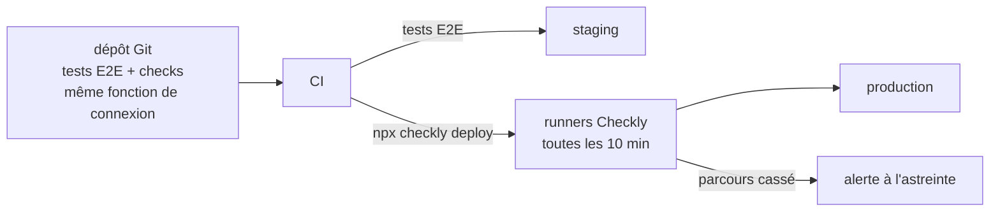

Les runners Checkly sont chez Checkly, pas dans mon réseau : ils n'ont pas accès au coffre à secrets interne. Les identifiants du <span class="term" data-term="service-account">compte robot</span> sont donc copiés dans les variables d'environnement Checkly **au déploiement**, par la CI.

| Critère                                | Checkly                       | Datadog Synthetics            | Playwright planifié en CI     |
|----------------------------------------|-------------------------------|-------------------------------|-------------------------------|
| Écriture des tests                     | code Playwright               | enregistreur dans l'interface (plus API) | code Playwright     |
| Réutiliser la suite E2E                | ★★★                           | ★                             | ★★★                           |
| Exécution depuis plusieurs régions     | ★★★                           | ★★★                           | ★ (là où tourne la CI)        |
| Alertes et <span class="term" data-term="on-call">astreinte</span>                   | ★★★ intégrées                 | ★★★ intégrées                 | ★ (à construire)              |
| Versionné dans Git                     | ★★★ (*monitoring as code*)    | ★★ (Terraform possible)       | ★★★                           |

Capacités constatées dans la documentation des éditeurs en octobre 2026 (à vérifier, elles évoluent vite).

| Je veux...                                                         | J'utilise...                    |
|--------------------------------------------------------------------|---------------------------------|
| je veux surveiller la prod avec les mêmes tests Playwright que la CI, pour ne pas maintenir deux copies | Checkly |
| je veux des tests synthétiques sans écrire de code, et mon équipe paie déjà la plateforme d'observabilité | Datadog Synthetics |
| je veux juste un contrôle de temps en temps, sans alerte ni exécution depuis plusieurs régions | un job Playwright planifié en CI |

:material-book-open-variant: Doc de référence : [Checkly, Docs](https://www.checklyhq.com/docs/) (consultée en novembre 2026)
{ .doc-ref }

## Outils de développement : mise, uv, ruff, yarn

<a class="pill pill-scope pill-scope-code" href="../architecture/#carte-des-echelles">Échelle · Code</a> <span class="pill pill-status pill-status-ok" title="Toujours valable, vérifié en novembre 2026">Valable · 11/2026</span>


*ruff : remplace flake8, black ; complémentaire de mypy*<br>
*uv : concurrent de pip, Poetry, pdm ; complémentaire de mise*<br>
*mise : concurrent de asdf ; complémentaire de uv*<br>
*yarn : concurrent de npm, pnpm*
{ .tool-rel }

**<span class="term" data-term="mise">mise</span>** : installe et fixe les versions des outils par projet (Python 3.12, Node 22) et lance des tâches. Remplace `pyenv`, `nvm` et `asdf` d'un coup.

*asdf : concurrent de mise*
{ .tool-rel }


```toml
# mise.toml
# Exemple : versions des outils du projet et une tâche test
[tools]
python = "3.12"
node = "22"

[tasks.test]
run = "pytest"
```

**Gestionnaires de paquets Python** : `pip` (installe), **PDM**, **Poetry** et **<span class="term" data-term="uv">uv</span>** (installent, verrouillent les versions dans un <span class="term" data-term="lockfile">lockfile</span>, gèrent l'environnement). uv est écrit en Rust et annoncé 10 à 100 fois plus rapide que pip [À prendre avec précaution : chiffres de l'éditeur, Astral ([README d'uv](https://github.com/astral-sh/uv), consulté en octobre 2026)].

*pip : concurrent de uv, Poetry, pdm*<br>
*Poetry : concurrent de uv, pip, pdm*
{ .tool-rel }


**ruff** : linter et formateur Python en Rust, remplace flake8, isort et black [À prendre avec précaution : vitesse annoncée par l'éditeur, Astral, « 10 à 100 fois plus rapide » ([README de ruff](https://github.com/astral-sh/ruff), consulté en octobre 2026)]. **mypy** : vérifie les types.

*flake8 : remplacé par ruff*<br>
*mypy : complémentaire de ruff*
{ .tool-rel }


**Gestionnaires de paquets JavaScript** : `npm` (fourni avec Node), **yarn** et **pnpm** (plus rapides, pnpm économise le disque en partageant les paquets).

*npm : concurrent de yarn, pnpm*<br>
*pnpm : concurrent de npm, yarn*
{ .tool-rel }


| Je veux...                                          | J'utilise...                   |
|-----------------------------------------------------|--------------------------------|
| toute l'équipe et la CI doivent avoir la même version de Python et de Node, pour éviter le « ça marche chez moi » | mise |
| je démarre un projet Python et je veux des versions de dépendances verrouillées dans un lockfile | uv (ou PDM, Poetry s'ils sont déjà en place) |
| je veux trouver les erreurs simples et formater mon code Python avec un seul outil | ruff |
| je veux savoir avant l'exécution qu'une fonction reçoit un mauvais type, comme un texte à la place d'un nombre | mypy |
| j'ai plusieurs paquets JavaScript dans un même dépôt (un <span class="term" data-term="monorepo">monorepo</span>), comme un front et une bibliothèque partagée | yarn ou pnpm (workspaces) |

:material-book-open-variant: Doc de référence : [mise](https://mise.jdx.dev/) (consultée en novembre 2026) ; [uv](https://docs.astral.sh/uv/) (consultée en novembre 2026) ; [Ruff](https://docs.astral.sh/ruff/) (consultée en novembre 2026)
{ .doc-ref }

## Collaboration : Jira, Confluence, Slack, Backstage

<a class="pill pill-scope pill-scope-enterprise" href="../architecture/#carte-des-echelles">Échelle · Entreprise</a> <span class="pill pill-status pill-status-ok" title="Toujours valable, vérifié en novembre 2026">Valable · 11/2026</span>


*Jira : complémentaire de Confluence, Slack*<br>
*Confluence : complémentaire de Jira*
{ .tool-rel }

**Jira** : suivi des tickets et des sprints. **Confluence** : wiki d'équipe. **Slack** : messagerie instantanée. **Backstage** : portail développeur open source (créé par Spotify) qui recense tous les services, leurs propriétaires, leur documentation, et propose des modèles pour créer un nouveau service.

```yaml
# catalog-info.yaml, à la racine du dépôt, lu par Backstage
# Exemple : fiche du service dans le catalogue, avec son équipe propriétaire
apiVersion: backstage.io/v1alpha1
kind: Component
metadata:
  name: orders-service
spec:
  type: service
  owner: team-core
  lifecycle: production
```

| Je veux...                                             | J'utilise...                |
|--------------------------------------------------------|-----------------------------|
| je veux suivre le travail et les bugs de l'équipe, savoir qui fait quoi et où ça en est | Jira |
| une décision ou une procédure doit rester facile à retrouver longtemps, comme la marche à suivre pour une mise en prod | Confluence, ou la doc dans le dépôt |
| j'ai une question rapide pour un collègue, qui n'a pas besoin de laisser de trace | Slack |
| je cherche qui possède un service et où est sa doc, comme l'équipe responsable de `orders-service` | Backstage |

:material-book-open-variant: Doc de référence : [Backstage, What is Backstage?](https://backstage.io/docs/overview/what-is-backstage) (consultée en novembre 2026)
{ .doc-ref }

## Tech radar : Thoughtworks, BYOR, Zalando, AOE, CNCF

<a class="pill pill-scope pill-scope-enterprise" href="../architecture/#carte-des-echelles">Échelle · Entreprise</a> <span class="pill pill-status pill-status-ok" title="Toujours valable, vérifié en novembre 2026">Valable · 11/2026</span>

*Thoughtworks Technology Radar : complémentaire de CNCF Technology Radar, radar d'entreprise*<br>
*BYOR : concurrent de Zalando tech-radar, AOE Technology Radar, plugin Tech Radar de Backstage*
{ .tool-rel }

Mon équipe hésite entre deux outils de tests de contrat, et une autre équipe vient d'en choisir un troisième sans prévenir personne. Un **<span class="term" data-term="tech-radar">tech radar</span>** répond à ce problème : une carte des technologies, chacune placée dans un anneau qui dit quoi en faire (l'adopter, l'essayer, l'étudier ou l'éviter), avec quelques phrases qui expliquent pourquoi. C'est la justification qui fait la valeur d'un radar, pas l'anneau seul.

Il existe deux familles d'outils : les **radars publics**, qui donnent l'avis d'experts extérieurs, et les **générateurs**, qui dessinent le radar de mon entreprise. Qui décide des anneaux dans une entreprise, et à quel rythme, est expliqué dans [Architecture : tech radar d'entreprise](architecture.md#tech-radar-dentreprise). Le radar personnel, pour ma propre veille, est dans [Veille technique](veille.md#pourquoi-quand-et-comment).

!!! info "Rédigé le 12/11/2026"
    Les numéros de volume, les noms d'anneaux et l'état des projets open source changent. À revérifier avant de les citer.

### Les radars publics

| Radar | Qui l'écrit | Rythme | Anneaux | Ce que j'y trouve |
|---|---|---|---|---|
| [Thoughtworks Technology Radar](https://www.thoughtworks.com/radar) (depuis 2010, volume 35 en novembre 2026) | le Technology Advisory Board : une vingtaine de technologues seniors de Thoughtworks | deux fois par an | Adopt, Trial, Assess, Caution (le dernier anneau s'appelait Hold, « proceed with caution », au moins jusqu'au volume 30 d'avril 2024 ; date du changement de nom à vérifier) | un avis argumenté sur chaque entrée, rangée dans un des quatre quadrants : Techniques, Platforms, Tools, Languages & Frameworks ; l'archive montre comment une entrée a bougé d'un volume à l'autre |
| [CNCF Technology Radar](https://radar.cncf.io/) (depuis juin 2020) | les entreprises utilisatrices de la communauté CNCF | une édition par thème : livraison continue, observabilité, secrets... | Adopt, Trial, Assess, parfois Hold selon l'édition | ce que des entreprises utilisent vraiment en production dans l'écosystème cloud native |
| [Zalando Tech Radar](https://opensource.zalando.com/tech-radar/) (public depuis 2016) | la communauté des principal engineers de Zalando | au fil des décisions | Adopt, Trial, Assess, Hold | un vrai radar d'entreprise, avec ses quadrants Languages, Infrastructure, Datastores, Data Management |
| [AOE Technology Radar](https://www.aoe.com/techradar/) (date de création à vérifier) | l'entreprise AOE | au fil des décisions | Adopt, Trial, Assess, Hold | un autre radar d'entreprise, avec l'historique de chaque entrée |

Un radar public donne l'avis d'une entreprise sur **son** contexte : Thoughtworks le dit dans sa FAQ, son radar reflète l'expérience de ses équipes chez ses clients, sans prétendre couvrir tout le marché. Je m'en sers pour ouvrir une discussion, pas pour la trancher.

### Dessiner le radar de mon entreprise

| Outil | Ce que c'est | Quand le prendre |
|---|---|---|
| [BYOR, Build Your Own Radar](https://www.thoughtworks.com/radar/byor) (Thoughtworks, open source) | dessine un radar à partir d'une Google Sheet, d'un CSV ou d'un JSON | un premier radar en une heure, sans rien héberger ; en ligne, il impose les noms standards des anneaux et des quadrants, une installation locale permet de les changer et de garder le radar privé |
| [Zalando tech-radar](https://github.com/zalando/tech-radar) (open source, licence MIT) | une page HTML, une bibliothèque JavaScript et un fichier de configuration : un radar statique à héberger soi-même | un radar simple, sur n'importe quel hébergement statique |
| [AOE Technology Radar](https://github.com/AOEpeople/aoe_technology_radar) (générateur open source) | un générateur de site statique : un fichier Markdown par entrée, versionné dans Git, avec l'historique des déplacements, une recherche et un tableau de bord | un radar tenu comme du code, chaque changement relu en merge request |
| [plugin Tech Radar de Backstage](https://github.com/backstage/community-plugins/tree/main/workspaces/tech-radar) | affiche le radar dans le portail développeur, à côté du catalogue de services ; il reprend le dessin de Zalando | une entreprise qui a déjà Backstage |

Exemple : le fichier CSV que lit BYOR, une ligne par entrée (contenu fictif) :

```
name,ring,quadrant,isNew,description
Testcontainers,adopt,tools,FALSE,"Bases jetables dans les tests d'intégration, utilisé par toutes les équipes depuis 2025."
Contrats pilotés par le consommateur,trial,techniques,TRUE,"Essai entre orders-service et billing-service, à étendre si l'essai tient trois mois."
Bruno,assess,tools,TRUE,"Collections d'API versionnées dans Git, à comparer à Postman."
Selenium,hold,tools,FALSE,"Pas de nouveau projet : Playwright couvre nos besoins avec moins de tests instables."
```

| Je veux... | J'utilise... |
|---|---|
| je veux savoir si un outil dont tout le monde parle est assez mûr, avant d'en parler à mon équipe, comme un nouveau framework de tests | Thoughtworks Technology Radar, et l'historique de l'entrée dans l'archive |
| je travaille sur Kubernetes et je veux savoir ce que d'autres entreprises utilisent vraiment en production, comme pour gérer les secrets | CNCF Technology Radar |
| mon entreprise veut publier ses choix techniques vite, pour un premier atelier, sans rien développer | BYOR avec une Google Sheet |
| je veux que chaque changement d'anneau soit relu en merge request et garde son historique, comme du code | générateur AOE, ou Zalando tech-radar avec sa configuration dans Git |
| mes équipes cherchent déjà leurs services dans Backstage et je veux le radar au même endroit | plugin Tech Radar de Backstage |
| je veux suivre ma propre veille, pas celle de l'entreprise | un radar personnel ([Veille technique](veille.md#pourquoi-quand-et-comment)) |

:material-book-open-variant: Doc de référence : [Thoughtworks, Technology Radar FAQ](https://www.thoughtworks.com/radar/faq) (consultée en novembre 2026) ; [Neal Ford, « Build your own Technology Radar »](https://www.thoughtworks.com/insights/blog/build-your-own-technology-radar) (2016)
{ .doc-ref }

## Complémentaires ou concurrents

Les pages citent beaucoup d'outils. Deux outils peuvent être :

- <span class="pill pill-rel pill-rel-compete">concurrents</span> : ils font le même travail, on en choisit **un** (Playwright ou Cypress) ;
- <span class="pill pill-rel pill-rel-complement">complémentaires</span> : ils font des travaux différents qui s'emboîtent, on les **combine** (Prometheus et Grafana) ;
- <span class="pill pill-rel pill-rel-overlap">chevauchement</span> : ils se recouvrent en partie, le choix dépend du besoin (Airflow et Temporal).

!!! noob "As noob"
    Une perceuse et une visseuse sans fil sont **concurrentes** : pour visser, l'une suffit. Une perceuse et des chevilles sont **complémentaires** : il faut les deux pour fixer une étagère. La question à se poser devant deux outils : **font-ils le même geste, ou deux gestes qui se suivent ?**

!!! info "Écrit en novembre 2026"
    Les outils évoluent vite et empiètent les uns sur les autres (un outil ajoute la fonction d'un autre, un fork apparaît). À revérifier avant une décision.

Le long d'une chaîne de livraison, chaque étape est **complémentaire** de la suivante ; dans une même case, les outils séparés par « ou » sont **concurrents** :

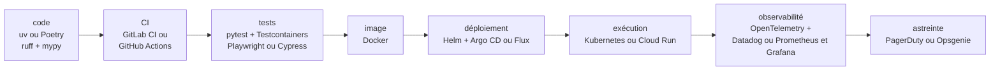

### Messagerie, cache et bases de données

| Outils | Relation | En pratique |
|---|---|---|
| RabbitMQ, Kafka, Pub/Sub, SQS | <span class="pill pill-rel pill-rel-overlap">chevauchement</span> | même famille (faire passer des messages), mais pas le même modèle : RabbitMQ et SQS distribuent des tâches, Kafka garde un journal d'événements relisible, Pub/Sub est entre les deux et géré par Google |
| RabbitMQ + Kafka | <span class="pill pill-rel pill-rel-complement">complémentaires</span> | fréquent dans un même système : Kafka pour les faits métier diffusés à plusieurs équipes, RabbitMQ pour les tâches à faire une fois (voir [Pourquoi avoir les deux](#pourquoi-avoir-les-deux)) |
| Kafka + Strimzi | <span class="pill pill-rel pill-rel-complement">complémentaires</span> | Strimzi est un opérateur qui installe et gère Kafka dans Kubernetes : il ne le remplace pas |
| PostgreSQL, MySQL / MariaDB | <span class="pill pill-rel pill-rel-compete">concurrents</span> | deux bases relationnelles généralistes : on en choisit une par service (MariaDB est un fork de MySQL) |
| PostgreSQL + Redis | <span class="pill pill-rel pill-rel-complement">complémentaires</span> | la base garde la vérité, Redis garde une copie rapide et jetable (cache, sessions, compteurs) |
| PostgreSQL + BigQuery, Snowflake, ClickHouse, Databricks | <span class="pill pill-rel pill-rel-complement">complémentaires</span> | la base transactionnelle sert l'application, l'entrepôt sert les analyses ; les entrepôts entre eux sont concurrents |
| PostgreSQL + Elasticsearch / OpenSearch | <span class="pill pill-rel pill-rel-complement">complémentaires</span> | la base reste la source, le moteur de recherche est un index alimenté depuis elle ; Elasticsearch et OpenSearch (son fork) sont concurrents |
| PostgreSQL, MongoDB | <span class="pill pill-rel pill-rel-overlap">chevauchement</span> | MongoDB stocke des documents, PostgreSQL aussi avec `jsonb` : concurrents pour des données variables, rarement les deux pour la même donnée |
| PgBouncer, ProxySQL | <span class="pill pill-rel pill-rel-complement">complémentaires</span> | pas concurrents : un pooler par moteur (PgBouncer pour PostgreSQL, ProxySQL pour MySQL), placé devant la base |
| Vitess, Citus, CockroachDB, YugabyteDB, Spanner | <span class="pill pill-rel pill-rel-overlap">chevauchement</span> | Vitess (MySQL) et Citus (PostgreSQL) shardent une base connue ; le SQL distribué (CockroachDB, YugabyteDB, Spanner) remplace la base : même problème, deux approches |
| Flyway, Liquibase, Alembic, Doctrine Migrations, Prisma Migrate | <span class="pill pill-rel pill-rel-compete">concurrents</span> | un seul outil de migration par base, souvent celui de l'ORM du projet |
| SQLAlchemy + Alembic | <span class="pill pill-rel pill-rel-complement">complémentaires</span> | Alembic est l'outil de migration construit pour SQLAlchemy : l'ORM décrit les modèles, Alembic fait évoluer le schéma |

### Orchestration et données

| Outils | Relation | En pratique |
|---|---|---|
| n8n, Zapier | <span class="pill pill-rel pill-rel-compete">concurrents</span> | automatisation entre outils par blocs visuels ; n8n peut s'héberger soi-même, Zapier non |
| Airflow, Dagster, Prefect | <span class="pill pill-rel pill-rel-compete">concurrents</span> | trois ordonnanceurs de pipelines de données : on en garde un |
| Airflow, Temporal, Argo Workflows | <span class="pill pill-rel pill-rel-overlap">chevauchement</span> | tous enchaînent des étapes, mais Airflow vise les lots de données planifiés, Temporal les processus métier longs et fiables, Argo Workflows des étapes en conteneurs dans Kubernetes |
| Airflow + dbt + Spark | <span class="pill pill-rel pill-rel-complement">complémentaires</span> | Airflow décide **quand** lancer, dbt écrit les transformations SQL, Spark calcule sur de gros volumes |
| Fivetran, Airbyte | <span class="pill pill-rel pill-rel-compete">concurrents</span> | deux outils de copie de données vers l'entrepôt (le E et le L d'ELT) |
| Fivetran / Airbyte + dbt | <span class="pill pill-rel pill-rel-complement">complémentaires</span> | l'un charge les données brutes, l'autre les transforme dans l'entrepôt : c'est le découpage ELT classique |

### Conteneurs, déploiement et scaling

| Outils | Relation | En pratique |
|---|---|---|
| Docker + Kubernetes + Helm + Argo CD | <span class="pill pill-rel pill-rel-complement">complémentaires</span> | une chaîne : Docker fabrique l'image, Helm décrit le déploiement, Argo CD l'applique depuis Git, Kubernetes le fait tourner |
| Argo CD, Flux | <span class="pill pill-rel pill-rel-compete">concurrents</span> | deux outils GitOps : on en choisit un par cluster |
| Helm, Kustomize | <span class="pill pill-rel pill-rel-overlap">chevauchement</span> | deux façons de varier les manifestes par environnement (modèles ou surcouches) ; on peut combiner, mais c'est rarement utile |
| Kubernetes (GKE), Cloud Run | <span class="pill pill-rel pill-rel-compete">concurrents</span> | pour un service simple, Cloud Run évite de gérer un cluster ; pour beaucoup de services qui se parlent, Kubernetes |
| HPA + KEDA | <span class="pill pill-rel pill-rel-complement">complémentaires</span> | KEDA crée et pilote un HPA à partir d'événements (taille de file) et ajoute le passage à zéro |
| KEDA, Knative | <span class="pill pill-rel pill-rel-overlap">chevauchement</span> | tous deux savent descendre à zéro : KEDA pour des consommateurs de files, Knative pour des services HTTP |
| Karpenter, Cluster Autoscaler | <span class="pill pill-rel pill-rel-compete">concurrents</span> | deux façons d'ajouter des nœuds : on en active un seul |
| HPA / KEDA + Karpenter | <span class="pill pill-rel pill-rel-complement">complémentaires</span> | le premier ajoute des pods, le second ajoute les machines pour les accueillir |

### Infrastructure, réseau et passerelles

| Outils | Relation | En pratique |
|---|---|---|
| Terraform, OpenTofu, Pulumi | <span class="pill pill-rel pill-rel-compete">concurrents</span> | trois outils pour créer l'infrastructure ; OpenTofu est un fork libre de Terraform (2023), Pulumi le fait dans un vrai langage |
| Terraform / OpenTofu + Terragrunt | <span class="pill pill-rel pill-rel-complement">complémentaires</span> | Terragrunt enveloppe Terraform pour ne pas répéter la même configuration entre environnements |
| Terraform, Crossplane | <span class="pill pill-rel pill-rel-overlap">chevauchement</span> | même but (créer des ressources cloud) ; Crossplane le fait en continu depuis Kubernetes, Terraform à chaque `apply` |
| Packer + Terraform + Ansible | <span class="pill pill-rel pill-rel-complement">complémentaires</span> | Packer fabrique l'image de machine, Terraform crée la machine, Ansible configure ce qui tourne dedans |
| KrakenD, Kong, Apigee | <span class="pill pill-rel pill-rel-compete">concurrents</span> | trois passerelles d'API (clés, quotas, agrégation) |
| nginx, Caddy, Traefik, Envoy | <span class="pill pill-rel pill-rel-compete">concurrents</span> | quatre reverse proxies : on en met un devant les services |
| passerelle d'API + reverse proxy | <span class="pill pill-rel pill-rel-complement">complémentaires</span> | le reverse proxy (ou l'Ingress) termine le HTTPS et route, la passerelle applique les règles d'API |
| Istio, Linkerd | <span class="pill pill-rel pill-rel-compete">concurrents</span> | deux service meshes (mTLS et routage entre services) ; Istio s'appuie sur Envoy |

### CI, qualité du code et outillage

| Outils | Relation | En pratique |
|---|---|---|
| GitLab CI, GitHub Actions, Jenkins | <span class="pill pill-rel pill-rel-compete">concurrents</span> | on garde la CI de la forge de code, sauf besoin particulier |
| Renovate, Dependabot | <span class="pill pill-rel pill-rel-compete">concurrents</span> | deux robots qui ouvrent des MR de mise à jour de dépendances |
| Renovate + Snyk / Trivy | <span class="pill pill-rel pill-rel-complement">complémentaires</span> | Renovate met à jour, Snyk ou Trivy disent quelles versions ont une faille connue (Snyk et Trivy se recouvrent entre eux) |
| SonarQube, Semgrep | <span class="pill pill-rel pill-rel-overlap">chevauchement</span> | les deux font de l'analyse statique ; SonarQube vise la qualité et la couverture, Semgrep des règles de sécurité sur mesure : souvent les deux |
| ruff, flake8 + black | <span class="pill pill-rel pill-rel-compete">concurrents</span> | ruff remplace à lui seul le linter (flake8) et le formateur (black) |
| ruff + mypy | <span class="pill pill-rel pill-rel-complement">complémentaires</span> | ruff vérifie le style et les erreurs simples, mypy vérifie les types |
| pre-commit, prek, Husky, lefthook | <span class="pill pill-rel pill-rel-compete">concurrents</span> | quatre gestionnaires de hooks Git ; prek relit le même `.pre-commit-config.yaml` que pre-commit |
| gitleaks, detect-secrets, TruffleHog | <span class="pill pill-rel pill-rel-compete">concurrents</span> | trois détecteurs de secrets dans le code et l'historique Git |
| Bandit, Semgrep, SonarQube | <span class="pill pill-rel pill-rel-overlap">chevauchement</span> | Bandit cherche les failles de sécurité du code Python, Semgrep et SonarQube couvrent plusieurs langages ; ruff reprend une partie des règles de Bandit |
| ruff + vulture | <span class="pill pill-rel pill-rel-complement">complémentaires</span> | ruff signale un import inutilisé dans un fichier, vulture cherche le code que rien n'appelle dans tout le projet |
| ESLint + Prettier | <span class="pill pill-rel pill-rel-complement">complémentaires</span> | ESLint trouve les erreurs, Prettier formate ; on désactive les règles de forme d'ESLint pour qu'ils ne se contredisent pas |
| uv, pip, Poetry, pdm | <span class="pill pill-rel pill-rel-compete">concurrents</span> | un seul gestionnaire de dépendances Python par projet |
| mise, asdf | <span class="pill pill-rel pill-rel-compete">concurrents</span> | deux gestionnaires de versions d'outils ; mise lit aussi les fichiers d'asdf |
| mise + uv | <span class="pill pill-rel pill-rel-complement">complémentaires</span> | mise fixe la version de Python et des outils, uv installe les dépendances du projet (uv sait aussi installer Python : à trancher dans l'équipe) |
| npm, yarn, pnpm | <span class="pill pill-rel pill-rel-compete">concurrents</span> | un seul gestionnaire de paquets JavaScript par dépôt, celui dont le lockfile est commité |

### Observabilité et astreinte

| Outils | Relation | En pratique |
|---|---|---|
| OpenTelemetry + n'importe quel backend | <span class="pill pill-rel pill-rel-complement">complémentaires</span> | OpenTelemetry produit et transporte les signaux, il ne les stocke pas : il alimente Datadog comme Prometheus, Tempo ou Loki |
| Datadog, Prometheus + Grafana + Tempo + Loki | <span class="pill pill-rel pill-rel-compete">concurrents</span> | une plateforme payante tout-en-un, ou une pile libre à exploiter soi-même : on choisit l'une des deux |
| Prometheus + Grafana | <span class="pill pill-rel pill-rel-complement">complémentaires</span> | Prometheus stocke les métriques, Grafana les affiche ; Tempo (traces) et Loki (logs) complètent la même pile |
| Prometheus + Alertmanager + PagerDuty / Opsgenie | <span class="pill pill-rel pill-rel-complement">complémentaires</span> | Prometheus évalue la règle, Alertmanager regroupe et route, PagerDuty ou Opsgenie (concurrents) réveillent la bonne personne |

### Tests

| Outils | Relation | En pratique |
|---|---|---|
| pytest, unittest | <span class="pill pill-rel pill-rel-compete">concurrents</span> | deux lanceurs de tests Python ; pytest sait aussi lancer les tests écrits avec unittest |
| Playwright, Cypress, Selenium | <span class="pill pill-rel pill-rel-compete">concurrents</span> | trois outils de tests de navigateur : un seul par projet |
| k6, JMeter, Locust, Gatling | <span class="pill pill-rel pill-rel-compete">concurrents</span> | outils de tests de charge ; le choix suit surtout le langage de l'équipe |
| Bruno, Postman | <span class="pill pill-rel pill-rel-compete">concurrents</span> | deux clients d'API pour explorer et rejouer des requêtes |
| Playwright + Checkly | <span class="pill pill-rel pill-rel-complement">complémentaires</span> | Checkly rejoue des scripts Playwright en production toutes les N minutes : le même test sert en CI et en surveillance |
| pytest + Testcontainers | <span class="pill pill-rel pill-rel-complement">complémentaires</span> | pytest lance les tests, Testcontainers démarre une vraie base ou un vrai broker jetable pour eux |
| Pact + Microcks / Prism | <span class="pill pill-rel pill-rel-complement">complémentaires</span> | Pact vérifie le contrat entre deux services ; Microcks et Prism (concurrents entre eux) servent un faux partenaire tiré du contrat |
| Allure, ReportPortal | <span class="pill pill-rel pill-rel-compete">concurrents</span> | deux outils de rapports et d'historique de tests |
| Gherkin + pytest-bdd / Cucumber | <span class="pill pill-rel pill-rel-complement">complémentaires</span> | Gherkin est la langue des scénarios, pytest-bdd ou Cucumber les exécutent |

### Identité, flags, collaboration et IA

| Outils | Relation | En pratique |
|---|---|---|
| Auth0, Keycloak, Okta | <span class="pill pill-rel pill-rel-compete">concurrents</span> | trois fournisseurs d'identité : Keycloak s'héberge soi-même, Auth0 et Okta sont des services payants |
| Unleash, LaunchDarkly | <span class="pill pill-rel pill-rel-compete">concurrents</span> | deux plateformes de feature flags |
| Vault, gestionnaires de secrets des clouds | <span class="pill pill-rel pill-rel-compete">concurrents</span> | un coffre à secrets central, ou celui du cloud utilisé |
| Jira + Confluence + Slack + Backstage | <span class="pill pill-rel pill-rel-complement">complémentaires</span> | tickets, documentation, discussion, portail des services : chacun son rôle |
| Claude Code, Cursor, GitHub Copilot | <span class="pill pill-rel pill-rel-compete">concurrents</span> | assistants de code IA ; certaines équipes en utilisent deux (un dans l'éditeur, un en terminal) |
| assistant IA + serveurs MCP | <span class="pill pill-rel pill-rel-complement">complémentaires</span> | MCP est un protocole : il branche des outils sur n'importe quel assistant compatible |
| Thoughtworks Technology Radar + radar d'entreprise | <span class="pill pill-rel pill-rel-complement">complémentaires</span> | le radar public donne l'avis de l'industrie, celui de l'entreprise dit ce qui est soutenu chez moi |
| BYOR, Zalando tech-radar, AOE Technology Radar, plugin Backstage | <span class="pill pill-rel pill-rel-compete">concurrents</span> | quatre façons de dessiner le même radar d'entreprise ; on en choisit une |

## Pièges à éviter

- **Croire le benchmark de l'éditeur** : je choisis un outil sur un chiffre publié par son éditeur, sur un matériel et un scénario qui ne sont pas les miens, donc l'outil déçoit une fois branché sur ma vraie charge. Je mesure sur ma propre charge avant de trancher ([voir Lire les mini benchmarks](#lire-les-mini-benchmarks)).
- **Confondre file de tâches et journal d'événements** : je diffuse un fait métier comme « la commande 42 a été payée » par RabbitMQ, donc le service ajouté le mois suivant ne peut pas relire l'historique, le message a déjà disparu. Je garde RabbitMQ pour les tâches à faire une fois, et Kafka pour les faits à conserver ([voir Pourquoi avoir les deux](#pourquoi-avoir-les-deux)).
- **Ajouter des machines quand le retard monte** : j'ajoute des consommateurs Kafka sans chercher la cause, donc ceux en trop au-delà du nombre de partitions attendent sans rien faire, et la partition bloquée reste bloquée. Je remonte d'abord vers la cause (pic, erreurs, partition chaude), et j'alerte sur l'âge du plus vieux message plutôt que sur un nombre brut ([voir Observer la santé d'une file](#observer-la-sante-dune-file)).
- **Faire de Redis la source de vérité** : je garde une donnée que je ne peux pas perdre, comme une commande payée, seulement dans le cache, donc elle disparaît au redémarrage ou quand Redis évince des clés faute de mémoire. La base garde la vérité, Redis une copie que j'invalide quand la source change ([voir Cache : Redis](#cache-redis)).
- **Utiliser BigQuery comme une base applicative** : je mets à jour une ligne à chaque clic ou je lance des `SELECT *`, donc l'application rame et la facture grimpe, puisque je paie au volume lu. BigQuery sert aux analyses, PostgreSQL ou MySQL à l'application ([voir Bases de données](#bases-de-donnees-postgresql-mysql-bigquery)).
- **Modifier une migration déjà appliquée** : je corrige le fichier `V2__add_orders_status.sql` après son passage en staging, donc l'outil, qui le note comme déjà passé, ne le rejoue pas, et les environnements divergent. J'écris une nouvelle migration ([voir Migrations de schéma](#migrations-de-schema-flyway-liquibase-alembic)).
- **Maltraiter l'état Terraform** : je range `terraform.tfstate` dans Git ou je corrige une ressource à la main dans la console, donc des secrets fuient dans le dépôt, ou le prochain `apply` écrase ma correction. L'état va dans un bucket partagé avec verrou, et chaque changement passe par une MR avec son `plan` ([voir Terraform et OpenTofu](#terraform-et-opentofu-le-standard-declaratif)).
- **Laisser vivre les feature flags** : je garde un flag des mois après la mise en production complète, donc chaque flag double les parcours à tester et l'ancien code traîne. Je teste les deux positions tant que le flag existe, puis je supprime le flag et l'ancien code ([voir Feature flags : Unleash](#feature-flags-unleash)).

## Ce qu'on demande en entretien

Les questions typiques :

- « Quelle différence entre RabbitMQ et Kafka ? », « Pourquoi une entreprise garderait-elle les deux ? » Pour répondre : j'oppose une file de tâches qui supprime le message après l'ack à un journal d'événements conservé et relisible par plusieurs groupes ([Pourquoi avoir les deux](#pourquoi-avoir-les-deux)).
- « Comment sais-tu qu'un consommateur est en retard ? », « Que fais-tu quand le lag monte ? » Pour répondre : je regarde le retard et l'âge du plus vieux message, puis je cherche la cause avant d'ajouter des consommateurs ([Observer la santé d'une file](#observer-la-sante-dune-file)).
- « Quand mettre un cache, et comment gérer l'invalidation ? » Pour répondre : je décris le motif cache-aside, le TTL, le taux de hit, et une base qui reste la source de vérité ([Cache : Redis](#cache-redis)).
- « PostgreSQL ou BigQuery ? », « Pourquoi ne pas faire la recherche du catalogue avec un `LIKE` ? » Pour répondre : j'oppose OLTP et OLAP, puis je propose un moteur de recherche alimenté depuis la base ([Bases de données](#bases-de-donnees-postgresql-mysql-bigquery), [Recherche et documents](#recherche-et-documents-elasticsearch-mongodb)).
- « Terraform ou Pulumi ? », « Qu'est-ce que l'état Terraform, et où le ranges-tu ? » Pour répondre : j'oppose le déclaratif en HCL à un vrai langage, puis je range l'état dans un bucket avec verrou, jamais dans Git ([Terraform et OpenTofu](#terraform-et-opentofu-le-standard-declaratif)).
- « Playwright, Cypress ou Selenium ? », « Comment testes-tu une fonctionnalité derrière un feature flag ? » Pour répondre : je reprends les critères du tableau (navigateurs, attente automatique, parallélisme), puis je teste les deux positions du flag tant qu'il existe ([Playwright, Cypress, Selenium](#playwright-cypress-selenium), [Feature flags : Unleash](#feature-flags-unleash)).

- « Connais-tu le Technology Radar ? », « Comment ton entreprise choisit-elle ses technologies ? » Pour répondre : je décris les quatre anneaux et la justification de chaque entrée, puis je distingue le radar public, qui ouvre la discussion, du radar d'entreprise, qui dit ce qui est soutenu chez moi ([Tech radar](#tech-radar-thoughtworks-byor-zalando-aoe-cncf), [Architecture : tech radar d'entreprise](architecture.md#tech-radar-dentreprise)).

Ce qui fait une bonne réponse : partir du besoin, pas de l'outil, donc je nomme le problème, l'outil qui y répond, ce qu'il coûte (exploitation, licence, verrouillage fournisseur) et le cas où je ne le prendrais pas.

## Récapitulatif

| Famille          | Outils                           | Question à se poser                                         |
|------------------|----------------------------------|-------------------------------------------------------------|
| Messagerie       | RabbitMQ, Kafka, Pub/Sub         | tâche à faire une fois, ou fait à conserver et diffuser ?   |
| Cache            | Redis                            | partagé entre pods, et peut-on tolérer une donnée périmée ? |
| Base de données  | PostgreSQL, MySQL, BigQuery      | petites transactions, ou grosses analyses ?                 |
| Migrations de schéma | Flyway, Liquibase, Alembic   | SQL brut, plusieurs moteurs, ou modèles Python ?            |
| Recherche        | Elasticsearch, MongoDB           | chercher dans du texte, ou stocker des documents variables ? |
| Orchestration    | n8n, Airflow, Temporal, Argo Workflows | relier des outils, lot de données, processus métier long, ou conteneurs ? |
| Fichiers         | bucket (GCS, S3)                 | est-ce un fichier ou une donnée qu'on interroge ?           |
| Déploiement      | Docker, Kubernetes, Helm, Argo CD, Cloud Run | beaucoup de services, ou un seul petit ?        |
| Infrastructure as code | Terraform, OpenTofu, Terragrunt, Pulumi, Crossplane, Ansible, Packer | créer des ressources, configurer des machines, ou fabriquer des images ? |
| Secrets          | Vault                            | qui a accès à quel secret, et où est-ce tracé ?             |
| Passerelle et proxy | KrakenD, nginx, Caddy, Traefik, Envoy | API à sécuriser et agréger, HTTPS simple, routage dynamique, ou service mesh ? |
| CI et qualité    | GitLab CI, SonarQube, Renovate   | que doit-on bloquer avant le merge ?                        |
| Feature flags    | Unleash                          | peut-on couper une fonctionnalité sans redéployer ?         |
| Observabilité    | OpenTelemetry, Datadog, Prometheus, Grafana | qui opère la plateforme, et à quel coût de volume ? |
| Identité         | Auth0, Keycloak                  | acheter ou exploiter ?                                         |
| Tests            | pytest, Playwright, k6, Checkly  | API, interface, charge, ou surveillance de la prod ?        |
| Outillage dev    | mise, uv, ruff, yarn             | comment garantir le même environnement pour tous ?          |
| Tech radar       | Thoughtworks, CNCF, BYOR, Zalando, AOE | l'avis de l'industrie, ou les choix soutenus dans mon entreprise ? |

## Sources

- [Benchmarking Apache Kafka, Apache Pulsar, and RabbitMQ, Confluent (2020)](https://www.confluent.io/blog/kafka-fastest-messaging-system/)
- [Pub/Sub subscription overview, Google Cloud (consulté en octobre 2026)](https://cloud.google.com/pubsub/docs/subscription-overview)
- [Playwright vs Puppeteer vs Cypress vs Selenium, Better Stack (date de publication non indiquée)](https://betterstack.com/community/comparisons/playwright-cypress-puppeteer-selenium-comparison/)
- [Cypress vs Selenium vs Playwright vs Puppeteer speed comparison, Checkly (2021, à vérifier)](https://www.checklyhq.com/blog/cypress-vs-selenium-vs-playwright-vs-puppeteer-speed-comparison/)
- [k6 vs JMeter, QAInsights (date de publication non indiquée)](https://qainsights.com/?p=9380)
- [Documentation Checkly (consultée en octobre 2026)](https://www.checklyhq.com/docs/)
- [Documentation Datadog Synthetic Monitoring (consultée en octobre 2026)](https://docs.datadoghq.com/synthetics/)
- [Annonce du fork OpenTofu, Linux Foundation (septembre 2023)](https://www.linuxfoundation.org/press/announcing-opentofu)
- [Documentation Terragrunt (consultée en novembre 2026)](https://terragrunt.gruntwork.io/docs/)
- [Documentation Pulumi (consultée en novembre 2026)](https://www.pulumi.com/docs/)
- [Documentation Crossplane (consultée en novembre 2026)](https://docs.crossplane.io/)
- [Documentation Ansible (consultée en novembre 2026)](https://docs.ansible.com/)
- [Documentation Packer (consultée en novembre 2026)](https://developer.hashicorp.com/packer/docs)
- [Documentation n8n et Sustainable Use License (consultée en novembre 2026)](https://docs.n8n.io/sustainable-use-license/)
- [Documentation Temporal (consultée en novembre 2026)](https://docs.temporal.io/)
- [Documentation Argo Workflows (consultée en novembre 2026)](https://argo-workflows.readthedocs.io/)
- [Documentation Flyway (consultée en novembre 2026)](https://documentation.red-gate.com/flyway), [Liquibase](https://docs.liquibase.com/), [Alembic](https://alembic.sqlalchemy.org/)
- [Documentation Caddy, HTTPS automatique (consultée en novembre 2026)](https://caddyserver.com/docs/automatic-https)
- [Thoughtworks, Technology Radar FAQ (consultée en novembre 2026)](https://www.thoughtworks.com/radar/faq)
- [Neal Ford, « Build your own Technology Radar », Thoughtworks (2016, reprise d'un billet de 2013)](https://www.thoughtworks.com/insights/blog/build-your-own-technology-radar)
- [Thoughtworks, Build Your Own Radar, dépôt GitHub (consulté en novembre 2026)](https://github.com/thoughtworks/build-your-own-radar)
- [CNCF, « Introducing the CNCF Technology Radar » (juin 2020)](https://www.cncf.io/blog/2020/06/12/introducing-the-cncf-technology-radar/)
- [Zalando, tech-radar, dépôt GitHub (consulté en novembre 2026)](https://github.com/zalando/tech-radar)
- [AOE, générateur Technology Radar, dépôt GitHub (consulté en novembre 2026)](https://github.com/AOEpeople/aoe_technology_radar)
- [Backstage, plugin Tech Radar (consulté en novembre 2026)](https://github.com/backstage/community-plugins/tree/main/workspaces/tech-radar)
- [Documentation Traefik (consultée en novembre 2026)](https://doc.traefik.io/traefik/), [Envoy](https://www.envoyproxy.io/docs)
