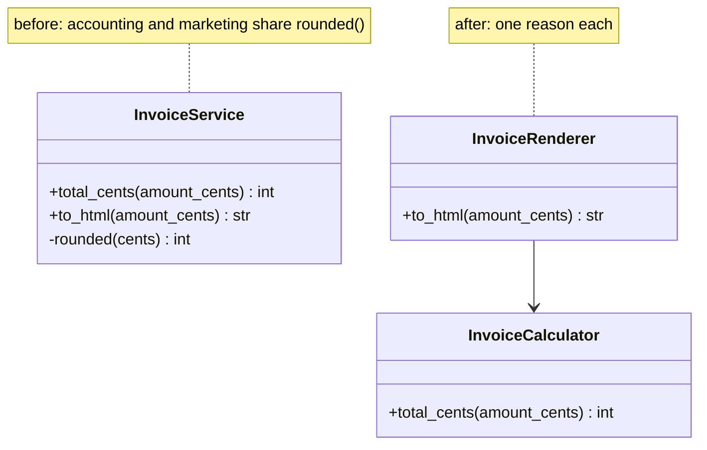
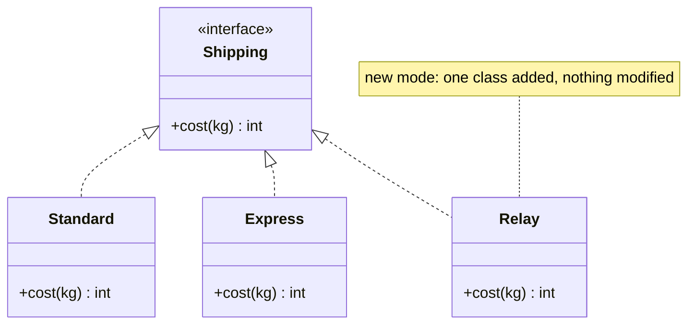
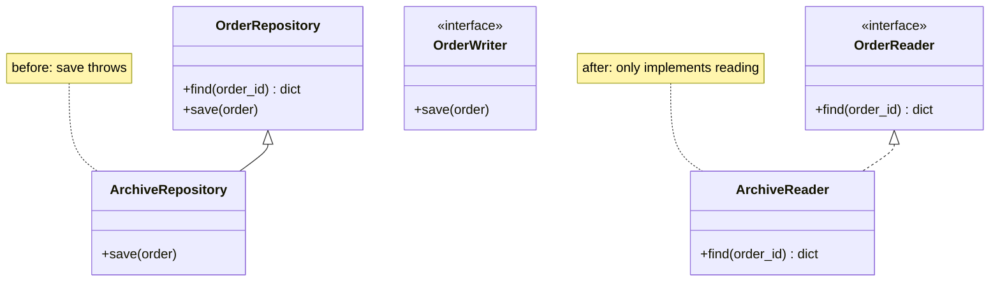
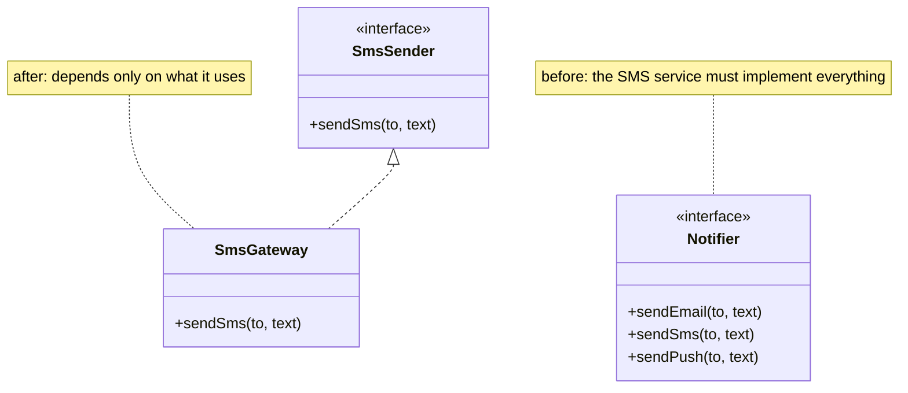
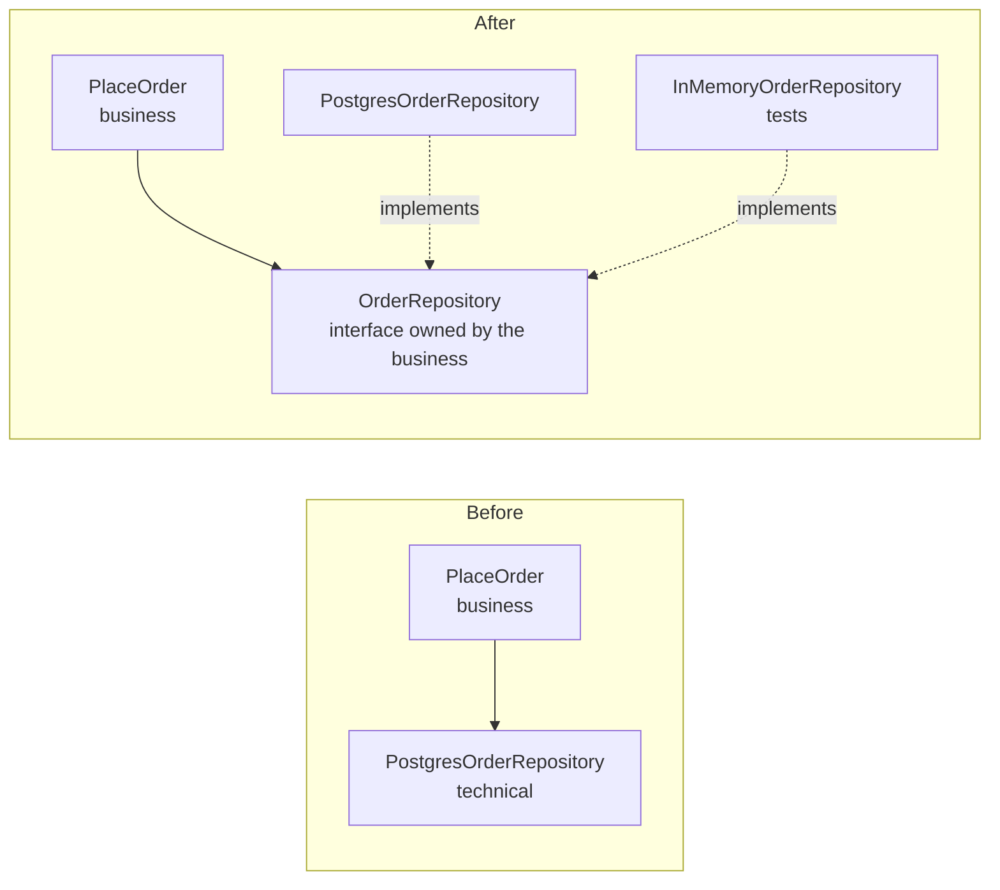
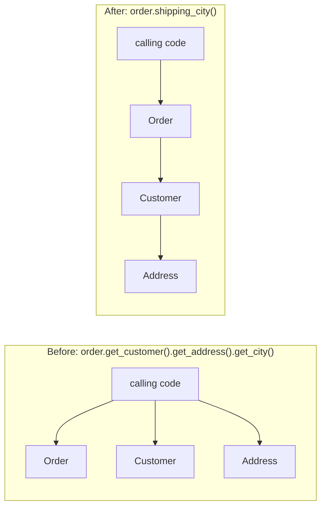
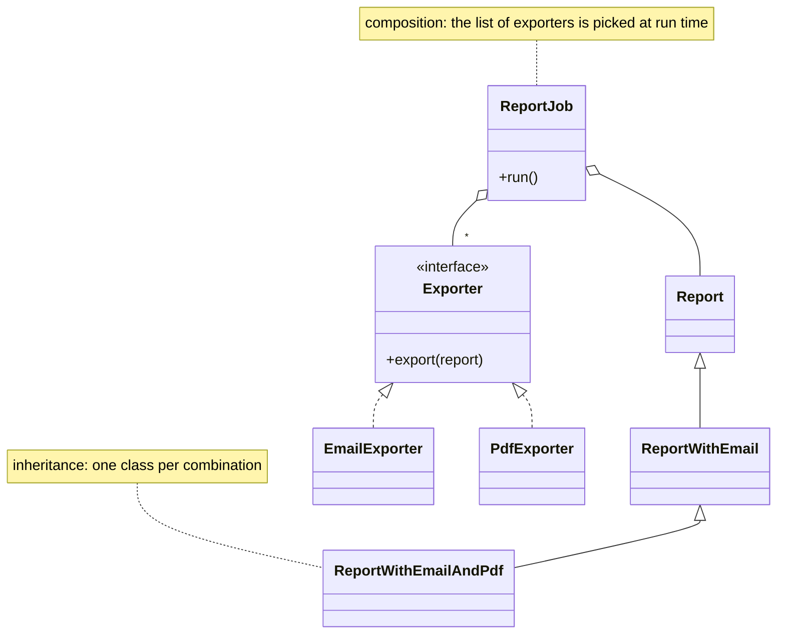
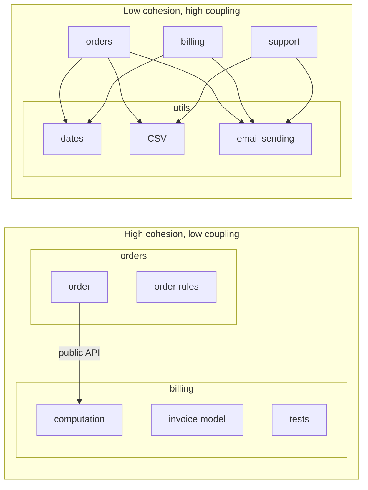

# Design principles

!!! warning "Disclaimer"
    These notes are personal cheat sheets, not a source of truth. They reflect my own understanding and choices: their content remains subjective, despite the quotes and references it contains. It may be incomplete, simplified, inaccurate or outdated. Always check the official documentation before applying it. This content is provided as is, without any warranty: you use it at your own risk.

!!! abstract "Scales"
    The colored badges under the headings say at which scale a notion applies:

    - <span class="pill pill-scope pill-scope-code">Code</span> the classes, functions and modules of one program;
    - <span class="pill pill-scope pill-scope-app">Application</span> one service or application and its internal split;
    - <span class="pill pill-scope pill-scope-system">System</span> several services talking to each other over the network;
    - <span class="pill pill-scope pill-scope-infra">Infrastructure</span> servers, network, zones and clusters, physical or virtual;
    - <span class="pill pill-scope pill-scope-enterprise">Enterprise</span> the whole information system and its organization.

    Details and ambiguous words: [map of scales](architecture.md#map-of-scales).

A **design principle** is a named rule of thumb that helps decide how to split and connect code. Unlike a [design pattern](design-patterns.md), it is not a shape of solution: it is a criterion to judge a solution. "This class changes for three reasons" or "this test cannot be written without a database" are observations that principles help name.

This page covers SOLID, its opposite STUPID, then the related principles (KISS, DRY, YAGNI, Demeter, composition over inheritance...). Examples are short, with the same code in PHP, Python and Java. Service and data names are fictitious.

!!! tip "Choose the language"
    Click a language: **every example on the page** switches to it, and the choice is kept from one page to the next.

=== "PHP"

    Examples shown in **PHP 8.3** (`readonly` classes, `match`, enums).

=== "Python"

    Examples shown in **Python 3.12** (`Protocol`, `dataclass`, type hints).

=== "Java"

    Examples shown in **Java 21** (`record`, `switch` expressions, `enum`).

## Terminology

**<span class="term" data-term="interface-code">Interface</span>**: a contract that lists methods without writing them. Any class implementing it promises to provide them.

**Abstraction**: what calling code sees of other code (an interface, a function, a base class), ignoring the details behind it.

**<span class="term" data-term="coupling">Coupling</span>**: how much a piece of code depends on the details of another. Tight coupling: changing one forces changing the other.

**<span class="term" data-term="cohesion">Cohesion</span>**: how much what is grouped together (in a class, a module) serves the same purpose. High cohesion: everything in `InvoiceCalculator` is about computing invoices.

**<span class="term" data-term="code-smell">Code smell</span>**: a sign in the code that a design problem is likely. It is not a bug, it is a smell that invites a closer look.

**<span class="term" data-term="over-engineering">Over-engineering</span>**: adding layers, interfaces or options for needs that do not exist yet.

**Principle or rule**: a principle depends on context. None of the ones on this page is a law: each has a cost, and a good reviewer can say when it does not apply.

## SOLID

<a class="pill pill-scope pill-scope-code" href="../architecture/#map-of-scales">Scale · Code</a>

<a class="pill pill-practice" href="../livraison/#design-before-coding">Practice · Technical design</a>
<a class="pill pill-dora" href="https://dora.dev/capabilities/code-maintainability/">DORA · Code maintainability</a>


**<span class="term" data-term="solid">SOLID</span>** groups five object-oriented design principles described by Robert C. Martin in the paper "Design Principles and Design Patterns" (2000), then in the book "Agile Software Development, Principles, Patterns, and Practices" (2002). The acronym itself is credited to Michael Feathers, around 2004 (to check). Several principles are older: open/closed comes from Bertrand Meyer ("Object-Oriented Software Construction", 1988), substitution from Barbara Liskov (keynote "Data Abstraction and Hierarchy", 1987, then Liskov and Wing, 1994).

They mostly serve one thing: **keeping change local**. When the accountant changes the VAT rate, I want to edit one file, not ten. And when my team switches email provider or database, the business rule should not move by a single line: if the invoice computation and the database call sit in the same method, every technical migration makes me reopen the computation, with the risk of breaking it.

:material-book-open-variant: Reference docs: [Robert C. Martin, "Solid Relevance"](https://blog.cleancoder.com/uncle-bob/2020/10/18/Solid-Relevance.html) (2020)
{ .doc-ref }

### S: single responsibility

<span class="pill pill-status pill-status-ok" title="Still valid, checked November 2026">Current · 11/2026</span>

**Definition**: the <span class="term" data-term="single-responsibility">single responsibility</span> principle says a class should have only one reason to change. Robert C. Martin later rephrased it: a module should answer to only one actor (one person or team asking for changes).

!!! noob "As noob"
    Single responsibility does not mean "a single method": it means only one person has reasons to ask for a change. If the accountant (the billed total) and marketing (the invoice display) both ask for changes in the same class, their methods often end up sharing some code, and the tweak one asks for silently skews the other's result. The one thing to remember: **one class, one reason to change.**

**Symptom**: a class that two teams ask to change, for unrelated reasons, and whose methods share code. `InvoiceService` computes the billed total for the accountant and displays the invoice for marketing, and both call the same private rounding method. Marketing asks to show amounts without cents; a developer rounds to the euro in that shared method, and the billed total loses its cents too, without the accountant asking for it and without the page test noticing. Robert C. Martin describes the same mechanism with an `Employee` class in "Clean Architecture" (2017): two methods requested by two different departments share an hours calculation, and the change wanted by one skews the other's numbers.

**Example**: before, `InvoiceService` computes the total for the accountant and lays out the invoice for marketing, and both go through the same rounding method. After, two classes, each with its own rounding and a single reason to change.



=== "PHP"

    ```php
    <?php

    final class InvoiceService
    {
        // Avoid: total requested by the accountant, computed through the shared rounded()
        public function totalCents(int $amountCents): int
        {
            return $this->rounded($amountCents * 1.20);
        }

        // Avoid: display requested by marketing, through the same rounded()
        public function toHtml(int $amountCents): string
        {
            return "<h1>Invoice</h1><p>" . $this->rounded($amountCents * 1.20) / 100 . " €</p>";
        }

        // Avoid: rounding to the euro here for the display also changes the billed total
        private function rounded(float $cents): int
        {
            return (int) round($cents);
        }
    }

    // What changes: accounting gets its own class, the total stays rounded to the cent
    final class InvoiceCalculator
    {
        public function totalCents(int $amountCents): int
        {
            return (int) round($amountCents * 1.20);
        }
    }

    // What changes: marketing rounds the display to the euro, in its own class only
    final class InvoiceRenderer
    {
        public function __construct(private readonly InvoiceCalculator $calculator) {}

        public function toHtml(int $amountCents): string
        {
            return "<h1>Invoice</h1><p>" . round($this->calculator->totalCents($amountCents) / 100) . " €</p>";
        }
    }
    ```

=== "Python"

    ```python
    class InvoiceService:
        # Avoid: total requested by the accountant, computed through the shared rounded()
        def total_cents(self, amount_cents: int) -> int:
            return self._rounded(amount_cents * 1.20)

        # Avoid: display requested by marketing, through the same rounded()
        def to_html(self, amount_cents: int) -> str:
            return f"<h1>Invoice</h1><p>{self._rounded(amount_cents * 1.20) / 100} €</p>"

        # Avoid: rounding to the euro here for the display also changes the billed total
        def _rounded(self, cents: float) -> int:
            return round(cents)


    # What changes: accounting gets its own class, the total stays rounded to the cent
    class InvoiceCalculator:
        def total_cents(self, amount_cents: int) -> int:
            return round(amount_cents * 1.20)


    # What changes: marketing rounds the display to the euro, in its own class only
    class InvoiceRenderer:
        def __init__(self, calculator: InvoiceCalculator) -> None:
            self._calculator = calculator

        def to_html(self, amount_cents: int) -> str:
            return f"<h1>Invoice</h1><p>{round(self._calculator.total_cents(amount_cents) / 100)} €</p>"
    ```

=== "Java"

    ```java
    final class InvoiceService {
        // Avoid: total requested by the accountant, computed through the shared rounded()
        int totalCents(int amountCents) { return rounded(amountCents * 1.20); }
        // Avoid: display requested by marketing, through the same rounded()
        String toHtml(int amountCents) { return "<h1>Invoice</h1><p>" + rounded(amountCents * 1.20) / 100.0 + " €</p>"; }
        // Avoid: rounding to the euro here for the display also changes the billed total
        private int rounded(double cents) { return (int) Math.round(cents); }
    }

    // What changes: accounting gets its own class, the total stays rounded to the cent
    final class InvoiceCalculator {
        int totalCents(int amountCents) { return (int) Math.round(amountCents * 1.20); }
    }

    // What changes: marketing rounds the display to the euro, in its own class only
    final class InvoiceRenderer {
        private final InvoiceCalculator calculator;
        InvoiceRenderer(InvoiceCalculator calculator) { this.calculator = calculator; }
        String toHtml(int amountCents) { return "<h1>Invoice</h1><p>" + Math.round(calculator.totalCents(amountCents) / 100.0) + " €</p>"; }
    }
    ```

The first version (`InvoiceService`) is the "before": the total and the display go through the same rounding method. The two next classes are the "after": marketing got its amounts without cents in `InvoiceRenderer`, and the total computed by `InvoiceCalculator` did not move.

**When not to apply it**: when both responsibilities always change together, or when the class is twenty lines long. Splitting too early scatters simple logic across five files.

:material-book-open-variant: Reference docs: [Robert C. Martin, "The Single Responsibility Principle"](https://blog.cleancoder.com/uncle-bob/2014/05/08/SingleReponsibilityPrinciple.html) (2014)
{ .doc-ref }

### O: open/closed

<span class="pill pill-status pill-status-ok" title="Still valid, checked November 2026">Current · 11/2026</span>

**Definition**: the <span class="term" data-term="open-closed">open/closed</span> principle (Bertrand Meyer, 1988) says a module should be open for extension but closed for modification: we add behavior by adding code, without editing code that already works.

!!! noob "As noob"
    I think of a power strip: to plug in a new device, I add a plug, I do not open the wall to redo the wiring. There is usually still one line to add where the case is picked, but the working code is not rewritten. The one thing to remember: **adding a case means adding code, not editing the code that works.**

**Symptom**: a `switch` or `if/elif` on a type, growing with each new case. To add relay pickup, I reopen the function that already computes standard and express: one mistake in the next branch, and the express price changes, although nobody asked to touch it.

**Example**: before, a `match` on the shipping mode. After, each mode is a class (the [Strategy](design-patterns.md#strategy) pattern): adding `Relay` does not touch the existing computation.



=== "PHP"

    ```php
    <?php

    // Avoid: every new mode reopens this computation that already works
    function shippingCost(string $mode, float $kg): int
    {
        return match ($mode) {
            'standard' => 500 + (int) ($kg * 100),
            'express' => 1500 + (int) ($kg * 200),
        };
    }

    // Good: the shared contract, each mode implements it
    interface Shipping
    {
        public function cost(float $kg): int;
    }

    // What changes: the standard mode becomes its own class
    final class Standard implements Shipping
    {
        public function cost(float $kg): int { return 500 + (int) ($kg * 100); }
    }

    // What changes: relay pickup is added without touching the other modes
    final class Relay implements Shipping
    {
        public function cost(float $kg): int { return 300; }
    }
    ```

=== "Python"

    ```python
    from typing import Protocol


    # Avoid: every new mode reopens this computation that already works
    def shipping_cost(mode: str, kg: float) -> int:
        match mode:
            case "standard":
                return 500 + int(kg * 100)
            case "express":
                return 1500 + int(kg * 200)
        raise ValueError(mode)


    # Good: the shared contract, each mode implements it
    class Shipping(Protocol):
        def cost(self, kg: float) -> int: ...


    # What changes: the standard mode becomes its own class
    class Standard:
        def cost(self, kg: float) -> int:
            return 500 + int(kg * 100)


    # What changes: relay pickup is added without touching the other modes
    class Relay:
        def cost(self, kg: float) -> int:
            return 300
    ```

=== "Java"

    ```java
    // Avoid: every new mode reopens this computation that already works
    static int shippingCost(String mode, double kg) {
        return switch (mode) {
            case "standard" -> 500 + (int) (kg * 100);
            case "express" -> 1500 + (int) (kg * 200);
            default -> throw new IllegalArgumentException(mode);
        };
    }

    // Good: the shared contract, each mode implements it
    interface Shipping { int cost(double kg); }

    // What changes: the standard mode becomes its own class
    final class Standard implements Shipping {
        public int cost(double kg) { return 500 + (int) (kg * 100); }
    }

    // What changes: relay pickup is added without touching the other modes
    final class Relay implements Shipping {
        public int cost(double kg) { return 300; }
    }
    ```

**When not to apply it**: two stable cases that will not move. A three-line `match` reads better than three classes. Open the code when the third case arrives (see the <span class="term" data-term="rule-of-three">rule of three</span>).

:material-book-open-variant: Reference docs: [Robert C. Martin, "The Open Closed Principle"](https://blog.cleancoder.com/uncle-bob/2014/05/12/TheOpenClosedPrinciple.html) (2014)
{ .doc-ref }

### L: Liskov substitution

<span class="pill pill-status pill-status-ok" title="Still valid, checked November 2026">Current · 11/2026</span>

**Definition**: the <span class="term" data-term="liskov-substitution">Liskov substitution</span> principle says an object of a subclass must be able to replace an object of the parent class **without the calling code noticing**. Stated by Barbara Liskov in 1987, refined with Jeannette Wing in 1994. In practice, a subclass:

- must not require more than the parent (no stronger **precondition**: the parent accepts any positive amount, the child cannot reject those above 100);
- must guarantee at least as much as the parent (no weaker **postcondition**: if the parent promises to save, the child cannot silently ignore);
- must not throw exceptions the parent does not plan for.

!!! noob "As noob"
    If I am lent a replacement car, I must be able to drive it without reading the manual: wheel, pedals and brakes work the same. A car whose brake pedal accelerates has the right shape but breaks the promise. The one thing to remember: **a subclass keeps every promise of its parent, not just its method names.**

**Symptom**: `instanceof` or `isinstance` checks in calling code to handle a special case, or an inherited method that throws "not supported". The classic example is the square inheriting from the rectangle: `setWidth(5)` on a square also changes the height, and a test "area = width x height" written for the rectangle fails.

**Example**: a read-only repository inheriting from a writable one and throwing on `save()`. The code that cancels an order receives an `OrderRepository` and calls `save()`: the day it is given the archive repository, it crashes at runtime, although its type said everything was fine. The fix: split reading from writing, the read-only version only implements reading.



=== "PHP"

    ```php
    <?php

    // Example: the writable repository, which promises reading and writing
    class OrderRepository
    {
        public function find(string $id): ?array { return null; }
        public function save(array $order): void { }
    }

    // Avoid: inherits save() but makes it crash, Liskov is broken
    final class ArchiveRepository extends OrderRepository
    {
        public function save(array $order): void
        {
            throw new LogicException('read only');
        }
    }

    // What changes: reading gets its own contract
    interface OrderReader
    {
        public function find(string $id): ?array;
    }

    // What changes: so does writing, separately
    interface OrderWriter
    {
        public function save(array $order): void;
    }

    // Good: the archive only implements reading, no broken promise
    final class ArchiveReader implements OrderReader
    {
        public function find(string $id): ?array { return null; }
    }
    ```

=== "Python"

    ```python
    from typing import Protocol


    # Example: the writable repository, which promises reading and writing
    class OrderRepository:
        def find(self, order_id: str) -> dict | None:
            return None

        def save(self, order: dict) -> None:
            pass


    # Avoid: inherits save() but makes it crash, Liskov is broken
    class ArchiveRepository(OrderRepository):
        def save(self, order: dict) -> None:
            raise NotImplementedError("read only")


    # What changes: reading gets its own contract
    class OrderReader(Protocol):
        def find(self, order_id: str) -> dict | None: ...


    # What changes: so does writing, separately
    class OrderWriter(Protocol):
        def save(self, order: dict) -> None: ...


    # Good: the archive only implements reading, no broken promise
    class ArchiveReader:
        def find(self, order_id: str) -> dict | None:
            return None
    ```

=== "Java"

    ```java
    // Example: the writable repository, which promises reading and writing
    class OrderRepository {
        Optional<Order> find(String id) { return Optional.empty(); }
        void save(Order order) { }
    }

    // Avoid: inherits save() but makes it crash, Liskov is broken
    final class ArchiveRepository extends OrderRepository {
        @Override
        void save(Order order) { throw new UnsupportedOperationException("read only"); }
    }

    // What changes: reading gets its own contract
    interface OrderReader { Optional<Order> find(String id); }
    // What changes: so does writing, separately
    interface OrderWriter { void save(Order order); }

    // Good: the archive only implements reading, no broken promise
    final class ArchiveReader implements OrderReader {
        public Optional<Order> find(String id) { return Optional.empty(); }
    }
    ```

**When not to apply it**: there is hardly a case where we break it on purpose. However, it does not require inheritance: if substitution is hard, it is often a sign we should not have inherited (see [composition over inheritance](#composition-over-inheritance)).

:material-book-open-variant: Reference docs: [Barbara Liskov and Jeannette Wing, "A Behavioral Notion of Subtyping"](https://dl.acm.org/doi/10.1145/197320.197383) (1994)
{ .doc-ref }

### I: interface segregation

<span class="pill pill-status pill-status-ok" title="Still valid, checked November 2026">Current · 11/2026</span>

**Definition**: the <span class="term" data-term="interface-segregation">interface segregation</span> principle says a client should not depend on methods it does not use. Several small targeted interfaces beat one big "do everything" interface.

!!! noob "As noob"
    Someone who only wants to change channels does not need a 60-button remote, and whoever builds the remote should not have to wire all 60 to make one work. The one thing to remember: **several small, focused interfaces beat one big one.**

**Symptom**: implementations full of empty methods or methods throwing "not supported". A test fake (a <span class="term" data-term="test-double">test double</span>: a simplified object that replaces the real one during the test, see [D: dependency inversion](#d-dependency-inversion)) that must implement fifteen methods while the test calls only one.

**Example**: before, a `Notifier` interface with `sendEmail`, `sendSms` and `sendPush`. The SMS service must implement all three. After, one interface per need.



=== "PHP"

    ```php
    <?php

    // Avoid: every implementation must provide all three channels
    interface Notifier
    {
        public function sendEmail(string $to, string $text): void;
        public function sendSms(string $to, string $text): void;
        public function sendPush(string $to, string $text): void;
    }

    // What changes: one interface for the SMS need only
    interface SmsSender
    {
        public function sendSms(string $to, string $text): void;
    }

    // Good: the SMS service implements only what it uses
    final class SmsGateway implements SmsSender
    {
        public function sendSms(string $to, string $text): void { }
    }
    ```

=== "Python"

    ```python
    from typing import Protocol


    # Avoid: every implementation must provide all three channels
    class Notifier(Protocol):
        def send_email(self, to: str, text: str) -> None: ...
        def send_sms(self, to: str, text: str) -> None: ...
        def send_push(self, to: str, text: str) -> None: ...


    # What changes: one interface for the SMS need only
    class SmsSender(Protocol):
        def send_sms(self, to: str, text: str) -> None: ...


    # Good: the SMS service implements only what it uses
    class SmsGateway:
        def send_sms(self, to: str, text: str) -> None:
            pass
    ```

=== "Java"

    ```java
    // Avoid: every implementation must provide all three channels
    interface Notifier {
        void sendEmail(String to, String text);
        void sendSms(String to, String text);
        void sendPush(String to, String text);
    }

    // What changes: one interface for the SMS need only
    interface SmsSender { void sendSms(String to, String text); }

    // Good: the SMS service implements only what it uses
    final class SmsGateway implements SmsSender {
        public void sendSms(String to, String text) { }
    }
    ```

**When not to apply it**: splitting an interface into one-method interfaces with no client needing them. The right size of an interface is what its client uses.

:material-book-open-variant: Reference docs: [Wikipedia, "Interface segregation principle"](https://en.wikipedia.org/wiki/Interface_segregation_principle) (accessed November 2026)
{ .doc-ref }

### D: dependency inversion

<span class="pill pill-status pill-status-ok" title="Still valid, checked November 2026">Current · 11/2026</span>

**Definition**: the <span class="term" data-term="dependency-inversion">dependency inversion</span> principle says business code (high level) must not depend on technical code (low level): both depend on an abstraction, and the business code defines it. Not to be confused with <span class="term" data-term="dependency-injection">dependency injection</span>, a technique to apply the principle: the dependency is passed to the constructor instead of being created inside.

!!! noob "As noob"
    It is the power socket: my lamp does not depend on the power plant, it depends on the shape of the socket, and any source that fits that shape can power it. Unlike real life, here the business code (the lamp) designs the socket, and the database plugs into it. The one thing to remember: **business code defines the interface, technical code adapts to it, never the other way round.**

**Symptom**: a `new PostgresOrderRepository()` or a direct HTTP call in the middle of a business rule. The rule cannot be tested without a database or network.

**Example**: before, `PlaceOrder` creates its own database access. After, it receives an `OrderRepository` it defined, and both the PostgreSQL version and the in-memory test version plug into it.



=== "PHP"

    ```php
    <?php

    // Avoid: business code builds the PostgreSQL access itself, untestable without a database
    final class PlaceOrderBefore
    {
        public function handle(array $order): void
        {
            (new PostgresOrderRepository())->save($order);
        }
    }

    // What changes: business code defines the interface it needs
    interface OrderRepository
    {
        public function save(array $order): void;
    }

    // What changes: receives the repository through the constructor, real or fake
    final class PlaceOrder
    {
        public function __construct(private readonly OrderRepository $orders) {}

        public function handle(array $order): void
        {
            $this->orders->save($order);
        }
    }
    ```

=== "Python"

    ```python
    from typing import Protocol


    # Avoid: business code builds the PostgreSQL access itself, untestable without a database
    class PlaceOrderBefore:
        def handle(self, order: dict) -> None:
            PostgresOrderRepository().save(order)


    # What changes: business code defines the interface it needs
    class OrderRepository(Protocol):
        def save(self, order: dict) -> None: ...


    # What changes: receives the repository through the constructor, real or fake
    class PlaceOrder:
        def __init__(self, orders: OrderRepository) -> None:
            self._orders = orders

        def handle(self, order: dict) -> None:
            self._orders.save(order)
    ```

=== "Java"

    ```java
    // Avoid: business code builds the PostgreSQL access itself, untestable without a database
    final class PlaceOrderBefore {
        void handle(Order order) { new PostgresOrderRepository().save(order); }
    }

    // What changes: business code defines the interface it needs
    interface OrderRepository { void save(Order order); }

    // What changes: receives the repository through the constructor, real or fake
    final class PlaceOrder {
        private final OrderRepository orders;
        PlaceOrder(OrderRepository orders) { this.orders = orders; }
        void handle(Order order) { orders.save(order); }
    }
    ```

That "in-memory test version" is a <span class="term" data-term="fake-object">fake</span>, a kind of test double: a class that replaces the real one during the test, with no database, keeping orders in a list (see [test doubles](qualite.md#test-double-mock-stub-fake)).

=== "PHP"

    ```php
    <?php

    // Example: a fake that keeps orders in memory for tests
    final class InMemoryOrderRepository implements OrderRepository
    {
        public array $saved = [];

        public function save(array $order): void
        {
            $this->saved[] = $order;
        }
    }
    ```

=== "Python"

    ```python
    # Example: a fake that keeps orders in memory for tests
    class InMemoryOrderRepository:
        def __init__(self) -> None:
            self.saved: list[dict] = []

        def save(self, order: dict) -> None:
            self.saved.append(order)
    ```

=== "Java"

    ```java
    // Example: a fake that keeps orders in memory for tests
    final class InMemoryOrderRepository implements OrderRepository {
        final List<Order> saved = new ArrayList<>();
        public void save(Order order) { saved.add(order); }
    }
    ```

**When not to apply it**: for a stable dependency without side effects (a date library, a pure computation function). An interface in front of `math` or in front of every business class only adds indirection. Apply it at the boundaries: database, network, clock, files, external providers.

:material-book-open-variant: Reference docs: [Martin Fowler, "DIP in the Wild"](https://martinfowler.com/articles/dipInTheWild.html) (2013); [Martin Fowler, "Inversion of Control Containers and the Dependency Injection pattern"](https://martinfowler.com/articles/injection.html) (2004)
{ .doc-ref }

## STUPID: the six smells to avoid

<a class="pill pill-scope pill-scope-code" href="../architecture/#map-of-scales">Scale · Code</a> <span class="pill pill-status pill-status-ok" title="Still valid, checked November 2026">Current · 11/2026</span>

**<span class="term" data-term="stupid-code">STUPID</span>** is the reverse acronym of SOLID: six flaws that make code hard to test and evolve. It was popularized by a blog post by William Durand, "From STUPID to SOLID Code!" (2013, to check). It is not a standard, rather a handy mnemonic for code reviews.

**S: Singleton.** A unique object reachable from anywhere (`Config::getInstance()`) is hidden global state: tests influence each other (a test that changes a config value leaves it to the next test, which fails or passes depending on run order), and reading a class signature does not tell what it depends on. The fix: pass the dependency through the constructor, and let the [injection container](design-patterns.md#injection-container) (the framework object that builds objects and hands them their dependencies) guarantee the single instance (see [Singleton](design-patterns.md#singleton)).

**T: Tight coupling.** A class that knows the details of another: <span class="term" data-term="tight-coupling">tight coupling</span>. `OrderService` building `new SmtpMailer('smtp.example.com', 25)` must change when the mail server changes. Fix: dependency inversion.

**U: Untestability.** Code that is hard to test is almost always badly split: hidden dependency, system clock read directly (`datetime.now()` in the middle of a rule), side effect in a constructor. Fix: pass the clock and dependencies as parameters.

**P: Premature optimization.** Making code more complex to gain speed before measuring a problem. A home-made cache added "just in case" on a query taking 2 ms (example figure). Donald Knuth's quote ("Structured Programming with go to Statements", 1974): <span class="term" data-term="premature-optimization">premature optimization</span> is the root of all evil, in 97% of cases. Fix: measure first (profiler, trace), then optimize the hot spot.

**I: Indescriptive naming.** `$data`, `tmp`, `Manager`, `process()`, `flag2`. The reader has to read the body to understand the intent. Fix: a name stating the business role (`overdueInvoices`, `applyLoyaltyDiscount`).

**D: Duplication.** The same rule written in several places: when it changes, one is forgotten. Fix: DRY, applied to knowledge and not to text (see below).

| STUPID smell | Sign in code review | Principle that fixes it |
|---|---|---|
| Singleton | `getInstance()`, shared static state | dependency inversion, injection |
| Tight coupling | `new` of a technical class in business code | dependency inversion, Demeter |
| Untestability | test impossible without a real database, network or clock | dependency inversion, single responsibility |
| Premature optimization | cache, pool or micro-optimization without measurement | KISS, YAGNI |
| Indescriptive naming | `data`, `Manager`, `doStuff` | least astonishment, code review |
| Duplication | same `if` or same computation copied | DRY, with the rule of three |

:material-book-open-variant: Reference docs: [William Durand, "From STUPID to SOLID Code!"](https://williamdurand.fr/2013/07/30/from-stupid-to-solid-code/) (2013)
{ .doc-ref }

## Related principles

<a class="pill pill-scope pill-scope-code" href="../architecture/#map-of-scales">Scale · Code</a> <a class="pill pill-scope pill-scope-app" href="../architecture/#map-of-scales">Scale · Application</a>

### KISS

<span class="pill pill-status pill-status-ok" title="Still valid, checked November 2026">Current · 11/2026</span>

**<span class="term" data-term="kiss">KISS</span>** (*Keep It Simple, Stupid*, phrase credited to engineer Kelly Johnson, 1960s, origin to check): the simplest solution that solves the problem is the best. Simple does not mean easy to write, but easy for someone else to read and change.

Example: a colleague will have to fix my code in six months. A five-line loop, they understand by reading it. A chain of nested `reduce` calls, they have to redo on paper before daring to touch it, so they lose an hour or break something.

:material-book-open-variant: Reference docs: [Wikipedia, "KISS principle"](https://en.wikipedia.org/wiki/KISS_principle) (accessed November 2026)
{ .doc-ref }

### DRY, WET and AHA

<span class="pill pill-status pill-status-ok" title="Still valid, checked November 2026">Current · 11/2026</span>

**<span class="term" data-term="dry">DRY</span>** (*Don't Repeat Yourself*, Andy Hunt and Dave Thomas, "The Pragmatic Programmer", 1999): "every piece of knowledge must have a single, unambiguous, authoritative representation within a system". The key point: DRY is about **knowledge**, not text. Two functions that look alike but represent two different business rules are not duplication.

!!! noob "As noob"
    Two signs that both show "30" do not necessarily say the same thing: one is a speed limit, the other a house number. Merging them because they look alike would be a mistake. The one thing to remember: **DRY hunts copied rules, not lines that look alike.**

**WET** (*Write Everything Twice*, or *We Enjoy Typing*): the mocking nickname for code that ignores DRY.

**AHA** (*Avoid Hasty Abstractions*, Kent C. Dodds, around 2019, date to check) and **<span class="term" data-term="wrong-abstraction">the wrong abstraction</span>** (Sandi Metz, "The Wrong Abstraction", 2016): "duplication is far cheaper than the wrong abstraction". An abstraction created too early ends up piling parameters and `if`s to serve unrelated cases. Sandi Metz's fix: inline the code back into each caller, then start again from there.

```text
Day 1:  formatPrice(amount)                               2 identical callers, we factor out.
Day 30: formatPrice(amount, currency, withTax)            a 3rd caller differs a little.
Day 90: formatPrice(amount, currency, withTax, isB2b,     5 flags, 12 combinations,
        legacyRounding)                                   nobody dares to touch it.
```

:material-book-open-variant: Reference docs: [Andy Hunt and Dave Thomas, "Orthogonality and the DRY Principle", Artima](https://www.artima.com/articles/orthogonality-and-the-dry-principle) (2003); [Sandi Metz, "The Wrong Abstraction"](https://sandimetz.com/blog/2016/1/20/the-wrong-abstraction) (2016)
{ .doc-ref }

### YAGNI and rule of three

<span class="pill pill-status pill-status-ok" title="Still valid, checked November 2026">Current · 11/2026</span>

**<span class="term" data-term="yagni">YAGNI</span>** (*You Aren't Gonna Need It*, Extreme Programming, late 1990s): do not build today what you do not need yet. I add a PDF export "because we will surely need it": it has to be written, tested and reread at every change. The day the need really arrives, I am often asked for an Excel export, and my PDF code was for nothing.

**<span class="term" data-term="rule-of-three">Rule of three</span>** (Don Roberts, quoted by Martin Fowler in "Refactoring", 1999): the first time we write it, the second time we duplicate with a wince, the third time we refactor. It reconciles DRY and YAGNI: wait for enough examples to see the right abstraction.

:material-book-open-variant: Reference docs: [Martin Fowler, "Yagni"](https://martinfowler.com/bliki/Yagni.html) (2015)
{ .doc-ref }

### Law of Demeter and Tell, don't ask

<span class="pill pill-status pill-status-ok" title="Still valid, checked November 2026">Current · 11/2026</span>

**<span class="term" data-term="law-of-demeter">Law of Demeter</span>** (Ian Holland and Karl Lieberherr, Northeastern University, 1987), or "only talk to your immediate friends": a method only calls methods of its own object, its parameters, objects it creates and its direct attributes. No long chain walking through other objects' structure.

!!! noob "As noob"
    To get paid, a waiter does not grab the customer's wallet to look for the card: they ask the customer to pay. Digging through other objects (`a.get_b().get_c()`) ties me to how they are organized inside. The one thing to remember: **I ask the object to do it, I do not go through its pockets.**

```python
# Avoid: walks through three classes, breaks if one changes its structure
city = order.get_customer().get_address().get_city()
# Good: only Order knows where to find the city
city = order.shipping_city()
```

The first line couples the code to three classes. The second only knows `Order`, which decides how to find the city.



**<span class="term" data-term="tell-dont-ask">Tell, don't ask</span>** (Andy Hunt and Dave Thomas, article "Tell, Don't Ask", 2003, date to check): instead of asking an object for its state to decide in its place, tell it what to do. `if account.balance >= amount: account.balance -= amount` becomes `account.withdraw(amount)`, and the rule stays in `Account`.

:material-book-open-variant: Reference docs: [Wikipedia, "Law of Demeter"](https://en.wikipedia.org/wiki/Law_of_Demeter) (accessed November 2026); [Martin Fowler, "TellDontAsk"](https://martinfowler.com/bliki/TellDontAsk.html) (2013)
{ .doc-ref }

### Composition over inheritance

<span class="pill pill-status pill-status-ok" title="Still valid, checked November 2026">Current · 11/2026</span>

**<span class="term" data-term="composition-over-inheritance">Composition over inheritance</span>** (Gamma, Helm, Johnson and Vlissides, "Design Patterns", 1994): "favor object composition over class inheritance". <span class="term" data-term="inheritance">Inheritance</span> ties the child to every detail of the parent, forever. <span class="term" data-term="object-composition">Composition</span> (an object holds another and delegates to it) can change at runtime and is tested separately.

!!! noob "As noob"
    Inheritance is furniture delivered already assembled: I take the whole block, including the drawers I do not need. Composition is a set of parts: I combine the ones I need and swap one without breaking the others. The one thing to remember: **inherit only when the child truly "is a" parent, otherwise contain and delegate.**

=== "PHP"

    ```php
    <?php

    // Avoid: one subclass per combination of exports
    class ReportWithEmail extends Report { }
    class ReportWithEmailAndPdf extends ReportWithEmail { }

    // Good: the job receives the list of exporters it needs
    final class ReportJob
    {
        /** @param list<Exporter> $exporters */
        public function __construct(private readonly Report $report, private readonly array $exporters) {}

        public function run(): void
        {
            foreach ($this->exporters as $exporter) {
                $exporter->export($this->report);
            }
        }
    }
    ```

=== "Python"

    ```python
    # Avoid: one subclass per combination of exports
    class ReportWithEmail(Report): ...
    class ReportWithEmailAndPdf(ReportWithEmail): ...


    # Good: the job receives the list of exporters it needs
    class ReportJob:
        def __init__(self, report: Report, exporters: list[Exporter]) -> None:
            self._report = report
            self._exporters = exporters

        def run(self) -> None:
            for exporter in self._exporters:
                exporter.export(self._report)
    ```

=== "Java"

    ```java
    // Avoid: one subclass per combination of exports
    class ReportWithEmail extends Report { }
    class ReportWithEmailAndPdf extends ReportWithEmail { }

    // Good: the job receives the list of exporters it needs
    final class ReportJob {
        private final Report report;
        private final List<Exporter> exporters;
        ReportJob(Report report, List<Exporter> exporters) { this.report = report; this.exporters = exporters; }
        void run() { exporters.forEach(e -> e.export(report)); }
    }
    ```

With inheritance, each combination (email, PDF, email and PDF) needs a class. With composition, we pass the list of exporters we want.



Inheritance remains right for a true "is a" relationship that respects Liskov, on one level, or when a framework requires it.

:material-book-open-variant: Reference docs: [Brandon Rhodes, "The Composition Over Inheritance Principle", python-patterns.guide](https://python-patterns.guide/gang-of-four/composition-over-inheritance/) (accessed November 2026)
{ .doc-ref }

### Separation of concerns, cohesion and coupling

<span class="pill pill-status pill-status-ok" title="Still valid, checked November 2026">Current · 11/2026</span>

**<span class="term" data-term="separation-of-concerns">Separation of concerns</span>** (Edsger Dijkstra, "On the role of scientific thought", 1974): handle each aspect of a problem separately (display, business rule, storage). It is the parent idea of single responsibility and of layered or hexagonal architectures. In practice, a split into three folders:

```
orders/
├── api/      # HTTP: reads the request, calls the domain, returns the response
├── domain/   # business rules and interfaces (OrderRepository); imports nothing from infra/
└── infra/    # PostgresOrderRepository, payment provider HTTP client; implements the domain interfaces
```

The rule that matters: `domain/` never imports `infra/` or `api/`. Details in [Hexagonal and clean architecture](architecture.md#hexagonal-and-clean-architecture).

**High <span class="term" data-term="cohesion">cohesion</span>, low coupling**: two sides of the same goal. Group what changes together (cohesion), separate what changes for different reasons (low coupling). A `billing` module holding the computation, its tests and its data model is cohesive. A `utils` module holding dates, CSV and email sending is not.



:material-book-open-variant: Reference docs: [Edsger W. Dijkstra, "On the role of scientific thought", EWD447](https://www.cs.utexas.edu/~EWD/transcriptions/EWD04xx/EWD447.html) (1974)
{ .doc-ref }

### GRASP

<span class="pill pill-status pill-status-ok" title="Still valid, checked November 2026">Current · 11/2026</span>

**<span class="term" data-term="grasp">GRASP</span>** (*General Responsibility Assignment Software Patterns*, Craig Larman, "Applying UML and Patterns", 1997): nine principles to decide **which class gets a responsibility**. The most quoted: *Information Expert* (the responsibility goes to the class holding the data, like `order.total()` rather than `calculator.total(order.lines)`), *Creator*, *Controller*, *Low Coupling*, *High Cohesion*, *Polymorphism*, *Indirection*, *Pure Fabrication*, *Protected Variations*. Less known than SOLID in interviews, but useful to justify where code lives.

| Principle | What it says | Example |
|---|---|---|
| Information Expert | the class holding the data does the computation | `order.total()` rather than `calculator.total(order.lines)` |
| Creator | an object is created by the class that contains or closely uses it | `order.add_line(product, qty)` creates the `OrderLine` |
| Controller | one object receives the user action and delegates it to the business code | `PlaceOrderHandler` receives the HTTP request and calls `Order` |
| Low Coupling | depend on as few classes as possible | `PlaceOrder` knows `OrderRepository`, not PostgreSQL |
| High Cohesion | a class keeps closely related responsibilities | `Invoice` computes VAT, does not send emails |
| Polymorphism | one variant per type instead of an `if type ==` | `CardPayment.pay()` and `TransferPayment.pay()` |
| Pure Fabrication | invent a class with no business equivalent to keep the business code clean | `OrderRepository`, `EmailSender` |
| Indirection | an intermediary to decouple two classes | a `PaymentGateway` between `PayOrder` and the provider's API |
| Protected Variations | hide what will change behind an interface | `TaxPolicy` per country, the calling code does not change |

:material-book-open-variant: Reference docs: [Wikipedia, "GRASP (object-oriented design)"](https://en.wikipedia.org/wiki/GRASP_%28object-oriented_design%29) (accessed November 2026)
{ .doc-ref }

### Component principles

<span class="pill pill-status pill-status-ok" title="Still valid, checked November 2026">Current · 11/2026</span>

Robert C. Martin applies the same ideas at the level of **packages** (libraries, modules, services): the <span class="term" data-term="package-principles">component principles</span>, described in "Agile Software Development" (2002) then "Clean Architecture" (2017).

| Principle | What it says | Example |
|---|---|---|
| REP, Reuse/Release Equivalence | what we reuse, we release with a version | a shared library has a version number and a changelog |
| CCP, Common Closure | group classes that change together | the refund rule and its model in the same package |
| CRP, Common Reuse | do not force depending on what one does not use | do not put the HTTP client and the CSV parser in the same `common` package |
| ADP, Acyclic Dependencies | no cycle between packages | `billing` depends on `orders`, never the reverse |
| SDP, Stable Dependencies | depend on something more stable than oneself | an application depends on a library, not a library on an application |
| SAP, Stable Abstractions | a stable package should be abstract | the most used package mostly exposes interfaces |

I need them most when several teams depend on the same code: a shared library, an SDK, or a monorepo where each team owns its folders. Without them, a change in a common package forces everyone to update at the same time.

:material-book-open-variant: Reference docs: [Wikipedia, "Package principles"](https://en.wikipedia.org/wiki/Package_principles) (accessed November 2026)
{ .doc-ref }

### CUPID

<span class="pill pill-status pill-status-ok" title="Still valid, checked November 2026">Current · 11/2026</span>

**<span class="term" data-term="cupid">CUPID</span>** (Dan North, article "CUPID: for joyful coding", 2022): a modern counterpoint to SOLID. Dan North proposes **properties** rather than principles, to aim for without ticking boxes: *Composable* (easy to combine), *Unix philosophy* (does one thing well), *Predictable* (does what we expect), *Idiomatic* (follows the language's conventions), *Domain-based* (speaks the business language). Useful in interviews to show we know the criticism of SOLID: principles designed for 1990s object-oriented programming, sometimes applied as a checklist.

| Property | Before | After |
|---|---|---|
| Composable | `export_report()` reads the database, formats and emails | `send(format_csv(load_orders()))`: three functions reusable on their own |
| Unix philosophy | `OrderManager` creates, invoices, ships and notifies | `PlaceOrder`, `InvoiceOrder`, `ShipOrder` |
| Predictable | `get_user(id)` creates the user when missing | `get_user(id)` reads; `create_user()` creates |
| Idiomatic | in Python, `for i in range(len(orders)): orders[i]` | `for order in orders:` |
| Domain-based | `process_data(d2)` | `refund_order(order)` |

:material-book-open-variant: Reference docs: [Dan North, cupid.dev](https://cupid.dev/) (accessed November 2026); [Dan North, "CUPID: for joyful coding"](https://dannorth.net/blog/cupid-for-joyful-coding/) (2022)
{ .doc-ref }

### Principle of least astonishment

<span class="pill pill-status pill-status-ok" title="Still valid, checked November 2026">Current · 11/2026</span>

**<span class="term" data-term="least-astonishment">Principle of least astonishment</span>** (quoted in interface design since the 1970s, exact origin not given): code, an API or a command should behave the way its user expects. A `getUser()` method that creates the user if missing is surprising. A `--dry-run` option that still writes is even more so.

:material-book-open-variant: Reference docs: [Wikipedia, "Principle of least astonishment"](https://en.wikipedia.org/wiki/Principle_of_least_astonishment) (accessed November 2026)
{ .doc-ref }

## Pitfalls to avoid

- **SOLID as a checklist**: I apply the five principles everywhere, on principle. Result: one interface per class, a factory for each object, and a newcomer who opens eight files to follow a single action. A principle answers a pain I have today, not a list to tick.
- **An interface for a single implementation**: I create `OrderRepositoryInterface` "just in case", while only the PostgreSQL version exists. I have two files instead of one, and nothing is decoupled. I add the interface the day a second implementation arrives, or a test that needs a fake.
- **DRY across two business contexts**: billing and support each have a `Customer` with the same fields, so I merge them. Then billing wants to add a VAT number and support a priority level: each team must wait for the other's agreement to touch the shared model, which becomes a bottleneck.
- **DRY in tests**: I factor my tests with nested helpers and parameters everywhere. The day a test breaks, I have to climb back through three functions to understand what it checked. In a test, readability comes before avoiding repetition.
- **Confusing dependency inversion and injection**: an [injection container](design-patterns.md#injection-container) (the object that builds objects and plugs in their dependencies) does not guarantee business code does not depend on technical code. What matters is who defines the interface.
- **Inheritance to reuse code**: I inherit from a class just to use its methods, with no true "is a" relationship, like an `ArchiveRepository` inheriting from a writable repository. Sooner or later, an inherited method no longer makes sense for the child and Liskov breaks.
- **Optimization without measurement**: I complicate code because I assume it is slow, without measuring it. The real slowness is often elsewhere, and I am left with harder-to-read code for nothing. I measure first.

## What interviews ask

Typical questions:

- "Explain SOLID, give an example for each letter", "Explain Liskov", "How do you apply SOLID without over-engineering?" How I answer: I give for each letter the symptom it cures, like the square that inherits from the rectangle and breaks the area test for Liskov, and I wait for a real need (a second implementation, a test that calls for a fake) before adding an interface ([SOLID](#solid), [L: Liskov substitution](#l-liskov-substitution), [Pitfalls to avoid](#pitfalls-to-avoid)).
- "When is duplication better than an abstraction?", "Composition or inheritance?" How I answer: I keep the duplication as long as the two pieces of code represent different rules or I do not have three examples, and I prefer composition, which can be changed and tested separately, to inheritance, which ties the child to the whole parent ([DRY, WET and AHA](#dry-wet-and-aha), [YAGNI and rule of three](#yagni-and-rule-of-three), [Composition over inheritance](#composition-over-inheritance)).
- "Should design principles be imposed on several teams?", "How do you make code maintainable?", "When should you create a shared library?" How I answer: I share principles as a review vocabulary, with the STUPID list, rather than as an imposed rule, I aim for high cohesion and low coupling, and I create a shared library only when several teams really need the same code ([STUPID](#stupid-the-six-smells-to-avoid), [Separation of concerns, cohesion and coupling](#separation-of-concerns-cohesion-and-coupling), [Component principles](#component-principles)).
- "How do you design an internal library, SDK or CLI that evolves without breaking its users?" How I answer: I publish each release with a version number and a changelog, I keep dependencies free of cycles and pointing to something more stable than me, and I assume every visible behaviour will end up being used ([Component principles](#component-principles), [Principle of least astonishment](#principle-of-least-astonishment), and [Hyrum's law](lois-et-principes.md#hyrums-law)).
- "Do you apply SOLID and DRY to test code?", "DRY or DAMP in tests?" How I answer: I apply SOLID to test tooling, like a fake that implements only what the test calls, but in the body of a test I prefer DAMP (descriptive phrases, even if they repeat), because a test must read on its own without climbing through three helpers ([I: interface segregation](#i-interface-segregation), [Pitfalls to avoid](#pitfalls-to-avoid)).

What makes a good answer: name the principle, give a lived (or realistic) example, then say **when it does not apply**. That last part is what sets an experienced answer apart from a learned one.

## Which principle for which need

| I want... | I use... |
|---|---|
| a marketing request on the invoice, like showing amounts without cents, to be unable to change the total the accountant bills, because both go through the same rounding method | single responsibility |
| to add a shipping mode, like pickup at a relay point, without reopening the cost function that already works | open/closed (often via Strategy) |
| to be sure code receiving an `OrderRepository` does not crash when given a subclass, like a read-only archive repository | Liskov substitution |
| my test fake not to implement fifteen methods when the test calls only one | interface segregation |
| to test the "place an order" rule without starting a database or calling the network | dependency inversion, with injection |
| to spot quickly, while reviewing an MR, what will make the code hard to test or evolve | the STUPID list |
| to choose between two working solutions, thinking of the colleague who will have to reread them | KISS |
| to know whether two pieces of code that look alike should be merged, or whether they represent two different rules | DRY (knowledge, not text) and rule of three |
| to resist adding an export or an option "because we will surely need it" | YAGNI |
| to stop writing `order.get_customer().get_address().get_city()`, which breaks as soon as one of those classes changes, like the day `Customer` moves to several addresses | Law of Demeter, Tell, don't ask |
| to send a report by email, as PDF or both, without one subclass per combination | composition over inheritance |
| to know where to put a computation, like an order total: in `Order` or in a separate class | GRASP (Information Expert) |
| to split a library shared by several teams, or a monorepo, without every change forcing everyone to follow | component principles (CCP, ADP, SDP) |
| a less dogmatic criterion than SOLID, to judge code without ticking a list | CUPID |
| the users of my API or CLI not to get trapped, like by a `--dry-run` that still writes | least astonishment |

## Sources

- Robert C. Martin, "Design Principles and Design Patterns" (2000)
- Robert C. Martin, "Agile Software Development, Principles, Patterns, and Practices" (2002)
- Robert C. Martin, "Clean Architecture" (2017)
- [Robert C. Martin, "The Single Responsibility Principle" (2014)](https://blog.cleancoder.com/uncle-bob/2014/05/08/SingleReponsibilityPrinciple.html)
- Bertrand Meyer, "Object-Oriented Software Construction" (1988)
- Barbara Liskov, "Data Abstraction and Hierarchy", OOPSLA keynote (1987)
- [Barbara Liskov and Jeannette Wing, "A Behavioral Notion of Subtyping" (1994)](https://dl.acm.org/doi/10.1145/197320.197383)
- [William Durand, "From STUPID to SOLID Code!" (2013, date to check)](https://williamdurand.fr/2013/07/30/from-stupid-to-solid-code/)
- Andy Hunt and Dave Thomas, "The Pragmatic Programmer" (1999, 2nd edition 2019)
- [Sandi Metz, "The Wrong Abstraction" (2016)](https://sandimetz.com/blog/2016/1/20/the-wrong-abstraction)
- [Kent C. Dodds, "AHA Programming" (publication date not given)](https://kentcdodds.com/blog/aha-programming)
- Martin Fowler, "Refactoring" (1999, 2nd edition 2018), for the rule of three
- Karl Lieberherr, Ian Holland and Arthur Riel, "Object-Oriented Programming: An Objective Sense of Style", OOPSLA (1988), for the Law of Demeter
- [Martin Fowler, "TellDontAsk" (2013)](https://martinfowler.com/bliki/TellDontAsk.html)
- Erich Gamma, Richard Helm, Ralph Johnson and John Vlissides, "Design Patterns" (1994)
- Edsger W. Dijkstra, "On the role of scientific thought", EWD447 (1974)
- Craig Larman, "Applying UML and Patterns" (1997)
- [Dan North, "CUPID: for joyful coding" (2022)](https://dannorth.net/blog/cupid-for-joyful-coding/)
- Donald Knuth, "Structured Programming with go to Statements" (1974)
