# Design principles

!!! warning "Disclaimer"
    These notes are personal cheat sheets, not a source of truth. They reflect my own understanding and choices: their content remains subjective, despite the quotes and references it contains. It may be incomplete, simplified, inaccurate or outdated. Always check the official documentation before applying it. This content is provided as is, without any warranty: you use it at your own risk.

!!! audience "Who and what for"
    - **Roles**: back-end developer, front-end developer, test automation QA engineer, tech lead, architect...
    - **Uses**: I prepare an interview where I am asked "explain SOLID with one example per letter", I review a merge request that adds an interface for a single implementation and want to say why it is too early, I split an `OrderManager` class that changes for three reasons, I decide whether two similar functions should be merged...

!!! abstract "Scales"
    The colored badges under the headings say at which scale a notion applies:

    - <span class="pill pill-scope pill-scope-code">Code</span> the classes, functions and modules of one program;
    - <span class="pill pill-scope pill-scope-app">Application</span> one service or application and its internal split;
    - <span class="pill pill-scope pill-scope-system">System</span> several services talking to each other over the network;
    - <span class="pill pill-scope pill-scope-infra">Infrastructure</span> servers, network, zones and clusters, physical or virtual;
    - <span class="pill pill-scope pill-scope-enterprise">Enterprise</span> the whole information system and its organization.

    Details and ambiguous words: [map of scales](architecture.md#map-of-scales).

A **design principle** is a named rule of thumb that helps decide how to split and connect code. Unlike a [design pattern](design-patterns.md), it is not a shape of solution: it is a criterion to judge a solution. "This class changes for three reasons" or "this test cannot be written without a database" are observations that principles help name.

This page covers SOLID, its opposite STUPID, then the related principles (KISS, DRY, YAGNI, Demeter, composition over inheritance...), design details (guard clauses, deep modules, contracts, error handling) and how to evolve existing code (refactoring, legacy code, technical debt). Examples are short, with the same code in PHP, Python and Java. Service and data names are fictitious.

!!! tip "Choose the language"
    I click a language: **every example on the page** switches to it, and the choice is kept from one page to the next.

=== "PHP"

    Examples shown in **PHP 8.3** (`readonly` classes, `match`, enums).

=== "Python"

    Examples shown in **Python 3.12** (`Protocol`, `dataclass`, type hints).

=== "Java"

    Examples shown in **Java 21** (`record`, `switch` expressions, `enum`).

## Terminology

**<span class="term" data-term="interface-code">Interface</span>**: a contract that lists methods without writing them. Any class implementing it promises to provide them.

**Abstraction**: what calling code sees of other code (an interface, a function, a base class), ignoring the details behind it.

**<span class="term" data-term="coupling">Coupling</span>**: how much a piece of code depends on the details of another. Tight coupling: changing one forces changing the other.

**<span class="term" data-term="cohesion">Cohesion</span>**: how much what is grouped together (in a class, a module) serves the same purpose. High cohesion: everything in `InvoiceCalculator` is about computing invoices.

**<span class="term" data-term="code-smell">Code smell</span>**: a sign in the code that a design problem is likely. It is not a bug, it is a smell that invites a closer look.

**<span class="term" data-term="over-engineering">Over-engineering</span>**: adding layers, interfaces or options for needs that do not exist yet.

**Principle or rule**: a principle depends on context. None of the ones on this page is a law: each has a cost, and a good reviewer can say when it does not apply.

**<span class="term" data-term="sli">SLI</span>** (Service Level Indicator): the number I measure to know whether a solution works, for example the number of files touched to change the VAT rate.

**<span class="term" data-term="slo">SLO</span>** (Service Level Objective): the internal target I set on that number, for example "a single module touched for a business rule change, in 9 MRs out of 10".

**<span class="term" data-term="sla">SLA</span>** (Service Level Agreement): the contractual promise made to a customer, with a penalty if it is not kept, usually looser than the SLO. A design principle is an internal practice: it has no SLA, except indirectly when it serves a customer commitment, like the availability of an API.

## SOLID

<a class="pill pill-scope pill-scope-code" href="../architecture/#map-of-scales">Scale · Code</a>

<a class="pill pill-practice" href="../livraison/#design-before-coding">Practice · Technical design</a>
<a class="pill pill-dora" href="https://dora.dev/capabilities/code-maintainability/">DORA · Code maintainability</a>


**<span class="term" data-term="solid">SOLID</span>** groups five object-oriented design principles described by Robert C. Martin in the paper "Design Principles and Design Patterns" (2000), then in the book "Agile Software Development, Principles, Patterns, and Practices" (2002). The acronym itself is credited to Michael Feathers, around 2004 (to check). Several principles are older: open/closed comes from Bertrand Meyer ("Object-Oriented Software Construction", 1988), substitution from Barbara Liskov (keynote "Data Abstraction and Hierarchy", 1987, then Liskov and Wing, 1994).

They mostly serve one thing: **keeping change local**. When the accountant changes the VAT rate, I want to edit one file, not ten. And when my team switches email provider or database, the business rule should not move by a single line: if the invoice computation and the database call sit in the same method, every technical migration makes me reopen the computation, with the risk of breaking it.

:material-book-open-variant: Reference docs: [Robert C. Martin, "Solid Relevance"](https://blog.cleancoder.com/uncle-bob/2020/10/18/Solid-Relevance.html) (2020)
{ .doc-ref }

### S: single responsibility

<span class="pill pill-status pill-status-ok" title="Still valid, checked November 2026">Current · 11/2026</span>

**Definition**: the <span class="term" data-term="single-responsibility">single responsibility</span> principle says a class should have only one reason to change. Robert C. Martin later rephrased it: a module should answer to only one actor (one person or team asking for changes).

!!! noob "As noob"
    Single responsibility does not mean "a single method": it means only one person has reasons to ask for a change. If the accountant (the billed total) and marketing (the invoice display) both ask for changes in the same class, their methods often end up sharing some code, and the tweak one asks for silently skews the other's result. The one thing to remember: **one class, one reason to change.**

**Symptom**: a class that two teams ask to change, for unrelated reasons, and whose methods share code. `InvoiceService` computes the billed total for the accountant and displays the invoice for marketing, and both call the same private rounding method. Marketing asks to show amounts without cents; a developer rounds to the euro in that shared method, and the billed total loses its cents too, without the accountant asking for it and without the page test noticing. Robert C. Martin describes the same mechanism with an `Employee` class in "Clean Architecture" (2017): two methods requested by two different departments share an hours calculation, and the change wanted by one skews the other's numbers.

**Example**: before, `InvoiceService` computes the total for the accountant and lays out the invoice for marketing, and both go through the same rounding method. After, two classes, each with its own rounding and a single reason to change.

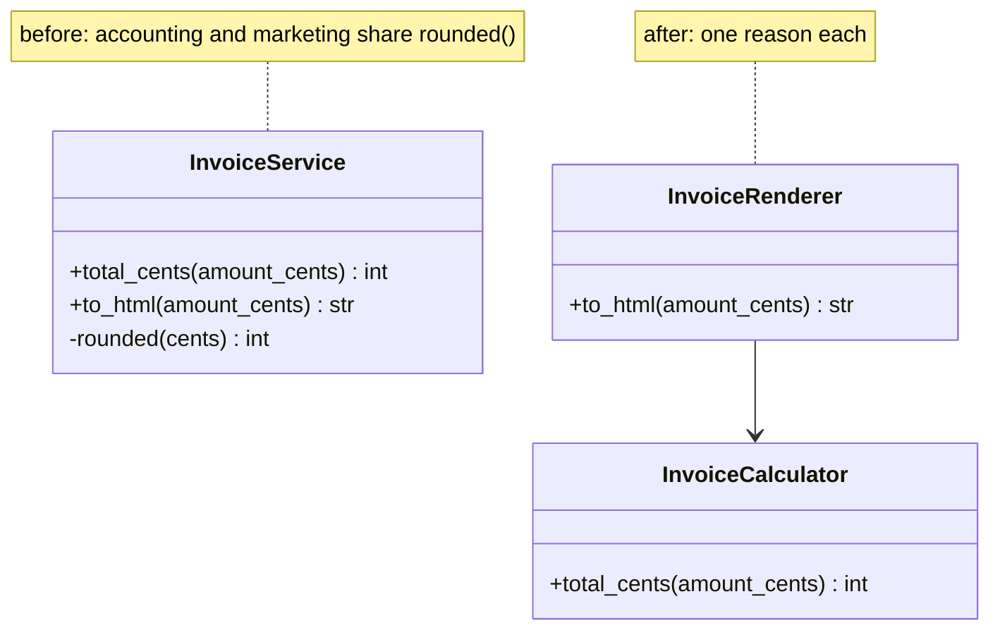

=== "PHP"

    ``` { .php .ex-bad title="Avoid" }
    <?php

    final class InvoiceService
    {
        // Avoid: total requested by the accountant, computed through the shared rounded()
        public function totalCents(int $amountCents): int
        {
            return $this->rounded($amountCents * 1.20);
        }

        // Avoid: display requested by marketing, through the same rounded()
        public function toHtml(int $amountCents): string
        {
            return "<h1>Invoice</h1><p>" . $this->rounded($amountCents * 1.20) / 100 . " €</p>";
        }

        // Avoid: rounding to the euro here for the display also changes the billed total
        private function rounded(float $cents): int
        {
            return (int) round($cents);
        }
    }
    ```

    ``` { .php .ex-good title="Recommended" }
    <?php

    // What changes: accounting gets its own class, the total stays rounded to the cent
    final class InvoiceCalculator
    {
        public function totalCents(int $amountCents): int
        {
            return (int) round($amountCents * 1.20);
        }
    }

    // What changes: marketing rounds the display to the euro, in its own class only
    final class InvoiceRenderer
    {
        public function __construct(private readonly InvoiceCalculator $calculator) {}

        public function toHtml(int $amountCents): string
        {
            return "<h1>Invoice</h1><p>" . round($this->calculator->totalCents($amountCents) / 100) . " €</p>";
        }
    }
    ```

=== "Python"

    ``` { .python .ex-bad title="Avoid" }
    class InvoiceService:
        # Avoid: total requested by the accountant, computed through the shared rounded()
        def total_cents(self, amount_cents: int) -> int:
            return self._rounded(amount_cents * 1.20)

        # Avoid: display requested by marketing, through the same rounded()
        def to_html(self, amount_cents: int) -> str:
            return f"<h1>Invoice</h1><p>{self._rounded(amount_cents * 1.20) / 100} €</p>"

        # Avoid: rounding to the euro here for the display also changes the billed total
        def _rounded(self, cents: float) -> int:
            return round(cents)
    ```

    ``` { .python .ex-good title="Recommended" }
    # What changes: accounting gets its own class, the total stays rounded to the cent
    class InvoiceCalculator:
        def total_cents(self, amount_cents: int) -> int:
            return round(amount_cents * 1.20)


    # What changes: marketing rounds the display to the euro, in its own class only
    class InvoiceRenderer:
        def __init__(self, calculator: InvoiceCalculator) -> None:
            self._calculator = calculator

        def to_html(self, amount_cents: int) -> str:
            return f"<h1>Invoice</h1><p>{round(self._calculator.total_cents(amount_cents) / 100)} €</p>"
    ```

=== "Java"

    ``` { .java .ex-bad title="Avoid" }
    final class InvoiceService {
        // Avoid: total requested by the accountant, computed through the shared rounded()
        int totalCents(int amountCents) { return rounded(amountCents * 1.20); }
        // Avoid: display requested by marketing, through the same rounded()
        String toHtml(int amountCents) { return "<h1>Invoice</h1><p>" + rounded(amountCents * 1.20) / 100.0 + " €</p>"; }
        // Avoid: rounding to the euro here for the display also changes the billed total
        private int rounded(double cents) { return (int) Math.round(cents); }
    }
    ```

    ``` { .java .ex-good title="Recommended" }
    // What changes: accounting gets its own class, the total stays rounded to the cent
    final class InvoiceCalculator {
        int totalCents(int amountCents) { return (int) Math.round(amountCents * 1.20); }
    }

    // What changes: marketing rounds the display to the euro, in its own class only
    final class InvoiceRenderer {
        private final InvoiceCalculator calculator;
        InvoiceRenderer(InvoiceCalculator calculator) { this.calculator = calculator; }
        String toHtml(int amountCents) { return "<h1>Invoice</h1><p>" + Math.round(calculator.totalCents(amountCents) / 100.0) + " €</p>"; }
    }
    ```

The first version (`InvoiceService`) is the "before": the total and the display go through the same rounding method. The two next classes are the "after": marketing got its amounts without cents in `InvoiceRenderer`, and the total computed by `InvoiceCalculator` did not move.

**When not to apply it**: when both responsibilities always change together, or when the class is twenty lines long. Splitting too early scatters simple logic across five files.

:material-book-open-variant: Reference docs: [Robert C. Martin, "The Single Responsibility Principle"](https://blog.cleancoder.com/uncle-bob/2014/05/08/SingleReponsibilityPrinciple.html) (2014)
{ .doc-ref }

### O: open/closed

<span class="pill pill-status pill-status-ok" title="Still valid, checked November 2026">Current · 11/2026</span>

**Definition**: the <span class="term" data-term="open-closed">open/closed</span> principle (Bertrand Meyer, 1988) says a module should be open for extension but closed for modification: we add behavior by adding code, without editing code that already works.

!!! noob "As noob"
    I think of a power strip: to plug in a new device, I add a plug, I do not open the wall to redo the wiring. There is usually still one line to add where the case is picked, but the working code is not rewritten. The one thing to remember: **adding a case means adding code, not editing the code that works.**

**Symptom**: a `switch` or `if/elif` on a type, growing with each new case. To add relay pickup, I reopen the function that already computes standard and express: one mistake in the next branch, and the express price changes, although nobody asked to touch it.

**Example**: before, a `match` on the shipping mode. After, each mode is a class (the [Strategy](design-patterns-comportement.md#strategy) pattern): adding `Relay` does not touch the existing computation.

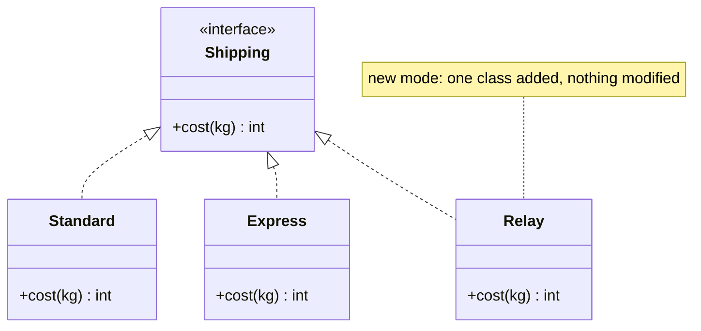

=== "PHP"

    ``` { .php .ex-bad title="Avoid" }
    <?php

    // Avoid: every new mode reopens this computation that already works
    function shippingCost(string $mode, float $kg): int
    {
        return match ($mode) {
            'standard' => 500 + (int) ($kg * 100),
            'express' => 1500 + (int) ($kg * 200),
        };
    }
    ```

    ``` { .php .ex-good title="Recommended" }
    <?php

    // Good: the shared contract, each mode implements it
    interface Shipping
    {
        public function cost(float $kg): int;
    }

    // What changes: the standard mode becomes its own class
    final class Standard implements Shipping
    {
        public function cost(float $kg): int { return 500 + (int) ($kg * 100); }
    }

    // What changes: relay pickup is added without touching the other modes
    final class Relay implements Shipping
    {
        public function cost(float $kg): int { return 300; }
    }
    ```

=== "Python"

    ``` { .python .ex-bad title="Avoid" }
    from typing import Protocol


    # Avoid: every new mode reopens this computation that already works
    def shipping_cost(mode: str, kg: float) -> int:
        match mode:
            case "standard":
                return 500 + int(kg * 100)
            case "express":
                return 1500 + int(kg * 200)
        raise ValueError(mode)
    ```

    ``` { .python .ex-good title="Recommended" }
    # Good: the shared contract, each mode implements it
    class Shipping(Protocol):
        def cost(self, kg: float) -> int: ...


    # What changes: the standard mode becomes its own class
    class Standard:
        def cost(self, kg: float) -> int:
            return 500 + int(kg * 100)


    # What changes: relay pickup is added without touching the other modes
    class Relay:
        def cost(self, kg: float) -> int:
            return 300
    ```

=== "Java"

    ``` { .java .ex-bad title="Avoid" }
    // Avoid: every new mode reopens this computation that already works
    static int shippingCost(String mode, double kg) {
        return switch (mode) {
            case "standard" -> 500 + (int) (kg * 100);
            case "express" -> 1500 + (int) (kg * 200);
            default -> throw new IllegalArgumentException(mode);
        };
    }
    ```

    ``` { .java .ex-good title="Recommended" }
    // Good: the shared contract, each mode implements it
    interface Shipping { int cost(double kg); }

    // What changes: the standard mode becomes its own class
    final class Standard implements Shipping {
        public int cost(double kg) { return 500 + (int) (kg * 100); }
    }

    // What changes: relay pickup is added without touching the other modes
    final class Relay implements Shipping {
        public int cost(double kg) { return 300; }
    }
    ```

**When not to apply it**: two stable cases that will not move. A three-line `match` reads better than three classes. Open the code when the third case arrives (see the <span class="term" data-term="rule-of-three">rule of three</span>).

:material-book-open-variant: Reference docs: [Robert C. Martin, "The Open Closed Principle"](https://blog.cleancoder.com/uncle-bob/2014/05/12/TheOpenClosedPrinciple.html) (2014)
{ .doc-ref }

### L: Liskov substitution

<span class="pill pill-status pill-status-ok" title="Still valid, checked November 2026">Current · 11/2026</span>

**Definition**: the <span class="term" data-term="liskov-substitution">Liskov substitution</span> principle says an object of a subclass must be able to replace an object of the parent class **without the calling code noticing**. Stated by Barbara Liskov in 1987, refined with Jeannette Wing in 1994. In practice, a subclass:

- must not require more than the parent (no stronger **precondition**: the parent accepts any positive amount, the child cannot reject those above 100);
- must guarantee at least as much as the parent (no weaker **postcondition**: if the parent promises to save, the child cannot silently ignore);
- must not throw exceptions the parent does not plan for.

!!! noob "As noob"
    If I am lent a replacement car, I must be able to drive it without reading the manual: wheel, pedals and brakes work the same. A car whose brake pedal accelerates has the right shape but breaks the promise. The one thing to remember: **a subclass keeps every promise of its parent, not just its method names.**

**Symptom**: `instanceof` or `isinstance` checks in calling code to handle a special case, or an inherited method that throws "not supported". The classic example is the square inheriting from the rectangle: `setWidth(5)` on a square also changes the height, and a test "area = width x height" written for the rectangle fails.

**Example**: a read-only repository inheriting from a writable one and throwing on `save()`. The code that cancels an order receives an `OrderRepository` and calls `save()`: the day it is given the archive repository, it crashes at runtime, although its type said everything was fine. The fix: split reading from writing, the read-only version only implements reading.

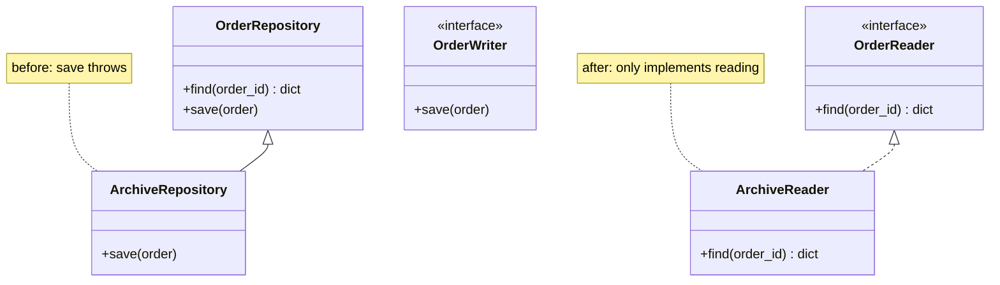

=== "PHP"

    ``` { .php .ex-illus title="Illustration" }
    <?php

    // Example: the writable repository, which promises reading and writing
    class OrderRepository
    {
        public function find(string $id): ?array { return null; }
        public function save(array $order): void { }
    }
    ```

    ``` { .php .ex-bad title="Avoid" }
    <?php

    // Avoid: inherits save() but makes it crash, Liskov is broken
    final class ArchiveRepository extends OrderRepository
    {
        public function save(array $order): void
        {
            throw new LogicException('read only');
        }
    }
    ```

    ``` { .php .ex-good title="Recommended" }
    <?php

    // What changes: reading gets its own contract
    interface OrderReader
    {
        public function find(string $id): ?array;
    }

    // What changes: so does writing, separately
    interface OrderWriter
    {
        public function save(array $order): void;
    }

    // Good: the archive only implements reading, no broken promise
    final class ArchiveReader implements OrderReader
    {
        public function find(string $id): ?array { return null; }
    }
    ```

=== "Python"

    ``` { .python .ex-illus title="Illustration" }
    from typing import Protocol


    # Example: the writable repository, which promises reading and writing
    class OrderRepository:
        def find(self, order_id: str) -> dict | None:
            return None

        def save(self, order: dict) -> None:
            pass
    ```

    ``` { .python .ex-bad title="Avoid" }
    # Avoid: inherits save() but makes it crash, Liskov is broken
    class ArchiveRepository(OrderRepository):
        def save(self, order: dict) -> None:
            raise NotImplementedError("read only")
    ```

    ``` { .python .ex-good title="Recommended" }
    # What changes: reading gets its own contract
    class OrderReader(Protocol):
        def find(self, order_id: str) -> dict | None: ...


    # What changes: so does writing, separately
    class OrderWriter(Protocol):
        def save(self, order: dict) -> None: ...


    # Good: the archive only implements reading, no broken promise
    class ArchiveReader:
        def find(self, order_id: str) -> dict | None:
            return None
    ```

=== "Java"

    ``` { .java .ex-illus title="Illustration" }
    // Example: the writable repository, which promises reading and writing
    class OrderRepository {
        Optional<Order> find(String id) { return Optional.empty(); }
        void save(Order order) { }
    }
    ```

    ``` { .java .ex-bad title="Avoid" }
    // Avoid: inherits save() but makes it crash, Liskov is broken
    final class ArchiveRepository extends OrderRepository {
        @Override
        void save(Order order) { throw new UnsupportedOperationException("read only"); }
    }
    ```

    ``` { .java .ex-good title="Recommended" }
    // What changes: reading gets its own contract
    interface OrderReader { Optional<Order> find(String id); }
    // What changes: so does writing, separately
    interface OrderWriter { void save(Order order); }

    // Good: the archive only implements reading, no broken promise
    final class ArchiveReader implements OrderReader {
        public Optional<Order> find(String id) { return Optional.empty(); }
    }
    ```

**When not to apply it**: there is hardly a case where we break it on purpose. However, it does not require inheritance: if substitution is hard, it is often a sign we should not have inherited (see [composition over inheritance](#composition-over-inheritance)).

:material-book-open-variant: Reference docs: [Barbara Liskov and Jeannette Wing, "A Behavioral Notion of Subtyping"](https://dl.acm.org/doi/10.1145/197320.197383) (1994)
{ .doc-ref }

### I: interface segregation

<span class="pill pill-status pill-status-ok" title="Still valid, checked November 2026">Current · 11/2026</span>

**Definition**: the <span class="term" data-term="interface-segregation">interface segregation</span> principle says a client should not depend on methods it does not use. Several small targeted interfaces beat one big "do everything" interface.

!!! noob "As noob"
    Someone who only wants to change channels does not need a 60-button remote, and whoever builds the remote should not have to wire all 60 to make one work. The one thing to remember: **several small, focused interfaces beat one big one.**

**Symptom**: implementations full of empty methods or methods throwing "not supported". A test fake (a <span class="term" data-term="test-double">test double</span>: a simplified object that replaces the real one during the test, see [D: dependency inversion](#d-dependency-inversion)) that must implement fifteen methods while the test calls only one.

**Example**: before, a `Notifier` interface with `sendEmail`, `sendSms` and `sendPush`. The SMS service must implement all three. After, one interface per need.

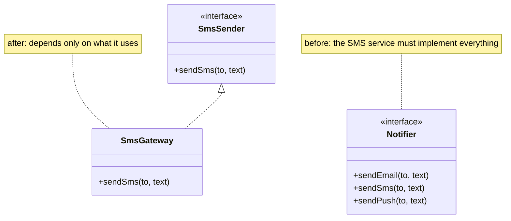

=== "PHP"

    ``` { .php .ex-bad title="Avoid" }
    <?php

    // Avoid: every implementation must provide all three channels
    interface Notifier
    {
        public function sendEmail(string $to, string $text): void;
        public function sendSms(string $to, string $text): void;
        public function sendPush(string $to, string $text): void;
    }
    ```

    ``` { .php .ex-good title="Recommended" }
    <?php

    // What changes: one interface for the SMS need only
    interface SmsSender
    {
        public function sendSms(string $to, string $text): void;
    }

    // Good: the SMS service implements only what it uses
    final class SmsGateway implements SmsSender
    {
        public function sendSms(string $to, string $text): void { }
    }
    ```

=== "Python"

    ``` { .python .ex-bad title="Avoid" }
    from typing import Protocol


    # Avoid: every implementation must provide all three channels
    class Notifier(Protocol):
        def send_email(self, to: str, text: str) -> None: ...
        def send_sms(self, to: str, text: str) -> None: ...
        def send_push(self, to: str, text: str) -> None: ...
    ```

    ``` { .python .ex-good title="Recommended" }
    # What changes: one interface for the SMS need only
    class SmsSender(Protocol):
        def send_sms(self, to: str, text: str) -> None: ...


    # Good: the SMS service implements only what it uses
    class SmsGateway:
        def send_sms(self, to: str, text: str) -> None:
            pass
    ```

=== "Java"

    ``` { .java .ex-bad title="Avoid" }
    // Avoid: every implementation must provide all three channels
    interface Notifier {
        void sendEmail(String to, String text);
        void sendSms(String to, String text);
        void sendPush(String to, String text);
    }
    ```

    ``` { .java .ex-good title="Recommended" }
    // What changes: one interface for the SMS need only
    interface SmsSender { void sendSms(String to, String text); }

    // Good: the SMS service implements only what it uses
    final class SmsGateway implements SmsSender {
        public void sendSms(String to, String text) { }
    }
    ```

**When not to apply it**: splitting an interface into one-method interfaces with no client needing them. The right size of an interface is what its client uses.

:material-book-open-variant: Reference docs: [Wikipedia, "Interface segregation principle"](https://en.wikipedia.org/wiki/Interface_segregation_principle) (accessed November 2026)
{ .doc-ref }

### D: dependency inversion

<span class="pill pill-status pill-status-ok" title="Still valid, checked November 2026">Current · 11/2026</span>

**Definition**: the <span class="term" data-term="dependency-inversion">dependency inversion</span> principle says business code (high level) must not depend on technical code (low level): both depend on an abstraction, and the business code defines it. Not to be confused with <span class="term" data-term="dependency-injection">dependency injection</span>, a technique to apply the principle: the dependency is passed to the constructor instead of being created inside.

!!! noob "As noob"
    It is the power socket: my lamp does not depend on the power plant, it depends on the shape of the socket, and any source that fits that shape can power it. Unlike real life, here the business code (the lamp) designs the socket, and the database plugs into it. The one thing to remember: **business code defines the interface, technical code adapts to it, never the other way round.**

**Symptom**: a `new PostgresOrderRepository()` or a direct HTTP call in the middle of a business rule. The rule cannot be tested without a database or network.

**Example**: before, `PlaceOrder` creates its own database access. After, it receives an `OrderRepository` it defined, and both the PostgreSQL version and the in-memory test version plug into it.

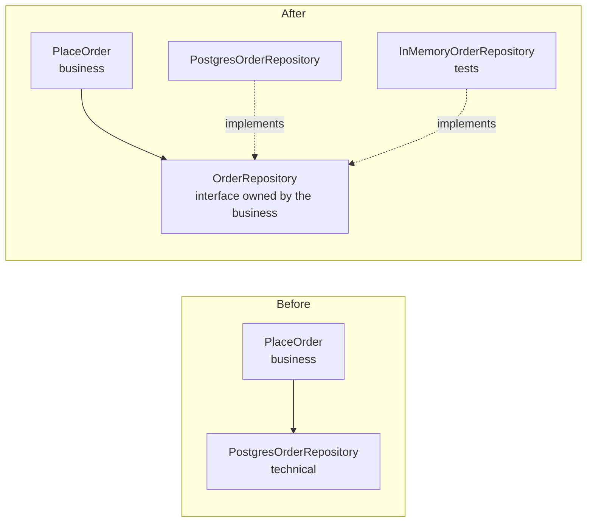

=== "PHP"

    ``` { .php .ex-bad title="Avoid" }
    <?php

    // Avoid: business code builds the PostgreSQL access itself, untestable without a database
    final class PlaceOrderBefore
    {
        public function handle(array $order): void
        {
            (new PostgresOrderRepository())->save($order);
        }
    }
    ```

    ``` { .php .ex-good title="Recommended" }
    <?php

    // What changes: business code defines the interface it needs
    interface OrderRepository
    {
        public function save(array $order): void;
    }

    // What changes: receives the repository through the constructor, real or fake
    final class PlaceOrder
    {
        public function __construct(private readonly OrderRepository $orders) {}

        public function handle(array $order): void
        {
            $this->orders->save($order);
        }
    }
    ```

=== "Python"

    ``` { .python .ex-bad title="Avoid" }
    from typing import Protocol


    # Avoid: business code builds the PostgreSQL access itself, untestable without a database
    class PlaceOrderBefore:
        def handle(self, order: dict) -> None:
            PostgresOrderRepository().save(order)
    ```

    ``` { .python .ex-good title="Recommended" }
    # What changes: business code defines the interface it needs
    class OrderRepository(Protocol):
        def save(self, order: dict) -> None: ...


    # What changes: receives the repository through the constructor, real or fake
    class PlaceOrder:
        def __init__(self, orders: OrderRepository) -> None:
            self._orders = orders

        def handle(self, order: dict) -> None:
            self._orders.save(order)
    ```

=== "Java"

    ``` { .java .ex-bad title="Avoid" }
    // Avoid: business code builds the PostgreSQL access itself, untestable without a database
    final class PlaceOrderBefore {
        void handle(Order order) { new PostgresOrderRepository().save(order); }
    }
    ```

    ``` { .java .ex-good title="Recommended" }
    // What changes: business code defines the interface it needs
    interface OrderRepository { void save(Order order); }

    // What changes: receives the repository through the constructor, real or fake
    final class PlaceOrder {
        private final OrderRepository orders;
        PlaceOrder(OrderRepository orders) { this.orders = orders; }
        void handle(Order order) { orders.save(order); }
    }
    ```

That "in-memory test version" is a <span class="term" data-term="fake-object">fake</span>, a kind of test double: a class that replaces the real one during the test, with no database, keeping orders in a list (see [test doubles](qualite.md#test-double-mock-stub-fake)).

=== "PHP"

    ``` { .php .ex-illus title="Illustration" }
    <?php

    // Example: a fake that keeps orders in memory for tests
    final class InMemoryOrderRepository implements OrderRepository
    {
        public array $saved = [];

        public function save(array $order): void
        {
            $this->saved[] = $order;
        }
    }
    ```

=== "Python"

    ``` { .python .ex-illus title="Illustration" }
    # Example: a fake that keeps orders in memory for tests
    class InMemoryOrderRepository:
        def __init__(self) -> None:
            self.saved: list[dict] = []

        def save(self, order: dict) -> None:
            self.saved.append(order)
    ```

=== "Java"

    ``` { .java .ex-illus title="Illustration" }
    // Example: a fake that keeps orders in memory for tests
    final class InMemoryOrderRepository implements OrderRepository {
        final List<Order> saved = new ArrayList<>();
        public void save(Order order) { saved.add(order); }
    }
    ```

**When not to apply it**: for a stable dependency without side effects (a date library, a pure computation function). An interface in front of `math` or in front of every business class only adds indirection. Apply it at the boundaries: database, network, clock, files, external providers.

:material-book-open-variant: Reference docs: [Martin Fowler, "DIP in the Wild"](https://martinfowler.com/articles/dipInTheWild.html) (2013); [Martin Fowler, "Inversion of Control Containers and the Dependency Injection pattern"](https://martinfowler.com/articles/injection.html) (2004)
{ .doc-ref }

!!! maturity "Measuring maturity"
    | Level | What I see in the team |
    |---|---|
    | N1 | one or two people quote SOLID in review, case by case, and business code still does `new` on technical classes |
    | N2 | each MR is reviewed with a shared grid (one reason to change per class, boundary dependencies passed through the constructor), and domain tests run without a database |
    | N3 | an architecture rule checked in CI (the domain never imports infrastructure) and the type checker block the MR that inverts a dependency or breaks an inherited signature |
    | N4 | the team tracks the number of modules touched per business change and the share of domain tests that run without infrastructure, and chooses where to split from those numbers, without applying all five letters everywhere |

    **I measure**: the share of business MRs that touch only one module, read in the MR tool; the number of domain import rule violations, read in the CI report.

## STUPID: the six smells to avoid

<a class="pill pill-scope pill-scope-code" href="../architecture/#map-of-scales">Scale · Code</a> <span class="pill pill-status pill-status-ok" title="Still valid, checked November 2026">Current · 11/2026</span>

**<span class="term" data-term="stupid-code">STUPID</span>** is the reverse acronym of SOLID: six flaws that make code hard to test and evolve. It was popularized by a blog post by William Durand, "From STUPID to SOLID Code!" (2013, to check). It is not a standard, rather a handy mnemonic for code reviews.

**S: Singleton.** A unique object reachable from anywhere (`Config::getInstance()`) is hidden global state: tests influence each other (a test that changes a config value leaves it to the next test, which fails or passes depending on run order), and reading a class signature does not tell what it depends on. The fix: pass the dependency through the constructor, and let the [injection container](design-patterns.md#injection-container) (the framework object that builds objects and hands them their dependencies) guarantee the single instance (see [Singleton](design-patterns.md#singleton)).

**T: Tight coupling.** A class that knows the details of another: <span class="term" data-term="tight-coupling">tight coupling</span>. `OrderService` building `new SmtpMailer('smtp.example.com', 25)` must change when the mail server changes. Fix: dependency inversion.

**U: Untestability.** Code that is hard to test is almost always badly split: hidden dependency, system clock read directly (`datetime.now()` in the middle of a rule), side effect in a constructor. Fix: pass the clock and dependencies as parameters.

**P: Premature optimization.** Making code more complex to gain speed before measuring a problem. A home-made cache added "just in case" on a query taking 2 ms (example figure). Donald Knuth's quote ("Structured Programming with go to Statements", 1974): <span class="term" data-term="premature-optimization">premature optimization</span> is the root of all evil, in 97% of cases. Fix: measure first (profiler, trace), then optimize the hot spot.

**I: Indescriptive naming.** `$data`, `tmp`, `Manager`, `process()`, `flag2`. The reader has to read the body to understand the intent. Fix: a name stating the business role (`overdueInvoices`, `applyLoyaltyDiscount`).

**D: Duplication.** The same rule written in several places: when it changes, one is forgotten. Fix: DRY, applied to knowledge and not to text (see below).

| STUPID smell | Sign in code review | Principle that fixes it |
|---|---|---|
| Singleton | `getInstance()`, shared static state | dependency inversion, injection |
| Tight coupling | `new` of a technical class in business code | dependency inversion, Demeter |
| Untestability | test impossible without a real database, network or clock | dependency inversion, single responsibility |
| Premature optimization | cache, pool or micro-optimization without measurement | KISS, YAGNI |
| Indescriptive naming | `data`, `Manager`, `doStuff` | least astonishment, code review |
| Duplication | same `if` or same computation copied | DRY, with the rule of three |

**Risks.** Used as a list of grievances, it turns the review into a trial ("your code is STUPID") and the author gets defensive: I quote the smell and its symptom, not the person. Applied to the letter, it pushes to remove every duplication and every singleton at once, including where they bother no one: I only deal with smells in the code I am changing.

:material-book-open-variant: Reference docs: [William Durand, "From STUPID to SOLID Code!"](https://williamdurand.fr/2013/07/30/from-stupid-to-solid-code/) (2013)
{ .doc-ref }

!!! maturity "Measuring maturity"
    | Level | What I see in the team |
    |---|---|
    | N1 | someone occasionally spots a singleton or a duplication in review, with no shared vocabulary |
    | N2 | the STUPID list is a shared review grid, and static analysis flags duplication, complexity and names that are too short |
    | N3 | the CI quality gate blocks an MR that adds duplication beyond a threshold or new shared static state, without a reviewer having to say it |
    | N4 | the team tracks the duplication rate and the number of singletons in the most changed areas, and schedules cleanup where those numbers cost |

    **I measure**: the duplication rate and the number of new smells per MR, read in static analysis; the number of review comments that quote a STUPID smell, read in the MR tool.

## Related principles

<a class="pill pill-scope pill-scope-code" href="../architecture/#map-of-scales">Scale · Code</a> <a class="pill pill-scope pill-scope-app" href="../architecture/#map-of-scales">Scale · Application</a>

### KISS

<span class="pill pill-status pill-status-ok" title="Still valid, checked November 2026">Current · 11/2026</span>

**<span class="term" data-term="kiss">KISS</span>** (*Keep It Simple, Stupid*, phrase credited to engineer Kelly Johnson, 1960s, origin to check): the simplest solution that solves the problem is the best. Simple does not mean easy to write, but easy for someone else to read and change.

!!! noob "As noob"
    KISS is the directions I give a friend: "straight on, then the second left" beats the shortcut through three alleys that only I know, even if it saves two minutes. The one thing to remember: **simple means easy for the next reader to understand, not short to write.**

Example: a colleague will have to fix my code in six months. A five-line loop, they understand by reading it. A chain of nested `reduce` calls, they have to redo on paper before daring to touch it, so they lose an hour or break something.

**Risks.** "Simple" is sometimes an excuse to remove error handling, tests or input validation: the code is short but crashes on the first real case. Simple means without needless complexity, not without what is needed. What is simple for the author is not always simple for the reader: in review, the reviewer's opinion decides.

:material-book-open-variant: Reference docs: [Wikipedia, "KISS principle"](https://en.wikipedia.org/wiki/KISS_principle) (accessed November 2026)
{ .doc-ref }

### DRY, WET and AHA

<span class="pill pill-status pill-status-ok" title="Still valid, checked November 2026">Current · 11/2026</span>

**<span class="term" data-term="dry">DRY</span>** (*Don't Repeat Yourself*, Andy Hunt and Dave Thomas, "The Pragmatic Programmer", 1999): "every piece of knowledge must have a single, unambiguous, authoritative representation within a system". The key point: DRY is about **knowledge**, not text. Two functions that look alike but represent two different business rules are not duplication.

!!! noob "As noob"
    Two signs that both show "30" do not necessarily say the same thing: one is a speed limit, the other a house number. Merging them because they look alike would be a mistake. The one thing to remember: **DRY hunts copied rules, not lines that look alike.**

**WET** (*Write Everything Twice*, or *We Enjoy Typing*): the mocking nickname for code that ignores DRY.

**AHA** (*Avoid Hasty Abstractions*, Kent C. Dodds, around 2019, date to check) and **<span class="term" data-term="wrong-abstraction">the wrong abstraction</span>** (Sandi Metz, "The Wrong Abstraction", 2016): "duplication is far cheaper than the wrong abstraction". An abstraction created too early ends up piling parameters and `if`s to serve unrelated cases. Sandi Metz's fix: inline the code back into each caller, then start again from there.

``` { .text .ex-illus title="Illustration" }
Day 1:  formatPrice(amount)                               2 identical callers, we factor out.
Day 30: formatPrice(amount, currency, withTax)            a 3rd caller differs a little.
Day 90: formatPrice(amount, currency, withTax, isB2b,     5 flags, 12 combinations,
        legacyRounding)                                   nobody dares to touch it.
```

:material-book-open-variant: Reference docs: [Andy Hunt and Dave Thomas, "Orthogonality and the DRY Principle", Artima](https://www.artima.com/articles/orthogonality-and-the-dry-principle) (2003); [Sandi Metz, "The Wrong Abstraction"](https://sandimetz.com/blog/2016/1/20/the-wrong-abstraction) (2016)
{ .doc-ref }

### YAGNI and rule of three

<span class="pill pill-status pill-status-ok" title="Still valid, checked November 2026">Current · 11/2026</span>

**<span class="term" data-term="yagni">YAGNI</span>** (*You Aren't Gonna Need It*, Extreme Programming, late 1990s): do not build today what you do not need yet. I add a PDF export "because we will surely need it": it has to be written, tested and reread at every change. The day the need really arrives, I am often asked for an Excel export, and my PDF code was for nothing.

!!! noob "As noob"
    YAGNI is not buying a trailer the day I buy my car "in case I move house": I pay insurance and garage space for years, and on moving day I actually need a van. The one thing to remember: **I build for today's need, tomorrow's need rarely arrives in the expected shape.**

**<span class="term" data-term="rule-of-three">Rule of three</span>** (Don Roberts, quoted by Martin Fowler in "Refactoring", 1999): the first time we write it, the second time we duplicate with a wince, the third time we refactor. It reconciles DRY and YAGNI: wait for enough examples to see the right abstraction.

**Risks.** Applied to everything, YAGNI also postpones what is very expensive to add later: security, logging, versioning of a public API, the format of stored data. Once the API is published without a version, every client will have to migrate. I make an exception for decisions that are hard to undo, and I apply YAGNI to features and options.

:material-book-open-variant: Reference docs: [Martin Fowler, "Yagni"](https://martinfowler.com/bliki/Yagni.html) (2015)
{ .doc-ref }

### Law of Demeter and Tell, don't ask

<span class="pill pill-status pill-status-ok" title="Still valid, checked November 2026">Current · 11/2026</span>

**<span class="term" data-term="law-of-demeter">Law of Demeter</span>** (Ian Holland and Karl Lieberherr, Northeastern University, 1987), or "only talk to your immediate friends": a method only calls methods of its own object, its parameters, objects it creates and its direct attributes. No long chain walking through other objects' structure.

!!! noob "As noob"
    To get paid, a waiter does not grab the customer's wallet to look for the card: they ask the customer to pay. Digging through other objects (`a.get_b().get_c()`) ties me to how they are organized inside. The one thing to remember: **I ask the object to do it, I do not go through its pockets.**

``` { .python .ex-bad title="Avoid" }
# Avoid: walks through three classes, breaks if one changes its structure
city = order.get_customer().get_address().get_city()
```

``` { .python .ex-good title="Recommended" }
# Good: only Order knows where to find the city
city = order.shipping_city()
```

The first line couples the code to three classes. The second only knows `Order`, which decides how to find the city.

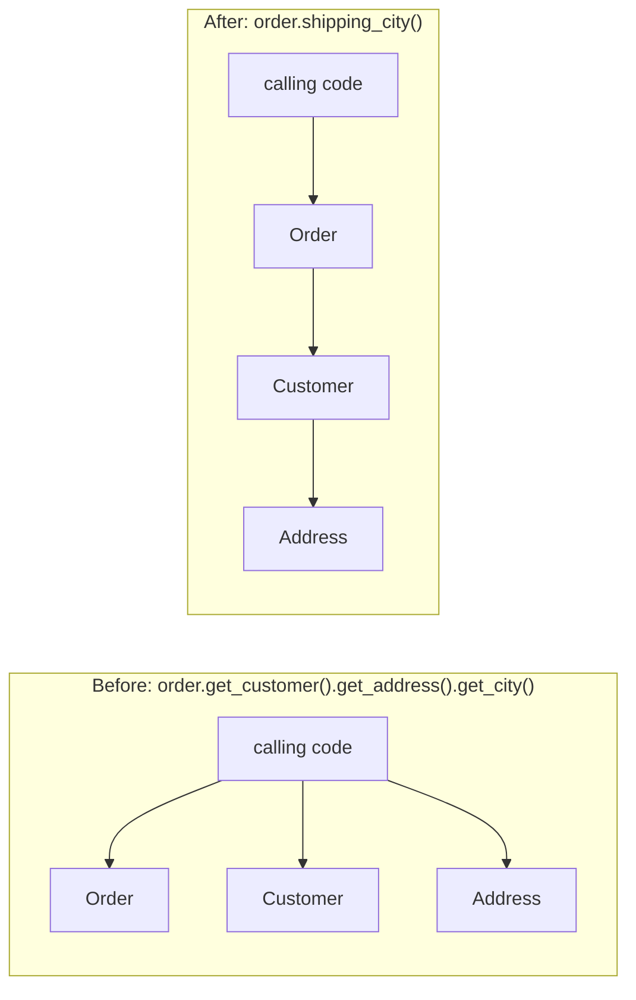

**<span class="term" data-term="tell-dont-ask">Tell, don't ask</span>** (Andy Hunt and Dave Thomas, article "Tell, Don't Ask", 2003, date to check): instead of asking an object for its state to decide in its place, tell it what to do. `if account.balance >= amount: account.balance -= amount` becomes `account.withdraw(amount)`, and the rule stays in `Account`.

**Risks.** Applied mechanically, it fills `Order` with methods that only forward (`shipping_city()`, `shipping_zip()`, `customer_phone()`...), and the class becomes a catch-all. It targets neither data objects nor fluent APIs (`query.where().order_by()`), where the chain does not walk through other objects' structure. I apply it to objects that carry behavior.

:material-book-open-variant: Reference docs: [Wikipedia, "Law of Demeter"](https://en.wikipedia.org/wiki/Law_of_Demeter) (accessed November 2026); [Martin Fowler, "TellDontAsk"](https://martinfowler.com/bliki/TellDontAsk.html) (2013)
{ .doc-ref }

### Composition over inheritance

<span class="pill pill-status pill-status-ok" title="Still valid, checked November 2026">Current · 11/2026</span>

**<span class="term" data-term="composition-over-inheritance">Composition over inheritance</span>** (Gamma, Helm, Johnson and Vlissides, "Design Patterns", 1994): "favor object composition over class inheritance". <span class="term" data-term="inheritance">Inheritance</span> ties the child to every detail of the parent, forever. <span class="term" data-term="object-composition">Composition</span> (an object holds another and delegates to it) can change at runtime and is tested separately.

!!! noob "As noob"
    Inheritance is furniture delivered already assembled: I take the whole block, including the drawers I do not need. Composition is a set of parts: I combine the ones I need and swap one without breaking the others. The one thing to remember: **inherit only when the child truly "is a" parent, otherwise contain and delegate.**

=== "PHP"

    ``` { .php .ex-bad title="Avoid" }
    <?php

    // Avoid: one subclass per combination of exports
    class ReportWithEmail extends Report { }
    class ReportWithEmailAndPdf extends ReportWithEmail { }
    ```

    ``` { .php .ex-good title="Recommended" }
    <?php

    // Good: the job receives the list of exporters it needs
    final class ReportJob
    {
        /** @param list<Exporter> $exporters */
        public function __construct(private readonly Report $report, private readonly array $exporters) {}

        public function run(): void
        {
            foreach ($this->exporters as $exporter) {
                $exporter->export($this->report);
            }
        }
    }
    ```

=== "Python"

    ``` { .python .ex-bad title="Avoid" }
    # Avoid: one subclass per combination of exports
    class ReportWithEmail(Report): ...
    class ReportWithEmailAndPdf(ReportWithEmail): ...
    ```

    ``` { .python .ex-good title="Recommended" }
    # Good: the job receives the list of exporters it needs
    class ReportJob:
        def __init__(self, report: Report, exporters: list[Exporter]) -> None:
            self._report = report
            self._exporters = exporters

        def run(self) -> None:
            for exporter in self._exporters:
                exporter.export(self._report)
    ```

=== "Java"

    ``` { .java .ex-bad title="Avoid" }
    // Avoid: one subclass per combination of exports
    class ReportWithEmail extends Report { }
    class ReportWithEmailAndPdf extends ReportWithEmail { }
    ```

    ``` { .java .ex-good title="Recommended" }
    // Good: the job receives the list of exporters it needs
    final class ReportJob {
        private final Report report;
        private final List<Exporter> exporters;
        ReportJob(Report report, List<Exporter> exporters) { this.report = report; this.exporters = exporters; }
        void run() { exporters.forEach(e -> e.export(report)); }
    }
    ```

With inheritance, each combination (email, PDF, email and PDF) needs a class. With composition, we pass the list of exporters we want.

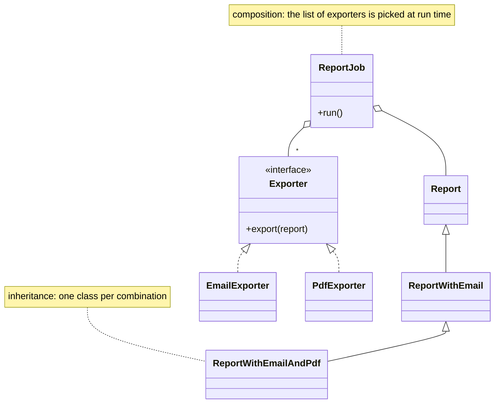

**The <span class="term" data-term="fragile-base-class">fragile base class</span>** is the concrete risk of inheritance: a parent class nobody dares to change any more, because an internal change breaks a subclass somewhere else. Joshua Bloch's example ("Effective Java", 3rd edition, 2018): a `HashSet` subclass counts additions by overriding `add()` and `addAll()`. But the parent's `addAll()` calls `add()` internally: adding three elements counts six. The day the parent changes how it works, the counter becomes wrong, without a single line of the subclass having moved. With composition, the counting object wraps a set and depends only on its public methods.

Inheritance remains right for a true "is a" relationship that respects Liskov, on one level, or when a framework requires it.

:material-book-open-variant: Reference docs: [Brandon Rhodes, "The Composition Over Inheritance Principle", python-patterns.guide](https://python-patterns.guide/gang-of-four/composition-over-inheritance/) (accessed November 2026)
{ .doc-ref }

### Separation of concerns, cohesion and coupling

<span class="pill pill-status pill-status-ok" title="Still valid, checked November 2026">Current · 11/2026</span>

**<span class="term" data-term="separation-of-concerns">Separation of concerns</span>** (Edsger Dijkstra, "On the role of scientific thought", 1974): handle each aspect of a problem separately (display, business rule, storage). It is the parent idea of single responsibility and of layered or hexagonal architectures. In practice, a split into three folders:

``` { .text .ex-illus title="Illustration" }
orders/
├── api/      # HTTP: reads the request, calls the domain, returns the response
├── domain/   # business rules and interfaces (OrderRepository); imports nothing from infra/
└── infra/    # PostgresOrderRepository, payment provider HTTP client; implements the domain interfaces
```

The rule that matters: `domain/` never imports `infra/` or `api/`. Details in [Hexagonal and clean architecture](architecture.md#hexagonal-and-clean-architecture).

**High <span class="term" data-term="cohesion">cohesion</span>, low coupling**: two sides of the same goal. Group what changes together (cohesion), separate what changes for different reasons (low coupling). A `billing` module holding the computation, its tests and its data model is cohesive. A `utils` module holding dates, CSV and email sending is not.

!!! noob "As noob"
    A tidy kitchen: spices sit together next to the hob (cohesion), and I can change pans without touching the fridge (low coupling). A "misc" drawer mixing batteries, string and a can opener is the `utils` module: everyone rummages in it, and tidying it disturbs everyone. The one thing to remember: **I group what changes together, I separate what changes for different reasons.**

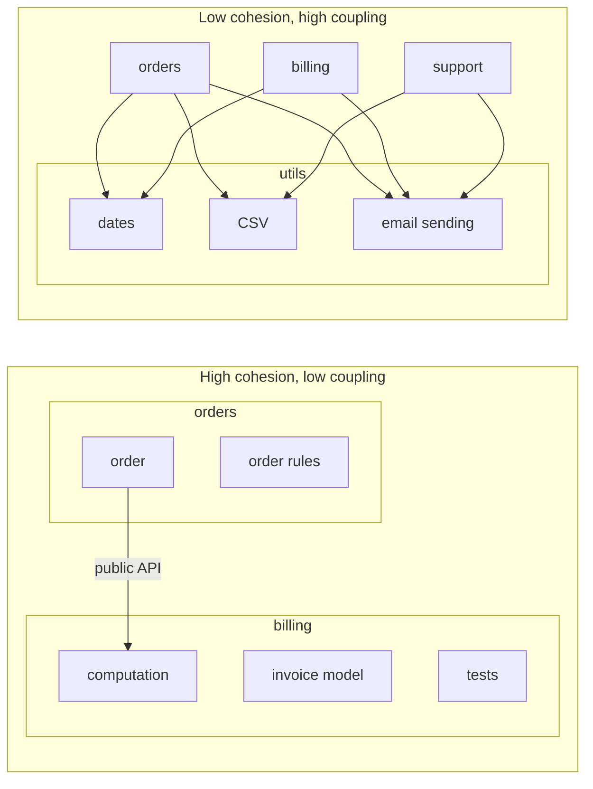

**Risks.** Splitting a small CRUD service into `api`, `domain` and `infra` layers multiplies files and object conversions without protecting anything: each added field touches four classes. I split when a real business rule exists. The other way round, a catch-all `utils` or `common` module couples everyone to the same package: I organize by business topic.

:material-book-open-variant: Reference docs: [Edsger W. Dijkstra, "On the role of scientific thought", EWD447](https://www.cs.utexas.edu/~EWD/transcriptions/EWD04xx/EWD447.html) (1974)
{ .doc-ref }

### GRASP

<span class="pill pill-status pill-status-ok" title="Still valid, checked November 2026">Current · 11/2026</span>

**<span class="term" data-term="grasp">GRASP</span>** (*General Responsibility Assignment Software Patterns*, Craig Larman, "Applying UML and Patterns", 1997): nine principles to decide **which class gets a responsibility**. The most quoted: *Information Expert* (the responsibility goes to the class holding the data, like `order.total()` rather than `calculator.total(order.lines)`), *Creator*, *Controller*, *Low Coupling*, *High Cohesion*, *Polymorphism*, *Indirection*, *Pure Fabrication*, *Protected Variations*. Less known than SOLID in interviews, but useful to justify where code lives.

| Principle | What it says | Example |
|---|---|---|
| Information Expert | the class holding the data does the computation | `order.total()` rather than `calculator.total(order.lines)` |
| Creator | an object is created by the class that contains or closely uses it | `order.add_line(product, qty)` creates the `OrderLine` |
| Controller | one object receives the user action and delegates it to the business code | `PlaceOrderHandler` receives the HTTP request and calls `Order` |
| Low Coupling | depend on as few classes as possible | `PlaceOrder` knows `OrderRepository`, not PostgreSQL |
| High Cohesion | a class keeps closely related responsibilities | `Invoice` computes VAT, does not send emails |
| Polymorphism | one variant per type instead of an `if type ==` | `CardPayment.pay()` and `TransferPayment.pay()` |
| Pure Fabrication | invent a class with no business equivalent to keep the business code clean | `OrderRepository`, `EmailSender` |
| Indirection | an intermediary to decouple two classes | a `PaymentGateway` between `PayOrder` and the provider's API |
| Protected Variations | hide what will change behind an interface | `TaxPolicy` per country, the calling code does not change |

**Risks.** Information Expert pushed to the end gives an `Order` class that computes, persists, formats and sends emails, because it "has the data": I balance it with High Cohesion and Pure Fabrication. The nine principles sometimes contradict each other, so quoting one alone settles nothing: I say which one I favor and why.

:material-book-open-variant: Reference docs: [Wikipedia, "GRASP (object-oriented design)"](https://en.wikipedia.org/wiki/GRASP_%28object-oriented_design%29) (accessed November 2026)
{ .doc-ref }

### Component principles

<span class="pill pill-status pill-status-ok" title="Still valid, checked November 2026">Current · 11/2026</span>

Robert C. Martin applies the same ideas at the level of **packages** (libraries, modules, services): the <span class="term" data-term="package-principles">component principles</span>, described in "Agile Software Development" (2002) then "Clean Architecture" (2017).

!!! noob "As noob"
    Component principles are SOLID applied to moving boxes rather than objects: I pack together what is used in the same room, I label each box, and I never put a box I open every day underneath the others. The one thing to remember: **a package groups what changes together and only depends on things more stable than itself.**

| Principle | What it says | Example |
|---|---|---|
| REP, Reuse/Release Equivalence | what we reuse, we release with a version | a shared library has a version number and a changelog |
| CCP, Common Closure | group classes that change together | the refund rule and its model in the same package |
| CRP, Common Reuse | do not force depending on what one does not use | do not put the HTTP client and the CSV parser in the same `common` package |
| ADP, Acyclic Dependencies | no cycle between packages | `billing` depends on `orders`, never the reverse |
| SDP, Stable Dependencies | depend on something more stable than oneself | an application depends on a library, not a library on an application |
| SAP, Stable Abstractions | a stable package should be abstract | the most used package mostly exposes interfaces |

I need them most when several teams depend on the same code: a shared library, an SDK, or a monorepo where each team owns its folders. Without them, a change in a common package forces everyone to update at the same time.

**Risks.** Splitting too early into dozens of small versioned packages creates version hell: one fix needs five releases in the right order. I keep things together as long as a single team consumes the code, and I split when a second consumer arrives with a different pace.

:material-book-open-variant: Reference docs: [Wikipedia, "Package principles"](https://en.wikipedia.org/wiki/Package_principles) (accessed November 2026)
{ .doc-ref }

### CUPID

<span class="pill pill-status pill-status-ok" title="Still valid, checked November 2026">Current · 11/2026</span>

**<span class="term" data-term="cupid">CUPID</span>** (Dan North, article "CUPID: for joyful coding", 2022): a modern counterpoint to SOLID. Dan North proposes **properties** rather than principles, to aim for without ticking boxes: *Composable* (easy to combine), *Unix philosophy* (does one thing well), *Predictable* (does what we expect), *Idiomatic* (follows the language's conventions), *Domain-based* (speaks the business language). Useful in interviews to show we know the criticism of SOLID: principles designed for 1990s object-oriented programming, sometimes applied as a checklist.

| Property | Before | After |
|---|---|---|
| Composable | `export_report()` reads the database, formats and emails | `send(format_csv(load_orders()))`: three functions reusable on their own |
| Unix philosophy | `OrderManager` creates, invoices, ships and notifies | `PlaceOrder`, `InvoiceOrder`, `ShipOrder` |
| Predictable | `get_user(id)` creates the user when missing | `get_user(id)` reads; `create_user()` creates |
| Idiomatic | in Python, `for i in range(len(orders)): orders[i]` | `for order in orders:` |
| Domain-based | `process_data(d2)` | `refund_order(order)` |

**Risks.** The properties are deliberately vague: without a shared criterion, "this is not predictable" becomes one opinion against another in review, and the discussion goes in circles. I use it as a discussion grid, with a before and after example, not as a blocking rule.

:material-book-open-variant: Reference docs: [Dan North, cupid.dev](https://cupid.dev/) (accessed November 2026); [Dan North, "CUPID: for joyful coding"](https://dannorth.net/blog/cupid-for-joyful-coding/) (2022)
{ .doc-ref }

### Principle of least astonishment

<span class="pill pill-status pill-status-ok" title="Still valid, checked November 2026">Current · 11/2026</span>

**<span class="term" data-term="least-astonishment">Principle of least astonishment</span>** (quoted in interface design since the 1970s, exact origin not given): code, an API or a command should behave the way its user expects. A `getUser()` method that creates the user if missing is surprising. A `--dry-run` option that still writes is even more so.

!!! noob "As noob"
    Least astonishment is the light switch that turns the light on when I press it up, like everywhere else: if it opened the shutters, I would stop trusting every switch in the house. The one thing to remember: **a name, an option or an API does what its reader guesses without reading the code.**

**Risks.** Surprise depends on the reader: a method that raises an exception is expected in Python and surprising in Go. I follow the conventions of the language and the framework, and I document the behavior when a doubt remains. Fixing a surprising but already used behavior breaks the callers that depend on it (Hyrum's law): I do it with a warning and a transition period.

:material-book-open-variant: Reference docs: [Wikipedia, "Principle of least astonishment"](https://en.wikipedia.org/wiki/Principle_of_least_astonishment) (accessed November 2026)
{ .doc-ref }

!!! maturity "Measuring maturity"
    | Level | What I see in the team |
    |---|---|
    | N1 | principles are quoted in review when someone thinks of it, often to defend an opinion ("this is not DRY") rather than a need |
    | N2 | the team follows written rules: rule of three before any factoring out, no interface without a second implementation or a test that needs it, no cycles between packages |
    | N3 | a tool checks dependencies between packages in CI and blocks a cycle or a forbidden import; the rule of three and YAGNI are part of the "ready for review" definition and applied without reminders |
    | N4 | the team tracks coupling (number of modules touched per MR) and unused code, and removes abstractions used only once based on those numbers |

    **I measure**: the average number of modules touched per MR, read in the git history; the number of single-implementation interfaces and of cycles between packages, counted by static analysis.

## Design details

<a class="pill pill-scope pill-scope-code" href="../architecture/#map-of-scales">Scale · Code</a>

The principles above say how to split code. The ones in this part say how to write each function and each boundary: where to put the checks, how big an interface should be, what to promise the caller and what to do when something fails.

### Guard clauses

<span class="pill pill-status pill-status-ok" title="Still valid, checked November 2026">Current · 11/2026</span>

A **<span class="term" data-term="guard-clause">guard clause</span>** is a check at the start of a function that exits right away (`return` or exception) in a special case: missing input, empty list, unsupported case. The normal case then reads at the end, without nesting. Martin Fowler makes it a named refactoring, "Replace Nested Conditional with Guard Clauses", in "Refactoring" (1999, 2nd edition 2018).

**When**: a function stacks three levels of `if` and the real computation hides at the far right, or its first lines check entry conditions. **When not**: two equally important branches (one rate for individuals, another for companies) read better as a symmetric `if / else`, and `return` statements scattered in the middle of an 80-line function make it harder to follow, not easier.

**Why**: each nesting level forces the reader to keep a condition in mind, which is what <span class="term" data-term="cognitive-complexity">cognitive complexity</span> measures. With guards, each special case is settled in one line, and what follows is the normal path.

**How**: I invert the condition, exit right away, and repeat for the next condition.

=== "PHP"

    ``` { .php .ex-bad title="Avoid" }
    <?php

    // Avoid: three nesting levels, the real computation hides at the far right
    function shippingFee(?Order $order): int
    {
        if ($order !== null) {
            if ($order->items !== []) {
                if (isset(RATES[$order->country])) {
                    return RATES[$order->country] * $order->weightKg;
                } else {
                    throw new UnknownCountry($order->country);
                }
            } else {
                return 0;
            }
        } else {
            throw new InvalidArgumentException('Order is required.');
        }
    }
    ```

    ``` { .php .ex-good title="Recommended" }
    <?php

    // Good: each special case exits right away, the normal case reads at the end
    function shippingFee(?Order $order): int
    {
        if ($order === null) {
            throw new InvalidArgumentException('Order is required.');
        }
        if ($order->items === []) {
            return 0;
        }
        if (!isset(RATES[$order->country])) {
            throw new UnknownCountry($order->country);
        }

        return RATES[$order->country] * $order->weightKg;
    }
    ```

=== "Python"

    ``` { .python .ex-bad title="Avoid" }
    # Avoid: three nesting levels, the real computation hides at the far right
    def shipping_fee(order: Order | None) -> int:
        if order is not None:
            if order.items:
                if order.country in RATES:
                    return RATES[order.country] * order.weight_kg
                else:
                    raise UnknownCountry(order.country)
            else:
                return 0
        else:
            raise ValueError("order is required")
    ```

    ``` { .python .ex-good title="Recommended" }
    # Good: each special case exits right away, the normal case reads at the end
    def shipping_fee(order: Order | None) -> int:
        if order is None:
            raise ValueError("order is required")
        if not order.items:
            return 0
        if order.country not in RATES:
            raise UnknownCountry(order.country)

        return RATES[order.country] * order.weight_kg
    ```

=== "Java"

    ``` { .java .ex-bad title="Avoid" }
    // Avoid: three nesting levels, the real computation hides at the far right
    static int shippingFee(Order order) {
        if (order != null) {
            if (!order.items().isEmpty()) {
                if (RATES.containsKey(order.country())) {
                    return RATES.get(order.country()) * order.weightKg();
                } else {
                    throw new UnknownCountry(order.country());
                }
            } else {
                return 0;
            }
        } else {
            throw new IllegalArgumentException("Order is required.");
        }
    }
    ```

    ``` { .java .ex-good title="Recommended" }
    // Good: each special case exits right away, the normal case reads at the end
    static int shippingFee(Order order) {
        if (order == null) {
            throw new IllegalArgumentException("Order is required.");
        }
        if (order.items().isEmpty()) {
            return 0;
        }
        if (!RATES.containsKey(order.country())) {
            throw new UnknownCountry(order.country());
        }

        return RATES.get(order.country()) * order.weightKg();
    }
    ```

In the first version, to know what happens when the country is unknown, I have to count braces. In the second, each case fits on two lines, in the order I check them.

:material-book-open-variant: Reference docs: [Martin Fowler, "Replace Nested Conditional with Guard Clauses", refactoring.com](https://refactoring.com/catalog/replaceNestedConditionalWithGuardClauses.html) (accessed November 2026)
{ .doc-ref }

### Deep modules

<span class="pill pill-status pill-status-ok" title="Still valid, checked November 2026">Current · 11/2026</span>

A **<span class="term" data-term="deep-module">deep module</span>** (John Ousterhout, "A Philosophy of Software Design", 2018, 2nd edition 2021) offers a simple interface that hides a lot of work. A **shallow** module exposes an interface almost as complicated as what it does: the caller must know every step and its order. Ousterhout's example is Unix file I/O: five calls (`open`, `read`, `write`, `lseek`, `close`) hide disks, caches, permissions and directories.

!!! noob "As noob"
    A one-button coffee machine is a deep module: I press, it handles grinding, pressure and temperature. A machine that asks me to set those three values for every cup is shallow: it hides almost nothing from me, so I must know everything to use it. The one thing to remember: **a good interface is cheap to learn and does a lot for me.**

**When**: I split code into many small classes or functions, and each caller has to chain them itself in the right order. Ousterhout calls this habit *classitis*. **When not**: it is no excuse for a 300-line function; depth is judged from the caller (the size of the interface), not by the length of the code hidden behind it.

**Why**: each public method is a cost for every caller, who has to learn it, and one more coupling. A narrow interface that hides a lot reduces what everyone needs to know, and lets me change the inside without touching the callers.

**How**: I look at a module from its caller and count what it needs to know. If every call follows the same five-line sequence, that sequence belongs in the module.

``` { .python .ex-bad title="Avoid" }
# Avoid: shallow module, every caller knows the five steps and their order
conn = orders_db.open_connection()
tx = orders_db.begin(conn)
row = orders_db.serialize(order)
orders_db.insert(tx, "orders", row)
orders_db.commit(tx)
```

``` { .python .ex-good title="Recommended" }
# Good: deep module, one method that hides connection, transaction and format
orders_repository.save(order)
```

With the first version, a caller who forgets `commit` silently loses the order, and changing the storage format means touching every caller.

:material-book-open-variant: Reference docs: [John Ousterhout, "A Philosophy of Software Design"](https://web.stanford.edu/~ouster/cgi-bin/book.php) (2018, 2nd edition 2021)
{ .doc-ref }

### The four rules of simple design

<span class="pill pill-status pill-status-ok" title="Still valid, checked November 2026">Current · 11/2026</span>

Kent Beck, in "Extreme Programming Explained" (1999), gives four rules to judge whether code is simple, **in priority order**:

| Rule | Question in review | Example |
|---|---|---|
| 1. Passes the tests | does the code do what is expected, proven by tests? | a discount computation without tests is not "simple", it is unknown |
| 2. Reveals intention | does a reader understand the goal without asking? | `apply_loyalty_discount()` rather than `process()` |
| 3. No duplication | is each rule written only once? | the VAT rate lives in one constant, not in three files |
| 4. Fewest elements | is there a class, interface or parameter left that serves nothing? | an interface created for a single implementation |

**When**: in code review, when I need to say why a solution feels too complicated without invoking an abstract principle. **Why**: the four rules fit on one line and can be checked on the code itself. The fourth rule is the most often forgotten: it asks to remove what the first three do not require, which joins YAGNI. **How**: I apply them in order. If removing a duplication makes the code more obscure, intention wins: Martin Fowler notes that the order between rules 2 and 3 is debated, but that clarity comes first when in doubt.

**Risks.** In the wrong order, rule 3 (no duplication) overrides rule 2 (reveal intent) and produces an obscure abstraction. Rule 1 assumes tests that check the right behavior: with weak tests, "simple" code can simply be wrong. I check test quality before leaning on the first rule.

:material-book-open-variant: Reference docs: [Martin Fowler, "BeckDesignRules"](https://martinfowler.com/bliki/BeckDesignRules.html) (2015)
{ .doc-ref }

### Design by contract

<span class="pill pill-status pill-status-ok" title="Still valid, checked November 2026">Current · 11/2026</span>

**<span class="term" data-term="design-by-contract">Design by Contract</span>** (Bertrand Meyer, "Object-Oriented Software Construction", 1988, and the Eiffel language) treats each method as a contract between the caller and the called code, with three clauses:

- the **precondition**: what the caller must guarantee before the call ("the amount is positive and does not exceed the balance");
- the **postcondition**: what the method guarantees afterwards ("the balance went down by exactly the amount");
- the <span class="term" data-term="invariant">invariant</span>: what stays true for the object before and after every call ("the balance is never negative").

!!! noob "As noob"
    It is a dry cleaner's contract: I must drop off a labelled garment (precondition), they commit to giving it back clean within three days (postcondition), and they never lose a garment left with them (invariant). If I drop off a garment without a label, the fault is mine, not theirs. The one thing to remember: **the contract says who must check what, so who is at fault when it breaks.**

**When**: on the public methods of a library or of a sensitive domain (money, stock, permissions), where a wrong input is expensive. **When not**: checking every parameter of every private function drowns the code. And in Python, `assert` disappears with `python -O`: a precondition on user input is checked with a real exception, `assert` stays for internal invariants.

**Why**: without a written contract, each side checks "just in case", or neither does. The contract says who is responsible, and the method fails at entry instead of corrupting the state. It is also the basis of [Liskov substitution](#l-liskov-substitution): a subclass may weaken preconditions and strengthen postconditions, never the reverse.

``` { .python .ex-bad title="Avoid" }
# Avoid: nothing says what the method requires, a negative amount increases the balance
def withdraw(self, amount):
    self.balance -= amount
```

``` { .python .ex-good title="Recommended" }
# Good: precondition checked at entry, postcondition and invariant written and enforced
def withdraw(self, amount_cents: int) -> None:
    """Precondition: 0 < amount_cents <= balance.
    Postcondition: balance went down by amount_cents.
    Invariant: balance >= 0.
    """
    if not 0 < amount_cents <= self.balance:
        raise InvalidAmount(amount_cents)
    self.balance -= amount_cents
    assert self.balance >= 0
```

:material-book-open-variant: Reference docs: [Eiffel, "Design by Contract and Assertions"](https://www.eiffel.org/doc/solutions/Design_by_Contract_and_Assertions) (accessed November 2026)
{ .doc-ref }

### Tolerant Reader

<a class="pill pill-scope pill-scope-system" href="../architecture/#map-of-scales">Scale · System</a> <span class="pill pill-status pill-status-ok" title="Still valid, checked November 2026">Current · 11/2026</span>

The **<span class="term" data-term="tolerant-reader">Tolerant Reader</span>** (Martin Fowler, 2011) is the "between services" version of the contract: my service, which consumes a response or a message, reads only the fields it needs and ignores the others. The provider can then add a field without publishing a new version of its API. It is the modern application of the "liberal in what you accept" half of the [robustness principle](lois-et-principes.md#robustness-principle-postels-law).

**When**: I consume another team's API or events, which evolve at their own pace. **When not**: tolerating an unknown field, yes; tolerating a wrong value in a field I read, no. I strictly validate what I use.

``` { .python .ex-bad title="Avoid" }
# Avoid: rejects any unknown field, billing-service adding "currency" breaks my service
if set(payload) != {"invoice_id", "amount_cents"}:
    raise ValueError("unexpected fields")
```

``` { .python .ex-good title="Recommended" }
# Good: reads only the two useful fields, validates their value, ignores the rest
invoice_id = str(payload["invoice_id"])
amount_cents = int(payload["amount_cents"])
```

:material-book-open-variant: Reference docs: [Martin Fowler, "TolerantReader"](https://martinfowler.com/bliki/TolerantReader.html) (2011)
{ .doc-ref }

### Error handling

<span class="pill pill-status pill-status-ok" title="Still valid, checked November 2026">Current · 11/2026</span>

My code calls a payment provider. Two things can go wrong, and they are not handled the same way:

| Family | Example | What I do |
|---|---|---|
| **Expected error** (business) | card declined, insufficient stock, expired coupon | it is part of the contract: a dedicated <span class="term" data-term="exception-code">exception</span> (`PaymentDeclined`) or an explicit result, which the caller handles as a normal case |
| **Unexpected error** (bug or outage) | database unreachable, timeout, impossible value | I let it bubble up to the boundary (HTTP controller, worker), which logs it once with the context and answers cleanly |

Four rules follow:

- **Fail early**: <span class="term" data-term="fail-fast">fail fast</span> (Jim Shore, IEEE Software, 2004) rejects invalid input at the very start of the function, with a clear message, instead of carrying on with a wrong state that will crash three calls later.
- **Never swallow an exception**: an `except Exception: pass` turns an outage into a silent success.
- **Translate at the boundary**: the API returns an HTTP code and a useful message, with no stack trace or internal detail.
- **Log only once**: where the error is handled, not in every layer that rethrows it, or one outage produces five log lines.

``` { .python .ex-bad title="Avoid" }
# Avoid: a network outage becomes a success, the order goes "paid" without payment
try:
    gateway.charge(order.total_cents, card)
except Exception:
    pass
order.mark_paid()
```

``` { .python .ex-good title="Recommended" }
# Good: the business decline is handled, the technical outage bubbles up and the order stays pending
try:
    gateway.charge(order.total_cents, card)
except PaymentDeclined:
    order.mark_payment_failed()
    return
order.mark_paid()
```

**The result type.** Instead of raising an exception for an expected error, the function can return a <span class="term" data-term="result-type">result type</span>: either a success (`Ok(order)`) or a failure (`Err("empty_cart")`). The error shows in the signature, and the caller cannot forget it. It is the rule in Rust (`Result<T, E>`), common in Kotlin, Scala, F# and Haskell; in Python or Java it is written by hand or with a library, and exceptions remain the usual way.

``` { .python .ex-illus title="Illustration" }
# Example: an explicit result, the caller must look at both cases
@dataclass(frozen=True)
class Ok:
    order: Order


@dataclass(frozen=True)
class Err:
    reason: str


def place_order(cart: Cart) -> Ok | Err:
    if cart.is_empty():
        return Err("empty_cart")
    return Ok(Order.from_cart(cart))


# Example: the caller handles success and failure, a type checker flags a forgotten case
match place_order(cart):
    case Ok(order):
        send_confirmation(order)
    case Err(reason):
        show_error(reason)
```

**Railway Oriented Programming** (Scott Wlaschin, talk and article from 2014): I see a chain of steps that return results as a two-track railway. As long as everything goes well, I stay on the success track; as soon as a step fails, I switch to the failure track, and the following steps are skipped until the end.

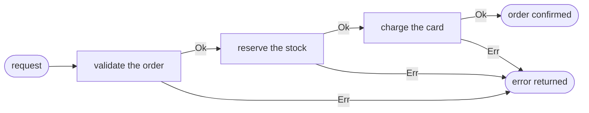

**"Define errors out of existence"** (John Ousterhout, 2018): the best error handling is sometimes to make the case disappear. In Python, `my_set.remove(x)` raises `KeyError` if `x` is missing, while `my_set.discard(x)` does nothing: the caller's goal (that `x` is no longer in the set) is reached in both cases, and the second version spares it a `try`. I design my own APIs the same way: `cancel_order()` on an already cancelled order simply returns the order, with no error.

**When to choose what**: exceptions for the unexpected and in a language where they are the norm; a result type when failure is frequent and business-related, and I want the compiler or type checker to force handling it; removing the case when the caller has nothing to do with the error anyway.

:material-book-open-variant: Reference docs: [Jim Shore, "Fail Fast", IEEE Software](https://martinfowler.com/ieeeSoftware/failFast.pdf) (2004); [Scott Wlaschin, "Railway Oriented Programming"](https://fsharpforfunandprofit.com/rop/) (2014)
{ .doc-ref }

!!! maturity "Measuring maturity"
    | Level | What I see in the team |
    |---|---|
    | N1 | some functions have guard clauses and dedicated exceptions, others still swallow errors with `except Exception: pass` |
    | N2 | shared rules are applied: fail fast at the entry, one business exception per expected error, logging once at the boundary, tolerant reader for other teams' APIs |
    | N3 | the linter refuses empty `except` blocks and cognitive complexity above a threshold; a contract test breaks CI when the provider removes a field I read |
    | N4 | the team tracks unexpected errors in production, detected swallowed errors and cognitive complexity, and adjusts its rules from those numbers |

    **I measure**: the number of unhandled exceptions per week, read in the error tracking tool; the number of functions above the cognitive complexity threshold, read in static analysis.

## Evolving code

<a class="pill pill-scope pill-scope-code" href="../architecture/#map-of-scales">Scale · Code</a> <a class="pill pill-scope pill-scope-app" href="../architecture/#map-of-scales">Scale · Application</a>

Principles matter most when I change code that already exists. This part says how to change it without breaking it: refactor in small steps, work in code without tests, and talk about the debt that slows the team down.

### Refactoring in small steps

<span class="pill pill-status pill-status-ok" title="Still valid, checked November 2026">Current · 11/2026</span>

**<span class="term" data-term="refactoring">Refactoring</span>** (Martin Fowler, "Refactoring", 1999, 2nd edition 2018) changes the structure of code without changing its observable behaviour. Fowler keeps a catalogue of them: named transformations (*Extract Function*, *Rename Variable*, *Replace Conditional with Polymorphism*), each with its safe steps. What triggers a refactoring is a <span class="term" data-term="code-smell">code smell</span> that gets in the way of the change I have to make: long function, duplication, endless parameter list.

**When**: at the moment I have to change that code, not in a separate cleanup project nobody funds. **When not**: without tests covering the behaviour (I start by writing some, see [legacy code](#changing-legacy-code)), or on a stable module nobody touches.

**How**:

- **Small steps**: rename, extract a function, move, and run the tests after each step. If a test breaks, I know it is the last minute of work, and I go back.
- **Editor tools**: automated refactorings (rename, extract) are safer than copy and paste.
- **Separate commits**: a `refactor:` commit that changes no behaviour, then a `feat:` or `fix:` commit. The reviewer checks each commit for what it claims to do.

**Preparatory refactoring.** Kent Beck summed it up in 2012: "for each desired change, make the change easy (warning: this may be hard), then make the easy change". I am asked to add shipping to Belgium. The classic to avoid: a single commit that reorganizes the rates and adds Belgium, where the reviewer can no longer tell what changes behaviour.

``` { .python .ex-good title="Recommended" }
# Example: starting point, each rate is hardcoded in a chain of if
def shipping_cost(country: str, weight_kg: float) -> float:
    if country == "FR":
        return 5 + weight_kg * 0.5
    elif country == "DE":
        return 7 + weight_kg * 0.6
    raise ValueError(country)


# What changes: commit 1, refactor, same behaviour, the existing tests stay green
RATES = {"FR": (5, 0.5), "DE": (7, 0.6)}


def shipping_cost(country: str, weight_kg: float) -> float:
    if country not in RATES:
        raise ValueError(country)
    base, per_kg = RATES[country]
    return base + weight_kg * per_kg


# What changes: commit 2, feat, one line and one test
RATES = {"FR": (5, 0.5), "DE": (7, 0.6), "BE": (6, 0.55)}
```

**The boy scout rule** (Robert C. Martin, "Clean Code", 2008, after the scout instruction to leave the campground cleaner than you found it): each time I pass through, I leave the code a little cleaner, a clarified name, an extracted function, without drifting into an off-topic rework in the same MR.

**The <span class="term" data-term="mikado-method">Mikado method</span>** (Ola Ellnestam and Daniel Brolund, "The Mikado Method", 2014) is for large refactorings, when pulling one thread moves ten. I try the target change; if it breaks, I write the prerequisites I discovered in a graph, **I revert my attempt**, and I start again from a leaf of the graph. Each leaf ships on its own, the code always stays in a working state.

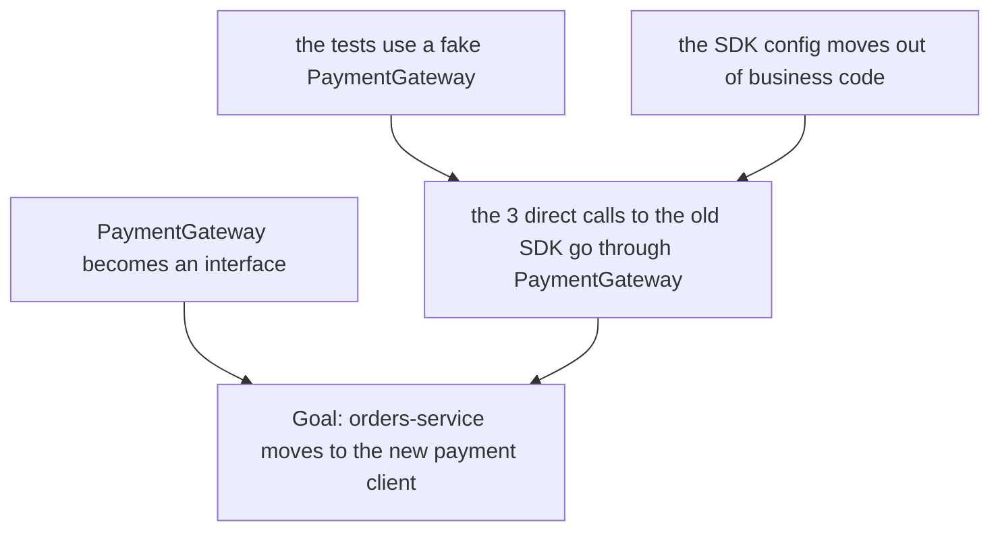

:material-book-open-variant: Reference docs: [Martin Fowler, "Refactoring catalog"](https://refactoring.com/catalog/) (accessed November 2026); [Martin Fowler, "An example of preparatory refactoring"](https://martinfowler.com/articles/preparatory-refactoring-example.html) (2015); [Ellnestam and Brolund, "The Mikado Method", Manning](https://www.manning.com/books/the-mikado-method) (2014)
{ .doc-ref }

### Changing legacy code

<span class="pill pill-status pill-status-ok" title="Still valid, checked November 2026">Current · 11/2026</span>

For Michael Feathers ("Working Effectively with Legacy Code", 2004), <span class="term" data-term="legacy-code">legacy code</span> is simply code without tests, whatever its age: I cannot change it safely, because nothing will tell me whether I broke it. The trap is that adding tests often means changing the code, and changing it would need tests.

**Feathers' legacy code change algorithm** breaks this circle in five steps:

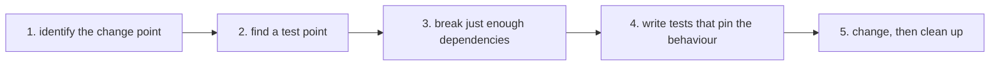

The tests of step 4 are <span class="term" data-term="characterization-test">characterization tests</span>: they record what the code does today, even if it is odd, to catch any unintended change. They are detailed on the [Quality and testing](qualite.md) page.

**The seam.** A <span class="term" data-term="seam">seam</span> is a place where I can change the behaviour of code without editing that code. The most common one in object languages: pass the troublesome dependency as a parameter, with the real implementation as default. Existing callers do not change, and my test passes a fake.

``` { .python .ex-bad title="Avoid" }
# Avoid: the carrier API and the clock are created inside the method, impossible to test without network
def checkout(cart):
    carrier = CarrierApi()
    today = date.today()
    ...
```

``` { .python .ex-good title="Recommended" }
# Good: a seam, the dependency becomes a parameter with the real value as default
def checkout(cart, carrier: Carrier | None = None, today: date | None = None):
    carrier = carrier or CarrierApi()
    today = today or date.today()
    ...
```

**<span class="term" data-term="sprout-method">Sprout Method</span> and Wrap Method** (same book). To add a "free shipping from 50 euros" rule in a 400-line `checkout()` method without tests:

- **Sprout Method**: I write the new logic in a new function, tested on its own, and call it from the old code. The old code changes by one line. *Sprout Class* is the variant when the new logic needs its own dependencies.
- **Wrap Method**: I rename the old method and create a new one with the same name, which calls the old one and adds the behaviour before or after (logging, auditing).

``` { .python .ex-bad title="Avoid" }
# Avoid: one more if in the middle of the 400 lines, impossible to test without the whole checkout
def checkout(cart):
    ...
    fee = carrier.base_fee()
    if cart.subtotal_cents >= 5000:
        fee = 0
    ...
```

``` { .python .ex-good title="Recommended" }
# Good: Sprout Method, the rule lives in a pure function tested on its own
FREE_SHIPPING_THRESHOLD_CENTS = 5000


def shipping_fee(subtotal_cents: int, base_fee_cents: int) -> int:
    if subtotal_cents >= FREE_SHIPPING_THRESHOLD_CENTS:
        return 0
    return base_fee_cents


# What changes: in checkout(), a single line calls the new function
def checkout(cart):
    ...
    fee = shipping_fee(cart.subtotal_cents, carrier.base_fee())
    ...
```

`shipping_fee` is a <span class="term" data-term="pure-function">pure function</span>: three tests (49.99 euros paid, 50 euros free, empty cart paid) cover it in a few milliseconds. The rework of `checkout()` will wait, ticket by ticket.

**When**: every time I have to change code without tests. **When not**: if the code is small and simple, I cover it directly. **Why**: I ship the feature without betting on a rewrite, and I leave a first tested area that will support the next change. To replace a whole system rather than a method, see the [Strangler Fig](textes-fondateurs.md#fowler-strangler-fig-application-2004).

**Risks.** Characterization tests freeze bugs too: if I take them for the specification, I protect a wrong behavior. When the behavior is doubtful, I write it in the test ("current, not intended"). Multiplied, seams with default values leave test parameters all over production signatures: I clean them up once the area is finally split.

:material-book-open-variant: Reference docs: [Martin Fowler, "LegacySeam"](https://martinfowler.com/bliki/LegacySeam.html) (2024), on Michael Feathers' seams
{ .doc-ref }

### Technical debt

<span class="pill pill-status pill-status-ok" title="Still valid, checked November 2026">Current · 11/2026</span>

<span class="term" data-term="technical-debt">Technical debt</span> is a metaphor by Ward Cunningham (experience report "The WyCash Portfolio Management System", OOPSLA, 1992): shipping code that is not quite right is borrowing. It goes fast at first, but there is **interest**: each change in that area costs a bit more time. As long as I pay it back (I refactor as I understand better), all is well; if I never pay back, the interest ends up eating all of the team's time.

!!! noob "As noob"
    It is a credit card: paying with it gets me the item right away, and that is no problem if I pay back quickly. What ruins me is paying only the interest month after month. And a debt on an item I never use costs me almost nothing. The one thing to remember: **a debt costs when I often touch the code concerned, not because the code is ugly.**

**Fowler's quadrant** (Martin Fowler, "TechnicalDebtQuadrant", 2009) tells where the debt comes from:

| | Reckless | Prudent |
|---|---|---|
| **Deliberate** | "we don't have time for design" | "we must ship now and deal with consequences" |
| **Inadvertent** | "what's layering?" | "now we know how we should have done it" |

Only the "prudent and deliberate" cell is a true chosen loan. The "prudent and inadvertent" cell is normal: we learn by building.

**Finding the debt that costs: <span class="term" data-term="hotspot-analysis">hotspot analysis</span>.** Adam Tornhill ("Your Code as a Crime Scene", 2015, 2nd edition 2024) crosses two measures taken from the repository: **churn** (how many times a file was changed) and its <span class="term" data-term="code-complexity">complexity</span>. A complex file nobody touches costs little; a complex file changed every week is a **hotspot**, and that is where paying back pays off.

``` { .bash .ex-ref title="Reference" }
# Example: the 10 most changed files over the last year (the churn), to cross with their complexity
git log --since="1 year ago" --name-only --format="" | sort | uniq -c | sort -rn | head -10
```

**When**: I want to convince a Product Owner to address a debt, or choose what to refactor first. **How**:

- I talk in consequences, not judgement: "each new promotion takes three days instead of one, and caused two bugs this quarter" rather than "the code is dirty" (example figures);
- I only mention the debt of an area that is often changed or about to be;
- I pay back in instalments, within the features that touch the area (preparatory refactoring), rather than in a three-week rework to sell;
- I record each significant debt in the backlog with its estimated impact, so the decision to address it or not is made knowingly.

For the debt that builds up over time anyway, see [Lehman's laws](lois-et-principes.md#lehmans-laws).

**Risks.** The word becomes a label for everything people dislike, and a debt list with no quantified impact convinces no one. Used to justify a full rewrite, the metaphor leads to the rewrite that overruns: I pay back in slices. The other way round, never paying back lets the interest absorb all of the team's time, so each new feature takes longer than the previous one.

:material-book-open-variant: Reference docs: [Ward Cunningham, "The WyCash Portfolio Management System"](http://c2.com/doc/oopsla92.html) (1992); [Martin Fowler, "TechnicalDebtQuadrant"](https://martinfowler.com/bliki/TechnicalDebtQuadrant.html) (2009); [Adam Tornhill, "Your Code as a Crime Scene", 2nd edition, Pragmatic Bookshelf](https://pragprog.com/titles/atcrime2/your-code-as-a-crime-scene-second-edition/) (2024)
{ .doc-ref }

!!! maturity "Measuring maturity"
    | Level | What I see in the team |
    |---|---|
    | N1 | one person refactors when they have time, often in big MRs that mix cleanup and features |
    | N2 | `refactor:` commits are separate from `feat:` ones, characterization tests come before any change to code without tests, and debt is noted in the backlog with its impact |
    | N3 | CI refuses an MR that lowers the coverage of changed files, and preparatory refactoring is done in every ticket that touches an area, without anyone asking |
    | N4 | the team tracks churn and complexity of hotspots and the lead time of tickets in those areas, and picks the debt to pay back from those numbers |

    **I measure**: the complexity of the ten most changed files, crossed with their churn from `git log`; the average lead time of tickets that touch those files, read in the ticket tool.

## Measuring success

I know a principle helped when changes get smaller and safer, not when the code "follows SOLID". Before reorganizing an area, I write down a baseline from its last MRs: the number of files touched per business change, regression bugs and review time. I take the same measure on the changes of the next two or three months. The guard metric is the number of files and layers to go through to follow an action: if it grows, I added over-engineering.

| Solution or situation | Success indicator (SLI) | Likely SLO | Likely SLA |
|---|---|---|---|
| single responsibility: isolate a business rule, like the VAT rate | number of modules touched by an MR that changes this rule | a single module in 90% of business MRs | n/a: no external contract |
| dependency inversion: test the domain without infrastructure | share of domain tests that run with no database or network, and suite duration | 100% of domain tests, unit suite under 2 minutes | n/a: no external contract |
| DRY, rule of three and YAGNI: avoid hasty abstractions | number of new interfaces with a single implementation and of boolean flags added to a shared function | no new single-implementation interface per quarter | n/a: no external contract |
| error handling: fail fast, no swallowed exception | number of empty or generic `except` blocks, and unexpected errors in production per week | zero empty `except`; unexpected errors halved within a quarter | API availability promised to the customer, for example 99.5% per month, looser than the internal 99.9% SLO that these errors consume |
| tolerant reader facing another team's API | number of incidents caused by a field added on the provider side | zero per quarter | n/a: no external contract |
| refactoring in small steps, separate commits | share of refactoring MRs split into `refactor:` then `feat:`, and rollback rate | 80% of MRs split, fewer than 5% rollbacks | n/a: no external contract |
| technical debt: pay back the hotspots | average lead time of a ticket that touches the ten most changed files | down 30% within two quarters | n/a: no external contract |

[Take with caution: example orders of magnitude, to set with the business]

!!! noob "As noob"
    The SLO is the rule I set for myself, like "I tidy my workshop every Friday"; the SLA is what I sign with a customer, with a penalty if I break it, like "repair delivered within ten days or a 20% discount". I always keep my internal rule stricter than my promise, to keep a margin. The takeaway: **the SLO is my internal target, the SLA is the looser commitment I sign with a customer.**

## Pitfalls to avoid

| Pitfall | What happens | Solution |
| --- | --- | --- |
| **SOLID as a checklist**: I apply the five principles everywhere, on principle. | I get one interface per class, a factory for each object, and a newcomer opens eight files to follow a single action. | I apply a principle when it answers a pain I have today, not as a list to tick. |
| **An interface for a single implementation**: I create `OrderRepositoryInterface` "just in case", while only the PostgreSQL version exists. | I have two files instead of one, and nothing is decoupled. | I add the interface the day a second implementation arrives, or a test that needs a fake. |
| **DRY across two business contexts**: billing and support each have a `Customer` with the same fields, so I merge them. | When billing wants to add a VAT number and support a priority level, each team must wait for the other's agreement to touch the shared model, which becomes a bottleneck. | I keep one `Customer` per business context, even when their fields look alike. |
| **DRY in tests**: I factor my tests with nested helpers and parameters everywhere. | The day a test breaks, I have to climb back through three functions to understand what it checked. | In a test, I put readability before avoiding repetition. |
| **Confusing dependency inversion and injection**: I believe an [injection container](design-patterns.md#injection-container) (the object that builds objects and plugs in their dependencies) is enough to protect business code from technical code. | The container does not guarantee business code does not depend on technical code. | I look at who defines the interface, because that is what matters. |
| **Inheritance to reuse code**: I inherit from a class just to use its methods, with no true "is a" relationship, like an `ArchiveRepository` inheriting from a writable repository. | Sooner or later, an inherited method no longer makes sense for the child and Liskov breaks. | I only inherit when there is a true "is a" relationship. |
| **Swallowing an exception**: I wrap a call in `try / except Exception: pass` so that "it no longer crashes". | An outage of the payment provider becomes a silent success, and orders go out "paid" without payment. | I catch only the errors I know how to handle and let the others bubble up ([Error handling](#error-handling)). |
| **Optimization without measurement**: I complicate code because I assume it is slow, without measuring it. | The real slowness is often elsewhere, and I am left with harder-to-read code for nothing. | I measure first. |

## What interviews ask

Typical questions:

- "Explain SOLID, give an example for each letter", "Explain Liskov", "How do you apply SOLID without over-engineering?" How I answer: I give for each letter the symptom it cures, like the square that inherits from the rectangle and breaks the area test for Liskov, and I wait for a real need (a second implementation, a test that calls for a fake) before adding an interface ([SOLID](#solid), [L: Liskov substitution](#l-liskov-substitution), [Pitfalls to avoid](#pitfalls-to-avoid)).
- "When is duplication better than an abstraction?", "Composition or inheritance?" How I answer: I keep the duplication as long as the two pieces of code represent different rules or I do not have three examples, and I prefer composition, which can be changed and tested separately, to inheritance, which ties the child to the whole parent ([DRY, WET and AHA](#dry-wet-and-aha), [YAGNI and rule of three](#yagni-and-rule-of-three), [Composition over inheritance](#composition-over-inheritance)).
- "Should design principles be imposed on several teams?", "How do you make code maintainable?", "When should you create a shared library?" How I answer: I share principles as a review vocabulary, with the STUPID list, rather than as an imposed rule, I aim for high cohesion and low coupling, and I create a shared library only when several teams really need the same code ([STUPID](#stupid-the-six-smells-to-avoid), [Separation of concerns, cohesion and coupling](#separation-of-concerns-cohesion-and-coupling), [Component principles](#component-principles)).
- "How do you design an internal library, SDK or CLI that evolves without breaking its users?" How I answer: I publish each release with a version number and a changelog, I keep dependencies free of cycles and pointing to something more stable than me, and I assume every visible behaviour will end up being used ([Component principles](#component-principles), [Principle of least astonishment](#principle-of-least-astonishment), and [Hyrum's law](lois-et-principes.md#hyrums-law)).
- "Do you apply SOLID and DRY to test code?", "DRY or DAMP in tests?" How I answer: I apply SOLID to test tooling, like a fake that implements only what the test calls, but in the body of a test I prefer DAMP (descriptive phrases, even if they repeat), because a test must read on its own without climbing through three helpers ([I: interface segregation](#i-interface-segregation), [Pitfalls to avoid](#pitfalls-to-avoid)).

- "How do you handle errors?", "Exceptions or a result type?" How I answer: I separate expected business errors, handled as a normal result, from outages, which I let bubble up to the boundary where I log them once; I fail early on invalid input and never swallow an exception ([Error handling](#error-handling), [Design by contract](#design-by-contract)).
- "How do you change legacy code without tests?", "When do you refactor?" How I answer: I look for a test point, create a minimal seam, pin the behaviour with characterization tests, then sprout the new logic in a tested function; I refactor when I have to change the code, in small steps and separate commits ([Changing legacy code](#changing-legacy-code), [Refactoring in small steps](#refactoring-in-small-steps)).
- "How do you talk about technical debt with the Product Owner?" How I answer: I put a figure on what it costs in delays and bugs, I only mention the debt of often-changed areas (the hotspots) and I propose paying it back in instalments within planned features ([Technical debt](#technical-debt)).
- "How do you prove that a refactoring or a design principle improved the code?" How I answer: I compare before and after the number of files touched per business change, regression bugs and ticket lead time, with a guard metric on the number of layers to go through to follow an action ([Measuring success](#measuring-success)).

What makes a good answer: name the principle, give a lived (or realistic) example, then say **when it does not apply**. That last part is what sets an experienced answer apart from a learned one.

## Which principle for which need

| I want... | I use... |
|---|---|
| a marketing request on the invoice, like showing amounts without cents, to be unable to change the total the accountant bills, because both go through the same rounding method | single responsibility |
| to add a shipping mode, like pickup at a relay point, without reopening the cost function that already works | open/closed (often via Strategy) |
| to be sure code receiving an `OrderRepository` does not crash when given a subclass, like a read-only archive repository | Liskov substitution |
| my test fake not to implement fifteen methods when the test calls only one | interface segregation |
| to test the "place an order" rule without starting a database or calling the network | dependency inversion, with injection |
| to spot quickly, while reviewing an MR, what will make the code hard to test or evolve | the STUPID list |
| to choose between two working solutions, thinking of the colleague who will have to reread them | KISS |
| to know whether two pieces of code that look alike should be merged, or whether they represent two different rules | DRY (knowledge, not text) and rule of three |
| to resist adding an export or an option "because we will surely need it" | YAGNI |
| to stop writing `order.get_customer().get_address().get_city()`, which breaks as soon as one of those classes changes, like the day `Customer` moves to several addresses | Law of Demeter, Tell, don't ask |
| to send a report by email, as PDF or both, without one subclass per combination | composition over inheritance |
| to know where to put a computation, like an order total: in `Order` or in a separate class | GRASP (Information Expert) |
| to split a library shared by several teams, or a monorepo, without every change forcing everyone to follow | component principles (CCP, ADP, SDP) |
| a less dogmatic criterion than SOLID, to judge code without ticking a list | CUPID |
| the users of my API or CLI not to get trapped, like by a `--dry-run` that still writes | least astonishment |
| to read a function whose real computation hides under three levels of `if` | guard clauses |
| to spare every caller of my repository from chaining connection, transaction and commit in the right order | deep module |
| to say clearly who must check that a withdrawal amount is positive: the caller or the method | design by contract |
| my service not to break when another team adds a field to its API response | Tolerant Reader |
| a payment provider outage not to turn an order into "paid", while handling a declined card as a normal case | error handling (expected or not, fail fast, result type) |
| to add a shipping country without mixing the rate reorganization and the new rate in the same commit | preparatory refactoring, in small steps |
| to add a rule in a 400-line method without tests, without rewriting it | seam, Sprout Method, characterization tests |
| to convince a Product Owner to address a debt, starting with the files that really cost | technical debt, hotspot analysis |

## Sources

- Robert C. Martin, "Design Principles and Design Patterns" (2000)
- Robert C. Martin, "Agile Software Development, Principles, Patterns, and Practices" (2002)
- Robert C. Martin, "Clean Architecture" (2017)
- [Robert C. Martin, "The Single Responsibility Principle" (2014)](https://blog.cleancoder.com/uncle-bob/2014/05/08/SingleReponsibilityPrinciple.html)
- Bertrand Meyer, "Object-Oriented Software Construction" (1988)
- Barbara Liskov, "Data Abstraction and Hierarchy", OOPSLA keynote (1987)
- [Barbara Liskov and Jeannette Wing, "A Behavioral Notion of Subtyping" (1994)](https://dl.acm.org/doi/10.1145/197320.197383)
- [William Durand, "From STUPID to SOLID Code!" (2013, date to check)](https://williamdurand.fr/2013/07/30/from-stupid-to-solid-code/)
- Andy Hunt and Dave Thomas, "The Pragmatic Programmer" (1999, 2nd edition 2019)
- [Sandi Metz, "The Wrong Abstraction" (2016)](https://sandimetz.com/blog/2016/1/20/the-wrong-abstraction)
- [Kent C. Dodds, "AHA Programming" (publication date not given)](https://kentcdodds.com/blog/aha-programming)
- Martin Fowler, "Refactoring" (1999, 2nd edition 2018), for the rule of three
- Karl Lieberherr, Ian Holland and Arthur Riel, "Object-Oriented Programming: An Objective Sense of Style", OOPSLA (1988), for the Law of Demeter
- [Martin Fowler, "TellDontAsk" (2013)](https://martinfowler.com/bliki/TellDontAsk.html)
- Erich Gamma, Richard Helm, Ralph Johnson and John Vlissides, "Design Patterns" (1994)
- Edsger W. Dijkstra, "On the role of scientific thought", EWD447 (1974)
- Craig Larman, "Applying UML and Patterns" (1997)
- [Dan North, "CUPID: for joyful coding" (2022)](https://dannorth.net/blog/cupid-for-joyful-coding/)
- Donald Knuth, "Structured Programming with go to Statements" (1974)
- Joshua Bloch, "Effective Java", 3rd edition (2018), for the fragile base class
- Kent Beck, "Extreme Programming Explained" (1999), for the four rules of simple design
- [Martin Fowler, "BeckDesignRules" (2015)](https://martinfowler.com/bliki/BeckDesignRules.html)
- [John Ousterhout, "A Philosophy of Software Design" (2018, 2nd edition 2021)](https://web.stanford.edu/~ouster/cgi-bin/book.php)
- [Martin Fowler, "TolerantReader" (2011)](https://martinfowler.com/bliki/TolerantReader.html)
- [Jim Shore, "Fail Fast", IEEE Software (2004)](https://martinfowler.com/ieeeSoftware/failFast.pdf)
- [Scott Wlaschin, "Railway Oriented Programming" (2014)](https://fsharpforfunandprofit.com/rop/)
- Robert C. Martin, "Clean Code" (2008), for the boy scout rule
- [Martin Fowler, "An example of preparatory refactoring" (2015)](https://martinfowler.com/articles/preparatory-refactoring-example.html)
- [Ola Ellnestam and Daniel Brolund, "The Mikado Method" (2014)](https://www.manning.com/books/the-mikado-method)
- Michael Feathers, "Working Effectively with Legacy Code" (2004)
- [Martin Fowler, "LegacySeam" (2024)](https://martinfowler.com/bliki/LegacySeam.html)
- [Ward Cunningham, "The WyCash Portfolio Management System", OOPSLA (1992)](http://c2.com/doc/oopsla92.html)
- [Martin Fowler, "TechnicalDebtQuadrant" (2009)](https://martinfowler.com/bliki/TechnicalDebtQuadrant.html)
- [Adam Tornhill, "Your Code as a Crime Scene" (2015, 2nd edition 2024)](https://pragprog.com/titles/atcrime2/your-code-as-a-crime-scene-second-edition/)
