# Principes de conception

!!! warning "Avertissement"
    Ces notes sont des pense-bêtes personnels, pas une source de vérité. Elles reflètent ma compréhension et mes choix : leur contenu reste subjectif, malgré les citations et les références qu'il contient. Il peut être incomplet, simplifié, inexact ou dépassé. Vérifiez toujours dans la documentation officielle avant de l'appliquer. Ce contenu est fourni tel quel, sans aucune garantie : son utilisation se fait sous votre seule responsabilité.

!!! audience "Pour qui, pour quoi"
    - **Métiers** : développeur back-end, développeur front-end, QA en automatisation de tests, tech lead, architecte...
    - **Usages** : je prépare un entretien où l'on me demande « explique SOLID avec un exemple par lettre », je relis une MR qui ajoute une interface pour une seule implémentation et je veux dire pourquoi c'est trop tôt, je découpe une classe `OrderManager` qui change pour trois raisons, je décide si deux fonctions qui se ressemblent doivent être fusionnées...

!!! abstract "Les échelles"
    Les pastilles de couleur sous les titres disent à quelle échelle une notion s'applique :

    - <span class="pill pill-scope pill-scope-code">Code</span> les classes, fonctions et modules d'un programme ;
    - <span class="pill pill-scope pill-scope-app">Application</span> un service ou une application et son découpage interne ;
    - <span class="pill pill-scope pill-scope-system">Système</span> plusieurs services qui communiquent par le réseau ;
    - <span class="pill pill-scope pill-scope-infra">Infrastructure</span> les serveurs, le réseau, les zones et les clusters, physiques ou virtuels ;
    - <span class="pill pill-scope pill-scope-enterprise">Entreprise</span> le système d'information entier et son organisation.

    Détail et mots ambigus : [carte des échelles](architecture.md#carte-des-echelles).

Un **principe de conception** est une règle de bon sens, nommée, qui aide à décider comment découper et relier le code. Contrairement à un [design pattern](design-patterns.md), ce n'est pas une forme de solution : c'est un critère pour juger une solution. « Cette classe change pour trois raisons » ou « ce test est impossible à écrire sans base de données » sont des constats que les principes permettent de nommer.

Cette page présente SOLID, son contraire STUPID, puis les principes voisins (KISS, DRY, YAGNI, Déméter, composition plutôt qu'héritage...), les détails de conception (clauses de garde, modules profonds, contrats, gestion des erreurs) et la façon de faire évoluer un code existant (refactoring, code legacy, dette technique). Les exemples sont courts, avec le même code en PHP, Python et Java. Les noms des services et des données sont fictifs.

!!! tip "Choisir le langage"
    Je clique sur un langage : **tous les exemples de la page** passent dans ce langage, et le choix est gardé d'une page à l'autre.

=== "PHP"

    Exemples affichés en **PHP 8.3** (classes `readonly`, `match`, enums).

=== "Python"

    Exemples affichés en **Python 3.12** (`Protocol`, `dataclass`, annotations de type).

=== "Java"

    Exemples affichés en **Java 21** (`record`, `switch` en expression, `enum`).

## Vocabulaire

**<span class="term" data-term="interface-code">Interface</span>** : un contrat qui liste des méthodes sans les écrire. Toute classe qui l'implémente promet de les fournir.

**Abstraction** : ce qu'un code appelant voit d'un autre code (une interface, une fonction, une classe de base), en ignorant les détails derrière.

**<span class="term" data-term="coupling">Couplage</span>** : à quel point un morceau de code dépend des détails d'un autre. Fort couplage : changer l'un oblige à changer l'autre.

**<span class="term" data-term="cohesion">Cohésion</span>** : à quel point ce qui est rangé ensemble (dans une classe, un module) sert le même but. Forte cohésion : tout ce qui est dans `InvoiceCalculator` parle de calcul de facture.

**<span class="term" data-term="code-smell">Code smell</span>** : un signe, dans le code, qu'un problème de conception est probable. Ce n'est pas un bug, c'est une odeur qui invite à regarder de plus près.

**<span class="term" data-term="over-engineering">Sur-ingénierie</span>** : ajouter des couches, des interfaces ou des options pour des besoins qui n'existent pas encore.

**Principe ou règle** : un principe se discute selon le contexte. Aucun de ceux de cette page n'est une loi : chacun a un coût, et un bon relecteur sait dire quand il ne s'applique pas.

**<span class="term" data-term="sli">SLI</span>** (Service Level Indicator, indicateur de niveau de service) : le chiffre que je mesure pour savoir si une solution marche, par exemple le nombre de fichiers touchés pour changer le taux de TVA.

**<span class="term" data-term="slo">SLO</span>** (Service Level Objective, objectif de niveau de service) : la cible interne que je me fixe sur ce chiffre, par exemple « un seul module touché pour un changement de règle métier, dans 9 MR sur 10 ».

**<span class="term" data-term="sla">SLA</span>** (Service Level Agreement, accord de niveau de service) : la promesse contractuelle faite à un client, avec une pénalité si elle n'est pas tenue, en général plus lâche que le SLO. Un principe de conception est une pratique interne : il n'a pas de SLA, sauf indirectement quand il sert un engagement client, comme la disponibilité d'une API.

## SOLID

<a class="pill pill-scope pill-scope-code" href="../architecture/#carte-des-echelles">Échelle · Code</a>

<a class="pill pill-practice" href="../livraison/#concevoir-avant-de-coder">Pratique · Conception technique</a>
<a class="pill pill-dora" href="https://dora.dev/capabilities/code-maintainability/">DORA · Code maintainability</a>


**<span class="term" data-term="solid">SOLID</span>** regroupe cinq principes de conception objet décrits par Robert C. Martin dans l'article « Design Principles and Design Patterns » (2000), puis dans le livre « Agile Software Development, Principles, Patterns, and Practices » (2002). L'acronyme lui-même est attribué à Michael Feathers, vers 2004 (date à vérifier). Plusieurs principes sont plus anciens : l'ouvert/fermé vient de Bertrand Meyer (« Object-Oriented Software Construction », 1988), la substitution de Barbara Liskov (conférence « Data Abstraction and Hierarchy », 1987, puis Liskov et Wing, 1994).

Ils servent surtout à une chose : **faire qu'un changement ne touche qu'un seul endroit du code**. Quand le comptable change le taux de TVA, je veux modifier un seul fichier, pas dix. Et quand mon équipe change de fournisseur d'e-mail ou de base de données, la règle métier ne doit pas bouger d'une ligne : si le calcul des factures et l'appel à la base sont dans la même méthode, chaque migration technique me fait rouvrir le calcul, avec le risque de le casser.

:material-book-open-variant: Doc de référence : [Robert C. Martin, « Solid Relevance »](https://blog.cleancoder.com/uncle-bob/2020/10/18/Solid-Relevance.html) (2020)
{ .doc-ref }

### S : responsabilité unique

<span class="pill pill-status pill-status-ok" title="Toujours valable, vérifié en novembre 2026">Valable · 11/2026</span>

**Définition** : la <span class="term" data-term="single-responsibility">responsabilité unique</span> (*Single Responsibility Principle*) dit qu'une classe ne doit avoir qu'une seule raison de changer. Robert C. Martin l'a reformulée plus tard : un module ne doit répondre qu'à un seul acteur (une seule personne ou équipe qui demande des changements).

!!! noob "As noob"
    Responsabilité unique ne veut pas dire « une seule méthode » : ça veut dire qu'une seule personne a des raisons de demander un changement. Si le comptable (le total facturé) et le marketing (l'affichage de la facture) font modifier la même classe, leurs méthodes finissent souvent par partager un bout de code, et la retouche demandée par l'un fausse en silence le résultat de l'autre. La phrase à retenir : **une classe, une seule raison de changer.**

**Symptôme** : une classe que deux équipes font modifier, pour des raisons sans rapport, et dont les méthodes partagent du code. `InvoiceService` calcule le total facturé pour le comptable et affiche la facture pour le marketing, et les deux appellent la même méthode privée d'arrondi. Le marketing demande d'afficher les montants sans centimes ; un développeur arrondit à l'euro dans cette méthode commune, et le total facturé perd ses centimes lui aussi, sans que le comptable l'ait demandé ni que le test de la page le voie. Robert C. Martin décrit le même mécanisme avec une classe `Employee` dans « Clean Architecture » (2017) : deux méthodes demandées par deux directions différentes partagent un calcul d'heures, et la modification voulue par l'une fausse les chiffres de l'autre.

**Exemple** : avant, `InvoiceService` calcule le total pour le comptable et met en page la facture pour le marketing, et les deux passent par la même méthode d'arrondi. Après, deux classes, chacune avec son propre arrondi et une seule raison de changer.

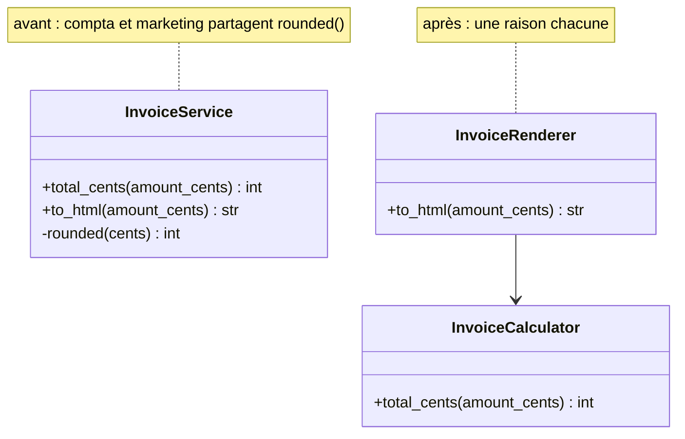

=== "PHP"

    ``` { .php .ex-bad title="À éviter" }
    <?php

    final class InvoiceService
    {
        // À éviter : total demandé par le comptable, calculé via le rounded() partagé
        public function totalCents(int $amountCents): int
        {
            return $this->rounded($amountCents * 1.20);
        }

        // À éviter : affichage demandé par le marketing, via le même rounded()
        public function toHtml(int $amountCents): string
        {
            return "<h1>Facture</h1><p>" . $this->rounded($amountCents * 1.20) / 100 . " €</p>";
        }

        // À éviter : l'arrondir à l'euro pour l'affichage change aussi le total facturé
        private function rounded(float $cents): int
        {
            return (int) round($cents);
        }
    }
    ```

    ``` { .php .ex-good title="Recommandé" }
    <?php

    // Ce qui change : la compta a sa classe, le total reste arrondi au centime
    final class InvoiceCalculator
    {
        public function totalCents(int $amountCents): int
        {
            return (int) round($amountCents * 1.20);
        }
    }

    // Ce qui change : le marketing arrondit l'affichage à l'euro, chez lui seulement
    final class InvoiceRenderer
    {
        public function __construct(private readonly InvoiceCalculator $calculator) {}

        public function toHtml(int $amountCents): string
        {
            return "<h1>Facture</h1><p>" . round($this->calculator->totalCents($amountCents) / 100) . " €</p>";
        }
    }
    ```

=== "Python"

    ``` { .python .ex-bad title="À éviter" }
    class InvoiceService:
        # À éviter : total demandé par le comptable, calculé via le rounded() partagé
        def total_cents(self, amount_cents: int) -> int:
            return self._rounded(amount_cents * 1.20)

        # À éviter : affichage demandé par le marketing, via le même rounded()
        def to_html(self, amount_cents: int) -> str:
            return f"<h1>Facture</h1><p>{self._rounded(amount_cents * 1.20) / 100} €</p>"

        # À éviter : l'arrondir à l'euro pour l'affichage change aussi le total facturé
        def _rounded(self, cents: float) -> int:
            return round(cents)
    ```

    ``` { .python .ex-good title="Recommandé" }
    # Ce qui change : la compta a sa classe, le total reste arrondi au centime
    class InvoiceCalculator:
        def total_cents(self, amount_cents: int) -> int:
            return round(amount_cents * 1.20)


    # Ce qui change : le marketing arrondit l'affichage à l'euro, chez lui seulement
    class InvoiceRenderer:
        def __init__(self, calculator: InvoiceCalculator) -> None:
            self._calculator = calculator

        def to_html(self, amount_cents: int) -> str:
            return f"<h1>Facture</h1><p>{round(self._calculator.total_cents(amount_cents) / 100)} €</p>"
    ```

=== "Java"

    ``` { .java .ex-bad title="À éviter" }
    final class InvoiceService {
        // À éviter : total demandé par le comptable, calculé via le rounded() partagé
        int totalCents(int amountCents) { return rounded(amountCents * 1.20); }
        // À éviter : affichage demandé par le marketing, via le même rounded()
        String toHtml(int amountCents) { return "<h1>Facture</h1><p>" + rounded(amountCents * 1.20) / 100.0 + " €</p>"; }
        // À éviter : l'arrondir à l'euro pour l'affichage change aussi le total facturé
        private int rounded(double cents) { return (int) Math.round(cents); }
    }
    ```

    ``` { .java .ex-good title="Recommandé" }
    // Ce qui change : la compta a sa classe, le total reste arrondi au centime
    final class InvoiceCalculator {
        int totalCents(int amountCents) { return (int) Math.round(amountCents * 1.20); }
    }

    // Ce qui change : le marketing arrondit l'affichage à l'euro, chez lui seulement
    final class InvoiceRenderer {
        private final InvoiceCalculator calculator;
        InvoiceRenderer(InvoiceCalculator calculator) { this.calculator = calculator; }
        String toHtml(int amountCents) { return "<h1>Facture</h1><p>" + Math.round(calculator.totalCents(amountCents) / 100.0) + " €</p>"; }
    }
    ```

La première version (`InvoiceService`) est l'« avant » : le total et l'affichage passent par la même méthode d'arrondi. Les deux classes suivantes sont l'« après » : le marketing a obtenu ses montants sans centimes dans `InvoiceRenderer`, et le total calculé par `InvoiceCalculator` n'a pas bougé.

**Quand ne pas l'appliquer** : quand les deux responsabilités changent toujours ensemble, ou quand la classe fait vingt lignes. Découper trop tôt disperse une logique simple dans cinq fichiers.

:material-book-open-variant: Doc de référence : [Robert C. Martin, « The Single Responsibility Principle »](https://blog.cleancoder.com/uncle-bob/2014/05/08/SingleReponsibilityPrinciple.html) (2014)
{ .doc-ref }

### O : ouvert/fermé

<span class="pill pill-status pill-status-ok" title="Toujours valable, vérifié en novembre 2026">Valable · 11/2026</span>

**Définition** : le principe <span class="term" data-term="open-closed">ouvert/fermé</span> (*Open/Closed Principle*, Bertrand Meyer, 1988) dit qu'un module doit être ouvert à l'extension mais fermé à la modification : on ajoute un comportement en ajoutant du code, sans modifier le code qui marche déjà.

!!! noob "As noob"
    Je pense à une multiprise : pour brancher un nouvel appareil, j'ajoute une fiche, je ne rouvre pas le mur pour refaire l'électricité. Il reste en général une ligne à ajouter là où l'on choisit le cas, mais le code qui marche n'est pas réécrit. La phrase à retenir : **ajouter un cas, c'est ajouter du code, pas modifier celui qui marche.**

**Symptôme** : un `switch` ou un `if/elif` sur un type, qui grossit à chaque nouveau cas. Pour ajouter le point relais, je rouvre la fonction qui calcule déjà le standard et l'express : une erreur dans la branche voisine, et c'est le tarif express qui change, alors que personne n'a demandé d'y toucher.

**Exemple** : avant, un `match` sur le mode de livraison. Après, chaque mode est une classe (le pattern [Strategy](design-patterns-comportement.md#strategy-strategie)) : ajouter `Relay` ne touche pas au calcul existant.

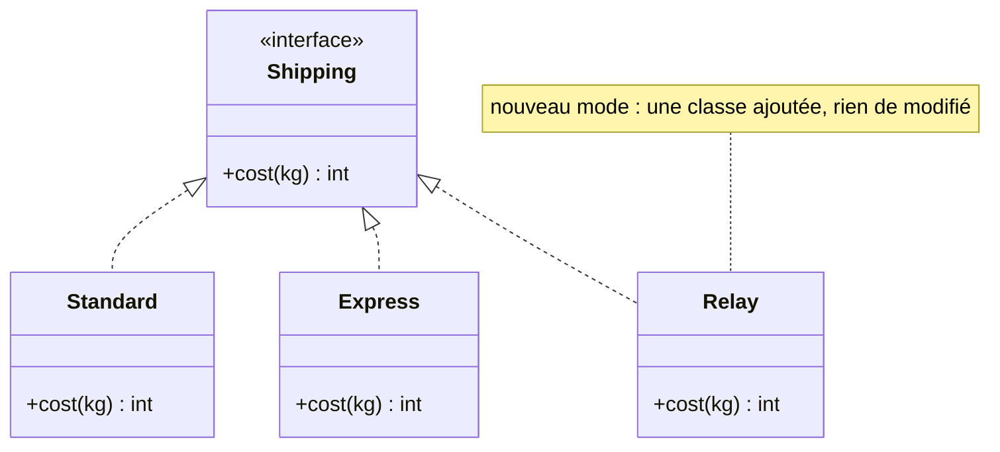

=== "PHP"

    ``` { .php .ex-bad title="À éviter" }
    <?php

    // À éviter : chaque nouveau mode rouvre ce calcul qui marche déjà
    function shippingCost(string $mode, float $kg): int
    {
        return match ($mode) {
            'standard' => 500 + (int) ($kg * 100),
            'express' => 1500 + (int) ($kg * 200),
        };
    }
    ```

    ``` { .php .ex-good title="Recommandé" }
    <?php

    // Bien : le contrat commun, chaque mode l'implémente
    interface Shipping
    {
        public function cost(float $kg): int;
    }

    // Ce qui change : le mode standard devient sa propre classe
    final class Standard implements Shipping
    {
        public function cost(float $kg): int { return 500 + (int) ($kg * 100); }
    }

    // Ce qui change : le point relais s'ajoute sans toucher aux autres modes
    final class Relay implements Shipping
    {
        public function cost(float $kg): int { return 300; }
    }
    ```

=== "Python"

    ``` { .python .ex-bad title="À éviter" }
    from typing import Protocol


    # À éviter : chaque nouveau mode rouvre ce calcul qui marche déjà
    def shipping_cost(mode: str, kg: float) -> int:
        match mode:
            case "standard":
                return 500 + int(kg * 100)
            case "express":
                return 1500 + int(kg * 200)
        raise ValueError(mode)
    ```

    ``` { .python .ex-good title="Recommandé" }
    # Bien : le contrat commun, chaque mode l'implémente
    class Shipping(Protocol):
        def cost(self, kg: float) -> int: ...


    # Ce qui change : le mode standard devient sa propre classe
    class Standard:
        def cost(self, kg: float) -> int:
            return 500 + int(kg * 100)


    # Ce qui change : le point relais s'ajoute sans toucher aux autres modes
    class Relay:
        def cost(self, kg: float) -> int:
            return 300
    ```

=== "Java"

    ``` { .java .ex-bad title="À éviter" }
    // À éviter : chaque nouveau mode rouvre ce calcul qui marche déjà
    static int shippingCost(String mode, double kg) {
        return switch (mode) {
            case "standard" -> 500 + (int) (kg * 100);
            case "express" -> 1500 + (int) (kg * 200);
            default -> throw new IllegalArgumentException(mode);
        };
    }
    ```

    ``` { .java .ex-good title="Recommandé" }
    // Bien : le contrat commun, chaque mode l'implémente
    interface Shipping { int cost(double kg); }

    // Ce qui change : le mode standard devient sa propre classe
    final class Standard implements Shipping {
        public int cost(double kg) { return 500 + (int) (kg * 100); }
    }

    // Ce qui change : le point relais s'ajoute sans toucher aux autres modes
    final class Relay implements Shipping {
        public int cost(double kg) { return 300; }
    }
    ```

**Quand ne pas l'appliquer** : deux cas stables qui ne bougeront pas. Un `match` de trois lignes se lit mieux que trois classes. On ouvre le code au moment où le troisième cas arrive (voir la <span class="term" data-term="rule-of-three">règle de trois</span>).

:material-book-open-variant: Doc de référence : [Robert C. Martin, « The Open Closed Principle »](https://blog.cleancoder.com/uncle-bob/2014/05/12/TheOpenClosedPrinciple.html) (2014)
{ .doc-ref }

### L : substitution de Liskov

<span class="pill pill-status pill-status-ok" title="Toujours valable, vérifié en novembre 2026">Valable · 11/2026</span>

**Définition** : le principe de <span class="term" data-term="liskov-substitution">substitution de Liskov</span> dit qu'un objet d'une sous-classe doit pouvoir remplacer un objet de la classe parente **sans que le code appelant s'en aperçoive**. Formulé par Barbara Liskov en 1987, précisé avec Jeannette Wing en 1994. En pratique, une sous-classe :

- ne doit pas exiger plus que le parent (pas de **précondition** plus forte : le parent accepte tout montant positif, l'enfant ne peut pas refuser ceux au-dessus de 100) ;
- doit garantir au moins autant que le parent (pas de **postcondition** plus faible : si le parent promet d'enregistrer, l'enfant ne peut pas ignorer silencieusement) ;
- ne doit pas lever d'exception que le parent ne prévoit pas.

!!! noob "As noob"
    Si on me prête une voiture de remplacement, je dois pouvoir la conduire sans relire le manuel : volant, pédales et freins marchent pareil. Une voiture dont la pédale de frein accélère a la bonne forme mais trahit la promesse. La phrase à retenir : **une sous-classe tient toutes les promesses du parent, pas seulement ses noms de méthodes.**

**Symptôme** : des `instanceof` ou `isinstance` dans le code appelant pour traiter un cas à part, ou une méthode héritée qui lève « non pris en charge ». L'exemple classique est le carré qui hérite du rectangle : `setWidth(5)` sur un carré change aussi la hauteur, et un test « aire = largeur x hauteur » écrit pour le rectangle échoue.

**Exemple** : un dépôt en lecture seule qui hérite d'un dépôt modifiable et lève une exception sur `save()`. Le code qui annule une commande reçoit un `OrderRepository` et appelle `save()` : le jour où on lui passe le dépôt d'archives, il plante à l'exécution, alors que son type disait que tout allait bien. La correction : séparer la lecture de l'écriture, la version lecture seule n'implémente que la lecture.

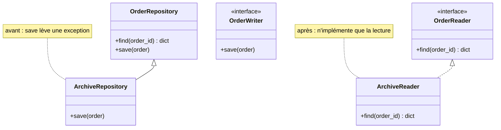

=== "PHP"

    ``` { .php .ex-illus title="Illustration" }
    <?php

    // Exemple : le dépôt modifiable, qui promet la lecture et l'écriture
    class OrderRepository
    {
        public function find(string $id): ?array { return null; }
        public function save(array $order): void { }
    }
    ```

    ``` { .php .ex-bad title="À éviter" }
    <?php

    // À éviter : hérite de save() mais le fait planter, Liskov est cassé
    final class ArchiveRepository extends OrderRepository
    {
        public function save(array $order): void
        {
            throw new LogicException('lecture seule');
        }
    }
    ```

    ``` { .php .ex-good title="Recommandé" }
    <?php

    // Ce qui change : la lecture a son propre contrat
    interface OrderReader
    {
        public function find(string $id): ?array;
    }

    // Ce qui change : l'écriture aussi, à part
    interface OrderWriter
    {
        public function save(array $order): void;
    }

    // Bien : l'archive n'implémente que la lecture, aucune promesse trahie
    final class ArchiveReader implements OrderReader
    {
        public function find(string $id): ?array { return null; }
    }
    ```

=== "Python"

    ``` { .python .ex-illus title="Illustration" }
    from typing import Protocol


    # Exemple : le dépôt modifiable, qui promet la lecture et l'écriture
    class OrderRepository:
        def find(self, order_id: str) -> dict | None:
            return None

        def save(self, order: dict) -> None:
            pass
    ```

    ``` { .python .ex-bad title="À éviter" }
    # À éviter : hérite de save() mais le fait planter, Liskov est cassé
    class ArchiveRepository(OrderRepository):
        def save(self, order: dict) -> None:
            raise NotImplementedError("lecture seule")
    ```

    ``` { .python .ex-good title="Recommandé" }
    # Ce qui change : la lecture a son propre contrat
    class OrderReader(Protocol):
        def find(self, order_id: str) -> dict | None: ...


    # Ce qui change : l'écriture aussi, à part
    class OrderWriter(Protocol):
        def save(self, order: dict) -> None: ...


    # Bien : l'archive n'implémente que la lecture, aucune promesse trahie
    class ArchiveReader:
        def find(self, order_id: str) -> dict | None:
            return None
    ```

=== "Java"

    ``` { .java .ex-illus title="Illustration" }
    // Exemple : le dépôt modifiable, qui promet la lecture et l'écriture
    class OrderRepository {
        Optional<Order> find(String id) { return Optional.empty(); }
        void save(Order order) { }
    }
    ```

    ``` { .java .ex-bad title="À éviter" }
    // À éviter : hérite de save() mais le fait planter, Liskov est cassé
    final class ArchiveRepository extends OrderRepository {
        @Override
        void save(Order order) { throw new UnsupportedOperationException("lecture seule"); }
    }
    ```

    ``` { .java .ex-good title="Recommandé" }
    // Ce qui change : la lecture a son propre contrat
    interface OrderReader { Optional<Order> find(String id); }
    // Ce qui change : l'écriture aussi, à part
    interface OrderWriter { void save(Order order); }

    // Bien : l'archive n'implémente que la lecture, aucune promesse trahie
    final class ArchiveReader implements OrderReader {
        public Optional<Order> find(String id) { return Optional.empty(); }
    }
    ```

**Quand ne pas l'appliquer** : il n'y a pas vraiment de cas où on le viole volontairement. En revanche, il n'impose pas l'héritage : si la substitution est difficile, c'est souvent le signe qu'il ne fallait pas hériter (voir [composition plutôt qu'héritage](#composition-plutot-quheritage)).

:material-book-open-variant: Doc de référence : [Barbara Liskov et Jeannette Wing, « A Behavioral Notion of Subtyping »](https://dl.acm.org/doi/10.1145/197320.197383) (1994)
{ .doc-ref }

### I : ségrégation des interfaces

<span class="pill pill-status pill-status-ok" title="Toujours valable, vérifié en novembre 2026">Valable · 11/2026</span>

**Définition** : la <span class="term" data-term="interface-segregation">ségrégation des interfaces</span> (*Interface Segregation Principle*) dit qu'un client ne doit pas dépendre de méthodes qu'il n'utilise pas. Mieux vaut plusieurs petites interfaces ciblées qu'une grosse interface « à tout faire ».

!!! noob "As noob"
    Celui qui veut seulement changer de chaîne n'a pas besoin d'une télécommande à 60 boutons, et celui qui fabrique la télécommande ne devrait pas avoir à câbler les 60 pour en faire marcher un. La phrase à retenir : **plusieurs petites interfaces ciblées valent mieux qu'une grosse.**

**Symptôme** : des implémentations remplies de méthodes vides ou qui lèvent « non pris en charge ». Un faux pour les tests (un <span class="term" data-term="test-double">double de test</span> : un objet simplifié qui remplace le vrai pendant le test, voir [D : inversion des dépendances](#d-inversion-des-dependances)) qui doit implémenter quinze méthodes alors que le test n'en appelle qu'une.

**Exemple** : avant, une interface `Notifier` avec `sendEmail`, `sendSms` et `sendPush`. Le service SMS doit implémenter les trois. Après, une interface par besoin.

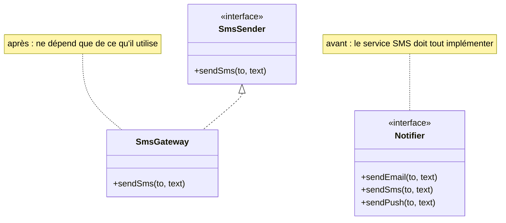

=== "PHP"

    ``` { .php .ex-bad title="À éviter" }
    <?php

    // À éviter : chaque implémentation doit fournir les trois canaux
    interface Notifier
    {
        public function sendEmail(string $to, string $text): void;
        public function sendSms(string $to, string $text): void;
        public function sendPush(string $to, string $text): void;
    }
    ```

    ``` { .php .ex-good title="Recommandé" }
    <?php

    // Ce qui change : une interface pour le seul besoin SMS
    interface SmsSender
    {
        public function sendSms(string $to, string $text): void;
    }

    // Bien : le service SMS n'implémente que ce qu'il utilise
    final class SmsGateway implements SmsSender
    {
        public function sendSms(string $to, string $text): void { }
    }
    ```

=== "Python"

    ``` { .python .ex-bad title="À éviter" }
    from typing import Protocol


    # À éviter : chaque implémentation doit fournir les trois canaux
    class Notifier(Protocol):
        def send_email(self, to: str, text: str) -> None: ...
        def send_sms(self, to: str, text: str) -> None: ...
        def send_push(self, to: str, text: str) -> None: ...
    ```

    ``` { .python .ex-good title="Recommandé" }
    # Ce qui change : une interface pour le seul besoin SMS
    class SmsSender(Protocol):
        def send_sms(self, to: str, text: str) -> None: ...


    # Bien : le service SMS n'implémente que ce qu'il utilise
    class SmsGateway:
        def send_sms(self, to: str, text: str) -> None:
            pass
    ```

=== "Java"

    ``` { .java .ex-bad title="À éviter" }
    // À éviter : chaque implémentation doit fournir les trois canaux
    interface Notifier {
        void sendEmail(String to, String text);
        void sendSms(String to, String text);
        void sendPush(String to, String text);
    }
    ```

    ``` { .java .ex-good title="Recommandé" }
    // Ce qui change : une interface pour le seul besoin SMS
    interface SmsSender { void sendSms(String to, String text); }

    // Bien : le service SMS n'implémente que ce qu'il utilise
    final class SmsGateway implements SmsSender {
        public void sendSms(String to, String text) { }
    }
    ```

**Quand ne pas l'appliquer** : découper une interface en interfaces d'une seule méthode chacune, sans client qui en a besoin. La bonne taille d'une interface est celle de ce que son client utilise.

:material-book-open-variant: Doc de référence : [Wikipedia, « Interface segregation principle »](https://en.wikipedia.org/wiki/Interface_segregation_principle) (consultée en novembre 2026)
{ .doc-ref }

### D : inversion des dépendances

<span class="pill pill-status pill-status-ok" title="Toujours valable, vérifié en novembre 2026">Valable · 11/2026</span>

**Définition** : l'<span class="term" data-term="dependency-inversion">inversion des dépendances</span> (*Dependency Inversion Principle*) dit que le code métier (haut niveau) ne doit pas dépendre du code technique (bas niveau) : les deux dépendent d'une abstraction, et c'est le code métier qui la définit. À ne pas confondre avec l'<span class="term" data-term="dependency-injection">injection de dépendances</span>, qui est une technique pour appliquer ce principe : on passe la dépendance au constructeur au lieu de la créer à l'intérieur.

!!! noob "As noob"
    C'est la prise électrique : ma lampe ne dépend pas de la centrale, elle dépend de la forme de la prise, et toute source qui respecte cette forme peut l'alimenter. Différence avec la vraie vie : ici, c'est le métier (la lampe) qui dessine la prise, et la base de données s'y branche. La phrase à retenir : **le métier définit l'interface, le technique s'y adapte, jamais l'inverse.**

**Symptôme** : un `new PostgresOrderRepository()` ou un appel HTTP direct au milieu d'une règle métier. Impossible de tester la règle sans base ni réseau.

**Exemple** : avant, `PlaceOrder` crée lui-même son accès à la base. Après, il reçoit un `OrderRepository` qu'il a défini, et la version PostgreSQL comme la version en mémoire des tests s'y branchent.

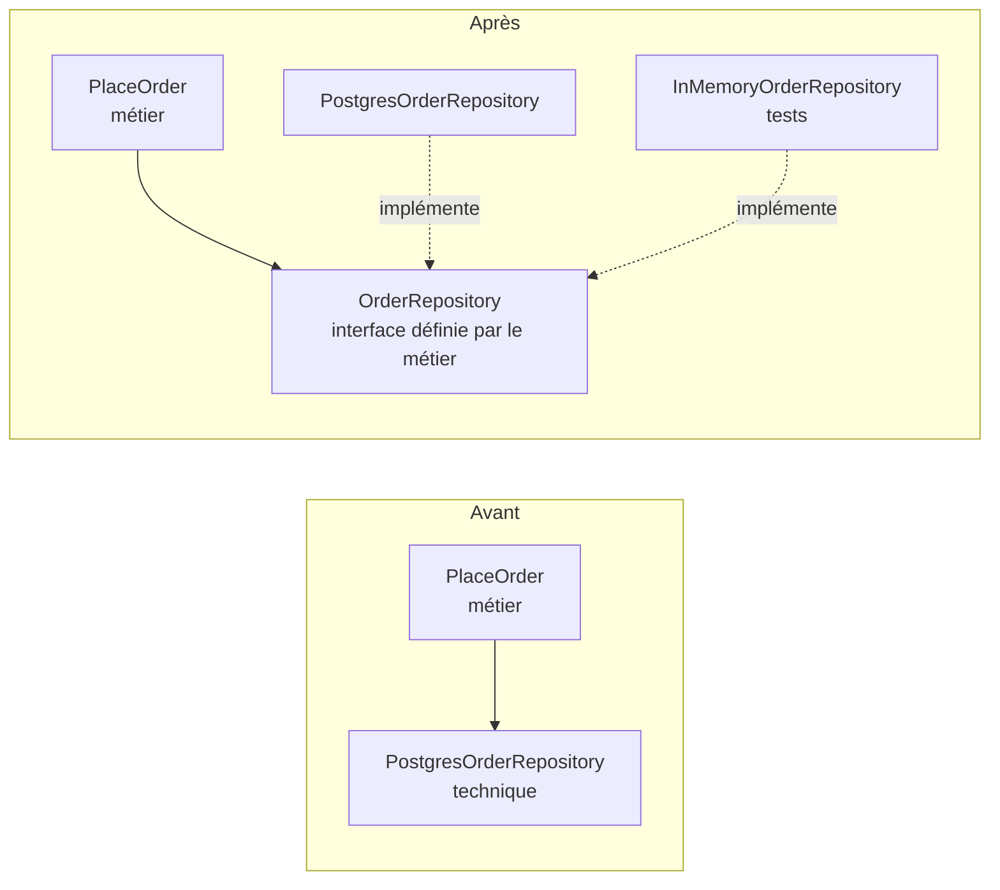

=== "PHP"

    ``` { .php .ex-bad title="À éviter" }
    <?php

    // À éviter : le métier crée lui-même l'accès PostgreSQL, intestable sans base
    final class PlaceOrderBefore
    {
        public function handle(array $order): void
        {
            (new PostgresOrderRepository())->save($order);
        }
    }
    ```

    ``` { .php .ex-good title="Recommandé" }
    <?php

    // Ce qui change : le métier définit l'interface dont il a besoin
    interface OrderRepository
    {
        public function save(array $order): void;
    }

    // Ce qui change : reçoit le dépôt par le constructeur, vrai ou faux
    final class PlaceOrder
    {
        public function __construct(private readonly OrderRepository $orders) {}

        public function handle(array $order): void
        {
            $this->orders->save($order);
        }
    }
    ```

=== "Python"

    ``` { .python .ex-bad title="À éviter" }
    from typing import Protocol


    # À éviter : le métier crée lui-même l'accès PostgreSQL, intestable sans base
    class PlaceOrderBefore:
        def handle(self, order: dict) -> None:
            PostgresOrderRepository().save(order)
    ```

    ``` { .python .ex-good title="Recommandé" }
    # Ce qui change : le métier définit l'interface dont il a besoin
    class OrderRepository(Protocol):
        def save(self, order: dict) -> None: ...


    # Ce qui change : reçoit le dépôt par le constructeur, vrai ou faux
    class PlaceOrder:
        def __init__(self, orders: OrderRepository) -> None:
            self._orders = orders

        def handle(self, order: dict) -> None:
            self._orders.save(order)
    ```

=== "Java"

    ``` { .java .ex-bad title="À éviter" }
    // À éviter : le métier crée lui-même l'accès PostgreSQL, intestable sans base
    final class PlaceOrderBefore {
        void handle(Order order) { new PostgresOrderRepository().save(order); }
    }
    ```

    ``` { .java .ex-good title="Recommandé" }
    // Ce qui change : le métier définit l'interface dont il a besoin
    interface OrderRepository { void save(Order order); }

    // Ce qui change : reçoit le dépôt par le constructeur, vrai ou faux
    final class PlaceOrder {
        private final OrderRepository orders;
        PlaceOrder(OrderRepository orders) { this.orders = orders; }
        void handle(Order order) { orders.save(order); }
    }
    ```

Cette « version en mémoire des tests » est un <span class="term" data-term="fake-object">faux</span>, une sorte de double de test : une classe qui remplace la vraie pendant le test, sans base, en gardant les commandes dans une liste (voir [doubles de test](qualite.md#double-de-test-mock-stub-fake)).

=== "PHP"

    ``` { .php .ex-illus title="Illustration" }
    <?php

    // Exemple : un faux qui garde les commandes en mémoire pour les tests
    final class InMemoryOrderRepository implements OrderRepository
    {
        public array $saved = [];

        public function save(array $order): void
        {
            $this->saved[] = $order;
        }
    }
    ```

=== "Python"

    ``` { .python .ex-illus title="Illustration" }
    # Exemple : un faux qui garde les commandes en mémoire pour les tests
    class InMemoryOrderRepository:
        def __init__(self) -> None:
            self.saved: list[dict] = []

        def save(self, order: dict) -> None:
            self.saved.append(order)
    ```

=== "Java"

    ``` { .java .ex-illus title="Illustration" }
    // Exemple : un faux qui garde les commandes en mémoire pour les tests
    final class InMemoryOrderRepository implements OrderRepository {
        final List<Order> saved = new ArrayList<>();
        public void save(Order order) { saved.add(order); }
    }
    ```

**Quand ne pas l'appliquer** : pour une dépendance stable et sans effet de bord (une bibliothèque de dates, une fonction de calcul pure). Mettre une interface devant `math` ou devant chaque classe métier n'apporte que de l'indirection. On l'applique aux frontières : base, réseau, horloge, fichiers, fournisseurs externes.

:material-book-open-variant: Doc de référence : [Martin Fowler, « DIP in the Wild »](https://martinfowler.com/articles/dipInTheWild.html) (2013) ; [Martin Fowler, « Inversion of Control Containers and the Dependency Injection pattern »](https://martinfowler.com/articles/injection.html) (2004)
{ .doc-ref }

!!! maturity "Mesurer la maturité"
    | Niveau | Ce que j'observe dans l'équipe |
    |---|---|
    | N1 | une ou deux personnes citent SOLID en revue, au cas par cas, et le code métier fait encore des `new` de classes techniques |
    | N2 | chaque MR est relue avec une grille partagée (une raison de changer par classe, dépendances aux frontières passées par le constructeur), et les tests du domaine tournent sans base |
    | N3 | une règle d'architecture vérifiée en CI (le domaine n'importe jamais l'infrastructure) et le vérificateur de types bloquent la MR qui inverse une dépendance ou casse une signature héritée |
    | N4 | l'équipe suit le nombre de modules touchés par changement métier et la part des tests du domaine qui tournent sans infrastructure, et choisit où découper d'après ces chiffres, sans appliquer les cinq lettres partout |

    **Je mesure** : la part des MR métier qui ne touchent qu'un module, lue dans l'outil de MR ; le nombre de violations de la règle d'import du domaine, lu dans le rapport de CI.

## STUPID : les six odeurs à éviter

<a class="pill pill-scope pill-scope-code" href="../architecture/#carte-des-echelles">Échelle · Code</a> <span class="pill pill-status pill-status-ok" title="Toujours valable, vérifié en novembre 2026">Valable · 11/2026</span>

**<span class="term" data-term="stupid-code">STUPID</span>** est l'acronyme inverse de SOLID : six défauts qui rendent un code difficile à tester et à faire évoluer. Il est popularisé par un article de blog de William Durand, « From STUPID to SOLID Code! » (2013, date à vérifier). Ce n'est pas un standard, plutôt une liste mnémotechnique pratique en revue de code.

**S : Singleton.** Un objet unique accessible de partout (`Config::getInstance()`) est un état global caché : les tests s'influencent entre eux (un test qui change une valeur de la config la laisse au test suivant, qui échoue ou passe selon l'ordre d'exécution) et on ne voit pas, en lisant la signature d'une classe, de quoi elle dépend. Le remède : passer la dépendance par le constructeur, et laisser le [conteneur d'injection](design-patterns.md#conteneur-dinjection) (l'objet du framework qui construit les objets et leur passe leurs dépendances) garantir l'instance unique (voir [Singleton](design-patterns.md#singleton)).

**T : Tight coupling (couplage fort).** Une classe qui connaît les détails d'une autre : <span class="term" data-term="tight-coupling">couplage fort</span>. `OrderService` qui construit `new SmtpMailer('smtp.example.com', 25)` doit changer quand le serveur de mail change. Remède : inversion des dépendances.

**U : Untestability (code non testable).** Un code difficile à tester est presque toujours un code mal découpé : dépendance cachée, horloge système lue directement (`datetime.now()` au milieu d'une règle), effet de bord dans un constructeur. Remède : passer l'horloge et les dépendances en paramètre.

**P : Premature optimization (optimisation prématurée).** Rendre le code plus compliqué pour gagner en vitesse avant d'avoir mesuré un problème. Un cache maison ajouté « au cas où » sur une requête qui prend 2 ms (chiffre d'exemple). La citation de Donald Knuth (« Structured Programming with go to Statements », 1974) : l'<span class="term" data-term="premature-optimization">optimisation prématurée</span> est la racine de tous les maux, pour 97 % des cas. Remède : mesurer d'abord (profileur, trace), optimiser ensuite le point chaud.

**I : Indescriptive naming (noms qui ne disent rien).** `$data`, `tmp`, `Manager`, `process()`, `flag2`. Le lecteur doit lire le corps pour comprendre l'intention. Remède : un nom qui dit le rôle métier (`overdueInvoices`, `applyLoyaltyDiscount`).

**D : Duplication.** La même règle écrite à plusieurs endroits : quand elle change, on en oublie un. Remède : DRY, appliqué au savoir et pas au texte (voir plus bas).

| Odeur STUPID | Signe en revue de code | Principe qui la corrige |
|---|---|---|
| Singleton | `getInstance()`, état statique partagé | inversion des dépendances, injection |
| Tight coupling | `new` d'une classe technique dans le code métier | inversion des dépendances, Déméter |
| Untestability | test impossible sans base, réseau ou horloge réelle | inversion des dépendances, responsabilité unique |
| Premature optimization | cache, pool ou micro-optimisation sans mesure | KISS, YAGNI |
| Indescriptive naming | `data`, `Manager`, `doStuff` | moindre surprise, revue de code |
| Duplication | même `if` ou même calcul copié | DRY, avec la règle de trois |

**Risques.** Utilisée comme liste de griefs, elle transforme la revue en procès (« ton code est STUPID ») et l'auteur se braque : je cite l'odeur et son symptôme, pas la personne. Appliquée à la lettre, elle pousse à supprimer d'un coup toute duplication et tout singleton, y compris là où ils ne gênent personne : je ne traite que les odeurs du code que je modifie.

:material-book-open-variant: Doc de référence : [William Durand, « From STUPID to SOLID Code! »](https://williamdurand.fr/2013/07/30/from-stupid-to-solid-code/) (2013)
{ .doc-ref }

!!! maturity "Mesurer la maturité"
    | Niveau | Ce que j'observe dans l'équipe |
    |---|---|
    | N1 | quelqu'un repère de temps en temps un singleton ou une duplication en revue, sans vocabulaire commun |
    | N2 | la liste STUPID sert de grille de revue partagée, et l'analyse statique signale la duplication, la complexité et les noms trop courts |
    | N3 | le seuil qualité de la CI bloque une MR qui ajoute de la duplication au-delà d'un seuil ou un nouvel état statique partagé, sans qu'un relecteur ait à le dire |
    | N4 | l'équipe suit le taux de duplication et le nombre de singletons dans les zones les plus modifiées, et planifie le nettoyage là où ces chiffres coûtent |

    **Je mesure** : le taux de duplication et le nombre de nouvelles odeurs par MR, lus dans l'analyse statique ; le nombre de commentaires de revue qui citent une odeur STUPID, lu dans l'outil de MR.

## Principes voisins

<a class="pill pill-scope pill-scope-code" href="../architecture/#carte-des-echelles">Échelle · Code</a> <a class="pill pill-scope pill-scope-app" href="../architecture/#carte-des-echelles">Échelle · Application</a>

### KISS

<span class="pill pill-status pill-status-ok" title="Toujours valable, vérifié en novembre 2026">Valable · 11/2026</span>

**<span class="term" data-term="kiss">KISS</span>** (*Keep It Simple, Stupid*, expression attribuée à l'ingénieur Kelly Johnson, années 1960, origine à vérifier) : la solution la plus simple qui résout le problème est la meilleure. Simple ne veut pas dire facile à écrire, mais facile à lire et à modifier par quelqu'un d'autre.

!!! noob "As noob"
    KISS, c'est l'itinéraire que je donne à un ami : « tout droit, puis la deuxième à gauche » vaut mieux que le raccourci par trois ruelles que je suis seul à connaître, même s'il fait gagner deux minutes. La phrase à retenir : **simple veut dire facile à comprendre pour le prochain lecteur, pas court à écrire.**

Exemple : un collègue devra corriger mon code dans six mois. Une boucle de cinq lignes, il la comprend en la lisant. Une chaîne de `reduce` imbriqués, il doit la refaire sur papier avant d'oser la toucher, donc il perd une heure ou il casse quelque chose.

**Risques.** « Simple » sert parfois d'excuse pour retirer la gestion d'erreurs, les tests ou la validation des entrées : le code est court mais plante au premier cas réel. Simple veut dire sans complexité inutile, pas sans le nécessaire. Ce qui est simple pour l'auteur ne l'est pas toujours pour le lecteur : en revue, c'est l'avis du relecteur qui tranche.

:material-book-open-variant: Doc de référence : [Wikipedia, « KISS principle »](https://en.wikipedia.org/wiki/KISS_principle) (consultée en novembre 2026)
{ .doc-ref }

### DRY, WET et AHA

<span class="pill pill-status pill-status-ok" title="Toujours valable, vérifié en novembre 2026">Valable · 11/2026</span>

**<span class="term" data-term="dry">DRY</span>** (*Don't Repeat Yourself*, Andy Hunt et Dave Thomas, « The Pragmatic Programmer », 1999) : « chaque élément de connaissance doit avoir une représentation unique, non ambiguë et faisant autorité dans le système ». Le point important : DRY parle de **connaissance**, pas de texte. Deux fonctions qui se ressemblent mais représentent deux règles métier différentes ne sont pas une duplication.

!!! noob "As noob"
    Deux panneaux qui affichent « 30 » ne disent pas forcément la même chose : l'un est une limite de vitesse, l'autre un numéro de rue. Les fusionner parce qu'ils se ressemblent serait une erreur. La phrase à retenir : **DRY chasse les règles copiées, pas les lignes qui se ressemblent.**

**WET** (*Write Everything Twice*, ou *We Enjoy Typing*) : le surnom moqueur du code qui ne respecte pas DRY.

**AHA** (*Avoid Hasty Abstractions*, Kent C. Dodds, vers 2019, date à vérifier) et **<span class="term" data-term="wrong-abstraction">la mauvaise abstraction</span>** (Sandi Metz, « The Wrong Abstraction », 2016) : « la duplication coûte bien moins cher que la mauvaise abstraction ». Une abstraction créée trop tôt finit par accumuler des paramètres et des `if` pour servir des cas qui n'ont rien à voir. Le remède de Sandi Metz : réintégrer le code dans chaque appelant, puis repartir de là.

``` { .text .ex-illus title="Illustration" }
Jour 1 : formatPrice(amount)                               2 appelants identiques, on factorise.
Jour 30 : formatPrice(amount, currency, withTax)           un 3e appelant diffère un peu.
Jour 90 : formatPrice(amount, currency, withTax, isB2b,    5 drapeaux, 12 combinaisons,
          legacyRounding)                                  personne n'ose y toucher.
```

:material-book-open-variant: Doc de référence : [Andy Hunt et Dave Thomas, « Orthogonality and the DRY Principle », Artima](https://www.artima.com/articles/orthogonality-and-the-dry-principle) (2003) ; [Sandi Metz, « The Wrong Abstraction »](https://sandimetz.com/blog/2016/1/20/the-wrong-abstraction) (2016)
{ .doc-ref }

### YAGNI et règle de trois

<span class="pill pill-status pill-status-ok" title="Toujours valable, vérifié en novembre 2026">Valable · 11/2026</span>

**<span class="term" data-term="yagni">YAGNI</span>** (*You Aren't Gonna Need It*, Extreme Programming, fin des années 1990) : ne pas construire aujourd'hui ce dont on n'a pas encore besoin. J'ajoute un export PDF « parce qu'on en aura sûrement besoin » : il faut l'écrire, le tester et le relire à chaque évolution. Le jour où le besoin arrive vraiment, on me demande souvent un export Excel, et mon code PDF n'a servi à rien.

!!! noob "As noob"
    YAGNI, c'est ne pas acheter une remorque le jour où j'achète ma voiture « au cas où je déménage » : je paie l'assurance et la place au garage pendant des années, et le jour du déménagement il me faut en fait un camion. La phrase à retenir : **je construis pour le besoin d'aujourd'hui, le besoin de demain arrivera rarement sous la forme prévue.**

**<span class="term" data-term="rule-of-three">Règle de trois</span>** (Don Roberts, citée par Martin Fowler dans « Refactoring », 1999) : la première fois on écrit, la deuxième fois on duplique en grimaçant, la troisième fois on factorise. Elle concilie DRY et YAGNI : on attend d'avoir assez d'exemples pour voir la bonne abstraction.

**Risques.** Appliqué à tout, YAGNI repousse aussi ce qui coûte très cher à ajouter après coup : la sécurité, la journalisation, le versionnement d'une API publique, le format des données stockées. Une fois l'API publiée sans version, chaque client devra migrer. Je fais une exception pour les décisions difficiles à défaire, et j'applique YAGNI aux fonctionnalités et aux options.

:material-book-open-variant: Doc de référence : [Martin Fowler, « Yagni »](https://martinfowler.com/bliki/Yagni.html) (2015)
{ .doc-ref }

### Loi de Déméter et Tell, don't ask

<span class="pill pill-status pill-status-ok" title="Toujours valable, vérifié en novembre 2026">Valable · 11/2026</span>

**<span class="term" data-term="law-of-demeter">Loi de Déméter</span>** (Ian Holland et Karl Lieberherr, Northeastern University, 1987), ou « ne parle qu'à tes amis proches » : une méthode n'appelle que les méthodes de son propre objet, de ses paramètres, des objets qu'elle crée et de ses attributs directs. Pas de longue chaîne qui traverse la structure des autres.

!!! noob "As noob"
    Pour se faire payer, un serveur ne prend pas le portefeuille du client pour y chercher sa carte : il lui demande de payer. Fouiller dans les objets des autres (`a.get_b().get_c()`) me lie à leur rangement intérieur. La phrase à retenir : **je demande à l'objet de faire, je ne vais pas chercher dans ses poches.**

``` { .python .ex-bad title="À éviter" }
# À éviter : traverse trois classes, casse si l'une change de structure
city = order.get_customer().get_address().get_city()
```

``` { .python .ex-good title="Recommandé" }
# Bien : seul Order sait où trouver la ville
city = order.shipping_city()
```

La première ligne couple le code à trois classes. La seconde ne connaît que `Order`, qui décide comment trouver la ville.

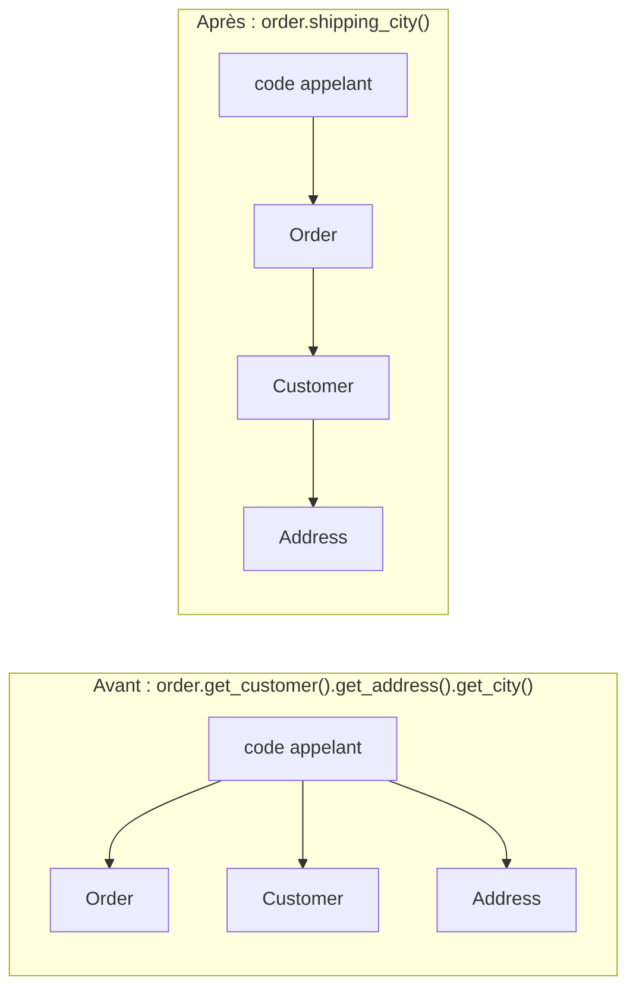

**<span class="term" data-term="tell-dont-ask">Tell, don't ask</span>** (Andy Hunt et Dave Thomas, article « Tell, Don't Ask », 2003, date à vérifier) : au lieu de demander l'état d'un objet pour décider à sa place, on lui dit quoi faire. `if account.balance >= amount: account.balance -= amount` devient `account.withdraw(amount)`, et la règle reste dans `Account`.

**Risques.** Appliquée mécaniquement, elle remplit `Order` de méthodes qui ne font que transmettre (`shipping_city()`, `shipping_zip()`, `customer_phone()`...), et la classe devient un fourre-tout. Elle ne vise ni les objets de données ni les API fluides (`query.where().order_by()`), où la chaîne ne traverse pas la structure d'autres objets. Je l'applique aux objets qui portent un comportement.

:material-book-open-variant: Doc de référence : [Wikipedia, « Law of Demeter »](https://en.wikipedia.org/wiki/Law_of_Demeter) (consultée en novembre 2026) ; [Martin Fowler, « TellDontAsk »](https://martinfowler.com/bliki/TellDontAsk.html) (2013)
{ .doc-ref }

### Composition plutôt qu'héritage

<span class="pill pill-status pill-status-ok" title="Toujours valable, vérifié en novembre 2026">Valable · 11/2026</span>

**<span class="term" data-term="composition-over-inheritance">Composition plutôt qu'héritage</span>** (Gamma, Helm, Johnson et Vlissides, « Design Patterns », 1994) : « préférer la composition d'objets à l'héritage de classe ». L'<span class="term" data-term="inheritance">héritage</span> lie l'enfant à tous les détails du parent, pour toujours. La <span class="term" data-term="object-composition">composition</span> (un objet en contient un autre et lui délègue) se change à l'exécution et se teste séparément.

!!! noob "As noob"
    L'héritage, c'est un meuble livré monté : je prends tout le bloc, y compris les tiroirs dont je n'ai pas besoin. La composition, ce sont des éléments à assembler : je combine ceux qui me servent et j'en change un sans casser les autres. La phrase à retenir : **hériter seulement quand l'enfant « est vraiment un » parent, sinon contenir et déléguer.**

=== "PHP"

    ``` { .php .ex-bad title="À éviter" }
    <?php

    // À éviter : une sous-classe par combinaison d'envois
    class ReportWithEmail extends Report { }
    class ReportWithEmailAndPdf extends ReportWithEmail { }
    ```

    ``` { .php .ex-good title="Recommandé" }
    <?php

    // Bien : le job reçoit la liste d'exportateurs voulue
    final class ReportJob
    {
        /** @param list<Exporter> $exporters */
        public function __construct(private readonly Report $report, private readonly array $exporters) {}

        public function run(): void
        {
            foreach ($this->exporters as $exporter) {
                $exporter->export($this->report);
            }
        }
    }
    ```

=== "Python"

    ``` { .python .ex-bad title="À éviter" }
    # À éviter : une sous-classe par combinaison d'envois
    class ReportWithEmail(Report): ...
    class ReportWithEmailAndPdf(ReportWithEmail): ...
    ```

    ``` { .python .ex-good title="Recommandé" }
    # Bien : le job reçoit la liste d'exportateurs voulue
    class ReportJob:
        def __init__(self, report: Report, exporters: list[Exporter]) -> None:
            self._report = report
            self._exporters = exporters

        def run(self) -> None:
            for exporter in self._exporters:
                exporter.export(self._report)
    ```

=== "Java"

    ``` { .java .ex-bad title="À éviter" }
    // À éviter : une sous-classe par combinaison d'envois
    class ReportWithEmail extends Report { }
    class ReportWithEmailAndPdf extends ReportWithEmail { }
    ```

    ``` { .java .ex-good title="Recommandé" }
    // Bien : le job reçoit la liste d'exportateurs voulue
    final class ReportJob {
        private final Report report;
        private final List<Exporter> exporters;
        ReportJob(Report report, List<Exporter> exporters) { this.report = report; this.exporters = exporters; }
        void run() { exporters.forEach(e -> e.export(report)); }
    }
    ```

Avec l'héritage, chaque combinaison (e-mail, PDF, e-mail et PDF) demande une classe. Avec la composition, on passe la liste d'exportateurs voulue.

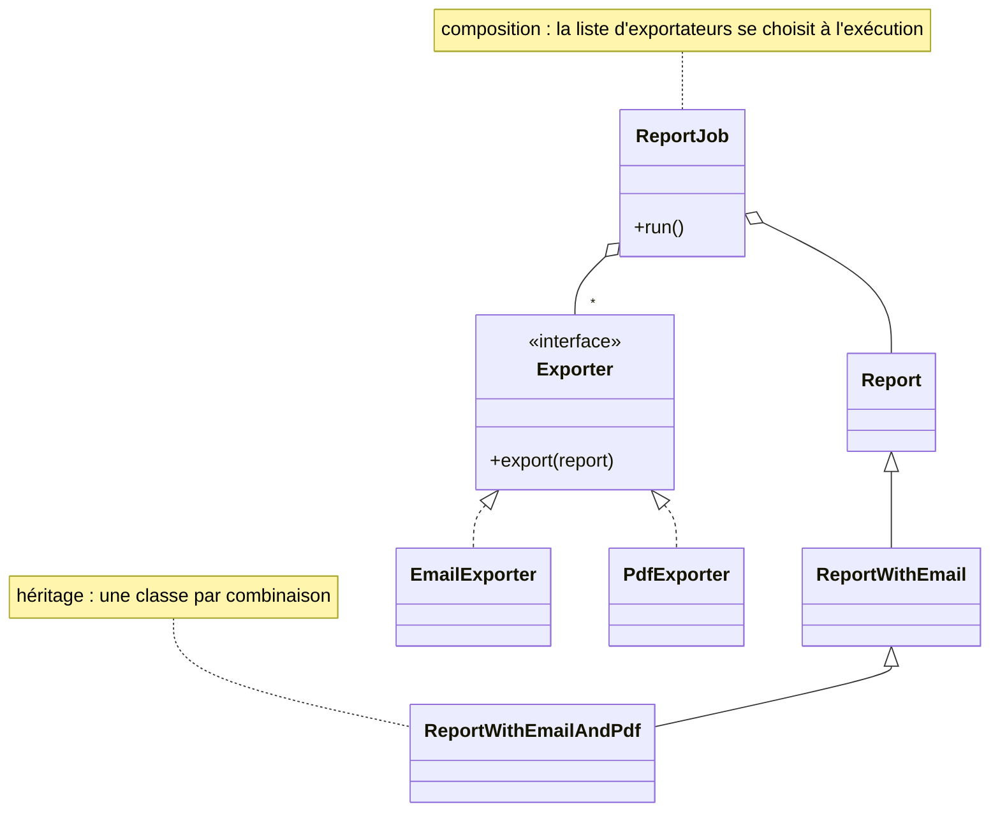

**La <span class="term" data-term="fragile-base-class">classe de base fragile</span>** (*fragile base class*) est le risque concret de l'héritage : une classe parente qu'on n'ose plus modifier, parce qu'un changement interne casse une sous-classe ailleurs. L'exemple de Joshua Bloch (« Effective Java », 3e édition, 2018) : une sous-classe de `HashSet` compte les ajouts en redéfinissant `add()` et `addAll()`. Mais `addAll()` du parent appelle `add()` en interne : ajouter trois éléments en compte six. Le jour où le parent change sa façon de faire, le compteur devient faux, sans qu'une ligne de la sous-classe ait bougé. Avec la composition, l'objet qui compte enveloppe un ensemble et ne dépend que de ses méthodes publiques.

L'héritage reste juste pour une vraie relation « est un » qui respecte Liskov, sur un niveau, ou quand un framework l'impose.

:material-book-open-variant: Doc de référence : [Brandon Rhodes, « The Composition Over Inheritance Principle », python-patterns.guide](https://python-patterns.guide/gang-of-four/composition-over-inheritance/) (consultée en novembre 2026)
{ .doc-ref }

### Séparation des préoccupations, cohésion et couplage

<span class="pill pill-status pill-status-ok" title="Toujours valable, vérifié en novembre 2026">Valable · 11/2026</span>

**<span class="term" data-term="separation-of-concerns">Séparation des préoccupations</span>** (Edsger Dijkstra, « On the role of scientific thought », 1974) : traiter séparément chaque aspect d'un problème (affichage, règle métier, stockage). C'est l'idée mère de la responsabilité unique et des architectures en couches ou hexagonales. En pratique, un découpage en trois dossiers :

``` { .text .ex-illus title="Illustration" }
orders/
├── api/      # HTTP : lit la requête, appelle le domaine, renvoie la réponse
├── domain/   # règles métier et interfaces (OrderRepository) ; n'importe rien de infra/
└── infra/    # PostgresOrderRepository, client HTTP du prestataire ; implémente les interfaces du domaine
```

La règle qui compte : `domain/` n'importe jamais `infra/` ni `api/`. Le détail est dans [Architecture hexagonale et clean architecture](architecture.md#architecture-hexagonale-et-clean-architecture).

**Forte <span class="term" data-term="cohesion">cohésion</span>, faible couplage** : les deux faces du même objectif. On regroupe ce qui change ensemble (cohésion), on sépare ce qui change pour des raisons différentes (faible couplage). Un module `billing` qui contient le calcul, ses tests et son modèle de données est cohésif. Un module `utils` qui contient des dates, du CSV et de l'envoi d'e-mail ne l'est pas.

!!! noob "As noob"
    Une cuisine bien rangée : les épices sont ensemble près des plaques (cohésion), et je peux changer de casseroles sans toucher au réfrigérateur (faible couplage). Un tiroir « divers » qui mélange piles, ficelle et ouvre-boîte, c'est le module `utils` : tout le monde y fouille, et le ranger dérange tout le monde. La phrase à retenir : **je regroupe ce qui change ensemble, je sépare ce qui change pour des raisons différentes.**

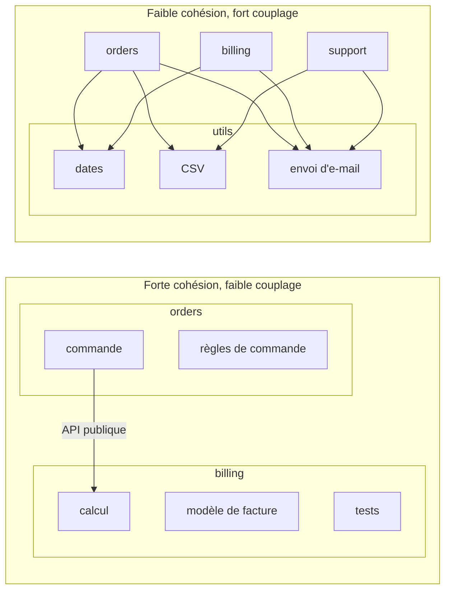

**Risques.** Découper un petit service CRUD en couches `api`, `domain` et `infra` multiplie les fichiers et les conversions d'objets sans rien protéger : chaque champ ajouté touche quatre classes. Je sépare quand une vraie règle métier existe. À l'inverse, un module `utils` ou `common` fourre-tout couple tout le monde au même paquet : je range par sujet métier.

:material-book-open-variant: Doc de référence : [Edsger W. Dijkstra, « On the role of scientific thought », EWD447](https://www.cs.utexas.edu/~EWD/transcriptions/EWD04xx/EWD447.html) (1974)
{ .doc-ref }

### GRASP

<span class="pill pill-status pill-status-ok" title="Toujours valable, vérifié en novembre 2026">Valable · 11/2026</span>

**<span class="term" data-term="grasp">GRASP</span>** (*General Responsibility Assignment Software Patterns*, Craig Larman, « Applying UML and Patterns », 1997) : neuf principes pour décider **à quelle classe donner une responsabilité**. Les plus cités : *Information Expert* (la responsabilité va à la classe qui a les données, comme `order.total()` plutôt que `calculator.total(order.lines)`), *Creator*, *Controller*, *Low Coupling*, *High Cohesion*, *Polymorphism*, *Indirection*, *Pure Fabrication*, *Protected Variations*. Moins connu que SOLID en entretien, mais utile pour justifier un choix de placement.

| Principe | Ce qu'il dit | Exemple |
|---|---|---|
| Information Expert | la classe qui a les données fait le calcul | `order.total()` plutôt que `calculator.total(order.lines)` |
| Creator | crée un objet la classe qui le contient ou l'utilise de près | `order.add_line(product, qty)` crée la `OrderLine` |
| Controller | un objet reçoit l'action de l'utilisateur et la délègue au métier | `PlaceOrderHandler` reçoit la requête HTTP et appelle `Order` |
| Low Coupling | dépendre du moins de classes possible | `PlaceOrder` connaît `OrderRepository`, pas PostgreSQL |
| High Cohesion | une classe garde des responsabilités proches | `Invoice` calcule la TVA, n'envoie pas d'e-mail |
| Polymorphism | une variante par type au lieu d'un `if type ==` | `CardPayment.pay()` et `TransferPayment.pay()` |
| Pure Fabrication | inventer une classe sans équivalent métier pour garder le métier propre | `OrderRepository`, `EmailSender` |
| Indirection | un intermédiaire pour découpler deux classes | un `PaymentGateway` entre `PayOrder` et l'API du prestataire |
| Protected Variations | cacher derrière une interface ce qui va changer | `TaxPolicy` par pays, le code appelant ne change pas |

**Risques.** Information Expert poussé au bout donne une classe `Order` qui calcule, persiste, formate et envoie des e-mails, parce qu'elle « a les données » : je l'équilibre avec High Cohesion et Pure Fabrication. Les neuf principes se contredisent parfois, donc en citer un seul ne tranche rien : je dis lequel je privilégie et pourquoi.

:material-book-open-variant: Doc de référence : [Wikipedia, « GRASP (object-oriented design) »](https://en.wikipedia.org/wiki/GRASP_%28object-oriented_design%29) (consultée en novembre 2026)
{ .doc-ref }

### Principes des composants

<span class="pill pill-status pill-status-ok" title="Toujours valable, vérifié en novembre 2026">Valable · 11/2026</span>

Robert C. Martin applique les mêmes idées au niveau des **paquets** (bibliothèques, modules, services) : les <span class="term" data-term="package-principles">principes des composants</span>, décrits dans « Agile Software Development » (2002) puis « Clean Architecture » (2017).

!!! noob "As noob"
    Les principes des composants, c'est SOLID appliqué aux cartons d'un déménagement plutôt qu'aux objets : je mets ensemble ce qui sert dans la même pièce, j'étiquette chaque carton, et je ne pose jamais un carton solide sous un carton qu'on va ouvrir tous les jours. La phrase à retenir : **un paquet regroupe ce qui change ensemble et ne dépend que de plus stable que lui.**

| Principe | Ce qu'il dit | Exemple |
|---|---|---|
| REP, Reuse/Release Equivalence | ce qu'on réutilise, on le publie avec une version | une bibliothèque partagée a un numéro de version et un changelog |
| CCP, Common Closure | regrouper les classes qui changent ensemble | la règle de remboursement et son modèle dans le même paquet |
| CRP, Common Reuse | ne pas forcer à dépendre de ce qu'on n'utilise pas | ne pas mettre le client HTTP et le parseur CSV dans le même paquet `common` |
| ADP, Acyclic Dependencies | pas de cycle entre paquets | `billing` dépend de `orders`, jamais l'inverse |
| SDP, Stable Dependencies | dépendre de plus stable que soi | une application dépend d'une bibliothèque, pas une bibliothèque d'une application |
| SAP, Stable Abstractions | un paquet stable doit être abstrait | le paquet le plus utilisé expose surtout des interfaces |

J'en ai surtout besoin quand plusieurs équipes dépendent du même code : une bibliothèque partagée, un SDK, ou un monorepo où chaque équipe a ses dossiers. Sans eux, un changement dans un paquet commun oblige tout le monde à mettre à jour en même temps.

**Risques.** Découper trop tôt en dizaines de petits paquets versionnés crée un enfer de versions : une correction demande cinq publications dans le bon ordre. Je regroupe tant qu'une seule équipe consomme le code, et je découpe quand un deuxième consommateur arrive avec un rythme différent.

:material-book-open-variant: Doc de référence : [Wikipedia, « Package principles »](https://en.wikipedia.org/wiki/Package_principles) (consultée en novembre 2026)
{ .doc-ref }

### CUPID

<span class="pill pill-status pill-status-ok" title="Toujours valable, vérifié en novembre 2026">Valable · 11/2026</span>

**<span class="term" data-term="cupid">CUPID</span>** (Dan North, article « CUPID: for joyful coding », 2022) : un contrepoint moderne à SOLID. Dan North propose des **propriétés** plutôt que des principes, à viser sans les cocher : *Composable* (facile à combiner), *Unix philosophy* (fait une chose bien), *Predictable* (fait ce qu'on attend), *Idiomatic* (suit les usages du langage), *Domain-based* (parle le langage du métier). Utile en entretien pour montrer qu'on connaît les critiques de SOLID : principes pensés pour la programmation objet des années 1990, parfois appliqués comme une checklist.

| Propriété | Avant | Après |
|---|---|---|
| Composable | `export_report()` lit la base, formate et envoie par e-mail | `send(format_csv(load_orders()))` : trois fonctions réutilisables séparément |
| Unix philosophy | `OrderManager` crée, facture, expédie et notifie | `PlaceOrder`, `InvoiceOrder`, `ShipOrder` |
| Predictable | `get_user(id)` crée l'utilisateur s'il manque | `get_user(id)` lit ; `create_user()` crée |
| Idiomatic | en Python, `for i in range(len(orders)): orders[i]` | `for order in orders:` |
| Domain-based | `process_data(d2)` | `refund_order(order)` |

**Risques.** Les propriétés sont volontairement floues : sans critère partagé, « ce n'est pas prévisible » devient un avis contre un autre en revue, et la discussion tourne en rond. Je l'utilise comme grille de discussion, avec un exemple avant et après, pas comme règle bloquante.

:material-book-open-variant: Doc de référence : [Dan North, cupid.dev](https://cupid.dev/) (consultée en novembre 2026) ; [Dan North, « CUPID: for joyful coding »](https://dannorth.net/blog/cupid-for-joyful-coding/) (2022)
{ .doc-ref }

### Principe de moindre surprise

<span class="pill pill-status pill-status-ok" title="Toujours valable, vérifié en novembre 2026">Valable · 11/2026</span>

**<span class="term" data-term="least-astonishment">Principe de moindre surprise</span>** (*Principle of Least Astonishment*, cité dans la conception d'interfaces depuis les années 1970, origine exacte non indiquée) : un code, une API ou une commande doit se comporter comme son utilisateur s'y attend. Une méthode `getUser()` qui crée l'utilisateur s'il n'existe pas surprend. Une option `--dry-run` qui écrit quand même surprend encore plus.

!!! noob "As noob"
    La moindre surprise, c'est l'interrupteur qui allume la lumière quand je l'appuie vers le haut, comme partout ailleurs : s'il ouvrait les volets, je n'aurais plus confiance dans aucun interrupteur de la maison. La phrase à retenir : **un nom, une option ou une API fait ce que son lecteur devine sans lire le code.**

**Risques.** La surprise dépend du lecteur : une méthode qui lève une exception est attendue en Python et surprend en Go. Je suis les conventions du langage et du framework, et je documente le comportement quand un doute reste. Corriger un comportement surprenant mais déjà utilisé casse les appelants qui en dépendent (loi de Hyrum) : je le fais avec un avertissement et une période de transition.

:material-book-open-variant: Doc de référence : [Wikipedia, « Principle of least astonishment »](https://en.wikipedia.org/wiki/Principle_of_least_astonishment) (consultée en novembre 2026)
{ .doc-ref }

!!! maturity "Mesurer la maturité"
    | Niveau | Ce que j'observe dans l'équipe |
    |---|---|
    | N1 | les principes sont cités en revue quand quelqu'un y pense, souvent pour défendre un avis (« ce n'est pas DRY ») plutôt qu'un besoin |
    | N2 | l'équipe suit des règles écrites : règle de trois avant toute factorisation, pas d'interface sans deuxième implémentation ou test qui en a besoin, dépendances entre paquets sans cycle |
    | N3 | un outil vérifie les dépendances entre paquets en CI et bloque un cycle ou un import interdit ; la règle de trois et YAGNI font partie de la définition de « prêt pour la revue » et sont appliqués sans rappel |
    | N4 | l'équipe suit le couplage (nombre de modules touchés par MR) et le code inutilisé, et retire les abstractions qui ne servent qu'une fois d'après ces chiffres |

    **Je mesure** : le nombre moyen de modules touchés par MR, lu dans l'historique git ; le nombre d'interfaces à une seule implémentation et de cycles entre paquets, comptés par l'analyse statique.

## Détails de conception

<a class="pill pill-scope pill-scope-code" href="../architecture/#carte-des-echelles">Échelle · Code</a>

Les principes ci-dessus disent comment découper. Ceux de cette partie disent comment écrire chaque fonction et chaque frontière : où placer les vérifications, quelle taille donner à une interface, quoi promettre à l'appelant et quoi faire quand quelque chose échoue.

### Clauses de garde

<span class="pill pill-status pill-status-ok" title="Toujours valable, vérifié en novembre 2026">Valable · 11/2026</span>

Une **<span class="term" data-term="guard-clause">clause de garde</span>** est un test placé au début d'une fonction qui sort tout de suite (`return` ou exception) dans un cas particulier : entrée absente, liste vide, cas non pris en charge. Le cas normal se lit ensuite à la fin, sans imbrication. Martin Fowler en fait un refactoring nommé, « Replace Nested Conditional with Guard Clauses », dans « Refactoring » (1999, 2e édition 2018).

**Quand** : une fonction empile trois niveaux de `if` et le vrai calcul est caché tout à droite, ou ses premières lignes vérifient des conditions d'entrée. **Quand ne pas** : deux branches également importantes (un tarif pour les particuliers, un autre pour les entreprises) se lisent mieux en `if / else` symétrique, et des `return` semés au milieu d'une fonction de 80 lignes la rendent plus dure à suivre, pas plus facile.

**Pourquoi** : chaque niveau d'imbrication oblige le lecteur à garder une condition en tête, ce que mesure la <span class="term" data-term="cognitive-complexity">complexité cognitive</span>. Avec les gardes, chaque cas particulier est réglé en une ligne, et ce qui suit est le chemin normal.

**Comment** : j'inverse la condition, je sors tout de suite, et je recommence pour la condition suivante.

=== "PHP"

    ``` { .php .ex-bad title="À éviter" }
    <?php

    // À éviter : trois niveaux d'imbrication, le vrai calcul est caché tout à droite
    function shippingFee(?Order $order): int
    {
        if ($order !== null) {
            if ($order->items !== []) {
                if (isset(RATES[$order->country])) {
                    return RATES[$order->country] * $order->weightKg;
                } else {
                    throw new UnknownCountry($order->country);
                }
            } else {
                return 0;
            }
        } else {
            throw new InvalidArgumentException('Order is required.');
        }
    }
    ```

    ``` { .php .ex-good title="Recommandé" }
    <?php

    // Bien : chaque cas particulier sort tout de suite, le cas normal se lit à la fin
    function shippingFee(?Order $order): int
    {
        if ($order === null) {
            throw new InvalidArgumentException('Order is required.');
        }
        if ($order->items === []) {
            return 0;
        }
        if (!isset(RATES[$order->country])) {
            throw new UnknownCountry($order->country);
        }

        return RATES[$order->country] * $order->weightKg;
    }
    ```

=== "Python"

    ``` { .python .ex-bad title="À éviter" }
    # À éviter : trois niveaux d'imbrication, le vrai calcul est caché tout à droite
    def shipping_fee(order: Order | None) -> int:
        if order is not None:
            if order.items:
                if order.country in RATES:
                    return RATES[order.country] * order.weight_kg
                else:
                    raise UnknownCountry(order.country)
            else:
                return 0
        else:
            raise ValueError("order is required")
    ```

    ``` { .python .ex-good title="Recommandé" }
    # Bien : chaque cas particulier sort tout de suite, le cas normal se lit à la fin
    def shipping_fee(order: Order | None) -> int:
        if order is None:
            raise ValueError("order is required")
        if not order.items:
            return 0
        if order.country not in RATES:
            raise UnknownCountry(order.country)

        return RATES[order.country] * order.weight_kg
    ```

=== "Java"

    ``` { .java .ex-bad title="À éviter" }
    // À éviter : trois niveaux d'imbrication, le vrai calcul est caché tout à droite
    static int shippingFee(Order order) {
        if (order != null) {
            if (!order.items().isEmpty()) {
                if (RATES.containsKey(order.country())) {
                    return RATES.get(order.country()) * order.weightKg();
                } else {
                    throw new UnknownCountry(order.country());
                }
            } else {
                return 0;
            }
        } else {
            throw new IllegalArgumentException("Order is required.");
        }
    }
    ```

    ``` { .java .ex-good title="Recommandé" }
    // Bien : chaque cas particulier sort tout de suite, le cas normal se lit à la fin
    static int shippingFee(Order order) {
        if (order == null) {
            throw new IllegalArgumentException("Order is required.");
        }
        if (order.items().isEmpty()) {
            return 0;
        }
        if (!RATES.containsKey(order.country())) {
            throw new UnknownCountry(order.country());
        }

        return RATES.get(order.country()) * order.weightKg();
    }
    ```

Dans la première version, pour savoir ce qui se passe quand le pays est inconnu, je dois compter les accolades. Dans la seconde, chaque cas tient sur deux lignes, dans l'ordre où je les vérifie.

:material-book-open-variant: Doc de référence : [Martin Fowler, « Replace Nested Conditional with Guard Clauses », refactoring.com](https://refactoring.com/catalog/replaceNestedConditionalWithGuardClauses.html) (consultée en novembre 2026)
{ .doc-ref }

### Modules profonds

<span class="pill pill-status pill-status-ok" title="Toujours valable, vérifié en novembre 2026">Valable · 11/2026</span>

Un **<span class="term" data-term="deep-module">module profond</span>** (*deep module*, John Ousterhout, « A Philosophy of Software Design », 2018, 2e édition 2021) offre une interface simple qui cache beaucoup de travail. Un module **peu profond** expose une interface presque aussi compliquée que ce qu'il fait : l'appelant doit connaître toutes les étapes et leur ordre. L'exemple d'Ousterhout est la lecture de fichiers sous Unix : cinq appels (`open`, `read`, `write`, `lseek`, `close`) cachent les disques, les caches, les droits et les répertoires.

!!! noob "As noob"
    Une machine à café à un bouton est un module profond : j'appuie, elle gère la mouture, la pression et la température. Une machine qui me demande de régler ces trois valeurs à chaque tasse est peu profonde : elle ne me cache presque rien, donc je dois tout savoir pour m'en servir. La phrase à retenir : **une bonne interface coûte peu à apprendre et rend beaucoup de service.**

**Quand** : je découpe un code en beaucoup de petites classes ou fonctions, et chaque appelant doit les enchaîner lui-même dans le bon ordre. Ousterhout appelle ce travers *classitis*. **Quand ne pas** : ce n'est pas une raison pour écrire une fonction de 300 lignes ; la profondeur se juge depuis l'appelant (la taille de l'interface), pas à la longueur du code caché derrière.

**Pourquoi** : chaque méthode publique est un coût pour tous les appelants, qui doivent l'apprendre, et un couplage de plus. Une interface étroite qui cache beaucoup réduit ce que chacun doit savoir, et me laisse changer l'intérieur sans toucher aux appelants.

**Comment** : je regarde un module depuis son appelant et je compte ce qu'il doit savoir. Si chaque appel suit la même séquence de cinq lignes, cette séquence appartient au module.

``` { .python .ex-bad title="À éviter" }
# À éviter : module peu profond, chaque appelant connaît les cinq étapes et leur ordre
conn = orders_db.open_connection()
tx = orders_db.begin(conn)
row = orders_db.serialize(order)
orders_db.insert(tx, "orders", row)
orders_db.commit(tx)
```

``` { .python .ex-good title="Recommandé" }
# Bien : module profond, une méthode qui cache connexion, transaction et format
orders_repository.save(order)
```

Avec la première version, un appelant qui oublie `commit` perd la commande en silence, et changer le format de stockage oblige à retoucher tous les appelants.

:material-book-open-variant: Doc de référence : [John Ousterhout, « A Philosophy of Software Design »](https://web.stanford.edu/~ouster/cgi-bin/book.php) (2018, 2e édition 2021)
{ .doc-ref }

### Les quatre règles du design simple

<span class="pill pill-status pill-status-ok" title="Toujours valable, vérifié en novembre 2026">Valable · 11/2026</span>

Kent Beck, dans « Extreme Programming Explained » (1999), donne quatre règles pour juger si un code est simple, **par ordre de priorité** :

| Règle | Question en revue | Exemple |
|---|---|---|
| 1. Passe les tests | le code fait-il ce qu'on attend, prouvé par des tests ? | un calcul de remise sans test n'est pas « simple », il est inconnu |
| 2. Révèle l'intention | un lecteur comprend-il le but sans demander ? | `apply_loyalty_discount()` plutôt que `process()` |
| 3. Pas de duplication | chaque règle est-elle écrite une seule fois ? | le taux de TVA vit dans une constante, pas dans trois fichiers |
| 4. Le moins d'éléments possible | reste-t-il une classe, une interface ou un paramètre qui ne sert pas ? | une interface créée pour une seule implémentation |

**Quand** : en revue de code, quand je dois dire pourquoi une solution me semble trop compliquée sans invoquer un principe abstrait. **Pourquoi** : les quatre règles tiennent sur une ligne et se vérifient sur le code lui-même. La quatrième règle est la plus souvent oubliée : elle demande de supprimer ce que les trois premières n'exigent pas, ce qui rejoint YAGNI. **Comment** : je les applique dans l'ordre. Si retirer une duplication rend le code plus obscur, l'intention gagne : Martin Fowler note que l'ordre entre les règles 2 et 3 est discuté, mais que la clarté passe en premier dans le doute.

**Risques.** Dans le mauvais ordre, la règle 3 (pas de duplication) écrase la règle 2 (révéler l'intention) et produit une abstraction obscure. La règle 1 suppose des tests qui vérifient le bon comportement : avec des tests faibles, un code « simple » peut être simplement faux. Je vérifie la qualité des tests avant de m'appuyer sur la première règle.

:material-book-open-variant: Doc de référence : [Martin Fowler, « BeckDesignRules »](https://martinfowler.com/bliki/BeckDesignRules.html) (2015)
{ .doc-ref }

### Conception par contrat

<span class="pill pill-status pill-status-ok" title="Toujours valable, vérifié en novembre 2026">Valable · 11/2026</span>

La **<span class="term" data-term="design-by-contract">conception par contrat</span>** (*Design by Contract*, Bertrand Meyer, « Object-Oriented Software Construction », 1988, et le langage Eiffel) traite chaque méthode comme un contrat entre l'appelant et le code appelé, avec trois clauses :

- la **précondition** : ce que l'appelant doit garantir avant l'appel (« le montant est positif et ne dépasse pas le solde ») ;
- la **postcondition** : ce que la méthode garantit après (« le solde a baissé exactement du montant ») ;
- l'<span class="term" data-term="invariant">invariant</span> : ce qui reste vrai pour l'objet avant et après chaque appel (« le solde n'est jamais négatif »).

!!! noob "As noob"
    C'est le contrat d'un pressing : je dois déposer un vêtement étiqueté (précondition), il s'engage à me le rendre propre sous trois jours (postcondition), et il ne perd jamais un vêtement déposé (invariant). Si je dépose un vêtement sans étiquette, la faute est de mon côté, pas du sien. La phrase à retenir : **le contrat dit qui doit vérifier quoi, donc qui est en faute quand ça casse.**

**Quand** : sur les méthodes publiques d'une bibliothèque ou d'un domaine sensible (argent, stock, droits), là où une entrée fausse coûte cher. **Quand ne pas** : vérifier chaque paramètre de chaque fonction privée noie le code. Et en Python, `assert` disparaît avec `python -O` : une précondition sur une entrée utilisateur se vérifie avec une vraie exception, `assert` reste pour les invariants internes.

**Pourquoi** : sans contrat écrit, chaque côté vérifie « au cas où », ou aucun ne vérifie. Le contrat dit qui est responsable, et la méthode échoue dès l'entrée au lieu de corrompre l'état. C'est aussi la base de la [substitution de Liskov](#l-substitution-de-liskov) : une sous-classe peut assouplir les préconditions et renforcer les postconditions, jamais l'inverse.

``` { .python .ex-bad title="À éviter" }
# À éviter : rien ne dit ce que la méthode exige, un montant négatif augmente le solde
def withdraw(self, amount):
    self.balance -= amount
```

``` { .python .ex-good title="Recommandé" }
# Bien : précondition vérifiée à l'entrée, postcondition et invariant écrits et contrôlés
def withdraw(self, amount_cents: int) -> None:
    """Précondition : 0 < amount_cents <= balance.
    Postcondition : balance a baissé de amount_cents.
    Invariant : balance >= 0.
    """
    if not 0 < amount_cents <= self.balance:
        raise InvalidAmount(amount_cents)
    self.balance -= amount_cents
    assert self.balance >= 0
```

:material-book-open-variant: Doc de référence : [Eiffel, « Design by Contract and Assertions »](https://www.eiffel.org/doc/solutions/Design_by_Contract_and_Assertions) (consultée en novembre 2026)
{ .doc-ref }

### Lecteur tolérant

<a class="pill pill-scope pill-scope-system" href="../architecture/#carte-des-echelles">Échelle · Système</a> <span class="pill pill-status pill-status-ok" title="Toujours valable, vérifié en novembre 2026">Valable · 11/2026</span>

Le **<span class="term" data-term="tolerant-reader">lecteur tolérant</span>** (*Tolerant Reader*, Martin Fowler, 2011) est la version « entre services » du contrat : mon service, qui consomme une réponse ou un message, ne lit que les champs dont il a besoin et ignore les autres. Le fournisseur peut alors ajouter un champ sans publier de nouvelle version de son API. C'est l'application moderne de la moitié « libéral à la réception » du [principe de robustesse](lois-et-principes.md#principe-de-robustesse-loi-de-postel).

**Quand** : je consomme l'API ou les événements d'une autre équipe, qui évoluent à leur rythme. **Quand ne pas** : tolérer un champ inconnu, oui ; tolérer une valeur fausse dans un champ que je lis, non. Je valide strictement ce que j'utilise.

``` { .python .ex-bad title="À éviter" }
# À éviter : refuse tout champ inconnu, l'ajout de "currency" par billing-service casse mon service
if set(payload) != {"invoice_id", "amount_cents"}:
    raise ValueError("unexpected fields")
```

``` { .python .ex-good title="Recommandé" }
# Bien : lit seulement les deux champs utiles, valide leur valeur, ignore le reste
invoice_id = str(payload["invoice_id"])
amount_cents = int(payload["amount_cents"])
```

:material-book-open-variant: Doc de référence : [Martin Fowler, « TolerantReader »](https://martinfowler.com/bliki/TolerantReader.html) (2011)
{ .doc-ref }

### Gestion des erreurs

<span class="pill pill-status pill-status-ok" title="Toujours valable, vérifié en novembre 2026">Valable · 11/2026</span>

Mon code appelle un prestataire de paiement. Deux choses peuvent mal tourner, et elles ne se traitent pas pareil :

| Famille | Exemple | Ce que je fais |
|---|---|---|
| **Erreur attendue** (métier) | carte refusée, stock insuffisant, coupon expiré | elle fait partie du contrat : une <span class="term" data-term="exception-code">exception</span> dédiée (`PaymentDeclined`) ou un résultat explicite, que l'appelant traite comme un cas normal |
| **Erreur inattendue** (bug ou panne) | base injoignable, délai dépassé, valeur impossible | je la laisse remonter jusqu'à la frontière (contrôleur HTTP, worker), qui la journalise une fois avec le contexte et répond proprement |

Quatre règles en découlent :

- **Échouer tôt** : l'<span class="term" data-term="fail-fast">échec rapide</span> (*Fail Fast*, Jim Shore, IEEE Software, 2004) refuse une entrée invalide dès le début de la fonction, avec un message clair, au lieu de continuer avec un état faux qui plantera trois appels plus loin.
- **Ne jamais avaler une exception** : un `except Exception: pass` transforme une panne en succès silencieux.
- **Traduire à la frontière** : l'API renvoie un code HTTP et un message utile, sans trace d'exécution ni détail interne.
- **Journaliser une seule fois** : à l'endroit qui traite l'erreur, pas à chaque couche qui la relance, sinon une panne produit cinq lignes de log.

``` { .python .ex-bad title="À éviter" }
# À éviter : une panne réseau devient un succès, la commande passe "payée" sans paiement
try:
    gateway.charge(order.total_cents, card)
except Exception:
    pass
order.mark_paid()
```

``` { .python .ex-good title="Recommandé" }
# Bien : le refus métier est traité, la panne technique remonte et la commande reste en attente
try:
    gateway.charge(order.total_cents, card)
except PaymentDeclined:
    order.mark_payment_failed()
    return
order.mark_paid()
```

**Le type résultat.** Au lieu de lever une exception pour une erreur attendue, la fonction peut renvoyer un <span class="term" data-term="result-type">type résultat</span> : soit un succès (`Ok(order)`), soit un échec (`Err("empty_cart")`). L'erreur apparaît dans la signature, et l'appelant ne peut pas l'oublier. C'est la règle en Rust (`Result<T, E>`), courant en Kotlin, Scala, F# et Haskell ; en Python ou en Java, il s'écrit à la main ou avec une bibliothèque, et les exceptions restent l'usage courant.

``` { .python .ex-illus title="Illustration" }
# Exemple : un résultat explicite, l'appelant doit regarder les deux cas
@dataclass(frozen=True)
class Ok:
    order: Order


@dataclass(frozen=True)
class Err:
    reason: str


def place_order(cart: Cart) -> Ok | Err:
    if cart.is_empty():
        return Err("empty_cart")
    return Ok(Order.from_cart(cart))


# Exemple : l'appelant traite le succès et l'échec, un vérificateur de types signale l'oubli d'un cas
match place_order(cart):
    case Ok(order):
        send_confirmation(order)
    case Err(reason):
        show_error(reason)
```

**Railway Oriented Programming** (Scott Wlaschin, conférence et article de 2014) : je vois une suite d'étapes qui renvoient des résultats comme une voie ferrée à deux voies. Tant que tout va bien, je reste sur la voie du succès ; dès qu'une étape échoue, je bascule sur la voie de l'échec, et les étapes suivantes sont sautées jusqu'au bout.

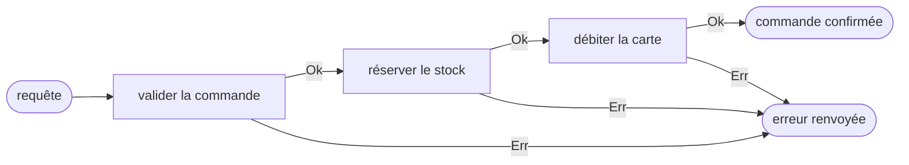

**« Define errors out of existence »** (John Ousterhout, 2018) : la meilleure gestion d'erreur est parfois de faire disparaître le cas. En Python, `my_set.remove(x)` lève `KeyError` si `x` est absent, alors que `my_set.discard(x)` ne fait rien : le but de l'appelant (que `x` ne soit plus dans l'ensemble) est atteint dans les deux cas, et la seconde version lui épargne un `try`. Je conçois mes propres API de la même façon : `cancel_order()` sur une commande déjà annulée renvoie simplement la commande, sans erreur.

**Quand choisir quoi** : exceptions pour l'inattendu et dans un langage où c'est l'usage ; type résultat quand l'échec est fréquent et métier, et que je veux que le compilateur ou le vérificateur de types oblige à le traiter ; suppression du cas quand l'appelant n'a de toute façon rien à faire de l'erreur.

:material-book-open-variant: Doc de référence : [Jim Shore, « Fail Fast », IEEE Software](https://martinfowler.com/ieeeSoftware/failFast.pdf) (2004) ; [Scott Wlaschin, « Railway Oriented Programming »](https://fsharpforfunandprofit.com/rop/) (2014)
{ .doc-ref }

!!! maturity "Mesurer la maturité"
    | Niveau | Ce que j'observe dans l'équipe |
    |---|---|
    | N1 | certaines fonctions ont des clauses de garde et des exceptions dédiées, d'autres avalent encore des erreurs avec `except Exception: pass` |
    | N2 | des règles partagées sont appliquées : échec rapide à l'entrée, une exception métier par erreur attendue, journalisation unique à la frontière, lecteur tolérant pour les API des autres équipes |
    | N3 | le linter refuse les `except` vides et la complexité cognitive au-dessus d'un seuil ; un test de contrat casse la CI quand le fournisseur retire un champ que je lis |
    | N4 | l'équipe suit les erreurs inattendues en production, les erreurs avalées détectées et la complexité cognitive, et ajuste ses règles d'après ces chiffres |

    **Je mesure** : le nombre d'exceptions non traitées par semaine, lu dans l'outil de suivi d'erreurs ; le nombre de fonctions au-dessus du seuil de complexité cognitive, lu dans l'analyse statique.

## Faire évoluer le code

<a class="pill pill-scope pill-scope-code" href="../architecture/#carte-des-echelles">Échelle · Code</a> <a class="pill pill-scope pill-scope-app" href="../architecture/#carte-des-echelles">Échelle · Application</a>

Les principes servent surtout quand je modifie un code qui existe déjà. Cette partie dit comment le changer sans le casser : refactorer par petits pas, intervenir dans un code sans tests, et parler de la dette qui ralentit l'équipe.

### Refactoring en petits pas

<span class="pill pill-status pill-status-ok" title="Toujours valable, vérifié en novembre 2026">Valable · 11/2026</span>

Le **<span class="term" data-term="refactoring">refactoring</span>** (Martin Fowler, « Refactoring », 1999, 2e édition 2018) change la structure du code sans changer son comportement observable. Fowler en tient un catalogue : des transformations nommées (*Extract Function*, *Rename Variable*, *Replace Conditional with Polymorphism*), chacune avec ses étapes sûres. Ce qui déclenche un refactoring est une <span class="term" data-term="code-smell">odeur de code</span> qui gêne le changement que je dois faire : fonction longue, duplication, liste de paramètres sans fin.

**Quand** : au moment où je dois modifier ce code, pas dans un projet de nettoyage séparé que personne ne finance. **Quand ne pas** : sans tests qui couvrent le comportement (je commence par en écrire, voir [code legacy](#modifier-du-code-legacy)), ou sur un module stable que personne ne touche.

**Comment** :

- **Petits pas** : renommer, extraire une fonction, déplacer, et lancer les tests après chaque étape. Si un test casse, je sais que c'est la dernière minute de travail, et je reviens en arrière.
- **Outils de l'éditeur** : les refactorings automatiques (renommer, extraire) sont plus sûrs qu'un copier-coller.
- **Commits séparés** : un commit `refactor:` qui ne change aucun comportement, puis un commit `feat:` ou `fix:`. Le relecteur vérifie chaque commit pour ce qu'il prétend faire.

**Le refactoring préparatoire.** Kent Beck l'a résumé en 2012 : « pour chaque changement voulu, rendre le changement facile (attention, ça peut être difficile), puis faire le changement facile ». On me demande d'ajouter la livraison en Belgique. Le classique à éviter : un seul commit qui réorganise les tarifs et ajoute la Belgique, où le relecteur ne peut plus distinguer ce qui change de comportement.

``` { .python .ex-good title="Recommandé" }
# Exemple : point de départ, chaque tarif est codé en dur dans une chaîne de if
def shipping_cost(country: str, weight_kg: float) -> float:
    if country == "FR":
        return 5 + weight_kg * 0.5
    elif country == "DE":
        return 7 + weight_kg * 0.6
    raise ValueError(country)


# Ce qui change : commit 1, refactor, même comportement, les tests existants restent verts
RATES = {"FR": (5, 0.5), "DE": (7, 0.6)}


def shipping_cost(country: str, weight_kg: float) -> float:
    if country not in RATES:
        raise ValueError(country)
    base, per_kg = RATES[country]
    return base + weight_kg * per_kg


# Ce qui change : commit 2, feat, une ligne et un test
RATES = {"FR": (5, 0.5), "DE": (7, 0.6), "BE": (6, 0.55)}
```

**La règle du boy scout** (Robert C. Martin, « Clean Code », 2008, d'après la consigne scoute de laisser le camp plus propre qu'on ne l'a trouvé) : à chaque passage, je laisse le code un peu plus propre, un nom clarifié, une fonction extraite, sans dériver vers une refonte hors sujet dans la même MR.

**La <span class="term" data-term="mikado-method">méthode Mikado</span>** (Ola Ellnestam et Daniel Brolund, « The Mikado Method », 2014) sert aux gros refactorings, quand tirer un fil en fait bouger dix. J'essaie le changement visé ; si ça casse, je note les prérequis découverts dans un graphe, **j'annule mon essai**, et je recommence par une feuille du graphe. Chaque feuille se livre seule, le code reste toujours dans un état qui marche.

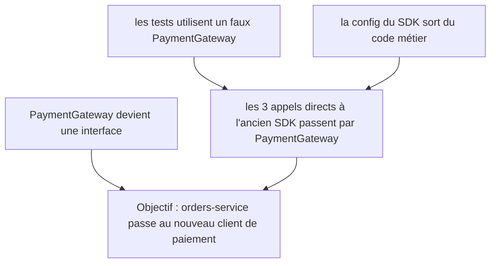

:material-book-open-variant: Doc de référence : [Martin Fowler, « Refactoring catalog »](https://refactoring.com/catalog/) (consultée en novembre 2026) ; [Martin Fowler, « An example of preparatory refactoring »](https://martinfowler.com/articles/preparatory-refactoring-example.html) (2015) ; [Ellnestam et Brolund, « The Mikado Method », Manning](https://www.manning.com/books/the-mikado-method) (2014)
{ .doc-ref }

### Modifier du code legacy

<span class="pill pill-status pill-status-ok" title="Toujours valable, vérifié en novembre 2026">Valable · 11/2026</span>

Pour Michael Feathers (« Working Effectively with Legacy Code », 2004), le <span class="term" data-term="legacy-code">code legacy</span> est simplement du code sans tests, quel que soit son âge : je ne peux pas le modifier sans risque, parce que rien ne me dira si je l'ai cassé. Le piège, c'est que pour ajouter des tests il faut souvent modifier le code, et que pour le modifier il faudrait des tests.

**L'algorithme de modification de Feathers** sort de ce cercle en cinq étapes :

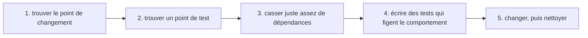

Les tests de l'étape 4 sont des <span class="term" data-term="characterization-test">tests de caractérisation</span> : ils enregistrent ce que le code fait aujourd'hui, même si c'est bizarre, pour détecter tout changement involontaire. Ils sont détaillés sur la page [Qualité et tests](qualite.md).

**Le seam.** Un <span class="term" data-term="seam">seam</span> (point de jonction) est un endroit où je peux changer le comportement du code sans modifier ce code. Le plus courant en langage objet : passer la dépendance gênante en paramètre, avec la vraie implémentation par défaut. Les appelants existants ne changent pas, et mon test passe un faux.

``` { .python .ex-bad title="À éviter" }
# À éviter : l'API du transporteur et l'horloge sont créées dans la méthode, impossible de tester sans réseau
def checkout(cart):
    carrier = CarrierApi()
    today = date.today()
    ...
```

``` { .python .ex-good title="Recommandé" }
# Bien : un seam, la dépendance devient un paramètre avec la vraie valeur par défaut
def checkout(cart, carrier: Carrier | None = None, today: date | None = None):
    carrier = carrier or CarrierApi()
    today = today or date.today()
    ...
```

**<span class="term" data-term="sprout-method">Sprout Method</span> et Wrap Method** (même livre). Pour ajouter une règle « livraison gratuite dès 50 € » dans une méthode `checkout()` de 400 lignes sans tests :

- **Sprout Method** (faire pousser) : j'écris la nouvelle logique dans une nouvelle fonction, testée à part, et je l'appelle depuis l'ancien code. L'ancien code change d'une ligne. Variante *Sprout Class* quand la nouvelle logique a besoin de ses propres dépendances.
- **Wrap Method** (envelopper) : je renomme l'ancienne méthode et j'en crée une nouvelle, du même nom, qui appelle l'ancienne et ajoute le comportement avant ou après (journaliser, auditer).

``` { .python .ex-bad title="À éviter" }
# À éviter : un if de plus au milieu des 400 lignes, impossible à tester sans tout le checkout
def checkout(cart):
    ...
    fee = carrier.base_fee()
    if cart.subtotal_cents >= 5000:
        fee = 0
    ...
```

``` { .python .ex-good title="Recommandé" }
# Bien : Sprout Method, la règle vit dans une fonction pure testée seule
FREE_SHIPPING_THRESHOLD_CENTS = 5000


def shipping_fee(subtotal_cents: int, base_fee_cents: int) -> int:
    if subtotal_cents >= FREE_SHIPPING_THRESHOLD_CENTS:
        return 0
    return base_fee_cents


# Ce qui change : dans checkout(), une seule ligne appelle la nouvelle fonction
def checkout(cart):
    ...
    fee = shipping_fee(cart.subtotal_cents, carrier.base_fee())
    ...
```

`shipping_fee` est une <span class="term" data-term="pure-function">fonction pure</span> : trois tests (49,99 € payant, 50 € gratuit, panier vide payant) la couvrent en quelques millisecondes. La refonte de `checkout()` attendra, ticket par ticket.

**Quand** : chaque fois que je dois changer un code sans tests. **Quand ne pas** : si le code est petit et simple, je le couvre directement. **Pourquoi** : je livre la fonctionnalité sans parier sur une réécriture, et je laisse une première zone testée qui servira d'appui au changement suivant. Pour remplacer tout un système plutôt qu'une méthode, voir le [Strangler Fig](textes-fondateurs.md#fowler-strangler-fig-application-2004).

**Risques.** Les tests de caractérisation figent aussi les bugs : si je les prends pour la spécification, je protège un comportement faux. Quand le comportement est douteux, je l'écris dans le test (« actuel, pas voulu »). Multipliés, les seams à valeur par défaut laissent des paramètres de test partout dans les signatures de production : je les nettoie quand la zone est enfin découpée.

:material-book-open-variant: Doc de référence : [Martin Fowler, « LegacySeam »](https://martinfowler.com/bliki/LegacySeam.html) (2024), sur les seams de Michael Feathers
{ .doc-ref }

### Dette technique

<span class="pill pill-status pill-status-ok" title="Toujours valable, vérifié en novembre 2026">Valable · 11/2026</span>

La <span class="term" data-term="technical-debt">dette technique</span> est une métaphore de Ward Cunningham (rapport d'expérience « The WyCash Portfolio Management System », OOPSLA, 1992) : livrer un code pas tout à fait juste, c'est emprunter. Ça va vite au début, mais il y a des **intérêts** : chaque changement dans cette zone coûte un peu plus de temps. Tant que je rembourse (je refactore à mesure que je comprends mieux), tout va bien ; si je ne rembourse jamais, les intérêts finissent par absorber tout le temps de l'équipe.

!!! noob "As noob"
    C'est une carte de crédit : payer avec permet d'avoir l'objet tout de suite, et ce n'est pas un problème si je rembourse vite. Ce qui ruine, c'est de ne payer que les intérêts mois après mois. Et une dette sur un objet que je n'utilise jamais ne me coûte presque rien. La phrase à retenir : **une dette coûte quand je touche souvent au code concerné, pas parce que le code est laid.**

**Le quadrant de Fowler** (Martin Fowler, « TechnicalDebtQuadrant », 2009) distingue d'où vient la dette :

| | Imprudente | Prudente |
|---|---|---|
| **Délibérée** | « on n'a pas le temps de concevoir » | « on livre maintenant et on assume les conséquences » |
| **Involontaire** | « c'est quoi, une architecture en couches ? » | « maintenant on sait comment on aurait dû faire » |

Seule la case « prudente et délibérée » est un vrai emprunt choisi. La case « prudente et involontaire » est normale : on apprend en construisant.

**Trouver la dette qui coûte : l'<span class="term" data-term="hotspot-analysis">analyse des points chauds</span>.** Adam Tornhill (« Your Code as a Crime Scene », 2015, 2e édition 2024) croise deux mesures tirées du dépôt : le **churn** (combien de fois un fichier a été modifié) et sa <span class="term" data-term="code-complexity">complexité</span>. Un fichier complexe que personne ne touche coûte peu ; un fichier complexe modifié chaque semaine est un **point chaud**, c'est là que le remboursement rapporte.

``` { .bash .ex-ref title="Référence" }
# Exemple : les 10 fichiers les plus modifiés depuis un an (le churn), à croiser avec leur complexité
git log --since="1 year ago" --name-only --format="" | sort | uniq -c | sort -rn | head -10
```

**Quand** : je veux convaincre un Product Owner de traiter une dette, ou choisir quoi refactorer en premier. **Comment** :

- je parle en conséquences, pas en jugement : « chaque nouvelle promotion prend trois jours au lieu d'un, et a causé deux bugs ce trimestre » plutôt que « le code est sale » (chiffres d'exemple) ;
- je ne cite que la dette d'une zone qu'on modifie souvent ou qu'on va modifier ;
- je rembourse par tranches, dans les fonctionnalités qui touchent la zone (refactoring préparatoire), plutôt qu'en refonte de trois semaines à vendre ;
- je note chaque dette importante dans le backlog avec son impact estimé, pour que la décision de la traiter ou non soit prise en connaissance de cause.

Pour la dette qui s'accumule malgré tout avec le temps, voir les [lois de Lehman](lois-et-principes.md#lois-de-lehman).

**Risques.** Le mot sert d'étiquette à tout ce qui déplaît, et une liste de dette sans impact chiffré ne convainc personne. Utilisée pour justifier une refonte complète, la métaphore mène à la réécriture qui déborde : je rembourse par tranches. À l'inverse, ne jamais rembourser laisse les intérêts absorber tout le temps de l'équipe, donc chaque nouvelle fonctionnalité prend plus longtemps que la précédente.

:material-book-open-variant: Doc de référence : [Ward Cunningham, « The WyCash Portfolio Management System »](http://c2.com/doc/oopsla92.html) (1992) ; [Martin Fowler, « TechnicalDebtQuadrant »](https://martinfowler.com/bliki/TechnicalDebtQuadrant.html) (2009) ; [Adam Tornhill, « Your Code as a Crime Scene », 2e édition, Pragmatic Bookshelf](https://pragprog.com/titles/atcrime2/your-code-as-a-crime-scene-second-edition/) (2024)
{ .doc-ref }

!!! maturity "Mesurer la maturité"
    | Niveau | Ce que j'observe dans l'équipe |
    |---|---|
    | N1 | une personne refactore quand elle a le temps, souvent dans de grosses MR qui mélangent nettoyage et fonctionnalité |
    | N2 | les commits `refactor:` sont séparés des `feat:`, des tests de caractérisation précèdent toute modification d'un code sans tests, et la dette est notée dans le backlog avec son impact |
    | N3 | la CI refuse une MR qui baisse la couverture des fichiers modifiés, et le refactoring préparatoire est fait dans chaque ticket qui touche une zone, sans qu'on le demande |
    | N4 | l'équipe suit le churn et la complexité des points chauds et le délai des tickets dans ces zones, et choisit la dette à rembourser d'après ces chiffres |

    **Je mesure** : la complexité des dix fichiers les plus modifiés, croisée avec leur churn tiré de `git log` ; le délai moyen des tickets qui touchent ces fichiers, lu dans l'outil de tickets.

## Mesurer le succès

Je sais qu'un principe a aidé quand les changements deviennent plus petits et plus sûrs, pas quand le code « respecte SOLID ». Avant de réorganiser une zone, je note une base sur ses dernières MR : le nombre de fichiers touchés par changement métier, les bugs de régression et le temps de revue. Je reprends la même mesure sur les changements des deux ou trois mois suivants. La métrique garde-fou est le nombre de fichiers et de couches à traverser pour suivre une action : s'il augmente, j'ai ajouté de la sur-ingénierie.

| Solution ou situation | Indicateur de succès (SLI) | SLO probable | SLA probable |
|---|---|---|---|
| responsabilité unique : isoler une règle métier, comme le taux de TVA | nombre de modules touchés par une MR qui change cette règle | un seul module dans 90 % des MR métier | sans objet : pas de contrat externe |
| inversion des dépendances : tester le domaine sans infrastructure | part des tests du domaine qui tournent sans base ni réseau, et durée de la suite | 100 % des tests du domaine, suite unitaire sous 2 minutes | sans objet : pas de contrat externe |
| DRY, règle de trois et YAGNI : éviter les abstractions hâtives | nombre de nouvelles interfaces à une seule implémentation et de drapeaux booléens ajoutés à une fonction partagée | aucune nouvelle interface à une seule implémentation par trimestre | sans objet : pas de contrat externe |
| gestion des erreurs : échec rapide, aucune exception avalée | nombre de `except` vides ou génériques, et erreurs inattendues en production par semaine | zéro `except` vide ; erreurs inattendues divisées par deux en un trimestre | disponibilité de l'API promise au client, par exemple 99,5 % par mois, plus lâche que le SLO interne de 99,9 % que ces erreurs consomment |
| lecteur tolérant face à l'API d'une autre équipe | nombre d'incidents causés par un champ ajouté chez le fournisseur | zéro par trimestre | sans objet : pas de contrat externe |
| refactoring en petits pas, commits séparés | part des MR de refactoring séparées en `refactor:` puis `feat:`, et taux de retour arrière | 80 % des MR séparées, moins de 5 % de retours arrière | sans objet : pas de contrat externe |
| dette technique : rembourser les points chauds | délai moyen d'un ticket qui touche les dix fichiers les plus modifiés | baisse de 30 % en deux trimestres | sans objet : pas de contrat externe |

[À prendre avec précaution : ordres de grandeur d'exemple, à fixer avec le métier]

!!! noob "As noob"
    Le SLO, c'est la règle que je me fixe moi-même, comme « je range mon atelier chaque vendredi » ; le SLA, c'est ce que je signe avec un client, avec une pénalité si je ne le tiens pas, comme « la réparation livrée sous dix jours ou remise de 20 % ». Je garde toujours ma règle interne plus exigeante que ma promesse, pour avoir de la marge. La phrase à retenir : **le SLO est ma cible interne, le SLA est l'engagement plus lâche que je signe avec un client.**

## Pièges à éviter

- **SOLID comme checklist** : j'applique les cinq principes partout, par principe. Résultat : une interface par classe, une fabrique pour chaque objet, et un nouveau venu qui ouvre huit fichiers pour suivre une seule action. Un principe répond à une douleur que j'ai aujourd'hui, pas à une liste à cocher.
- **Une interface pour une seule implémentation** : je crée `OrderRepositoryInterface` « au cas où », alors qu'il n'existe que la version PostgreSQL. J'ai deux fichiers au lieu d'un, et rien n'est découplé. J'ajoute l'interface le jour où arrive une deuxième implémentation, ou un test qui a besoin d'un faux.
- **DRY entre deux contextes métier** : la facturation et le support ont chacun un `Customer` avec les mêmes champs, alors je les fusionne. Puis la facturation veut ajouter un numéro de TVA et le support un niveau de priorité : chaque équipe doit attendre l'accord de l'autre pour toucher au modèle commun, qui devient un point de blocage.
- **DRY sur les tests** : je factorise mes tests à coups de helpers imbriqués et de paramètres partout. Le jour où un test casse, il faut remonter trois fonctions pour comprendre ce qu'il vérifiait. Dans un test, la lisibilité passe avant l'absence de répétition.
- **Confondre inversion et injection de dépendances** : un [conteneur d'injection](design-patterns.md#conteneur-dinjection) (l'objet qui construit les objets et branche leurs dépendances) ne garantit pas que le métier ne dépend pas du technique. Ce qui compte, c'est qui définit l'interface.
- **Héritage pour réutiliser du code** : j'hérite d'une classe juste pour profiter de ses méthodes, sans vraie relation « est un », comme un `ArchiveRepository` qui hérite d'un dépôt modifiable. Tôt ou tard, une méthode héritée n'a plus de sens pour l'enfant et Liskov casse.
- **Avaler une exception** : j'entoure un appel de `try / except Exception: pass` pour que « ça ne plante plus ». Une panne du prestataire de paiement devient un succès silencieux, et des commandes partent « payées » sans paiement. J'attrape seulement les erreurs que je sais traiter et je laisse remonter les autres ([Gestion des erreurs](#gestion-des-erreurs)).
- **Optimisation sans mesure** : je complique un code parce que je suppose qu'il est lent, sans l'avoir mesuré. Souvent la vraie lenteur est ailleurs, et j'ai un code plus dur à lire pour rien. Je mesure d'abord.

## Ce qu'on demande en entretien

Les questions typiques :

- « Explique SOLID, donne un exemple pour chaque lettre », « Explique Liskov », « Comment appliques-tu SOLID sans sur-ingénierie ? » Pour répondre : je donne pour chaque lettre le symptôme qu'elle soigne, comme le carré qui hérite du rectangle et casse le test d'aire pour Liskov, et j'attends un vrai besoin (une deuxième implémentation, un test qui réclame un faux) avant d'ajouter une interface ([SOLID](#solid), [L : substitution de Liskov](#l-substitution-de-liskov), [Pièges à éviter](#pieges-a-eviter)).
- « Quand une duplication vaut-elle mieux qu'une abstraction ? », « Composition ou héritage ? » Pour répondre : je garde la duplication tant que les deux codes représentent des règles différentes ou que je n'ai pas trois exemples, et je préfère la composition, qui se change et se teste séparément, à l'héritage qui lie l'enfant à tout le parent ([DRY, WET et AHA](#dry-wet-et-aha), [YAGNI et règle de trois](#yagni-et-regle-de-trois), [Composition plutôt qu'héritage](#composition-plutot-quheritage)).
- « Faut-il imposer des principes de conception à plusieurs équipes ? », « Comment rendre un code maintenable ? », « Quand créer une bibliothèque partagée ? » Pour répondre : je partage les principes comme un vocabulaire de revue, avec la liste STUPID, plutôt que comme une règle imposée, je vise une forte cohésion et un faible couplage, et je crée une bibliothèque partagée seulement quand plusieurs équipes ont vraiment besoin du même code ([STUPID](#stupid-les-six-odeurs-a-eviter), [Séparation des préoccupations, cohésion et couplage](#separation-des-preoccupations-cohesion-et-couplage), [Principes des composants](#principes-des-composants)).
- « Comment concevoir une bibliothèque, un SDK ou une CLI interne qui évolue sans casser ses utilisateurs ? » Pour répondre : je publie chaque version avec un numéro et un changelog, je garde des dépendances sans cycle et tournées vers plus stable que moi, et je pars du principe que tout comportement visible finira par être utilisé ([Principes des composants](#principes-des-composants), [Principe de moindre surprise](#principe-de-moindre-surprise), et [Loi de Hyrum](lois-et-principes.md#loi-de-hyrum)).
- « Appliques-tu SOLID et DRY au code de test ? », « DRY ou DAMP dans les tests ? » Pour répondre : j'applique SOLID aux outils de test, comme un faux qui n'implémente que ce que le test appelle, mais dans le corps d'un test je préfère DAMP (des phrases descriptives, quitte à répéter), car un test doit se lire seul sans remonter trois helpers ([I : ségrégation des interfaces](#i-segregation-des-interfaces), [Pièges à éviter](#pieges-a-eviter)).

- « Comment gères-tu les erreurs ? », « Exceptions ou type résultat ? » Pour répondre : je sépare les erreurs métier attendues, traitées comme un résultat normal, des pannes, que je laisse remonter jusqu'à la frontière où je les journalise une fois ; j'échoue tôt sur une entrée invalide et je n'avale jamais une exception ([Gestion des erreurs](#gestion-des-erreurs), [Conception par contrat](#conception-par-contrat)).
- « Comment modifies-tu un code legacy sans tests ? », « Quand refactores-tu ? » Pour répondre : je cherche un point de test, je crée un seam minimal, je fige le comportement par des tests de caractérisation, puis je fais pousser la nouvelle logique dans une fonction testée ; je refactore au moment où je dois changer le code, par petits pas et en commits séparés ([Modifier du code legacy](#modifier-du-code-legacy), [Refactoring en petits pas](#refactoring-en-petits-pas)).
- « Comment parles-tu de dette technique au Product Owner ? » Pour répondre : je chiffre ce qu'elle coûte en délais et en bugs, je ne cite que la dette des zones souvent modifiées (les points chauds) et je propose un remboursement par tranches dans les fonctionnalités prévues ([Dette technique](#dette-technique)).
- « Comment prouves-tu qu'un refactoring ou un principe de conception a amélioré le code ? » Pour répondre : je compare avant et après le nombre de fichiers touchés par changement métier, les bugs de régression et le délai des tickets, avec une métrique garde-fou sur le nombre de couches à traverser pour suivre une action ([Mesurer le succès](#mesurer-le-succes)).

Ce qui fait une bonne réponse : nommer le principe, donner un exemple vécu (ou réaliste), puis dire **quand il ne s'applique pas**. C'est cette dernière partie qui distingue une réponse apprise d'une réponse d'expérience.

## Quel principe pour quel besoin

| Je veux... | J'utilise... |
|---|---|
| qu'une demande du marketing sur la facture, comme afficher les montants sans centimes, ne puisse pas changer le total que le comptable facture, parce que les deux passent par la même méthode d'arrondi | responsabilité unique |
| ajouter un mode de livraison, comme le retrait en point relais, sans rouvrir la fonction de calcul qui marche déjà | ouvert/fermé (souvent via Strategy) |
| être sûr qu'un code qui reçoit un `OrderRepository` ne plante pas quand on lui passe une sous-classe, comme un dépôt d'archives en lecture seule | substitution de Liskov |
| que mon faux pour les tests n'ait pas à implémenter quinze méthodes alors que le test n'en appelle qu'une | ségrégation des interfaces |
| tester la règle « passer une commande » sans lancer de base de données ni appeler le réseau | inversion des dépendances, avec injection |
| repérer vite, en relisant une MR, ce qui rendra le code dur à tester ou à faire évoluer | la liste STUPID |
| choisir entre deux solutions qui marchent, en pensant au collègue qui devra les relire | KISS |
| savoir si deux bouts de code qui se ressemblent doivent être fusionnés, ou s'ils représentent deux règles différentes | DRY (connaissance, pas texte) et règle de trois |
| résister à l'envie d'ajouter un export ou une option « parce qu'on en aura sûrement besoin » | YAGNI |
| arrêter d'écrire `order.get_customer().get_address().get_city()`, qui casse dès qu'une de ces classes change, comme le jour où `Customer` passe à plusieurs adresses | loi de Déméter, Tell, don't ask |
| envoyer un rapport par e-mail, en PDF ou les deux, sans créer une sous-classe par combinaison | composition plutôt qu'héritage |
| savoir où ranger un calcul, comme le total d'une commande : dans `Order` ou dans une classe à part | GRASP (Information Expert) |
| découper une bibliothèque partagée entre plusieurs équipes, ou un monorepo, sans que chaque changement oblige tout le monde à suivre | principes des composants (CCP, ADP, SDP) |
| un critère moins dogmatique que SOLID, pour juger un code sans cocher une liste | CUPID |
| que les utilisateurs de mon API ou de ma CLI ne se fassent pas piéger, comme un `--dry-run` qui écrit quand même | moindre surprise |
| lire une fonction dont le vrai calcul est caché sous trois niveaux de `if` | clauses de garde |
| éviter que chaque appelant de mon dépôt doive enchaîner connexion, transaction et commit dans le bon ordre | module profond |
| dire clairement qui doit vérifier qu'un montant de retrait est positif : l'appelant ou la méthode | conception par contrat |
| que mon service ne casse pas quand une autre équipe ajoute un champ à la réponse de son API | lecteur tolérant |
| qu'une panne du prestataire de paiement ne transforme pas une commande en « payée », tout en traitant une carte refusée comme un cas normal | gestion des erreurs (attendues ou non, échec rapide, type résultat) |
| ajouter un pays de livraison sans mélanger dans le même commit la réorganisation des tarifs et le nouveau tarif | refactoring préparatoire, en petits pas |
| ajouter une règle dans une méthode de 400 lignes sans tests, sans la réécrire | seam, Sprout Method, tests de caractérisation |
| convaincre un Product Owner de traiter une dette, en commençant par les fichiers qui coûtent vraiment | dette technique, analyse des points chauds |

## Sources

- Robert C. Martin, « Design Principles and Design Patterns » (2000)
- Robert C. Martin, « Agile Software Development, Principles, Patterns, and Practices » (2002)
- Robert C. Martin, « Clean Architecture » (2017)
- [Robert C. Martin, « The Single Responsibility Principle » (2014)](https://blog.cleancoder.com/uncle-bob/2014/05/08/SingleReponsibilityPrinciple.html)
- Bertrand Meyer, « Object-Oriented Software Construction » (1988)
- Barbara Liskov, « Data Abstraction and Hierarchy », keynote OOPSLA (1987)
- [Barbara Liskov et Jeannette Wing, « A Behavioral Notion of Subtyping » (1994)](https://dl.acm.org/doi/10.1145/197320.197383)
- [William Durand, « From STUPID to SOLID Code! » (2013, date à vérifier)](https://williamdurand.fr/2013/07/30/from-stupid-to-solid-code/)
- Andy Hunt et Dave Thomas, « The Pragmatic Programmer » (1999, 2e édition 2019)
- [Sandi Metz, « The Wrong Abstraction » (2016)](https://sandimetz.com/blog/2016/1/20/the-wrong-abstraction)
- [Kent C. Dodds, « AHA Programming » (date de publication non indiquée)](https://kentcdodds.com/blog/aha-programming)
- Martin Fowler, « Refactoring » (1999, 2e édition 2018), pour la règle de trois
- Karl Lieberherr, Ian Holland et Arthur Riel, « Object-Oriented Programming: An Objective Sense of Style », OOPSLA (1988), pour la loi de Déméter
- [Martin Fowler, « TellDontAsk » (2013)](https://martinfowler.com/bliki/TellDontAsk.html)
- Erich Gamma, Richard Helm, Ralph Johnson et John Vlissides, « Design Patterns » (1994)
- Edsger W. Dijkstra, « On the role of scientific thought », EWD447 (1974)
- Craig Larman, « Applying UML and Patterns » (1997)
- [Dan North, « CUPID: for joyful coding » (2022)](https://dannorth.net/blog/cupid-for-joyful-coding/)
- Donald Knuth, « Structured Programming with go to Statements » (1974)
- Joshua Bloch, « Effective Java », 3e édition (2018), pour la classe de base fragile
- Kent Beck, « Extreme Programming Explained » (1999), pour les quatre règles du design simple
- [Martin Fowler, « BeckDesignRules » (2015)](https://martinfowler.com/bliki/BeckDesignRules.html)
- [John Ousterhout, « A Philosophy of Software Design » (2018, 2e édition 2021)](https://web.stanford.edu/~ouster/cgi-bin/book.php)
- [Martin Fowler, « TolerantReader » (2011)](https://martinfowler.com/bliki/TolerantReader.html)
- [Jim Shore, « Fail Fast », IEEE Software (2004)](https://martinfowler.com/ieeeSoftware/failFast.pdf)
- [Scott Wlaschin, « Railway Oriented Programming » (2014)](https://fsharpforfunandprofit.com/rop/)
- Robert C. Martin, « Clean Code » (2008), pour la règle du boy scout
- [Martin Fowler, « An example of preparatory refactoring » (2015)](https://martinfowler.com/articles/preparatory-refactoring-example.html)
- [Ola Ellnestam et Daniel Brolund, « The Mikado Method » (2014)](https://www.manning.com/books/the-mikado-method)
- Michael Feathers, « Working Effectively with Legacy Code » (2004)
- [Martin Fowler, « LegacySeam » (2024)](https://martinfowler.com/bliki/LegacySeam.html)
- [Ward Cunningham, « The WyCash Portfolio Management System », OOPSLA (1992)](http://c2.com/doc/oopsla92.html)
- [Martin Fowler, « TechnicalDebtQuadrant » (2009)](https://martinfowler.com/bliki/TechnicalDebtQuadrant.html)
- [Adam Tornhill, « Your Code as a Crime Scene » (2015, 2e édition 2024)](https://pragprog.com/titles/atcrime2/your-code-as-a-crime-scene-second-edition/)
