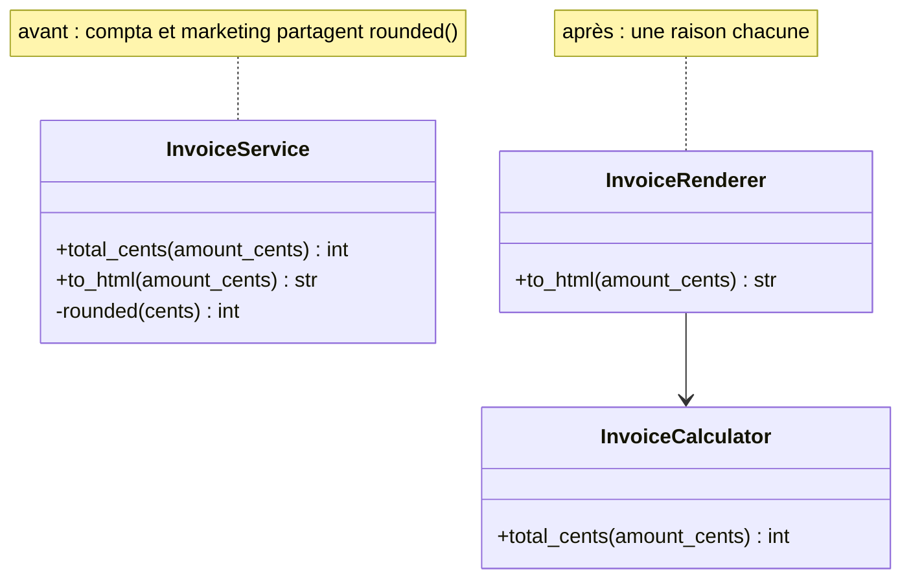
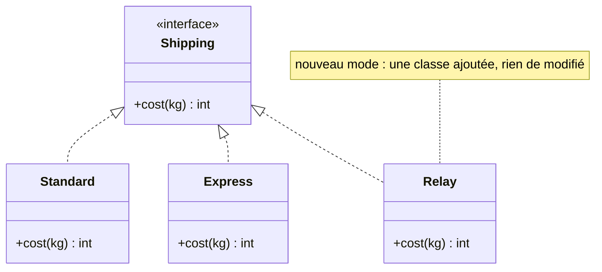
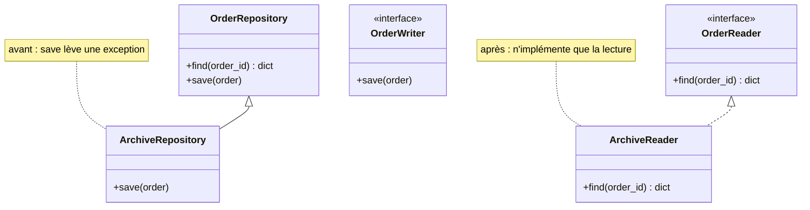
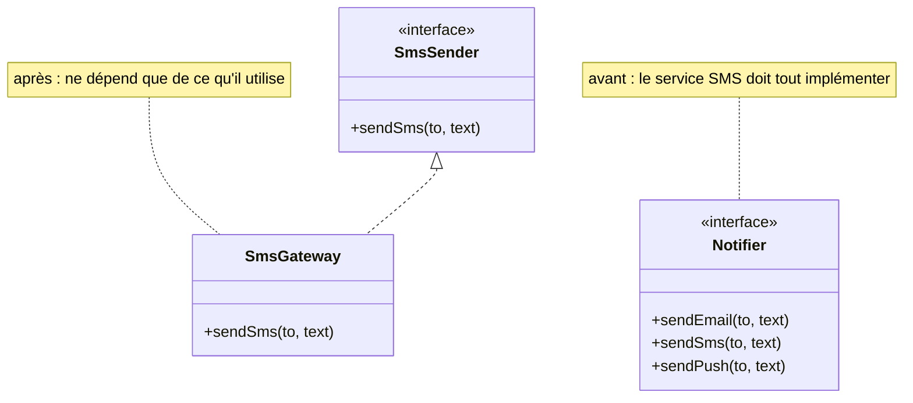
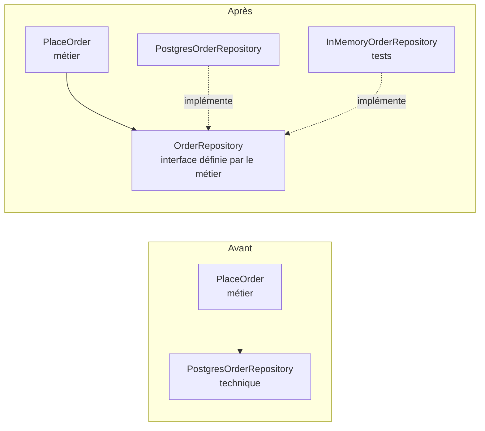
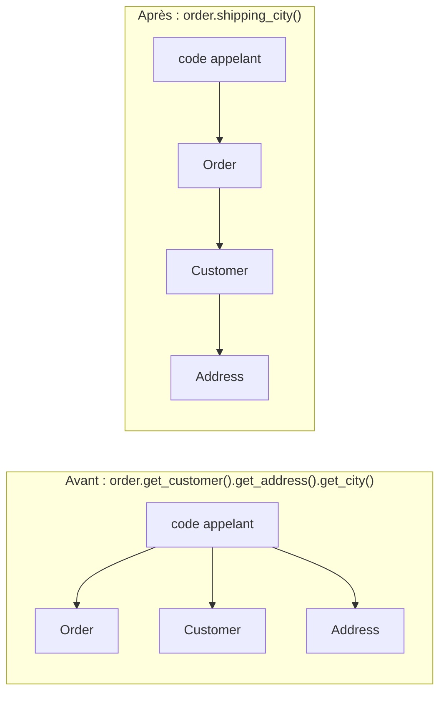
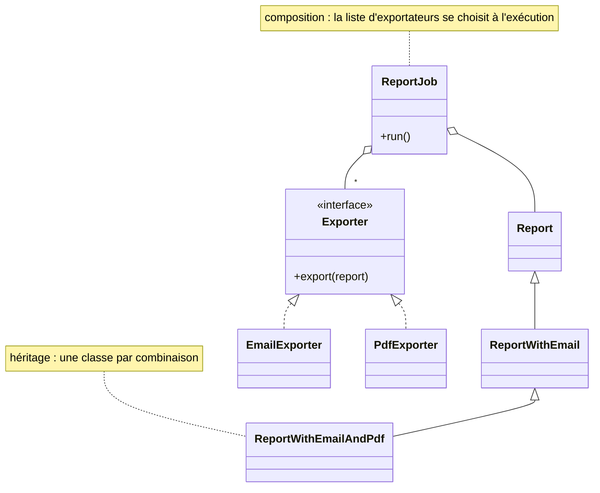
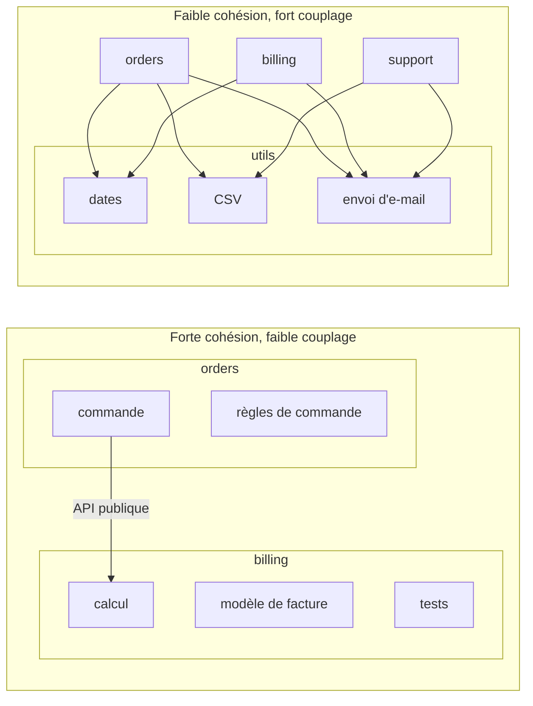

# Principes de conception

!!! warning "Avertissement"
    Ces notes sont des pense-bêtes personnels, pas une source de vérité. Elles reflètent ma compréhension et mes choix : leur contenu reste subjectif, malgré les citations et les références qu'il contient. Il peut être incomplet, simplifié, inexact ou dépassé. Vérifiez toujours dans la documentation officielle avant de l'appliquer. Ce contenu est fourni tel quel, sans aucune garantie : son utilisation se fait sous votre seule responsabilité.

!!! abstract "Les échelles"
    Les pastilles de couleur sous les titres disent à quelle échelle une notion s'applique :

    - <span class="pill pill-scope pill-scope-code">Code</span> les classes, fonctions et modules d'un programme ;
    - <span class="pill pill-scope pill-scope-app">Application</span> un service ou une application et son découpage interne ;
    - <span class="pill pill-scope pill-scope-system">Système</span> plusieurs services qui communiquent par le réseau ;
    - <span class="pill pill-scope pill-scope-infra">Infrastructure</span> les serveurs, le réseau, les zones et les clusters, physiques ou virtuels ;
    - <span class="pill pill-scope pill-scope-enterprise">Entreprise</span> le système d'information entier et son organisation.

    Détail et mots ambigus : [carte des échelles](architecture.md#carte-des-echelles).

Un **principe de conception** est une règle de bon sens, nommée, qui aide à décider comment découper et relier le code. Contrairement à un [design pattern](design-patterns.md), ce n'est pas une forme de solution : c'est un critère pour juger une solution. « Cette classe change pour trois raisons » ou « ce test est impossible à écrire sans base de données » sont des constats que les principes permettent de nommer.

Cette page présente SOLID, son contraire STUPID, puis les principes voisins (KISS, DRY, YAGNI, Déméter, composition plutôt qu'héritage...). Les exemples sont courts, avec le même code en PHP, Python et Java. Les noms des services et des données sont fictifs.

!!! tip "Choisir le langage"
    Clique sur un langage : **tous les exemples de la page** passent dans ce langage, et le choix est gardé d'une page à l'autre.

=== "PHP"

    Exemples affichés en **PHP 8.3** (classes `readonly`, `match`, enums).

=== "Python"

    Exemples affichés en **Python 3.12** (`Protocol`, `dataclass`, annotations de type).

=== "Java"

    Exemples affichés en **Java 21** (`record`, `switch` en expression, `enum`).

## Vocabulaire

**<span class="term" data-term="interface-code">Interface</span>** : un contrat qui liste des méthodes sans les écrire. Toute classe qui l'implémente promet de les fournir.

**Abstraction** : ce qu'un code appelant voit d'un autre code (une interface, une fonction, une classe de base), en ignorant les détails derrière.

**<span class="term" data-term="coupling">Couplage</span>** : à quel point un morceau de code dépend des détails d'un autre. Fort couplage : changer l'un oblige à changer l'autre.

**<span class="term" data-term="cohesion">Cohésion</span>** : à quel point ce qui est rangé ensemble (dans une classe, un module) sert le même but. Forte cohésion : tout ce qui est dans `InvoiceCalculator` parle de calcul de facture.

**<span class="term" data-term="code-smell">Code smell</span>** : un signe, dans le code, qu'un problème de conception est probable. Ce n'est pas un bug, c'est une odeur qui invite à regarder de plus près.

**<span class="term" data-term="over-engineering">Sur-ingénierie</span>** : ajouter des couches, des interfaces ou des options pour des besoins qui n'existent pas encore.

**Principe ou règle** : un principe se discute selon le contexte. Aucun de ceux de cette page n'est une loi : chacun a un coût, et un bon relecteur sait dire quand il ne s'applique pas.

## SOLID

<a class="pill pill-scope pill-scope-code" href="../architecture/#carte-des-echelles">Échelle · Code</a>

<a class="pill pill-practice" href="../livraison/#concevoir-avant-de-coder">Pratique · Conception technique</a>
<a class="pill pill-dora" href="https://dora.dev/capabilities/code-maintainability/">DORA · Code maintainability</a>


**<span class="term" data-term="solid">SOLID</span>** regroupe cinq principes de conception objet décrits par Robert C. Martin dans l'article « Design Principles and Design Patterns » (2000), puis dans le livre « Agile Software Development, Principles, Patterns, and Practices » (2002). L'acronyme lui-même est attribué à Michael Feathers, vers 2004 (date à vérifier). Plusieurs principes sont plus anciens : l'ouvert/fermé vient de Bertrand Meyer (« Object-Oriented Software Construction », 1988), la substitution de Barbara Liskov (conférence « Data Abstraction and Hierarchy », 1987, puis Liskov et Wing, 1994).

Ils servent surtout à une chose : **faire qu'un changement ne touche qu'un seul endroit du code**. Quand le comptable change le taux de TVA, je veux modifier un seul fichier, pas dix. Et quand mon équipe change de fournisseur d'e-mail ou de base de données, la règle métier ne doit pas bouger d'une ligne : si le calcul des factures et l'appel à la base sont dans la même méthode, chaque migration technique me fait rouvrir le calcul, avec le risque de le casser.

:material-book-open-variant: Doc de référence : [Robert C. Martin, « Solid Relevance »](https://blog.cleancoder.com/uncle-bob/2020/10/18/Solid-Relevance.html) (2020)
{ .doc-ref }

### S : responsabilité unique

<span class="pill pill-status pill-status-ok" title="Toujours valable, vérifié en novembre 2026">Valable · 11/2026</span>

**Définition** : la <span class="term" data-term="single-responsibility">responsabilité unique</span> (*Single Responsibility Principle*) dit qu'une classe ne doit avoir qu'une seule raison de changer. Robert C. Martin l'a reformulée plus tard : un module ne doit répondre qu'à un seul acteur (une seule personne ou équipe qui demande des changements).

!!! noob "As noob"
    Responsabilité unique ne veut pas dire « une seule méthode » : ça veut dire qu'une seule personne a des raisons de demander un changement. Si le comptable (le total facturé) et le marketing (l'affichage de la facture) font modifier la même classe, leurs méthodes finissent souvent par partager un bout de code, et la retouche demandée par l'un fausse en silence le résultat de l'autre. La phrase à retenir : **une classe, une seule raison de changer.**

**Symptôme** : une classe que deux équipes font modifier, pour des raisons sans rapport, et dont les méthodes partagent du code. `InvoiceService` calcule le total facturé pour le comptable et affiche la facture pour le marketing, et les deux appellent la même méthode privée d'arrondi. Le marketing demande d'afficher les montants sans centimes ; un développeur arrondit à l'euro dans cette méthode commune, et le total facturé perd ses centimes lui aussi, sans que le comptable l'ait demandé ni que le test de la page le voie. Robert C. Martin décrit le même mécanisme avec une classe `Employee` dans « Clean Architecture » (2017) : deux méthodes demandées par deux directions différentes partagent un calcul d'heures, et la modification voulue par l'une fausse les chiffres de l'autre.

**Exemple** : avant, `InvoiceService` calcule le total pour le comptable et met en page la facture pour le marketing, et les deux passent par la même méthode d'arrondi. Après, deux classes, chacune avec son propre arrondi et une seule raison de changer.



=== "PHP"

    ```php
    <?php

    final class InvoiceService
    {
        // À éviter : total demandé par le comptable, calculé via le rounded() partagé
        public function totalCents(int $amountCents): int
        {
            return $this->rounded($amountCents * 1.20);
        }

        // À éviter : affichage demandé par le marketing, via le même rounded()
        public function toHtml(int $amountCents): string
        {
            return "<h1>Facture</h1><p>" . $this->rounded($amountCents * 1.20) / 100 . " €</p>";
        }

        // À éviter : l'arrondir à l'euro pour l'affichage change aussi le total facturé
        private function rounded(float $cents): int
        {
            return (int) round($cents);
        }
    }

    // Ce qui change : la compta a sa classe, le total reste arrondi au centime
    final class InvoiceCalculator
    {
        public function totalCents(int $amountCents): int
        {
            return (int) round($amountCents * 1.20);
        }
    }

    // Ce qui change : le marketing arrondit l'affichage à l'euro, chez lui seulement
    final class InvoiceRenderer
    {
        public function __construct(private readonly InvoiceCalculator $calculator) {}

        public function toHtml(int $amountCents): string
        {
            return "<h1>Facture</h1><p>" . round($this->calculator->totalCents($amountCents) / 100) . " €</p>";
        }
    }
    ```

=== "Python"

    ```python
    class InvoiceService:
        # À éviter : total demandé par le comptable, calculé via le rounded() partagé
        def total_cents(self, amount_cents: int) -> int:
            return self._rounded(amount_cents * 1.20)

        # À éviter : affichage demandé par le marketing, via le même rounded()
        def to_html(self, amount_cents: int) -> str:
            return f"<h1>Facture</h1><p>{self._rounded(amount_cents * 1.20) / 100} €</p>"

        # À éviter : l'arrondir à l'euro pour l'affichage change aussi le total facturé
        def _rounded(self, cents: float) -> int:
            return round(cents)


    # Ce qui change : la compta a sa classe, le total reste arrondi au centime
    class InvoiceCalculator:
        def total_cents(self, amount_cents: int) -> int:
            return round(amount_cents * 1.20)


    # Ce qui change : le marketing arrondit l'affichage à l'euro, chez lui seulement
    class InvoiceRenderer:
        def __init__(self, calculator: InvoiceCalculator) -> None:
            self._calculator = calculator

        def to_html(self, amount_cents: int) -> str:
            return f"<h1>Facture</h1><p>{round(self._calculator.total_cents(amount_cents) / 100)} €</p>"
    ```

=== "Java"

    ```java
    final class InvoiceService {
        // À éviter : total demandé par le comptable, calculé via le rounded() partagé
        int totalCents(int amountCents) { return rounded(amountCents * 1.20); }
        // À éviter : affichage demandé par le marketing, via le même rounded()
        String toHtml(int amountCents) { return "<h1>Facture</h1><p>" + rounded(amountCents * 1.20) / 100.0 + " €</p>"; }
        // À éviter : l'arrondir à l'euro pour l'affichage change aussi le total facturé
        private int rounded(double cents) { return (int) Math.round(cents); }
    }

    // Ce qui change : la compta a sa classe, le total reste arrondi au centime
    final class InvoiceCalculator {
        int totalCents(int amountCents) { return (int) Math.round(amountCents * 1.20); }
    }

    // Ce qui change : le marketing arrondit l'affichage à l'euro, chez lui seulement
    final class InvoiceRenderer {
        private final InvoiceCalculator calculator;
        InvoiceRenderer(InvoiceCalculator calculator) { this.calculator = calculator; }
        String toHtml(int amountCents) { return "<h1>Facture</h1><p>" + Math.round(calculator.totalCents(amountCents) / 100.0) + " €</p>"; }
    }
    ```

La première version (`InvoiceService`) est l'« avant » : le total et l'affichage passent par la même méthode d'arrondi. Les deux classes suivantes sont l'« après » : le marketing a obtenu ses montants sans centimes dans `InvoiceRenderer`, et le total calculé par `InvoiceCalculator` n'a pas bougé.

**Quand ne pas l'appliquer** : quand les deux responsabilités changent toujours ensemble, ou quand la classe fait vingt lignes. Découper trop tôt disperse une logique simple dans cinq fichiers.

:material-book-open-variant: Doc de référence : [Robert C. Martin, « The Single Responsibility Principle »](https://blog.cleancoder.com/uncle-bob/2014/05/08/SingleReponsibilityPrinciple.html) (2014)
{ .doc-ref }

### O : ouvert/fermé

<span class="pill pill-status pill-status-ok" title="Toujours valable, vérifié en novembre 2026">Valable · 11/2026</span>

**Définition** : le principe <span class="term" data-term="open-closed">ouvert/fermé</span> (*Open/Closed Principle*, Bertrand Meyer, 1988) dit qu'un module doit être ouvert à l'extension mais fermé à la modification : on ajoute un comportement en ajoutant du code, sans modifier le code qui marche déjà.

!!! noob "As noob"
    Je pense à une multiprise : pour brancher un nouvel appareil, j'ajoute une fiche, je ne rouvre pas le mur pour refaire l'électricité. Il reste en général une ligne à ajouter là où l'on choisit le cas, mais le code qui marche n'est pas réécrit. La phrase à retenir : **ajouter un cas, c'est ajouter du code, pas modifier celui qui marche.**

**Symptôme** : un `switch` ou un `if/elif` sur un type, qui grossit à chaque nouveau cas. Pour ajouter le point relais, je rouvre la fonction qui calcule déjà le standard et l'express : une erreur dans la branche voisine, et c'est le tarif express qui change, alors que personne n'a demandé d'y toucher.

**Exemple** : avant, un `match` sur le mode de livraison. Après, chaque mode est une classe (le pattern [Strategy](design-patterns.md#strategy-strategie)) : ajouter `Relay` ne touche pas au calcul existant.



=== "PHP"

    ```php
    <?php

    // À éviter : chaque nouveau mode rouvre ce calcul qui marche déjà
    function shippingCost(string $mode, float $kg): int
    {
        return match ($mode) {
            'standard' => 500 + (int) ($kg * 100),
            'express' => 1500 + (int) ($kg * 200),
        };
    }

    // Bien : le contrat commun, chaque mode l'implémente
    interface Shipping
    {
        public function cost(float $kg): int;
    }

    // Ce qui change : le mode standard devient sa propre classe
    final class Standard implements Shipping
    {
        public function cost(float $kg): int { return 500 + (int) ($kg * 100); }
    }

    // Ce qui change : le point relais s'ajoute sans toucher aux autres modes
    final class Relay implements Shipping
    {
        public function cost(float $kg): int { return 300; }
    }
    ```

=== "Python"

    ```python
    from typing import Protocol


    # À éviter : chaque nouveau mode rouvre ce calcul qui marche déjà
    def shipping_cost(mode: str, kg: float) -> int:
        match mode:
            case "standard":
                return 500 + int(kg * 100)
            case "express":
                return 1500 + int(kg * 200)
        raise ValueError(mode)


    # Bien : le contrat commun, chaque mode l'implémente
    class Shipping(Protocol):
        def cost(self, kg: float) -> int: ...


    # Ce qui change : le mode standard devient sa propre classe
    class Standard:
        def cost(self, kg: float) -> int:
            return 500 + int(kg * 100)


    # Ce qui change : le point relais s'ajoute sans toucher aux autres modes
    class Relay:
        def cost(self, kg: float) -> int:
            return 300
    ```

=== "Java"

    ```java
    // À éviter : chaque nouveau mode rouvre ce calcul qui marche déjà
    static int shippingCost(String mode, double kg) {
        return switch (mode) {
            case "standard" -> 500 + (int) (kg * 100);
            case "express" -> 1500 + (int) (kg * 200);
            default -> throw new IllegalArgumentException(mode);
        };
    }

    // Bien : le contrat commun, chaque mode l'implémente
    interface Shipping { int cost(double kg); }

    // Ce qui change : le mode standard devient sa propre classe
    final class Standard implements Shipping {
        public int cost(double kg) { return 500 + (int) (kg * 100); }
    }

    // Ce qui change : le point relais s'ajoute sans toucher aux autres modes
    final class Relay implements Shipping {
        public int cost(double kg) { return 300; }
    }
    ```

**Quand ne pas l'appliquer** : deux cas stables qui ne bougeront pas. Un `match` de trois lignes se lit mieux que trois classes. On ouvre le code au moment où le troisième cas arrive (voir la <span class="term" data-term="rule-of-three">règle de trois</span>).

:material-book-open-variant: Doc de référence : [Robert C. Martin, « The Open Closed Principle »](https://blog.cleancoder.com/uncle-bob/2014/05/12/TheOpenClosedPrinciple.html) (2014)
{ .doc-ref }

### L : substitution de Liskov

<span class="pill pill-status pill-status-ok" title="Toujours valable, vérifié en novembre 2026">Valable · 11/2026</span>

**Définition** : le principe de <span class="term" data-term="liskov-substitution">substitution de Liskov</span> dit qu'un objet d'une sous-classe doit pouvoir remplacer un objet de la classe parente **sans que le code appelant s'en aperçoive**. Formulé par Barbara Liskov en 1987, précisé avec Jeannette Wing en 1994. En pratique, une sous-classe :

- ne doit pas exiger plus que le parent (pas de **précondition** plus forte : le parent accepte tout montant positif, l'enfant ne peut pas refuser ceux au-dessus de 100) ;
- doit garantir au moins autant que le parent (pas de **postcondition** plus faible : si le parent promet d'enregistrer, l'enfant ne peut pas ignorer silencieusement) ;
- ne doit pas lever d'exception que le parent ne prévoit pas.

!!! noob "As noob"
    Si on me prête une voiture de remplacement, je dois pouvoir la conduire sans relire le manuel : volant, pédales et freins marchent pareil. Une voiture dont la pédale de frein accélère a la bonne forme mais trahit la promesse. La phrase à retenir : **une sous-classe tient toutes les promesses du parent, pas seulement ses noms de méthodes.**

**Symptôme** : des `instanceof` ou `isinstance` dans le code appelant pour traiter un cas à part, ou une méthode héritée qui lève « non pris en charge ». L'exemple classique est le carré qui hérite du rectangle : `setWidth(5)` sur un carré change aussi la hauteur, et un test « aire = largeur x hauteur » écrit pour le rectangle échoue.

**Exemple** : un dépôt en lecture seule qui hérite d'un dépôt modifiable et lève une exception sur `save()`. Le code qui annule une commande reçoit un `OrderRepository` et appelle `save()` : le jour où on lui passe le dépôt d'archives, il plante à l'exécution, alors que son type disait que tout allait bien. La correction : séparer la lecture de l'écriture, la version lecture seule n'implémente que la lecture.



=== "PHP"

    ```php
    <?php

    // Exemple : le dépôt modifiable, qui promet la lecture et l'écriture
    class OrderRepository
    {
        public function find(string $id): ?array { return null; }
        public function save(array $order): void { }
    }

    // À éviter : hérite de save() mais le fait planter, Liskov est cassé
    final class ArchiveRepository extends OrderRepository
    {
        public function save(array $order): void
        {
            throw new LogicException('lecture seule');
        }
    }

    // Ce qui change : la lecture a son propre contrat
    interface OrderReader
    {
        public function find(string $id): ?array;
    }

    // Ce qui change : l'écriture aussi, à part
    interface OrderWriter
    {
        public function save(array $order): void;
    }

    // Bien : l'archive n'implémente que la lecture, aucune promesse trahie
    final class ArchiveReader implements OrderReader
    {
        public function find(string $id): ?array { return null; }
    }
    ```

=== "Python"

    ```python
    from typing import Protocol


    # Exemple : le dépôt modifiable, qui promet la lecture et l'écriture
    class OrderRepository:
        def find(self, order_id: str) -> dict | None:
            return None

        def save(self, order: dict) -> None:
            pass


    # À éviter : hérite de save() mais le fait planter, Liskov est cassé
    class ArchiveRepository(OrderRepository):
        def save(self, order: dict) -> None:
            raise NotImplementedError("lecture seule")


    # Ce qui change : la lecture a son propre contrat
    class OrderReader(Protocol):
        def find(self, order_id: str) -> dict | None: ...


    # Ce qui change : l'écriture aussi, à part
    class OrderWriter(Protocol):
        def save(self, order: dict) -> None: ...


    # Bien : l'archive n'implémente que la lecture, aucune promesse trahie
    class ArchiveReader:
        def find(self, order_id: str) -> dict | None:
            return None
    ```

=== "Java"

    ```java
    // Exemple : le dépôt modifiable, qui promet la lecture et l'écriture
    class OrderRepository {
        Optional<Order> find(String id) { return Optional.empty(); }
        void save(Order order) { }
    }

    // À éviter : hérite de save() mais le fait planter, Liskov est cassé
    final class ArchiveRepository extends OrderRepository {
        @Override
        void save(Order order) { throw new UnsupportedOperationException("lecture seule"); }
    }

    // Ce qui change : la lecture a son propre contrat
    interface OrderReader { Optional<Order> find(String id); }
    // Ce qui change : l'écriture aussi, à part
    interface OrderWriter { void save(Order order); }

    // Bien : l'archive n'implémente que la lecture, aucune promesse trahie
    final class ArchiveReader implements OrderReader {
        public Optional<Order> find(String id) { return Optional.empty(); }
    }
    ```

**Quand ne pas l'appliquer** : il n'y a pas vraiment de cas où on le viole volontairement. En revanche, il n'impose pas l'héritage : si la substitution est difficile, c'est souvent le signe qu'il ne fallait pas hériter (voir [composition plutôt qu'héritage](#composition-plutot-quheritage)).

:material-book-open-variant: Doc de référence : [Barbara Liskov et Jeannette Wing, « A Behavioral Notion of Subtyping »](https://dl.acm.org/doi/10.1145/197320.197383) (1994)
{ .doc-ref }

### I : ségrégation des interfaces

<span class="pill pill-status pill-status-ok" title="Toujours valable, vérifié en novembre 2026">Valable · 11/2026</span>

**Définition** : la <span class="term" data-term="interface-segregation">ségrégation des interfaces</span> (*Interface Segregation Principle*) dit qu'un client ne doit pas dépendre de méthodes qu'il n'utilise pas. Mieux vaut plusieurs petites interfaces ciblées qu'une grosse interface « à tout faire ».

!!! noob "As noob"
    Celui qui veut seulement changer de chaîne n'a pas besoin d'une télécommande à 60 boutons, et celui qui fabrique la télécommande ne devrait pas avoir à câbler les 60 pour en faire marcher un. La phrase à retenir : **plusieurs petites interfaces ciblées valent mieux qu'une grosse.**

**Symptôme** : des implémentations remplies de méthodes vides ou qui lèvent « non pris en charge ». Un faux pour les tests (un <span class="term" data-term="test-double">double de test</span> : un objet simplifié qui remplace le vrai pendant le test, voir [D : inversion des dépendances](#d-inversion-des-dependances)) qui doit implémenter quinze méthodes alors que le test n'en appelle qu'une.

**Exemple** : avant, une interface `Notifier` avec `sendEmail`, `sendSms` et `sendPush`. Le service SMS doit implémenter les trois. Après, une interface par besoin.



=== "PHP"

    ```php
    <?php

    // À éviter : chaque implémentation doit fournir les trois canaux
    interface Notifier
    {
        public function sendEmail(string $to, string $text): void;
        public function sendSms(string $to, string $text): void;
        public function sendPush(string $to, string $text): void;
    }

    // Ce qui change : une interface pour le seul besoin SMS
    interface SmsSender
    {
        public function sendSms(string $to, string $text): void;
    }

    // Bien : le service SMS n'implémente que ce qu'il utilise
    final class SmsGateway implements SmsSender
    {
        public function sendSms(string $to, string $text): void { }
    }
    ```

=== "Python"

    ```python
    from typing import Protocol


    # À éviter : chaque implémentation doit fournir les trois canaux
    class Notifier(Protocol):
        def send_email(self, to: str, text: str) -> None: ...
        def send_sms(self, to: str, text: str) -> None: ...
        def send_push(self, to: str, text: str) -> None: ...


    # Ce qui change : une interface pour le seul besoin SMS
    class SmsSender(Protocol):
        def send_sms(self, to: str, text: str) -> None: ...


    # Bien : le service SMS n'implémente que ce qu'il utilise
    class SmsGateway:
        def send_sms(self, to: str, text: str) -> None:
            pass
    ```

=== "Java"

    ```java
    // À éviter : chaque implémentation doit fournir les trois canaux
    interface Notifier {
        void sendEmail(String to, String text);
        void sendSms(String to, String text);
        void sendPush(String to, String text);
    }

    // Ce qui change : une interface pour le seul besoin SMS
    interface SmsSender { void sendSms(String to, String text); }

    // Bien : le service SMS n'implémente que ce qu'il utilise
    final class SmsGateway implements SmsSender {
        public void sendSms(String to, String text) { }
    }
    ```

**Quand ne pas l'appliquer** : découper une interface en interfaces d'une seule méthode chacune, sans client qui en a besoin. La bonne taille d'une interface est celle de ce que son client utilise.

:material-book-open-variant: Doc de référence : [Wikipedia, « Interface segregation principle »](https://en.wikipedia.org/wiki/Interface_segregation_principle) (consultée en novembre 2026)
{ .doc-ref }

### D : inversion des dépendances

<span class="pill pill-status pill-status-ok" title="Toujours valable, vérifié en novembre 2026">Valable · 11/2026</span>

**Définition** : l'<span class="term" data-term="dependency-inversion">inversion des dépendances</span> (*Dependency Inversion Principle*) dit que le code métier (haut niveau) ne doit pas dépendre du code technique (bas niveau) : les deux dépendent d'une abstraction, et c'est le code métier qui la définit. À ne pas confondre avec l'<span class="term" data-term="dependency-injection">injection de dépendances</span>, qui est une technique pour appliquer ce principe : on passe la dépendance au constructeur au lieu de la créer à l'intérieur.

!!! noob "As noob"
    C'est la prise électrique : ma lampe ne dépend pas de la centrale, elle dépend de la forme de la prise, et toute source qui respecte cette forme peut l'alimenter. Différence avec la vraie vie : ici, c'est le métier (la lampe) qui dessine la prise, et la base de données s'y branche. La phrase à retenir : **le métier définit l'interface, le technique s'y adapte, jamais l'inverse.**

**Symptôme** : un `new PostgresOrderRepository()` ou un appel HTTP direct au milieu d'une règle métier. Impossible de tester la règle sans base ni réseau.

**Exemple** : avant, `PlaceOrder` crée lui-même son accès à la base. Après, il reçoit un `OrderRepository` qu'il a défini, et la version PostgreSQL comme la version en mémoire des tests s'y branchent.



=== "PHP"

    ```php
    <?php

    // À éviter : le métier crée lui-même l'accès PostgreSQL, intestable sans base
    final class PlaceOrderBefore
    {
        public function handle(array $order): void
        {
            (new PostgresOrderRepository())->save($order);
        }
    }

    // Ce qui change : le métier définit l'interface dont il a besoin
    interface OrderRepository
    {
        public function save(array $order): void;
    }

    // Ce qui change : reçoit le dépôt par le constructeur, vrai ou faux
    final class PlaceOrder
    {
        public function __construct(private readonly OrderRepository $orders) {}

        public function handle(array $order): void
        {
            $this->orders->save($order);
        }
    }
    ```

=== "Python"

    ```python
    from typing import Protocol


    # À éviter : le métier crée lui-même l'accès PostgreSQL, intestable sans base
    class PlaceOrderBefore:
        def handle(self, order: dict) -> None:
            PostgresOrderRepository().save(order)


    # Ce qui change : le métier définit l'interface dont il a besoin
    class OrderRepository(Protocol):
        def save(self, order: dict) -> None: ...


    # Ce qui change : reçoit le dépôt par le constructeur, vrai ou faux
    class PlaceOrder:
        def __init__(self, orders: OrderRepository) -> None:
            self._orders = orders

        def handle(self, order: dict) -> None:
            self._orders.save(order)
    ```

=== "Java"

    ```java
    // À éviter : le métier crée lui-même l'accès PostgreSQL, intestable sans base
    final class PlaceOrderBefore {
        void handle(Order order) { new PostgresOrderRepository().save(order); }
    }

    // Ce qui change : le métier définit l'interface dont il a besoin
    interface OrderRepository { void save(Order order); }

    // Ce qui change : reçoit le dépôt par le constructeur, vrai ou faux
    final class PlaceOrder {
        private final OrderRepository orders;
        PlaceOrder(OrderRepository orders) { this.orders = orders; }
        void handle(Order order) { orders.save(order); }
    }
    ```

Cette « version en mémoire des tests » est un <span class="term" data-term="fake-object">faux</span>, une sorte de double de test : une classe qui remplace la vraie pendant le test, sans base, en gardant les commandes dans une liste (voir [doubles de test](qualite.md#double-de-test-mock-stub-fake)).

=== "PHP"

    ```php
    <?php

    // Exemple : un faux qui garde les commandes en mémoire pour les tests
    final class InMemoryOrderRepository implements OrderRepository
    {
        public array $saved = [];

        public function save(array $order): void
        {
            $this->saved[] = $order;
        }
    }
    ```

=== "Python"

    ```python
    # Exemple : un faux qui garde les commandes en mémoire pour les tests
    class InMemoryOrderRepository:
        def __init__(self) -> None:
            self.saved: list[dict] = []

        def save(self, order: dict) -> None:
            self.saved.append(order)
    ```

=== "Java"

    ```java
    // Exemple : un faux qui garde les commandes en mémoire pour les tests
    final class InMemoryOrderRepository implements OrderRepository {
        final List<Order> saved = new ArrayList<>();
        public void save(Order order) { saved.add(order); }
    }
    ```

**Quand ne pas l'appliquer** : pour une dépendance stable et sans effet de bord (une bibliothèque de dates, une fonction de calcul pure). Mettre une interface devant `math` ou devant chaque classe métier n'apporte que de l'indirection. On l'applique aux frontières : base, réseau, horloge, fichiers, fournisseurs externes.

:material-book-open-variant: Doc de référence : [Martin Fowler, « DIP in the Wild »](https://martinfowler.com/articles/dipInTheWild.html) (2013) ; [Martin Fowler, « Inversion of Control Containers and the Dependency Injection pattern »](https://martinfowler.com/articles/injection.html) (2004)
{ .doc-ref }

## STUPID : les six odeurs à éviter

<a class="pill pill-scope pill-scope-code" href="../architecture/#carte-des-echelles">Échelle · Code</a> <span class="pill pill-status pill-status-ok" title="Toujours valable, vérifié en novembre 2026">Valable · 11/2026</span>

**<span class="term" data-term="stupid-code">STUPID</span>** est l'acronyme inverse de SOLID : six défauts qui rendent un code difficile à tester et à faire évoluer. Il est popularisé par un article de blog de William Durand, « From STUPID to SOLID Code! » (2013, date à vérifier). Ce n'est pas un standard, plutôt une liste mnémotechnique pratique en revue de code.

**S : Singleton.** Un objet unique accessible de partout (`Config::getInstance()`) est un état global caché : les tests s'influencent entre eux (un test qui change une valeur de la config la laisse au test suivant, qui échoue ou passe selon l'ordre d'exécution) et on ne voit pas, en lisant la signature d'une classe, de quoi elle dépend. Le remède : passer la dépendance par le constructeur, et laisser le [conteneur d'injection](design-patterns.md#conteneur-dinjection) (l'objet du framework qui construit les objets et leur passe leurs dépendances) garantir l'instance unique (voir [Singleton](design-patterns.md#singleton)).

**T : Tight coupling (couplage fort).** Une classe qui connaît les détails d'une autre : <span class="term" data-term="tight-coupling">couplage fort</span>. `OrderService` qui construit `new SmtpMailer('smtp.example.com', 25)` doit changer quand le serveur de mail change. Remède : inversion des dépendances.

**U : Untestability (code non testable).** Un code difficile à tester est presque toujours un code mal découpé : dépendance cachée, horloge système lue directement (`datetime.now()` au milieu d'une règle), effet de bord dans un constructeur. Remède : passer l'horloge et les dépendances en paramètre.

**P : Premature optimization (optimisation prématurée).** Rendre le code plus compliqué pour gagner en vitesse avant d'avoir mesuré un problème. Un cache maison ajouté « au cas où » sur une requête qui prend 2 ms (chiffre d'exemple). La citation de Donald Knuth (« Structured Programming with go to Statements », 1974) : l'<span class="term" data-term="premature-optimization">optimisation prématurée</span> est la racine de tous les maux, pour 97 % des cas. Remède : mesurer d'abord (profileur, trace), optimiser ensuite le point chaud.

**I : Indescriptive naming (noms qui ne disent rien).** `$data`, `tmp`, `Manager`, `process()`, `flag2`. Le lecteur doit lire le corps pour comprendre l'intention. Remède : un nom qui dit le rôle métier (`overdueInvoices`, `applyLoyaltyDiscount`).

**D : Duplication.** La même règle écrite à plusieurs endroits : quand elle change, on en oublie un. Remède : DRY, appliqué au savoir et pas au texte (voir plus bas).

| Odeur STUPID | Signe en revue de code | Principe qui la corrige |
|---|---|---|
| Singleton | `getInstance()`, état statique partagé | inversion des dépendances, injection |
| Tight coupling | `new` d'une classe technique dans le code métier | inversion des dépendances, Déméter |
| Untestability | test impossible sans base, réseau ou horloge réelle | inversion des dépendances, responsabilité unique |
| Premature optimization | cache, pool ou micro-optimisation sans mesure | KISS, YAGNI |
| Indescriptive naming | `data`, `Manager`, `doStuff` | moindre surprise, revue de code |
| Duplication | même `if` ou même calcul copié | DRY, avec la règle de trois |

:material-book-open-variant: Doc de référence : [William Durand, « From STUPID to SOLID Code! »](https://williamdurand.fr/2013/07/30/from-stupid-to-solid-code/) (2013)
{ .doc-ref }

## Principes voisins

<a class="pill pill-scope pill-scope-code" href="../architecture/#carte-des-echelles">Échelle · Code</a> <a class="pill pill-scope pill-scope-app" href="../architecture/#carte-des-echelles">Échelle · Application</a>

### KISS

<span class="pill pill-status pill-status-ok" title="Toujours valable, vérifié en novembre 2026">Valable · 11/2026</span>

**<span class="term" data-term="kiss">KISS</span>** (*Keep It Simple, Stupid*, expression attribuée à l'ingénieur Kelly Johnson, années 1960, origine à vérifier) : la solution la plus simple qui résout le problème est la meilleure. Simple ne veut pas dire facile à écrire, mais facile à lire et à modifier par quelqu'un d'autre.

Exemple : un collègue devra corriger mon code dans six mois. Une boucle de cinq lignes, il la comprend en la lisant. Une chaîne de `reduce` imbriqués, il doit la refaire sur papier avant d'oser la toucher, donc il perd une heure ou il casse quelque chose.

:material-book-open-variant: Doc de référence : [Wikipedia, « KISS principle »](https://en.wikipedia.org/wiki/KISS_principle) (consultée en novembre 2026)
{ .doc-ref }

### DRY, WET et AHA

<span class="pill pill-status pill-status-ok" title="Toujours valable, vérifié en novembre 2026">Valable · 11/2026</span>

**<span class="term" data-term="dry">DRY</span>** (*Don't Repeat Yourself*, Andy Hunt et Dave Thomas, « The Pragmatic Programmer », 1999) : « chaque élément de connaissance doit avoir une représentation unique, non ambiguë et faisant autorité dans le système ». Le point important : DRY parle de **connaissance**, pas de texte. Deux fonctions qui se ressemblent mais représentent deux règles métier différentes ne sont pas une duplication.

!!! noob "As noob"
    Deux panneaux qui affichent « 30 » ne disent pas forcément la même chose : l'un est une limite de vitesse, l'autre un numéro de rue. Les fusionner parce qu'ils se ressemblent serait une erreur. La phrase à retenir : **DRY chasse les règles copiées, pas les lignes qui se ressemblent.**

**WET** (*Write Everything Twice*, ou *We Enjoy Typing*) : le surnom moqueur du code qui ne respecte pas DRY.

**AHA** (*Avoid Hasty Abstractions*, Kent C. Dodds, vers 2019, date à vérifier) et **<span class="term" data-term="wrong-abstraction">la mauvaise abstraction</span>** (Sandi Metz, « The Wrong Abstraction », 2016) : « la duplication coûte bien moins cher que la mauvaise abstraction ». Une abstraction créée trop tôt finit par accumuler des paramètres et des `if` pour servir des cas qui n'ont rien à voir. Le remède de Sandi Metz : réintégrer le code dans chaque appelant, puis repartir de là.

```text
Jour 1 : formatPrice(amount)                               2 appelants identiques, on factorise.
Jour 30 : formatPrice(amount, currency, withTax)           un 3e appelant diffère un peu.
Jour 90 : formatPrice(amount, currency, withTax, isB2b,    5 drapeaux, 12 combinaisons,
          legacyRounding)                                  personne n'ose y toucher.
```

:material-book-open-variant: Doc de référence : [Andy Hunt et Dave Thomas, « Orthogonality and the DRY Principle », Artima](https://www.artima.com/articles/orthogonality-and-the-dry-principle) (2003) ; [Sandi Metz, « The Wrong Abstraction »](https://sandimetz.com/blog/2016/1/20/the-wrong-abstraction) (2016)
{ .doc-ref }

### YAGNI et règle de trois

<span class="pill pill-status pill-status-ok" title="Toujours valable, vérifié en novembre 2026">Valable · 11/2026</span>

**<span class="term" data-term="yagni">YAGNI</span>** (*You Aren't Gonna Need It*, Extreme Programming, fin des années 1990) : ne pas construire aujourd'hui ce dont on n'a pas encore besoin. J'ajoute un export PDF « parce qu'on en aura sûrement besoin » : il faut l'écrire, le tester et le relire à chaque évolution. Le jour où le besoin arrive vraiment, on me demande souvent un export Excel, et mon code PDF n'a servi à rien.

**<span class="term" data-term="rule-of-three">Règle de trois</span>** (Don Roberts, citée par Martin Fowler dans « Refactoring », 1999) : la première fois on écrit, la deuxième fois on duplique en grimaçant, la troisième fois on factorise. Elle concilie DRY et YAGNI : on attend d'avoir assez d'exemples pour voir la bonne abstraction.

:material-book-open-variant: Doc de référence : [Martin Fowler, « Yagni »](https://martinfowler.com/bliki/Yagni.html) (2015)
{ .doc-ref }

### Loi de Déméter et Tell, don't ask

<span class="pill pill-status pill-status-ok" title="Toujours valable, vérifié en novembre 2026">Valable · 11/2026</span>

**<span class="term" data-term="law-of-demeter">Loi de Déméter</span>** (Ian Holland et Karl Lieberherr, Northeastern University, 1987), ou « ne parle qu'à tes amis proches » : une méthode n'appelle que les méthodes de son propre objet, de ses paramètres, des objets qu'elle crée et de ses attributs directs. Pas de longue chaîne qui traverse la structure des autres.

!!! noob "As noob"
    Pour se faire payer, un serveur ne prend pas le portefeuille du client pour y chercher sa carte : il lui demande de payer. Fouiller dans les objets des autres (`a.get_b().get_c()`) me lie à leur rangement intérieur. La phrase à retenir : **je demande à l'objet de faire, je ne vais pas chercher dans ses poches.**

```python
# À éviter : traverse trois classes, casse si l'une change de structure
city = order.get_customer().get_address().get_city()
# Bien : seul Order sait où trouver la ville
city = order.shipping_city()
```

La première ligne couple le code à trois classes. La seconde ne connaît que `Order`, qui décide comment trouver la ville.



**<span class="term" data-term="tell-dont-ask">Tell, don't ask</span>** (Andy Hunt et Dave Thomas, article « Tell, Don't Ask », 2003, date à vérifier) : au lieu de demander l'état d'un objet pour décider à sa place, on lui dit quoi faire. `if account.balance >= amount: account.balance -= amount` devient `account.withdraw(amount)`, et la règle reste dans `Account`.

:material-book-open-variant: Doc de référence : [Wikipedia, « Law of Demeter »](https://en.wikipedia.org/wiki/Law_of_Demeter) (consultée en novembre 2026) ; [Martin Fowler, « TellDontAsk »](https://martinfowler.com/bliki/TellDontAsk.html) (2013)
{ .doc-ref }

### Composition plutôt qu'héritage

<span class="pill pill-status pill-status-ok" title="Toujours valable, vérifié en novembre 2026">Valable · 11/2026</span>

**<span class="term" data-term="composition-over-inheritance">Composition plutôt qu'héritage</span>** (Gamma, Helm, Johnson et Vlissides, « Design Patterns », 1994) : « préférer la composition d'objets à l'héritage de classe ». L'<span class="term" data-term="inheritance">héritage</span> lie l'enfant à tous les détails du parent, pour toujours. La <span class="term" data-term="object-composition">composition</span> (un objet en contient un autre et lui délègue) se change à l'exécution et se teste séparément.

!!! noob "As noob"
    L'héritage, c'est un meuble livré monté : je prends tout le bloc, y compris les tiroirs dont je n'ai pas besoin. La composition, ce sont des éléments à assembler : je combine ceux qui me servent et j'en change un sans casser les autres. La phrase à retenir : **hériter seulement quand l'enfant « est vraiment un » parent, sinon contenir et déléguer.**

=== "PHP"

    ```php
    <?php

    // À éviter : une sous-classe par combinaison d'envois
    class ReportWithEmail extends Report { }
    class ReportWithEmailAndPdf extends ReportWithEmail { }

    // Bien : le job reçoit la liste d'exportateurs voulue
    final class ReportJob
    {
        /** @param list<Exporter> $exporters */
        public function __construct(private readonly Report $report, private readonly array $exporters) {}

        public function run(): void
        {
            foreach ($this->exporters as $exporter) {
                $exporter->export($this->report);
            }
        }
    }
    ```

=== "Python"

    ```python
    # À éviter : une sous-classe par combinaison d'envois
    class ReportWithEmail(Report): ...
    class ReportWithEmailAndPdf(ReportWithEmail): ...


    # Bien : le job reçoit la liste d'exportateurs voulue
    class ReportJob:
        def __init__(self, report: Report, exporters: list[Exporter]) -> None:
            self._report = report
            self._exporters = exporters

        def run(self) -> None:
            for exporter in self._exporters:
                exporter.export(self._report)
    ```

=== "Java"

    ```java
    // À éviter : une sous-classe par combinaison d'envois
    class ReportWithEmail extends Report { }
    class ReportWithEmailAndPdf extends ReportWithEmail { }

    // Bien : le job reçoit la liste d'exportateurs voulue
    final class ReportJob {
        private final Report report;
        private final List<Exporter> exporters;
        ReportJob(Report report, List<Exporter> exporters) { this.report = report; this.exporters = exporters; }
        void run() { exporters.forEach(e -> e.export(report)); }
    }
    ```

Avec l'héritage, chaque combinaison (e-mail, PDF, e-mail et PDF) demande une classe. Avec la composition, on passe la liste d'exportateurs voulue.



L'héritage reste juste pour une vraie relation « est un » qui respecte Liskov, sur un niveau, ou quand un framework l'impose.

:material-book-open-variant: Doc de référence : [Brandon Rhodes, « The Composition Over Inheritance Principle », python-patterns.guide](https://python-patterns.guide/gang-of-four/composition-over-inheritance/) (consultée en novembre 2026)
{ .doc-ref }

### Séparation des préoccupations, cohésion et couplage

<span class="pill pill-status pill-status-ok" title="Toujours valable, vérifié en novembre 2026">Valable · 11/2026</span>

**<span class="term" data-term="separation-of-concerns">Séparation des préoccupations</span>** (Edsger Dijkstra, « On the role of scientific thought », 1974) : traiter séparément chaque aspect d'un problème (affichage, règle métier, stockage). C'est l'idée mère de la responsabilité unique et des architectures en couches ou hexagonales. En pratique, un découpage en trois dossiers :

```
orders/
├── api/      # HTTP : lit la requête, appelle le domaine, renvoie la réponse
├── domain/   # règles métier et interfaces (OrderRepository) ; n'importe rien de infra/
└── infra/    # PostgresOrderRepository, client HTTP du prestataire ; implémente les interfaces du domaine
```

La règle qui compte : `domain/` n'importe jamais `infra/` ni `api/`. Le détail est dans [Architecture hexagonale et clean architecture](architecture.md#architecture-hexagonale-et-clean-architecture).

**Forte <span class="term" data-term="cohesion">cohésion</span>, faible couplage** : les deux faces du même objectif. On regroupe ce qui change ensemble (cohésion), on sépare ce qui change pour des raisons différentes (faible couplage). Un module `billing` qui contient le calcul, ses tests et son modèle de données est cohésif. Un module `utils` qui contient des dates, du CSV et de l'envoi d'e-mail ne l'est pas.



:material-book-open-variant: Doc de référence : [Edsger W. Dijkstra, « On the role of scientific thought », EWD447](https://www.cs.utexas.edu/~EWD/transcriptions/EWD04xx/EWD447.html) (1974)
{ .doc-ref }

### GRASP

<span class="pill pill-status pill-status-ok" title="Toujours valable, vérifié en novembre 2026">Valable · 11/2026</span>

**<span class="term" data-term="grasp">GRASP</span>** (*General Responsibility Assignment Software Patterns*, Craig Larman, « Applying UML and Patterns », 1997) : neuf principes pour décider **à quelle classe donner une responsabilité**. Les plus cités : *Information Expert* (la responsabilité va à la classe qui a les données, comme `order.total()` plutôt que `calculator.total(order.lines)`), *Creator*, *Controller*, *Low Coupling*, *High Cohesion*, *Polymorphism*, *Indirection*, *Pure Fabrication*, *Protected Variations*. Moins connu que SOLID en entretien, mais utile pour justifier un choix de placement.

| Principe | Ce qu'il dit | Exemple |
|---|---|---|
| Information Expert | la classe qui a les données fait le calcul | `order.total()` plutôt que `calculator.total(order.lines)` |
| Creator | crée un objet la classe qui le contient ou l'utilise de près | `order.add_line(product, qty)` crée la `OrderLine` |
| Controller | un objet reçoit l'action de l'utilisateur et la délègue au métier | `PlaceOrderHandler` reçoit la requête HTTP et appelle `Order` |
| Low Coupling | dépendre du moins de classes possible | `PlaceOrder` connaît `OrderRepository`, pas PostgreSQL |
| High Cohesion | une classe garde des responsabilités proches | `Invoice` calcule la TVA, n'envoie pas d'e-mail |
| Polymorphism | une variante par type au lieu d'un `if type ==` | `CardPayment.pay()` et `TransferPayment.pay()` |
| Pure Fabrication | inventer une classe sans équivalent métier pour garder le métier propre | `OrderRepository`, `EmailSender` |
| Indirection | un intermédiaire pour découpler deux classes | un `PaymentGateway` entre `PayOrder` et l'API du prestataire |
| Protected Variations | cacher derrière une interface ce qui va changer | `TaxPolicy` par pays, le code appelant ne change pas |

:material-book-open-variant: Doc de référence : [Wikipedia, « GRASP (object-oriented design) »](https://en.wikipedia.org/wiki/GRASP_%28object-oriented_design%29) (consultée en novembre 2026)
{ .doc-ref }

### Principes des composants

<span class="pill pill-status pill-status-ok" title="Toujours valable, vérifié en novembre 2026">Valable · 11/2026</span>

Robert C. Martin applique les mêmes idées au niveau des **paquets** (bibliothèques, modules, services) : les <span class="term" data-term="package-principles">principes des composants</span>, décrits dans « Agile Software Development » (2002) puis « Clean Architecture » (2017).

| Principe | Ce qu'il dit | Exemple |
|---|---|---|
| REP, Reuse/Release Equivalence | ce qu'on réutilise, on le publie avec une version | une bibliothèque partagée a un numéro de version et un changelog |
| CCP, Common Closure | regrouper les classes qui changent ensemble | la règle de remboursement et son modèle dans le même paquet |
| CRP, Common Reuse | ne pas forcer à dépendre de ce qu'on n'utilise pas | ne pas mettre le client HTTP et le parseur CSV dans le même paquet `common` |
| ADP, Acyclic Dependencies | pas de cycle entre paquets | `billing` dépend de `orders`, jamais l'inverse |
| SDP, Stable Dependencies | dépendre de plus stable que soi | une application dépend d'une bibliothèque, pas une bibliothèque d'une application |
| SAP, Stable Abstractions | un paquet stable doit être abstrait | le paquet le plus utilisé expose surtout des interfaces |

J'en ai surtout besoin quand plusieurs équipes dépendent du même code : une bibliothèque partagée, un SDK, ou un monorepo où chaque équipe a ses dossiers. Sans eux, un changement dans un paquet commun oblige tout le monde à mettre à jour en même temps.

:material-book-open-variant: Doc de référence : [Wikipedia, « Package principles »](https://en.wikipedia.org/wiki/Package_principles) (consultée en novembre 2026)
{ .doc-ref }

### CUPID

<span class="pill pill-status pill-status-ok" title="Toujours valable, vérifié en novembre 2026">Valable · 11/2026</span>

**<span class="term" data-term="cupid">CUPID</span>** (Dan North, article « CUPID: for joyful coding », 2022) : un contrepoint moderne à SOLID. Dan North propose des **propriétés** plutôt que des principes, à viser sans les cocher : *Composable* (facile à combiner), *Unix philosophy* (fait une chose bien), *Predictable* (fait ce qu'on attend), *Idiomatic* (suit les usages du langage), *Domain-based* (parle le langage du métier). Utile en entretien pour montrer qu'on connaît les critiques de SOLID : principes pensés pour la programmation objet des années 1990, parfois appliqués comme une checklist.

| Propriété | Avant | Après |
|---|---|---|
| Composable | `export_report()` lit la base, formate et envoie par e-mail | `send(format_csv(load_orders()))` : trois fonctions réutilisables séparément |
| Unix philosophy | `OrderManager` crée, facture, expédie et notifie | `PlaceOrder`, `InvoiceOrder`, `ShipOrder` |
| Predictable | `get_user(id)` crée l'utilisateur s'il manque | `get_user(id)` lit ; `create_user()` crée |
| Idiomatic | en Python, `for i in range(len(orders)): orders[i]` | `for order in orders:` |
| Domain-based | `process_data(d2)` | `refund_order(order)` |

:material-book-open-variant: Doc de référence : [Dan North, cupid.dev](https://cupid.dev/) (consultée en novembre 2026) ; [Dan North, « CUPID: for joyful coding »](https://dannorth.net/blog/cupid-for-joyful-coding/) (2022)
{ .doc-ref }

### Principe de moindre surprise

<span class="pill pill-status pill-status-ok" title="Toujours valable, vérifié en novembre 2026">Valable · 11/2026</span>

**<span class="term" data-term="least-astonishment">Principe de moindre surprise</span>** (*Principle of Least Astonishment*, cité dans la conception d'interfaces depuis les années 1970, origine exacte non indiquée) : un code, une API ou une commande doit se comporter comme son utilisateur s'y attend. Une méthode `getUser()` qui crée l'utilisateur s'il n'existe pas surprend. Une option `--dry-run` qui écrit quand même surprend encore plus.

:material-book-open-variant: Doc de référence : [Wikipedia, « Principle of least astonishment »](https://en.wikipedia.org/wiki/Principle_of_least_astonishment) (consultée en novembre 2026)
{ .doc-ref }

## Pièges à éviter

- **SOLID comme checklist** : j'applique les cinq principes partout, par principe. Résultat : une interface par classe, une fabrique pour chaque objet, et un nouveau venu qui ouvre huit fichiers pour suivre une seule action. Un principe répond à une douleur que j'ai aujourd'hui, pas à une liste à cocher.
- **Une interface pour une seule implémentation** : je crée `OrderRepositoryInterface` « au cas où », alors qu'il n'existe que la version PostgreSQL. J'ai deux fichiers au lieu d'un, et rien n'est découplé. J'ajoute l'interface le jour où arrive une deuxième implémentation, ou un test qui a besoin d'un faux.
- **DRY entre deux contextes métier** : la facturation et le support ont chacun un `Customer` avec les mêmes champs, alors je les fusionne. Puis la facturation veut ajouter un numéro de TVA et le support un niveau de priorité : chaque équipe doit attendre l'accord de l'autre pour toucher au modèle commun, qui devient un point de blocage.
- **DRY sur les tests** : je factorise mes tests à coups de helpers imbriqués et de paramètres partout. Le jour où un test casse, il faut remonter trois fonctions pour comprendre ce qu'il vérifiait. Dans un test, la lisibilité passe avant l'absence de répétition.
- **Confondre inversion et injection de dépendances** : un [conteneur d'injection](design-patterns.md#conteneur-dinjection) (l'objet qui construit les objets et branche leurs dépendances) ne garantit pas que le métier ne dépend pas du technique. Ce qui compte, c'est qui définit l'interface.
- **Héritage pour réutiliser du code** : j'hérite d'une classe juste pour profiter de ses méthodes, sans vraie relation « est un », comme un `ArchiveRepository` qui hérite d'un dépôt modifiable. Tôt ou tard, une méthode héritée n'a plus de sens pour l'enfant et Liskov casse.
- **Optimisation sans mesure** : je complique un code parce que je suppose qu'il est lent, sans l'avoir mesuré. Souvent la vraie lenteur est ailleurs, et j'ai un code plus dur à lire pour rien. Je mesure d'abord.

## Ce qu'on demande en entretien

Les questions typiques :

- « Explique SOLID, donne un exemple pour chaque lettre », « Explique Liskov », « Comment appliques-tu SOLID sans sur-ingénierie ? » Pour répondre : je donne pour chaque lettre le symptôme qu'elle soigne, comme le carré qui hérite du rectangle et casse le test d'aire pour Liskov, et j'attends un vrai besoin (une deuxième implémentation, un test qui réclame un faux) avant d'ajouter une interface ([SOLID](#solid), [L : substitution de Liskov](#l-substitution-de-liskov), [Pièges à éviter](#pieges-a-eviter)).
- « Quand une duplication vaut-elle mieux qu'une abstraction ? », « Composition ou héritage ? » Pour répondre : je garde la duplication tant que les deux codes représentent des règles différentes ou que je n'ai pas trois exemples, et je préfère la composition, qui se change et se teste séparément, à l'héritage qui lie l'enfant à tout le parent ([DRY, WET et AHA](#dry-wet-et-aha), [YAGNI et règle de trois](#yagni-et-regle-de-trois), [Composition plutôt qu'héritage](#composition-plutot-quheritage)).
- « Faut-il imposer des principes de conception à plusieurs équipes ? », « Comment rendre un code maintenable ? », « Quand créer une bibliothèque partagée ? » Pour répondre : je partage les principes comme un vocabulaire de revue, avec la liste STUPID, plutôt que comme une règle imposée, je vise une forte cohésion et un faible couplage, et je crée une bibliothèque partagée seulement quand plusieurs équipes ont vraiment besoin du même code ([STUPID](#stupid-les-six-odeurs-a-eviter), [Séparation des préoccupations, cohésion et couplage](#separation-des-preoccupations-cohesion-et-couplage), [Principes des composants](#principes-des-composants)).
- « Comment concevoir une bibliothèque, un SDK ou une CLI interne qui évolue sans casser ses utilisateurs ? » Pour répondre : je publie chaque version avec un numéro et un changelog, je garde des dépendances sans cycle et tournées vers plus stable que moi, et je pars du principe que tout comportement visible finira par être utilisé ([Principes des composants](#principes-des-composants), [Principe de moindre surprise](#principe-de-moindre-surprise), et [Loi de Hyrum](lois-et-principes.md#loi-de-hyrum)).
- « Appliques-tu SOLID et DRY au code de test ? », « DRY ou DAMP dans les tests ? » Pour répondre : j'applique SOLID aux outils de test, comme un faux qui n'implémente que ce que le test appelle, mais dans le corps d'un test je préfère DAMP (des phrases descriptives, quitte à répéter), car un test doit se lire seul sans remonter trois helpers ([I : ségrégation des interfaces](#i-segregation-des-interfaces), [Pièges à éviter](#pieges-a-eviter)).

Ce qui fait une bonne réponse : nommer le principe, donner un exemple vécu (ou réaliste), puis dire **quand il ne s'applique pas**. C'est cette dernière partie qui distingue une réponse apprise d'une réponse d'expérience.

## Quel principe pour quel besoin

| Je veux... | J'utilise... |
|---|---|
| qu'une demande du marketing sur la facture, comme afficher les montants sans centimes, ne puisse pas changer le total que le comptable facture, parce que les deux passent par la même méthode d'arrondi | responsabilité unique |
| ajouter un mode de livraison, comme le retrait en point relais, sans rouvrir la fonction de calcul qui marche déjà | ouvert/fermé (souvent via Strategy) |
| être sûr qu'un code qui reçoit un `OrderRepository` ne plante pas quand on lui passe une sous-classe, comme un dépôt d'archives en lecture seule | substitution de Liskov |
| que mon faux pour les tests n'ait pas à implémenter quinze méthodes alors que le test n'en appelle qu'une | ségrégation des interfaces |
| tester la règle « passer une commande » sans lancer de base de données ni appeler le réseau | inversion des dépendances, avec injection |
| repérer vite, en relisant une MR, ce qui rendra le code dur à tester ou à faire évoluer | la liste STUPID |
| choisir entre deux solutions qui marchent, en pensant au collègue qui devra les relire | KISS |
| savoir si deux bouts de code qui se ressemblent doivent être fusionnés, ou s'ils représentent deux règles différentes | DRY (connaissance, pas texte) et règle de trois |
| résister à l'envie d'ajouter un export ou une option « parce qu'on en aura sûrement besoin » | YAGNI |
| arrêter d'écrire `order.get_customer().get_address().get_city()`, qui casse dès qu'une de ces classes change, comme le jour où `Customer` passe à plusieurs adresses | loi de Déméter, Tell, don't ask |
| envoyer un rapport par e-mail, en PDF ou les deux, sans créer une sous-classe par combinaison | composition plutôt qu'héritage |
| savoir où ranger un calcul, comme le total d'une commande : dans `Order` ou dans une classe à part | GRASP (Information Expert) |
| découper une bibliothèque partagée entre plusieurs équipes, ou un monorepo, sans que chaque changement oblige tout le monde à suivre | principes des composants (CCP, ADP, SDP) |
| un critère moins dogmatique que SOLID, pour juger un code sans cocher une liste | CUPID |
| que les utilisateurs de mon API ou de ma CLI ne se fassent pas piéger, comme un `--dry-run` qui écrit quand même | moindre surprise |

## Sources

- Robert C. Martin, « Design Principles and Design Patterns » (2000)
- Robert C. Martin, « Agile Software Development, Principles, Patterns, and Practices » (2002)
- Robert C. Martin, « Clean Architecture » (2017)
- [Robert C. Martin, « The Single Responsibility Principle » (2014)](https://blog.cleancoder.com/uncle-bob/2014/05/08/SingleReponsibilityPrinciple.html)
- Bertrand Meyer, « Object-Oriented Software Construction » (1988)
- Barbara Liskov, « Data Abstraction and Hierarchy », keynote OOPSLA (1987)
- [Barbara Liskov et Jeannette Wing, « A Behavioral Notion of Subtyping » (1994)](https://dl.acm.org/doi/10.1145/197320.197383)
- [William Durand, « From STUPID to SOLID Code! » (2013, date à vérifier)](https://williamdurand.fr/2013/07/30/from-stupid-to-solid-code/)
- Andy Hunt et Dave Thomas, « The Pragmatic Programmer » (1999, 2e édition 2019)
- [Sandi Metz, « The Wrong Abstraction » (2016)](https://sandimetz.com/blog/2016/1/20/the-wrong-abstraction)
- [Kent C. Dodds, « AHA Programming » (date de publication non indiquée)](https://kentcdodds.com/blog/aha-programming)
- Martin Fowler, « Refactoring » (1999, 2e édition 2018), pour la règle de trois
- Karl Lieberherr, Ian Holland et Arthur Riel, « Object-Oriented Programming: An Objective Sense of Style », OOPSLA (1988), pour la loi de Déméter
- [Martin Fowler, « TellDontAsk » (2013)](https://martinfowler.com/bliki/TellDontAsk.html)
- Erich Gamma, Richard Helm, Ralph Johnson et John Vlissides, « Design Patterns » (1994)
- Edsger W. Dijkstra, « On the role of scientific thought », EWD447 (1974)
- Craig Larman, « Applying UML and Patterns » (1997)
- [Dan North, « CUPID: for joyful coding » (2022)](https://dannorth.net/blog/cupid-for-joyful-coding/)
- Donald Knuth, « Structured Programming with go to Statements » (1974)
