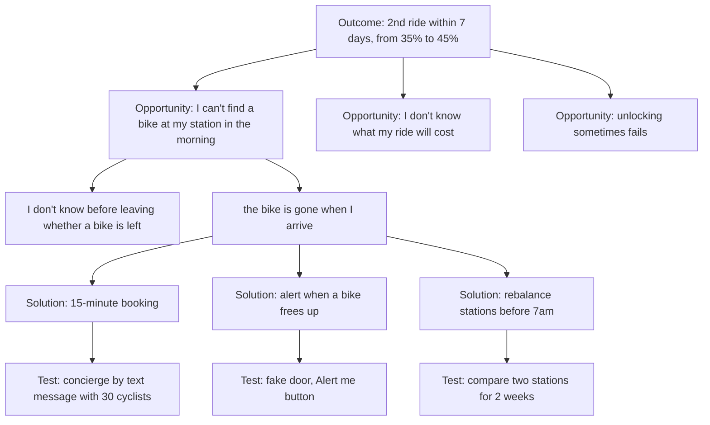
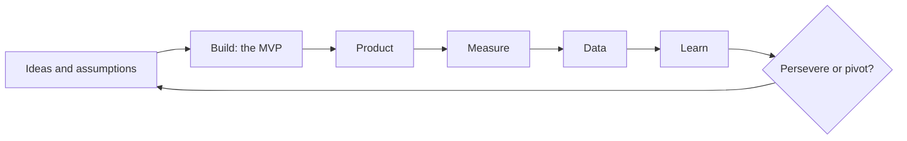
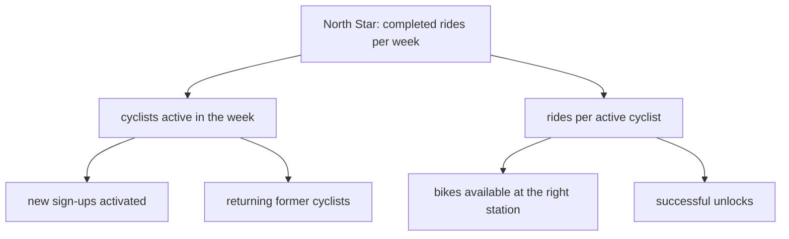
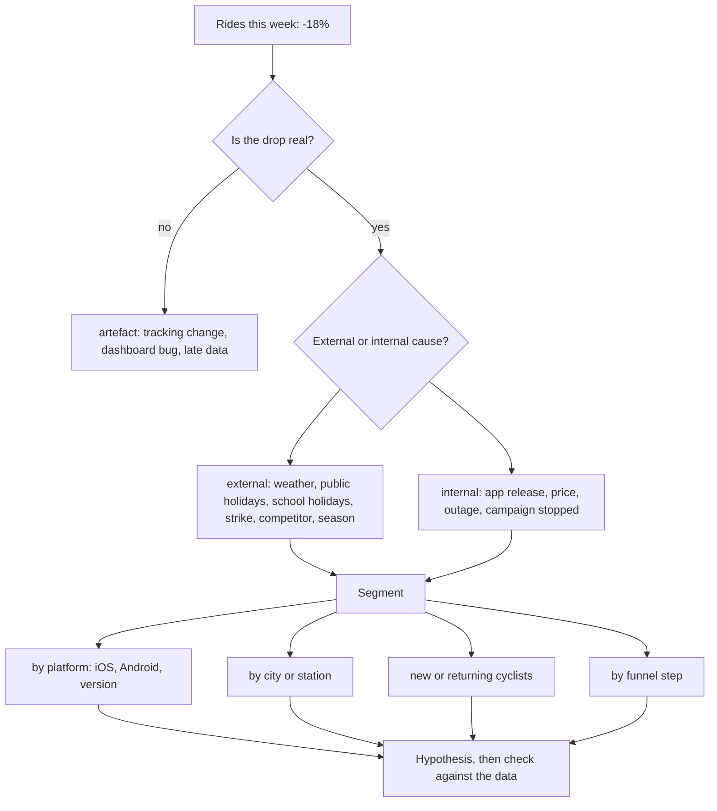

# Product management

!!! warning "Disclaimer"
    These notes are personal cheat sheets, not a source of truth. They reflect my own understanding and choices: their content remains subjective, despite the quotes and references it contains. It may be incomplete, simplified, inaccurate or outdated. Always check the official documentation before applying it. This content is provided as is, without any warranty: you use it at your own risk.

!!! audience "Who and what for"
    - **Roles**: product manager, product owner, product designer, tech lead, engineering manager, QA engineer.
    - **Uses**: I prepare a product manager interview and want to know what the role expects; I have to choose between five requests that all claim to be top priority, like a student subscription and a dark mode; a metric dropped 18% on Monday and I look for where to start; I want to check that an idea really interests users before having it built; I work with a PM and want to understand their tools and vocabulary.

A product manager (PM) does not only decide "what to build": they are accountable for the result the product achieves with its users and for the company. This page gathers what a PM needs to know: the role compared with the other jobs, discovery, writing a framing document, prioritization, roadmaps, product metrics, product-market fit, working with engineering and design, stakeholders and the basics of market strategy.

Several product notions already live in [Company culture](culture-entreprise.md#product) (Jobs to be done, discovery and delivery, Shape Up, estimation, build or buy, OKRs, North Star, cost of delay, one-pager) and in [Data and decisions](donnees-decision.md#ab-testing) (A/B testing): I summarize them here and link to them. The bike-rental app `bike-app`, the people (ada the PM, grace the designer, alan the tech lead) and all numbers are made-up examples.

## Terminology

| Word | Definition | Example |
|---|---|---|
| **<span class="term" data-term="product-manager">Product manager</span>** (PM) | the person accountable for a product's result: which problem we solve, for whom, and how we know it works | ada is accountable for the share of new sign-ups of `bike-app` who take a second ride |
| **<span class="term" data-term="product-owner">Product owner</span>** (PO) | the role defined by Scrum: maximizes the product's value and manages the team's backlog | the PO orders the stories of the next sprint |
| **Outcome** | a measurable change in user behaviour that creates value | "more new sign-ups take a second ride within the week" |
| **Output** | what the team produces: a feature, a screen, an API | "the book-ahead screen is in production" |
| **<span class="term" data-term="product-discovery">Discovery</span>** | the work that finds out what is worth building, before writing production code | showing a booking mock-up to five cyclists |
| **Opportunity** | a user need, pain or desire, phrased from their point of view | "I never find a bike at my station at 7am" |
| **<span class="term" data-term="mvp">MVP</span>** | Minimum Viable Product: the smallest version that lets me learn something true about customers | bookings handled by hand over text message for 30 cyclists |
| **<span class="term" data-term="prd">PRD</span>** | Product Requirements Document: the document that frames a problem, its goal and its limits | the "book ahead" PRD, two pages |
| **Roadmap** | what the team plans to do next, and why, over a few months | Now: make unlocking reliable; Next: booking |
| **Backlog** | the ordered list of the team's possible work | 40 stories, the first 8 ready to start |
| **<span class="term" data-term="activation-metric">Activation</span>** | the moment a new user first gets the promised value | the first completed ride |
| **Retention** | the share of users who come back after a given period | 30% of January sign-ups still ride in March |
| **<span class="term" data-term="churn">Churn</span>** | the share of customers who leave over a period, the opposite of retention | 4% of subscribers cancel each month |
| **Cohort** | a group of users who started in the same period | the sign-ups of the week of 2 March |
| **<span class="term" data-term="conversion-funnel">Funnel</span>** | the sequence of steps a user goes through, with the share passing each step | install, account, bank card, first ride |
| **<span class="term" data-term="guardrail-metric">Guardrail metric</span>** | a measure that must not degrade while I push another one | the crash rate while we speed up unlocking |
| **<span class="term" data-term="product-market-fit">Product-market fit</span>** | the point where a product satisfies a market so well that customers stay and bring others | cohort retention levels off instead of falling to zero |
| **<span class="term" data-term="go-to-market">Go-to-market</span>** | the plan to bring a product to its customers: to whom, through which channel, at what price, with which message | launching the student subscription in two cities, with student unions |
| **<span class="term" data-term="stakeholder">Stakeholder</span>** | anyone affected by a product decision or able to influence it | support, finance, the bike maintenance teams |
| **<span class="term" data-term="sli">SLI</span>** | Service Level Indicator: the indicator measured to know whether something works | the share of unlocks that succeed in under 5 seconds |
| **<span class="term" data-term="slo">SLO</span>** | Service Level Objective: the internal target set on an SLI | "99% of unlocks succeed in under 5 s" (example) |
| **<span class="term" data-term="sla">SLA</span>** | Service Level Agreement: the contractual promise to a customer, with a penalty, usually looser than the SLO | 99.5% availability promised to a partner city, or a discount (example) |

A product review sentence, decoded:

``` { .text .ex-illus title="Illustration" }
"Activation is stuck at 27%, the March cohort is not flattening: we keep booking in Next,
 and the trio spends the quarter on the 'I can't find a bike' opportunity."

activation at 27%               27% of sign-ups complete a first ride
the cohort is not flattening    March sign-ups keep leaving, week after week
booking in Next                 the feature is still planned, but after the current topic
the trio                        the PM, the designer and the tech lead, who decide together
the opportunity                 the user need we try to solve, not a feature
```

## The product manager role

### Product manager, product owner, project manager, product designer

<span class="pill pill-status pill-status-ok" title="Still valid, checked November 2026">Current · 11/2026</span>

When I join a product team, four titles look alike and overlap. Each one is accountable for something different:

| Role | Accountable for... | Question they ask | Example on `bike-app` |
|---|---|---|---|
| product manager | the outcome: the right problem, for the right users, with a measurable effect | "what will bring new sign-ups back?" | ada picks the "no bike at my station" opportunity |
| product owner (Scrum) | the product's value and the order of the team's backlog | "which story do we do first this sprint?" | the PO slices booking into stories and orders them |
| project manager | a scope delivered on time and on budget | "will we make the 1 June date?" | the project manager coordinates the roll-out of new docks |
| product designer | the experience: the user understands and succeeds | "does the cyclist understand they have 15 minutes to pick up the bike?" | grace tests the booking mock-up with five cyclists |

The Scrum Guide (November 2020 edition) does not mention product managers: it defines the **product owner** as the person accountable for maximizing the value of the product, who manages the backlog. In many companies one person holds both titles; in others, the PM looks at the market and strategy, and the PO works daily with the team. Martin Eriksson drew the PM at the intersection of three worlds, business, technology and user experience ("What exactly is a product manager?", 2011):

<figure class="diagram"><svg viewBox="0 0 300 220" role="img" aria-label="The product manager at the intersection of business, technology and user experience"><circle class="set" cx="115" cy="85" r="65"/><circle class="set" cx="185" cy="85" r="65"/><circle class="set" cx="150" cy="145" r="65"/><text x="85" y="60" text-anchor="middle" class="label-strong">Business</text><text x="215" y="60" text-anchor="middle" class="label-strong">Tech</text><text x="150" y="190" text-anchor="middle" class="label-strong">Experience</text><text x="150" y="110" text-anchor="middle" class="label-strong">PM</text></svg><figcaption>The PM where the three worlds meet, after Martin Eriksson (2011)</figcaption></figure>

!!! noob "As noob"
    I think of a film: the director decides which story is told and for which audience, the production manager makes sure shooting ends on time and on budget, the production designer makes each scene readable for the viewer. The PM is the director, the project manager the production manager, the designer the production designer. The takeaway: **the PM is accountable for the "why" and the outcome, not for the delivery date alone.** Limit of the picture: a PM does not give the team orders, they convince it.

**Risks.** a PM who behaves like a project manager tracks only dates, and the team ships on time features nobody uses. A PM who draws the screens and picks the architecture themselves takes their craft away from the designer and the tech lead, and the team disengages. I write down who decides what, with a [RACI](culture-entreprise.md#raci) matrix if needed.

:material-book-open-variant: Reference docs: [Ken Schwaber and Jeff Sutherland, The Scrum Guide](https://scrumguides.org/scrum-guide.html) (November 2020); [Martin Eriksson, What exactly is a product manager?](https://www.mindtheproduct.com/what-exactly-is-a-product-manager/) (2011)
{ .doc-ref }

### The product trio

<span class="pill pill-status pill-status-ok" title="Still valid, checked November 2026">Current · 11/2026</span>

My team works badly when the PM decides alone, the designer draws afterwards and developers discover the topic when asked to estimate it. Teresa Torres ("Continuous Discovery Habits", 2021) proposes the <span class="term" data-term="product-trio">product trio</span>: the PM, the designer and the tech lead run discovery together, every week, and decide together which opportunity to address and which solution to test.

**When**: as soon as a team has an outcome goal and room to choose how to reach it. **Why**: each one sees a risk the others miss (the PM value, the designer usability, the tech lead feasibility), and the team understands the "why" instead of receiving a list. **How**: one user interview slot per week with all three present, a shared opportunity tree, decisions taken by the three and written down.

``` { .text .ex-illus title="Illustration" }
Monday     ada, grace and alan interview a cyclist who quit after 2 rides
Tuesday    they add the opportunity "the booked bike is gone when I arrive" to the tree
Wednesday  alan points out the dock cannot hold a bike: feasibility risk
Thursday   they pick a concierge test: booking by text message, bike held by hand
```

**Risks.** the trio turns into a committee that slows everything if every small decision goes through three people: I keep the trio for opportunity and solution choices, not for a button colour. The trio does not replace the rest of the team: the other developers and the QA engineer join interviews in turn.

:material-book-open-variant: Reference docs: [Teresa Torres, Product Trios](https://www.producttalk.org/2021/05/product-trio/) (2021)
{ .doc-ref }

### The PM by company stage

<span class="pill pill-status pill-status-ok" title="Still valid, checked November 2026">Current · 11/2026</span>

The same title covers different jobs depending on the company's stage:

| Stage | What the PM mostly does | What matters | Trap |
|---|---|---|---|
| startup before product-market fit (under 20 people) | talk to customers every day, test assumptions, often the founder themselves | learn fast, change course without regret | building a platform before having customers who stay |
| growth (50 to 500 people) | one team per PM, one outcome goal per team, funnel metrics | grow what works without breaking what exists | ten teams each optimizing their own number without a shared North Star |
| large company | arbitrate between teams, manage dependencies, convince many stakeholders | alignment and written decisions | spending more time in meetings than with users |

Marty Cagan contrasts **product teams**, given a problem to solve, with **feature teams**, given a list of features to ship ("Product vs. Feature Teams", 2019). In a feature team, the "PM" is mostly a project manager.

**Risks.** I copy how a large company works into a ten-person startup, with quarterly reviews and 15-page documents, and the team spends more time writing than learning. Conversely, keeping the "everyone talks to the founder" way of working at 200 people creates priorities that change every week.

:material-book-open-variant: Reference docs: [Marty Cagan, Product vs. Feature Teams](https://www.svpg.com/product-vs-feature-teams/) (2019)
{ .doc-ref }

### What the PM is accountable for

Ben Horowitz sums up the expectation in "Good Product Manager/Bad Product Manager" (an internal text from 1996 published later, to check): a good PM knows the market, the product and the competition, and judges themselves by the product's success, not by the meetings they run. Concretely, I am accountable for:

- **the chosen problem**: why this one, for whom, now;
- **the outcome**: a measurable change in behaviour, with its [guardrail metric](#guardrail-metrics);
- **viability**: the product holds up for the company (cost, legal, sales, support);
- **clarity**: everyone in the team knows what we do, why, and what we do not do;
- **written decisions**: what we chose, what we ruled out, and what would change our mind.

I am not accountable alone for the date (the team estimates), the technical solution (the tech lead) or the interface (the designer): I am accountable with them.

**Risks.** a PM accountable for an outcome with no lever on it (no budget, no stable team, an imposed roadmap) carries an empty responsibility: I negotiate room to act at the same time as the goal.

:material-book-open-variant: Reference docs: [Ben Horowitz, Good Product Manager/Bad Product Manager](https://a16z.com/good-product-manager-bad-product-manager/) (accessed November 2026); [Marty Cagan, The Product Manager Role](https://www.svpg.com/the-product-manager-role/) (accessed November 2026)
{ .doc-ref }

!!! maturity "Measuring maturity"
    | Level | What I see in the team |
    |---|---|
    | N1 | someone plays the PM role, even part time, and roles overlap without being written down |
    | N2 | each team has an identified PM, designer and tech lead, and a matrix says who decides what |
    | N3 | the trio picks on its own the opportunity and the solution to test within its goal, without leadership sign-off at each step |
    | N4 | the trio tracks the outcome of each bet and adjusts its opportunity choices from those results |

    **I measure**: the share of teams that have an outcome goal rather than a feature list, read in the roadmaps; the number of user interviews per trio per month.

## Outcomes over outputs

<span class="pill pill-status pill-status-ok" title="Still valid, checked November 2026">Current · 11/2026</span>

My team shipped twelve features this quarter, and yet new sign-ups still leave after one ride. Joshua Seiden ("Outcomes Over Output", 2019) separates three things: the **output** (what we build), the **outcome** (the change in user behaviour) and the **impact** (the effect for the company, like revenue). He defines an outcome as "a change in human behavior that drives business results". An <span class="term" data-term="product-outcome">outcome goal</span> lets the team choose how to reach it.

!!! noob "As noob"
    A doctor is not judged by the number of prescriptions they sign, but by whether their patients get better. A prescription is an output, recovery is the outcome, and the health system spending less is the impact. The takeaway: **I measure what users do differently, not what the team shipped.**

Avoid: a roadmap made of features and dates. The team ticks the boxes without knowing whether anything changed for cyclists.

``` { .text .ex-bad title="Avoid" }
Q2  book ahead (15 April)
    NFC unlocking (30 May)
    dark mode (15 June)
```

Good: a quantified outcome, how to measure it, and bets presented as assumptions.

``` { .text .ex-good title="Recommended" }
Q2 outcome   share of new sign-ups taking a 2nd ride within 7 days: from 35% to 45%
Measure      weekly cohorts in the analytics tool
Guardrail    app crash rate under 0.5% of sessions
Bets         book ahead, alert when a bike frees up (assumptions, to test)
(example numbers)
```

**When**: as soon as a team has enough stability and data to measure a behaviour. Not for a legal obligation (a compliance change is an imposed output, not a bet). **Why**: the team looks for the best solution instead of executing the first idea, and can stop a bet that does not work. The cost: the product must be instrumented, and we accept not promising a specific feature on a date.

**Risks.** an outcome too far from the team, like "+10% revenue", guides no daily decision: I go down to a behaviour the team can influence within a few weeks. An outcome with no guardrail invites cheating (a burst of notifications brings people back, then makes them uninstall the app): see [Goodhart](culture-entreprise.md#avoiding-the-goodhart-trap).

:material-book-open-variant: Reference docs: [Joshua Seiden, Outcomes Over Output](https://joshuaseiden.com/) (2019, accessed November 2026); [Melissa Perri, Escaping the Build Trap](https://melissaperri.com/book) (2018)
{ .doc-ref }

!!! maturity "Measuring maturity"
    | Level | What I see in the team |
    |---|---|
    | N1 | the team sometimes talks about a feature's expected effect, but its goals remain feature lists |
    | N2 | each quarter, the team has a quantified outcome goal with its guardrail, and each feature says which outcome it targets |
    | N3 | a bet that does not move its outcome is stopped or removed without debate, based on the criterion written beforehand |
    | N4 | the team compares the expected and the measured effect of each bet, and corrects how it picks the next ones |

    **I measure**: the share of shipped features whose effect was measured three months later, read in the launch sheets; the share of goals written as outcomes rather than outputs.

## Discovery

<a class="pill pill-dora" href="https://dora.dev/capabilities/customer-feedback/">DORA · Customer feedback</a> <a class="pill pill-dora" href="https://dora.dev/capabilities/team-experimentation/">DORA · Team experimentation</a>

Discovery finds out what is worth building. Its basics are already in [Discovery and delivery](culture-entreprise.md#discovery-and-delivery) (Marty Cagan, the two activities in parallel) and [Jobs to be done](culture-entreprise.md#jobs-to-be-done) (the progress the customer wants to make). Here I go further into the everyday tools.

### The four risks

<span class="pill pill-status pill-status-ok" title="Still valid, checked November 2026">Current · 11/2026</span>

Marty Cagan ("Inspired", second edition, 2017) asks to address four risks before writing production code: **value** (will they use it or buy it?), **usability** (can they figure out how to use it?), **feasibility** (can we build it with what we have?), **viability** (does it work for the business?). The detail, with one test per risk, is in [Discovery and delivery](culture-entreprise.md#discovery-and-delivery). On `bike-app`, for booking ahead:

| Risk | Question | Main owner in the trio |
|---|---|---|
| value | would morning cyclists book, and would booking bring them back? | ada, the PM |
| usability | do they understand a booked bike is held 15 minutes, then released? | grace, the designer |
| feasibility | can the dock lock a bike remotely? | alan, the tech lead |
| viability | does a bike held 15 minutes without riding cost too much at rush hour? | ada, with finance |

**Risks.** I mostly address the risk I know best: a PM from engineering tests feasibility and forgets value. I list the four risks for each idea, even in one line.

:material-book-open-variant: Reference docs: [Marty Cagan, The Four Big Risks](https://www.svpg.com/the-four-big-risks/) (2017)
{ .doc-ref }

### Continuous discovery and the opportunity solution tree

<span class="pill pill-status pill-status-ok" title="Still valid, checked November 2026">Current · 11/2026</span>

My team runs one "big user study" a year, then nothing for eleven months. Teresa Torres ("Continuous Discovery Habits", 2021) defines continuous discovery as at least weekly touchpoints with customers, by the team building the product, where they conduct small research activities in pursuit of a desired outcome. She organizes what she learns in an <span class="term" data-term="opportunity-solution-tree">opportunity solution tree</span>:

- at the top, the targeted **outcome** (only one);
- below, the **opportunities**: needs, pains, desires heard in interviews, from the user's point of view;
- under a chosen opportunity, several possible **solutions** (at least three, so as not to fall in love with the first);
- under each solution, the **assumption tests** that tell whether it holds.



!!! noob "As noob"
    It is the family tree of a decision: at the top, what I want to change; in the middle, the real reasons people fail to get there; at the bottom, my ideas and how to check them. If an idea has no parent in the tree, it serves no known need. The takeaway: **I compare several solutions for the same opportunity, instead of defending my first idea.**

**When**: a stable team with an outcome goal. Less useful for an imposed, well-understood request, like a VAT change. **Why**: discovery becomes a short habit instead of a project, and each feature ties back to a heard need. **How**: one interview a week (automated recruiting, for example an in-app question offering a call), a synthesis after each interview, the tree updated as a trio.

**Risks.** a tree full of solutions disguised as opportunities ("there's no dark mode") teaches nothing: I rewrite each opportunity as a sentence the user could say about their life. A tree with ten outcomes at the top turns back into a wish list: one outcome per tree.

:material-book-open-variant: Reference docs: [Teresa Torres, Opportunity Solution Trees](https://www.producttalk.org/opportunity-solution-trees/) (accessed November 2026); [Teresa Torres, Continuous Discovery Habits](https://www.producttalk.org/continuous-discovery-habits/) (2021)
{ .doc-ref }

### Interviewing without bias: The Mom Test

<span class="pill pill-status pill-status-ok" title="Still valid, checked November 2026">Current · 11/2026</span>

I show my idea to cyclists, everyone finds it "great", and nobody uses it once shipped. Rob Fitzpatrick ("The Mom Test", 2013) explains why: when I ask for an opinion on my idea, people are polite, even my mother. The <span class="term" data-term="mom-test">Mom Test</span> sets three rules:

1. talk about their life, not my idea;
2. ask about specifics in the past, not generics or opinions about the future;
3. talk less, listen more.

Avoid: questions about the future and about my idea. The answers are kind and wrong, and I leave with false value signals.

``` { .text .ex-bad title="Avoid" }
"Would you use a way to book a bike in advance?"
"How much would you pay to book?"
"Don't you think that would be handy?"
```

Good: past facts, real behaviour, what the person already tried or paid for.

``` { .text .ex-good title="Recommended" }
"Tell me about the last time you couldn't find a bike. What happened next?"
"What have you tried to avoid it? Leaving earlier, taking the bus?"
"How many times did it happen last month? What did it cost you?"
```

A real commitment (leaving a phone number for a test, paying upfront, introducing a colleague) is worth more than a compliment. For usability tests, Jakob Nielsen ("Why You Only Need to Test with 5 Users", 2000) observes that five users find most problems of a screen [Take with caution: valid for one user profile and a qualitative usability test, not to measure a preference or a value].

**Risks.** I only interview loyal users who are easy to reach, and I ignore those who left: they hold the answer about retention. I also recruit sign-ups who took only one ride. An interview written from memory the next day keeps mostly what suits me: I write down exact quotes during the interview.

:material-book-open-variant: Reference docs: [Rob Fitzpatrick, The Mom Test](https://www.momtestbook.com/) (2013); [Jakob Nielsen, Why You Only Need to Test with 5 Users](https://www.nngroup.com/articles/why-you-only-need-to-test-with-5-users/) (2000)
{ .doc-ref }

### Mapping assumptions

<span class="pill pill-status pill-status-ok" title="Still valid, checked November 2026">Current · 11/2026</span>

My booking idea rests on several suppositions I never checked. <span class="term" data-term="assumption-mapping">Assumption mapping</span> (popularized by David Bland, "Testing Business Ideas", 2019) writes them all down, then places them on two axes: their **importance** (if it is false, the idea falls) and the **evidence** I already have. I test first the important assumptions with no evidence.

| | Little evidence | Strong evidence |
|---|---|---|
| **Important** | test first: "morning cyclists would book at least twice a week" | watch: "the station is empty at 7am 30% of the time" (dock data) |
| **Less important** | note: "they prefer booking from the home screen widget" | ignore for now: "they have a recent smartphone" |

Teresa Torres also sorts assumptions by type: desirability, usability, feasibility, viability, ethics ("Assumption Testing", accessed November 2026).

**Risks.** writing thirty assumptions and testing none gives an illusion of rigour: I pick the two or three in the "important, little evidence" corner and test them this week. Rating importance alone leads me to underrate what I do not know: I build the map as a trio.

:material-book-open-variant: Reference docs: [Teresa Torres, Assumption Testing](https://www.producttalk.org/assumption-testing/) (accessed November 2026); [David Bland and Alexander Osterwalder, Testing Business Ideas](https://www.strategyzer.com/library/testing-business-ideas-book) (2019)
{ .doc-ref }

### Prototypes and tests: fake door, concierge, Wizard of Oz

<span class="pill pill-status pill-status-ok" title="Still valid, checked November 2026">Current · 11/2026</span>

To test an important assumption, I do not need to build the feature. Three classic tests, described among others in "Testing Business Ideas" (2019):

| Test | What it is | What it checks | Example on `bike-app` |
|---|---|---|---|
| <span class="term" data-term="fake-door-test">fake door</span> (painted door) | a visible button or offer with no feature behind it; on click, an honest message | demand: how many click | a "Book" button on 10% of station screens; on click, "coming soon, want to be notified?" |
| <span class="term" data-term="concierge-test">concierge</span> | the service delivered by hand, openly, to a few customers | value and real usage, in detail | 30 cyclists book by text message, alan holds the bike from the maintenance tool |
| <span class="term" data-term="wizard-of-oz-test">Wizard of Oz</span> | the user thinks the service is automated, a human answers behind it | that the service, if it existed, would be used as planned | an "assistant" suggesting the nearest station with a bike, actually a team member for 2 weeks |
| clickable prototype | a mock-up you can interact with, no production code | usability | grace shows the booking mock-up to 5 cyclists |

Alberto Savoia calls these very light forms of <span class="term" data-term="prototype">prototyping</span> "pretotypes" ("The Right It", 2019): make sure it is the right thing before building it right.

**When**: an important assumption with no evidence, and a feature that would cost more than a few days. **Why**: a one-week test replaces a two-month build. **How**: I write the success criterion before the test ("at least 8% clicks on the Book button, otherwise I drop it"), I time-box it, I decide on the planned date.

**Risks.** a fake door frustrates the user who clicks and finds nothing: I show it to a small share of traffic, briefly, with an honest message. A Wizard of Oz that lasts too long becomes a lie and raises trust and personal-data questions: I limit it to a few days and collect nothing sensitive. A concierge that works for 30 people does not prove the service holds for 30,000: it proves value, not feasibility.

:material-book-open-variant: Reference docs: [Alberto Savoia, Pretotyping](https://www.pretotyping.org/) (accessed November 2026); [Wikipedia, Wizard of Oz experiment](https://en.wikipedia.org/wiki/Wizard_of_Oz_experiment) (accessed November 2026)
{ .doc-ref }

### MVP and build-measure-learn

<span class="pill pill-status pill-status-ok" title="Still valid, checked November 2026">Current · 11/2026</span>

Eric Ries ("The Lean Startup", 2011) defines the <span class="term" data-term="mvp">MVP</span> as the version of a new product which allows a team to collect the maximum amount of validated learning about customers with the least effort. The MVP is not "a cheap version 1": it is an experiment. It sits in the <span class="term" data-term="build-measure-learn">build-measure-learn</span> loop, at the end of which I decide to persevere or to **pivot** (change strategy without changing vision).



!!! noob "As noob"
    Before opening a restaurant, I can run a market stall on Saturday with three dishes. If nobody comes back, I lost a Saturday, not a commercial lease. The stall is not a bad restaurant, it is an experiment to know whether the restaurant is worth it. The takeaway: **an MVP is for learning, its success is measured by what it teaches me, not by its sales.**

Avoid: an MVP that is a full version 1, just less polished. It takes four months, and at the end I still do not know which assumption was wrong.

``` { .text .ex-bad title="Avoid" }
Booking MVP   booking, cancelling, history, paying for the booking,
              widget, notifications; quality "we'll fix it later"; 4 months
```

Good: one assumption, a written decision criterion, two weeks.

``` { .text .ex-good title="Recommended" }
Assumption  morning cyclists book at least twice a week
MVP         booking by text message for 30 cyclists, bike held by hand (concierge)
Criterion   at least 18 of the 30 book twice a week for 2 weeks, otherwise I stop
(example numbers)
```

**Risks.** a badly finished MVP (bugs, slowness) sinks a good idea for a bad reason: "minimum" is about scope, not about the quality of what is shown. An MVP that works is often kept in production as is, and turns into [technical debt](#negotiating-technical-debt): I decide upfront whether it will be thrown away or rebuilt.

:material-book-open-variant: Reference docs: [Eric Ries, The Lean Startup, principles](https://theleanstartup.com/principles) (2011, accessed November 2026)
{ .doc-ref }

!!! maturity "Measuring maturity"
    | Level | What I see in the team |
    |---|---|
    | N1 | someone talks to users now and then, often to validate an idea already chosen |
    | N2 | the trio runs at least one interview a week, keeps an opportunity tree and tests important assumptions before code |
    | N3 | an idea that fails its test criterion is dropped on the planned date, with no arbitration meeting |
    | N4 | the team tracks the share of tests that confirm their assumption and the time from idea to decision, and adjusts its discovery from those numbers |

    **I measure**: the number of interviews per trio per week, read in the synthesis folder; the share of shipped features that passed a value test before code.

## Framing and writing

### The problem statement

<span class="pill pill-status pill-status-ok" title="Still valid, checked November 2026">Current · 11/2026</span>

I am asked for "bike booking". If I start from there, the team can only build booking, even if another solution was better. A <span class="term" data-term="problem-statement">problem statement</span> describes who has the problem, in which situation, what it costs them, and how I will know it is solved, without naming the solution. I often end with a "How might we...?" question (popularized by IDEO's design thinking method).

Avoid: the solution disguised as a problem. The team can neither propose something else nor know when it has succeeded.

``` { .text .ex-bad title="Avoid" }
Problem: we don't have bike booking.
```

Good: the person, the situation, the consequence, the measure.

``` { .text .ex-good title="Recommended" }
Who          cyclists who leave between 6am and 8am on weekdays
Situation    their station is empty when they arrive 30% of the time
Consequence  they take another mode of transport; 1 in 5 no longer opens the app the next month
Measure      share of morning rides started at the intended station
Question     How might we guarantee a bike to morning cyclists?
(example numbers)
```

**Risks.** a statement that is too broad ("improve the experience") guides nothing; one that is too narrow ("how might we book a bike?") hides the solution in the question. I test the statement by asking the trio for three different solutions: if they find only one, the statement is too narrow.

:material-book-open-variant: Reference docs: [IDEO Design Kit, How Might We](https://www.designkit.org/methods/how-might-we.html) (accessed November 2026)
{ .doc-ref }

### PRD and one-pager

<span class="pill pill-status pill-status-ok" title="Still valid, checked November 2026">Current · 11/2026</span>

The <span class="term" data-term="prd">PRD</span> (Product Requirements Document) frames an initiative: the problem, the targeted outcome, what is in scope and what is not, the open questions. The 40-page PRDs of the 2000s described every screen; today most teams write a short, living document that leaves the solution to the trio. The [one-pager](culture-entreprise.md#one-pager) for leadership is its decision-oriented version: one page, one expected decision, one date.

Avoid: a PRD that is a feature list. Nobody knows why we build them, nor when we will have succeeded.

``` { .markdown .ex-bad title="Avoid" }
# Booking PRD
- Book button on the station page
- 15-minute booking
- cancellation allowed
- notification 5 minutes before expiry
```

Good: a skeleton that starts from the problem and the outcome, and says what we do not do.

``` { .markdown .ex-good title="Recommended" }
# Guarantee a bike to morning cyclists

Problem: 30% of cyclists between 6am and 8am find their station empty (dock data, March)
For whom: subscribers who ride at least 3 mornings a week
Target outcome: morning rides started at the intended station, from 70% to 85%
Guardrail: bike utilization at rush hour, not down by more than 2 points
What we know: concierge test, 21 of 30 cyclists booked twice a week
Out of scope: paid booking, booking more than 30 minutes ahead
Open questions: can the dock lock a bike remotely? (one-day spike)
Expected decision: go for slice 1, by 15/05
(example numbers)
```

**Risks.** a PRD written by the PM alone and "handed over" to the team becomes a specification again: I write it with the trio and keep it short. A PRD never updated lies after three weeks: I log each decision and its date in it.

:material-book-open-variant: Reference docs: [Atlassian, Product requirements document](https://www.atlassian.com/agile/product-management/requirements) (accessed November 2026)
{ .doc-ref }

### Working Backwards: the press release and FAQ

<span class="pill pill-status pill-status-ok" title="Still valid, checked November 2026">Current · 11/2026</span>

I want to check that an idea stands up from the customer's point of view before any line of code. The <span class="term" data-term="pr-faq">PR/FAQ</span> method, described by Colin Bryar and Bill Carr in "Working Backwards" (2021), starts from the end: I write the launch-day press release, then an FAQ. If the press release is not exciting, neither is the idea. It is a cousin of the [six-page narrative memo](culture-entreprise.md#the-six-page-narrative-memo): a full text, read silently at the start of the meeting.

``` { .text .ex-illus title="Illustration" }
Heading         bike-app guarantees a bike to morning cyclists
Subheading      book your bike 15 minutes before leaving home
Problem         three mornings out of ten, the station is empty when I arrive (fictional cyclist)
Solution        a Book button on the station page; the bike is held for 15 minutes
Quote           "I no longer run out to catch a bike" (fictional customer)
Getting started available to subscribers from 1 June, at no extra cost
Customer FAQ    what if I'm late? what if the dock is down?
Internal FAQ    how many bikes held without riding at rush hour? what cost?
```

**When**: a new offer or a major feature, before starting detailed discovery. Not for a small fix. **Why**: the text forces me to explain the customer benefit in plain words, and the internal FAQ brings up the awkward questions early (cost, legal, feasibility). **How**: one to two pages of press release, an FAQ with no limit, read and rewritten several times.

**Risks.** a brilliant press release can hide an untested idea: I treat it as an assumption to check, not as proof. The internal FAQ is the useful part: a PR/FAQ with no awkward questions has not been reviewed enough.

:material-book-open-variant: Reference docs: [Colin Bryar and Bill Carr, Working Backwards](https://workingbackwards.com/) (2021)
{ .doc-ref }

!!! maturity "Measuring maturity"
    | Level | What I see in the team |
    |---|---|
    | N1 | requests arrive as solutions, written in a ticket or said orally |
    | N2 | each major initiative has a problem statement and a short PRD, with outcome, guardrail and out of scope |
    | N3 | an initiative without a validated problem statement cannot enter the roadmap, without anyone having to remind it |
    | N4 | the team compares the outcome targeted in the PRD with the outcome reached, and improves its PRD template from the gaps |

    **I measure**: the share of roadmap initiatives that have a problem statement and a quantified outcome, read in the PRD folder; the number of open questions still unresolved when development starts.

## Prioritizing

Five requests arrive at once, each carried by someone who calls it urgent. A prioritization method does not decide for me: it makes assumptions visible and forces the discussion onto the right criteria. [Cost of delay](culture-entreprise.md#cost-of-delay) and [type 1 or type 2 decisions](culture-entreprise.md#type-1-and-type-2-decisions) complete this section.

### RICE

<span class="pill pill-status pill-status-ok" title="Still valid, checked November 2026">Current · 11/2026</span>

Sean McBride presented the <span class="term" data-term="rice-score">RICE score</span> at Intercom in 2016. Four factors:

- **Reach**: how many people or events will be affected over a period, for example per quarter;
- **Impact**: the effect on each person, on a fixed scale: 3 massive, 2 high, 1 medium, 0.5 low, 0.25 minimal;
- **Confidence**: how much I trust my numbers: 100% high, 80% medium, 50% low;
- **Effort**: the total work, in person-months.

Score = Reach × Impact × Confidence ÷ Effort.

| Idea for `bike-app` | Reach (people per quarter) | Impact | Confidence | Effort (person-months) | RICE score |
|---|---|---|---|---|---|
| dark mode | 12,000 | 0.25 | 100% | 0.5 | 6,000 |
| student subscription | 2,000 | 3 | 80% | 2 | 2,400 |
| book ahead | 4,000 | 2 | 80% | 4 | 1,600 |
| NFC unlocking | 9,000 | 1 | 50% | 3 | 1,500 |

Example numbers. The first row's calculation: 12,000 × 0.25 × 1 ÷ 0.5 = 6,000. Dark mode comes first because it is small and touches everyone, while its impact is minimal: RICE favours small, wide things. It is a signal to discuss, not a decision. I also look at the quarter's goal: if the targeted outcome is new sign-ups' second ride, booking serves the goal and dark mode does not.

!!! noob "As noob"
    It is like choosing which work to do in a flat: how many rooms are affected, how much each job improves daily life, how sure I am of the quote, how much it costs. Repainting a door is cheap and seen everywhere, but changes little. The takeaway: **RICE ranks bets, it does not say which ones serve my goal.**

**Risks.** everyone inflates their idea's impact: I set the impact scale against the quarter's goal and have several people rate impact. A "100%" confidence with no data is a comfortable lie: 100% needs a measurement, otherwise 50%. RICE ignores cost of delay: a legal obligation with a date comes first, whatever its score.

:material-book-open-variant: Reference docs: [Sean McBride, RICE: Simple prioritization for product managers](https://www.intercom.com/blog/rice-simple-prioritization-for-product-managers/) (2016)
{ .doc-ref }

### ICE

<span class="pill pill-status pill-status-ok" title="Still valid, checked November 2026">Current · 11/2026</span>

The <span class="term" data-term="ice-score">ICE score</span> (Impact, Confidence, Ease), associated with Sean Ellis and growth marketing (around 2015, date to check), rates each idea from 1 to 10 on the three criteria, then multiplies them (some teams average them). It is faster than RICE, without reach.

``` { .text .ex-illus title="Illustration" }
idea                                       impact  confidence  ease  ICE
reminder e-mail 24 h after sign-up          6        7          9    378
referral: 1 free ride                       8        5          5    200
new home page                               5        3          4     60
(example ratings)
```

**When**: many small growth experiments to sort quickly, like e-mail or message tests. **Risks.** three subjective ratings multiplied give a number that looks precise: two people rate the same idea 378 and 120. I use it to sort a long list into three piles, not to decide between two close ideas.

:material-book-open-variant: Reference docs: no public founding text found; method described in Sean Ellis and Morgan Brown, "Hacking Growth" (2017, to check)
{ .doc-ref }

### Kano model

<span class="pill pill-status pill-status-ok" title="Still valid, checked November 2026">Current · 11/2026</span>

I want to know which features are expected without discussion and which ones surprise. The <span class="term" data-term="kano-model">Kano model</span> (Noriaki Kano and co-authors, 1984) sorts a product's attributes by the link between their presence and satisfaction:

| Category | If present | If absent | Example on `bike-app` |
|---|---|---|---|
| must-be | normal, nobody says thanks | anger | brakes work, unlocking works |
| one-dimensional (performance) | the more, the happier | dissatisfaction | e-bike battery range, unlocking time |
| attractive (delighter) | delight | nobody asks for it | the app warns me when a bike frees up at my station |
| indifferent | nothing | nothing | choosing the icon colour |
| reverse | dissatisfaction for some | satisfaction for some | weekly challenge notifications |

The category is measured with a paired questionnaire: "how do you feel if the feature is present?" and "if it is absent?", each answer on a five-point scale (I like it, I expect it, I am neutral, I can live with it, I dislike it).

**When**: choosing the content of an offer or a release, and not forgetting must-be features. **Risks.** categories drift over time: yesterday's delighter becomes tomorrow's must-be (the availability alert, once every competitor copies it). A Kano questionnaire on a feature the user cannot picture gives random answers: I show a mock-up.

:material-book-open-variant: Reference docs: [Wikipedia, Kano model](https://en.wikipedia.org/wiki/Kano_model) (accessed November 2026)
{ .doc-ref }

### MoSCoW

<span class="pill pill-status pill-status-ok" title="Still valid, checked November 2026">Current · 11/2026</span>

My launch date is fixed (the start of the academic year) and the scope must adapt to it. <span class="term" data-term="moscow-method">MoSCoW</span>, created by Dai Clegg in 1994 and taken up by the DSDM method, sorts the requirements of a release into four groups: **Must** (without it, the release makes no sense), **Should** (important, but we can ship without it), **Could** (if time allows), **Won't this time** (not this time, and written down). DSDM guidance recommends Musts stay under about 60% of the effort, to keep a margin (to check in the current guide).

``` { .text .ex-illus title="Illustration" }
Student subscription, launch on 1 September
Must    sign-up with student status check, reduced price applied to rides
Should  student card added to the phone wallet
Could   referral between students
Won't   group rate for student unions (planned for spring)
```

**Risks.** everything ends up as a Must when each stakeholder defends their line: I ask "do we still ship if this line is missing?", and if the answer is yes, it is not a Must. MoSCoW sorts within a release, it does not compare initiatives with each other.

:material-book-open-variant: Reference docs: [Wikipedia, MoSCoW method](https://en.wikipedia.org/wiki/MoSCoW_method) (accessed November 2026)
{ .doc-ref }

### WSJF and cost of delay

<span class="pill pill-status pill-status-ok" title="Still valid, checked November 2026">Current · 11/2026</span>

<span class="term" data-term="wsjf">WSJF</span> (Weighted Shortest Job First) comes from Donald Reinertsen's work ("The Principles of Product Development Flow", 2009) and was popularized by the SAFe framework: do first the work with the highest [cost of delay](culture-entreprise.md#cost-of-delay) per unit of duration. SAFe estimates cost of delay with three relative ratings: user or business value, time criticality, risk reduction or opportunity enablement.

``` { .text .ex-illus title="Illustration" }
                          value  urgency  risk  cost of delay  size  WSJF
GDPR compliance             5      13      8         26          5    5.2
student subscription        8      13      2         23          8    2.9
book ahead                 13       3      3         19         13    1.5
(example relative ratings, Fibonacci sequence)
```

The student subscription is highly urgent because the academic year does not move: shipped in October, it misses the period when students choose how they get around.

**Risks.** relative ratings get negotiated like everything else: I have several people give them at the same time, as in planning poker. WSJF assumes work can be sliced; a large indivisible initiative always scores badly, even when it is strategic.

:material-book-open-variant: Reference docs: [Scaled Agile, WSJF](https://framework.scaledagile.com/wsjf) (accessed November 2026); [Black Swan Farming, WSJF](https://blackswanfarming.com/wsjf-weighted-shortest-job-first/) (accessed November 2026)
{ .doc-ref }

### Which method, and when it fails

| Situation | Method | When it fails |
|---|---|---|
| I compare a dozen ideas of different sizes and reach for the quarter, like booking and the student subscription | RICE | when impact is made up, or the quarter's goal is ignored |
| I need to quickly sort thirty small growth experiments, like e-mail variants | ICE | when two close ideas are split on subjective ratings |
| I prepare the content of an offer and want to miss nothing expected or surprising | Kano | when categories have drifted since the survey |
| my date is fixed, like the start of the academic year, and I must choose what goes into the release | MoSCoW | when everything becomes a Must |
| some requests lose value over time, like a seasonal offer or a legal obligation | WSJF, cost of delay | when the work cannot be sliced, or costs of delay are inflated |
| all ideas look good and the discussion goes round in circles | go back to the quarter's outcome: which idea moves it? | never quite: it is the starting question |

**Risks.** a method applied mechanically replaces judgement with a spreadsheet: the PM who says "the score decided" no longer owns the decision. I use the score to open the discussion, then I write down the decision and its reason.

!!! maturity "Measuring maturity"
    | Level | What I see in the team |
    |---|---|
    | N1 | priority goes to the latest request or to the most senior person |
    | N2 | the team ranks its initiatives with a written method (RICE, WSJF), and each decision has its reason noted |
    | N3 | a new request is rated with the same criteria before entering the roadmap, without leadership arbitration for each case |
    | N4 | the team compares estimated and measured impact of shipped bets, and recalibrates its impact and confidence scales from those gaps |

    **I measure**: the share of shipped initiatives whose measured impact reaches at least half the estimated impact, read in the quarterly review; the number of priority changes during the quarter.

## Roadmaps

### Now, Next, Later

<span class="pill pill-status pill-status-ok" title="Still valid, checked November 2026">Current · 11/2026</span>

My date-based roadmap promises precise features six months out, while I barely know what I will do in six weeks. The <span class="term" data-term="now-next-later">Now, Next, Later</span> roadmap, popularized by Janna Bastow (around 2012, to check), replaces dates with three horizons of decreasing precision:

``` { .text .ex-illus title="Illustration" }
Now (in progress, detailed)     make unlocking reliable: from 94% to 99% success
                                booking: concierge test in progress
Next (coming, framed)           guarantee a bike to morning cyclists
                                student subscription for the new academic year
Later (later, exploratory)      family rides, cargo bikes
```

**When**: a product team with outcome goals in an uncertain environment. **Why**: the precision shown matches the real precision, and Later can change without being "late". **How**: Now is detailed and committed, Next is framed (problem and outcome), Later is a list of opportunities; each item says which outcome it serves.

**Risks.** with no dates at all, leadership, sales or marketing cannot prepare anything, and they invent their own dates: I give dates where they really exist (contract, season, law), with a [confidence](#holding-a-date-commitment). A Later that keeps growing without ever being cleaned becomes an idea graveyard: I reread it every quarter and remove items.

:material-book-open-variant: Reference docs: [Janna Bastow, I invented the Now-Next-Later roadmap](https://www.prodpad.com/blog/invented-now-next-later-roadmap/) (accessed November 2026)
{ .doc-ref }

### Outcome or date roadmap

<span class="pill pill-status pill-status-ok" title="Still valid, checked November 2026">Current · 11/2026</span>

An <span class="term" data-term="outcome-roadmap">outcome-based roadmap</span> lists problems to solve and targeted outcomes; a feature-and-date roadmap lists outputs with deadlines. C. Todd Lombardo, Bruce McCarthy and co-authors ("Product Roadmaps Relaunched", 2017) argue for the former, with themes rather than features.

| | Features and dates | Outcomes |
|---|---|---|
| what it promises | "booking on 15 April" | "more successful morning rides this quarter" |
| what happens if the idea fails | we ship it anyway, we promised | we change the solution, the outcome stays |
| what leadership gets from it | a clear date, often wrong | a clear direction, dates only where they matter |
| when it fits | customer contract, legal obligation, platform migration | evolving product, uncertain market |

**Risks.** an outcome roadmap that is too vague ("improve the experience") looks like no plan at all, and leadership takes back control with a feature list: each outcome is quantified, and I show the bets in progress. A public feature roadmap creates customer promises that can no longer be withdrawn.

:material-book-open-variant: Reference docs: C. Todd Lombardo, Bruce McCarthy, Evan Ryan and Michael Connors, "Product Roadmaps Relaunched" (O'Reilly, 2017; publisher page not verifiable automatically)
{ .doc-ref }

### Saying no

<span class="pill pill-status pill-status-ok" title="Still valid, checked November 2026">Current · 11/2026</span>

The sales director wants a PDF export for a key account, support wants a help page, leadership wants a feature seen at a competitor. Saying yes to everything dilutes the team, and nothing moves. Saying no is not rejecting the person: it is showing the <span class="term" data-term="opportunity-cost">opportunity cost</span>.

Avoid: a curt no, or a "yes, we'll see" that commits to nothing. The request comes back, louder, through leadership.

``` { .text .ex-bad title="Avoid" }
"No, it's not on the roadmap."
"Yes, we'll put it in the backlog." (and nobody ever mentions it again)
```

Good: I restate the need, tie the decision to the goal, say what would change my mind.

``` { .text .ex-good title="Recommended" }
"If I understand correctly, the key account wants to justify its mobility spending every month.
 This quarter, the team is on morning rides: if we take the export, booking slips by six weeks.
 I suggest a CSV export done by hand by support for this customer,
 and I'll revisit if three other accounts ask for it by June."
```

**Risks.** saying no too often without an alternative cuts the PM off from sales and support, who are their best sources of opportunities: I log each refused request with its requester, and get back to them if the context changes. A no based on my intuition alone does not hold in front of leadership: I lean on the written goal and on data.

:material-book-open-variant: Reference docs: [Marty Cagan, Inspired](https://www.svpg.com/inspired-how-to-create-products-customers-love/) (second edition, 2017)
{ .doc-ref }

### Holding a date commitment

<span class="pill pill-status pill-status-ok" title="Still valid, checked November 2026">Current · 11/2026</span>

Some dates are real: the start of the academic year, a legal obligation, a trade show, a contract with a city. Others are wishes. For a real date, I fix the date and let the scope vary, like Shape Up's [appetite](culture-entreprise.md#shape-up).

1. I separate external dates (expensive to miss) from internal targets;
2. I give a date with a confidence: "1 September, 80% confidence, if the student status check is ready by end of June";
3. I sort the scope with [MoSCoW](#moscow) and ship the Musts first;
4. I flag a risk as soon as an assumption falls, not the day before;
5. I estimate in ranges by vertical slices, as in [Estimating and slicing](culture-entreprise.md#estimating-and-slicing-a-feature).

**Risks.** a date announced without a confidence becomes a firm promise in other people's minds: I write it with its confidence and its conditions. Keeping both scope and date fixed forces a sacrifice on quality, and bugs are paid for after launch: I sacrifice scope, never tests.

:material-book-open-variant: Reference docs: [Ryan Singer, Shape Up](https://basecamp.com/shapeup) (2019)
{ .doc-ref }

!!! maturity "Measuring maturity"
    | Level | What I see in the team |
    |---|---|
    | N1 | a roadmap exists, often a feature list with dates, rarely reread |
    | N2 | the roadmap is in Now, Next, Later, each item says which outcome it serves, and real dates have a confidence |
    | N3 | an off-goal request is refused or parked with its written reason, without escalating to leadership each time |
    | N4 | the team measures the share of date commitments kept and the share of Now items that moved their outcome, and adjusts its horizon and ranges |

    **I measure**: the share of external date commitments kept over the year, read in the launch tracker; the number of items added to or removed from Now during the quarter.

## Product metrics

### North Star and metric tree

The [North Star metric](culture-entreprise.md#north-star-metric) is the single measure that captures the value customers receive and predicts future revenue; it breaks down into input metrics each team acts on, with a counter-metric against [Goodhart](culture-entreprise.md#avoiding-the-goodhart-trap). For `bike-app`, a possible North Star is completed rides per week, broken down like this:



**Risks.** a volume North Star (rides) can grow while value drops, for example with free rides handed out massively: I pair it with margin per ride and satisfaction.

:material-book-open-variant: Reference docs: [Amplitude, The North Star Playbook](https://amplitude.com/books/north-star) (accessed November 2026)
{ .doc-ref }

### AARRR, the pirate metrics

<span class="pill pill-status pill-status-ok" title="Still valid, checked November 2026">Current · 11/2026</span>

In 2007 Dave McClure proposed the <span class="term" data-term="aarrr">AARRR metrics</span>, called "pirate" metrics because of how the acronym sounds, to follow a customer's lifecycle in five stages:

| Stage | Question | Example metric for `bike-app` |
|---|---|---|
| Acquisition | where do users come from? | installs by channel (app store, partnership, word of mouth) |
| Activation | do they have a good first experience? | share of sign-ups completing a first ride within 7 days |
| Retention | do they come back? | share of activated users still riding 4 weeks later |
| Referral | do they talk about it? | referrals sent per active cyclist |
| Revenue | do they pay? | average revenue per active cyclist per month |

Some add an **Awareness** stage at the front, hence AAARRR (to check depending on the author). The order of the stages is not necessarily the order of priorities: acquiring users who do not stay is filling a leaky bucket.

**Risks.** following all five stages with the same attention scatters the team: I look for the stage where the loss is biggest and cheapest to fix. Fuzzy definitions ("active" = opened the app?) make numbers move without anything changing: I write down each metric's definition.

:material-book-open-variant: Reference docs: [Dave McClure, Startup Metrics for Pirates](https://www.slideshare.net/dmc500hats/startup-metrics-for-pirates-long-version) (2007)
{ .doc-ref }

### HEART

<span class="pill pill-status pill-status-ok" title="Still valid, checked November 2026">Current · 11/2026</span>

I want to measure the quality of the user experience, not only growth. Kerry Rodden, Hilary Hutchinson and Xin Fu (Google, CHI 2010 conference) propose the <span class="term" data-term="heart-framework">HEART framework</span>: five categories, and for each one a Goals, Signals, Metrics process.

| Category | Goal on `bike-app` | Signal | Metric |
|---|---|---|---|
| Happiness | cyclists find the app reliable | answer to the in-app survey | average rating out of 5 after a ride |
| Engagement | they ride often | rides per cyclist | rides per active cyclist per week |
| Adoption | they try booking | first booking | share of active cyclists who booked at least once |
| Retention | they stay | a ride in the period | share of cyclists active in March still active in April |
| Task success | they unlock easily | successful or failed unlock | success rate and median unlock time |

**When**: a feature or product whose value goes through the experience. I keep only the useful categories: booking needs Adoption and Task success, not necessarily Happiness. **Risks.** filling all five boxes for each feature produces a dashboard nobody reads: I pick two categories per goal.

:material-book-open-variant: Reference docs: [Kerry Rodden, Hilary Hutchinson and Xin Fu, Measuring the User Experience on a Large Scale](https://research.google/pubs/measuring-the-user-experience-on-a-large-scale-user-centered-metrics-for-web-applications/) (CHI 2010)
{ .doc-ref }

### Funnel and activation

<span class="pill pill-status pill-status-ok" title="Still valid, checked November 2026">Current · 11/2026</span>

Many people install `bike-app`, few become regular cyclists. A <span class="term" data-term="conversion-funnel">funnel analysis</span> follows the share of users who pass each step, for a single cohort, and shows where they leave. **Activation** is the step where the user first receives the promised value: for `bike-app`, the first completed ride.

| Step (March sign-ups) | Users | Pass the step | Lost |
|---|---|---|---|
| install | 10,000 | | |
| account created | 6,500 | 65% | 3,500 |
| bank card added | 3,900 | 60% | 2,600 |
| first ride completed (activation) | 2,730 | 70% | 1,170 |
| second ride within 7 days | 1,365 | 50% | 1,365 |

Example numbers. Activation: 2,730 ÷ 10,000 = 27%. The biggest loss in count is at account creation (3,500), but the biggest loss in share is at the second ride (50%). I look at both, then I segment: if the loss at the bank card step is 60% on Android and 25% on iOS, it is probably a bug, not a lack of motivation.

!!! noob "As noob"
    It is the queue at a theme park: 100 people join the queue, 60 reach the ticket desk, 40 get on the ride, 20 go again. I do not know yet why they leave, but I know where to look. The takeaway: **the funnel says where people leave; interviews and segmented data say why.**

**Risks.** a funnel mixing cohorts (March and January sign-ups) compares people who did not have the same time to progress: I fix a window (for example 7 days after install). Pushing activation with a trick (a mandatory free ride) inflates the number without building a habit: I look at the retention of activated users.

:material-book-open-variant: Reference docs: [Wikipedia, Conversion funnel](https://en.wikipedia.org/wiki/Conversion_funnel) (accessed November 2026)
{ .doc-ref }

### Cohort retention

<span class="pill pill-status pill-status-ok" title="Still valid, checked November 2026">Current · 11/2026</span>

The total number of active cyclists goes up, and yet new ones leave fast: growth hides the departures. A <span class="term" data-term="cohort-retention">cohort retention analysis</span> groups users by start date and follows, for each group, the share still active after 1, 2, 4, 8 weeks.

| Cohort | Week 0 | Week 1 | Week 2 | Week 4 | Week 8 |
|---|---|---|---|---|---|
| January | 100% | 42% | 30% | 24% | 22% |
| February | 100% | 45% | 33% | 27% | 25% |
| March | 100% | 50% | 38% | 32% | 31% |

Example numbers. Two readings: each row levels off after week 4 (the curve flattens, a sign that those who stay found their use), and each cohort retains better than the previous one (the February and March changes helped). The definition of "active" must follow the product's natural frequency: a bike app is judged by the week, a tax-filing app by the year.

**Risks.** an average retention over all users mixes loyal long-time users and new ones who leave, and hides the problem. A cohort that is too small (200 people) moves randomly by several points: I do not conclude on a single week.

:material-book-open-variant: Reference docs: [Wikipedia, Cohort analysis](https://en.wikipedia.org/wiki/Cohort_analysis) (accessed November 2026)
{ .doc-ref }

### Guardrail metrics

<span class="pill pill-status pill-status-ok" title="Still valid, checked November 2026">Current · 11/2026</span>

I speed up unlocking by removing a check, and the number of stolen bikes doubles. A <span class="term" data-term="guardrail-metric">guardrail metric</span> is a measure I do not try to improve, but which must not degrade while I push my main metric. It is the product application of the counter-metric against [Goodhart](culture-entreprise.md#avoiding-the-goodhart-trap), and a standard part of [A/B tests](donnees-decision.md#ab-testing).

| Metric pushed | Cheat or side effect | Guardrail |
|---|---|---|
| rides per week | free rides handed out massively | margin per ride |
| app reopens | bursts of notifications | uninstall rate and notification opt-out rate |
| unlock speed | checks removed | thefts and damage reported |
| payment conversion | price hidden until the last screen | support tickets and refunds |

**Risks.** too many guardrails block every decision, because one of them always moves a little by chance: I keep one or two per experiment, with a threshold written beforehand.

:material-book-open-variant: Reference docs: [Ron Kohavi, Diane Tang and Ya Xu, Trustworthy Online Controlled Experiments](https://experimentguide.com/) (2020)
{ .doc-ref }

### Investigating a metric drop

<span class="pill pill-status pill-status-ok" title="Still valid, checked November 2026">Current · 11/2026</span>

On Monday, the dashboard shows rides down 18% for the week. Before looking for a cause, I follow a diagnosis tree, from the simplest to the deepest:



``` { .text .ex-illus title="Illustration" }
1. real?        yes: dock counts drop too, not only the analytics tool
2. external?    normal weather, no public holiday; the same week last year was stable
3. internal?    version 4.2 of the Android app shipped on Tuesday
4. segment      iOS stable; Android -35%; only version 4.2
5. funnel       the loss is at the "scan the QR code" step: the scanner crashes on some phones
6. action       roll back to 4.1 through the app store, regression test added
(example scenario)
```

Simpson's paradox is why I segment: an average can drop while every segment rises, if the mix of segments has changed (more new cyclists, who ride less, for example).

**Risks.** I jump to the first plausible cause ("it's the weather") without checking: I look for evidence in segmented data before concluding. I compare with the previous day while usage depends on the day of the week: I compare with the same week last year and with the average of the previous four weeks.

:material-book-open-variant: Reference docs: [Wikipedia, Simpson's paradox](https://en.wikipedia.org/wiki/Simpson%27s_paradox) (accessed November 2026)
{ .doc-ref }

### Experimenting with an A/B test

To know whether a change really moves a metric, I compare two versions shown at the same time to two randomly drawn groups. Everything is in [A/B testing](donnees-decision.md#ab-testing): hypothesis and sample size fixed beforehand, <span class="term" data-term="statistical-significance">significance</span>, confidence interval, guardrails. As a PM, I keep three things: I write the decision I will take for each result before launching the test, I do not look at the result every day to stop at the first favourable number, and a test without enough traffic concludes nothing: I run a qualitative test instead.

When the test is over, I read the result in a fixed order, from checking the setup to the decision:

1. **the split**: if I planned 50% and 50% and I observe 52% and 48% over 40,000 people, an assignment or tracking bug skews everything else. This is a <span class="term" data-term="sample-ratio-mismatch">sample ratio mismatch</span>: a chi-squared test on the group sizes spots it, and I read nothing else until it is explained;
2. **the <span class="term" data-term="confidence-interval">confidence interval</span>** of the difference, not only the p-value: does it contain 0, and is its lower bound still worth the cost of the change?
3. **the effect over time**: a strong difference in week one that melts in week two often betrays a <span class="term" data-term="novelty-effect">novelty effect</span> (regular users click on what is new, then go back to their habits); it affects existing users, much less new sign-ups, who never saw the old version;
4. **the guardrails**, with their threshold written before the test;
5. **the segments** only to understand, not to hunt afterwards for the segment where "it works": with 20 segments tested, one in twenty comes out significant by chance.

``` { .text .ex-illus title="Illustration" }
split            20,000 against 20,150, planned 50/50: a gap compatible with chance (p = 0.45)
overall gap      +1.6 points of weekly cooks, 95% interval: +0.8 to +2.4
week 1           +2.5 points; week 2: +0.7 point, interval from -0.1 to +1.5
guardrail        notifications switched off: +0.3 point, threshold +0.5; but the interval reaches +0.6
decision         extend by two weeks before rolling out: the effect looks mostly like novelty
(example numbers, fictitious recipe app)
```

**Risks.** testing details (a button colour) for lack of strong ideas keeps the team busy without moving the outcome: I first test what comes from an opportunity in the tree. Deciding on the two-week average hides the novelty effect: I always look at the difference week by week.

:material-book-open-variant: Reference docs: [Ron Kohavi, Diane Tang and Ya Xu, Trustworthy Online Controlled Experiments](https://experimentguide.com/) (2020, chapters on trust metrics and sample ratio mismatch); [Wikipedia, Novelty effect](https://en.wikipedia.org/wiki/Novelty_effect) (accessed November 2026)
{ .doc-ref }

!!! maturity "Measuring maturity"
    | Level | What I see in the team |
    |---|---|
    | N1 | a few numbers are looked at by hand, without a written definition |
    | N2 | a North Star, a funnel and cohort retention are tracked weekly, each metric with its definition and its guardrail |
    | N3 | a drop beyond a threshold triggers an alert and the diagnosis tree, without waiting for the weekly review |
    | N4 | every major product decision is taken on a measurement (cohort, A/B test), and the team revisits its metrics when they no longer predict revenue |

    **I measure**: the time between the start of a drop and its cause being found, read in the investigation write-ups; the share of dashboard metrics with a written definition and owner.

## Product-market fit

### What product-market fit means

Marc Andreessen popularized <span class="term" data-term="product-market-fit">product-market fit</span> in "The only thing that matters" (2007): being in a good market with a product that can satisfy that market. He describes it by its signs: customers buy as fast as you can make the product, usage grows without effort, you cannot hire fast enough. Before that point, almost everything else (optimizing price, speeding up acquisition, building a platform) is premature.

!!! noob "As noob"
    It is the difference between pushing a car and driving it: before, each customer is won by sheer effort; after, customers arrive and stay without being pushed. The takeaway: **without product-market fit, speeding up acquisition fills a leaky bucket.**

:material-book-open-variant: Reference docs: [Marc Andreessen, The only thing that matters](https://pmarchive.com/guide_to_startups_part4.html) (2007)
{ .doc-ref }

### Sean Ellis's 40% test

<span class="pill pill-status pill-status-ok" title="Still valid, checked November 2026">Current · 11/2026</span>

Sean Ellis proposes a single question for recent, active users: "How would you feel if you could no longer use this product?", with three answers: very disappointed, somewhat disappointed, not disappointed. The <span class="term" data-term="sean-ellis-test">Sean Ellis test</span> sets the threshold at 40% "very disappointed": above it, the product would have found its market. [Take with caution: the threshold comes from Sean Ellis's own comparison across about a hundred startups, according to his own writing, with no published or peer-reviewed study; the result depends heavily on who receives the survey.]

``` { .text .ex-illus title="Illustration" }
survey sent to 600 cyclists who rode at least twice in the last 2 weeks
answers: 250
very disappointed      95   (38%)
somewhat               110  (44%)
not disappointed       45   (18%)
"home to work" segment: 61% very disappointed, "weekend leisure" segment: 19%
(example numbers)
```

The overall number is under 40%, but one segment clears it by far: the logical next step is to understand what this segment loves and focus the product on it.

**Risks.** surveying only fans inflates the score; surveying sign-ups who never rode sinks it: I write the sampling rule beforehand. A score above 40% with retention falling to zero proves nothing: I always cross-check with cohorts.

:material-book-open-variant: Reference docs: [Sean Ellis, The Startup Pyramid](https://www.startup-marketing.com/the-startup-pyramid/) (2009, to check); [PMF Survey](https://pmfsurvey.com/) (accessed November 2026)
{ .doc-ref }

### The flattening retention curve

<span class="pill pill-status pill-status-ok" title="Still valid, checked November 2026">Current · 11/2026</span>

The most reliable sign of product-market fit is a cohort retention curve that levels off on a plateau above zero, instead of falling all the way to zero. A plateau means part of the users found lasting value.

<figure class="diagram"><svg viewBox="0 0 320 175" role="img" aria-label="Two cohort retention curves, one flattening around 30%, the other falling towards zero"><line class="set" x1="40" y1="140" x2="300" y2="140"/><line class="set" x1="40" y1="20" x2="40" y2="140"/><polyline class="set" points="40,20 60,80 80,94 120,102 200,103 280,104"/><polyline class="set" stroke-dasharray="4 3" points="40,20 60,98 80,116 120,128 200,135 280,139"/><circle class="hit" cx="280" cy="104" r="3"/><circle class="hit" cx="280" cy="139" r="3"/><text x="34" y="24" text-anchor="end">100%</text><text x="34" y="84" text-anchor="end">50%</text><text x="34" y="144" text-anchor="end">0</text><text x="40" y="155" text-anchor="middle">0</text><text x="120" y="155" text-anchor="middle">4</text><text x="200" y="155" text-anchor="middle">8</text><text x="280" y="155" text-anchor="middle">12</text><text x="170" y="170" text-anchor="middle">weeks after sign-up</text><text x="284" y="98" text-anchor="end" class="label-strong">plateau around 30%</text><text x="284" y="132" text-anchor="end">falls towards 0 (dashed)</text></svg><figcaption>Cohort retention: a product that found its market and one that did not (example numbers)</figcaption></figure>

The top curve (March cohort, example) flattens around 30%; the bottom one (a product without fit, example) heads towards zero. Lenny Rachitsky published orders of magnitude for "good" retention by product type (2021) [Take with caution: numbers gathered by surveying founders and investors, without verified data, and highly dependent on the sector].

**Risks.** a plateau obtained through promotions disappears with them: I look at the retention of cohorts that got no offer. A small segment's plateau says nothing about the rest of the market: I read it by segment.

:material-book-open-variant: Reference docs: [Lenny Rachitsky, What is good retention](https://www.lennysnewsletter.com/p/what-is-good-retention-issue-29) (2021)
{ .doc-ref }

!!! maturity "Measuring maturity"
    | Level | What I see in the team |
    |---|---|
    | N1 | the team thinks it found its market because sign-ups are rising |
    | N2 | cohort retention and the Sean Ellis test are measured at least every quarter, by segment |
    | N3 | acquisition budgets stay frozen as long as the target cohort's retention does not flatten, with no case-by-case arbitration |
    | N4 | the team picks its target segments and bets from the retention plateau and the score by segment, and revisits that choice each quarter |

    **I measure**: the 8-week retention plateau of the last complete cohort, read in the analytics tool; the share of "very disappointed" in the target segment.

## Working with engineering and design

### User stories and INVEST

<span class="pill pill-status pill-status-ok" title="Still valid, checked November 2026">Current · 11/2026</span>

A <span class="term" data-term="user-story">user story</span> describes a need from the user's point of view, in one sentence, and serves as a unit of work. The "As a..., I want..., so that..." format is credited to the Connextra team (2001, to check). Bill Wake sums up the qualities of a good story with <span class="term" data-term="invest-criteria">INVEST</span> (2003): **I**ndependent, **N**egotiable, **V**aluable, **E**stimable, **S**mall, **T**estable. A story is a promise of a conversation, not a contract.

Avoid: a technical story, with no user and no value, impossible to test from anyone's point of view.

``` { .text .ex-bad title="Avoid" }
As a        developer,
I want      a reservations table in the database,
so that     bookings are stored.
```

Good: a user, a need, a value, small enough to fit in a few days.

``` { .text .ex-good title="Recommended" }
As a        subscriber who leaves before 8am,
I want      to book a bike at my station 15 minutes before leaving,
so that     I don't find the station empty when I arrive.
```

The story is sliced into [vertical slices](culture-entreprise.md#estimating-and-slicing-a-feature): each slice goes through database, API and screen and can ship on its own.

**Risks.** the "As a" format applied everywhere produces empty sentences ("as a user, I want it to work"): I keep the format for the need, and write technical tasks as tasks. A story detailed too much by the PM leaves nothing to negotiate: I describe the need and the criteria, not the screen.

:material-book-open-variant: Reference docs: [Bill Wake, INVEST in Good Stories, and SMART Tasks](https://xp123.com/articles/invest-in-good-stories-and-smart-tasks/) (2003)
{ .doc-ref }

### Acceptance criteria

<span class="pill pill-status pill-status-ok" title="Still valid, checked November 2026">Current · 11/2026</span>

<span class="term" data-term="acceptance-criteria">Acceptance criteria</span> say when a story is done from the business point of view: concrete, verifiable examples, written before development with the developer and the QA engineer (the "three amigos"). They are often written in Gherkin (Given, When, Then): the format and its good practices are in [Gherkin with a "Goal"](conception-tests.md#gherkin-with-a-goal), and the workshop that produces them, Example Mapping, in [Estimating and slicing](culture-entreprise.md#estimating-and-slicing-a-feature).

``` { .gherkin .ex-ref title="Reference" }
# Example: acceptance criterion for booking
Feature: book a bike

  Scenario: the booked bike is released after 15 minutes
    Given ada booked a bike at the "North Station" dock at 7:00
    When she has not unlocked the bike at 7:15
    Then the bike becomes available to other cyclists again
    And ada receives a "booking expired" notification
```

**Risks.** criteria written by the PM alone miss the edge cases the QA engineer would have seen (two simultaneous bookings, dock offline): I write them as a trio or with the three amigos. Criteria that describe the interface ("the button is blue") break at every redesign: I describe behaviour.

:material-book-open-variant: Reference docs: [Matt Wynne, Introducing Example Mapping](https://cucumber.io/blog/bdd/example-mapping-introduction/) (2015)
{ .doc-ref }

### Story mapping

<span class="pill pill-status pill-status-ok" title="Still valid, checked November 2026">Current · 11/2026</span>

My backlog is a flat list of 80 stories: nobody sees the user's full journey, and the first release misses a step. Jeff Patton's <span class="term" data-term="story-mapping">story mapping</span> (article "The new backlog is a map", 2008; book "User Story Mapping", 2014) lays stories out in two dimensions: left to right, the user's main activities in journey order (the **backbone**); top to bottom, the stories of each activity, from the most essential to the most optional. Horizontal lines slice the releases.

``` { .text .ex-illus title="Illustration" }
              Find a bike         Book                  Unlock                Ride and return
backbone      ──────────────────  ────────────────────  ────────────────────  ──────────────────
release 1     see stations        book 15 min           scan the QR code      end the ride
(minimum)     with free bikes     auto expiry           booked bike opens     price shown
─────────────────────────────────────────────────────────────────────────────────────────────
release 2     e-bike filter       cancel                NFC unlocking         e-mail receipt
─────────────────────────────────────────────────────────────────────────────────────────────
later         route planning      book for a friend     -                     share the ride
```

The first row forms a complete journey, even a very simple one: Patton sometimes calls it the product's walking skeleton.

**Risks.** a map built by the PM alone misses the steps support or the designer see: I build it in a workshop, with cards. A map never updated after the first release turns back into a list: I keep it on the wall (or in a shared board) and move the cards at each release.

:material-book-open-variant: Reference docs: [Jeff Patton, The new backlog is a map](https://jpattonassociates.com/the-new-backlog/) (2008); [Nielsen Norman Group, User Story Mapping](https://www.nngroup.com/articles/user-story-mapping/) (accessed November 2026)
{ .doc-ref }

### Estimating and slicing

The team estimates, the PM helps slice. The full method (questions before the number, vertical slices, ranges, <span class="term" data-term="spike">spike</span>, cone of uncertainty) is in [Estimating and slicing a feature](culture-entreprise.md#estimating-and-slicing-a-feature), and the fixed-appetite method in [Shape Up](culture-entreprise.md#shape-up). As a PM, I keep this: I never turn an estimate into a commitment without telling the team, I ask for a range, and I offer to cut scope when the range exceeds the appetite.

### Negotiating technical debt

<span class="pill pill-status pill-status-ok" title="Still valid, checked November 2026">Current · 11/2026</span>

Alan tells me the dock code "won't hold" booking, and asks for three weeks of clean-up. <span class="term" data-term="technical-debt">Technical debt</span> (Ward Cunningham's metaphor, 1992) is the future cost of a shortcut taken today: each change in that code costs more, like interest. Martin Fowler sorts it along two axes, deliberate or inadvertent, prudent or reckless ("Technical Debt Quadrant", 2009).

Avoid: pitting "features" against "debt" every sprint. The PM always wins in the short term, and the debt grows until the outage.

``` { .text .ex-bad title="Avoid" }
PM    "We'll do the clean-up after the launch."
alan  "You said that at the last launch."
(the debt shows up nowhere, it loses every arbitration)
```

Good: I tie the debt to an outcome I track, and reserve a fixed share of capacity for it.

``` { .text .ex-good title="Recommended" }
Finding     every change in the dock code takes 3 times longer than elsewhere,
            and 4 of the last 6 incidents came from there
Link        booking touches this code: without clean-up, estimate 8 to 12 weeks;
            with clean-up first, 3 weeks + 4 to 6 weeks
Decision    targeted clean-up of the locking module first; 20% of capacity per sprint
            reserved for debt for the rest of the quarter
(example numbers)
```

**Risks.** a reserved share with no clear priority gets spent on what the team enjoys rather than on what costs: I ask for the debt list ranked by cost (time lost, incidents). A PM who refuses all debt also blocks useful shortcuts: deliberate, prudent debt taken to test an MVP is a good choice if its repayment is written down.

:material-book-open-variant: Reference docs: [Martin Fowler, Technical Debt Quadrant](https://martinfowler.com/bliki/TechnicalDebtQuadrant.html) (2009)
{ .doc-ref }

### Definition of done

<span class="pill pill-status pill-status-ok" title="Still valid, checked November 2026">Current · 11/2026</span>

The <span class="term" data-term="definition-of-done">Definition of Done</span> is the shared list of conditions a piece of work meets to be considered finished; the 2020 Scrum Guide makes it the commitment attached to the Increment. It applies to every story, whereas acceptance criteria are specific to each one.

``` { .text .ex-illus title="Illustration" }
Done, for the bike-app team, means:
- acceptance criteria covered by green tests in CI
- code review done, 30-minute exploratory session
- analytics events in place to measure the targeted outcome
- feature behind a feature flag, off by default
- help text and release note written
```

**Risks.** a definition of done without measurement ("analytics events in place") ships features nobody will ever know work: it is the line I add as a PM. A definition that is too long gets ignored under pressure: I keep five to eight lines, all verifiable.

:material-book-open-variant: Reference docs: [The Scrum Guide, Commitment: Definition of Done](https://scrumguides.org/scrum-guide.html) (November 2020)
{ .doc-ref }

### Shipping a feature: flags, beta, launch

<span class="pill pill-status pill-status-ok" title="Still valid, checked November 2026">Current · 11/2026</span>

I separate three moments: **deploy** (the code is in production), **release** (users see the feature) and **launch** (we announce and sell it). A <span class="term" data-term="feature-flag">feature flag</span> lets me deploy without releasing, then open up gradually: the mechanics are in [Progressive deployment](livraison.md#progressive-deployment).

``` { .text .ex-illus title="Illustration" }
week 1   deployed, flag off; the team tests in production
week 2   closed beta: 200 volunteer cyclists at 2 stations, in-app feedback
week 3   5% of subscribers, guardrails watched (crashes, bikes held without a ride)
week 4   50%, then 100%; launch: e-mail, release note, support trained
week 8   review: did the targeted outcome move? keep, improve or remove
```

The <span class="term" data-term="go-to-market">go-to-market</span> of a major feature answers a few questions: for which segment, which message, which channel (in-app, e-mail, partners), which price, who trains support and sales, how to measure adoption. A closed <span class="term" data-term="beta-program">beta</span> gives qualitative feedback from a small chosen group; an open beta measures usage at a larger scale.

Avoid: a release note written for the team, not for the user. Nobody understands what changes for them.

``` { .text .ex-bad title="Avoid" }
v4.3: added POST /reservations endpoint, refactored lock module, fix #1287
```

Good: what the user can now do, in one sentence, and how.

``` { .text .ex-good title="Recommended" }
New: book your bike 15 minutes before you leave. Tap "Book" on your station's page;
the bike waits for you. Also: unlocking fails less often on Android.
```

**Risks.** releasing to everyone on deploy day mixes a technical bug with user rejection, and we no longer know which one to fix. Flags never removed pile up and make the code unreadable: each flag has a removal date. A launch without trained support makes tickets explode in the first week.

:material-book-open-variant: Reference docs: [Wikipedia, Go-to-market strategy](https://en.wikipedia.org/wiki/Go-to-market_strategy) (accessed November 2026)
{ .doc-ref }

### An AI feature in the product

<span class="pill pill-status pill-status-ok" title="Still valid, checked November 2026">Current · 11/2026</span>

!!! info "Section written in November 2026"
    Models, their costs and legal obligations change fast: numbers and dates to check at the time of reading.

Leadership wants "AI in `bike-app`". If I start from the technology, the team builds an assistant nobody asked for. I start from the same place as for any feature, an opportunity in the tree, then I ask a question specific to AI: **what does a wrong answer cost?** A language model can state something false with confidence (a <span class="term" data-term="hallucination">hallucination</span>, see [Hallucination](ia-agents.md#hallucination)): a badly suggested recipe costs a failed dinner, a wrong answer about a refund costs money and trust.

| Cost of an error | Example on `bike-app` | What I put in place |
|---|---|---|
| low, easy to see and fix | suggesting a name for a saved ride | direct answer, the user edits it if they want |
| medium | answering common questions from the online help | answer with the source quoted, a "talk to someone" button always visible |
| high: money, safety, personal data | deciding on a refund after a dispute | the AI prepares, a human decides: a <span class="term" data-term="human-in-the-loop">human in the loop</span> |

**When**: a frequent task, where an approximate answer already has value, and where I have real examples to judge quality (the 2,000 questions asked to support last month). Not when a simple rule is enough: a price calculation does not need a model. **Why**: the model handles free-language requests that no form covers. The cost: quality that varies from one answer to the next, a cost per request, and transparency obligations.

**How**:

1. before launch, I build an <span class="term" data-term="llm-eval">eval</span>: 200 real anonymised questions with the right answer, graded by support; the technical detail is in [Testing an agent-based system](ia-capacites.md#testing-an-agent-based-system);
2. I write the launch threshold before measuring: "at least 90% right answers, no wrong answer about refunds";
3. I plan the way out: when the model does not know, it says so and hands over to a human;
4. I price the cost per conversation and compare it with the cost of a ticket handled by a person;
5. I tell users they are talking to an AI: the AI Act requires it for chatbots from 2 August 2026 (see [The four risk levels](ia-entreprise.md#the-four-risk-levels), to check);
6. after launch, I measure task success (questions solved without a ticket), not the number of messages exchanged, with a guardrail: complaints and refund requests.

``` { .text .ex-illus title="Illustration" }
Feature        bike-app support assistant, on the online help
Eval           200 real questions: 182 right (91%), 0 wrong about refunds
Launch         10% of riders, a "talk to someone" button on every answer
Result         41% of questions solved without a ticket; cost 0.02 € per conversation
Guardrail      complaints stable; 3 wrong answers reported, added to the eval
(example numbers)
```

**Risks.** a successful demo on ten hand-picked questions says nothing about quality on real questions: without an eval on real examples, I launch blind. A model update by the vendor can change the answers without the team touching the code: I replay the eval at every model or prompt change. Measuring usage (messages sent) rather than success rewards a chatty assistant that solves nothing.

:material-book-open-variant: Reference docs: [Google PAIR, People + AI Guidebook](https://pair.withgoogle.com/guidebook/) (2019, updated in 2021, to check); [Hamel Husain, Your AI Product Needs Evals](https://hamel.dev/blog/posts/evals/) (March 2024)
{ .doc-ref }

!!! maturity "Measuring maturity"
    | Level | What I see in the team |
    |---|---|
    | N1 | stories exist, acceptance criteria are often implicit, and the feature is released on deploy |
    | N2 | each story has its criteria written by the three amigos, the definition of done includes measurement, and each feature ships behind a flag |
    | N3 | the progressive roll-out stops on its own when a guardrail crosses its threshold, and debt has a capacity share that is not renegotiated each sprint |
    | N4 | the team reviews each feature 8 weeks after launch from its measured outcome, and removes the ones that are not used |

    **I measure**: the share of launched features reviewed at 8 weeks with their measured outcome, read in the launch sheets; the number of feature flags active for more than 3 months.

## Stakeholders

### Mapping and aligning stakeholders

<span class="pill pill-status pill-status-ok" title="Still valid, checked November 2026">Current · 11/2026</span>

The booking launch gets blocked two days before the date, because the bike maintenance team was never told that a booked bike would not be available to them. A <span class="term" data-term="stakeholder-map">stakeholder map</span> lists everyone affected and places them by their **power** over the decision and their **interest** in it (power-interest grid, credited to Aubrey Mendelow, 1991, to check):

| | Low interest | High interest |
|---|---|---|
| **High power** | keep satisfied: the finance department | manage closely: the executive team, the head of operations |
| **Low power** | monitor: the other product teams | keep informed and listen: support, bike maintenance |

**How**: a one-on-one with each important stakeholder before the decision meeting (what the Japanese call nemawashi, see [Influence without authority](culture-entreprise.md#influence-without-authority-and-communities-of-practice)), a regular open product review, a written decision. Contested decisions go through [disagree and commit](culture-entreprise.md#disagree-and-commit).

**Risks.** I spend all my time with those who have power and forget those who live with the decision (support, maintenance): they are the ones who make it fail in the field. An alignment meeting where everyone discovers the topic produces live objections: I prepare one-on-one.

:material-book-open-variant: Reference docs: [Wikipedia, Product manager](https://en.wikipedia.org/wiki/Product_manager) (accessed November 2026)
{ .doc-ref }

### Communicating a trade-off

<span class="pill pill-status pill-status-ok" title="Still valid, checked November 2026">Current · 11/2026</span>

Every product choice rules out another. I present a trade-off as a decision between named options, with what we gain and what we lose, the recommendation first (the [pyramid principle](culture-entreprise.md#pyramid-principle)), and what would change my mind.

``` { .text .ex-illus title="Illustration" }
Recommendation  student subscription before booking
Why             the academic year does not move: 6 weeks late misses the period of choice
What we lose    booking slips to Q4; morning cyclists wait 3 more months
Option rejected both at once: two half-teams, both late
What would change my mind  if the concierge test shows more than 80% repeat bookings
(example numbers)
```

**Risks.** hiding what we lose to get the decision through backfires when the stakeholder finds out: I always write the "what we lose" line. A trade-off presented in technical terms does not convince leadership: I translate it into customers, money or time, as in [Presenting a technical trade-off in business terms](culture-entreprise.md#presenting-a-technical-trade-off-in-business-terms).

:material-book-open-variant: Reference docs: [Barbara Minto, The Minto Pyramid Principle](https://www.barbaraminto.com/) (accessed November 2026)
{ .doc-ref }

!!! maturity "Measuring maturity"
    | Level | What I see in the team |
    |---|---|
    | N1 | the PM informs stakeholders when they think of it, often after the decision |
    | N2 | a stakeholder map exists per initiative, a regular product review is open, and each written decision says what we lose |
    | N3 | stakeholders receive decisions and roadmap changes without having to ask for them |
    | N4 | the PM measures reopened decisions and last-minute blockers, and adjusts whom they consult and when |

    **I measure**: the number of decisions reopened by a stakeholder who was not consulted, noted in the decision log; the number of launches delayed by a team warned too late.

## Strategy and market

General strategy (diagnosis, guiding policy, actions), Wardley maps and the build-or-buy choice are in [Strategy](culture-entreprise.md#strategy) and [Build, buy or partner](culture-entreprise.md#build-buy-or-partner). Here, three tools expected from a PM in interviews.

### Market size: TAM, SAM, SOM

<span class="pill pill-status pill-status-ok" title="Still valid, checked November 2026">Current · 11/2026</span>

Before investing in a new offer, I want to know whether the market is worth the effort. The <span class="term" data-term="tam-sam-som">TAM, SAM, SOM</span> breakdown does it in three circles: **TAM** (Total Addressable Market, the whole market if I had 100% of possible customers), **SAM** (Serviceable Available Market, the part my offer can serve, in my cities and for my uses), **SOM** (Serviceable Obtainable Market, the part I can really take in the coming years).

``` { .text .ex-illus title="Illustration" }
bike-app student subscription, bottom-up calculation
SAM  students in the 4 cities where bike-app operates        200,000
     share cycling at least twice a week                     × 25%    = 50,000
     subscription at 15 € a month, 10 months a year          × 150 €  = 7.5 M€ a year
SOM  share reachable in 2 years (competition, awareness)     × 10%    = 750,000 € a year
(example numbers)
```

**Risks.** a "top-down" calculation ("the bike market is worth X billion, if we take 1%...") gives a huge, empty number: I calculate bottom-up, from customers I can count. Each assumption in the calculation is a source of error: I write it down and give a range.

:material-book-open-variant: Reference docs: [Wikipedia, Total addressable market](https://en.wikipedia.org/wiki/Total_addressable_market) (accessed November 2026)
{ .doc-ref }

### Estimating an order of magnitude

<span class="pill pill-status pill-status-ok" title="Still valid, checked November 2026">Current · 11/2026</span>

In an interview, I am asked "how many shared bikes does a city of 500,000 people need?". A <span class="term" data-term="fermi-estimate">Fermi estimate</span> (named after the physicist Enrico Fermi) breaks the question into factors I can estimate, then multiplies them. The approach is judged, not the final number.

``` { .text .ex-illus title="Illustration" }
inhabitants                                            500,000
share using a shared bike on a given day               × 2%     = 10,000 rides a day
rides per bike per day (turnover)                      ÷ 4      = 2,500 bikes
margin for empty stations and repairs                  × 1.3    ≈ 3,250 bikes
sanity check: about 1 bike per 150 inhabitants; I compare with known cities if I have them
(example assumptions, to say out loud)
```

**Risks.** giving a number without showing the steps loses the exercise, even if the number is right. Forgetting to sanity-check the order of magnitude at the end lets a factor-of-10 error through: I compare with a known reference.

:material-book-open-variant: Reference docs: [Wikipedia, Fermi problem](https://en.wikipedia.org/wiki/Fermi_problem) (accessed November 2026)
{ .doc-ref }

### Pricing basics

<span class="pill pill-status pill-status-ok" title="Still valid, checked November 2026">Current · 11/2026</span>

Three ways to set a price: from **cost** (cost plus a margin), from **competitors**, or from the **value** perceived by the customer (<span class="term" data-term="value-based-pricing">value-based pricing</span>). For a digital product, the cost of one more customer is low: the price is set mostly from value and competitors. The Van Westendorp questionnaire (1976) asks at which price the offer seems too expensive, expensive, cheap and too cheap, to find an acceptable range.

``` { .text .ex-illus title="Illustration" }
bike-app student subscription
cost          about 4 € per subscriber per month (wear, maintenance, payment)
competitor    student transit pass at 25 € a month
value         a student takes 30 rides a month, 1 € each without a subscription
tested range  12 to 18 € a month; price test in two cities before rolling out
(example numbers)
```

**Risks.** lowering the price to win customers anchors the market at that price, and raising it later makes customers leave: I test on a segment before rolling out. A price set by the PM alone ignores finance and legal constraints: I decide it with them.

:material-book-open-variant: Reference docs: [Wikipedia, Value-based pricing](https://en.wikipedia.org/wiki/Value-based_pricing) (accessed November 2026); [Wikipedia, Van Westendorp's Price Sensitivity Meter](https://en.wikipedia.org/wiki/Van_Westendorp%27s_Price_Sensitivity_Meter) (accessed November 2026)
{ .doc-ref }

### Customer value and acquisition cost: LTV and CAC

<span class="pill pill-status pill-status-ok" title="Still valid, checked November 2026">Current · 11/2026</span>

Marketing wants to double the advertising budget for the student subscription, because "each subscriber brings in 15 € a month". The useful question is another one: how much does a subscriber bring in **over their whole lifetime**, and how much does it cost to get them? <span class="term" data-term="customer-lifetime-value">Customer lifetime value</span> (LTV) estimates the total margin a customer brings in before leaving; <span class="term" data-term="customer-acquisition-cost">customer acquisition cost</span> (CAC) is the marketing and sales spend divided by the number of new customers won.

``` { .text .ex-illus title="Illustration" }
bike-app student subscription, simplified calculation
revenue per subscriber     15 € a month
gross margin               × 70%                     = 10.50 € of margin a month
monthly churn              8%: average lifetime      = 1 ÷ 0.08 = 12.5 months
LTV                        10.50 × 12.5              ≈ 131 €
CAC                        30,000 € campaign ÷ 600 subscribers = 50 €
LTV ÷ CAC                  ≈ 2.6
payback period             50 ÷ 10.50                ≈ 5 months of margin to repay the acquisition
(example numbers)
```

A widespread rule in subscription software aims at an LTV of at least three times the CAC and a payback under twelve months [Take with caution: a rule of thumb from investors and specialised blogs, with no published study, varying a lot by sector]. Here, the 2.6 ratio says that before doubling advertising, reducing churn is the better bet: going from 8% to 6% departures a month brings the LTV to 175 € without spending one more euro on acquisition.

!!! noob "As noob"
    It is a gym's calculation: a member at 30 € a month who stays two years is worth far more than one who leaves after a month, and the flyer that brought them in cost the same in both cases. The takeaway: **a customer is only worth what they bring in before leaving, minus what it cost to bring them in.**

**When**: deciding on an acquisition budget, a price, or comparing two channels (university partnership against online ads). Of little use before product-market fit: without stable retention, churn changes every month and the LTV means nothing. **How**: I calculate per cohort and per channel, never as an overall average, and I take the margin, not the revenue.

**Risks.** an LTV calculated on revenue rather than margin inflates it by a third or more. A CAC that leaves out sales salaries or welcome discounts looks low and justifies too much spending. An LTV extrapolated over five years from three months of data is an assumption, not a number: I write it as such.

:material-book-open-variant: Reference docs: [Wikipedia, Customer lifetime value](https://en.wikipedia.org/wiki/Customer_lifetime_value) (accessed November 2026); [Wikipedia, Customer acquisition cost](https://en.wikipedia.org/wiki/Customer_acquisition_cost) (accessed November 2026)
{ .doc-ref }

!!! maturity "Measuring maturity"
    | Level | What I see in the team |
    |---|---|
    | N1 | new offers start from intuition, with no market size or tested price |
    | N2 | each new offer has a bottom-up market calculation with its assumptions, and a price chosen from value and competitors |
    | N3 | a price test on a segment is the rule before any roll-out, without debate |
    | N4 | the team compares forecast market and adoption with actual numbers a year later, and corrects its calculation assumptions |

    **I measure**: the gap between forecast and actual adoption at 12 months, read in the offer files; the share of price changes tested on a segment before being rolled out.

## Measuring success

I know my PM work succeeds when user behaviour changes, not when the roadmap is ticked off. Before an initiative, I write down a baseline: for example, 35% of new sign-ups take a second ride within 7 days. I take the same measure, on the following cohorts, 4 to 8 weeks after launch. The guard metric depends on the bet: margin per ride for an offer, crash rate for a technical change, notification opt-out rate for a re-engagement push.

| Solution or situation | Success indicator (SLI) | Likely SLO | Likely SLA |
|---|---|---|---|
| continuous discovery | number of user interviews per trio per week | at least 1 a week, 10 weeks out of 12 | not applicable: no external contract |
| outcome goal | share of shipped bets that move their outcome in the right direction | at least 1 in 3; higher, the bets are probably too cautious | not applicable: no external contract |
| activation | share of sign-ups completing a first ride within 7 days | at least 35% | not applicable: no external contract |
| retention | share of activated users still active 8 weeks later | plateau above 25% for the target cohort | not applicable: no external contract |
| date commitments | share of external dates kept over the year | at least 90% | depends on the contract: a date promised to a partner city may carry a penalty |
| reliability as seen by the user | share of unlocks that succeed in under 5 s | 99% over 28 days | 99.5% service availability promised to a partner city, with a discount (example) |
| launch | share of targeted cyclists who used the feature at least once at 30 days | at least 15% | not applicable: no external contract |

[Take with caution: example orders of magnitude, to set with the business and depending on the product]

!!! noob "As noob"
    The SLO is the goal the team sets itself, like a restaurant aiming to serve each dish in under 15 minutes; the SLA is what it promises the customer in writing, with a goodwill gesture if the promise is broken, for example 30 minutes. The restaurant aims tighter than it promises, to keep a margin. The takeaway: **the SLO is the internal target, the SLA the looser contractual commitment; a team practice only has an SLO.**

## Pitfalls to avoid

| Pitfall | What happens | Solution |
| --- | --- | --- |
| **A feature roadmap**: I promise booking on 15 April, NFC on 30 May. | The team ships on time, and new sign-ups still leave after one ride. | I write a quantified outcome with its guardrail, and present features as bets ([Outcomes over outputs](#outcomes-over-outputs)). |
| **Asking for opinions on my idea**: I ask cyclists whether they would use booking. | Everyone says yes out of politeness, and nobody books once the feature ships. | I have them tell past facts, and I look for a real commitment ([The Mom Test](#interviewing-without-bias-the-mom-test)). |
| **An MVP that is a version 1**: I build booking, cancelling, history and payment in four months. | I still do not know which assumption was wrong, and I spent a quarter. | One assumption, a concierge test or a fake door, a criterion written beforehand ([MVP](#mvp-and-build-measure-learn), [Prototypes and tests](#prototypes-and-tests-fake-door-concierge-wizard-of-oz)). |
| **Trusting the score**: I put dark mode first because it has the best RICE score. | The team ships a feature that does not serve the quarter's goal. | I use the score to open the discussion, then check which idea moves the outcome ([RICE](#rice), [Which method](#which-method-and-when-it-fails)). |
| **Concluding on the first cause**: rides drop, I say "it's the weather". | The real Android bug stays in production one more week. | I check the drop is real, then segment before concluding ([Investigating a drop](#investigating-a-metric-drop)). |
| **Acquiring before retaining**: I double the acquisition budget while retention falls towards zero. | I pay to fill a leaky bucket. | I wait for the target cohort's retention to flatten ([The flattening curve](#the-flattening-retention-curve)). |
| **Debt that always loses**: I push clean-up to "after the launch", at every launch. | Each feature costs three times more, then the dock code breaks down. | I tie the debt to an outcome and reserve a fixed share of capacity for it ([Negotiating technical debt](#negotiating-technical-debt)). |
| **Forgetting a stakeholder**: I do not tell bike maintenance before the launch. | The launch is blocked two days before the date. | I build a stakeholder map per initiative and see them one-on-one before the decision ([Mapping and aligning](#mapping-and-aligning-stakeholders)). |

## What interviews ask

A product manager interview usually mixes six kinds of questions. The typical questions:

- **Product sense.** "How would you improve your favourite app?", "Design a bike-rental app for seniors." How I answer: I clarify the goal and the target user, pick a segment, list their needs with their situations, prioritize one opportunity, propose three solutions, pick one and say how I would measure its success. Lewis Lin's CIRCLES framework ("Decode and Conquer", 2013) follows this order ([Jobs to be done](culture-entreprise.md#jobs-to-be-done), [Opportunity tree](#continuous-discovery-and-the-opportunity-solution-tree), [Problem statement](#the-problem-statement)).
- **Metrics and analysis.** "What North Star for a bike-rental app?", "How would you measure the success of booking?" How I answer: I start from the value for the user, propose a North Star, break it down into input metrics, add a guardrail and say what cheating would look like ([North Star](#north-star-and-metric-tree), [HEART](#heart), [Guardrail metrics](#guardrail-metrics)).
- **Diagnosis.** "Rides dropped 18% last week, what do you do?" How I answer: I check the drop is real, separate external and internal causes, segment (platform, version, city, new or returning), locate the funnel step, then propose a hypothesis and how to check it ([Investigating a drop](#investigating-a-metric-drop), [Funnel](#funnel-and-activation)).
- **Execution.** "You have five requests and one team, how do you prioritize?", "Launch is in two weeks and a risk shows up, what do you do?", "How do you know a feature is a success?" How I answer: I go back to the quarter's goal, use an explicit method (RICE, cost of delay) and state its limit, cut scope rather than quality, and measure the outcome after launch ([Prioritizing](#prioritizing), [Holding a date commitment](#holding-a-date-commitment), [Shipping a feature](#shipping-a-feature-flags-beta-launch)).
- **Discovery.** "How do you know an idea is worth building?", "What is an MVP?" How I answer: the four risks, an important assumption with no evidence, a cheap test (fake door, concierge), a criterion written beforehand; the MVP as an experiment, not a cheap version ([The four risks](#the-four-risks), [Mapping assumptions](#mapping-assumptions), [MVP](#mvp-and-build-measure-learn)).
- **Strategy.** "Should we launch the offer in a new city?", "How do you know a product has found its market?", "What would you do if a competitor launched the same feature for free?" How I answer: bottom-up market size, cohort retention and the Sean Ellis test by segment, what differentiates the product rather than copying the feature ([TAM, SAM, SOM](#market-size-tam-sam-som), [Product-market fit](#product-market-fit), [Pricing basics](#pricing-basics)).
- **Estimation.** "How many shared bikes for a city of 500,000 people?" How I answer: I break it into factors, say each assumption out loud, calculate, then sanity-check the order of magnitude ([Estimating an order of magnitude](#estimating-an-order-of-magnitude)).
- **Behavioural.** "Tell me about a disagreement with an engineer", "Tell me about a product or feature that failed", "How do you say no to an executive?" How I answer: a lived story told with the STAR method (situation, task, action, result), then what I learned; for the no, the opportunity cost and the alternative ([The STAR method](culture-entreprise.md#telling-an-experience-with-the-star-method), [Saying no](#saying-no), [Communicating a trade-off](#communicating-a-trade-off)).
- **Role.** "What is the difference between a product manager and a product owner?", "How do you work with design and engineering?" How I answer: the PM is accountable for the outcome, the PO for value and the backlog in Scrum, often the same person; the product trio decides together ([Roles](#product-manager-product-owner-project-manager-product-designer), [The product trio](#the-product-trio)).

What makes a good answer: ask one or two clarifying questions, announce my structure, choose (a segment, a metric, a solution) instead of covering everything, and end with how I measure success and one limit of my choice.

The questions by role, with more detailed answers and worked exercises: [Product Manager](../entretiens/product-manager/questions.md).

## What to use in which situation

| I want... | I use... |
|---|---|
| my team to stop shipping features nobody uses, like a PDF export never opened | a quantified outcome goal, with its guardrail |
| to know which cyclist needs to address first to bring new sign-ups back | continuous discovery and an opportunity tree |
| to know whether cyclists really have a problem, without them answering out of politeness | interviews following the Mom Test |
| to check an idea interests people before paying for two months of development, like booking | assumption mapping, then a fake door or a concierge test |
| to frame an initiative so the trio knows why, for whom, and when we will have succeeded | a problem statement and a short PRD |
| to test a big idea from the customer's point of view before any detailed discovery | a PR/FAQ |
| to rank a dozen ideas of different sizes for the quarter | RICE, then the question "which one serves the goal?" |
| to choose what goes into a release whose date does not move, like the start of the academic year | MoSCoW, fixed appetite and variable scope |
| to present a roadmap that is honest about what I know and do not know | Now, Next, Later, by outcomes |
| to turn down an executive's request without closing the door | the opportunity cost, an alternative and a condition for revisiting |
| to understand where new sign-ups drop out | a funnel analysis by cohort, segmented |
| to know whether my product has found its market | cohort retention and the Sean Ellis test, by segment |
| to find why a metric dropped on Monday | the diagnosis tree: real, external or internal, segment |
| to get time accepted for technical debt | a link between the debt and a tracked outcome, and a fixed share of capacity |
| to ship a feature without risking everything at once | feature flag, closed beta, progressive roll-out, separate launch |
| not to discover a forgotten stakeholder two days before launch | a power-interest map and one-on-ones |

## Sources

- [Ken Schwaber and Jeff Sutherland, "The Scrum Guide" (November 2020)](https://scrumguides.org/scrum-guide.html)
- [Martin Eriksson, "What exactly is a product manager?" (2011)](https://www.mindtheproduct.com/what-exactly-is-a-product-manager/)
- [Ben Horowitz, "Good Product Manager/Bad Product Manager" (publication date not stated, 1996 text to check)](https://a16z.com/good-product-manager-bad-product-manager/)
- Marty Cagan, "Inspired" (2008, second edition 2017)
- [Marty Cagan, "The Four Big Risks" (2017)](https://www.svpg.com/the-four-big-risks/)
- [Marty Cagan, "Product vs. Feature Teams" (2019)](https://www.svpg.com/product-vs-feature-teams/)
- Marty Cagan, "Empowered" (2020)
- Teresa Torres, "Continuous Discovery Habits" (2021)
- [Teresa Torres, "Product Trios" (2021)](https://www.producttalk.org/2021/05/product-trio/)
- Joshua Seiden, "Outcomes Over Output" (2019)
- Melissa Perri, "Escaping the Build Trap" (2018)
- Rob Fitzpatrick, "The Mom Test" (2013)
- David Bland and Alexander Osterwalder, "Testing Business Ideas" (2019)
- Alberto Savoia, "The Right It" (2019)
- Eric Ries, "The Lean Startup" (2011)
- [Jakob Nielsen, "Why You Only Need to Test with 5 Users" (2000)](https://www.nngroup.com/articles/why-you-only-need-to-test-with-5-users/)
- Colin Bryar and Bill Carr, "Working Backwards" (2021)
- [Sean McBride, "RICE: Simple prioritization for product managers", Intercom (2016)](https://www.intercom.com/blog/rice-simple-prioritization-for-product-managers/)
- Sean Ellis and Morgan Brown, "Hacking Growth" (2017)
- Noriaki Kano, Nobuhiku Seraku, Fumio Takahashi and Shinichi Tsuji, "Attractive quality and must-be quality", Journal of the Japanese Society for Quality Control (1984)
- Donald Reinertsen, "The Principles of Product Development Flow" (2009)
- C. Todd Lombardo, Bruce McCarthy, Evan Ryan and Michael Connors, "Product Roadmaps Relaunched" (2017)
- [Dave McClure, "Startup Metrics for Pirates" (2007)](https://www.slideshare.net/dmc500hats/startup-metrics-for-pirates-long-version)
- [Kerry Rodden, Hilary Hutchinson and Xin Fu, "Measuring the User Experience on a Large Scale", CHI (2010)](https://research.google/pubs/measuring-the-user-experience-on-a-large-scale-user-centered-metrics-for-web-applications/)
- Ron Kohavi, Diane Tang and Ya Xu, "Trustworthy Online Controlled Experiments" (2020)
- [Marc Andreessen, "The only thing that matters" (2007)](https://pmarchive.com/guide_to_startups_part4.html)
- [Lenny Rachitsky, "What is good retention" (2021)](https://www.lennysnewsletter.com/p/what-is-good-retention-issue-29)
- [Bill Wake, "INVEST in Good Stories, and SMART Tasks" (2003)](https://xp123.com/articles/invest-in-good-stories-and-smart-tasks/)
- [Jeff Patton, "The new backlog is a map" (2008)](https://jpattonassociates.com/the-new-backlog/)
- Jeff Patton, "User Story Mapping" (2014)
- [Martin Fowler, "Technical Debt Quadrant" (2009)](https://martinfowler.com/bliki/TechnicalDebtQuadrant.html)
- Lewis Lin, "Decode and Conquer" (2013)
- Gayle Laakmann McDowell and Jackie Bavaro, "Cracking the PM Interview" (2013)
