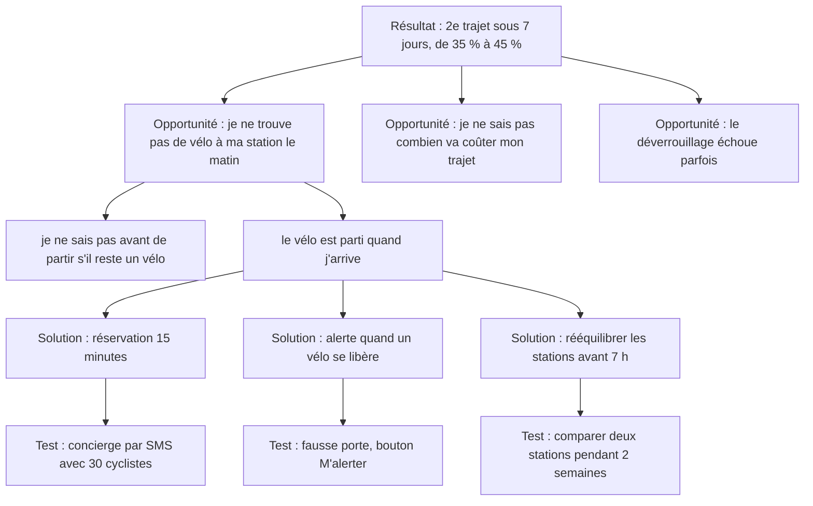
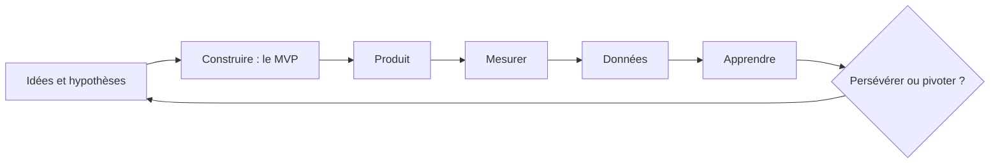
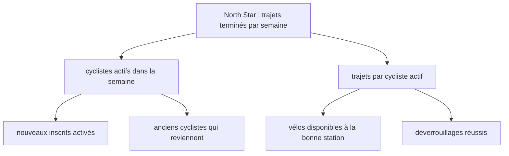
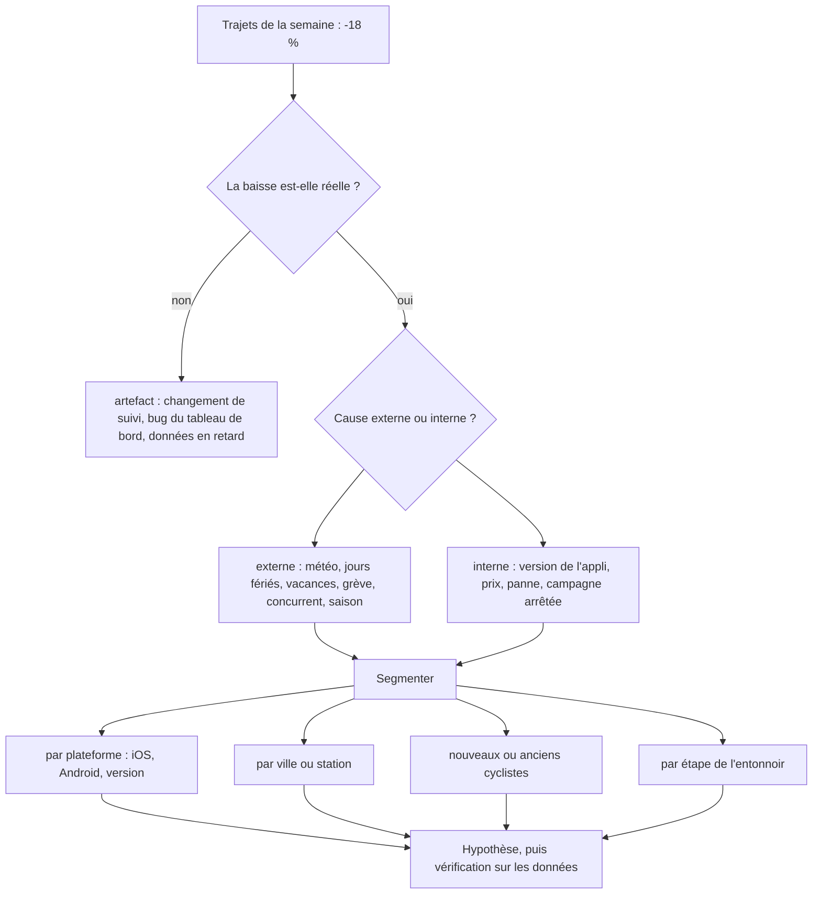

# Product management

!!! warning "Avertissement"
    Ces notes sont des pense-bêtes personnels, pas une source de vérité. Elles reflètent ma compréhension et mes choix : leur contenu reste subjectif, malgré les citations et les références qu'il contient. Il peut être incomplet, simplifié, inexact ou dépassé. Vérifiez toujours dans la documentation officielle avant de l'appliquer. Ce contenu est fourni tel quel, sans aucune garantie : son utilisation se fait sous votre seule responsabilité.

!!! audience "Pour qui, pour quoi"
    - **Métiers** : product manager, product owner, product designer, tech lead, engineering manager, QA.
    - **Usages** : je prépare un entretien de product manager et je veux savoir ce qu'on attend du rôle ; je dois choisir entre cinq demandes qui se disent toutes prioritaires, comme un abonnement étudiant et un mode sombre ; une métrique a chuté de 18 % lundi et je cherche par où commencer ; je veux vérifier qu'une idée intéresse vraiment des utilisateurs avant de la faire développer ; je travaille avec un PM et je veux comprendre ses outils et son vocabulaire.

Un product manager (PM) ne décide pas seulement « quoi construire » : il répond du résultat que le produit obtient auprès de ses utilisateurs et de l'entreprise. Cette page rassemble ce qu'un PM doit savoir : son rôle face aux autres métiers, la discovery, l'écriture d'un cadrage, la priorisation, les feuilles de route, les métriques produit, le product-market fit, le travail avec l'ingénierie et le design, les parties prenantes et les bases de stratégie de marché.

Plusieurs notions produit vivent déjà dans [Culture d'entreprise](culture-entreprise.md#produit) (Jobs to be done, discovery et delivery, Shape Up, estimation, construire ou acheter, OKR, North Star, coût du retard, one-pager) et dans [Données et décision](donnees-decision.md#ab-testing) (A/B testing) : je les résume ici et j'y renvoie. L'application de location de vélos `bike-app`, les personnes (ada la PM, grace la designer, alan le tech lead) et tous les chiffres sont des exemples inventés.

## Vocabulaire

| Mot | Définition | Exemple |
|---|---|---|
| **<span class="term" data-term="product-manager">Product manager</span>** (PM) | la personne qui répond du résultat d'un produit : quel problème on résout, pour qui, et comment on sait que ça marche | ada répond de la part des nouveaux inscrits de `bike-app` qui font un deuxième trajet |
| **<span class="term" data-term="product-owner">Product owner</span>** (PO) | le rôle défini par Scrum : il maximise la valeur du produit et gère le backlog de l'équipe | le PO ordonne les stories du prochain sprint |
| **Résultat** (outcome) | un changement de comportement des utilisateurs, mesurable, qui crée de la valeur | « plus de nouveaux inscrits font un deuxième trajet dans la semaine » |
| **Livrable** (output) | ce que l'équipe produit : une fonction, un écran, une API | « l'écran de réservation à l'avance est en production » |
| **<span class="term" data-term="product-discovery">Discovery</span>** | le travail qui cherche ce qui vaut la peine d'être construit, avant d'écrire le code de production | montrer une maquette de réservation à cinq cyclistes |
| **Opportunité** | un besoin, une douleur ou un désir d'utilisateur, formulé de son point de vue | « je ne trouve jamais de vélo à ma station à 7 h » |
| **<span class="term" data-term="mvp">MVP</span>** | Minimum Viable Product : la plus petite version qui permet d'apprendre quelque chose de vrai sur les clients | une réservation gérée à la main par SMS pour 30 cyclistes |
| **<span class="term" data-term="prd">PRD</span>** | Product Requirements Document : le document qui cadre un problème, son objectif et ses limites | le PRD « réservation à l'avance », deux pages |
| **Feuille de route** (roadmap) | ce que l'équipe compte faire ensuite, et pourquoi, à un horizon de quelques mois | Now : fiabiliser le déverrouillage ; Next : réservation |
| **Backlog** | la liste ordonnée du travail possible de l'équipe | 40 stories, les 8 premières prêtes à démarrer |
| **<span class="term" data-term="activation-metric">Activation</span>** | le moment où un nouvel utilisateur obtient pour la première fois la valeur promise | le premier trajet terminé |
| **Rétention** | la part des utilisateurs qui reviennent après une période donnée | 30 % des inscrits de janvier roulent encore en mars |
| **<span class="term" data-term="churn">Churn</span>** (attrition) | la part des clients qui partent sur une période, l'inverse de la rétention | 4 % des abonnés résilient chaque mois |
| **Cohorte** | un groupe d'utilisateurs qui ont commencé à la même période | les inscrits de la semaine du 2 mars |
| **<span class="term" data-term="conversion-funnel">Entonnoir</span>** (funnel) | la suite d'étapes qu'un utilisateur franchit, avec la part qui passe chaque étape | installation, compte, carte bancaire, premier trajet |
| **<span class="term" data-term="guardrail-metric">Métrique garde-fou</span>** | une mesure qui ne doit pas se dégrader pendant qu'on en pousse une autre | le taux de plantage pendant qu'on accélère le déverrouillage |
| **<span class="term" data-term="product-market-fit">Product-market fit</span>** | le moment où un produit satisfait si bien un marché que les clients restent et en amènent d'autres | la rétention des cohortes se stabilise au lieu de tomber à zéro |
| **<span class="term" data-term="go-to-market">Go-to-market</span>** | le plan pour amener un produit à ses clients : à qui, par quel canal, à quel prix, avec quel message | lancement de l'abonnement étudiant dans deux villes, avec les associations étudiantes |
| **<span class="term" data-term="stakeholder">Partie prenante</span>** (stakeholder) | toute personne touchée par une décision produit ou qui peut l'influencer | le support, la finance, les équipes de maintenance des vélos |
| **<span class="term" data-term="sli">SLI</span>** | Service Level Indicator : l'indicateur mesuré pour savoir si quelque chose marche | la part des déverrouillages réussis en moins de 5 secondes |
| **<span class="term" data-term="slo">SLO</span>** | Service Level Objective : la cible interne fixée sur un SLI | « 99 % des déverrouillages réussis en moins de 5 s » (exemple) |
| **<span class="term" data-term="sla">SLA</span>** | Service Level Agreement : la promesse contractuelle faite à un client, avec une pénalité, en général plus lâche que le SLO | 99,5 % de disponibilité promis à une ville partenaire, sinon remise (exemple) |

Une phrase de revue produit, décodée :

``` { .text .ex-illus title="Illustration" }
« L'activation stagne à 27 %, la cohorte de mars ne s'aplatit pas : on garde la réservation en Next,
  et le trio passe le trimestre sur l'opportunité "je ne trouve pas de vélo". »

activation à 27 %             27 % des inscrits terminent un premier trajet
la cohorte ne s'aplatit pas   les inscrits de mars continuent de partir, semaine après semaine
réservation en Next           la fonction reste prévue, mais après le sujet en cours
le trio                       la PM, la designer et le tech lead, qui décident ensemble
l'opportunité                 le besoin d'utilisateur qu'on cherche à résoudre, pas une fonction
```

## Le rôle du product manager

### Product manager, product owner, chef de projet, product designer

<span class="pill pill-status pill-status-ok" title="Toujours valable, vérifié en novembre 2026">Valable · 11/2026</span>

Quand j'arrive dans une équipe produit, quatre titres se ressemblent et se recouvrent. Chacun répond d'une chose différente :

| Rôle | Il répond de... | Question qu'il pose | Exemple sur `bike-app` |
|---|---|---|---|
| product manager | du résultat : le bon problème, pour les bons utilisateurs, avec un effet mesurable | « qu'est-ce qui fera revenir les nouveaux inscrits ? » | ada choisit l'opportunité « pas de vélo à ma station » |
| product owner (Scrum) | de la valeur du produit et de l'ordre du backlog de l'équipe | « quelle story fait-on en premier ce sprint ? » | le PO découpe la réservation en stories et les ordonne |
| chef de projet | d'un périmètre livré dans un délai et un budget | « est-ce qu'on tient la date du 1er juin ? » | le chef de projet coordonne le déploiement des nouvelles bornes |
| product designer | de l'expérience : que l'utilisateur comprenne et réussisse | « le cycliste comprend-il qu'il a 15 minutes pour récupérer son vélo ? » | grace teste la maquette de réservation avec cinq cyclistes |

Le Scrum Guide (édition de novembre 2020) ne parle pas de product manager : il définit le **product owner** comme la personne qui répond de la maximisation de la valeur du produit, et qui gère le backlog. Dans beaucoup d'entreprises, une seule personne porte les deux titres ; dans d'autres, le PM regarde le marché et la stratégie, et le PO travaille au quotidien avec l'équipe. Martin Eriksson a dessiné le PM à l'intersection de trois mondes, le business, la technique et l'expérience utilisateur (« What exactly is a product manager? », 2011) :

<figure class="diagram"><svg viewBox="0 0 300 220" role="img" aria-label="Le product manager à l'intersection du business, de la technique et de l'expérience utilisateur"><circle class="set" cx="115" cy="85" r="65"/><circle class="set" cx="185" cy="85" r="65"/><circle class="set" cx="150" cy="145" r="65"/><text x="85" y="60" text-anchor="middle" class="label-strong">Business</text><text x="215" y="60" text-anchor="middle" class="label-strong">Technique</text><text x="150" y="190" text-anchor="middle" class="label-strong">Expérience</text><text x="150" y="110" text-anchor="middle" class="label-strong">PM</text></svg><figcaption>Le PM au croisement des trois mondes, d'après Martin Eriksson (2011)</figcaption></figure>

!!! noob "As noob"
    Je pense à un film : le réalisateur décide quelle histoire on raconte et pour quel public, le directeur de production s'assure que le tournage finit à temps et dans le budget, le chef décorateur fait que chaque scène soit lisible pour le spectateur. Le PM est le réalisateur, le chef de projet le directeur de production, le designer le chef décorateur. La phrase à retenir : **le PM répond du « pourquoi » et du résultat, pas de la date de livraison seule.** Limite de l'image : un PM ne donne pas d'ordres à l'équipe, il la convainc.

**Risques.** un PM qui se comporte en chef de projet ne suit que les dates, et l'équipe livre à l'heure des fonctions que personne n'utilise. Un PM qui dessine lui-même les écrans et choisit l'architecture prive le designer et le tech lead de leur métier, et l'équipe décroche. J'écris noir sur blanc qui décide quoi, avec une matrice [RACI](culture-entreprise.md#raci) si besoin.

:material-book-open-variant: Doc de référence : [Ken Schwaber et Jeff Sutherland, The Scrum Guide](https://scrumguides.org/scrum-guide.html) (novembre 2020) ; [Martin Eriksson, What exactly is a product manager?](https://www.mindtheproduct.com/what-exactly-is-a-product-manager/) (2011)
{ .doc-ref }

### Le trio produit

<span class="pill pill-status pill-status-ok" title="Toujours valable, vérifié en novembre 2026">Valable · 11/2026</span>

Mon équipe travaille mal quand la PM décide seule, la designer dessine après coup et les développeurs découvrent le sujet au moment de l'estimer. Teresa Torres (« Continuous Discovery Habits », 2021) propose le <span class="term" data-term="product-trio">trio produit</span> : la PM, le designer et le tech lead mènent la discovery ensemble, chaque semaine, et décident ensemble quelle opportunité traiter et quelle solution tester.

**Quand** : dès qu'une équipe a un objectif de résultat et une marge pour choisir comment l'atteindre. **Pourquoi** : chacun voit un risque que les autres ne voient pas (la PM la valeur, le designer l'utilisabilité, le tech lead la faisabilité), et l'équipe comprend le « pourquoi » au lieu de recevoir une liste. **Comment** : un créneau d'entretien utilisateur par semaine où les trois sont présents, un arbre d'opportunités partagé, les décisions prises à trois et notées.

``` { .text .ex-illus title="Illustration" }
lundi     ada, grace et alan interviewent une cycliste qui a abandonné après 2 trajets
mardi     ils ajoutent l'opportunité « le vélo réservé est parti quand j'arrive » à l'arbre
mercredi  alan signale que la borne ne sait pas bloquer un vélo : risque de faisabilité
jeudi     ils choisissent un test concierge : réservation par SMS, vélo bloqué à la main
```

**Risques.** le trio devient un comité qui ralentit tout si chaque petite décision passe par trois personnes : je garde le trio pour les choix d'opportunité et de solution, pas pour la couleur d'un bouton. Le trio ne remplace pas le reste de l'équipe : les autres développeurs et le QA viennent aux entretiens à tour de rôle.

:material-book-open-variant: Doc de référence : [Teresa Torres, Product Trios](https://www.producttalk.org/2021/05/product-trio/) (2021)
{ .doc-ref }

### Le PM selon la taille de l'entreprise

<span class="pill pill-status pill-status-ok" title="Toujours valable, vérifié en novembre 2026">Valable · 11/2026</span>

Le même titre recouvre des métiers différents selon l'étape de l'entreprise :

| Étape | Ce que fait surtout le PM | Ce qui compte | Piège |
|---|---|---|---|
| startup avant le product-market fit (moins de 20 personnes) | parler aux clients tous les jours, tester des hypothèses, souvent le fondateur lui-même | apprendre vite, changer de cap sans regret | construire une plateforme avant d'avoir des clients qui restent |
| croissance (50 à 500 personnes) | une équipe par PM, un objectif de résultat par équipe, des métriques d'entonnoir | faire grandir ce qui marche, sans casser l'existant | dix équipes qui optimisent chacune leur chiffre sans North Star commune |
| grande entreprise | arbitrer entre équipes, gérer les dépendances, convaincre beaucoup de parties prenantes | l'alignement et les décisions écrites | passer plus de temps en réunion qu'avec les utilisateurs |

Marty Cagan oppose les **équipes produit**, à qui l'on confie un problème à résoudre, et les **équipes de fonctionnalités** (feature teams), à qui l'on donne une liste de fonctions à livrer (« Product vs. Feature Teams », 2019). Dans une équipe de fonctionnalités, le « PM » est surtout un chef de projet.

**Risques.** je copie le fonctionnement d'une grande entreprise dans une startup de dix personnes, avec ses revues trimestrielles et ses documents de 15 pages, et l'équipe passe plus de temps à écrire qu'à apprendre. À l'inverse, garder le fonctionnement « tout le monde parle au fondateur » à 200 personnes crée des priorités qui changent chaque semaine.

:material-book-open-variant: Doc de référence : [Marty Cagan, Product vs. Feature Teams](https://www.svpg.com/product-vs-feature-teams/) (2019)
{ .doc-ref }

### Ce dont le PM répond

Ben Horowitz résume l'attente dans « Good Product Manager/Bad Product Manager » (texte interne de 1996 publié plus tard, à vérifier) : le bon PM connaît le marché, le produit et la concurrence, et il se juge au succès du produit, pas aux réunions qu'il anime. Concrètement, je réponds de :

- **le problème choisi** : pourquoi celui-là, pour qui, maintenant ;
- **le résultat** : un changement mesurable de comportement, avec sa [métrique garde-fou](#metriques-garde-fous) ;
- **la viabilité** : le produit tient pour l'entreprise (coût, juridique, ventes, support) ;
- **la clarté** : chacun dans l'équipe sait ce qu'on fait, pourquoi, et ce qu'on ne fait pas ;
- **les décisions écrites** : ce qu'on a choisi, ce qu'on a écarté, et ce qui nous ferait changer d'avis.

Je ne réponds pas seul de la date (l'équipe estime), de la solution technique (le tech lead) ni de l'interface (le designer) : j'en réponds avec eux.

**Risques.** un PM responsable d'un résultat sans aucun levier dessus (pas de budget, pas d'équipe stable, une feuille de route imposée) porte une responsabilité vide : je négocie la marge de manœuvre en même temps que l'objectif.

:material-book-open-variant: Doc de référence : [Ben Horowitz, Good Product Manager/Bad Product Manager](https://a16z.com/good-product-manager-bad-product-manager/) (consultée en novembre 2026) ; [Marty Cagan, The Product Manager Role](https://www.svpg.com/the-product-manager-role/) (consultée en novembre 2026)
{ .doc-ref }

!!! maturity "Mesurer la maturité"
    | Niveau | Ce que j'observe dans l'équipe |
    |---|---|
    | N1 | quelqu'un joue le rôle de PM, même à temps partiel, et les rôles se recouvrent sans être écrits |
    | N2 | chaque équipe a un PM, un designer et un tech lead identifiés, et une matrice dit qui décide quoi |
    | N3 | le trio choisit seul l'opportunité et la solution à tester dans le cadre de son objectif, sans validation de la direction à chaque étape |
    | N4 | le trio suit le résultat obtenu par chaque pari et ajuste ses choix d'opportunité d'après ces résultats |

    **Je mesure** : la part des équipes qui ont un objectif de résultat plutôt qu'une liste de fonctions, lue dans les feuilles de route ; le nombre d'entretiens utilisateurs par trio et par mois.

## Résultats plutôt que livrables

<span class="pill pill-status pill-status-ok" title="Toujours valable, vérifié en novembre 2026">Valable · 11/2026</span>

Mon équipe a livré douze fonctions ce trimestre, et pourtant les nouveaux inscrits partent toujours après un trajet. Joshua Seiden (« Outcomes Over Output », 2019) distingue trois choses : le **livrable** (output, ce qu'on construit), le **résultat** (outcome, le changement de comportement des utilisateurs) et l'**impact** (l'effet pour l'entreprise, comme le chiffre d'affaires). Il définit le résultat comme « un changement de comportement humain qui produit des résultats pour l'entreprise ». Un <span class="term" data-term="product-outcome">objectif de résultat</span> laisse l'équipe choisir comment l'atteindre.

!!! noob "As noob"
    Un médecin ne se juge pas au nombre d'ordonnances qu'il signe, mais au fait que ses patients guérissent. Une ordonnance est un livrable, la guérison est le résultat, et la sécurité sociale qui dépense moins est l'impact. La phrase à retenir : **je mesure ce que les utilisateurs font de différent, pas ce que l'équipe a livré.**

À éviter : une feuille de route faite de fonctions et de dates. L'équipe coche les cases sans savoir si quelque chose a changé pour les cyclistes.

``` { .text .ex-bad title="À éviter" }
T2  réservation à l'avance (15 avril)
    déverrouillage NFC (30 mai)
    mode sombre (15 juin)
```

Bien : un résultat chiffré, la façon de le mesurer, et des paris présentés comme des hypothèses.

``` { .text .ex-good title="Recommandé" }
Résultat T2   part des nouveaux inscrits qui font un 2e trajet sous 7 jours : de 35 % à 45 %
Mesure        cohortes hebdomadaires dans l'outil d'analytique
Garde-fou     taux de plantage de l'appli sous 0,5 % des sessions
Paris         réservation à l'avance, rappel quand un vélo se libère (hypothèses, à tester)
(chiffres d'exemple)
```

**Quand** : dès qu'une équipe a assez de stabilité et de données pour mesurer un comportement. Pas pour une obligation légale (une mise en conformité est un livrable imposé, pas un pari). **Pourquoi** : l'équipe cherche la meilleure solution au lieu d'exécuter la première idée, et peut arrêter un pari qui ne marche pas. Le coût : il faut instrumenter le produit et accepter de ne pas promettre de fonction précise à une date.

**Risques.** un résultat trop éloigné de l'équipe, comme « +10 % de chiffre d'affaires », ne guide aucune décision quotidienne : je descends à un comportement que l'équipe peut influencer en quelques semaines. Un résultat sans garde-fou pousse à tricher (des notifications en rafale font revenir les gens, puis désinstaller l'appli) : voir [Goodhart](culture-entreprise.md#eviter-le-piege-de-goodhart).

:material-book-open-variant: Doc de référence : [Joshua Seiden, Outcomes Over Output](https://joshuaseiden.com/) (2019, consultée en novembre 2026) ; [Melissa Perri, Escaping the Build Trap](https://melissaperri.com/book) (2018)
{ .doc-ref }

!!! maturity "Mesurer la maturité"
    | Niveau | Ce que j'observe dans l'équipe |
    |---|---|
    | N1 | l'équipe parle parfois de l'effet attendu d'une fonction, mais ses objectifs restent des listes de fonctions |
    | N2 | chaque trimestre, l'équipe a un objectif de résultat chiffré avec son garde-fou, et chaque fonction dit quel résultat elle vise |
    | N3 | un pari qui ne fait pas bouger son résultat est arrêté ou retiré sans débat, d'après le critère écrit avant |
    | N4 | l'équipe compare l'effet attendu et l'effet mesuré de chaque pari, et corrige sa façon de choisir les suivants |

    **Je mesure** : la part des fonctions livrées dont l'effet a été mesuré trois mois après, lue dans les fiches de lancement ; la part des objectifs écrits comme des résultats plutôt que comme des livrables.

## Discovery

<a class="pill pill-dora" href="https://dora.dev/capabilities/customer-feedback/">DORA · Customer feedback</a> <a class="pill pill-dora" href="https://dora.dev/capabilities/team-experimentation/">DORA · Team experimentation</a>

La discovery cherche ce qui vaut la peine d'être construit. Ses bases sont déjà dans [Discovery et delivery](culture-entreprise.md#discovery-et-delivery) (Marty Cagan, les deux activités en parallèle) et [Jobs to be done](culture-entreprise.md#jobs-to-be-done) (le progrès que le client veut faire). Ici, je vais plus loin sur les outils du quotidien.

### Les quatre risques

<span class="pill pill-status pill-status-ok" title="Toujours valable, vérifié en novembre 2026">Valable · 11/2026</span>

Marty Cagan (« Inspired », deuxième édition, 2017) demande de traiter quatre risques avant d'écrire le code de production : **valeur** (vont-ils l'utiliser ou l'acheter ?), **utilisabilité** (sauront-ils s'en servir ?), **faisabilité** (peut-on le construire avec nos moyens ?), **viabilité** (est-ce tenable pour l'entreprise ?). Le détail, avec un test par risque, est dans [Discovery et delivery](culture-entreprise.md#discovery-et-delivery). Sur `bike-app`, pour la réservation à l'avance :

| Risque | Question | Responsable principal dans le trio |
|---|---|---|
| valeur | les cyclistes du matin réserveraient-ils, et la réservation les ferait-elle revenir ? | ada, la PM |
| utilisabilité | comprennent-ils qu'un vélo réservé est gardé 15 minutes, puis libéré ? | grace, la designer |
| faisabilité | la borne peut-elle bloquer un vélo à distance ? | alan, le tech lead |
| viabilité | un vélo bloqué 15 minutes sans rouler coûte-t-il trop cher en heure de pointe ? | ada, avec la finance |

**Risques.** je traite surtout le risque que je connais le mieux : un PM venu de la technique teste la faisabilité et oublie la valeur. Je liste les quatre risques pour chaque idée, même en une ligne.

:material-book-open-variant: Doc de référence : [Marty Cagan, The Four Big Risks](https://www.svpg.com/the-four-big-risks/) (2017)
{ .doc-ref }

### Discovery continue et arbre d'opportunités

<span class="pill pill-status pill-status-ok" title="Toujours valable, vérifié en novembre 2026">Valable · 11/2026</span>

Mon équipe fait une « grande étude utilisateurs » par an, puis plus rien pendant onze mois. Teresa Torres (« Continuous Discovery Habits », 2021) définit la discovery continue comme des points de contact au moins hebdomadaires avec les clients, menés par l'équipe qui construit le produit, sous forme de petites recherches au service d'un résultat voulu. Elle organise ce qu'elle apprend dans un <span class="term" data-term="opportunity-solution-tree">arbre d'opportunités et de solutions</span> (opportunity solution tree) :

- en haut, le **résultat** visé (un seul) ;
- en dessous, les **opportunités** : besoins, douleurs, désirs, entendus en entretien, du point de vue de l'utilisateur ;
- sous une opportunité choisie, plusieurs **solutions** possibles (au moins trois, pour ne pas tomber amoureux de la première) ;
- sous chaque solution, les **tests d'hypothèses** qui disent si elle tient.



!!! noob "As noob"
    C'est l'arbre généalogique d'une décision : tout en haut, ce que je veux changer ; au milieu, les vraies raisons pour lesquelles les gens n'y arrivent pas ; en bas, mes idées et la façon de les vérifier. Si une idée n'a pas de parent dans l'arbre, elle ne sert aucun besoin connu. La phrase à retenir : **je compare plusieurs solutions pour une même opportunité, au lieu de défendre ma première idée.**

**Quand** : une équipe stable avec un objectif de résultat. Moins utile pour une demande imposée et bien comprise, comme un changement de TVA. **Pourquoi** : la discovery devient une habitude courte au lieu d'un projet, et chaque fonction se rattache à un besoin entendu. **Comment** : un entretien par semaine (recrutement automatisé, par exemple une question dans l'appli qui propose un appel), une synthèse après chaque entretien, l'arbre mis à jour en trio.

**Risques.** un arbre rempli de solutions déguisées en opportunités (« il manque un mode sombre ») n'apprend rien : je réécris chaque opportunité comme une phrase que l'utilisateur pourrait dire de sa vie. Un arbre avec dix résultats en haut redevient une liste de vœux : un seul résultat par arbre.

:material-book-open-variant: Doc de référence : [Teresa Torres, Opportunity Solution Trees](https://www.producttalk.org/opportunity-solution-trees/) (consultée en novembre 2026) ; [Teresa Torres, Continuous Discovery Habits](https://www.producttalk.org/continuous-discovery-habits/) (2021)
{ .doc-ref }

### Interviewer sans biais : The Mom Test

<span class="pill pill-status pill-status-ok" title="Toujours valable, vérifié en novembre 2026">Valable · 11/2026</span>

Je montre mon idée à des cyclistes, tout le monde la trouve « super », et personne ne l'utilise une fois livrée. Rob Fitzpatrick (« The Mom Test », 2013) explique pourquoi : quand je demande un avis sur mon idée, les gens sont polis, même ma mère. Le <span class="term" data-term="mom-test">Mom Test</span> pose trois règles :

1. parler de leur vie, pas de mon idée ;
2. demander des faits précis du passé, pas des opinions générales ni des promesses sur l'avenir ;
3. parler moins, écouter plus.

À éviter : des questions sur l'avenir et sur mon idée. Les réponses sont gentilles et fausses, et je repars avec de faux signaux de valeur.

``` { .text .ex-bad title="À éviter" }
« Est-ce que vous utiliseriez une réservation de vélo à l'avance ? »
« Combien seriez-vous prêt à payer pour réserver ? »
« Vous ne trouvez pas que ce serait pratique ? »
```

Bien : des faits passés, des comportements réels, ce que la personne a déjà essayé ou payé.

``` { .text .ex-good title="Recommandé" }
« Racontez-moi la dernière fois que vous n'avez pas trouvé de vélo. Que s'est-il passé ensuite ? »
« Qu'avez-vous essayé pour éviter ça ? Vous partez plus tôt, vous prenez le bus ? »
« Combien de fois est-ce arrivé le mois dernier ? Qu'est-ce que ça vous a coûté ? »
```

Un engagement réel (laisser son numéro pour un test, payer d'avance, présenter un collègue) vaut plus qu'un compliment. Pour les tests d'utilisabilité, Jakob Nielsen (« Why You Only Need to Test with 5 Users », 2000) observe que cinq utilisateurs trouvent la plupart des problèmes d'un écran [À prendre avec précaution : valable pour un même profil d'utilisateurs et un test d'utilisabilité qualitatif, pas pour mesurer une préférence ni une valeur].

**Risques.** je n'interroge que des utilisateurs fidèles, faciles à joindre, et j'ignore ceux qui sont partis : ce sont eux qui ont la réponse sur la rétention. Je recrute aussi parmi les inscrits qui n'ont fait qu'un trajet. Un entretien noté de mémoire le lendemain garde surtout ce qui m'arrange : je note les citations exactes pendant l'entretien.

:material-book-open-variant: Doc de référence : [Rob Fitzpatrick, The Mom Test](https://www.momtestbook.com/) (2013) ; [Jakob Nielsen, Why You Only Need to Test with 5 Users](https://www.nngroup.com/articles/why-you-only-need-to-test-with-5-users/) (2000)
{ .doc-ref }

### Cartographier les hypothèses

<span class="pill pill-status pill-status-ok" title="Toujours valable, vérifié en novembre 2026">Valable · 11/2026</span>

Mon idée de réservation repose sur plusieurs suppositions que je n'ai jamais vérifiées. La <span class="term" data-term="assumption-mapping">cartographie des hypothèses</span> (assumption mapping, popularisée par David Bland, « Testing Business Ideas », 2019) les écrit toutes, puis les place sur deux axes : leur **importance** (si elle est fausse, l'idée tombe) et les **preuves** que j'ai déjà. Je teste en premier les hypothèses importantes et sans preuve.

| | Peu de preuves | Beaucoup de preuves |
|---|---|---|
| **Importante** | à tester d'abord : « les cyclistes du matin réserveraient au moins 2 fois par semaine » | à surveiller : « la station est vide à 7 h dans 30 % des cas » (données des bornes) |
| **Peu importante** | à noter : « ils préfèrent réserver depuis le widget de l'écran d'accueil » | à ignorer pour l'instant : « ils ont un smartphone récent » |

Teresa Torres classe aussi les hypothèses par type : désirabilité, utilisabilité, faisabilité, viabilité, éthique (« Assumption Testing », consultée en novembre 2026).

**Risques.** écrire trente hypothèses et n'en tester aucune donne l'illusion de la rigueur : je choisis les deux ou trois du coin « importante, peu de preuves » et je les teste cette semaine. Classer l'importance seul conduit à sous-estimer ce que je ne connais pas : je fais la carte en trio.

:material-book-open-variant: Doc de référence : [Teresa Torres, Assumption Testing](https://www.producttalk.org/assumption-testing/) (consultée en novembre 2026) ; [David Bland et Alexander Osterwalder, Testing Business Ideas](https://www.strategyzer.com/library/testing-business-ideas-book) (2019)
{ .doc-ref }

### Prototypes et tests : fausse porte, concierge, magicien d'Oz

<span class="pill pill-status pill-status-ok" title="Toujours valable, vérifié en novembre 2026">Valable · 11/2026</span>

Pour tester une hypothèse importante, je n'ai pas besoin de construire la fonction. Trois tests classiques, décrits notamment dans « Testing Business Ideas » (2019) :

| Test | Ce que c'est | Ce qu'il vérifie | Exemple sur `bike-app` |
|---|---|---|---|
| <span class="term" data-term="fake-door-test">fausse porte</span> (fake door, painted door) | un bouton ou une offre visible, sans fonction derrière ; au clic, un message honnête | la demande : combien cliquent | un bouton « Réserver » sur 10 % des écrans de station ; au clic, « bientôt disponible, voulez-vous être prévenu ? » |
| <span class="term" data-term="concierge-test">concierge</span> | le service rendu à la main, ouvertement, à quelques clients | la valeur et l'usage réel, en détail | 30 cyclistes réservent par SMS, alan bloque le vélo depuis l'outil de maintenance |
| <span class="term" data-term="wizard-of-oz-test">magicien d'Oz</span> (Wizard of Oz) | l'utilisateur croit le service automatique, un humain répond derrière | que le service, s'il existait, serait utilisé comme prévu | un « assistant » qui propose la station la plus proche avec un vélo, en fait un membre de l'équipe pendant 2 semaines |
| prototype cliquable | une maquette qui se manipule, sans code de production | l'utilisabilité | grace montre la maquette de réservation à 5 cyclistes |

Alberto Savoia appelle ces tests du <span class="term" data-term="prototype">prototypage</span> très léger des « pretotypes » (« The Right It », 2019) : vérifier que c'est la bonne chose avant de bien la construire.

**Quand** : une hypothèse importante sans preuve, et une fonction qui coûterait plus de quelques jours. **Pourquoi** : un test d'une semaine remplace un développement de deux mois. **Comment** : j'écris le critère de succès avant le test (« au moins 8 % de clics sur le bouton Réserver, sinon j'abandonne »), je borne la durée, je décide à la date prévue.

**Risques.** une fausse porte frustre l'utilisateur qui clique et ne trouve rien : je l'affiche à une petite part du trafic, peu de temps, avec un message honnête. Un magicien d'Oz qui dure trop longtemps devient un mensonge et pose des questions de confiance et de données personnelles : je le limite à quelques jours et je n'y collecte rien de sensible. Un concierge réussi à 30 personnes ne prouve pas que le service tient à 30 000 : il prouve la valeur, pas la faisabilité.

:material-book-open-variant: Doc de référence : [Alberto Savoia, Pretotyping](https://www.pretotyping.org/) (consultée en novembre 2026) ; [Wikipédia, Wizard of Oz experiment](https://en.wikipedia.org/wiki/Wizard_of_Oz_experiment) (consultée en novembre 2026)
{ .doc-ref }

### MVP et build-measure-learn

<span class="pill pill-status pill-status-ok" title="Toujours valable, vérifié en novembre 2026">Valable · 11/2026</span>

Eric Ries (« The Lean Startup », 2011) définit le <span class="term" data-term="mvp">MVP</span> comme la version d'un nouveau produit qui permet à l'équipe de récolter le maximum d'apprentissage validé sur ses clients avec le moins d'effort. Le MVP n'est pas « la version 1 au rabais » : c'est une expérience. Il s'inscrit dans la boucle <span class="term" data-term="build-measure-learn">construire, mesurer, apprendre</span> (build-measure-learn), au bout de laquelle je décide de persévérer ou de **pivoter** (changer de stratégie sans changer de vision).



!!! noob "As noob"
    Avant d'ouvrir un restaurant, je peux tenir un stand le samedi au marché avec trois plats. Si personne ne revient, j'ai perdu un samedi, pas un bail commercial. Le stand n'est pas un mauvais restaurant, c'est une expérience pour savoir si le restaurant vaut la peine. La phrase à retenir : **un MVP sert à apprendre, son succès se mesure à ce qu'il m'apprend, pas à ses ventes.**

À éviter : un MVP qui est une version 1 complète, juste moins finie. Il prend quatre mois, et à la fin je ne sais toujours pas quelle hypothèse était fausse.

``` { .text .ex-bad title="À éviter" }
MVP réservation  réservation, annulation, historique, paiement de la réservation,
                 widget, notifications ; qualité « on corrigera après » ; 4 mois
```

Bien : une seule hypothèse, un critère de décision écrit, deux semaines.

``` { .text .ex-good title="Recommandé" }
Hypothèse   les cyclistes du matin réservent au moins 2 fois par semaine
MVP         réservation par SMS pour 30 cyclistes, vélo bloqué à la main (concierge)
Critère     au moins 18 des 30 réservent 2 fois par semaine pendant 2 semaines, sinon j'arrête
(chiffres d'exemple)
```

**Risques.** un MVP mal fini (bugs, lenteur) fait échouer une bonne idée pour une mauvaise raison : « minimum » porte sur le périmètre, pas sur la qualité de ce qui est montré. Un MVP qui marche est souvent gardé en production tel quel, et devient de la [dette technique](#negocier-la-dette-technique) : je décide à l'avance s'il sera jeté ou reconstruit.

:material-book-open-variant: Doc de référence : [Eric Ries, The Lean Startup, principes](https://theleanstartup.com/principles) (2011, consultée en novembre 2026)
{ .doc-ref }

!!! maturity "Mesurer la maturité"
    | Niveau | Ce que j'observe dans l'équipe |
    |---|---|
    | N1 | quelqu'un parle aux utilisateurs de temps en temps, souvent pour valider une idée déjà choisie |
    | N2 | le trio fait au moins un entretien par semaine, tient un arbre d'opportunités et teste les hypothèses importantes avant le code |
    | N3 | une idée qui échoue à son critère de test est abandonnée à la date prévue, sans réunion d'arbitrage |
    | N4 | l'équipe suit la part des tests qui confirment leur hypothèse et le délai entre une idée et sa décision, et ajuste sa discovery d'après ces chiffres |

    **Je mesure** : le nombre d'entretiens par trio et par semaine, lu dans le dossier de synthèses ; la part des fonctions livrées qui ont passé un test de valeur avant le code.

## Cadrer et écrire

### L'énoncé du problème

<span class="pill pill-status pill-status-ok" title="Toujours valable, vérifié en novembre 2026">Valable · 11/2026</span>

On me demande « une réservation de vélos ». Si je pars de là, l'équipe ne peut que construire une réservation, même si une autre solution était meilleure. Un <span class="term" data-term="problem-statement">énoncé du problème</span> décrit qui a le problème, dans quelle situation, ce que ça lui coûte, et comment je saurai qu'il est résolu, sans nommer la solution. Je finis souvent par une question « Comment pourrions-nous... ? » (How Might We, popularisée par la méthode de design thinking d'IDEO).

À éviter : la solution déguisée en problème. L'équipe ne peut ni proposer autre chose ni savoir quand elle a réussi.

``` { .text .ex-bad title="À éviter" }
Problème : nous n'avons pas de réservation de vélos.
```

Bien : la personne, la situation, la conséquence, la mesure.

``` { .text .ex-good title="Recommandé" }
Qui          les cyclistes qui partent entre 6 h et 8 h en semaine
Situation    leur station est vide à leur arrivée dans 30 % des cas
Conséquence  ils prennent un autre transport ; 1 sur 5 n'ouvre plus l'appli le mois suivant
Mesure       part des trajets du matin commencés à la station prévue
Question     Comment pourrions-nous garantir un vélo aux cyclistes du matin ?
(chiffres d'exemple)
```

**Risques.** un énoncé trop large (« améliorer l'expérience ») ne guide rien ; un énoncé trop étroit (« comment pourrions-nous réserver un vélo ? ») cache la solution dans la question. Je teste l'énoncé en demandant au trio trois solutions différentes : s'il n'en trouve qu'une, l'énoncé est trop étroit.

:material-book-open-variant: Doc de référence : [IDEO Design Kit, How Might We](https://www.designkit.org/methods/how-might-we.html) (consultée en novembre 2026)
{ .doc-ref }

### PRD et one-pager

<span class="pill pill-status pill-status-ok" title="Toujours valable, vérifié en novembre 2026">Valable · 11/2026</span>

Le <span class="term" data-term="prd">PRD</span> (Product Requirements Document) cadre une initiative : le problème, le résultat visé, ce qui est dans le périmètre et ce qui n'y est pas, les questions ouvertes. Les PRD de 40 pages des années 2000 décrivaient chaque écran ; aujourd'hui, la plupart des équipes écrivent un document court, vivant, qui laisse la solution au trio. Le [one-pager](culture-entreprise.md#one-pager) destiné à la direction en est la version décisionnelle : une page, une décision attendue, une date.

À éviter : un PRD qui est une liste de fonctions. Personne ne sait pourquoi on les fait, ni quand on aura réussi.

``` { .markdown .ex-bad title="À éviter" }
# PRD Réservation
- bouton Réserver sur la fiche station
- réservation de 15 minutes
- annulation possible
- notification 5 minutes avant expiration
```

Bien : un squelette qui part du problème et du résultat, et qui dit ce qu'on ne fait pas.

``` { .markdown .ex-good title="Recommandé" }
# Garantir un vélo aux cyclistes du matin

Problème : 30 % des cyclistes de 6 h à 8 h trouvent leur station vide (données des bornes, mars)
Pour qui : abonnés qui roulent au moins 3 matins par semaine
Résultat visé : trajets du matin commencés à la station prévue, de 70 % à 85 %
Garde-fou : taux d'utilisation des vélos en heure de pointe, pas en baisse de plus de 2 points
Ce qu'on sait : test concierge, 21 cyclistes sur 30 ont réservé 2 fois par semaine
Hors périmètre : réservation payante, réservation plus de 30 minutes à l'avance
Questions ouvertes : la borne sait-elle bloquer un vélo à distance ? (spike d'une journée)
Décision attendue : go pour la tranche 1, d'ici le 15/05
(chiffres d'exemple)
```

**Risques.** un PRD écrit seul par le PM et « remis » à l'équipe redevient un cahier des charges : je l'écris avec le trio et je le garde court. Un PRD jamais mis à jour ment au bout de trois semaines : j'y note chaque décision et sa date.

:material-book-open-variant: Doc de référence : [Atlassian, Product requirements document](https://www.atlassian.com/agile/product-management/requirements) (consultée en novembre 2026)
{ .doc-ref }

### Working Backwards : le communiqué et la FAQ

<span class="pill pill-status pill-status-ok" title="Toujours valable, vérifié en novembre 2026">Valable · 11/2026</span>

Je veux vérifier qu'une idée tient debout du point de vue du client avant toute ligne de code. La méthode <span class="term" data-term="pr-faq">PR/FAQ</span>, décrite par Colin Bryar et Bill Carr dans « Working Backwards » (2021), part de la fin : j'écris le communiqué de presse (press release) du jour du lancement, puis une FAQ. Si le communiqué n'est pas enthousiasmant, l'idée ne l'est pas non plus. C'est un cousin du [mémo narratif de six pages](culture-entreprise.md#le-memo-narratif-de-six-pages) : un texte complet, lu en silence en début de réunion.

``` { .text .ex-illus title="Illustration" }
Titre           bike-app garantit un vélo aux cyclistes du matin
Sous-titre      réservez votre vélo 15 minutes avant de quitter la maison
Problème        trois matins sur dix, la station est vide quand j'arrive (cycliste fictive)
Solution        un bouton Réserver sur la fiche station ; le vélo est bloqué 15 minutes
Citation        « je ne pars plus en courant pour attraper un vélo » (cliente fictive)
Pour commencer  disponible pour les abonnés à partir du 1er juin, sans surcoût
FAQ client      que se passe-t-il si je suis en retard ? si la borne est en panne ?
FAQ interne     combien de vélos bloqués sans rouler en heure de pointe ? quel coût ?
```

**Quand** : une nouvelle offre ou une fonction importante, avant de lancer la discovery détaillée. Pas pour un petit correctif. **Pourquoi** : le texte oblige à expliquer le bénéfice client en mots simples, et la FAQ interne fait sortir tôt les questions qui fâchent (coût, juridique, faisabilité). **Comment** : une à deux pages de communiqué, une FAQ sans limite, relus et réécrits plusieurs fois.

**Risques.** un communiqué brillant peut masquer une idée non testée : je le traite comme une hypothèse à vérifier, pas comme une preuve. La FAQ interne est la partie utile : un PR/FAQ sans questions gênantes n'a pas été assez relu.

:material-book-open-variant: Doc de référence : [Colin Bryar et Bill Carr, Working Backwards](https://workingbackwards.com/) (2021)
{ .doc-ref }

!!! maturity "Mesurer la maturité"
    | Niveau | Ce que j'observe dans l'équipe |
    |---|---|
    | N1 | les demandes arrivent sous forme de solutions, écrites dans un ticket ou dites à l'oral |
    | N2 | chaque initiative importante a un énoncé du problème et un PRD court, avec résultat, garde-fou et hors périmètre |
    | N3 | une initiative sans énoncé du problème validé ne peut pas entrer dans la feuille de route, sans que quelqu'un ait à le rappeler |
    | N4 | l'équipe compare le résultat visé dans le PRD et le résultat obtenu, et améliore son modèle de PRD d'après les écarts |

    **Je mesure** : la part des initiatives de la feuille de route qui ont un énoncé du problème et un résultat chiffré, lue dans le dossier des PRD ; le nombre de questions ouvertes encore non résolues au démarrage du développement.

## Prioriser

Cinq demandes arrivent en même temps, chacune portée par quelqu'un qui la dit urgente. Une méthode de priorisation ne décide pas à ma place : elle rend les hypothèses visibles et force la discussion sur les bons critères. Le [coût du retard](culture-entreprise.md#cout-du-retard) et les [décisions de type 1 ou type 2](culture-entreprise.md#decisions-de-type-1-et-de-type-2) complètent cette section.

### RICE

<span class="pill pill-status pill-status-ok" title="Toujours valable, vérifié en novembre 2026">Valable · 11/2026</span>

Sean McBride a présenté le <span class="term" data-term="rice-score">score RICE</span> chez Intercom en 2016. Quatre facteurs :

- **Reach** (portée) : combien de personnes ou d'événements seront touchés sur une période, par exemple par trimestre ;
- **Impact** : l'effet sur chaque personne, sur une échelle fixe : 3 massif, 2 fort, 1 moyen, 0,5 faible, 0,25 minime ;
- **Confidence** (confiance) : à quel point je crois à mes chiffres : 100 % fort, 80 % moyen, 50 % faible ;
- **Effort** : le travail total, en personnes-mois.

Score = Reach × Impact × Confidence ÷ Effort.

| Idée pour `bike-app` | Reach (personnes par trimestre) | Impact | Confiance | Effort (personnes-mois) | Score RICE |
|---|---|---|---|---|---|
| mode sombre | 12 000 | 0,25 | 100 % | 0,5 | 6 000 |
| abonnement étudiant | 2 000 | 3 | 80 % | 2 | 2 400 |
| réservation à l'avance | 4 000 | 2 | 80 % | 4 | 1 600 |
| déverrouillage NFC | 9 000 | 1 | 50 % | 3 | 1 500 |

Chiffres d'exemple. Le calcul de la première ligne : 12 000 × 0,25 × 1 ÷ 0,5 = 6 000. Le mode sombre arrive en tête parce qu'il est petit et touche tout le monde, alors que son impact est minime : RICE favorise les petites choses larges. C'est un signal à discuter, pas une décision. Je regarde aussi l'objectif du trimestre : si le résultat visé est le deuxième trajet des nouveaux inscrits, la réservation sert l'objectif et le mode sombre non.

!!! noob "As noob"
    C'est comme choisir quels travaux faire dans un appartement : combien de pièces sont concernées, combien chaque travail améliore la vie, à quel point je suis sûr du devis, combien il coûte. Repeindre une porte coûte peu et se voit partout, mais ne change pas grand-chose. La phrase à retenir : **RICE classe des paris, il ne dit pas lesquels servent mon objectif.**

**Risques.** chacun gonfle l'impact de son idée : je fixe l'échelle d'impact par rapport à l'objectif du trimestre et je fais noter l'impact par plusieurs personnes. La confiance « 100 % » sans données est un mensonge confortable : 100 % demande une mesure, sinon 50 %. RICE ignore le coût du retard : une obligation légale avec une date passe avant, quel que soit son score.

:material-book-open-variant: Doc de référence : [Sean McBride, RICE: Simple prioritization for product managers](https://www.intercom.com/blog/rice-simple-prioritization-for-product-managers/) (2016)
{ .doc-ref }

### ICE

<span class="pill pill-status pill-status-ok" title="Toujours valable, vérifié en novembre 2026">Valable · 11/2026</span>

Le <span class="term" data-term="ice-score">score ICE</span> (Impact, Confidence, Ease : impact, confiance, facilité), associé à Sean Ellis et au growth marketing (vers 2015, date à vérifier), note chaque idée de 1 à 10 sur les trois critères, puis les multiplie (certaines équipes font la moyenne). Il est plus rapide que RICE, sans la portée.

``` { .text .ex-illus title="Illustration" }
idée                                  impact  confiance  facilité  ICE
e-mail de rappel 24 h après l'inscription  6        7          9      378
parrainage : 1 trajet offert          8        5          5      200
nouvelle page d'accueil               5        3          4       60
(notes d'exemple)
```

**Quand** : beaucoup de petites expériences de croissance à classer vite, comme des tests d'e-mails ou de messages. **Risques.** trois notes subjectives multipliées donnent un chiffre précis en apparence : deux personnes notent la même idée à 378 et à 120. Je l'utilise pour trier une longue liste en trois paquets, pas pour départager deux idées proches.

:material-book-open-variant: Doc de référence : pas de texte fondateur public trouvé ; méthode décrite dans Sean Ellis et Morgan Brown, « Hacking Growth » (2017, à vérifier)
{ .doc-ref }

### Modèle de Kano

<span class="pill pill-status pill-status-ok" title="Toujours valable, vérifié en novembre 2026">Valable · 11/2026</span>

Je veux savoir quelles fonctions sont attendues sans discussion et lesquelles surprennent. Le <span class="term" data-term="kano-model">modèle de Kano</span> (Noriaki Kano et coauteurs, 1984) classe les attributs d'un produit selon le lien entre leur présence et la satisfaction :

| Catégorie | Si présent | Si absent | Exemple sur `bike-app` |
|---|---|---|---|
| obligatoire (must-be) | normal, personne ne remercie | colère | les freins fonctionnent, le déverrouillage marche |
| proportionnel (performance) | plus il y en a, plus on est content | mécontentement | l'autonomie du vélo électrique, le temps de déverrouillage |
| attractif (delighter) | ravissement | personne ne le réclame | l'appli prévient quand un vélo se libère à ma station |
| indifférent | rien | rien | le choix de la couleur de l'icône |
| inversé | mécontentement pour certains | satisfaction pour certains | des notifications de défis hebdomadaires |

La catégorie se mesure avec un questionnaire à double question : « que pensez-vous si la fonction est présente ? » et « si elle est absente ? », chaque réponse sur une échelle de cinq (j'aime, c'est normal, ça m'est égal, je m'en accommode, je n'aime pas).

**Quand** : choisir le contenu d'une offre ou d'une version, et ne pas oublier les fonctions obligatoires. **Risques.** les catégories glissent avec le temps : un attractif d'hier devient obligatoire demain (l'alerte de disponibilité, une fois copiée par tous les concurrents). Un questionnaire Kano sur une fonction que l'utilisateur ne s'imagine pas donne des réponses au hasard : je montre une maquette.

:material-book-open-variant: Doc de référence : [Wikipédia, Kano model](https://en.wikipedia.org/wiki/Kano_model) (consultée en novembre 2026)
{ .doc-ref }

### MoSCoW

<span class="pill pill-status pill-status-ok" title="Toujours valable, vérifié en novembre 2026">Valable · 11/2026</span>

Ma date de lancement est fixe (le début de l'année universitaire) et le périmètre doit s'y adapter. <span class="term" data-term="moscow-method">MoSCoW</span>, créé par Dai Clegg en 1994 et repris par la méthode DSDM, classe les exigences d'une livraison en quatre groupes : **Must** (sans elle, la livraison n'a pas de sens), **Should** (important, mais on peut livrer sans), **Could** (si le temps le permet), **Won't this time** (pas cette fois, et c'est écrit). Le guide DSDM recommande que les Must ne dépassent pas environ 60 % de l'effort, pour garder de la marge (à vérifier dans le guide en vigueur).

``` { .text .ex-illus title="Illustration" }
Abonnement étudiant, lancement le 1er septembre
Must    souscription avec vérification du statut étudiant, prix réduit appliqué aux trajets
Should  carte étudiante ajoutée au portefeuille du téléphone
Could   parrainage entre étudiants
Won't   tarif de groupe pour les associations (prévu au printemps)
```

**Risques.** tout finit en Must quand chaque partie prenante défend sa ligne : je demande « livre-t-on quand même si cette ligne manque ? », et si la réponse est oui, ce n'est pas un Must. MoSCoW classe à l'intérieur d'une livraison, il ne compare pas des initiatives entre elles.

:material-book-open-variant: Doc de référence : [Wikipédia, MoSCoW method](https://en.wikipedia.org/wiki/MoSCoW_method) (consultée en novembre 2026)
{ .doc-ref }

### WSJF et coût du retard

<span class="pill pill-status pill-status-ok" title="Toujours valable, vérifié en novembre 2026">Valable · 11/2026</span>

<span class="term" data-term="wsjf">WSJF</span> (Weighted Shortest Job First) vient des travaux de Donald Reinertsen (« The Principles of Product Development Flow », 2009) et a été popularisé par le framework SAFe : on fait d'abord le travail qui a le plus fort [coût du retard](culture-entreprise.md#cout-du-retard) par unité de durée. SAFe estime le coût du retard par trois notes relatives : valeur pour l'utilisateur ou l'entreprise, urgence dans le temps, réduction de risque ou opportunité ouverte.

``` { .text .ex-illus title="Illustration" }
                          valeur  urgence  risque  coût du retard  taille  WSJF
mise en conformité RGPD     5       13       8          26            5     5,2
abonnement étudiant         8       13       2          23            8     2,9
réservation à l'avance     13        3       3          19           13     1,5
(notes relatives d'exemple, suite de Fibonacci)
```

L'abonnement étudiant a une forte urgence parce que la rentrée universitaire ne se décale pas : livré en octobre, il rate la période où les étudiants choisissent leur transport.

**Risques.** les notes relatives se négocient comme les autres : je les fais donner en même temps par plusieurs personnes, comme au planning poker. WSJF suppose qu'on peut découper le travail ; une grosse initiative indivisible a toujours une mauvaise note, même si elle est stratégique.

:material-book-open-variant: Doc de référence : [Scaled Agile, WSJF](https://framework.scaledagile.com/wsjf) (consultée en novembre 2026) ; [Black Swan Farming, WSJF](https://blackswanfarming.com/wsjf-weighted-shortest-job-first/) (consultée en novembre 2026)
{ .doc-ref }

### Quelle méthode, et quand elle échoue

| Situation | Méthode | Quand elle échoue |
|---|---|---|
| je compare une dizaine d'idées de tailles et de portées différentes pour le trimestre, comme la réservation et l'abonnement étudiant | RICE | quand l'impact est inventé, ou que l'objectif du trimestre n'est pas pris en compte |
| je dois trier vite trente petites expériences de croissance, comme des variantes d'e-mails | ICE | quand on départage deux idées proches sur des notes subjectives |
| je prépare le contenu d'une offre et je veux ne rien oublier d'attendu ni de surprenant | Kano | quand les catégories ont glissé depuis l'enquête |
| ma date est fixe, comme la rentrée universitaire, et je dois choisir ce qui entre dans la livraison | MoSCoW | quand tout devient Must |
| certaines demandes perdent leur valeur avec le temps, comme une offre liée à une saison ou une obligation légale | WSJF, coût du retard | quand le travail ne se découpe pas, ou que les coûts du retard sont gonflés |
| toutes les idées semblent bonnes et la discussion tourne en rond | revenir au résultat du trimestre : quelle idée le fait bouger ? | jamais tout à fait : c'est la question de départ |

**Risques.** une méthode appliquée mécaniquement remplace le jugement par un tableau : le PM qui dit « le score l'a décidé » ne porte plus sa décision. J'utilise le score pour ouvrir la discussion, puis j'écris la décision et sa raison.

!!! maturity "Mesurer la maturité"
    | Niveau | Ce que j'observe dans l'équipe |
    |---|---|
    | N1 | la priorité va à la demande la plus récente ou à la personne la plus haut placée |
    | N2 | l'équipe classe ses initiatives avec une méthode écrite (RICE, WSJF), et chaque décision a sa raison notée |
    | N3 | une nouvelle demande est notée avec les mêmes critères avant d'entrer dans la feuille de route, sans arbitrage de la direction pour chaque cas |
    | N4 | l'équipe compare l'impact estimé et l'impact mesuré des paris livrés, et recale ses échelles d'impact et de confiance d'après ces écarts |

    **Je mesure** : la part des initiatives livrées dont l'impact mesuré atteint au moins la moitié de l'impact estimé, lue dans la revue trimestrielle ; le nombre de changements de priorité en cours de trimestre.

## Feuilles de route

### Now, Next, Later

<span class="pill pill-status pill-status-ok" title="Toujours valable, vérifié en novembre 2026">Valable · 11/2026</span>

Ma feuille de route à dates promet des fonctions précises à six mois, alors que je sais à peine ce que je ferai dans six semaines. La feuille de route <span class="term" data-term="now-next-later">Now, Next, Later</span>, popularisée par Janna Bastow (vers 2012, à vérifier), remplace les dates par trois horizons dont la précision décroît :

``` { .text .ex-illus title="Illustration" }
Now (en cours, détaillé)       fiabiliser le déverrouillage : de 94 % à 99 % de réussite
                               réservation : test concierge en cours
Next (prochain, cadré)         garantir un vélo aux cyclistes du matin
                               abonnement étudiant pour la rentrée
Later (plus tard, exploratoire) trajets en famille, vélos cargo
```

**Quand** : une équipe produit qui a des objectifs de résultat et un environnement incertain. **Pourquoi** : la précision affichée correspond à la précision réelle, et Later peut changer sans « retard ». **Comment** : Now est détaillé et engagé, Next est cadré (problème et résultat), Later est une liste d'opportunités ; chaque élément dit quel résultat il sert.

**Risques.** sans aucune date, la direction, les ventes ou le marketing ne peuvent rien préparer, et ils inventent leurs propres dates : je donne des dates là où elles existent vraiment (contrat, saison, loi), avec une [confiance](#tenir-un-engagement-de-date). Un Later qui grossit sans jamais être nettoyé devient un cimetière d'idées : je le relis chaque trimestre et j'en retire.

:material-book-open-variant: Doc de référence : [Janna Bastow, I invented the Now-Next-Later roadmap](https://www.prodpad.com/blog/invented-now-next-later-roadmap/) (consultée en novembre 2026)
{ .doc-ref }

### Feuille de route par résultats ou par dates

<span class="pill pill-status pill-status-ok" title="Toujours valable, vérifié en novembre 2026">Valable · 11/2026</span>

Une <span class="term" data-term="outcome-roadmap">feuille de route par résultats</span> liste les problèmes à résoudre et les résultats visés ; une feuille de route par fonctions et dates liste des livrables à une échéance. C. Todd Lombardo, Bruce McCarthy et coauteurs (« Product Roadmaps Relaunched », 2017) défendent la première, avec des thèmes plutôt que des fonctions.

| | Par fonctions et dates | Par résultats |
|---|---|---|
| ce qu'elle promet | « la réservation le 15 avril » | « plus de trajets du matin réussis ce trimestre » |
| ce qui se passe si l'idée échoue | on la livre quand même, on a promis | on change de solution, le résultat reste |
| ce qu'en tire la direction | une date claire, souvent fausse | une direction claire, des dates seulement là où elles comptent |
| quand elle convient | contrat client, obligation légale, migration de plateforme | produit en évolution, marché incertain |

**Risques.** une feuille de route par résultats trop vague (« améliorer l'expérience ») ressemble à une absence de plan, et la direction reprend la main avec une liste de fonctions : chaque résultat est chiffré, et j'indique les paris en cours. Une feuille de route publique par fonctions crée des promesses aux clients qu'on ne peut plus retirer.

:material-book-open-variant: Doc de référence : C. Todd Lombardo, Bruce McCarthy, Evan Ryan et Michael Connors, « Product Roadmaps Relaunched » (O'Reilly, 2017 ; page de l'éditeur non vérifiable automatiquement)
{ .doc-ref }

### Dire non

<span class="pill pill-status pill-status-ok" title="Toujours valable, vérifié en novembre 2026">Valable · 11/2026</span>

Le directeur commercial veut un export PDF pour un grand compte, la support veut une page d'aide, la direction veut une fonction vue chez un concurrent. Dire oui à tout dilue l'équipe, et rien n'avance. Dire non n'est pas refuser la personne : c'est montrer le <span class="term" data-term="opportunity-cost">coût d'opportunité</span>.

À éviter : un non sec, ou un « oui, on verra » qui n'engage à rien. La demande revient, plus fort, par la direction.

``` { .text .ex-bad title="À éviter" }
« Non, ce n'est pas dans la roadmap. »
« Oui, on le met dans le backlog. » (et personne n'en parle plus jamais)
```

Bien : je reformule le besoin, je relie la décision à l'objectif, je dis ce qui ferait changer d'avis.

``` { .text .ex-good title="Recommandé" }
« Si je comprends bien, le grand compte veut justifier ses dépenses de mobilité chaque mois.
  Ce trimestre, l'équipe est sur les trajets du matin : si on prend l'export, la réservation
  glisse de six semaines. Je propose un export CSV fait à la main par le support pour ce client,
  et je réexamine si trois autres comptes le demandent d'ici juin. »
```

**Risques.** dire non trop souvent sans montrer d'alternative coupe le PM des ventes et du support, qui sont pourtant ses meilleures sources d'opportunités : je note chaque demande refusée avec son demandeur, et je reviens vers lui si le contexte change. Un non motivé par mon intuition seule ne tient pas devant la direction : je m'appuie sur l'objectif écrit et sur des données.

:material-book-open-variant: Doc de référence : [Marty Cagan, Inspired](https://www.svpg.com/inspired-how-to-create-products-customers-love/) (deuxième édition, 2017)
{ .doc-ref }

### Tenir un engagement de date

<span class="pill pill-status pill-status-ok" title="Toujours valable, vérifié en novembre 2026">Valable · 11/2026</span>

Certaines dates sont réelles : la rentrée universitaire, une obligation légale, un salon, un contrat avec une ville. D'autres sont des souhaits. Pour une vraie date, je fixe la date et je fais varier le périmètre, comme l'[appétit](culture-entreprise.md#shape-up) de Shape Up.

1. je sépare les dates externes (qui coûtent cher à rater) des cibles internes ;
2. je donne une date avec une confiance : « 1er septembre, confiance 80 %, si la vérification du statut étudiant est prête fin juin » ;
3. je classe le périmètre en [MoSCoW](#moscow) et je livre les Must d'abord ;
4. j'annonce un risque dès qu'une hypothèse tombe, pas la veille ;
5. j'estime en fourchettes par tranches verticales, comme dans [Estimer et découper](culture-entreprise.md#estimer-et-decouper-une-fonctionnalite).

**Risques.** une date annoncée sans confiance devient une promesse ferme dans la tête des autres : je l'écris avec sa confiance et ses conditions. Garder le périmètre fixe et la date fixe oblige à sacrifier la qualité, et les bugs se paient après le lancement : je sacrifie du périmètre, jamais les tests.

:material-book-open-variant: Doc de référence : [Ryan Singer, Shape Up](https://basecamp.com/shapeup) (2019)
{ .doc-ref }

!!! maturity "Mesurer la maturité"
    | Niveau | Ce que j'observe dans l'équipe |
    |---|---|
    | N1 | une feuille de route existe, souvent une liste de fonctions avec des dates, rarement relue |
    | N2 | la feuille de route est en Now, Next, Later, chaque élément dit quel résultat il sert, et les vraies dates ont une confiance |
    | N3 | une demande hors objectif est refusée ou garée avec sa raison écrite, sans remonter à la direction à chaque fois |
    | N4 | l'équipe mesure la part des engagements de date tenus et la part des éléments Now qui ont fait bouger leur résultat, et ajuste son horizon et ses fourchettes |

    **Je mesure** : la part des engagements de date externes tenus sur l'année, lue dans le suivi des lancements ; le nombre d'éléments ajoutés ou retirés de Now en cours de trimestre.

## Métriques produit

### North Star et arbre de métriques

La [North Star metric](culture-entreprise.md#north-star-metric) est l'unique mesure qui capte la valeur reçue par les clients et annonce le revenu futur ; elle se décompose en métriques d'entrée sur lesquelles chaque équipe agit, avec une contre-mesure contre [Goodhart](culture-entreprise.md#eviter-le-piege-de-goodhart). Pour `bike-app`, une North Star possible est le nombre de trajets terminés par semaine, décomposé ainsi :



**Risques.** une North Star de volume (trajets) peut grossir pendant que la valeur baisse, par exemple avec des trajets gratuits offerts en masse : je l'accompagne de la marge par trajet et de la satisfaction.

:material-book-open-variant: Doc de référence : [Amplitude, The North Star Playbook](https://amplitude.com/books/north-star) (consultée en novembre 2026)
{ .doc-ref }

### AARRR, les métriques pirates

<span class="pill pill-status pill-status-ok" title="Toujours valable, vérifié en novembre 2026">Valable · 11/2026</span>

Dave McClure a proposé en 2007 les <span class="term" data-term="aarrr">métriques AARRR</span>, dites « pirates » à cause du cri du sigle, pour suivre le cycle de vie d'un client en cinq étapes :

| Étape | Question | Métrique d'exemple pour `bike-app` |
|---|---|---|
| Acquisition | d'où viennent les utilisateurs ? | installations par canal (magasin d'applications, partenariat, bouche-à-oreille) |
| Activation | ont-ils une bonne première expérience ? | part des inscrits qui terminent un premier trajet sous 7 jours |
| Rétention | reviennent-ils ? | part des activés qui roulent encore 4 semaines après |
| Referral (recommandation) | en parlent-ils ? | parrainages envoyés par cycliste actif |
| Revenue (revenu) | paient-ils ? | revenu moyen par cycliste actif et par mois |

Certains ajoutent une étape **Awareness** (notoriété) en tête, d'où AAARRR (à vérifier selon les auteurs). L'ordre des étapes n'est pas forcément l'ordre des priorités : acquérir des utilisateurs qui ne restent pas revient à remplir un seau percé.

**Risques.** suivre les cinq étapes avec la même attention disperse l'équipe : je cherche l'étape où la perte est la plus forte et la moins chère à corriger. Des définitions floues (« actif » = a ouvert l'appli ?) font varier les chiffres sans que rien ne change : j'écris la définition de chaque métrique.

:material-book-open-variant: Doc de référence : [Dave McClure, Startup Metrics for Pirates](https://www.slideshare.net/dmc500hats/startup-metrics-for-pirates-long-version) (2007)
{ .doc-ref }

### HEART

<span class="pill pill-status pill-status-ok" title="Toujours valable, vérifié en novembre 2026">Valable · 11/2026</span>

Je veux mesurer la qualité de l'expérience utilisateur, pas seulement la croissance. Kerry Rodden, Hilary Hutchinson et Xin Fu (Google, conférence CHI 2010) proposent le <span class="term" data-term="heart-framework">cadre HEART</span> : cinq catégories, et pour chacune une démarche Objectifs, Signaux, Métriques (Goals, Signals, Metrics).

| Catégorie | Objectif sur `bike-app` | Signal | Métrique |
|---|---|---|---|
| Happiness (satisfaction) | les cyclistes trouvent l'appli fiable | réponse à l'enquête dans l'appli | note moyenne sur 5 après un trajet |
| Engagement | ils roulent souvent | trajets par cycliste | trajets par cycliste actif et par semaine |
| Adoption | ils essaient la réservation | première réservation | part des cyclistes actifs qui ont réservé au moins une fois |
| Retention | ils restent | trajet dans la période | part des cyclistes actifs en mars encore actifs en avril |
| Task success (réussite de la tâche) | ils déverrouillent sans peine | déverrouillage réussi ou échoué | taux de réussite et temps médian de déverrouillage |

**Quand** : une fonction ou un produit dont la valeur passe par l'expérience. Je ne prends que les catégories utiles : la réservation a besoin d'Adoption et de Task success, pas forcément de Happiness. **Risques.** remplir les cinq cases pour chaque fonction produit un tableau de bord que personne ne lit : je choisis deux catégories par objectif.

:material-book-open-variant: Doc de référence : [Kerry Rodden, Hilary Hutchinson et Xin Fu, Measuring the User Experience on a Large Scale](https://research.google/pubs/measuring-the-user-experience-on-a-large-scale-user-centered-metrics-for-web-applications/) (CHI 2010)
{ .doc-ref }

### Entonnoir et activation

<span class="pill pill-status pill-status-ok" title="Toujours valable, vérifié en novembre 2026">Valable · 11/2026</span>

Beaucoup de gens installent `bike-app`, peu deviennent des cyclistes réguliers. Une <span class="term" data-term="conversion-funnel">analyse d'entonnoir</span> suit la part des utilisateurs qui franchissent chaque étape, pour une même cohorte, et montre où ils partent. L'**activation** est l'étape où l'utilisateur reçoit pour la première fois la valeur promise : pour `bike-app`, le premier trajet terminé.

| Étape (inscrits de mars) | Utilisateurs | Passent l'étape | Perdus |
|---|---|---|---|
| installation | 10 000 | | |
| compte créé | 6 500 | 65 % | 3 500 |
| carte bancaire ajoutée | 3 900 | 60 % | 2 600 |
| premier trajet terminé (activation) | 2 730 | 70 % | 1 170 |
| deuxième trajet sous 7 jours | 1 365 | 50 % | 1 365 |

Chiffres d'exemple. Activation : 2 730 ÷ 10 000 = 27 %. La plus grosse perte en nombre est à la création de compte (3 500), mais la plus grosse perte en part est au deuxième trajet (50 %). Je regarde les deux, puis je segmente : si la perte à la carte bancaire est de 60 % sur Android et 25 % sur iOS, c'est sans doute un bug, pas un manque de motivation.

!!! noob "As noob"
    C'est la file d'attente d'un parc d'attractions : 100 personnes entrent dans la file, 60 arrivent au guichet, 40 montent dans le manège, 20 y retournent. Je ne sais pas encore pourquoi ils partent, mais je sais où regarder. La phrase à retenir : **l'entonnoir dit où les gens partent ; les entretiens et les données segmentées disent pourquoi.**

**Risques.** un entonnoir qui mélange des cohortes (inscrits de mars et de janvier) compare des gens qui n'ont pas eu le même temps pour avancer : je fixe une fenêtre (par exemple 7 jours après l'installation). Pousser l'activation par une astuce (un trajet gratuit obligatoire) gonfle le chiffre sans créer d'habitude : je regarde la rétention des activés.

:material-book-open-variant: Doc de référence : [Wikipédia, Conversion funnel](https://en.wikipedia.org/wiki/Conversion_funnel) (consultée en novembre 2026)
{ .doc-ref }

### Rétention par cohortes

<span class="pill pill-status pill-status-ok" title="Toujours valable, vérifié en novembre 2026">Valable · 11/2026</span>

Le nombre total de cyclistes actifs monte, et pourtant les nouveaux partent vite : la croissance cache les départs. Une <span class="term" data-term="cohort-retention">analyse de rétention par cohortes</span> regroupe les utilisateurs par date de début et suit, pour chaque groupe, la part encore active après 1, 2, 4, 8 semaines.

| Cohorte | Semaine 0 | Semaine 1 | Semaine 2 | Semaine 4 | Semaine 8 |
|---|---|---|---|---|---|
| janvier | 100 % | 42 % | 30 % | 24 % | 22 % |
| février | 100 % | 45 % | 33 % | 27 % | 25 % |
| mars | 100 % | 50 % | 38 % | 32 % | 31 % |

Chiffres d'exemple. Deux lectures : chaque ligne se stabilise après la semaine 4 (la courbe s'aplatit, signe que ceux qui restent ont trouvé leur usage), et chaque cohorte retient mieux que la précédente (les changements de février et mars ont aidé). La définition d'« actif » doit suivre la fréquence naturelle du produit : une appli de vélo se juge à la semaine, une appli de déclaration d'impôts à l'année.

**Risques.** une moyenne de rétention sur tous les utilisateurs mélange les anciens fidèles et les nouveaux qui partent, et cache le problème. Une cohorte trop petite (200 personnes) bouge au hasard de plusieurs points : je ne conclus pas sur une seule semaine.

:material-book-open-variant: Doc de référence : [Wikipédia, Cohort analysis](https://en.wikipedia.org/wiki/Cohort_analysis) (consultée en novembre 2026)
{ .doc-ref }

### Métriques garde-fous

<span class="pill pill-status pill-status-ok" title="Toujours valable, vérifié en novembre 2026">Valable · 11/2026</span>

J'accélère le déverrouillage en supprimant une vérification, et le nombre de vélos volés double. Une <span class="term" data-term="guardrail-metric">métrique garde-fou</span> est une mesure que je ne cherche pas à améliorer, mais qui ne doit pas se dégrader pendant que je pousse ma métrique principale. C'est l'application produit de la contre-mesure contre [Goodhart](culture-entreprise.md#eviter-le-piege-de-goodhart), et une pièce standard des [A/B tests](donnees-decision.md#ab-testing).

| Métrique poussée | Triche ou effet de bord | Garde-fou |
|---|---|---|
| trajets par semaine | trajets gratuits offerts en masse | marge par trajet |
| réouvertures de l'appli | notifications en rafale | taux de désinstallation et de désactivation des notifications |
| vitesse de déverrouillage | contrôles supprimés | vols et dégradations signalés |
| conversion au paiement | prix caché jusqu'au dernier écran | tickets support et remboursements |

**Risques.** trop de garde-fous bloquent toute décision, car l'un d'eux bouge toujours un peu par hasard : j'en garde un ou deux par expérience, avec un seuil écrit à l'avance.

:material-book-open-variant: Doc de référence : [Ron Kohavi, Diane Tang et Ya Xu, Trustworthy Online Controlled Experiments](https://experimentguide.com/) (2020)
{ .doc-ref }

### Enquêter sur une baisse de métrique

<span class="pill pill-status pill-status-ok" title="Toujours valable, vérifié en novembre 2026">Valable · 11/2026</span>

Lundi, le tableau de bord affiche des trajets en baisse de 18 % sur la semaine. Avant de chercher une cause, je suis un arbre de diagnostic, du plus simple au plus profond :



``` { .text .ex-illus title="Illustration" }
1. réelle ?      oui : les comptages des bornes baissent aussi, pas seulement l'outil d'analytique
2. externe ?     météo normale, pas de jour férié ; la même semaine l'an dernier était stable
3. interne ?     la version 4.2 de l'appli Android est sortie mardi
4. segmenter     iOS stable ; Android -35 % ; uniquement la version 4.2
5. entonnoir     la perte est à l'étape « scanner le QR code » : le scanner plante sur certains téléphones
6. action        retour à la version 4.1 via le magasin d'applications, test de non-régression ajouté
(scénario d'exemple)
```

Le paradoxe de Simpson rappelle pourquoi segmenter : une moyenne peut baisser alors que chaque segment monte, si la part des segments a changé (plus de nouveaux cyclistes, qui roulent moins, par exemple).

**Risques.** je saute à la première cause plausible (« c'est la météo ») sans vérifier : je cherche une preuve dans les données segmentées avant de conclure. Je compare au jour précédent alors que l'usage dépend du jour de la semaine : je compare à la même semaine l'an dernier et à la moyenne des quatre semaines précédentes.

:material-book-open-variant: Doc de référence : [Wikipédia, Simpson's paradox](https://en.wikipedia.org/wiki/Simpson%27s_paradox) (consultée en novembre 2026)
{ .doc-ref }

### Expérimenter avec un A/B test

Pour savoir si un changement fait vraiment bouger une métrique, je compare deux versions montrées en même temps à deux groupes tirés au hasard. Tout est dans [A/B testing](donnees-decision.md#ab-testing) : hypothèse et taille d'échantillon fixées avant, <span class="term" data-term="statistical-significance">significativité</span>, intervalle de confiance, garde-fous. Côté PM, je retiens trois choses : j'écris la décision que je prendrai selon chaque résultat avant de lancer le test, je ne regarde pas le résultat tous les jours pour arrêter au premier chiffre favorable, et un test sans assez de trafic ne conclut rien : je fais plutôt un test qualitatif.

Quand le test est fini, je lis le résultat dans un ordre fixe, du contrôle du dispositif à la décision :

1. **la répartition** : si j'ai prévu 50 % et 50 % et que j'observe 52 % et 48 % sur 40 000 personnes, un bug d'affectation ou de mesure fausse tout le reste. C'est le <span class="term" data-term="sample-ratio-mismatch">déséquilibre d'échantillon</span> (sample ratio mismatch) : un test du khi-deux sur les effectifs le repère, et je ne lis rien d'autre tant qu'il n'est pas expliqué ;
2. **l'<span class="term" data-term="confidence-interval">intervalle de confiance</span>** de l'écart, pas seulement la p-value : contient-il 0, et sa borne basse vaut-elle encore le coût du changement ?
3. **l'effet dans le temps** : un écart fort la première semaine qui fond la deuxième trahit souvent un <span class="term" data-term="novelty-effect">effet de nouveauté</span> (les habitués cliquent sur ce qui est nouveau, puis reviennent à leurs habitudes) ; il touche les utilisateurs existants, beaucoup moins les nouveaux inscrits, qui n'ont jamais vu l'ancienne version ;
4. **les garde-fous**, avec leur seuil écrit avant le test ;
5. **les segments** seulement pour comprendre, pas pour chercher après coup le segment où « ça marche » : à 20 segments testés, un sur vingt sort significatif par hasard.

``` { .text .ex-illus title="Illustration" }
répartition      20 000 contre 20 150, prévue 50/50 : écart compatible avec le hasard (p = 0,45)
écart global     +1,6 point de cuisiniers par semaine, intervalle à 95 % : +0,8 à +2,4
semaine 1        +2,5 points ; semaine 2 : +0,7 point, intervalle de -0,1 à +1,5
garde-fou        désactivation des notifications : +0,3 point, seuil +0,5 ; mais l'intervalle va jusqu'à +0,6
décision         prolonger deux semaines avant de généraliser : l'effet semble surtout de la nouveauté
(chiffres d'exemple, application de recettes fictive)
```

**Risques.** tester des détails (la couleur d'un bouton) faute d'idées fortes occupe l'équipe sans faire bouger le résultat : je teste d'abord ce qui vient d'une opportunité de l'arbre. Décider sur la moyenne des deux semaines cache l'effet de nouveauté : je regarde toujours l'écart semaine par semaine.

:material-book-open-variant: Doc de référence : [Ron Kohavi, Diane Tang et Ya Xu, Trustworthy Online Controlled Experiments](https://experimentguide.com/) (2020, chapitres sur les métriques de confiance et le déséquilibre d'échantillon) ; [Wikipédia, Novelty effect](https://en.wikipedia.org/wiki/Novelty_effect) (consultée en novembre 2026)
{ .doc-ref }

!!! maturity "Mesurer la maturité"
    | Niveau | Ce que j'observe dans l'équipe |
    |---|---|
    | N1 | quelques chiffres sont regardés à la main, sans définition écrite |
    | N2 | une North Star, un entonnoir et une rétention par cohortes sont suivis chaque semaine, chaque métrique avec sa définition et son garde-fou |
    | N3 | une baisse au-delà d'un seuil déclenche une alerte et l'arbre de diagnostic, sans attendre la revue hebdomadaire |
    | N4 | chaque décision produit importante est prise sur une mesure (cohorte, A/B test), et l'équipe revoit ses métriques quand elles ne prédisent plus le revenu |

    **Je mesure** : le délai entre le début d'une baisse et sa cause trouvée, lu dans les comptes rendus d'enquête ; la part des métriques du tableau de bord qui ont une définition et un responsable écrits.

## Product-market fit

### Ce que veut dire product-market fit

Marc Andreessen a popularisé le <span class="term" data-term="product-market-fit">product-market fit</span> dans « The only thing that matters » (2007) : être sur un bon marché avec un produit qui peut satisfaire ce marché. Il le décrit par ses signes : les clients achètent aussi vite qu'on peut produire, l'usage grandit sans effort, on n'arrive plus à recruter assez vite. Avant ce point, presque tout le reste (optimiser le prix, accélérer l'acquisition, construire une plateforme) est prématuré.

!!! noob "As noob"
    C'est la différence entre pousser une voiture et la conduire : avant, chaque client s'obtient à la force des bras ; après, les clients arrivent et restent sans qu'on les pousse. La phrase à retenir : **sans product-market fit, accélérer l'acquisition remplit un seau percé.**

:material-book-open-variant: Doc de référence : [Marc Andreessen, The only thing that matters](https://pmarchive.com/guide_to_startups_part4.html) (2007)
{ .doc-ref }

### Le test des 40 % de Sean Ellis

<span class="pill pill-status pill-status-ok" title="Toujours valable, vérifié en novembre 2026">Valable · 11/2026</span>

Sean Ellis propose une question unique à poser aux utilisateurs récents et actifs : « Comment vous sentiriez-vous si vous ne pouviez plus utiliser ce produit ? », avec trois réponses : très déçu, un peu déçu, pas déçu. Le <span class="term" data-term="sean-ellis-test">test de Sean Ellis</span> fixe le seuil à 40 % de « très déçu » : au-dessus, le produit aurait trouvé son marché. [À prendre avec précaution : le seuil vient de la comparaison faite par Sean Ellis sur une centaine de startups, d'après ses propres écrits, sans étude publiée ni relue ; le résultat dépend beaucoup de qui reçoit l'enquête.]

``` { .text .ex-illus title="Illustration" }
enquête envoyée à 600 cyclistes qui ont roulé au moins 2 fois dans les 2 dernières semaines
réponses : 250
très déçu  95   (38 %)
un peu     110  (44 %)
pas déçu   45   (18 %)
segment « trajets domicile-travail » : 61 % de très déçu, segment « loisir du week-end » : 19 %
(chiffres d'exemple)
```

Le chiffre global est sous 40 %, mais un segment le dépasse largement : la suite logique est de comprendre ce que ce segment aime et de concentrer le produit sur lui.

**Risques.** interroger seulement les fans gonfle le score ; interroger des inscrits qui n'ont jamais roulé le fait chuter : j'écris la règle d'échantillonnage avant. Un score au-dessus de 40 % avec une rétention qui tombe à zéro ne prouve rien : je croise toujours avec les cohortes.

:material-book-open-variant: Doc de référence : [Sean Ellis, The Startup Pyramid](https://www.startup-marketing.com/the-startup-pyramid/) (2009, à vérifier) ; [PMF Survey](https://pmfsurvey.com/) (consultée en novembre 2026)
{ .doc-ref }

### La courbe de rétention qui s'aplatit

<span class="pill pill-status pill-status-ok" title="Toujours valable, vérifié en novembre 2026">Valable · 11/2026</span>

Le signe le plus fiable du product-market fit est une courbe de rétention par cohortes qui se stabilise sur un plateau au-dessus de zéro, au lieu de tomber jusqu'à zéro. Un plateau veut dire qu'une partie des utilisateurs a trouvé une valeur durable.

<figure class="diagram"><svg viewBox="0 0 320 175" role="img" aria-label="Deux courbes de rétention par cohortes, l'une qui s'aplatit vers 30 %, l'autre qui tombe vers zéro"><line class="set" x1="40" y1="140" x2="300" y2="140"/><line class="set" x1="40" y1="20" x2="40" y2="140"/><polyline class="set" points="40,20 60,80 80,94 120,102 200,103 280,104"/><polyline class="set" stroke-dasharray="4 3" points="40,20 60,98 80,116 120,128 200,135 280,139"/><circle class="hit" cx="280" cy="104" r="3"/><circle class="hit" cx="280" cy="139" r="3"/><text x="34" y="24" text-anchor="end">100 %</text><text x="34" y="84" text-anchor="end">50 %</text><text x="34" y="144" text-anchor="end">0</text><text x="40" y="155" text-anchor="middle">0</text><text x="120" y="155" text-anchor="middle">4</text><text x="200" y="155" text-anchor="middle">8</text><text x="280" y="155" text-anchor="middle">12</text><text x="170" y="170" text-anchor="middle">semaines après l'inscription</text><text x="284" y="98" text-anchor="end" class="label-strong">plateau vers 30 %</text><text x="284" y="132" text-anchor="end">tombe vers 0 (pointillés)</text></svg><figcaption>Rétention par cohortes : un produit qui a trouvé son marché et un produit qui ne l'a pas (chiffres d'exemple)</figcaption></figure>

La courbe du haut (cohorte de mars, exemple) s'aplatit vers 30 % ; celle du bas (un produit sans fit, exemple) tend vers zéro. Lenny Rachitsky a publié des ordres de grandeur de « bonne » rétention par type de produit (2021) [À prendre avec précaution : chiffres recueillis par enquête auprès de dirigeants et d'investisseurs, sans données vérifiées, et très dépendants du secteur].

**Risques.** un plateau obtenu à coups de promotions disparaît avec elles : je regarde la rétention des cohortes qui n'ont pas eu d'offre. Le plateau d'un petit segment ne dit rien du reste du marché : je le lis par segment.

:material-book-open-variant: Doc de référence : [Lenny Rachitsky, What is good retention](https://www.lennysnewsletter.com/p/what-is-good-retention-issue-29) (2021)
{ .doc-ref }

!!! maturity "Mesurer la maturité"
    | Niveau | Ce que j'observe dans l'équipe |
    |---|---|
    | N1 | l'équipe pense avoir trouvé son marché parce que les inscriptions montent |
    | N2 | la rétention par cohortes et le test de Sean Ellis sont mesurés au moins chaque trimestre, par segment |
    | N3 | les budgets d'acquisition sont bloqués tant que la rétention de la cohorte cible ne s'aplatit pas, sans arbitrage au cas par cas |
    | N4 | l'équipe choisit ses segments cibles et ses paris d'après le plateau de rétention et le score par segment, et revoit ce choix chaque trimestre |

    **Je mesure** : le plateau de rétention à 8 semaines de la dernière cohorte complète, lu dans l'outil d'analytique ; la part de « très déçu » dans le segment cible.

## Travailler avec l'ingénierie et le design

### Stories utilisateur et INVEST

<span class="pill pill-status pill-status-ok" title="Toujours valable, vérifié en novembre 2026">Valable · 11/2026</span>

Une <span class="term" data-term="user-story">story utilisateur</span> décrit un besoin du point de vue de l'utilisateur, en une phrase, et sert d'unité de travail. Le format « En tant que..., je veux..., afin de... » est attribué à l'équipe Connextra (2001, à vérifier). Bill Wake résume les qualités d'une bonne story avec <span class="term" data-term="invest-criteria">INVEST</span> (2003) : **I**ndépendante, **N**égociable, porteuse de **V**aleur, **E**stimable, petite (**S**mall), **T**estable. Une story est une promesse de conversation, pas un contrat.

À éviter : une story technique, sans utilisateur ni valeur, impossible à tester du point de vue de quelqu'un.

``` { .text .ex-bad title="À éviter" }
En tant que  développeur,
je veux      une table reservations en base,
afin de      stocker les réservations.
```

Bien : un utilisateur, un besoin, une valeur, assez petite pour tenir en quelques jours.

``` { .text .ex-good title="Recommandé" }
En tant que  cycliste abonné qui part avant 8 h,
je veux      réserver un vélo à ma station 15 minutes avant de partir,
afin de      ne pas trouver la station vide en arrivant.
```

La story est découpée en [tranches verticales](culture-entreprise.md#estimer-et-decouper-une-fonctionnalite) : chaque tranche traverse base, API et écran et peut sortir seule.

**Risques.** le format « En tant que » appliqué partout produit des phrases vides (« en tant qu'utilisateur, je veux que ça marche ») : je garde le format pour le besoin, et j'écris les tâches techniques comme des tâches. Une story trop détaillée par le PM ne laisse rien à négocier : je décris le besoin et les critères, pas l'écran.

:material-book-open-variant: Doc de référence : [Bill Wake, INVEST in Good Stories, and SMART Tasks](https://xp123.com/articles/invest-in-good-stories-and-smart-tasks/) (2003)
{ .doc-ref }

### Critères d'acceptation

<span class="pill pill-status pill-status-ok" title="Toujours valable, vérifié en novembre 2026">Valable · 11/2026</span>

Les <span class="term" data-term="acceptance-criteria">critères d'acceptation</span> disent quand une story est faite du point de vue du métier : des exemples concrets, vérifiables, écrits avant le développement avec le développeur et le QA (les « trois amigos »). Ils s'écrivent souvent en Gherkin (Étant donné, Quand, Alors) : le format et ses bonnes pratiques sont dans [Gherkin avec un « Goal »](conception-tests.md#gherkin-avec-un-goal), et l'atelier qui les produit, l'Example Mapping, dans [Estimer et découper](culture-entreprise.md#estimer-et-decouper-une-fonctionnalite).

``` { .gherkin .ex-ref title="Référence" }
# language: fr
# Exemple : critère d'acceptation de la réservation
Fonctionnalité : réserver un vélo

  Scénario : le vélo réservé est libéré après 15 minutes
    Étant donné qu'ada a réservé un vélo à la station "Gare Nord" à 7 h 00
    Quand elle n'a pas déverrouillé le vélo à 7 h 15
    Alors le vélo redevient disponible pour les autres cyclistes
    Et ada reçoit une notification "réservation expirée"
```

**Risques.** des critères écrits seul par le PM oublient les cas limites que le QA aurait vus (deux réservations simultanées, borne hors ligne) : je les écris en trio ou à trois amigos. Des critères qui décrivent l'interface (« le bouton est bleu ») cassent à chaque refonte : je décris le comportement.

:material-book-open-variant: Doc de référence : [Matt Wynne, Introducing Example Mapping](https://cucumber.io/blog/bdd/example-mapping-introduction/) (2015)
{ .doc-ref }

### Story mapping

<span class="pill pill-status pill-status-ok" title="Toujours valable, vérifié en novembre 2026">Valable · 11/2026</span>

Mon backlog est une liste plate de 80 stories : personne ne voit le parcours complet de l'utilisateur, et la première version oublie une étape. Le <span class="term" data-term="story-mapping">story mapping</span> de Jeff Patton (article « The new backlog is a map », 2008 ; livre « User Story Mapping », 2014) range les stories en deux dimensions : de gauche à droite, les grandes activités de l'utilisateur dans l'ordre du parcours (la **colonne vertébrale**) ; de haut en bas, les stories de chaque activité, de la plus indispensable à la plus accessoire. Des lignes horizontales découpent les versions.

``` { .text .ex-illus title="Illustration" }
              Trouver un vélo     Réserver              Déverrouiller        Rouler et rendre
colonne       ──────────────────  ────────────────────  ───────────────────  ──────────────────
version 1     voir les stations   réserver 15 min       scanner le QR code   terminer le trajet
(minimum)     avec vélos dispo    expiration auto       vélo réservé ouvert   prix affiché
─────────────────────────────────────────────────────────────────────────────────────────────
version 2     filtre électrique   annuler               déverrouillage NFC    reçu par e-mail
─────────────────────────────────────────────────────────────────────────────────────────────
plus tard     itinéraire          réserver pour un ami  -                     partager le trajet
```

La première ligne forme un parcours complet, même très simple : Patton l'appelle parfois le squelette ambulant (walking skeleton) du produit.

**Risques.** une carte faite par le PM seul manque les étapes que voient le support ou le designer : je la construis en atelier, avec des cartes. Une carte jamais mise à jour après la première version redevient une liste : je la garde au mur (ou dans un tableau partagé) et je déplace les cartes à chaque version.

:material-book-open-variant: Doc de référence : [Jeff Patton, The new backlog is a map](https://jpattonassociates.com/the-new-backlog/) (2008) ; [Nielsen Norman Group, User Story Mapping](https://www.nngroup.com/articles/user-story-mapping/) (consultée en novembre 2026)
{ .doc-ref }

### Estimation et découpage

L'équipe estime, le PM aide à découper. La méthode complète (questions avant le chiffre, tranches verticales, fourchettes, <span class="term" data-term="spike">spike</span>, cône d'incertitude) est dans [Estimer et découper une fonctionnalité](culture-entreprise.md#estimer-et-decouper-une-fonctionnalite), et la méthode à appétit fixe dans [Shape Up](culture-entreprise.md#shape-up). Côté PM, je retiens : je ne transforme jamais une estimation en engagement sans le dire à l'équipe, je demande une fourchette, et je propose de couper du périmètre quand la fourchette dépasse l'appétit.

### Négocier la dette technique

<span class="pill pill-status pill-status-ok" title="Toujours valable, vérifié en novembre 2026">Valable · 11/2026</span>

Alan me dit que le code des bornes « ne tiendra pas » la réservation, et me demande trois semaines de nettoyage. La <span class="term" data-term="technical-debt">dette technique</span> (métaphore de Ward Cunningham, 1992) est le coût futur d'un raccourci pris aujourd'hui : chaque changement dans ce code coûte plus cher, comme des intérêts. Martin Fowler la classe selon deux axes, délibérée ou involontaire, prudente ou imprudente (« Technical Debt Quadrant », 2009).

À éviter : opposer « fonctions » et « dette » à chaque sprint. Le PM gagne toujours à court terme, et la dette grossit jusqu'à la panne.

``` { .text .ex-bad title="À éviter" }
PM    « On fera le nettoyage après le lancement. »
alan  « Tu disais ça au dernier lancement. »
(la dette n'apparaît nulle part, elle perd chaque arbitrage)
```

Bien : je relie la dette à un résultat que je suis, et je lui réserve une part fixe de capacité.

``` { .text .ex-good title="Recommandé" }
Constat     chaque changement sur le code des bornes prend 3 fois plus de temps qu'ailleurs,
            et 4 des 6 derniers incidents viennent de là
Lien        la réservation touche ce code : sans nettoyage, estimation 8 à 12 semaines ;
            avec nettoyage d'abord, 3 semaines + 4 à 6 semaines
Décision    nettoyage ciblé sur le module de verrouillage d'abord ; 20 % de capacité par sprint
            réservés à la dette pour le reste du trimestre
(chiffres d'exemple)
```

**Risques.** une part réservée sans priorité claire se dépense sur ce qui amuse l'équipe plutôt que sur ce qui coûte : je demande la liste des dettes classée par coût (temps perdu, incidents). Un PM qui refuse toute dette empêche aussi les raccourcis utiles : une dette délibérée et prudente, prise pour tester un MVP, est un bon choix si son remboursement est noté.

:material-book-open-variant: Doc de référence : [Martin Fowler, Technical Debt Quadrant](https://martinfowler.com/bliki/TechnicalDebtQuadrant.html) (2009)
{ .doc-ref }

### Définition de terminé

<span class="pill pill-status pill-status-ok" title="Toujours valable, vérifié en novembre 2026">Valable · 11/2026</span>

La <span class="term" data-term="definition-of-done">définition de terminé</span> (Definition of Done) est la liste commune des conditions qu'un travail remplit pour être considéré comme fini ; le Scrum Guide 2020 en fait l'engagement attaché à l'incrément. Elle s'applique à toutes les stories, là où les critères d'acceptation sont propres à chacune.

``` { .text .ex-illus title="Illustration" }
Terminé, pour l'équipe de bike-app, veut dire :
- critères d'acceptation couverts par des tests verts dans la CI
- revue de code faite, session exploratoire de 30 minutes
- événements d'analytique en place pour mesurer le résultat visé
- fonction derrière un feature flag, éteinte par défaut
- texte d'aide et note de version rédigés
```

**Risques.** une définition de terminé sans la mesure (« événements d'analytique en place ») livre des fonctions dont on ne saura jamais si elles marchent : c'est la ligne que j'ajoute en tant que PM. Une définition trop longue est ignorée sous la pression : je garde cinq à huit lignes, toutes vérifiables.

:material-book-open-variant: Doc de référence : [The Scrum Guide, Commitment: Definition of Done](https://scrumguides.org/scrum-guide.html) (novembre 2020)
{ .doc-ref }

### Sortir une fonctionnalité : flags, bêta, lancement

<span class="pill pill-status pill-status-ok" title="Toujours valable, vérifié en novembre 2026">Valable · 11/2026</span>

Je sépare trois moments : **déployer** (le code est en production), **activer** (des utilisateurs voient la fonction) et **lancer** (on l'annonce et on la vend). Un <span class="term" data-term="feature-flag">feature flag</span> permet de déployer sans activer, puis d'ouvrir progressivement : la mécanique est dans [Déploiement progressif](livraison.md#deploiement-progressif).

``` { .text .ex-illus title="Illustration" }
semaine 1   déployé, flag éteint ; l'équipe teste en production
semaine 2   bêta fermée : 200 cyclistes volontaires de 2 stations, retours dans l'appli
semaine 3   5 % des abonnés, garde-fous surveillés (plantages, vélos bloqués sans trajet)
semaine 4   50 %, puis 100 % ; lancement : e-mail, note de version, support formé
semaine 8   revue : le résultat visé a-t-il bougé ? garder, améliorer ou retirer
```

Le <span class="term" data-term="go-to-market">go-to-market</span> d'une fonction importante répond à quelques questions : pour quel segment, quel message, quel canal (dans l'appli, e-mail, partenaires), quel prix, qui forme le support et les ventes, comment mesurer l'adoption. Une <span class="term" data-term="beta-program">bêta</span> fermée donne des retours qualitatifs sur un petit groupe choisi ; une bêta ouverte mesure l'usage à plus grande échelle.

À éviter : une note de version écrite pour l'équipe, pas pour l'utilisateur. Personne ne comprend ce qui change pour lui.

``` { .text .ex-bad title="À éviter" }
v4.3 : ajout de l'endpoint POST /reservations, refactoring du module lock, fix #1287
```

Bien : ce que l'utilisateur peut faire de nouveau, en une phrase, et comment.

``` { .text .ex-good title="Recommandé" }
Nouveau : réservez votre vélo 15 minutes avant de partir. Touchez « Réserver » sur la fiche
de votre station ; le vélo vous attend. Aussi : le déverrouillage échoue moins souvent sur Android.
```

**Risques.** activer pour tout le monde le jour du déploiement mélange un bug technique et un rejet par les utilisateurs, et on ne sait plus lequel des deux corriger. Des flags jamais retirés s'accumulent et rendent le code illisible : chaque flag a une date de retrait. Un lancement sans support formé fait exploser les tickets la première semaine.

:material-book-open-variant: Doc de référence : [Wikipédia, Go-to-market strategy](https://en.wikipedia.org/wiki/Go-to-market_strategy) (consultée en novembre 2026)
{ .doc-ref }

### Une fonction d'IA dans le produit

<span class="pill pill-status pill-status-ok" title="Toujours valable, vérifié en novembre 2026">Valable · 11/2026</span>

!!! info "Section rédigée en novembre 2026"
    Les modèles, leurs coûts et les obligations légales évoluent vite : chiffres et dates à vérifier au moment de la lecture.

La direction veut « de l'IA dans `bike-app` ». Si je pars de la technologie, l'équipe construit un assistant que personne n'a demandé. Je pars du même endroit que pour toute fonction, une opportunité de l'arbre, puis je me pose une question propre à l'IA : **que coûte une mauvaise réponse ?** Un modèle de langage peut affirmer une chose fausse avec assurance (une <span class="term" data-term="hallucination">hallucination</span>, voir [Hallucination](ia-agents.md#hallucination)) : une recette mal suggérée coûte un dîner raté, une mauvaise réponse sur un remboursement coûte de l'argent et de la confiance.

| Coût d'une erreur | Exemple sur `bike-app` | Ce que je mets en place |
|---|---|---|
| faible, facile à voir et à corriger | proposer un nom pour un trajet enregistré | réponse directe, l'utilisateur modifie s'il veut |
| moyen | répondre aux questions courantes à partir de l'aide en ligne | réponse avec la source citée, bouton « parler à quelqu'un » toujours visible |
| élevé : argent, sécurité, données personnelles | décider d'un remboursement après un litige | l'IA prépare, un humain décide : un <span class="term" data-term="human-in-the-loop">humain dans la boucle</span> |

**Quand** : une tâche fréquente, où une réponse approximative a déjà de la valeur, et où j'ai des exemples réels pour juger la qualité (les 2 000 questions posées au support le mois dernier). Pas quand une règle simple suffit : un calcul de prix ne demande pas de modèle. **Pourquoi** : le modèle traite des demandes en langage libre qu'aucun formulaire ne couvre. Le coût : une qualité qui varie d'une réponse à l'autre, un coût par requête, et des obligations de transparence.

**Comment** :

1. je construis avant le lancement une <span class="term" data-term="llm-eval">évaluation</span> : 200 vraies questions anonymisées avec la bonne réponse, notées par le support ; le détail technique est dans [Tester un système à base d'agents](ia-capacites.md#tester-un-systeme-a-base-dagents) ;
2. j'écris le seuil de lancement avant de mesurer : « au moins 90 % de réponses justes, aucune réponse fausse sur les remboursements » ;
3. je prévois la sortie : quand le modèle ne sait pas, il le dit et passe la main à un humain ;
4. je chiffre le coût par conversation et je le compare au coût d'un ticket traité par une personne ;
5. j'informe l'utilisateur qu'il échange avec une IA : l'AI Act l'impose aux chatbots à partir du 2 août 2026 (voir [Les quatre niveaux de risque](ia-entreprise.md#les-quatre-niveaux-de-risque), à vérifier) ;
6. après le lancement, je mesure la réussite de la tâche (questions résolues sans ticket), pas le nombre de messages échangés, avec un garde-fou : les réclamations et les demandes de remboursement.

``` { .text .ex-illus title="Illustration" }
Fonction       assistant du support de bike-app, sur l'aide en ligne
Évaluation     200 questions réelles : 182 justes (91 %), 0 fausse sur les remboursements
Lancement      10 % des cyclistes, bouton « parler à quelqu'un » sur chaque réponse
Résultat       41 % des questions résolues sans ticket ; coût 0,02 € par conversation
Garde-fou      réclamations stables ; 3 réponses fausses signalées, ajoutées à l'évaluation
(chiffres d'exemple)
```

**Risques.** une démonstration réussie sur dix questions choisies ne dit rien de la qualité sur les questions réelles : sans évaluation sur des exemples vrais, je lance à l'aveugle. Une mise à jour du modèle par le fournisseur peut changer les réponses sans que l'équipe ait touché au code : je rejoue l'évaluation à chaque changement de modèle ou de consigne. Mesurer l'usage (messages envoyés) plutôt que la réussite récompense un assistant bavard qui ne résout rien.

:material-book-open-variant: Doc de référence : [Google PAIR, People + AI Guidebook](https://pair.withgoogle.com/guidebook/) (2019, mise à jour en 2021, à vérifier) ; [Hamel Husain, Your AI Product Needs Evals](https://hamel.dev/blog/posts/evals/) (mars 2024)
{ .doc-ref }

!!! maturity "Mesurer la maturité"
    | Niveau | Ce que j'observe dans l'équipe |
    |---|---|
    | N1 | des stories existent, les critères d'acceptation sont souvent implicites, et la fonction est activée au déploiement |
    | N2 | chaque story a ses critères écrits en trois amigos, la définition de terminé inclut la mesure, et chaque fonction sort derrière un flag |
    | N3 | l'ouverture progressive s'arrête seule quand un garde-fou passe son seuil, et la dette a une part de capacité qui ne se renégocie pas à chaque sprint |
    | N4 | l'équipe revoit chaque fonction 8 semaines après son lancement d'après son résultat mesuré, et retire celles qui ne servent pas |

    **Je mesure** : la part des fonctions lancées revues à 8 semaines avec leur résultat mesuré, lue dans les fiches de lancement ; le nombre de feature flags actifs depuis plus de 3 mois.

## Parties prenantes

### Cartographier et aligner les parties prenantes

<span class="pill pill-status pill-status-ok" title="Toujours valable, vérifié en novembre 2026">Valable · 11/2026</span>

Le lancement de la réservation se bloque deux jours avant la date, parce que l'équipe de maintenance des vélos n'a jamais été prévenue qu'un vélo réservé ne serait pas disponible pour elle. Une <span class="term" data-term="stakeholder-map">carte des parties prenantes</span> liste toutes les personnes touchées et les place selon leur **pouvoir** sur la décision et leur **intérêt** pour elle (grille pouvoir-intérêt, attribuée à Aubrey Mendelow, 1991, à vérifier) :

| | Intérêt faible | Intérêt fort |
|---|---|---|
| **Pouvoir fort** | tenir informé : la direction financière | associer étroitement : la direction générale, le responsable des opérations |
| **Pouvoir faible** | surveiller : les autres équipes produit | tenir au courant et écouter : le support, la maintenance des vélos |

**Comment** : un entretien individuel avec chaque partie prenante importante avant la réunion de décision (ce que les Japonais appellent nemawashi, voir [Influence sans autorité](culture-entreprise.md#influence-sans-autorite-et-communautes-de-pratique)), une revue produit régulière ouverte, une décision écrite. Les décisions désaccordées passent par [désaccord et engagement](culture-entreprise.md#desaccord-et-engagement).

**Risques.** je passe tout mon temps avec ceux qui ont du pouvoir et j'oublie ceux qui subissent la décision (support, maintenance) : ce sont eux qui la font échouer sur le terrain. Une réunion d'alignement où tout le monde découvre le sujet produit des objections en direct : je prépare en tête à tête.

:material-book-open-variant: Doc de référence : [Wikipédia, Product manager](https://en.wikipedia.org/wiki/Product_manager) (consultée en novembre 2026)
{ .doc-ref }

### Communiquer un compromis

<span class="pill pill-status pill-status-ok" title="Toujours valable, vérifié en novembre 2026">Valable · 11/2026</span>

Chaque choix produit en écarte un autre. Je présente un compromis comme une décision entre des options nommées, avec ce qu'on gagne et ce qu'on perd, la recommandation en premier (le [principe de la pyramide](culture-entreprise.md#principe-de-la-pyramide)), et ce qui me ferait changer d'avis.

``` { .text .ex-illus title="Illustration" }
Recommandation  abonnement étudiant avant la réservation
Pourquoi        la rentrée ne se décale pas : 6 semaines de retard ratent la période de choix
Ce qu'on perd   la réservation glisse au T4 ; les cyclistes du matin attendent 3 mois de plus
Option écartée  les deux en même temps : deux demi-équipes, les deux en retard
Ce qui changerait l'avis  si le test concierge montre plus de 80 % de réservations répétées
(chiffres d'exemple)
```

**Risques.** cacher ce qu'on perd pour faire passer la décision se paie au moment où la partie prenante le découvre : j'écris toujours la ligne « ce qu'on perd ». Un compromis présenté en termes techniques ne convainc pas la direction : je le traduis en clients, en argent ou en délai, comme dans [Présenter un compromis technique en termes métier](culture-entreprise.md#presenter-un-compromis-technique-en-termes-metier).

:material-book-open-variant: Doc de référence : [Barbara Minto, The Minto Pyramid Principle](https://www.barbaraminto.com/) (consultée en novembre 2026)
{ .doc-ref }

!!! maturity "Mesurer la maturité"
    | Niveau | Ce que j'observe dans l'équipe |
    |---|---|
    | N1 | le PM informe les parties prenantes quand on y pense, souvent après la décision |
    | N2 | une carte des parties prenantes existe par initiative, une revue produit régulière est ouverte, et chaque décision écrite dit ce qu'on perd |
    | N3 | les parties prenantes reçoivent les décisions et les changements de feuille de route sans avoir à les demander |
    | N4 | le PM mesure les décisions rouvertes et les blocages de dernière minute, et ajuste qui il consulte et quand |

    **Je mesure** : le nombre de décisions rouvertes par une partie prenante non consultée, noté dans le journal de décisions ; le nombre de lancements retardés par une équipe prévenue trop tard.

## Stratégie et marché

La stratégie générale (diagnostic, politique, actions), les cartes de Wardley et le choix construire ou acheter sont dans [Stratégie](culture-entreprise.md#strategie) et [Construire, acheter ou s'associer](culture-entreprise.md#construire-acheter-ou-sassocier). Ici, trois outils qu'on attend d'un PM en entretien.

### Taille de marché : TAM, SAM, SOM

<span class="pill pill-status pill-status-ok" title="Toujours valable, vérifié en novembre 2026">Valable · 11/2026</span>

Avant d'investir dans une nouvelle offre, je veux savoir si le marché vaut l'effort. La décomposition <span class="term" data-term="tam-sam-som">TAM, SAM, SOM</span> le fait en trois cercles : **TAM** (Total Addressable Market, tout le marché si j'avais 100 % des clients possibles), **SAM** (Serviceable Available Market, la part que mon offre peut servir, dans mes villes et pour mes usages), **SOM** (Serviceable Obtainable Market, la part que je peux réellement prendre dans les prochaines années).

``` { .text .ex-illus title="Illustration" }
Abonnement étudiant de bike-app, calcul de bas en haut
SAM  étudiants dans les 4 villes où bike-app est présente      200 000
     part qui se déplace en vélo au moins 2 fois par semaine   × 25 %   = 50 000
     abonnement à 15 € par mois, 10 mois par an                × 150 €  = 7,5 M€ par an
SOM  part atteignable en 2 ans (concurrence, notoriété)        × 10 %   = 750 000 € par an
(chiffres d'exemple)
```

**Risques.** un calcul « de haut en bas » (« le marché du vélo vaut X milliards, si on en prend 1 %... ») donne un chiffre énorme et vide : je calcule de bas en haut, à partir de clients que je peux compter. Chaque hypothèse du calcul est une source d'erreur : je l'écris et je donne une fourchette.

:material-book-open-variant: Doc de référence : [Wikipédia, Total addressable market](https://en.wikipedia.org/wiki/Total_addressable_market) (consultée en novembre 2026)
{ .doc-ref }

### Estimer un ordre de grandeur

<span class="pill pill-status pill-status-ok" title="Toujours valable, vérifié en novembre 2026">Valable · 11/2026</span>

En entretien, on me demande « combien de vélos en libre-service faut-il pour une ville de 500 000 habitants ? ». Une <span class="term" data-term="fermi-estimate">estimation de Fermi</span> (du nom du physicien Enrico Fermi) découpe la question en facteurs que je peux estimer, puis les multiplie. On juge la démarche, pas le chiffre final.

``` { .text .ex-illus title="Illustration" }
habitants                                         500 000
part qui utiliserait un vélo partagé un jour donné      × 2 %    = 10 000 trajets par jour
trajets par vélo et par jour (rotation)                 ÷ 4      = 2 500 vélos
marge pour les stations vides et les réparations        × 1,3    ≈ 3 250 vélos
vérification : 1 vélo pour 150 habitants environ ; je compare à des villes connues si je les ai
(hypothèses d'exemple, à dire à voix haute)
```

**Risques.** donner un chiffre sans montrer les étapes fait perdre l'exercice, même si le chiffre est bon. Oublier de vérifier l'ordre de grandeur à la fin laisse passer une erreur d'un facteur 10 : je compare à une référence connue.

:material-book-open-variant: Doc de référence : [Wikipédia, Fermi problem](https://en.wikipedia.org/wiki/Fermi_problem) (consultée en novembre 2026)
{ .doc-ref }

### Les bases du prix

<span class="pill pill-status pill-status-ok" title="Toujours valable, vérifié en novembre 2026">Valable · 11/2026</span>

Trois façons de fixer un prix : à partir du **coût** (coût plus une marge), à partir des **concurrents**, ou à partir de la **valeur** perçue par le client (<span class="term" data-term="value-based-pricing">tarification à la valeur</span>). Pour un produit numérique, le coût d'un client de plus est faible : le prix se fixe surtout d'après la valeur et les concurrents. Le questionnaire de Van Westendorp (1976) demande à quel prix l'offre paraît trop chère, chère, bon marché et trop bon marché pour trouver une plage acceptable.

``` { .text .ex-illus title="Illustration" }
Abonnement étudiant de bike-app
coût          environ 4 € par mois et par abonné (usure, maintenance, paiement)
concurrent    pass transport étudiant à 25 € par mois
valeur        un étudiant fait 30 trajets par mois, 1 € l'unité sans abonnement
plage testée  12 à 18 € par mois ; test de prix sur deux villes avant de généraliser
(chiffres d'exemple)
```

**Risques.** baisser le prix pour gagner des clients habitue le marché à ce prix, et remonter ensuite fait partir les clients : je teste sur un segment avant de généraliser. Un prix fixé seul par le PM ignore les contraintes de la finance et du juridique : je le décide avec elles.

:material-book-open-variant: Doc de référence : [Wikipédia, Value-based pricing](https://en.wikipedia.org/wiki/Value-based_pricing) (consultée en novembre 2026) ; [Wikipédia, Van Westendorp's Price Sensitivity Meter](https://en.wikipedia.org/wiki/Van_Westendorp%27s_Price_Sensitivity_Meter) (consultée en novembre 2026)
{ .doc-ref }

### Valeur d'un client et coût d'acquisition : LTV et CAC

<span class="pill pill-status pill-status-ok" title="Toujours valable, vérifié en novembre 2026">Valable · 11/2026</span>

Le marketing veut doubler le budget de publicité pour l'abonnement étudiant, parce que « chaque abonné rapporte 15 € par mois ». La question utile est autre : combien rapporte un abonné **sur toute sa durée de vie**, et combien coûte-t-il à obtenir ? La <span class="term" data-term="customer-lifetime-value">valeur vie client</span> (LTV, lifetime value) estime la marge totale qu'un client rapporte avant de partir ; le <span class="term" data-term="customer-acquisition-cost">coût d'acquisition client</span> (CAC) est la dépense de marketing et de ventes divisée par le nombre de nouveaux clients obtenus.

``` { .text .ex-illus title="Illustration" }
Abonnement étudiant de bike-app, calcul simplifié
revenu par abonné          15 € par mois
marge brute                × 70 %                    = 10,50 € de marge par mois
churn mensuel              8 % : durée de vie moyenne = 1 ÷ 0,08 = 12,5 mois
LTV                        10,50 × 12,5              ≈ 131 €
CAC                        30 000 € de campagne ÷ 600 abonnés = 50 €
LTV ÷ CAC                  ≈ 2,6
délai de retour            50 ÷ 10,50                ≈ 5 mois de marge pour rembourser l'acquisition
(chiffres d'exemple)
```

Une règle répandue dans le logiciel par abonnement vise une LTV d'au moins trois fois le CAC et un retour en moins de douze mois [À prendre avec précaution : règle empirique d'investisseurs et de blogs spécialisés, sans étude publiée, très variable selon le secteur]. Ici, le ratio de 2,6 dit qu'avant de doubler la publicité, mieux vaut réduire le churn : passer de 8 % à 6 % de départs par mois porte la LTV à 175 € sans dépenser un euro de plus en acquisition.

!!! noob "As noob"
    C'est le calcul d'un club de sport : un abonné à 30 € par mois qui reste deux ans vaut bien plus qu'un abonné qui part après un mois, et le prospectus qui l'a fait venir a coûté la même chose dans les deux cas. La phrase à retenir : **un client ne vaut que ce qu'il rapporte avant de partir, moins ce qu'il a coûté pour venir.**

**Quand** : décider d'un budget d'acquisition, d'un prix, ou comparer deux canaux (partenariat universitaire contre publicité en ligne). Peu utile avant le product-market fit : sans rétention stable, le churn change chaque mois et la LTV ne veut rien dire. **Comment** : je calcule par cohorte et par canal, jamais en moyenne générale, et je prends la marge, pas le chiffre d'affaires.

**Risques.** une LTV calculée sur le chiffre d'affaires plutôt que sur la marge la gonfle d'un tiers ou plus. Un CAC qui oublie les salaires des ventes ou les remises de bienvenue paraît faible et justifie trop de dépenses. Une LTV extrapolée sur cinq ans à partir de trois mois de données est une hypothèse, pas un chiffre : je l'écris comme telle.

:material-book-open-variant: Doc de référence : [Wikipédia, Customer lifetime value](https://en.wikipedia.org/wiki/Customer_lifetime_value) (consultée en novembre 2026) ; [Wikipédia, Customer acquisition cost](https://en.wikipedia.org/wiki/Customer_acquisition_cost) (consultée en novembre 2026)
{ .doc-ref }

!!! maturity "Mesurer la maturité"
    | Niveau | Ce que j'observe dans l'équipe |
    |---|---|
    | N1 | les nouvelles offres partent d'une intuition, sans taille de marché ni prix testé |
    | N2 | chaque nouvelle offre a un calcul de marché de bas en haut avec ses hypothèses, et un prix choisi par valeur et concurrents |
    | N3 | un test de prix sur un segment est la règle avant toute généralisation, sans débat |
    | N4 | l'équipe compare le marché et l'adoption prévus aux chiffres réels un an après, et corrige ses hypothèses de calcul |

    **Je mesure** : l'écart entre l'adoption prévue et l'adoption réelle à 12 mois, lu dans les dossiers d'offre ; la part des changements de prix testés sur un segment avant d'être généralisés.

## Mesurer le succès

Je sais que mon travail de PM marche quand le comportement des utilisateurs change, pas quand la feuille de route est cochée. Avant une initiative, je note une base : par exemple, 35 % des nouveaux inscrits font un deuxième trajet sous 7 jours. Je reprends la même mesure, sur les cohortes suivantes, 4 à 8 semaines après le lancement. La métrique garde-fou dépend du pari : la marge par trajet pour une offre, le taux de plantage pour un changement technique, le taux de désactivation des notifications pour une relance.

| Solution ou situation | Indicateur de succès (SLI) | SLO probable | SLA probable |
|---|---|---|---|
| discovery continue | nombre d'entretiens utilisateurs par trio et par semaine | au moins 1 par semaine, 10 semaines sur 12 | sans objet : pas de contrat externe |
| objectif de résultat | part des paris livrés qui font bouger leur résultat dans le bon sens | au moins 1 sur 3 ; plus haut, les paris sont sans doute trop prudents | sans objet : pas de contrat externe |
| activation | part des inscrits qui terminent un premier trajet sous 7 jours | au moins 35 % | sans objet : pas de contrat externe |
| rétention | part des activés encore actifs 8 semaines après | plateau au-dessus de 25 % pour la cohorte cible | sans objet : pas de contrat externe |
| engagements de date | part des dates externes tenues sur l'année | au moins 90 % | selon le contrat : une date promise à une ville partenaire peut avoir une pénalité |
| fiabilité vue par l'utilisateur | part des déverrouillages réussis en moins de 5 s | 99 % sur 28 jours | 99,5 % de disponibilité du service promise à une ville partenaire, avec remise (exemple) |
| lancement | part des cyclistes visés qui ont utilisé la fonction au moins une fois à 30 jours | au moins 15 % | sans objet : pas de contrat externe |

[À prendre avec précaution : ordres de grandeur d'exemple, à fixer avec le métier et selon le produit]

!!! noob "As noob"
    Le SLO, c'est l'objectif que l'équipe se fixe, comme un restaurant qui vise de servir chaque plat en moins de 15 minutes ; le SLA, c'est ce qu'il promet par écrit au client, avec un geste commercial si la promesse n'est pas tenue, par exemple 30 minutes. Le restaurant vise plus serré qu'il ne promet, pour garder de la marge. La phrase à retenir : **le SLO est la cible interne, le SLA l'engagement contractuel plus lâche ; une pratique d'équipe n'a qu'un SLO.**

## Pièges à éviter

| Piège | Ce qui se passe | Solution |
| --- | --- | --- |
| **Une feuille de route de fonctions** : je promets la réservation le 15 avril, le NFC le 30 mai. | L'équipe livre à l'heure, et les nouveaux inscrits partent toujours après un trajet. | J'écris un résultat chiffré avec son garde-fou, et je présente les fonctions comme des paris ([Résultats plutôt que livrables](#resultats-plutot-que-livrables)). |
| **Demander leur avis sur mon idée** : je demande aux cyclistes s'ils utiliseraient une réservation. | Tout le monde dit oui par politesse, et personne ne réserve une fois la fonction livrée. | Je fais raconter des faits passés, et je cherche un engagement réel ([The Mom Test](#interviewer-sans-biais-the-mom-test)). |
| **Un MVP qui est une version 1** : je construis réservation, annulation, historique et paiement en quatre mois. | Je ne sais toujours pas quelle hypothèse était fausse, et j'ai dépensé un trimestre. | Une seule hypothèse, un test concierge ou une fausse porte, un critère écrit avant ([MVP](#mvp-et-build-measure-learn), [Prototypes et tests](#prototypes-et-tests-fausse-porte-concierge-magicien-doz)). |
| **Croire le score** : je fais passer le mode sombre en premier parce qu'il a le meilleur score RICE. | L'équipe livre une fonction qui ne sert pas l'objectif du trimestre. | J'utilise le score pour ouvrir la discussion, puis je vérifie quelle idée fait bouger le résultat ([RICE](#rice), [Quelle méthode](#quelle-methode-et-quand-elle-echoue)). |
| **Conclure sur la première cause** : les trajets baissent, je dis « c'est la météo ». | Le vrai bug Android reste en production une semaine de plus. | Je vérifie que la baisse est réelle, puis je segmente avant de conclure ([Enquêter sur une baisse](#enqueter-sur-une-baisse-de-metrique)). |
| **Acquérir avant de retenir** : je double le budget d'acquisition alors que la rétention tombe vers zéro. | Je paie pour remplir un seau percé. | J'attends que la rétention de la cohorte cible s'aplatisse ([La courbe qui s'aplatit](#la-courbe-de-retention-qui-saplatit)). |
| **La dette qui perd toujours** : je repousse le nettoyage à « après le lancement », à chaque lancement. | Chaque fonction coûte trois fois plus cher, puis le code des bornes tombe en panne. | Je relie la dette à un résultat et je lui réserve une part fixe de capacité ([Négocier la dette technique](#negocier-la-dette-technique)). |
| **Oublier une partie prenante** : je ne préviens pas la maintenance des vélos avant le lancement. | Le lancement est bloqué deux jours avant la date. | Je fais une carte des parties prenantes par initiative et je les vois en tête à tête avant la décision ([Cartographier et aligner](#cartographier-et-aligner-les-parties-prenantes)). |

## Ce qu'on demande en entretien

Un entretien de product manager mêle en général six types de questions. Les questions typiques :

- **Sens produit.** « Comment amélioreriez-vous votre application préférée ? », « Concevez une application de location de vélos pour les seniors. » Pour répondre : je clarifie le but et l'utilisateur visé, je choisis un segment, je liste ses besoins avec leurs situations, je priorise une opportunité, je propose trois solutions, j'en choisis une et je dis comment je mesurerais son succès. Le cadre CIRCLES de Lewis Lin (« Decode and Conquer », 2013) suit cet ordre ([Jobs to be done](culture-entreprise.md#jobs-to-be-done), [Arbre d'opportunités](#discovery-continue-et-arbre-dopportunites), [Énoncé du problème](#lenonce-du-probleme)).
- **Métriques et analyse.** « Quelle North Star pour une application de location de vélos ? », « Comment mesureriez-vous le succès de la réservation ? » Pour répondre : je pars de la valeur pour l'utilisateur, je propose une North Star, je la décompose en métriques d'entrée, j'ajoute un garde-fou et je dis ce qui serait tricher ([North Star](#north-star-et-arbre-de-metriques), [HEART](#heart), [Métriques garde-fous](#metriques-garde-fous)).
- **Diagnostic.** « Les trajets ont baissé de 18 % la semaine dernière, que faites-vous ? » Pour répondre : je vérifie que la baisse est réelle, je sépare causes externes et internes, je segmente (plateforme, version, ville, nouveaux ou anciens), je situe l'étape de l'entonnoir, puis je propose une hypothèse et sa vérification ([Enquêter sur une baisse](#enqueter-sur-une-baisse-de-metrique), [Entonnoir](#entonnoir-et-activation)).
- **Exécution.** « Vous avez cinq demandes et une équipe, comment priorisez-vous ? », « Le lancement est dans deux semaines et un risque apparaît, que faites-vous ? », « Comment savez-vous qu'une fonction est un succès ? » Pour répondre : je reviens à l'objectif du trimestre, j'utilise une méthode explicite (RICE, coût du retard) en disant sa limite, je coupe du périmètre plutôt que la qualité, et je mesure le résultat après le lancement ([Prioriser](#prioriser), [Tenir un engagement de date](#tenir-un-engagement-de-date), [Sortir une fonctionnalité](#sortir-une-fonctionnalite-flags-beta-lancement)).
- **Discovery.** « Comment savez-vous qu'une idée vaut la peine d'être construite ? », « Qu'est-ce qu'un MVP ? » Pour répondre : les quatre risques, une hypothèse importante sans preuve, un test bon marché (fausse porte, concierge), un critère écrit avant ; le MVP comme expérience, pas comme version au rabais ([Les quatre risques](#les-quatre-risques), [Cartographier les hypothèses](#cartographier-les-hypotheses), [MVP](#mvp-et-build-measure-learn)).
- **Stratégie.** « Faut-il lancer l'offre dans une nouvelle ville ? », « Comment savez-vous qu'un produit a trouvé son marché ? », « Que feriez-vous si un concurrent lançait la même fonction gratuitement ? » Pour répondre : taille de marché de bas en haut, rétention par cohortes et test de Sean Ellis par segment, ce qui différencie le produit plutôt que la copie de la fonction ([TAM, SAM, SOM](#taille-de-marche-tam-sam-som), [Product-market fit](#product-market-fit), [Les bases du prix](#les-bases-du-prix)).
- **Estimation.** « Combien de vélos en libre-service pour une ville de 500 000 habitants ? » Pour répondre : je découpe en facteurs, je dis chaque hypothèse à voix haute, je calcule, puis je vérifie l'ordre de grandeur ([Estimer un ordre de grandeur](#estimer-un-ordre-de-grandeur)).
- **Comportement.** « Parlez-moi d'un désaccord avec un ingénieur », « Racontez un produit ou une fonction qui a échoué », « Comment dites-vous non à un dirigeant ? » Pour répondre : une histoire vécue racontée avec la méthode STAR (situation, tâche, action, résultat), puis ce que j'en ai appris ; pour le non, le coût d'opportunité et l'alternative ([La méthode STAR](culture-entreprise.md#raconter-une-experience-avec-la-methode-star), [Dire non](#dire-non), [Communiquer un compromis](#communiquer-un-compromis)).
- **Rôle.** « Quelle différence entre un product manager et un product owner ? », « Comment travaillez-vous avec le design et l'ingénierie ? » Pour répondre : le PM répond du résultat, le PO de la valeur et du backlog dans Scrum, souvent la même personne ; le trio produit décide ensemble ([Rôles](#product-manager-product-owner-chef-de-projet-product-designer), [Le trio produit](#le-trio-produit)).

Ce qui fait une bonne réponse : poser une ou deux questions de clarification, annoncer sa structure, choisir (un segment, une métrique, une solution) au lieu de tout couvrir, et finir par la mesure du succès et une limite de son choix.

Les questions par métier, avec des réponses plus détaillées et des exercices corrigés : [Product Manager](../entretiens/product-manager/questions.md).

## Quoi utiliser dans quelle situation

| Je veux... | J'utilise... |
|---|---|
| que mon équipe arrête de livrer des fonctions que personne n'utilise, comme un export PDF jamais ouvert | un objectif de résultat chiffré, avec son garde-fou |
| savoir quels besoins des cyclistes traiter en premier pour faire revenir les nouveaux inscrits | la discovery continue et un arbre d'opportunités |
| savoir si les cyclistes ont vraiment un problème, sans qu'ils me répondent par politesse | des entretiens selon le Mom Test |
| vérifier qu'une idée intéresse avant de payer deux mois de développement, comme la réservation | une cartographie des hypothèses, puis une fausse porte ou un test concierge |
| cadrer une initiative pour que le trio sache pourquoi, pour qui et quand on aura réussi | un énoncé du problème et un PRD court |
| tester une grosse idée du point de vue du client avant toute discovery détaillée | un PR/FAQ |
| classer une dizaine d'idées de tailles différentes pour le trimestre | RICE, puis la question « laquelle sert l'objectif ? » |
| choisir ce qui entre dans une livraison dont la date ne bouge pas, comme la rentrée universitaire | MoSCoW, appétit fixe et périmètre variable |
| présenter une feuille de route honnête sur ce que je sais et ne sais pas | Now, Next, Later, par résultats |
| refuser une demande d'un dirigeant sans fermer la porte | le coût d'opportunité, une alternative et une condition de réexamen |
| comprendre où les nouveaux inscrits abandonnent | une analyse d'entonnoir par cohorte, segmentée |
| savoir si mon produit a trouvé son marché | la rétention par cohortes et le test de Sean Ellis, par segment |
| trouver pourquoi une métrique a chuté lundi | l'arbre de diagnostic : réelle, externe ou interne, segmenter |
| faire accepter du temps pour la dette technique | un lien entre la dette et un résultat suivi, et une part fixe de capacité |
| sortir une fonction sans tout risquer d'un coup | feature flag, bêta fermée, ouverture progressive, lancement séparé |
| ne pas découvrir une partie prenante oubliée deux jours avant le lancement | une carte pouvoir-intérêt et des entretiens individuels |

## Sources

- [Ken Schwaber et Jeff Sutherland, « The Scrum Guide » (novembre 2020)](https://scrumguides.org/scrum-guide.html)
- [Martin Eriksson, « What exactly is a product manager? » (2011)](https://www.mindtheproduct.com/what-exactly-is-a-product-manager/)
- [Ben Horowitz, « Good Product Manager/Bad Product Manager » (date de publication non indiquée, texte de 1996 à vérifier)](https://a16z.com/good-product-manager-bad-product-manager/)
- Marty Cagan, « Inspired » (2008, deuxième édition 2017)
- [Marty Cagan, « The Four Big Risks » (2017)](https://www.svpg.com/the-four-big-risks/)
- [Marty Cagan, « Product vs. Feature Teams » (2019)](https://www.svpg.com/product-vs-feature-teams/)
- Marty Cagan, « Empowered » (2020)
- Teresa Torres, « Continuous Discovery Habits » (2021)
- [Teresa Torres, « Product Trios » (2021)](https://www.producttalk.org/2021/05/product-trio/)
- Joshua Seiden, « Outcomes Over Output » (2019)
- Melissa Perri, « Escaping the Build Trap » (2018)
- Rob Fitzpatrick, « The Mom Test » (2013)
- David Bland et Alexander Osterwalder, « Testing Business Ideas » (2019)
- Alberto Savoia, « The Right It » (2019)
- Eric Ries, « The Lean Startup » (2011)
- [Jakob Nielsen, « Why You Only Need to Test with 5 Users » (2000)](https://www.nngroup.com/articles/why-you-only-need-to-test-with-5-users/)
- Colin Bryar et Bill Carr, « Working Backwards » (2021)
- [Sean McBride, « RICE: Simple prioritization for product managers », Intercom (2016)](https://www.intercom.com/blog/rice-simple-prioritization-for-product-managers/)
- Sean Ellis et Morgan Brown, « Hacking Growth » (2017)
- Noriaki Kano, Nobuhiku Seraku, Fumio Takahashi et Shinichi Tsuji, « Attractive quality and must-be quality », Journal of the Japanese Society for Quality Control (1984)
- Donald Reinertsen, « The Principles of Product Development Flow » (2009)
- C. Todd Lombardo, Bruce McCarthy, Evan Ryan et Michael Connors, « Product Roadmaps Relaunched » (2017)
- [Dave McClure, « Startup Metrics for Pirates » (2007)](https://www.slideshare.net/dmc500hats/startup-metrics-for-pirates-long-version)
- [Kerry Rodden, Hilary Hutchinson et Xin Fu, « Measuring the User Experience on a Large Scale », CHI (2010)](https://research.google/pubs/measuring-the-user-experience-on-a-large-scale-user-centered-metrics-for-web-applications/)
- Ron Kohavi, Diane Tang et Ya Xu, « Trustworthy Online Controlled Experiments » (2020)
- [Marc Andreessen, « The only thing that matters » (2007)](https://pmarchive.com/guide_to_startups_part4.html)
- [Lenny Rachitsky, « What is good retention » (2021)](https://www.lennysnewsletter.com/p/what-is-good-retention-issue-29)
- [Bill Wake, « INVEST in Good Stories, and SMART Tasks » (2003)](https://xp123.com/articles/invest-in-good-stories-and-smart-tasks/)
- [Jeff Patton, « The new backlog is a map » (2008)](https://jpattonassociates.com/the-new-backlog/)
- Jeff Patton, « User Story Mapping » (2014)
- [Martin Fowler, « Technical Debt Quadrant » (2009)](https://martinfowler.com/bliki/TechnicalDebtQuadrant.html)
- Lewis Lin, « Decode and Conquer » (2013)
- Gayle Laakmann McDowell et Jackie Bavaro, « Cracking the PM Interview » (2013)
