# Software quality and testing

!!! warning "Disclaimer"
    These notes are personal cheat sheets, not a source of truth. They reflect my own understanding and choices: their content remains subjective, despite the quotes and references it contains. It may be incomplete, simplified, inaccurate or outdated. Always check the official documentation before applying it. This content is provided as is, without any warranty: you use it at your own risk.

!!! abstract "Scales"
    The colored badges under the headings say at which scale a notion applies:

    - <span class="pill pill-scope pill-scope-code">Code</span> the classes, functions and modules of one program;
    - <span class="pill pill-scope pill-scope-app">Application</span> one service or application and its internal split;
    - <span class="pill pill-scope pill-scope-system">System</span> several services talking to each other over the network;
    - <span class="pill pill-scope pill-scope-infra">Infrastructure</span> servers, network, zones and clusters, physical or virtual;
    - <span class="pill pill-scope pill-scope-enterprise">Enterprise</span> the whole information system and its organization.

    Details and ambiguous words: [map of scales](architecture.md#map-of-scales).

Quality, here, means the confidence I can have in what I ship: does it work, will it keep working after the next change, and will I find out quickly if it breaks. Tests, <span class="term" data-term="ci">CI</span>, <span class="term" data-term="quality-gate">quality gates</span> and <span class="term" data-term="code-review">code review</span> are the tools that give that confidence.

The page follows the order in which the questions come up:

1. **the terminology** needed to read the rest;
2. **the reference models** (pyramid, trophy, honeycomb, quadrants, shift-left, ISTQB principles, ISO/IEC 25010), then **which test to write** for which need;
3. **how to write it** so that it really proves something (integration, contracts, scenarios);
4. **how to know what is tested** (coverage);
5. **how to enforce it** (quality gates, CI, review);
6. **how to keep it reliable over time** (flaky tests, results, <span class="term" data-term="slo">SLOs</span>);
7. **a final table**: what to use in which situation.

In the examples, `my-api`, `orders-service` and `bank-partner` are fictitious services, and the accounts `ada`, `grace` and `dennis` are test users. The figures come from real cases.

:material-swap-horizontal: The tools mentioned on this page: which ones replace each other, which ones combine? See [Complementary or competing](outils.md#complementary-or-competing).
{ .doc-ref }

## Terminology

### Defect, regression, escaped defect
- **Defect (bug)**: the software does not do what it should.
- **Regression**: something that used to work no longer works after a change.
- **Escaped defect**: a defect that every check let through all the way to <span class="term" data-term="production-env">production</span>.

```
Monday    : the cart page shows the total             OK
Tuesday   : MR "refactor VAT calculation" merged
Wednesday : the total is wrong for carts > €100       regression, escaped to prod
```
The right reflex on an escaped defect: write the test that would have caught it, in the fix's <span class="term" data-term="merge-request">MR</span>.

:material-book-open-variant: Reference docs: [ISTQB, Glossary](https://glossary.istqb.org/) (accessed November 2026)
{ .doc-ref }

### Test levels

| Level         | Question it answers                                   | Example                                                |
|---------------|-------------------------------------------------------|--------------------------------------------------------|
| unit          | is the pure rule right?                               | `password_policy("abc")` returns "too short"           |
| integration   | does the piece work with its real neighbour?          | `orders-service` writes and reads back an order in a real Postgres |
| contract      | do we speak the same language as the service on the other side? | the `bank-partner` response matches its <span class="term" data-term="openapi">OpenAPI</span> schema |
| end to end (E2E) | does the full journey work?                        | <span class="term" data-term="playwright">Playwright</span>: log in, order, see "paid"                  |
| acceptance    | does the product keep its promise?                    | <span class="term" data-term="gherkin">Gherkin</span> scenario a <span class="term" data-term="product-owner">PO</span> can read                         |
| performance   | does it hold the load?                                | k6: 10 users, 30 s, <span class="term" data-term="p95">p95</span> < 500 ms                       |

:material-book-open-variant: Reference docs: [Ham Vocke, The Practical Test Pyramid](https://martinfowler.com/articles/practical-test-pyramid.html) (2018)
{ .doc-ref }

### Test double (mock, stub, fake)
A fake object that replaces a real neighbour during the test. The vocabulary comes from Gerard Meszaros, "xUnit Test Patterns" (2007): there are five kinds of doubles, depending on what is expected of them.

!!! noob "As noob"
    It is a stunt double in a film: they stand in for the actor in one scene, but only play what the script says. Limit: if the real actor changes how they play, the double knows nothing about it, hence contract tests below. The one thing to remember: **a double makes the test fast and isolated, but proves nothing about the real neighbour.**

| Double    | What it does                                                      | Example                                                       |
|-----------|-------------------------------------------------------------------|---------------------------------------------------------------|
| **dummy** | fills a required parameter, never used                            | `refund(order, operator=object())`                            |
| **stub**  | returns an answer prepared in advance                             | `bank.get_balance.return_value = {"balance_cents": 1200}`     |
| **fake**  | a real, simplified implementation                                 | `InMemoryOrderRepository()`: a dict instead of Postgres       |
| **spy**   | records the calls it receives, the test reads them afterwards     | `sent = []` then `notify = sent.append`, and `assert sent == ["order 42 paid"]` |
| **mock**  | the test checks that the expected call did happen                 | `bank.debit.assert_called_once_with("ada", 500)`              |

The fake from the example, in full:
```python
# Good: a fake that behaves like the real repository, in memory
class InMemoryOrderRepository:
    def __init__(self):
        self._orders = {}

    def save(self, order):
        self._orders[order.id] = order

    def get(self, order_id):
        return self._orders[order_id]
```
`MagicMock` can play stub, spy and mock: the usage gives the name.

Which one: a **fake** for my own interfaces (a repository, a cache), because it behaves like the real one and the test checks a result, not a sequence of calls; a **mock** only to check that an outgoing call did happen (an email sent, a debit requested); a **stub** to pin a neighbour's answer; a **dummy** for a parameter that does not matter. Two testing schools disagree precisely on the place of mocks: see [London and Detroit schools](#london-and-detroit-schools-isolating-the-unit-or-not).

The same choice, as a decision tree:

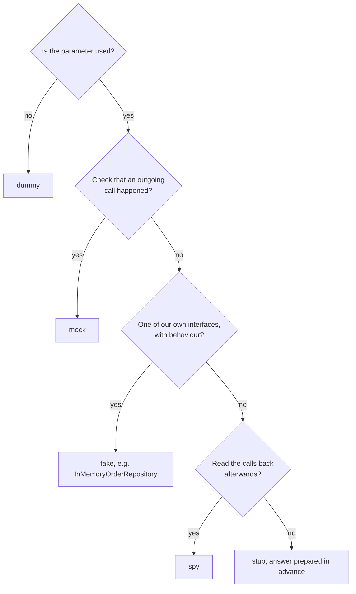

```python
# Example: a stub fixes the answer, it stays green if the real bank changes
bank = MagicMock()
bank.get_balance.return_value = {"balance_cents": 1200}
```
The problem with any double, here a stub: it answers what its author expected. If the real bank returns `{"data": {"balance_cents": 1200}}`, the test stays green and prod breaks. See [contract tests](#contract-tests-and-api-mocks).

:material-book-open-variant: Reference docs: [Martin Fowler, TestDouble](https://martinfowler.com/bliki/TestDouble.html) (2006); [Martin Fowler, Mocks Aren't Stubs](https://martinfowler.com/articles/mocksArentStubs.html) (2007)
{ .doc-ref }

### Flaky test
A test that passes or fails without the code changing.

!!! noob "As noob"
    It is an alarm that goes off one night in three for no reason: after a week, nobody gets up, even on the night of the real burglary. The one thing to remember: **a flaky test teaches the team to ignore red.**

```
run 1 : passed
run 2 : failed   TimeoutError: locator.click
run 3 : passed   (same commit)
```

:material-book-open-variant: Reference docs: [Google Testing Blog, Flaky Tests at Google and How We Mitigate Them](https://testing.googleblog.com/2016/05/flaky-tests-at-google-and-how-we.html) (2016)
{ .doc-ref }

### Quality gate
An automatic rule that blocks a merge if a condition is not met.

```
Quality gate "Standard", new code only
  new bugs              0       OK
  duplication           1.2%    OK  (< 3%)
  coverage              64%     KO  (≥ 80% required)
result: MR blocked
```

### Test suite families
A suite is a set of tests run together. They are named after their purpose and their duration.

| Suite               | Purpose                                                      | Example                                              | Typical duration |
|---------------------|--------------------------------------------------------------|------------------------------------------------------|---------------|
| **health check**    | does the service answer?                                     | `GET /livez` returns 200                      | seconds       |
| **smoke test**      | do the vital features roughly work?                          | the home page shows, I can log in, I can add to cart | a few minutes |
| **regression**      | is nothing that used to work broken?                         | the application's 180 E2E tests                      | from 15 min to several hours |
| **acceptance**      | does the feature do what the PO asked?                       | the Gherkin scenario "A closed customer is refused"  | variable      |
| **performance**     | does it hold the load?                                       | k6: 10 users for 30 s                                | minutes       |
| **synthetic**       | does production work right now, for a user?                  | every 10 min, a robot logs in to prod and opens its dashboard | seconds, in a loop |

"Smoke" comes from electronics: I plug the device in, and if no smoke comes out, I can start the real tests. A red smoke test means "no point going further". It runs right after a <span class="term" data-term="deployment">deployment</span>:
```
deployment to integration
  health check   OK     the service answers
  smoke          KO     login fails
  regression     not run: pointless, the basic journey is broken
```

### Performance test
A performance test sends traffic simulated by <span class="term" data-term="virtual-user">virtual users</span> (VU) and compares response times with thresholds. Below, 10 VUs for 30 s; the test fails if more than 5% of requests take longer than 500 ms or if more than 1% are errors.

```js
import http from "k6/http";
import { check } from "k6";

// Example: 10 VUs for 30 s, p95 under 500 ms and under 1% errors
export const options = {
  vus: 10,
  duration: "30s",
  thresholds: { http_req_duration: ["p(95)<500"], http_req_failed: ["rate<0.01"] },
};

// Example: what each VU does, a GET then a status check
export default function () {
  const res = http.get("https://staging.example.com/orders/42");
  check(res, { "status 200": (r) => r.status === 200 });
}
```

Summarized output (example, the exact layout depends on the k6 version):

```
$ k6 run orders.js
  ✓ http_req_duration..: avg=182ms med=160ms p(90)=310ms p(95)=420ms
  ✓ http_req_failed....: 0.21%  3 out of 1412
    http_reqs..........: 1412   47/s
    vus................: 10
```
A crossed threshold shows `✗` and k6 exits with a non-zero code: the CI job turns red. Load tool comparison in [k6, JMeter, Locust](outils.md#k6-jmeter-locust).

:material-book-open-variant: Reference docs: [Grafana k6, Thresholds](https://grafana.com/docs/k6/latest/using-k6/thresholds/) (accessed November 2026)
{ .doc-ref }

### Synthetic tests

<a class="pill pill-practice" href="../livraison/#testing-in-production" title="level 2: it is automated">Practice · Production testing · L2</a>
<a class="pill pill-dora" href="https://dora.dev/capabilities/monitoring-and-observability/">DORA · Monitoring and observability</a> <a class="pill pill-dora" href="https://dora.dev/capabilities/proactive-failure-notification/">DORA · Proactive failure notification</a>

A **synthetic test** (*synthetic monitoring*) is a small end-to-end test that runs **in production, in a loop**, from the outside, like a fake user. It does not check a new version: it watches that the service works **now**, and raises an <span class="term" data-term="alert-monitoring">alert</span> otherwise. "Synthetic" because the traffic is manufactured, as opposed to real users' traffic.

!!! noob "As noob"
    It is a mystery shopper who walks into the shop every 10 minutes: they do not judge the new collection, they check that the door opens and the till works. The one thing to remember: **a synthetic test watches production continuously, it does not validate a new version.**

```
every 10 min, from Paris and Frankfurt:
  10:00  open /login, log in with the robot account, see "Dashboard"   OK  4.1 s
  10:10  same                                                          OK  4.3 s
  10:20  same                                                          KO  the login page no longer answers
         alert sent to on-call, before the first customer ticket
```

How it differs from the other suites:

| Question                       | Smoke / regression           | Synthetic test                        | RUM (*real user monitoring*)          |
|--------------------------------|------------------------------|---------------------------------------|---------------------------------------|
| When?                          | after a deployment, in <span class="term" data-term="ci">CI</span>    | continuously, every N minutes         | continuously, on every real visit     |
| Where?                         | integration, staging         | production                            | production                            |
| Who generates the traffic?     | the CI                       | a robot, from several regions         | real users                            |
| Used to                        | block a bad version          | detect an outage, even at night with no traffic | measure what users experience |
| Result                         | red or green in the MR       | an alert                              | dashboards                            |

Rules that avoid trouble:

- **Dedicated account**: a robot account reserved for synthetic tests, without <span class="term" data-term="mfa">MFA</span>, with its credentials in a <span class="term" data-term="secret-manager">secret vault</span>, never a personal account.
- **Read-only** when possible: a test that creates a real order in production every 10 minutes pollutes the data and the statistics.
- **Few tests, the vital journeys**: login, main page, payment. It is not a regression suite.
- **A single source for the code**: the synthetic test reuses the same <span class="term" data-term="page-object">page objects</span> and the same login function as the E2E suite. Otherwise, the two copies drift, and the one no <span class="term" data-term="ci-pipeline">pipeline</span> runs breaks silently.

| I want... | I use... |
|---|---|
| the on-call person to know that login in prod is broken before the first customer calls support, even at night when nobody uses the site | a synthetic test, with an alert |
| a version where, for example, the "Order" button no longer works to never reach users | smoke and regression in CI |
| to know whether the page takes too long to show up for real users, on their own devices | <span class="term" data-term="rum">RUM</span> |
| to just check that the service answers, without running a journey, like a `GET /livez` that returns 200 | a health check (or an API synthetic test) |

The tools (Checkly, Datadog Synthetics) are compared in [Tech tools landscape](outils.md#synthetic-tests-checkly).

:material-book-open-variant: Reference docs: [Google SRE Book, Monitoring Distributed Systems](https://sre.google/sre-book/monitoring-distributed-systems/) (2016); [Datadog, Synthetic Monitoring](https://docs.datadoghq.com/synthetics/) (accessed November 2026)
{ .doc-ref }

### Testing vocabulary

**pytest**: the most common test framework in Python. A test is a function whose name starts with `test_`, in a `test_*.py` file, that checks its result with a plain `assert`. Here in `tests/test_orders.py`:
```python
# Example: the function under test
def order_total(lines):
    return sum(qty * price_cents for qty, price_cents in lines)


# Example: two pytest tests, each a test_ function with an assert
def test_total_of_two_lines():
    assert order_total([(2, 500), (1, 300)]) == 1300


def test_empty_order_costs_nothing():
    assert order_total([]) == 0
```
```
$ pytest tests/test_orders.py
============================= test session starts ==============================
collected 2 items

tests/test_orders.py ..                                                  [100%]

============================== 2 passed in 0.01s ===============================
```

**Assertion**: the line that checks a result. A test without an assertion checks nothing.
```python
# Example: an assertion, the line that checks the result
assert refund(1000, 500) == 500
```

**Fixture**: a function pytest runs to prepare what a test needs (a database, a user, an HTTP client) and that cleans up afterwards. The test asks for it by **parameter name**: pytest sees `customer` in the signature, runs the `customer` fixture, and passes the test the value it `yield`s. The code after `yield` is the teardown, run even if the test fails. `scope` says how often it runs: `function` (default, for every test), `module` (once per file), `session` (once for the whole suite, for an expensive resource).
```python
# Example: a fixture created once per session, closed at the end
@pytest.fixture(scope="session")
def db():
    database = connect_test_database()
    yield database
    database.close()


# Example: a per-test fixture that depends on db and cleans up after
@pytest.fixture
def customer(db):
    user = db.create_user("ada")
    yield user
    db.delete_user(user.id)


# Example: the test gets the fixtures through its parameter names
def test_new_customer_has_no_orders(db, customer):
    assert db.orders_of(customer.id) == []
```

**Test harness**: everything that lets a project's tests run: the framework, the fixtures, the config, the <span class="term" data-term="container">containers</span>, the launch command. "No harness yet" means that no test can run in CI for now.

**Marker (or tag)**: a label put on a test to run a subset.
```python
# Example: a marker to run this test with pytest -m integration
@pytest.mark.integration
def test_order_is_saved(db): ...
```
```
$ pytest -m integration
$ npx playwright test --grep @smoke
```

**`@pytest.mark.parametrize`**: runs the same test with several data sets. Each row becomes a separate test in the report, and a red row does not stop the others from running.
```python
# Example: three data sets, so three separate tests in the report
@pytest.mark.parametrize(
    ("lines", "expected"),
    [
        ([], 0),
        ([(1, 500)], 500),
        ([(2, 500), (1, 300)], 1300),
    ],
)
def test_order_total(lines, expected):
    assert order_total(lines) == expected
```
```
$ pytest -v tests/test_orders.py
tests/test_orders.py::test_order_total[lines0-0] PASSED
tests/test_orders.py::test_order_total[lines1-500] PASSED
tests/test_orders.py::test_order_total[lines2-1300] PASSED
```

**Selector**: the way an E2E test finds an element in the page.
```typescript
// Good: by role and label, like a user, not by CSS class
page.getByRole("button", { name: "Place order" })
```
By role and by label, like a user, rather than by a CSS class that changes at the slightest restyling.

**Page Object**: a class that groups a page's selectors and actions, so that tests stay readable.
```typescript
// Example: the test calls a Page Object action, not selectors
await loginPage.signIn("ada", password);
```

**Gherkin**: a format for writing a scenario in sentences, that humans read and a tool runs. `Feature` (the feature), `Scenario` (one case), `Given` (the context), `When` (the action), `Then` (the expected result). `Scenario Outline` replays the same scenario with several rows of data (`Examples`).

**PO (Product Owner)**: the person who decides what the product must do, and therefore what an acceptance test must prove.

**Playwright Codegen**: a tool that records clicks in a browser and generates the test code. **HAR**: the file that records all the network traffic of that session, including passwords and <span class="term" data-term="token-oauth">tokens</span>, hence the mandatory cleanup.

:material-book-open-variant: Reference docs: [pytest, How to use fixtures](https://docs.pytest.org/en/stable/how-to/fixtures.html) (accessed November 2026); [Playwright, Locators](https://playwright.dev/docs/locators) (accessed November 2026)
{ .doc-ref }

### Contract vocabulary

**API contract**: the description of what an API accepts and returns: routes, parameters, formats, error codes.

**OpenAPI**: the standard format for writing that contract, in <span class="term" data-term="yaml">YAML</span> or JSON. **AsyncAPI**: its equivalent for messages and events.
```yaml
# Example: one contract route, required parameter and response format
/balance:
  get:
    parameters:
      - name: username
        required: true
    responses:
      "200":
        content:
          application/json:
            schema:
              properties:
                balance_cents: { type: integer }
```

**Drift**: the real service no longer matches its contract, or the code no longer matches the committed contract.

:material-book-open-variant: Reference docs: [OpenAPI Specification](https://spec.openapis.org/oas/latest.html) (accessed November 2026); [AsyncAPI, Docs](https://www.asyncapi.com/docs) (accessed November 2026)
{ .doc-ref }

### CI vocabulary

**CI (continuous integration)**: on every push, a machine fetches the code and automatically runs the lint, the tests and the checks.

**Pipeline, stage, job**: the pipeline is the set of checks for one push. It is split into stages that contain jobs.
```
pipeline #1234
├─ stage lint   : job ruff, job mypy
├─ stage test   : job unit, job integration
└─ stage e2e    : job playwright-checkout, job playwright-account
```

**Push or MR pipeline**: the same commit can trigger a "branch" pipeline on push, and an "MR" pipeline because an MR is open. Their rules can differ.

**Artifact**: a file produced by a job and kept after it (HTML report, `junit.xml`, `coverage.xml`).

**<span class="term" data-term="junit-xml">JUnit XML</span>**: the standard file format for test results, which GitLab, GitHub and reporting tools can read.

**Lint**: a tool that analyses code without running it, to find errors and style deviations (ruff, ESLint). **Static typing**: mypy or TypeScript check that types are consistent before execution.

**Pre-commit hook**: a script run automatically on every `git commit`, on the developer's machine, to run the lint even before the push. `pre-commit` and `prek` are two tools that manage them. What goes into them beyond lint (secrets, SAST, dead code, architecture rules) is in [Automated checks before merging](livraison.md#automated-checks-before-merging).

**Pinning a version**: fixing the exact version of a <span class="term" data-term="dependency-software">dependency</span> (`pytest==8.3.2`). **Lockfile**: the file that pins every dependency, including indirect ones (`uv.lock`, `yarn.lock`), so that everyone installs exactly the same ones.

**`allow_failure`**: a GitLab CI option that keeps the pipeline green even if this job fails.

**Shard**: a piece of a suite split to run on several machines in parallel. `shard 2/4` = the 2nd quarter of the tests.

**Sidecar**: a container launched next to the CI job (a Postgres database, a Redis), that the tests use like a real service.

**Docker-in-Docker (DinD)**: running <span class="term" data-term="docker">Docker</span> inside a CI job that itself runs in a container. Often forbidden or slow, hence sidecars.

**SAST**: a source code security analysis tool, which looks for flaws (SQL injection, hardcoded secret) without running the code.

**Canary deployment**: the new version first receives a small share of the real traffic (5%), and its indicators are compared to the old one's before widening. **Blue-green deployment**: two full production environments; the new one (green) is tested without users, then all traffic is switched at once. The tests specific to each are in [Testing a canary deployment](#testing-a-canary-deployment) and [Testing a blue-green deployment](#testing-a-blue-green-deployment).

:material-book-open-variant: Reference docs: [GitLab, CI/CD](https://docs.gitlab.com/ci/) (accessed November 2026); [Martin Fowler, Continuous Integration](https://martinfowler.com/articles/continuousIntegration.html) (2024)
{ .doc-ref }

### Measurement vocabulary

**New code**: the lines added or changed by the MR, as opposed to the code that already existed.

**Technical debt**: the design flaws already present in the code, which slow down future changes.

**Duplication**: the share of the code copy-pasted identically elsewhere in the project.

**Pass rate**: the share of passed tests among the tests actually run: `passed / (total - skipped)`.

**p95**: 95% of the values are below it. A p95 response time of 500 ms means that 95 requests out of 100 answer in under 500 ms.

**SLO (Service Level Objective)**: a numeric target over a time window, for example "97% pass rate over 30 days".

**Mutation testing**: a tool deliberately changes the code (it replaces `<=` with `<`, `+` with `-`...) then reruns the tests. If no test fails, no test checks that line, even if it is covered.

**Quarantine**: setting a flaky test aside: it still runs, but no longer blocks the pipeline, until it is fixed.

:material-book-open-variant: Reference docs: [Google SRE Book, Service Level Objectives](https://sre.google/sre-book/service-level-objectives/) (2016); [Stryker Mutator](https://stryker-mutator.io/) (accessed November 2026)
{ .doc-ref }

### Authentication vocabulary in tests

**2FA (two-factor authentication)**: on top of the password, a second factor. **TOTP**: a 6-digit code that changes every 30 seconds (authenticator app). If several parallel tests share a 2FA account, they get in each other's way: the <span class="term" data-term="identity-provider">identity provider</span> rejects attempts that come too close together.

**Identity provider (IdP)**: the service that handles logins (Okta, Auth0, Keycloak...).

**Token**: the proof of login sent with every API call. A test can log in through the API to get a token, without going through the login screen.

:material-book-open-variant: Reference docs: [RFC 6238, TOTP](https://datatracker.ietf.org/doc/html/rfc6238) (2011)
{ .doc-ref }

## Reference models

<a class="pill pill-scope pill-scope-code" href="../architecture/#map-of-scales">Scale · Code</a> <a class="pill pill-scope pill-scope-app" href="../architecture/#map-of-scales">Scale · Application</a> <a class="pill pill-scope pill-scope-system" href="../architecture/#map-of-scales">Scale · System</a>

A few pictures come back in every discussion about quality. They do not say which test to write tomorrow morning, but they give a shared vocabulary to answer four questions: what **shape** to give the test suite, which **kinds** of tests not to forget, **when** to test, and what we mean by **"quality"**.

### Pyramid, trophy, honeycomb: the shape of a suite

<span class="pill pill-status pill-status-ok" title="Still valid, checked November 2026">Current · 11/2026</span>

The three models answer the same question: **how many tests at each level**? They differ on which layer carries the largest share.

- **<span class="term" data-term="test-pyramid">Test pyramid</span>** (Mike Cohn, "Succeeding with Agile", 2009): a wide base of unit tests, fewer integration tests, very few end-to-end tests. The idea: the higher a test sits, the slower, more fragile and more expensive to diagnose it is.
- **<span class="term" data-term="testing-trophy">Testing trophy</span>** (Kent C. Dodds, 2018): <span class="term" data-term="static-analysis">static analysis</span> (typing, lint) is the foundation, and the largest share goes to integration tests. The original slogan: "Write tests. Not too many. Mostly integration." Designed for the front end.
- **<span class="term" data-term="test-honeycomb">Testing honeycomb</span>** (André Schaffer, Spotify engineering blog, "Testing of Microservices", 2018): for a <span class="term" data-term="microservice">microservice</span>, the largest share goes to integration tests of the service with its real dependencies. Few implementation detail tests at the bottom, few tests that depend on other deployed services at the top.
- **<span class="term" data-term="ice-cream-cone">Ice cream cone</span>** (Alister Scott, "Testing Pyramids & Ice-Cream Cones", 2012, to check): the anti-pattern, an upside down pyramid. Many manual and E2E tests, few unit tests. It is not a target, it is a diagnosis.

!!! noob "As noob"
    I think of building a house: many quick checks on each brick (unit), fewer on the assembled walls (integration), and a few full walk-throughs of the finished house (end to end), slow and costly. The models mostly argue about which level deserves the most effort. The one thing to remember: **test as low as possible what can be tested there, and keep end-to-end tests for the journeys that matter.**

The share of each layer, schematically:

<div class="diagram-grid">
<figure><svg viewBox="0 0 140 140" role="img" aria-label="Pyramid (Mike Cohn, 2009)"><polygon class="layer layer-3" points="70,10 90,50 50,50"/><polygon class="layer layer-2" points="50,50 90,50 110,90 30,90"/><polygon class="layer layer-1" points="30,90 110,90 130,130 10,130"/><text x="70" y="43" text-anchor="middle">E2E</text><text x="70" y="74" text-anchor="middle">integration</text><text x="70" y="114" text-anchor="middle">unit</text></svg><figcaption>Pyramid (Mike Cohn, 2009)</figcaption></figure>
<figure><svg viewBox="0 0 140 140" role="img" aria-label="Trophy (Kent C. Dodds, 2018)"><polygon class="layer layer-1" points="45,10 95,10 95,30 45,30"/><polygon class="layer layer-3" points="20,30 120,30 110,80 30,80"/><polygon class="layer layer-2" points="45,80 95,80 90,105 50,105"/><polygon class="layer layer-2" points="25,110 115,110 115,130 25,130"/><text x="70" y="23" text-anchor="middle">E2E</text><text x="70" y="58" text-anchor="middle">integration</text><text x="70" y="96" text-anchor="middle">unit</text><text x="70" y="123" text-anchor="middle">static</text></svg><figcaption>Trophy (Kent C. Dodds, 2018)</figcaption></figure>
<figure><svg viewBox="0 0 140 140" role="img" aria-label="Honeycomb (Spotify, 2018)"><polygon class="layer layer-1" points="35,10 105,10 115.4,35 24.6,35"/><polygon class="layer layer-3" points="24.6,35 115.4,35 130,70 115.4,105 24.6,105 10,70"/><polygon class="layer layer-1" points="24.6,105 115.4,105 105,130 35,130"/><text x="70" y="26" text-anchor="middle">integrated</text><text x="70" y="73" text-anchor="middle">integration</text><text x="70" y="121" text-anchor="middle">implementation</text></svg><figcaption>Honeycomb (Spotify, 2018)</figcaption></figure>
<figure><svg viewBox="0 0 140 140" role="img" aria-label="Ice cream cone (anti-pattern)"><circle class="layer layer-3" cx="70" cy="28" r="22"/><polygon class="layer layer-2" points="30,50 110,50 95.9,80 44.1,80"/><polygon class="layer layer-1" points="44.1,80 95.9,80 84.1,105 55.9,105"/><polygon class="layer layer-1" points="55.9,105 84.1,105 70,135"/><text x="70" y="31" text-anchor="middle">manual</text><text x="70" y="69" text-anchor="middle">E2E</text><text x="70" y="96" text-anchor="middle">integration</text><text x="88" y="124" text-anchor="start">unit</text></svg><figcaption>Ice cream cone (anti-pattern)</figcaption></figure>
</div>

:material-book-open-variant: Reference docs: [Martin Fowler, "TestPyramid"](https://martinfowler.com/bliki/TestPyramid.html) (2012); [Kent C. Dodds, "The Testing Trophy and Testing Classifications"](https://kentcdodds.com/blog/the-testing-trophy-and-testing-classifications) (2021); [Spotify Engineering, "Testing of Microservices"](https://engineering.atspotify.com/2018/01/testing-of-microservices) (2018)
{ .doc-ref }


Two real suites, with example numbers:

```
orders-service (API, little logic,         checkout-front (React)
many database and HTTP calls)
  E2E             :  10                      E2E                  :   8
  integration     : 180                      integrated components: 240
  unit            :  60                      unit                 :  40
                                             static               : strict TypeScript + ESLint
  shape: honeycomb                           shape: trophy
```

What matters more than the shape: Martin Fowler ("On the Diverse And Fantastical Shapes of Testing", 2021) points out that these pictures differ mostly because everyone puts a different definition behind "unit" and "integration". A unit test that uses its real collaborators looks a lot like a small integration test. The shape is a symptom: the real goal is still fast, reliable tests that fail for one readable reason. That is the meaning of [the rule](#the-rule) in the next section.

| Context | Shape that fits | Why |
|---|---|---|
| I write a library or a calculation engine, where most of the value lies in business rules, like computing the discounts of a cart | pyramid | the logic lives in pure code, a unit test proves it fast and precisely |
| I work on a front end, like `checkout-front` in React | trophy | typing catches typos, confidence comes from components tested together |
| my microservice has little logic but talks a lot to the outside (database, HTTP, message queue), like `orders-service` | honeycomb | bugs live at the boundaries: database, HTTP, message queue |
| my suite relies mostly on manual or E2E tests, it is slow and breaks for no clear reason | cone: to straighten | push each check down to the lowest level that proves it |

**How to apply it.** Count the tests per level (one folder or one marker per level is enough), draw the current shape, compare it with the shape that fits the context, then push down one level every check that can be. Do it again when the suite becomes slow or flaky, or when a new service starts.

### Agile testing quadrants: not forgetting a kind of test

<span class="pill pill-status pill-status-ok" title="Still valid, checked November 2026">Current · 11/2026</span>

The **<span class="term" data-term="agile-testing-quadrants">agile testing quadrants</span>** (Brian Marick, 2003, taken up by Lisa Crispin and Janet Gregory in "Agile Testing", 2009) sort tests along two axes:

- **business facing** or **technology facing**: who can tell whether the result is right, the business or the tech team?
- **supporting the team** or **critiquing the product**: does the test help build, or does it look for what is wrong in what was built?

!!! noob "As noob"
    It is a shopping list sorted by aisle: it does not tell me what to cook, it stops me forgetting a whole aisle. The one thing to remember: **the quadrants help spot the forgotten kind of test, they do not set an order.**

```
                     business facing
                            │
   Q2: functional tests,    │ Q3: exploratory tests,
   examples, Gherkin        │ usability tests,
   scenarios, prototypes    │ user acceptance
   (automated and manual)   │ (mostly manual)
supporting ─────────────────┼────────────────── critiquing
the team                    │                   the product
   Q1: unit tests,          │ Q4: performance, load,
   component tests          │ security, resilience
   (automated)              │ (dedicated tools)
                            │
                    technology facing
```

The numbering is not an order: the four quadrants run in parallel. Their most useful use is a test plan check: if a feature has nothing in Q3 and Q4, nobody looked for what the business did not imagine (<span class="term" data-term="exploratory-testing">exploratory testing</span>), nor for what breaks under load or against an attacker.

**When and how.** During story refinement or at the start of a feature: lay the grid over it and write at least one line per quadrant, even "nothing, because...". An empty box that is assumed is a decision; an empty box that is forgotten is a gap.

:material-book-open-variant: Reference docs: [Lisa Crispin, Using the Agile Testing Quadrants](https://lisacrispin.com/2011/11/08/using-the-agile-testing-quadrants/) (2011)
{ .doc-ref }

### Shift-left and shift-right: when to test

<span class="pill pill-status pill-status-ok" title="Still valid, checked November 2026">Current · 11/2026</span>

```
need ── design ── code ── MR ── acceptance ── production ── real usage
<────── shift-left ──────────┤                 ├──────── shift-right ──────>
```

- **<span class="term" data-term="shift-left">Shift-left</span>** (term popularised by Larry Smith, Dr. Dobb's Journal, 2001): check earlier, where a defect costs less. Examples: ask test questions during scoping (three amigos), write Gherkin examples before the code, ship the tests in the same MR, run the hooks locally.
- **<span class="term" data-term="shift-right">Shift-right</span>**: keep checking in production, where the real usage and the real data are. Examples: [synthetic tests](#synthetic-tests), [canary deployment](#testing-a-canary-deployment), feature flags, alerts on the error rate.

The two are not opposed: shift-left reduces the number of defects that reach production, shift-right reduces the time during which the ones that get through stay invisible.

!!! noob "As noob"
    For a car, shift-left is checking the plans and every part at the factory; shift-right is the dashboard warning light that comes on once I am on the road. The one thing to remember: **testing early prevents defects, watching production shortens the life of those that slip through anyway.**

### The seven testing principles (ISTQB)

<span class="pill pill-status pill-status-ok" title="Still valid, checked November 2026">Current · 11/2026</span>

The ISTQB Foundation syllabus (version 4.0, 2023) sums up the job in seven principles. Each one answers a common misconception.

| Principle                                        | What it means, with an example                                                             |
|--------------------------------------------------|--------------------------------------------------------------------------------------------|
| testing shows the presence of defects, not their absence | 500 green tests prove these 500 cases work, not that there is no bug left          |
| exhaustive testing is impossible                  | a 10 character field has billions of values: pick them with partitions and boundary values |
| early testing saves time and money                | an ambiguity cleared during scoping costs a question, the same one in production costs an incident |
| defects cluster together                          | if 80 % of last year's bugs were in the billing module, test it more                    |
| tests wear out (pesticide paradox)                | a suite that never changes stops finding anything: add cases and explore                 |
| testing is context dependent                      | a medical application and a brochure site are not tested with the same rigour           |
| absence of defects is not enough                  | bug free software that does not meet the need is still a failure                         |

**When to use them.** To argue, not to recite: "we cannot test everything" (principle 2) justifies a risk based selection; "tests wear out" (principle 5) justifies setting time aside for exploratory testing; "defects cluster together" (principle 4) justifies focusing the effort on the modules that already have the most incidents.

:material-book-open-variant: Reference docs: [ISTQB, Certified Tester Foundation Level v4.0](https://www.istqb.org/certifications/certified-tester-foundation-level-ctfl-v4-0/) (2023)
{ .doc-ref }

### What "quality" means: ISO/IEC 25010

<span class="pill pill-status pill-status-ok" title="Still valid, checked November 2026">Current · 11/2026</span>

The **<span class="term" data-term="iso-25010">ISO/IEC 25010</span>** standard (first edition in 2011, revised in 2023, to check) splits the quality of a software product into characteristics. It works as a checklist: a test strategy that only talks about functionality forgets eight out of nine. Names from the 2023 edition:

| Characteristic                                      | Question                                          | Example check                                   |
|-----------------------------------------------------|---------------------------------------------------|-------------------------------------------------|
| functional suitability                              | does it do what is asked, correctly?              | unit, integration, E2E tests                    |
| performance efficiency                              | does it hold the load, with which resources?      | k6: p95 < 500 ms at 50 users                    |
| compatibility                                       | does it coexist and exchange with others?         | contract test with the partner                  |
| interaction capability (formerly "usability")       | can people use it, including with a disability?   | accessibility audit, user test                  |
| reliability                                         | does it stay available, does it recover?          | failover test, availability SLO                 |
| security                                            | does it protect data and access?                  | authorization tests, dependency scan            |
| maintainability                                     | can it be changed without breaking?               | quality gate, complexity, new code coverage     |
| flexibility (formerly "portability")                | does it adapt to another environment, to growth?  | same Docker image locally, in CI and in production |
| safety (added in 2023)                              | does it avoid putting people in danger?           | safe stop of a controller on an outlier value   |

**When and how.** When a project or a test strategy starts: go through the nine lines with the PO, keep three or four priorities, and for each one write a measurable requirement ("p95 < 500 ms at 50 users") and the test that checks it. The other lines are explicitly set aside, with the reason.

:material-book-open-variant: Reference docs: [ISO 25000 portal, ISO/IEC 25010](https://iso25000.com/index.php/en/iso-25000-standards/iso-25010) (accessed November 2026)
{ .doc-ref }

### London and Detroit schools: isolating the unit or not

<a class="pill pill-scope pill-scope-code" href="../architecture/#map-of-scales">Scale · Code</a> <span class="pill pill-status pill-status-ok" title="Still valid, checked in November 2026">Current · 11/2026</span>

I write the unit test of a service that computes an order's total and then saves it. Two questions come up straight away: is "the unit" the class alone or the whole behaviour? And its neighbours, the pricing and the repository, do I keep them real or replace them with [doubles](#test-double-mock-stub-fake)? Two schools of <span class="term" data-term="tdd">TDD</span> answer differently.

- **The Detroit school**, also called **classicist** or **Chicago**: the unit is a behaviour, which may cross several classes. Neighbours stay real, except the slow ones or those outside my control (database, network, clock), replaced by a fake or a stub. The test checks **the result**: the final state. It is Kent Beck's style, "Test-Driven Development: By Example" (2002).
- **The London school**, also called **mockist**: the unit is a class. All its neighbours are mocks, and the test checks **the exchanges**: which message goes to which neighbour. It comes from the London XP community, which invented mock objects (Mackinnon, Freeman and Craig, "Endo-Testing: Unit Testing with Mock Objects", 2000), and is described by Steve Freeman and Nat Pryce in "Growing Object-Oriented Software, Guided by Tests" (2009).

Martin Fowler popularised the contrast in 2007 in "Mocks Aren't Stubs", under the names "classical" and "mockist". The city names come from where each style was born (Chrysler's C3 project in Detroit for the classicist school) [to check: origin reported by several authors, no single source].

!!! noob "As noob"
    Two ways to check a new car. Detroit: I take it for a drive and check it gets to the right place. London: I put each part on a test bench and check the pedal sends the right signal to the engine. The first check survives swapping a part, the second tells exactly which part is at fault. **Detroit checks the result, London checks the exchanges: most teams mix both.**

The code under test:

```python
# Example: a service that asks pricing for the total, then saves
class OrderService:
    def __init__(self, pricing, repository):
        self.pricing = pricing
        self.repository = repository

    def place(self, order):
        order.total_cents = self.pricing.total(order)
        self.repository.save(order)
        return order
```

The same test in both schools:

```python
# Example: Detroit school, real pricing, fake repository, the result is checked
def test_place_order_stores_total_with_vat():
    repository = InMemoryOrderRepository()
    service = OrderService(Pricing(vat_rate=0.2), repository)
    service.place(Order(id=42, lines=[Line(price_cents=1000, qty=2)]))
    assert repository.get(42).total_cents == 2400


# Example: London school, every neighbour is a mock, the exchanges are checked
def test_place_order_asks_pricing_then_saves():
    pricing = Mock()
    pricing.total.return_value = 2400
    repository = Mock()
    order = Order(id=42, lines=[])
    OrderService(pricing, repository).place(order)
    pricing.total.assert_called_once_with(order)
    repository.save.assert_called_once_with(order)
```

What happens next:

- **a VAT bug in `Pricing`**: the Detroit test fails, the London one stays green (only `Pricing`'s own test sees it). But with Detroit, ten other tests going through `Pricing` fail too, and I search longer for where the bug is;
- **I merge `Pricing` into `OrderService`**, without changing the behaviour: the Detroit test stays green, the London one breaks, because it described how the work is done, not the result.

| | Detroit (classicist, Chicago) | London (mockist) |
|---|---|---|
| the unit | a behaviour, one or several classes | a class |
| the neighbours | real, except database, network, clock | mocks |
| what the test checks | the final state, the result | the messages exchanged |
| design direction | inside out: rules first | <span class="term" data-term="outside-in">outside-in</span>: from the acceptance test down to the classes |
| strength | tests that survive refactoring | localised failure; tests reveal the interfaces between roles |
| weakness | one bug fails many tests | tests tied to the implementation; a mock can lie about the real neighbour |

**When.** Detroit by default for business rules and services that compute: it matches [the rule](#the-rule) of this page, prove the behaviour with real neighbours whenever possible. London when I design a flow from the outside in and the classes do not exist yet, or to check an outgoing effect (an email sent, a debit requested). Freeman and Pryce add a rule that limits lying mocks: only mock types I own, and wrap an external library in my own adapter before mocking it.

**Why.** Being able to name the school explains team arguments that look technical: "this test breaks with every refactoring" (too much London) or "one bug fails forty tests" (Detroit without targeted tests). The choice changes the suite's maintenance cost, not its ability to find bugs.

**How.** I decide per neighbour, not for the whole project: a real object or a fake when it is fast and mine, a mock when the exchange **is** the behaviour to check, a stub for an external neighbour. And I keep contract or integration tests on top, which prove what the mocks assume.

:material-book-open-variant: Reference docs: [Martin Fowler, "Mocks Aren't Stubs"](https://martinfowler.com/articles/mocksArentStubs.html) (2007); [Steve Freeman and Nat Pryce, "Growing Object-Oriented Software, Guided by Tests"](http://www.growing-object-oriented-software.com/) (2009)
{ .doc-ref }

### Which model for which question

| Question | Model |
|---|---|
| my team wonders how many tests to write at each level, for example when a new service starts | pyramid, trophy or honeycomb depending on context |
| my suite is slow, it breaks for no clear reason, and I want to understand why | look for the ice cream cone |
| I review a test plan and want to know whether a whole kind of test is missing, like load or security | agile testing quadrants |
| I hesitate between putting the effort before delivery (examples written before the code, tests in the MR) or after (monitoring in production) | shift-left and shift-right |
| someone asks me why the team does not test everything, or why a suite that no longer changes finds no bugs anymore | seven ISTQB principles |
| my team says "quality" but only talks about functionality, and I want to list the rest, like performance, security or accessibility | ISO/IEC 25010 |
| my unit tests break with every refactoring although the behaviour did not change, or a single bug fails forty tests | London and Detroit schools, choose per neighbour |

Sources:

- [Mike Cohn, "Succeeding with Agile" (2009)](https://www.mountaingoatsoftware.com/books/succeeding-with-agile-software-development-using-scrum)
- [Martin Fowler, "TestPyramid" (2012)](https://martinfowler.com/bliki/TestPyramid.html)
- [Ham Vocke, "The Practical Test Pyramid" (2018)](https://martinfowler.com/articles/practical-test-pyramid.html)
- [Kent C. Dodds, "The Testing Trophy and Testing Classifications" (2021, the trophy dates from 2018)](https://kentcdodds.com/blog/the-testing-trophy-and-testing-classifications)
- [André Schaffer, "Testing of Microservices", Spotify Engineering (2018)](https://engineering.atspotify.com/2018/01/testing-of-microservices)
- [Martin Fowler, "On the Diverse And Fantastical Shapes of Testing" (2021)](https://martinfowler.com/articles/2021-test-shapes.html)
- [Brian Marick, "Agile testing directions: tests and examples" (2003, link to check)](http://www.exampler.com/old-blog/2003/08/22/)
- [ISTQB, Certified Tester Foundation Level syllabus v4.0 (2023)](https://www.istqb.org/certifications/certified-tester-foundation-level-ctfl-v4-0/)
- [ISO/IEC 25010:2023, "Product quality model" (2023)](https://www.iso.org/standard/78176.html)
- Kent Beck, "Test-Driven Development: By Example" (2002)
- [Martin Fowler, "Mocks Aren't Stubs" (2007)](https://martinfowler.com/articles/mocksArentStubs.html)
- [Steve Freeman and Nat Pryce, "Growing Object-Oriented Software, Guided by Tests" (2009)](http://www.growing-object-oriented-software.com/)
- Tim Mackinnon, Steve Freeman and Philip Craig, "Endo-Testing: Unit Testing with Mock Objects", XP2000 conference (2000)

## Choosing the right test level

<a class="pill pill-scope pill-scope-code" href="../architecture/#map-of-scales">Scale · Code</a> <a class="pill pill-scope pill-scope-app" href="../architecture/#map-of-scales">Scale · Application</a>

### The rule

<span class="pill pill-status pill-status-ok" title="Still valid, checked November 2026">Current · 11/2026</span>

I am testing an API. If a real request can prove a behaviour, I test it with a request, against real neighbours (the real database, the real HTTP server). I keep unit tests for pure business rules and for what no call can show. I do not put a double across a boundary (HTTP, database, message queue): the double answers what I expect, not what the real neighbour does, so the bug slips through.

Why, with two real bugs:
- a <span class="term" data-term="mock">mocked</span> stream test produced a last batch that the real stream never produces. A partial catalogue was reported complete, and the test was green;
- an integration <span class="term" data-term="test-harness">harness</span> that bypassed authentication hid a `403` response that lost its `WWW-Authenticate` <span class="term" data-term="http-header">header</span>.

### The question to ask
For each unit test of an API: **could a request prove it?** If so, what I need is an integration test.

| What I want to prove                                 | Level                         |
|------------------------------------------------------|-------------------------------|
| the password policy rejects "abc"                    | unit                          |
| computing a percentile                               | unit                          |
| the `/orders` route returns 401 without a token      | integration (real request)    |
| a token that is expired, has the wrong <span class="term" data-term="token-audience">audience</span> or an unknown `kid` is rejected | integration, with a real issuer that signs |
| the order is really written to the database          | integration (real Postgres)   |
| the client retries on a 503 the real partner cannot send | exception: scripted socket, documented in place |
| a customer orders and sees "paid"                    | E2E                           |

Quick check on an API layer:
```
$ grep -rn "unittest.mock" tests/
```
The result should be empty.

### Organising tests
Two markers are enough, and the file name says which neighbour is used:
```
tests/
├─ unit/
│  └─ test_password_policy.py
└─ integration/
   ├─ conftest.py               (all container fixtures here)
   ├─ test_orders_mysql.py
   ├─ test_reports_gcs.py
   └─ test_bank_contract.py
```

:material-book-open-variant: Reference docs: [Martin Fowler, UnitTest](https://martinfowler.com/bliki/UnitTest.html) (2014); [Martin Fowler, IntegrationTest](https://martinfowler.com/bliki/IntegrationTest.html) (2018)
{ .doc-ref }

## Integration tests with Testcontainers

<a class="pill pill-scope pill-scope-app" href="../architecture/#map-of-scales">Scale · Application</a> <a class="pill pill-scope pill-scope-system" href="../architecture/#map-of-scales">Scale · System</a> <span class="pill pill-status pill-status-ok" title="Still valid, checked November 2026">Current · 11/2026</span>

<a class="pill pill-practice" href="../livraison/#automated-functional-tests" title="level 2: it is automated">Practice · Functional testing · L2</a>
<a class="pill pill-dora" href="https://dora.dev/capabilities/test-automation/">DORA · Test automation</a> <a class="pill pill-dora" href="https://dora.dev/capabilities/test-data-management/">DORA · Test data management</a>


*Testcontainers: complements pytest*
{ .tool-rel }

### The principle
My test needs a real database or a real broker, like Postgres, Redis or RabbitMQ. The test itself starts a real throwaway <span class="term" data-term="container">container</span>, once per session: nobody has to run `docker compose up` beforehand. If <span class="term" data-term="docker">Docker</span> is not there, the test is skipped with the reason, it does not fail.

!!! noob "As noob"
    It is a lab where each work session gets fresh test tubes, thrown away at the end: no leftovers from the previous session, and no bench to set up by hand beforehand. The one thing to remember: **the test starts real dependencies itself, and throws them away at the end.**

Why: before, I had to start the broker by hand, and an "is it reachable?" probe failed at random, so tests went red with no real bug. With <span class="term" data-term="testcontainers">Testcontainers</span>, the same test runs on the workstation and in <span class="term" data-term="ci">CI</span>, with no checklist.

### The example
```python
# Good: a throwaway Redis container per session, skipped without Docker
@pytest.fixture(scope="session")
def redis_url() -> Iterator[str]:
    require_docker()
    with RedisContainer("redis:7") as redis:
        host = redis.get_container_host_ip()
        port = redis.get_exposed_port(6379)
        yield f"redis://{host}:{port}/0"
```

The 4 steps:
1. start the container (`with RedisContainer(...)`);
2. ask for the port chosen by Docker (`get_exposed_port(6379)`), never the default port;
3. `yield` the connection info to the test;
4. leaving the `with` removes the container.

*Docker: complements Kubernetes, Helm*
{ .tool-rel }


The lifecycle, for the whole session:

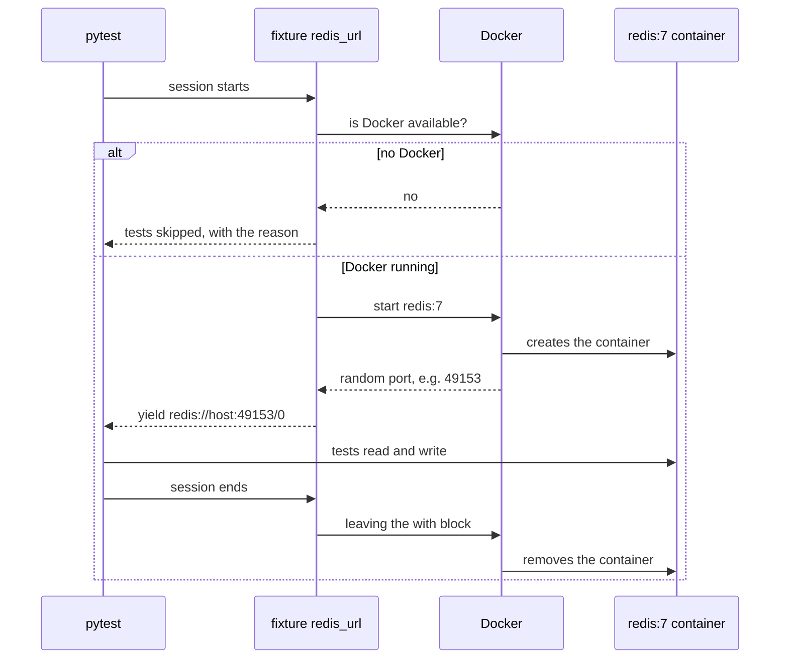

Good practices:
- prefix test resources (`test_` for queues, schemas, buckets), to avoid collisions on a shared instance;
- a test writes **its own** data, or restores what it changed;
- in CI without Docker-in-Docker: <span class="term" data-term="sidecar">sidecar</span> services, and the same test code pointed at them by a variable (`INTEGRATION_EXTERNAL_SERVICES=true`).

### Testing a test
A green test proves nothing until I have seen it red for the right reason. 5 checks, in order:

| Check                                            | Expected result                                          |
|--------------------------------------------------|----------------------------------------------------------|
| 1. stop Docker and run the suite                 | everything is skipped with "Docker unavailable", nothing fails |
| 2. run twice in a row without cleaning up        | still green, otherwise a test does not restore its data  |
| 3. break the code (remove an `INCR`)             | the test turns red, the <span class="term" data-term="assertion">assertion</span> names the difference   |
| 4. break the neighbour (wrong image tag)         | the failure says which neighbour and why, not a silent timeout |
| 5. `docker ps` during then after the suite       | containers on random ports, all gone at the end          |

:material-book-open-variant: Reference docs: [Testcontainers, Getting started](https://testcontainers.com/getting-started/) (accessed November 2026); [testcontainers-python](https://testcontainers-python.readthedocs.io/) (accessed November 2026)
{ .doc-ref }

## Contract tests and API mocks

<a class="pill pill-scope pill-scope-system" href="../architecture/#map-of-scales">Scale · System</a>

<a class="pill pill-practice" href="../livraison/#automated-functional-tests" title="level 2: it is automated">Practice · Functional testing · L2</a> <a class="pill pill-practice" href="../api-rest-async/#api-management" title="level 3: it decides without a human">Practice · API management · L3</a>
<a class="pill pill-dora" href="https://dora.dev/capabilities/test-automation/">DORA · Test automation</a> <a class="pill pill-dora" href="https://dora.dev/capabilities/loosely-coupled-teams/">DORA · Loosely coupled teams</a>

### The contract test

<span class="pill pill-status pill-status-ok" title="Still valid, checked November 2026">Current · 11/2026</span>

A <span class="term" data-term="contract-test">contract test</span> checks that two services agree on the shape of what they exchange: the provider returns what its contract promises, and the consumer expects nothing more. It does not test business logic, only fields, types and status codes.

!!! noob "As noob"
    It is the standard for a power socket: the socket maker and the appliance maker never talk, but each checks their product against the same standard. The contract test checks the shape of the socket, not what the appliance does. The one thing to remember: **the contract catches the partner who changes format, where a hand-written stub stays green.**

```
contract   : balance_cents: { type: integer }

BEFORE bank-partner : 200 {"data": {"balance_cents": 1200}}
       check        : OK
AFTER  bank-partner : 200 {"data": {"balance_cents": "1200"}}
       check        : KO  '1200' is not of type 'integer'
```
With a hand-written stub, the same change leaves the test green: the stub still returns the integer `1200`.

The **consumer-driven** variant (*consumer-driven contract*, Pact tool): the consumer writes the contract from its own tests, and the provider replays it against its real code before shipping.

*Pact: complements Microcks, Prism*
{ .tool-rel }


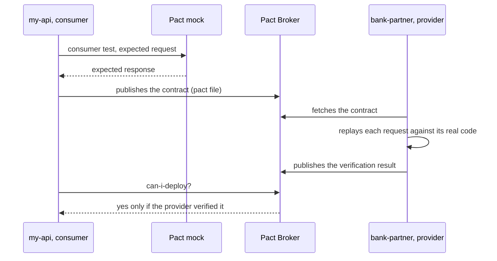

:material-book-open-variant: Reference docs: [Martin Fowler, ContractTest](https://martinfowler.com/bliki/ContractTest.html) (2011); [Pact Docs](https://docs.pact.io/) (accessed November 2026)
{ .doc-ref }

### The problem with hand-written mocks
- **<span class="term" data-term="mock">Mocks</span> lie**: I write myself what the API on the other side answers, and nothing checks that it matches the real <span class="term" data-term="api-contract">contract</span>. The API on the other side changes, for example an integer becomes text, my tests stay green, and prod breaks.
- **Double indirection**: a service mocks a client that itself mocks HTTP. Each layer adds an assumption, so confidence drops at each layer.
- **E2E tests on a shared environment** fall over as soon as that environment is unavailable. And they cannot produce a 500, a timeout or partial data on demand, so those cases are never tested.

### Contract-driven mock

<span class="pill pill-status pill-status-ok" title="Still valid, checked November 2026">Current · 11/2026</span>

I want to test my service against a partner without writing its responses by hand. A tool reads the <span class="term" data-term="openapi">OpenAPI</span> contract of the service on the other side and serves compliant responses. My test makes real HTTP calls, as if it were talking to the real partner.

| Tool         | What it does                                                            | When to use it                           |
|--------------|-------------------------------------------------------------------------|------------------------------------------|
| Microcks     | serves the contract's examples, picks the response based on the request | integration tests, error scenarios       |
| Prism        | serves a mock on a port and **validates** every request (parameters, body, security) | local dev, demo, front end waiting for the back end |
| <span class="term" data-term="schemathesis">schemathesis</span> | generates requests from the contract and checks the responses           | against the real service, to detect <span class="term" data-term="contract-drift">drift</span> |

The same contract is used twice: it feeds the mock, and it is used to probe the real partner.

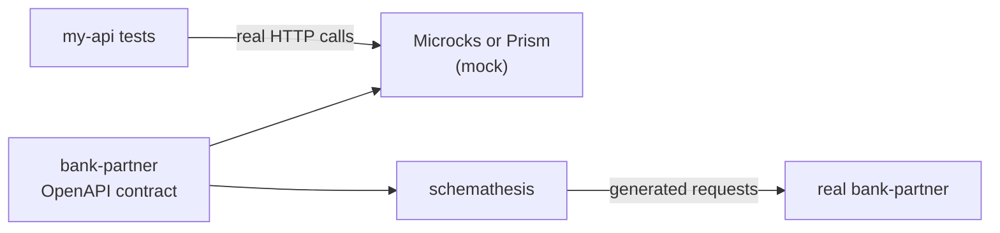

Example with Prism:
```
$ prism mock bank-partner.openapi.yaml

$ curl -s -H 'X-Api-Key: any' 'localhost:4010/balance?username=ada'
200 {"data": {"balance_cents": 1200}}

$ curl -s 'localhost:4010/balance?username=ada'
401   (missing key)

$ curl -s -H 'X-Api-Key: any' 'localhost:4010/balance'
422   (missing username)
```
Limit: Prism returns the same example for `ada` and `grace`. For per-customer responses, use Microcks.

*Microcks: competes with Prism; complements Pact*<br>
*Prism: competes with Microcks; complements Pact*
{ .tool-rel }


Typical error scenarios to cover with Microcks:
```
bank-partner returns 500       my-api answers 502 with an explicit error
bank-partner returns 404       my-api answers "unknown customer", cleanly
partial metadata               my-api applies the planned default values
```

:material-book-open-variant: Reference docs: [Microcks, Documentation](https://microcks.io/documentation/) (accessed November 2026); [Stoplight Prism](https://github.com/stoplightio/prism) (accessed November 2026)
{ .doc-ref }

### Detecting that the partner has changed

<span class="pill pill-status pill-status-ok" title="Still valid, checked November 2026">Current · 11/2026</span>

My suite is green against mocks: that proves my code follows the **specification**, not that the partner still follows it. If `bank-partner` changes its format tomorrow, I will not see it. So I need a test that queries the real one:
```
schemathesis : 50 generated requests (empty, accented, very long names)
checks       : not_a_server_error, status_code_conformance, response_schema_conformance
```
To see it red: change `balance_cents` to `type: string` in the contract, it answers `Response violates schema`.

Rules:
- captured examples are never edited by hand: recapture them and review the diff. Only error examples are written by hand;
- the contract of our own services is **generated from the code** (`mise run contracts:export`), and a test checks that the committed file is indeed the one the code produces.

*mise: competes with asdf; complements uv*
{ .tool-rel }


:material-book-open-variant: Reference docs: [Schemathesis, Documentation](https://schemathesis.readthedocs.io/) (accessed November 2026)
{ .doc-ref }

## Designing scenarios

<a class="pill pill-scope pill-scope-system" href="../architecture/#map-of-scales">Scale · System</a>

### Drawing the journey as a graph

<span class="pill pill-status pill-status-ok" title="Still valid, checked November 2026">Current · 11/2026</span>

A list of scenarios hides what is missing. A graph shows it: each scenario is a path, and transitions never walked stand out.

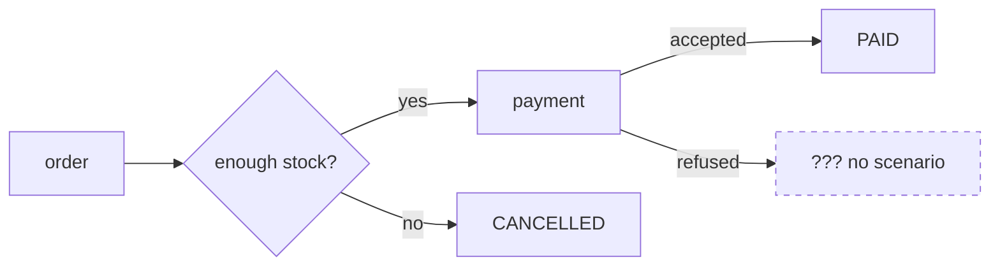

Examples of gaps found this way:
- account access: 23 transitions, 6 of them without a scenario (account migrated from an old login, weak password rejected...);
- order: nothing for a refused payment, nor for a worker that dies halfway and receives the event a 2nd time;
- file checks: everything passes, but no sample file is broken, so nothing proves that an empty or badly named file is detected.

Workflow: QA proposes the graph, the <span class="term" data-term="product-owner">PO</span> validates the journey, each path becomes a scenario.

### Gherkin with a "Goal"

<span class="pill pill-status pill-status-ok" title="Still valid, checked November 2026">Current · 11/2026</span>

*Gherkin: complements Cucumber, pytest-bdd*
{ .tool-rel }

The name says what happens, the `Goal` says why it matters: the risk covered.

```gherkin
# Good: the name says what happens, the Goal says the risk covered
@tool-playwright
Feature: Place an order

  Scenario: A closed customer is refused
    Goal: a customer the company no longer serves gets a 404,
    before any call to the bank or any visit counted.
    When "dennis" asks for a greeting
    Then the storefront answers 404
```

Good practices:
- few acceptance scenarios, **one behaviour each**, sentences a PO can challenge;
- no technical detail in the steps (no <span class="term" data-term="selector">selector</span>, no URL);
- a scenario only writes its own data (new user, one unit of a high-stock product);
- a shared account is only read: never send it a wrong password, it could get locked;
- <span class="term" data-term="playwright">Playwright</span>: fresh context per scenario, elements found by role and label, `expect(...)`, never `sleep`.

A performance threshold can also be a scenario:
```gherkin
# Example: a performance threshold written as a scenario
Scenario: The storefront holds a small rush
  Goal: ten customers at once still get a fast answer.
  When 10 customers browse for 30 seconds
  Then less than 1% of requests fail
  And the p95 response time is under 500 ms
```

:material-book-open-variant: Reference docs: [Cucumber, Gherkin Reference](https://cucumber.io/docs/gherkin/reference/) (accessed November 2026)
{ .doc-ref }

### Gherkin tools per language

<span class="pill pill-status pill-status-ok" title="Still valid, checked November 2026">Current · 11/2026</span>

The same `.feature` file runs with a tool specific to each language: the tool binds each sentence (`Given`, `When`, `Then`) to a function, the *step definition*.

| Language | Tool | Note |
|---|---|---|
| Java, JavaScript, Ruby | Cucumber | the original tool behind the Gherkin format |
| Python | pytest-bdd, Behave | pytest-bdd reuses pytest fixtures, Behave has its own runner |
| PHP | Behat | the reference tool of the PHP ecosystem (Symfony, Laravel) |
| .NET | Reqnroll | open source successor of SpecFlow (2024, to check) |
| TypeScript with Playwright | playwright-bdd | generates Playwright tests from `.feature` files |

**When to use Gherkin and <span class="term" data-term="bdd">BDD</span>.** When the business really reads, challenges or writes the scenarios: the format then becomes a shared contract. When only developers read them, the sentence layer is an indirection that brings nothing: a well named Playwright or pytest test is enough.

*pytest: competes with unittest; complements Testcontainers*
{ .tool-rel }


**How.** Write the scenarios in a workshop with the PO before the code (three amigos), keep steps reusable and free of technical detail, and stay at a handful of scenarios per feature: the rest moves down to lower level tests.

:material-book-open-variant: Reference docs: [pytest-bdd](https://pytest-bdd.readthedocs.io/) (accessed November 2026); [Behat](https://docs.behat.org/) (accessed November 2026)
{ .doc-ref }

### Recorded scenario (Playwright Codegen)

<span class="pill pill-status pill-status-ok" title="Still valid, checked November 2026">Current · 11/2026</span>

*Playwright: competes with Cypress, Selenium; complements Checkly*
{ .tool-rel }

A PO clicks through the journey, the tool records it. Trap: the person records with **their own** account without saying so, and the test fails for everyone else. Hence a template that forces it to be explicit:

```gherkin
# Good: the template forces me to state which account and data are used
Given "ada", a customer of the company who can order
And the stock of "BK-0004" holds at least 1 item
When ...
Then the page shows every step done and the order paid
```
A `Then` is mandatory: the clicks say what was done, not what was supposed to happen. And the recording (<span class="term" data-term="har-file">HAR</span> file) is **cleaned of its secrets before any other step**: `Authorization` and `Cookie` headers, passwords, tokens.

:material-book-open-variant: Reference docs: [Playwright, Test generator](https://playwright.dev/docs/codegen) (accessed November 2026)
{ .doc-ref }

## Code coverage

<a class="pill pill-scope pill-scope-code" href="../architecture/#map-of-scales">Scale · Code</a>

### What it says and what it does not

<span class="pill pill-status pill-status-ok" title="Still valid, checked November 2026">Current · 11/2026</span>

<span class="term" data-term="code-coverage">Coverage</span> says which code was **executed**, not whether it was **checked**.

!!! noob "As noob"
    Coverage is the list of museum rooms the visitor walked through: it does not say whether they looked at the paintings. The one thing to remember: **covered code is executed code, not necessarily verified code.**

```python
# Example: the function under test
def refund(paid_cents, asked_cents):
    return min(paid_cents, asked_cents)

# Avoid: 100% coverage, but no assert, so nothing is checked
def test_refund():
    refund(1000, 500)
```
Coverage: 100%. Checking: none, there is no `assert`.

Rules:
- show unit coverage and integration coverage **side by side, never added up**: a line executed by an <span class="term" data-term="integration-test">integration test</span> does not prove that its rule is right;
- a component with low unit coverage but tested in integration is a hint: extract its rules into a pure module;
- start with the files that have the most uncovered lines;
- to measure whether tests really check: [mutation testing](#mutation-testing-testing-the-tests) (mutmut, Stryker, Infection, PIT).

:material-book-open-variant: Reference docs: [Martin Fowler, TestCoverage](https://martinfowler.com/bliki/TestCoverage.html) (2012); [Coverage.py](https://coverage.readthedocs.io/) (accessed November 2026)
{ .doc-ref }

### Mutation testing: testing the tests

<span class="pill pill-status pill-status-ok" title="Still valid, checked in November 2026">Current · 11/2026</span>

My coverage shows 95%, but I do not know whether my tests would catch a real bug. **<span class="term" data-term="mutation-testing">Mutation testing</span>** answers that question: a tool plants small bugs in the code itself (replacing `<=` with `<`, `+` with `-`, `True` with `False`, removing a call), one at a time, and reruns the tests each time. Each modified version is called a **<span class="term" data-term="mutant">mutant</span>**.

- if at least one test fails, the mutant is **killed**: the tests saw the bug;
- if every test stays green, the mutant **survives**: that bug would reach production without anyone noticing.

The **<span class="term" data-term="mutation-score">mutation score</span>** is the share of killed mutants. The idea dates from the 1970s: Richard DeMillo, Richard Lipton and Frederick Sayward, "Hints on Test Data Selection: Help for the Practicing Programmer" (IEEE Computer, 1978).

!!! noob "As noob"
    It is a fire alarm drill: I put a little smoke in a room on purpose and watch whether the alarm goes off. If it stays silent, the room is not protected, even though the detector is hanging on the ceiling. **Coverage says the detector is installed, mutation testing says whether it rings.**

Example: the rule and its two tests.

```python
# Example: the rule under test, a refund never exceeds the amount paid
def can_refund(paid_cents, asked_cents):
    return asked_cents <= paid_cents


# Avoid: two tests far from the limit, they pass on the code and on the mutant
def test_refund_allowed():
    assert can_refund(1000, 500) is True


def test_refund_refused():
    assert can_refund(1000, 1500) is False
```

Coverage is 100%. The tool tries mutants (simplified output, each tool has its own format):

```
mutant 1   asked_cents <= paid_cents   becomes   asked_cents < paid_cents    survived
mutant 2   asked_cents <= paid_cents   becomes   asked_cents >= paid_cents   killed
mutant 3   return ...                  becomes   return None                 killed
mutation score: 2 killed out of 3, 67%
```

Mutant 1 survives: no test checks the exact limit, so a customer asking for a full refund could be refused without any test noticing. The missing test:

```python
# What changes: the exact limit, which kills mutant 1
def test_refund_whole_amount():
    assert can_refund(1000, 1000) is True
```

| Language | Tools |
|---|---|
| Python | mutmut, Cosmic Ray |
| JavaScript, TypeScript, C#, Scala | Stryker (StrykerJS, Stryker.NET, Stryker4s) |
| Java, JVM | PIT (pitest) |
| PHP | Infection |

**When.** On code where a bug is expensive (money, permissions, regulatory calculations), once coverage is already good and I want to know whether the assertions are worth anything. Not on the whole project at every MR: each mutant reruns the tests, so a 2 minute suite and 500 mutants means hours (example order of magnitude).

**Why.** It is the only measure that judges the assertions and not just the execution. The cost: compute time, and **<span class="term" data-term="equivalent-mutant">equivalent mutants</span>**, which change the code without changing the behaviour (for example `i < len(x)` turned into `i != len(x)` in a loop that steps by 1): no test can kill them, so aiming for 100% makes no sense.

**How.**

1. Start with one critical module, not the whole repository.
2. Read the survivors one by one: each is either a missing test, an equivalent mutant, or useless code to delete.
3. In CI, limit the analysis to the files changed by the MR (Stryker, Infection and PIT can do it; to check for mutmut), and run the full analysis at night.
4. Track the score on critical code over time, rather than enforcing a global threshold.

:material-book-open-variant: Reference docs: [Stryker, "What is mutation testing?"](https://stryker-mutator.io/docs/) (accessed November 2026); [PIT, documentation](https://pitest.org/) (accessed November 2026)
{ .doc-ref }

### The inverted mapping trap
I translate values from one system to another: `final` becomes `album`, and `pending` stays `pending`. The 2nd value is spelled the same on both sides. So if I invert the mapping by mistake, every test on `pending` still passes. Only a test on `final` reveals the error.

```python
# Good: both branches pinned, an inversion makes one assertion fail
assert to_legacy("final") == "album"
assert to_legacy("pending") == "pending"
```
Pin **both** branches: an inversion then fails one assertion instead of zero.

Same idea when I rename a parameter: the route must accept the new name, and also **reject** the old one. A route that accepts both has renamed nothing.

### The document-wide test

<span class="pill pill-status pill-status-ok" title="Still valid, checked November 2026">Current · 11/2026</span>

I rename a parameter across the whole API, and I want to be sure the old name is left nowhere. Rather than one test per route, I write a test that reads the whole OpenAPI contract and checks the rule everywhere:
```python
# Good: one test checks the rule on the whole contract, future routes included
def test_no_route_uses_the_old_name(openapi):
    for path, params in all_parameters(openapi):
        assert "releaseStatus" not in params, path
```
It also covers the routes nobody has written yet.

### Functional coverage map

<span class="pill pill-status pill-status-ok" title="Still valid, checked November 2026">Current · 11/2026</span>

One page per system that says, **per functional domain** (not per repo), what is proven, by which test module, and what is not.

```
Domain "publication"
  proven     : state transitions (41 assertions), rejection of a forbidden transition
  proven by  : tests/integration/test_release_state.py
  NOT proven : slow response from the upstream service, two concurrent workflows,
               cleanup after a partial creation
```
I read it before writing an acceptance criterion (so as not to write one that is already covered) and before writing a test (to put it where there is a gap). The most frequent gap: nothing crosses a boundary between two repos in a single assertion, each repo proves its half.

## Quality gates

<a class="pill pill-scope pill-scope-code" href="../architecture/#map-of-scales">Scale · Code</a>

### Two gates are enough

<span class="pill pill-status pill-status-ok" title="Still valid, checked November 2026">Current · 11/2026</span>

Two quality gates: **Standard** for a project whose tests already run in CI, **Starter** for a project with no test harness yet. **SonarQube** is a static analysis tool that grades code from A (best) to E on three axes: reliability (bugs), security (vulnerabilities) and maintainability (technical debt). The reliability rating follows from the most severe bug found: a single new critical bug drops it to D (mapping to check in the [SonarQube documentation](https://docs.sonarsource.com/), it changes between versions).

| Condition, on new code         | Standard | Starter |
|--------------------------------|----------|---------|
| reliability A (no new bug)     | yes      | yes     |
| maintainability A              | yes      | yes     |
| duplication < 3%               | yes      | yes     |
| coverage ≥ 80%                 | yes      | **no**  |

Why only coverage changes: not adding bugs or duplication is discipline, achievable from day one. Coverage needs a <span class="term" data-term="test-harness">test harness</span> wired into <span class="term" data-term="ci">CI</span>, which cannot be improvised in an <span class="term" data-term="merge-request">MR</span>.

Where the gate sits in an MR's path:

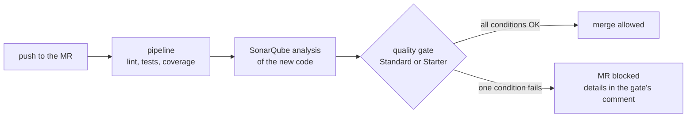

Deliberate choices:
- **Starter removes coverage, it does not lower it.** A 40% threshold would be a middle rung where everyone settles forever. Starter means "no harness yet", and it must stay visibly temporary;
- **no condition on overall code**: otherwise every project fails on <span class="term" data-term="technical-debt">debt</span> the MR did not create;
- **a gate that tolerates new bugs** is not a maturity level, it is a licence to ship defects.

### Traps
- A gate with duplication at 100% can never fail, so it checks nothing. The real need was to exclude the right files from the analysis (`sonar.cpd.exclusions`).
- Deleting a gate before reassigning its projects silently drops them onto the default gate. Order: reassign, check, delete.
- Two tools blocking the same MR for the same reason (Sonar and a <span class="term" data-term="sast">SAST</span>): two backlogs, twice the waiting. Keep only one blocking, the other for visibility.
- Computing "new code" in CI needs the full history (`GIT_DEPTH: 0`): a shallow clone has no common starting point with main, and the diff comes back wrong **without an error**.

:material-book-open-variant: Reference docs: [SonarQube Server, Introduction to quality gates](https://docs.sonarsource.com/sonarqube-server/latest/quality-standards-administration/managing-quality-gates/introduction-to-quality-gates/) (accessed November 2026)
{ .doc-ref }

## CI and delivery

<a class="pill pill-scope pill-scope-app" href="../architecture/#map-of-scales">Scale · Application</a> <a class="pill pill-scope pill-scope-infra" href="../architecture/#map-of-scales">Scale · Infrastructure</a>

<a class="pill pill-practice" href="../livraison/#automated-functional-tests" title="level 3: it decides without a human">Practice · Functional testing · L3</a> <a class="pill pill-practice" href="../livraison/#continuous-delivery-and-deployment" title="level 2: it is automated">Practice · Continuous deployment · L2</a>
<a class="pill pill-dora" href="https://dora.dev/capabilities/continuous-integration/">DORA · Continuous integration</a> <a class="pill pill-dora" href="https://dora.dev/capabilities/deployment-automation/">DORA · Deployment automation</a>


### Never weaken a gate

<span class="pill pill-status pill-status-ok" title="Still valid, checked November 2026">Current · 11/2026</span>

`allow_failure: true` is never a way to unblock a merge.

Real case: an MR consumes a package version not yet published, the job is red. Switching it to `allow_failure` would have merged a known broken state. The red job was actually telling the order of things:
```
1. merge the dependency's MR, the version is published
2. rerun the consumer's pipeline, it passes
```
Check before an MR:
```
$ git diff origin/main...HEAD -- '*.yml' | grep -n "allow_failure"
```

### Local identical to CI

<span class="pill pill-status pill-status-ok" title="Still valid, checked November 2026">Current · 11/2026</span>

I want a green run locally to mean the same thing as a green run in CI. For that: a pinned version and a regenerated <span class="term" data-term="lockfile">lockfile</span>, never a package copied by hand on top.

Real case: a local wheel installed on top of the pinned version, dependencies skipped. Tests green locally on an environment no pipeline will ever build, and a dependency was missing.
```
$ pip check
$ pip show my-lib | grep Version      (compare with the lockfile)
```

### Running hooks on the whole tree

<span class="pill pill-status pill-status-ok" title="Still valid, checked November 2026">Current · 11/2026</span>

I commit, the <span class="term" data-term="pre-commit-hook">hook</span> passes, and yet CI is red. The reason: on commit, the hook only sees staged files, while CI checks every file of the branch.

```
$ git add new_file.py          (untracked files are invisible to hooks)
$ pre-commit run --all-files
```
Real case: 5 mypy errors invisible locally, found at the 3rd review iteration. A single run on the whole tree found them. mypy can give different results depending on the files I pass it: never remove a `type: ignore` based on a run on a single file.

*mypy: complements ruff*
{ .tool-rel }


:material-book-open-variant: Reference docs: [pre-commit](https://pre-commit.com/) (accessed November 2026)
{ .doc-ref }

### Watching my pipeline

<span class="pill pill-status pill-status-ok" title="Still valid, checked November 2026">Current · 11/2026</span>

A push is only done when its <span class="term" data-term="ci-pipeline">pipeline</span> has a verdict. A local green proves the code, not the pipeline (image actually pulled, new code gate, config parsing).

Traps:
- the same commit can have **two pipelines** (push and MR) with different verdicts;
- a <span class="term" data-term="quality-gate">quality gate</span>'s failing conditions are in **its comment on the MR**, not in the job log;
- if something red is not mine, I say so and explain why, rather than ignoring it.

:material-book-open-variant: Reference docs: [GitLab, CI/CD pipelines](https://docs.gitlab.com/ci/pipelines/) (accessed November 2026)
{ .doc-ref }

### Testing a canary deployment

<span class="pill pill-status pill-status-ok" title="Still valid, checked November 2026">Current · 11/2026</span>

<a class="pill pill-practice" href="../livraison/#progressive-deployment" title="level 3: it decides without a human">Practice · Progressive rollout · L3</a> <a class="pill pill-practice" href="../livraison/#testing-in-production" title="level 3: it decides without a human">Practice · Production testing · L3</a>
<a class="pill pill-dora" href="https://dora.dev/capabilities/continuous-delivery/">DORA · Continuous delivery</a> <a class="pill pill-dora" href="https://dora.dev/capabilities/proactive-failure-notification/">DORA · Proactive failure notification</a>

With a <span class="term" data-term="canary-deployment">canary deployment</span>, the main test is not a suite I run: it is the **comparison** of the new version's indicators (the canary) with the old one's, on the same real traffic and the same time window. Tools such as Argo Rollouts, Flagger or Kayenta (Netflix and Google, 2018) run this analysis and decide on their own to widen or roll back.

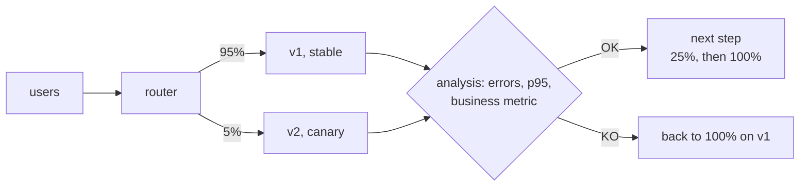

```
step 1: v2 receives 5% of the traffic for 15 min
  smoke test forced on v2 (header X-Canary: 1)    green
  errors   v1 0.4%     v2 0.5%     threshold: gap under 0.5 point   OK
  p95      v1 210 ms   v2 380 ms   threshold: v2 under 1.2 times v1 KO
  automatic decision: back to 100% on v1, team alerted
```

What to plan:

- **the criteria before starting**: metrics, thresholds, length of each step, and at least one business indicator (validated carts, accepted payments), not only technical ones;
- **a <span class="term" data-term="smoke-test">smoke test</span> that targets the canary**: a header or a route that forces the new version, otherwise 95% of the test's calls land on the old one;
- **enough traffic**: 5% of a rarely called service at 3 a.m. may be 20 requests (example), too few to conclude. Set a minimum number of requests per step;
- **a user stays on the same version** (session affinity): otherwise they jump from v1 to v2 from one page to the next, and an E2E test becomes flaky.

:material-book-open-variant: Reference docs: [Danilo Sato, CanaryRelease](https://martinfowler.com/bliki/CanaryRelease.html) (2014); [Argo Rollouts](https://argo-rollouts.readthedocs.io/) (accessed November 2026)
{ .doc-ref }

### Testing a blue-green deployment

<span class="pill pill-status pill-status-ok" title="Still valid, checked November 2026">Current · 11/2026</span>

<a class="pill pill-practice" href="../livraison/#progressive-deployment" title="level 2: it is automated">Practice · Progressive rollout · L2</a> <a class="pill pill-practice" href="../livraison/#testing-in-production" title="level 2: it is automated">Practice · Production testing · L2</a>
<a class="pill pill-dora" href="https://dora.dev/capabilities/continuous-delivery/">DORA · Continuous delivery</a>

With a <span class="term" data-term="blue-green-deployment">blue-green deployment</span>, I test **before** the switch: green already runs in production, with the real infrastructure and the real data, but without users. So I can run a real test suite against it.

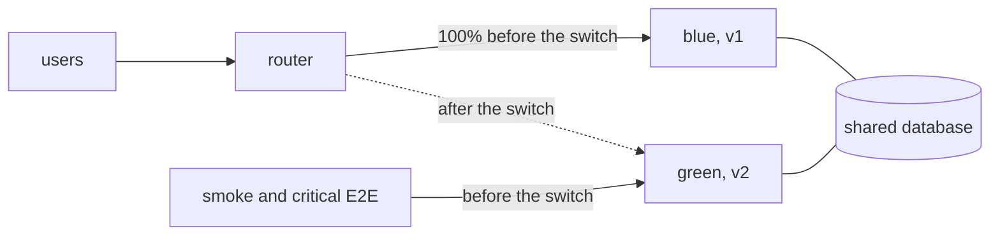

```
10:00  v2 deployed on green, no traffic; blue (v1) serves 100% of users
10:05  smoke and critical E2E tests on https://green.my-api.example: 24/24 green
10:20  router switch: green serves 100%, blue stays ready
10:20  synthetic tests every minute on the public URL, alerts watched
11:20  nothing to report: blue is kept for 24 h, then it will receive the next version
```

What to plan:

- **test accounts**: green uses the production database, every test writes real data there;
- **a database compatible with both versions**: blue and green often share the same database, the schema must accept v1 and v2 (see expand / contract in [Versioning](api-rest-async.md#versioning));
- **in-flight requests**: at the switch, let the requests and jobs started on blue finish before stopping it;
- **the cost**: two full environments during the switch.

|                | Canary                                                 | Blue-green                                         |
|----------------|--------------------------------------------------------|----------------------------------------------------|
| exposure       | progressive (5%, 25%, 100%)                            | all traffic at once                                |
| main test      | comparing v1 and v2 metrics on real traffic            | test suite on green before the switch              |
| rollback       | set the canary back to 0%                              | switch the router back to blue                     |
| good at finding| regressions that only show with real traffic (performance, real data) | deployment, configuration and infrastructure errors |
| limit          | little traffic, unreliable verdict                     | a bug the tests miss hits everyone at the switch   |
| cost           | low                                                    | double infrastructure during the switch            |

The two combine: deploy v2 on green, test it, then send it traffic in steps like a canary. Sources: Martin Fowler, "BlueGreenDeployment" (2010); Danilo Sato, "CanaryRelease" (2014), on Martin Fowler's site.

:material-book-open-variant: Reference docs: [Martin Fowler, BlueGreenDeployment](https://martinfowler.com/bliki/BlueGreenDeployment.html) (2010)
{ .doc-ref }

### Testing a feature in an A/B test

<span class="pill pill-status pill-status-ok" title="Still valid, checked in November 2026">Current · 11/2026</span>

<a class="pill pill-practice" href="../livraison/#testing-in-production" title="level 4: it is driven by measurement">Practice · Production testing · L4</a>
<a class="pill pill-dora" href="https://dora.dev/capabilities/team-experimentation/">DORA · Team experimentation</a>

Product wants to know whether a "1-click order" button brings more orders. It runs an <span class="term" data-term="ab-test">A/B test</span>: half of the visitors, drawn at random, see the new button (B), the other half keep the old one (A), and the order rate is compared. The statistics (sample size, p-value, confidence interval) are in [Data and decisions: A/B testing](donnees-decision.md#ab-testing). Here, the QA question: **how do I make sure the experiment measures what it thinks it measures?** A bug in the setup does not crash the site: it skews the conclusion, without any alert.

What I check:

- **each variant works**: I force A then B in E2E tests, through a cookie, a header or a parameter meant for it, as for a canary;
- **the assignment is sticky**: a visitor keeps the same variant from one page to the next and from one visit to the next (assignment computed from their identifier), otherwise they see both and the result means nothing;
- **the measurement fires in both variants**: the "order placed" event is sent exactly once, with the variant name. It is the most common bug: B has a new confirmation page, the event was not added there, and B looks worse than it is;
- **the observed split matches the planned split**: a clear gap between the expected and the observed 50/50 is called a <span class="term" data-term="sample-ratio-mismatch">sample ratio mismatch</span> and almost always signals a bug, not an effect of the variant;
- **the end of the experiment**: the losing variant and its flag are removed, otherwise every future test has to cover two flows.

```ts
// Example: force variant B to test its flow end to end
test("1-click order, variant B", async ({ page, context }) => {
  await context.addCookies([{ name: "exp_checkout", value: "B", url: "https://shop.example.com" }]);
  await page.goto("https://shop.example.com/cart");
  await page.getByRole("button", { name: "Order in 1 click" }).click();
  await expect(page.getByText("Order confirmed")).toBeVisible();
});
```

A mismatch caught (example numbers):

```
expected     50% / 50%
observed     A 10,400 visitors   B 9,600 visitors   (52% / 48%)
chi-squared test: p < 0.001, the gap is not due to chance
cause        variant B redirects before the "visit" event is sent
decision     results invalid, fix then restart the experiment
```

| I want to... | I use... |
|---|---|
| I want to check that variant B works before half of the customers see it | E2E with the variant forced by cookie or header |
| I want to be sure the experiment's conclusion is not skewed by a missing measurement | check the measurement event in each variant, once per action |
| the visitor split is not the planned one, like 52/48 instead of 50/50 over 20,000 visitors | sample ratio mismatch check, find the bug before reading the result |
| I want to know whether B really does better than A | the statistics in [Data and decisions](donnees-decision.md#ab-testing), not a QA test |

:material-book-open-variant: Reference docs: [Ron Kohavi, Diane Tang and Ya Xu, "Trustworthy Online Controlled Experiments"](https://experimentguide.com/) (2020)
{ .doc-ref }

## Flaky tests and parallelisation

<a class="pill pill-scope pill-scope-code" href="../architecture/#map-of-scales">Scale · Code</a>

<a class="pill pill-practice" href="../livraison/#automated-functional-tests" title="level 4: it is steered by measurement">Practice · Functional testing · L4</a>
<a class="pill pill-dora" href="https://dora.dev/capabilities/test-automation/">DORA · Test automation</a>


### Parallelising without breaking things

<span class="pill pill-status pill-status-ok" title="Still valid, checked November 2026">Current · 11/2026</span>

Real case, about 180 Playwright tests, 4 attempts:

| Version               | Split                        | Pipeline duration | Result                                         |
|-----------------------|------------------------------|----------|------------------------------------------------|
| v0                    | 7 jobs, one per application  | ~36 min  | reliable but linear                            |
| v1                    | 14 <span class="term" data-term="test-shard">shards</span> with no limit      | variable | 11 browser crashes, <span class="term" data-term="mfa">2FA</span> logins blocked         |
| v2                    | `parallel: 2` by number of tests | 45 min, timeout | all 16 red tests in the same shard, report lost |
| v3                    | per application **and per tag** | ~14 min | 9 jobs, all finished and reported              |

Lessons:
- **parallelise by login account**, one job per application;
- **isolate red or slow suites by tag**, not by number of tests: `--grep-invert=@invoice` for the rest, `--grep=@invoice` in its own job;
- **completeness comes before speed**: a cancelled or timed-out job loses its whole report, not just the failing tests.

:material-book-open-variant: Reference docs: [Playwright, Sharding](https://playwright.dev/docs/test-sharding) (accessed November 2026)
{ .doc-ref }

### Causes of flakiness that are not test bugs
| Symptom                                               | Real cause                               | Fix                                      |
|-------------------------------------------------------|------------------------------------------|------------------------------------------|
| `Target page, context or browser has been closed`     | `/dev/shm` (the shared memory Chromium uses for its tabs) too small in the container, 64 MB by default | launch Chromium with `--disable-dev-shm-usage` |
| jobs 8 to 12 times slower, dashboard at 13% CPU       | jobs declaring 250m of CPU while using 2 to 4 cores, saturated nodes | declare the real usage: `cpu: 2`, `memory: 4Gi` |
| `TOTP failed: Too many attempts`                      | a 2FA account shared by too many jobs in parallel | log in through the API without a browser in the setup |

Part of the "<span class="term" data-term="flaky-test">flakiness</span>" is contention (resources, logins), not a defect in the test or the product. Measure before <span class="term" data-term="test-quarantine">quarantining</span>.

### What does not parallelise
I chain `health_check`, `smoke`, then `regression` tiers, hoping to go faster. These tiers **order** the signal, they do not go faster: 741 s versus 745 s, and 44% more logins. And a green on the fast tiers predicts little, because they only cover 23% of the tests.

### Strategy for a flaky test

<span class="pill pill-status pill-status-ok" title="Still valid, checked November 2026">Current · 11/2026</span>

1. Quarantine it: off the blocking path, with a ticket, an owner, a deadline.
2. Let it run to measure its failure rate.
3. Look for the cause: shared data, fixed wait, saturated resource, test order.
4. No silent retry: a retry must leave a trace, otherwise the problem becomes invisible.

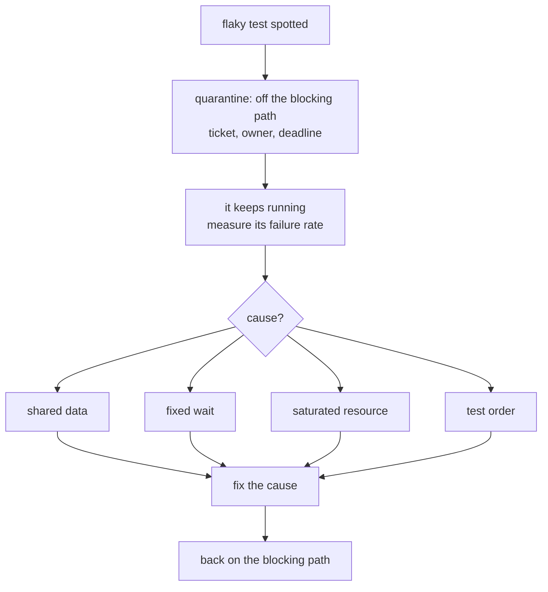

:material-book-open-variant: Reference docs: [Martin Fowler, Eradicating Non-Determinism in Tests](https://martinfowler.com/articles/nonDeterminism.html) (2011); [Playwright, Retries](https://playwright.dev/docs/test-retries) (accessed November 2026)
{ .doc-ref }

### Diagnostic tools: what they really show
A line-by-line tracer was tried to help an agent fix tests. It showed **where** the test broke, not **why**. The real cause, found by reading the code: a helper that gave up **without raising an error**, so the test kept going and then timed out further on. What remains useful on its own: one screenshot per action, with the clicked element highlighted, and `trace: retain-on-failure`.

:material-book-open-variant: Reference docs: [Playwright, Trace viewer](https://playwright.dev/docs/trace-viewer) (accessed November 2026)
{ .doc-ref }

## Test results and visibility

### The path of a test result

A test run produces more than "green" or "red". Each step keeps part of the information, and each question is read in a different place:

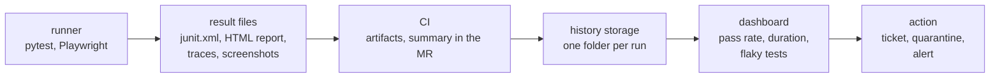

| I want to know... | I look at... |
|---|---|
| whether my MR is the one breaking something, when the pipeline has just turned red and I do not know if it is my fault | the test summary in the MR: new failures compared to the main branch |
| why this E2E test fails, by seeing what the browser really displayed, sent and received | the Playwright trace (DOM, network, console step by step), the screenshot and the video of the run |
| whether a test that passes one day and fails the next is flaky, or points to a real problem | its history over 30 days: same commit, different results |
| why the suite takes longer and longer, and which tests slow it down | duration per run and the 10 slowest tests, over several weeks |
| whether quality is really dropping, without being misled by MRs still in progress | the daily pass rate on the main branch, not on open MRs |

### Reading a failure: from red to cause

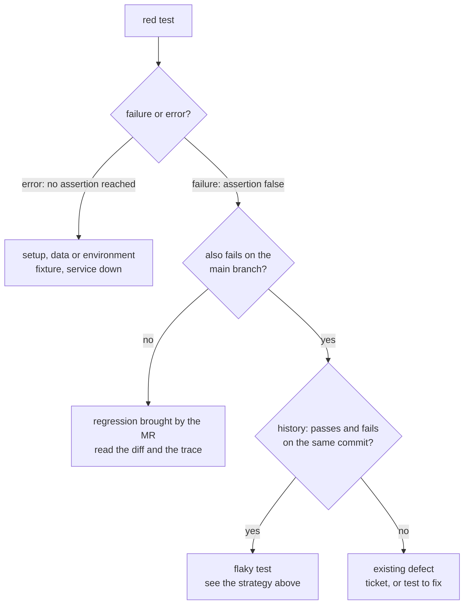

!!! noob "As noob"
    A test report is the application's school report. The MR summary says "did you pass today?", the trace of a red test says "exactly where you went wrong", and the history says "are you improving, or do you keep failing the same exercise?".

:material-book-open-variant: Reference docs: [Playwright, Trace viewer](https://playwright.dev/docs/trace-viewer) (accessed November 2026); [Playwright, Reporters](https://playwright.dev/docs/test-reporters) (accessed November 2026)
{ .doc-ref }

### Failed or error
```
<failure>  the test ran, an assertion did not hold    the product misbehaves
<error>    the test never reached an assertion        the setup is broken (fixture, page, service down)
```
Show them separately: `8/10 passed · 2 errors` does not tell the same story as `8/10 passed · 2 failed`.

### Keeping the history

<span class="pill pill-status pill-status-ok" title="Still valid, checked November 2026">Current · 11/2026</span>

CI <span class="term" data-term="ci-artifact">artifacts</span> expire (often after 2 weeks). To follow trends, send every run to storage:
```
test-reports/2026-10-23T09-15-00Z_pipeline-1234/
├─ junit.xml
└─ report.html
```
An ISO 8601 UTC date at the start of the name: alphabetical order is chronological order. The upload must run **whatever** the test result (in GitLab CI, `artifacts: when: always` or an `after_script`) and must not change their exit code. Public tools do this history work: Allure Report, ReportPortal, or the test reports built into GitLab and GitHub.

*GitLab CI: competes with GitHub Actions, Jenkins*<br>
*Allure: competes with ReportPortal*<br>
*ReportPortal: competes with Allure*
{ .tool-rel }


:material-book-open-variant: Reference docs: [GitLab, Unit test reports](https://docs.gitlab.com/ci/testing/unit_test_reports/) (accessed November 2026)
{ .doc-ref }

### Adding metadata to tests

<span class="pill pill-status pill-status-ok" title="Still valid, checked November 2026">Current · 11/2026</span>

```python
import allure
import pytest

# Example: labels that tie tests and failures to a feature
@allure.feature("checkout")
@allure.story("card payment")
@pytest.mark.smoke
def test_card_payment_is_accepted(): ...
```
These labels (here with Allure Report, or Playwright `tag`s) let me answer "which features have no tests?" or "which feature has the most failures this month?". Flakiness does not exist as a native field: it is computed (same test, same commit, different results).

:material-book-open-variant: Reference docs: [Allure Report, Documentation](https://allurereport.org/docs/) (accessed November 2026)
{ .doc-ref }

## SLOs on test suites

<span class="pill pill-status pill-status-ok" title="Still valid, checked November 2026">Current · 11/2026</span>

My team wears itself out analysing every red run, even when it is one isolated flaky test. Instead of reacting to every run, I set a <span class="term" data-term="pass-rate">pass rate</span> target over a time window.

```
E2E tests  : pass rate ≥ 90% over 30 days   (example figure)
API tests  : pass rate ≥ 98% over 30 days   (example figure)

rate = passed / (total - skipped)
```
The <span class="term" data-term="alert-monitoring">alert</span> only fires when the **rate** breaks the target: an isolated flaky test wakes nobody up, a real degradation does.

Traps:
- including MR pipelines, which fail more by nature, makes the <span class="term" data-term="slo">SLO</span> "always broken by noise";
- setting thresholds without looking at the history: they are random values, to be recalibrated.

:material-book-open-variant: Reference docs: [Google SRE Workbook, Implementing SLOs](https://sre.google/workbook/implementing-slos/) (2018)
{ .doc-ref }

## Code review

<a class="pill pill-scope pill-scope-code" href="../architecture/#map-of-scales">Scale · Code</a>

<a class="pill pill-practice" href="../livraison/#trunk-based-development" title="level 1: the practice is in place, even by hand">Practice · Trunk-based development · L1</a>
<a class="pill pill-dora" href="https://dora.dev/capabilities/code-maintainability/">DORA · Code maintainability</a>


### Iterating down to zero blockers

<span class="pill pill-status pill-status-ok" title="Still valid, checked November 2026">Current · 11/2026</span>

```
pass 1 : raise everything (blocker, major, minor, nit), then sort
pass 2 : blockers and majors down to zero
pass 3 : non-regression and a clear verdict
```
Three passes is a budget, not a goal: stop at two if it is clean.

| Level | What it means | Example |
|---|---|---|
| blocker | cannot be merged as is: bug, data loss, security hole | a refund computed as a `float`, which loses cents |
| major | to fix in this MR, unless explicitly agreed | an HTTP call with no timeout to payments-service |
| minor | improves the code, can go to a ticket | an 80-line function to split |
| nit | taste or style, the author decides | rename `data` to `order` |

:material-book-open-variant: Reference docs: [Google Engineering Practices, Code Review](https://google.github.io/eng-practices/review/) (accessed November 2026)
{ .doc-ref }

### Proving every comment

<span class="pill pill-status pill-status-ok" title="Still valid, checked November 2026">Current · 11/2026</span>

A review with 3 wrong comments out of 5 costs more than no review. Every comment must have:
- `file:line`;
- a concrete scenario that breaks;
- a check in the real code, not in the docstring or from memory.

On a large branch, 2 "blockers" on the list were wrong. Self-check before posting: mark each comment "verified" or "assumed", and delete the assumed ones or go and verify them.

### Style

<span class="pill pill-status pill-status-ok" title="Still valid, checked November 2026">Current · 11/2026</span>

One or two sentences (the problem and the fix), and an applicable suggestion rather than prose:

````
```suggestion:-0+0
const hasMultipleDestinations = targets.length > 1;
```
````
When I apply feedback, I resolve the discussion. No need to reply "thanks, done".

:material-book-open-variant: Reference docs: [GitLab, Suggest changes](https://docs.gitlab.com/user/project/merge_requests/reviews/suggestions/) (accessed November 2026)
{ .doc-ref }

## Code rules that prevent defects

<a class="pill pill-scope pill-scope-code" href="../architecture/#map-of-scales">Scale · Code</a>

### No fallback value that hides a gap

<span class="pill pill-status pill-status-ok" title="Still valid, checked November 2026">Current · 11/2026</span>

```typescript
// Avoid: if title is required, this fallback hides a data gap
const title = release.title ?? release.name ?? "Untitled";
```
If the <span class="term" data-term="api-contract">contract</span> says `title` is required, this fallback passes off a data gap as valid data. The test dataset looks fine, so does the interface, and the gap only shows up in <span class="term" data-term="production-env">production</span>.

```typescript
// What changes: the missing field raises an error instead of being hidden
if (release.title === undefined) {
  throw new MissingFieldError("release.title");
}
```
Rule: a default is legitimate if the field is **optional** in the contract, it is a mask if it is **required**.

### No magic value

<span class="pill pill-status pill-status-ok" title="Still valid, checked November 2026">Current · 11/2026</span>

```python
# Avoid: 128 is a magic number, nobody will know what it means
if luminance > 128:
```
Six months later, nobody knows whether 128 is a threshold, a buffer size or a coincidence.
```python
# What changes: the number gets a name and a docstring saying its role
LUMINANCE_THRESHOLD = 128
"""Above this value, the text is drawn in black for contrast."""
```

### Money in integer cents

<span class="pill pill-status pill-status-ok" title="Still valid, checked November 2026">Current · 11/2026</span>

```python
# Avoid: money as floats, rounding skews the result
0.1 + 0.2        # 0.30000000000000004
# Good: money as integer cents, the math stays exact
10 + 20          # 30 cents, exact
```

### Extract instead of piling up

<span class="pill pill-status pill-status-ok" title="Still valid, checked November 2026">Current · 11/2026</span>

A new responsibility becomes its own module, **in the same change**. Real case: a 1,385-line file, grown feature after feature with an "extract later" note. Nothing was ever extracted.
```
$ git diff origin/main...HEAD | grep -inE '^\+.*(todo|refactor later|extract later)'
```

### Extract at the 2nd occurrence

<span class="pill pill-status pill-status-ok" title="Still valid, checked November 2026">Current · 11/2026</span>

A helper is born at the 2nd copy, never at the 3rd. And no abstraction for a caller that does not exist yet.

:material-book-open-variant: Reference docs: [Refactoring.com, Catalog](https://refactoring.com/catalog/) (accessed November 2026); [Python Tutorial, Floating-Point Arithmetic](https://docs.python.org/3/tutorial/floatingpoint.html) (Python 3)
{ .doc-ref }

## Pitfalls to avoid

- **A double across a boundary**: I replace the database or the HTTP partner with a mock in an API test. The mock answers what I expect, not what the real neighbour does, so the test stays green while production breaks, like the `403` response that lost its `WWW-Authenticate` header. I prove the behaviour with a real request, against real neighbours ([see The rule](#the-rule)).
- **Coverage taken as proof**: I reassure myself with 100 % coverage. A test without an `assert` runs the whole function and checks nothing, so a bug gets through despite the number. I reread the assertions and try mutation testing ([see What it says](#what-it-says-and-what-it-does-not)).
- **`allow_failure` to unblock a merge**: I set a red job to `allow_failure: true` because it waits for a package version not yet published. I have merged a known broken state. I read the order the red job tells me, merge the dependency first, then rerun ([see Never weaken a gate](#never-weaken-a-gate)).
- **Silently retrying a flaky test**: I rerun the pipeline until it goes green. The team learns to ignore red, and on the day of a real bug nobody looks. I quarantine the test with a ticket, an owner and a deadline, and look for the cause ([see the strategy](#strategy-for-a-flaky-test)).
- **Hooks on staged files only**: I trust the commit hook, which only sees staged files. CI checks the whole branch and turns red, sometimes at the third review iteration. I run `pre-commit run --all-files` before pushing ([see Running hooks](#running-hooks-on-the-whole-tree)).
- **A shallow clone to judge new code**: I let CI clone with a partial history. The "new code" diff comes back wrong without any error, and the quality gate judges something other than my MR. I set `GIT_DEPTH: 0` ([see the gate traps](#traps)).
- **An SLO computed on MRs**: I include MR pipelines in the pass rate. They fail more by nature, so the SLO is always broken on noise and nobody reads the alert any more. I compute the rate on the main branch ([see SLOs](#slos-on-test-suites)).
- **A fallback value on a required field**: I write `release.title ?? "Untitled"` while the contract makes `title` required. A data gap passes for valid data and only shows up in production. I raise an error instead of hiding the gap ([see No fallback value](#no-fallback-value-that-hides-a-gap)).

## What interviews ask

The typical questions:

- "Pyramid or testing trophy?", "How do you split your tests between unit, integration and E2E?" How I answer: I say the shape depends on the context, then give my rule: a real request whenever it can prove the behaviour ([Pyramid, trophy, honeycomb](#pyramid-trophy-honeycomb-the-shape-of-a-suite), [The rule](#the-rule)).
- "How do you build the test strategy for a new feature?", "Time is short before a release, what do you test first?" How I answer: I list the risks and rank each one by impact times probability, draw the journey to cover the critical paths first, then pick the lowest test level that proves each behaviour; when time is short, I test those critical paths and the areas that already had incidents ([The seven testing principles](#the-seven-testing-principles-istqb), [Designing scenarios](#designing-scenarios), [Choosing the right test level](#choosing-the-right-test-level)).
- "What is the difference between a mock, a stub and a fake?", "When should you mock?" How I answer: I give the role of each double, then say why a hand-written mock lies and what a contract test adds ([Test double](#test-double-mock-stub-fake), [Contract tests and API mocks](#contract-tests-and-api-mocks)).
- "What do you do with a flaky test?", "How do you speed up an E2E suite that is too slow?" How I answer: I walk through quarantine with a ticket and measurement, and splitting by account and by tag ([Strategy for a flaky test](#strategy-for-a-flaky-test), [Parallelising without breaking things](#parallelising-without-breaking-things)).
- "Is code coverage a good indicator?", "Which threshold should be enforced?" How I answer: I separate executed code from verified code, then talk about a gate on new code only ([What it says and what it does not](#what-it-says-and-what-it-does-not), [Two gates are enough](#two-gates-are-enough)).
- "How do you test a canary deployment? And a blue-green one?" How I answer: I compare metrics step by step for the canary, and test green before the switch ([Testing a canary deployment](#testing-a-canary-deployment), [Testing a blue-green deployment](#testing-a-blue-green-deployment)), and [Progressive deployment](livraison.md#progressive-deployment) and [A/B testing](donnees-decision.md#ab-testing).
- "What makes a good code review?", "How do you write a good bug report?" How I answer: I rank my comments by severity level and prove each one with `file:line` and a scenario that breaks; a bug report follows the same logic, with the steps to reproduce, the expected and the actual result, the environment and evidence (screenshot, trace, log) ([Proving every comment](#proving-every-comment), [Recorded scenario](#recorded-scenario-playwright-codegen)).
- "What is mutation testing?", "Is 100% coverage enough?" How I answer: I show a mutant that survives despite 100% coverage, the boundary test that kills it, then the cost (compute time, equivalent mutants) and the targeted use on critical code ([Mutation testing](#mutation-testing-testing-the-tests)).
- "Mockist or classicist?", "London or Detroit school?" How I answer: I contrast checking the exchanges with checking the result, give the strength and weakness of each, then say I choose per neighbour, Detroit by default and a mock when the exchange is the behaviour ([London and Detroit schools](#london-and-detroit-schools-isolating-the-unit-or-not)).
- "How do you test a feature in an A/B test?" How I answer: I force each variant in E2E, check the sticky assignment, the measurement event in both variants and the observed split, and leave the conclusion to the statistics ([Testing a feature in an A/B test](#testing-a-feature-in-an-ab-test)).

What makes a good answer: a lived (or realistic) example with the bug the test caught or let through, then the limit of the tool I mention. An "it depends" followed by the criteria beats a recited rule.

## What to use in which situation

| Situation | I use |
|---|---|
| I have a calculation rule with no database or network, like the total of an order or a password policy | unit test |
| I want to prove that a route behaves well from the outside, like `/orders` returning 401 without a token | integration test with a real request |
| my code reads or writes to a database, a <span class="term" data-term="cache-data">cache</span> or a message queue, and I want to test it against the real thing, not an imitation | <span class="term" data-term="testcontainers">Testcontainers</span> |
| I depend on a service I do not control, like `bank-partner`, that I can neither change nor make return an error on demand | contract <span class="term" data-term="mock">mock</span> (Microcks) + a test of the real one (<span class="term" data-term="schemathesis">schemathesis</span>) |
| the front-end team wants to move forward while the back end is not ready yet, and only its contract exists | Prism on the contract |
| a journey whose failure is costly, like logging in, ordering and seeing "paid" | Playwright E2E, few of them |
| the PO wants to read, and be able to challenge, what the product promises, like "a closed customer is refused" | Gherkin scenario with a `Goal` |
| I want to know which journeys have no test at all, like a refused payment nobody planned for | scenario graph, coverage map |
| all my tests pass, but I doubt they really check anything, like a test with no `assert` that covers 100% of a function | <span class="term" data-term="mutation-testing">mutation testing</span> |
| I want to block the new defects of an MR without punishing it for the debt already in the project | <span class="term" data-term="quality-gate">quality gate</span> on new code |
| a red CI job blocks my merge, for example because it waits for a package version not yet published | understand and sequence, never `allow_failure` |
| a test passes or fails without the code changing, and the team starts ignoring red | <span class="term" data-term="test-quarantine">quarantine</span> with a ticket, measurement, cause |
| my E2E tests take too long, and the team waits for the pipeline on every MR | parallelise by account and by tag |
| I want to see whether my suites degrade over the weeks, without reacting to every red run | run history + pass rate <span class="term" data-term="slo">SLO</span> |
| I want to try a new version on a small share of real users, and roll back on its own if it does worse than the old one | canary: v1 and v2 compared step by step, stop criteria written beforehand |
| I want to test the new version in production, on the real infrastructure, before a single user sees it | blue-green: tests on green, then switch |
| my team wonders how many tests to write at each level (unit, integration, E2E) | pyramid, trophy or honeycomb depending on context |
| I am preparing a test plan and want to be sure I do not miss a kind of test, like exploratory or load testing | agile testing quadrants |
| I want to list with the PO what "quality" covers beyond "it works", like performance, security or accessibility | ISO/IEC 25010 |
| I have to test a feature shown to only half of the visitors, like a "1-click" button in an A/B test | each variant forced in E2E, measurement and split checked |
| I write the tests of a service that computes and saves, and I do not want a refactoring to break them when the behaviour does not change | Detroit school: real neighbours, fake for the database |
| I design a flow from the outside in while its classes do not exist yet, or I must check that an email is really sent | London school: mocks on the roles I own |
