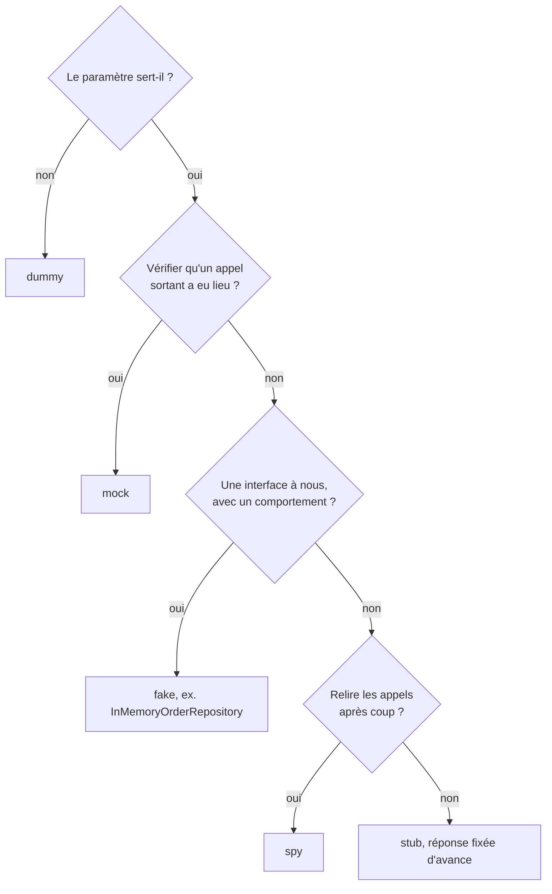
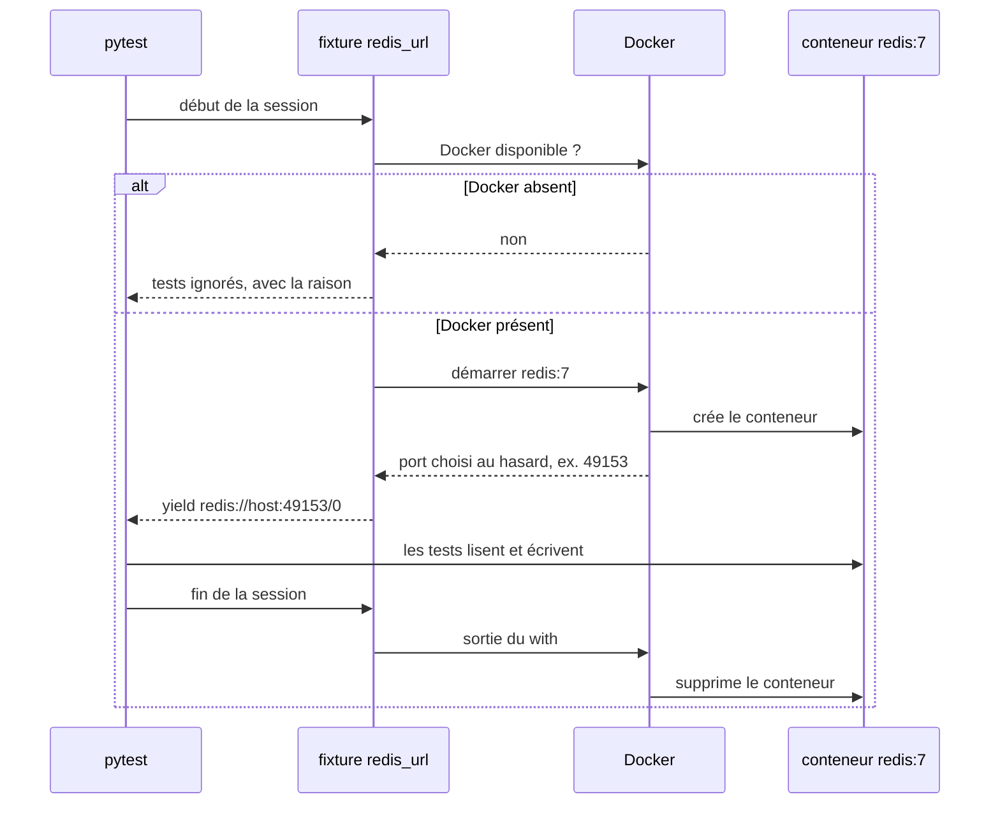
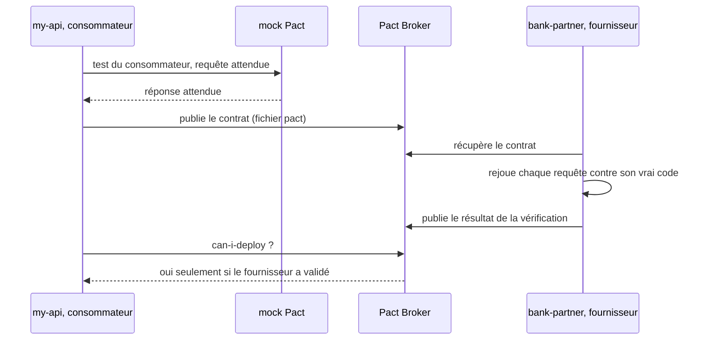
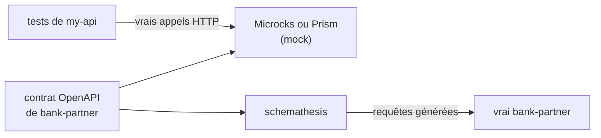
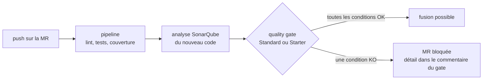
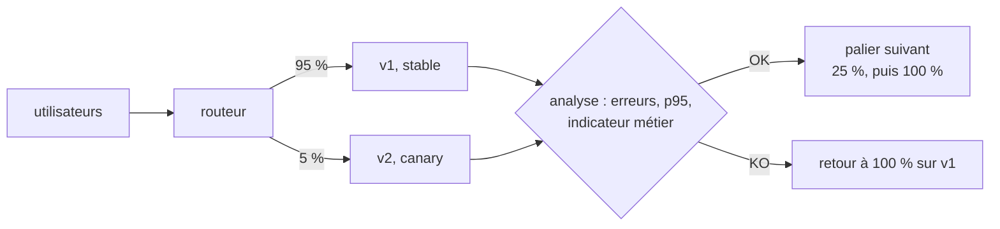
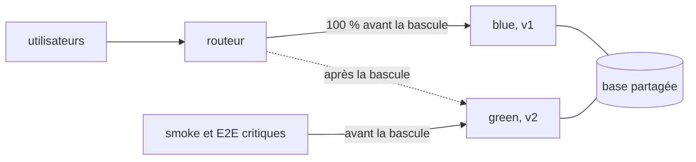
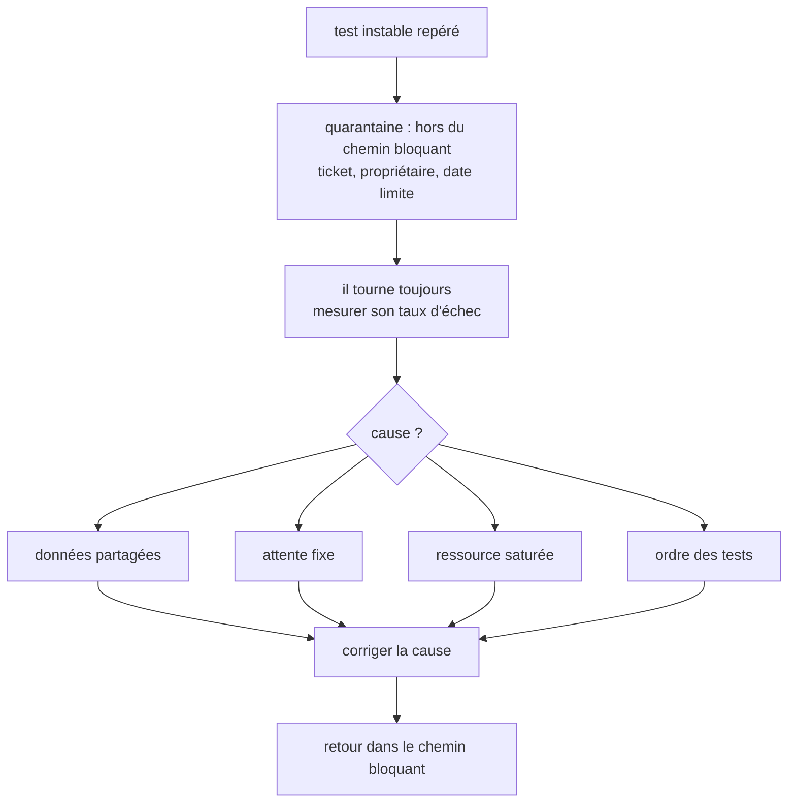
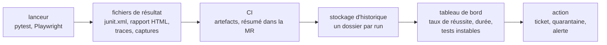
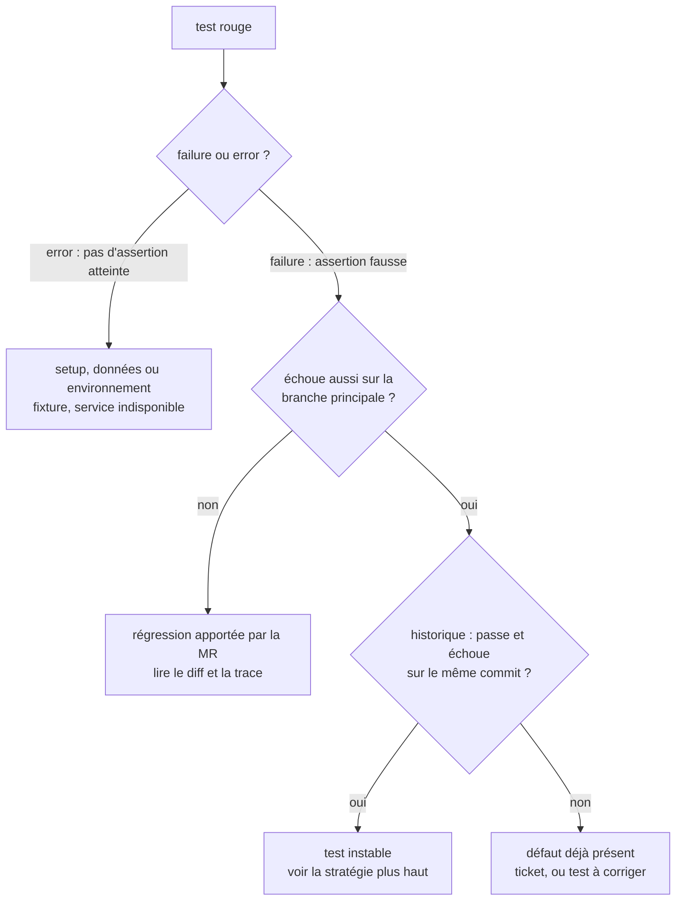

# Qualité logicielle et tests

!!! warning "Avertissement"
    Ces notes sont des pense-bêtes personnels, pas une source de vérité. Elles reflètent ma compréhension et mes choix : leur contenu reste subjectif, malgré les citations et les références qu'il contient. Il peut être incomplet, simplifié, inexact ou dépassé. Vérifiez toujours dans la documentation officielle avant de l'appliquer. Ce contenu est fourni tel quel, sans aucune garantie : son utilisation se fait sous votre seule responsabilité.

!!! audience "Pour qui, pour quoi"
    - **Métiers** : QA, développeur back-end ou front-end, SRE, tech lead, engineering manager
    - **Usages** : je prépare un entretien QA ou SDET (pyramide, mocks, tests instables) ; je choisis le niveau de test d'une nouvelle route d'API, unitaire ou vraie requête ; je relis une MR qui ajoute des tests et je cherche les pauses fixes et les mocks qui mentent ; je règle un quality gate sur le nouveau code ; je mets un test instable en quarantaine sans perdre le signal

!!! abstract "Les échelles"
    Les pastilles de couleur sous les titres disent à quelle échelle une notion s'applique :

    - <span class="pill pill-scope pill-scope-code">Code</span> les classes, fonctions et modules d'un programme ;
    - <span class="pill pill-scope pill-scope-app">Application</span> un service ou une application et son découpage interne ;
    - <span class="pill pill-scope pill-scope-system">Système</span> plusieurs services qui communiquent par le réseau ;
    - <span class="pill pill-scope pill-scope-infra">Infrastructure</span> les serveurs, le réseau, les zones et les clusters, physiques ou virtuels ;
    - <span class="pill pill-scope pill-scope-enterprise">Entreprise</span> le système d'information entier et son organisation.

    Détail et mots ambigus : [carte des échelles](architecture.md#carte-des-echelles).

La qualité, ici, c'est la confiance qu'on peut avoir dans ce qu'on livre : est-ce que ça marche, est-ce que ça va continuer à marcher après le prochain changement, et est-ce qu'on le saura vite si ça casse. Les tests, la <span class="term" data-term="ci">CI</span>, les <span class="term" data-term="quality-gate">quality gates</span> et la <span class="term" data-term="code-review">revue de code</span> sont les outils qui donnent cette confiance.

La page suit l'ordre dans lequel on se pose les questions :

1. **le vocabulaire** nécessaire pour lire la suite ;
2. **les modèles de référence** (pyramide, trophée, nid d'abeille, quadrants, shift-left, principes ISTQB, ISO/IEC 25010), puis **quel test écrire** pour quel besoin ;
3. **comment l'écrire** pour qu'il prouve vraiment quelque chose contre de vrais voisins (intégration avec Testcontainers, tests de contrat et mocks d'API) ;
4. **comment savoir ce qui est testé** (couverture) ;
5. **comment le faire respecter** (quality gates, CI, revue) ;
6. **comment le garder fiable dans le temps** (tests instables, résultats, mesure de la qualité, <span class="term" data-term="slo">SLO</span>) ;
7. **un tableau final** : quoi utiliser dans quelle situation.

La stratégie de test (risques, critères de sortie), la conception des scénarios et des cas de test (Gherkin, partitions, valeurs limites, table de décision, test par paires, test par propriétés), le test exploratoire, les données de test, le TDD et le code legacy, le rapport de défaut et l'accessibilité ont leur propre page : [Concevoir les tests](conception-tests.md).

Dans les exemples, `my-api`, `orders-service` et `bank-partner` sont des services fictifs, et les comptes `ada`, `grace` et `dennis` des utilisateurs de test. Les chiffres viennent de cas réels.

:material-swap-horizontal: Les outils cités dans cette page : lesquels se remplacent, lesquels se combinent ? Voir [Complémentaires ou concurrents](outils.md#complementaires-ou-concurrents).
{ .doc-ref }

## Vocabulaire

### Défaut, régression, défaut échappé
- **Défaut (bug)** : le logiciel ne fait pas ce qu'il devrait.
- **Régression** : quelque chose qui marchait ne marche plus après un changement.
- **Défaut échappé** : un défaut que tous les contrôles ont laissé passer jusqu'en <span class="term" data-term="production-env">production</span>.

``` { .text .ex-illus title="Illustration" }
lundi    : la page panier affiche le total          OK
mardi    : MR « refacto du calcul de TVA » fusionnée
mercredi : le total est faux pour les paniers > 100 € régression, échappée en prod
```
Le bon réflexe sur un défaut échappé : écrire le test qui l'aurait attrapé, dans la <span class="term" data-term="merge-request">MR</span> du correctif.

:material-book-open-variant: Doc de référence : [ISTQB, Glossary](https://glossary.istqb.org/) (consultée en novembre 2026)
{ .doc-ref }

### Les niveaux de test

| Niveau        | Question à laquelle il répond                         | Exemple                                                |
|---------------|-------------------------------------------------------|--------------------------------------------------------|
| unitaire      | la règle pure est-elle juste ?                        | `password_policy("abc")` renvoie « trop court »        |
| intégration   | la pièce marche-t-elle avec son vrai voisin ?         | `orders-service` écrit et relit une commande dans un vrai Postgres |
| contrat       | parle-t-on le même langage que le service d'en face ? | la réponse de `bank-partner` respecte son schéma <span class="term" data-term="openapi">OpenAPI</span> |
| bout en bout (E2E) | le parcours complet marche-t-il ?                | <span class="term" data-term="playwright">Playwright</span> : se connecter, commander, voir « payé »    |
| acceptance    | le produit tient-il sa promesse ?                     | scénario <span class="term" data-term="gherkin">Gherkin</span> lisible par un <span class="term" data-term="product-owner">PO</span>                     |
| performance   | tient-il la charge ?                                  | k6 : 10 utilisateurs, 30 s, <span class="term" data-term="p95">p95</span> < 500 ms               |

:material-book-open-variant: Doc de référence : [Ham Vocke, The Practical Test Pyramid](https://martinfowler.com/articles/practical-test-pyramid.html) (2018)
{ .doc-ref }

### Double de test (mock, stub, fake)
Un faux objet qui remplace un vrai voisin pendant le test. Le vocabulaire vient de Gerard Meszaros, « xUnit Test Patterns » (2007) : il y a cinq sortes de doubles, selon ce qu'on attend d'eux.

!!! noob "As noob"
    C'est la doublure au cinéma : elle remplace l'acteur pour une scène, mais ne joue que ce que le script prévoit. Limite : si le vrai acteur change sa façon de jouer, la doublure n'en sait rien, d'où les tests de contrat plus bas. La phrase à retenir : **un double rend le test rapide et isolé, mais il ne prouve rien sur le vrai voisin.**

| Double    | Ce qu'il fait                                                     | Exemple                                                       |
|-----------|-------------------------------------------------------------------|---------------------------------------------------------------|
| **dummy** | remplit un paramètre obligatoire, n'est jamais utilisé            | `refund(order, operator=object())`                            |
| **stub**  | renvoie une réponse préparée d'avance                             | `bank.get_balance.return_value = {"balance_cents": 1200}`     |
| **fake**  | une vraie implémentation, simplifiée                              | `InMemoryOrderRepository()` : un dict à la place de Postgres  |
| **spy**   | enregistre les appels reçus, le test les relit ensuite            | `sent = []` puis `notify = sent.append`, et `assert sent == ["order 42 paid"]` |
| **mock**  | le test vérifie que l'appel attendu a bien eu lieu                | `bank.debit.assert_called_once_with("ada", 500)`              |

Le fake de l'exemple, complet :
``` { .python .ex-good title="Recommandé" }
# Bien : un fake qui se comporte comme le vrai dépôt, en mémoire
class InMemoryOrderRepository:
    def __init__(self):
        self._orders = {}

    def save(self, order):
        self._orders[order.id] = order

    def get(self, order_id):
        return self._orders[order_id]
```
`MagicMock` sait jouer le stub, le spy et le mock : c'est l'usage qui donne le nom.

L'erreur inverse : un mock qui refait le calcul du code testé. Si la règle de TVA est fausse, le mock est faux de la même façon, et le test reste vert.
``` { .python .ex-bad title="À éviter" }
# À éviter : le mock recopie la règle de TVA, le test compare le code à sa propre copie
pricing = MagicMock()
pricing.total.side_effect = lambda order: round(sum(l.price_cents * l.qty for l in order.lines) * 1.2)
assert OrderService(pricing, repository).place(order).total_cents == pricing.total(order)
```

Lequel choisir : un **fake** pour ses propres interfaces (un dépôt, un cache), parce qu'il se comporte comme le vrai et que le test vérifie un résultat, pas une suite d'appels ; un **mock** seulement pour vérifier qu'un appel sortant a bien eu lieu (un e-mail envoyé, un débit demandé) ; un **stub** pour fixer la réponse d'un voisin ; un **dummy** pour un paramètre sans importance. Deux écoles de test s'opposent justement sur la place des mocks : voir [Écoles de Londres et de Detroit](#ecoles-de-londres-et-de-detroit-isoler-ou-non-lunite).

Le même choix, en arbre de décision :



``` { .python .ex-illus title="Illustration" }
# Exemple : un stub fixe la réponse, il reste vert si la vraie banque change
bank = MagicMock()
bank.get_balance.return_value = {"balance_cents": 1200}
```
Le problème de tout double, ici un stub : il répond ce que l'auteur attendait. Si la vraie banque renvoie `{"data": {"balance_cents": 1200}}`, le test reste vert et la prod casse. Voir [tests de contrat](#tests-de-contrat-et-mocks-dapi).

:material-book-open-variant: Doc de référence : [Martin Fowler, TestDouble](https://martinfowler.com/bliki/TestDouble.html) (2006) ; [Martin Fowler, Mocks Aren't Stubs](https://martinfowler.com/articles/mocksArentStubs.html) (2007)
{ .doc-ref }

### Test instable (flaky)
Un test qui passe ou échoue sans que le code change.

!!! noob "As noob"
    C'est une alarme qui sonne une nuit sur trois sans raison : au bout d'une semaine, on ne se lève plus, même le soir du vrai cambriolage. La phrase à retenir : **un test instable apprend à l'équipe à ignorer le rouge.**

``` { .text .ex-illus title="Illustration" }
run 1 : passed
run 2 : failed   TimeoutError: locator.click
run 3 : passed   (même commit)
```

Cause la plus fréquente : une attente fixe. Elle est trop courte le jour où la CI est chargée, et fait perdre du temps tous les autres jours.
``` { .typescript .ex-bad title="À éviter" }
// À éviter : une pause fixe de 2 s, rouge dès que la confirmation met 2,1 s à s'afficher
await page.getByRole("button", { name: "Commander" }).click();
await page.waitForTimeout(2000);
expect(await page.locator("#status").textContent()).toBe("Commande confirmée");
```

``` { .typescript .ex-good title="Recommandé" }
// Bien : l'assertion réessaie d'elle-même jusqu'à ce que le texte apparaisse, ou jusqu'au timeout
await page.getByRole("button", { name: "Commander" }).click();
await expect(page.getByText("Commande confirmée")).toBeVisible();
```

:material-book-open-variant: Doc de référence : [Google Testing Blog, Flaky Tests at Google and How We Mitigate Them](https://testing.googleblog.com/2016/05/flaky-tests-at-google-and-how-we.html) (2016)
{ .doc-ref }

### Quality gate
Une règle automatique qui bloque une fusion si une condition n'est pas remplie.

!!! noob "As noob"
    C'est le portique de sécurité d'un aéroport : il ne juge pas le voyage, il refuse de laisser passer un bagage qui contient un objet interdit, quel que soit le voyageur. La phrase à retenir : **le gate ne rend pas le code bon, il empêche automatiquement de fusionner ce qui enfreint la règle.**

``` { .text .ex-illus title="Illustration" }
Quality gate « Standard », nouveau code seulement
  nouveaux bugs         0       OK
  duplication           1,2 %   OK  (< 3 %)
  couverture            64 %    KO  (≥ 80 % requis)
résultat : MR bloquée
```

### Les familles de suites de test
Une suite, c'est un ensemble de tests qu'on lance ensemble. On les nomme selon leur but et leur durée.

| Suite               | But                                                          | Exemple                                              | Durée typique |
|---------------------|--------------------------------------------------------------|------------------------------------------------------|---------------|
| **health check**    | le service répond-il ?                                       | `GET /livez` renvoie 200                      | secondes      |
| **smoke test**      | les fonctions vitales marchent-elles, en gros ?              | la page d'accueil s'affiche, on peut se connecter, on peut ajouter au panier | quelques minutes |
| **régression**      | rien de ce qui marchait n'est cassé ?                        | les 180 tests E2E de l'application                   | de 15 min à plusieurs heures |
| **acceptance**      | la fonctionnalité fait-elle ce que le PO a demandé ?         | le scénario Gherkin « un client fermé est refusé »   | variable      |
| **performance**     | tient-il la charge ?                                         | k6 : 10 utilisateurs pendant 30 s                    | minutes       |
| **synthétique**     | la production marche-t-elle en ce moment, pour un utilisateur ? | toutes les 10 min, un robot se connecte en prod et ouvre son tableau de bord | secondes, en boucle |

« Smoke » vient de l'électronique : on branche l'appareil, et s'il ne sort pas de fumée, on peut commencer les vrais tests. Un smoke test rouge veut dire « inutile d'aller plus loin ». Il se lance juste après un <span class="term" data-term="deployment">déploiement</span> :
``` { .text .ex-illus title="Illustration" }
déploiement en intégration
  health check   OK     le service répond
  smoke          KO     la connexion échoue
  régression     non lancée : inutile, le parcours de base est cassé
```

### Test de performance
Un test de performance envoie du trafic simulé par des <span class="term" data-term="virtual-user">utilisateurs virtuels</span> (VU) et compare les temps de réponse à des seuils. Ci-dessous, 10 VU pendant 30 s ; le test échoue si plus de 5 % des requêtes dépassent 500 ms ou si plus de 1 % sont en erreur.

``` { .js .ex-ref title="Référence" }
import http from "k6/http";
import { check } from "k6";

// Exemple : 10 VU pendant 30 s, p95 sous 500 ms et moins de 1 % d'erreurs
export const options = {
  vus: 10,
  duration: "30s",
  thresholds: { http_req_duration: ["p(95)<500"], http_req_failed: ["rate<0.01"] },
};

// Exemple : ce que fait chaque VU, un GET puis une vérification du statut
export default function () {
  const res = http.get("https://staging.example.com/orders/42");
  check(res, { "status 200": (r) => r.status === 200 });
}
```

Sortie résumée (exemple, la mise en forme exacte dépend de la version de k6) :

``` { .text .ex-ref title="Référence" }
$ k6 run orders.js
  ✓ http_req_duration..: avg=182ms med=160ms p(90)=310ms p(95)=420ms
  ✓ http_req_failed....: 0.21%  3 sur 1 412
    http_reqs..........: 1412   47/s
    vus................: 10
```
Un seuil franchi affiche `✗` et k6 sort avec un code non nul : le job de CI devient rouge. Comparatif des outils de charge dans [k6, JMeter, Locust](outils.md#k6-jmeter-locust).

**Choisir le type de test.** Un test de performance part d'une question chiffrée (« tenons-nous 500 commandes par minute pendant le pic de la fête des mères, avec un p95 sous 500 ms ? ») ; sans objectif, il produit des graphiques mais pas de décision. La documentation de k6 nomme six types, chacun pour une question (charges d'exemple) :

| Type | Charge | Durée | Question posée |
|---|---|---|---|
| **smoke** (fumée) | 5 VU | 1 min | le script et l'environnement fonctionnent-ils ? |
| **<span class="term" data-term="load-test">charge</span>** (*average-load*) | 500 VU, la charge attendue | 30 min de plateau | tient-on le pic habituel ? |
| **<span class="term" data-term="stress-test">stress</span>** | jusqu'à 2 000 VU, par paliers | 30 à 60 min | comment le service se dégrade-t-il au-delà du prévu ? |
| **<span class="term" data-term="soak-test">endurance</span>** (*soak*) | 300 VU, une charge normale | plusieurs heures | la mémoire ou la latence dérivent-elles (fuite, pool qui s'épuise) ? |
| **pic** (*spike*) | de 50 à 1 500 VU d'un coup | quelques minutes | que se passe-t-il à l'ouverture d'une billetterie ou d'une campagne ? |
| **point de rupture** (*breakpoint*) | montée continue jusqu'à l'échec | jusqu'à la rupture | quelle est la capacité maximale ? |

**Montée, plateau, descente.** Un VU est une boucle qui rejoue la fonction `default` sans arrêt, comme un visiteur qui enchaîne les pages. Pour un test de charge, je monte progressivement, je tiens un plateau, puis je redescends :

``` { .text .ex-illus title="Illustration" }
VU
500 |        ______________________
    |       /                      \
    |      /                        \
  0 |_____/                          \_____
    0 min  10 min              40 min  45 min
      montée       plateau        descente
```
La montée montre à quelle charge la latence commence à grimper, au lieu d'un choc instantané ; le plateau laisse les caches, les pools de connexions et les files se stabiliser avant de mesurer.

``` { .js .ex-bad title="À éviter" }
// À éviter : 500 VU d'un coup, sans montée ni seuil
export const options = { vus: 500, duration: "30m" };

// À éviter : toujours le même produit, sans aucune pause entre deux requêtes
export default function () {
  http.get(`${BASE_URL}/products/42`);
}
```
Sans pause, 500 VU envoient bien plus de requêtes que 500 personnes, et un seul produit est servi depuis le cache : le test mesure le cache, pas l'application.

``` { .js .ex-good title="Recommandé" }
// Bien : montée de 10 min, plateau de 30 min, descente, et des seuils qui font échouer le test
export const options = {
  stages: [
    { duration: "10m", target: 500 },
    { duration: "30m", target: 500 },
    { duration: "5m", target: 0 },
  ],
  thresholds: { http_req_duration: ["p(95)<500"], http_req_failed: ["rate<0.01"] },
};

// Bien : un produit au hasard parmi 1 000, et un temps de réflexion de 1 à 4 s
export default function () {
  const res = http.get(`${BASE_URL}/products/${Math.ceil(Math.random() * 1000)}`);
  check(res, { "produit 200": (r) => r.status === 200 });
  sleep(Math.random() * 3 + 1);
}
```
Le `sleep` aléatoire est le **<span class="term" data-term="think-time">temps de réflexion</span>** (*think time*) : il imite un vrai utilisateur qui lit la page entre deux clics.

**Trois pièges de mesure.**

- **le <span class="term" data-term="load-generator">générateur de charge</span> saturé** : si la machine qui lance k6 est à 100 % de CPU, c'est elle qui ralentit, pas le serveur. Je surveille son CPU et son réseau pendant le test, et je répartis la charge sur plusieurs machines si besoin ;
- **la <span class="term" data-term="coordinated-omission">coordinated omission</span>** (Gil Tene, « How NOT to Measure Latency », conférence, version filmée de 2015, à vérifier) : dans un modèle **fermé**, où un VU attend la réponse avant d'envoyer la requête suivante, l'outil envoie moins de requêtes quand le serveur ralentit, donc mesure moins d'échantillons pendant la période lente, et la latence publiée est sous-estimée. Un modèle **ouvert**, qui envoie un débit fixe quoi qu'il arrive (dans k6, l'exécuteur `constant-arrival-rate`), mesure ce que vivraient de vrais clients, qui n'attendent pas que le serveur aille mieux pour arriver ;
- **la moyenne** : elle cache les utilisateurs lents. Je lis le p95 et le <span class="term" data-term="p99">p99</span> par type de requête, et je compare le moment où la latence monte avec les métriques du serveur (CPU, mémoire, connexions à la base) pour savoir quelle ressource sature en premier.

!!! noob "As noob"
    Je mesure l'attente à un guichet en envoyant un client, puis le suivant seulement quand le premier est servi. Si le guichet se bloque dix minutes, je n'ai noté qu'une seule longue attente, alors que dans la vraie vie vingt clients seraient arrivés pendant ce temps et auraient tous attendu. La phrase à retenir : **un outil qui attend le serveur avant d'envoyer la suite sous-estime la latence ; un débit d'arrivée fixe mesure ce que vivent les vrais clients.**

**Comment le lancer.** D'abord un smoke à 5 VU pour valider le script, puis le test complet sur un environnement de même taille que la production, en prévenant les équipes, et en gardant le résultat comme référence pour comparer les versions suivantes.

:material-book-open-variant: Doc de référence : [Grafana k6, Thresholds](https://grafana.com/docs/k6/latest/using-k6/thresholds/) (consultée en novembre 2026) ; [Grafana k6, Load test types](https://grafana.com/docs/k6/latest/testing-guides/test-types/) (consultée en novembre 2026) ; [Grafana k6, Open and closed models](https://grafana.com/docs/k6/latest/using-k6/scenarios/concepts/open-vs-closed/) (consultée en novembre 2026) ; [Gil Tene, How NOT to Measure Latency](https://www.youtube.com/watch?v=lJ8ydIuPFeU) (date à vérifier)
{ .doc-ref }

### Tests synthétiques

<a class="pill pill-practice" href="../livraison/#tester-en-production" title="niveau 2 : elle est automatisée">Pratique · Tests en production · N2</a>
<a class="pill pill-dora" href="https://dora.dev/capabilities/monitoring-and-observability/">DORA · Monitoring and observability</a> <a class="pill pill-dora" href="https://dora.dev/capabilities/proactive-failure-notification/">DORA · Proactive failure notification</a>

Un **test synthétique** (*synthetic monitoring*) est un petit test de bout en bout qui tourne **en production, en boucle**, depuis l'extérieur, comme un faux utilisateur. Il ne vérifie pas une nouvelle version : il surveille que le service marche **maintenant**, et déclenche une <span class="term" data-term="alert-monitoring">alerte</span> sinon. « Synthétique » parce que le trafic est fabriqué, par opposition au trafic des vrais utilisateurs.

!!! noob "As noob"
    C'est un client mystère qui passe dans la boutique toutes les 10 minutes : il ne juge pas la nouvelle collection, il vérifie que la porte s'ouvre et que la caisse marche. La phrase à retenir : **le test synthétique surveille la production en continu, il ne valide pas une nouvelle version.**

``` { .text .ex-illus title="Illustration" }
toutes les 10 min, depuis Paris et Francfort :
  10:00  ouvrir /login, se connecter avec le compte robot, voir "Tableau de bord"   OK  4,1 s
  10:10  idem                                                                       OK  4,3 s
  10:20  idem                                                                       KO  la page de connexion ne répond plus
         alerte envoyée à l'astreinte, avant le premier ticket d'un client
```

La différence avec les autres suites :

| Question                       | Smoke / régression           | Test synthétique                      | RUM (*real user monitoring*)          |
|--------------------------------|------------------------------|---------------------------------------|---------------------------------------|
| Quand ?                        | après un déploiement, en <span class="term" data-term="ci">CI</span>  | en continu, toutes les N minutes      | en continu, à chaque visite réelle    |
| Où ?                           | intégration, staging         | production                            | production                            |
| Qui génère le trafic ?         | la CI                        | un robot, depuis plusieurs régions    | les vrais utilisateurs                |
| Sert à                         | bloquer une mauvaise version | détecter une panne, même la nuit sans trafic | mesurer ce que vivent les utilisateurs |
| Résultat                       | rouge ou vert dans la MR     | une alerte                            | des tableaux de bord                  |

Règles qui évitent les ennuis :

- **Compte dédié** : un compte robot réservé aux tests synthétiques, sans <span class="term" data-term="mfa">MFA</span>, avec ses identifiants dans un <span class="term" data-term="secret-manager">coffre à secrets</span>, jamais un compte personnel.
- **Lecture seule** si possible : un test qui crée une vraie commande en production toutes les 10 minutes pollue les données et les statistiques.
- **Peu de tests, les parcours vitaux** : connexion, page principale, paiement. Ce n'est pas une suite de régression.
- **Une seule source pour le code** : le test synthétique réutilise les mêmes <span class="term" data-term="page-object">page objects</span> et la même fonction de connexion que la suite E2E. Sinon, deux copies divergent, et celle qu'aucun <span class="term" data-term="ci-pipeline">pipeline</span> n'exécute casse en silence.

| Je veux... | J'utilise... |
|---|---|
| que l'astreinte sache que la connexion en prod est cassée avant que le premier client appelle le support, même la nuit quand personne n'utilise le site | un test synthétique, avec alerte |
| qu'une version où, par exemple, le bouton « Commander » ne marche plus n'arrive jamais jusqu'aux utilisateurs | smoke et régression en CI |
| savoir si la page met trop longtemps à s'afficher chez les vrais utilisateurs, avec leurs propres appareils | <span class="term" data-term="rum">RUM</span> |
| vérifier seulement que le service répond, sans dérouler de parcours, comme un `GET /livez` qui renvoie 200 | un health check (ou un test synthétique d'API) |

Les outils (Checkly, Datadog Synthetics) sont comparés dans [Panorama des outils techniques](outils.md#tests-synthetiques-checkly).

:material-book-open-variant: Doc de référence : [Google SRE Book, Monitoring Distributed Systems](https://sre.google/sre-book/monitoring-distributed-systems/) (2016) ; [Datadog, Synthetic Monitoring](https://docs.datadoghq.com/synthetics/) (consultée en novembre 2026)
{ .doc-ref }

### Le vocabulaire des tests

**pytest** : le framework de test le plus courant en Python. Un test est une fonction dont le nom commence par `test_`, rangée dans un fichier `test_*.py`, qui vérifie son résultat avec un simple `assert`. Ici dans `tests/test_orders.py` :
``` { .python .ex-illus title="Illustration" }
# Exemple : la fonction testée
def order_total(lines):
    return sum(qty * price_cents for qty, price_cents in lines)


# Exemple : deux tests pytest, chacun une fonction test_ avec un assert
def test_total_of_two_lines():
    assert order_total([(2, 500), (1, 300)]) == 1300


def test_empty_order_costs_nothing():
    assert order_total([]) == 0
```
``` { .text .ex-ref title="Référence" }
$ pytest tests/test_orders.py
============================= test session starts ==============================
collected 2 items

tests/test_orders.py ..                                                  [100%]

============================== 2 passed in 0.01s ===============================
```

**Assertion** : la ligne qui vérifie un résultat. Un test sans assertion ne vérifie rien.
``` { .python .ex-illus title="Illustration" }
# Exemple : une assertion, la ligne qui vérifie le résultat
assert refund(1000, 500) == 500
```
Piège classique : un `try` autour de l'assertion. `AssertionError` hérite de `Exception`, donc l'échec est avalé et le test est vert quoi qu'il arrive.
``` { .python .ex-bad title="À éviter" }
# À éviter : le except avale aussi l'AssertionError, ce test ne peut jamais échouer
def test_refund_is_capped():
    try:
        assert refund(1000, 1500) == 1000
    except Exception:
        pass
```

**Fixture** : une fonction que pytest lance pour préparer ce dont un test a besoin (une base, un utilisateur, un client HTTP) et qui nettoie après. Le test la demande par le **nom de son paramètre** : pytest voit `customer` dans la signature, lance la fixture `customer`, et passe au test la valeur qu'elle `yield`. Le code après `yield` est le nettoyage, lancé même si le test échoue. `scope` dit combien de fois elle tourne : `function` (par défaut, à chaque test), `module` (une fois par fichier), `session` (une fois pour toute la suite, pour une ressource coûteuse).

!!! noob "As noob"
    C'est la mise en place en cuisine avant le service : chaque assiette part d'un plan de travail préparé de la même façon, et la vaisselle est faite après, même si le plat a raté. La phrase à retenir : **une fixture prépare et nettoie pour chaque test, pour qu'aucun test ne dépende d'un autre.**

L'erreur : des tests qui se passent des données par une variable globale. Lancé seul (`pytest -k no_orders`) ou dans un autre ordre avec pytest-xdist, le 2e test lit un dictionnaire vide et tombe en `KeyError`.
``` { .python .ex-bad title="À éviter" }
# À éviter : le 2e test compte sur le client créé par le 1er, il casse seul ou en parallèle
CUSTOMER = {}


def test_create_customer(db):
    CUSTOMER["id"] = db.create_user("ada").id


def test_new_customer_has_no_orders(db):
    assert db.orders_of(CUSTOMER["id"]) == []
```

La bonne version, avec des fixtures :
``` { .python .ex-good title="Recommandé" }
# Bien : une fixture créée une fois par session, fermée à la fin
@pytest.fixture(scope="session")
def db():
    database = connect_test_database()
    yield database
    database.close()


# Bien : une fixture par test, qui dépend de db et nettoie après
@pytest.fixture
def customer(db):
    user = db.create_user("ada")
    yield user
    db.delete_user(user.id)


# Bien : le test reçoit les fixtures par le nom de ses paramètres
def test_new_customer_has_no_orders(db, customer):
    assert db.orders_of(customer.id) == []
```

**Harnais de test** : l'ensemble de ce qui permet de lancer les tests d'un projet : le framework, les fixtures, la config, les <span class="term" data-term="container">conteneurs</span>, la commande de lancement. « Pas encore de harnais » veut dire qu'aucun test ne peut tourner en CI pour l'instant.

**Marker (ou tag)** : une étiquette posée sur un test pour lancer un sous-ensemble.
``` { .python .ex-ref title="Référence" }
# Exemple : un marker pour lancer ce test avec pytest -m integration
@pytest.mark.integration
def test_order_is_saved(db): ...
```
``` { .text .ex-ref title="Référence" }
$ pytest -m integration
$ npx playwright test --grep @smoke
```

**`@pytest.mark.parametrize`** : rejoue le même test avec plusieurs jeux de données. Chaque ligne devient un test distinct dans le rapport, et une ligne rouge n'empêche pas les autres de tourner.
``` { .python .ex-ref title="Référence" }
# Exemple : trois jeux de données, donc trois tests distincts dans le rapport
@pytest.mark.parametrize(
    ("lines", "expected"),
    [
        ([], 0),
        ([(1, 500)], 500),
        ([(2, 500), (1, 300)], 1300),
    ],
)
def test_order_total(lines, expected):
    assert order_total(lines) == expected
```
``` { .text .ex-ref title="Référence" }
$ pytest -v tests/test_orders.py
tests/test_orders.py::test_order_total[lines0-0] PASSED
tests/test_orders.py::test_order_total[lines1-500] PASSED
tests/test_orders.py::test_order_total[lines2-1300] PASSED
```

**Sélecteur** : la façon dont un test E2E trouve un élément dans la page.
``` { .typescript .ex-bad title="À éviter" }
// À éviter : un XPath calqué sur la mise en page, cassé dès qu'un div est ajouté autour
page.locator("//div[3]/form/div[2]/button[1]")
```

``` { .typescript .ex-good title="Recommandé" }
// Bien : par rôle et libellé, comme un utilisateur, pas par classe CSS
page.getByRole("button", { name: "Commander" })
```
Par rôle et par libellé, comme un utilisateur, plutôt que par une classe CSS qui change au moindre restylage.

**Page Object** : une classe qui regroupe les sélecteurs et les actions d'une page, pour que les tests restent lisibles.

!!! noob "As noob"
    C'est la télécommande de la page : le test appuie sur « se connecter » sans savoir quels fils sont derrière. Si l'écran change, je recâble la télécommande une fois, pas les cent tests qui s'en servent. La phrase à retenir : **un sélecteur qui change se corrige à un seul endroit.**

``` { .typescript .ex-bad title="À éviter" }
// À éviter : chaque test répète les sélecteurs, un libellé renommé casse des dizaines de fichiers
await page.getByLabel("Identifiant").fill("ada");
await page.getByLabel("Mot de passe").fill(password);
await page.getByRole("button", { name: "Se connecter" }).click();
```

``` { .typescript .ex-good title="Recommandé" }
// Bien : le test appelle une action du Page Object, pas des sélecteurs
await loginPage.signIn("ada", password);
```

**Gherkin** : un format pour écrire un scénario en phrases, que des humains lisent et qu'un outil exécute. `Feature` (la fonctionnalité), `Scenario` (un cas), `Given` (le contexte), `When` (l'action), `Then` (le résultat attendu). `Scenario Outline` rejoue le même scénario avec plusieurs lignes de données (`Examples`).

**PO (Product Owner)** : la personne qui décide de ce que le produit doit faire, et donc de ce qu'un test d'acceptance doit prouver.

:material-book-open-variant: Doc de référence : [pytest, How to use fixtures](https://docs.pytest.org/en/stable/how-to/fixtures.html) (consultée en novembre 2026) ; [Playwright, Locators](https://playwright.dev/docs/locators) (consultée en novembre 2026)
{ .doc-ref }

### Le vocabulaire des contrats

**Contrat d'API** : la description de ce qu'une API accepte et renvoie : routes, paramètres, formats, codes d'erreur.

**OpenAPI** : le format standard pour écrire ce contrat, en <span class="term" data-term="yaml">YAML</span> ou JSON. **AsyncAPI** : son équivalent pour les messages et événements.
``` { .yaml .ex-ref title="Référence" }
# Exemple : une route du contrat, paramètre requis et format de la réponse
/balance:
  get:
    parameters:
      - name: username
        required: true
    responses:
      "200":
        content:
          application/json:
            schema:
              properties:
                balance_cents: { type: integer }
```

**Dérive (drift)** : le vrai service ne correspond plus à son contrat, ou le code ne correspond plus au contrat commité.

:material-book-open-variant: Doc de référence : [OpenAPI Specification](https://spec.openapis.org/oas/latest.html) (consultée en novembre 2026) ; [AsyncAPI, Docs](https://www.asyncapi.com/docs) (consultée en novembre 2026)
{ .doc-ref }

### Le vocabulaire de la CI

**CI (intégration continue)** : à chaque push, une machine récupère le code et lance automatiquement le lint, les tests et les contrôles.

**Pipeline, stage, job** : le pipeline est l'ensemble des contrôles d'un push. Il est découpé en stages (étapes) qui contiennent des jobs (tâches).
``` { .text .ex-illus title="Illustration" }
pipeline #1234
├─ stage lint   : job ruff, job mypy
├─ stage test   : job unit, job integration
└─ stage e2e    : job playwright-checkout, job playwright-account
```

**Pipeline de push ou de MR** : un même commit peut déclencher un pipeline « branche » au push, et un pipeline « MR » parce qu'une MR est ouverte. Leurs règles peuvent différer.

**Artefact** : un fichier produit par un job et conservé après lui (rapport HTML, `junit.xml`, `coverage.xml`).

**<span class="term" data-term="junit-xml">JUnit XML</span>** : le format de fichier standard des résultats de tests, que GitLab, GitHub et les outils de reporting savent lire.

**Lint** : un outil qui analyse le code sans l'exécuter, pour trouver des erreurs et des écarts de style (ruff, ESLint). **Typage statique** : mypy ou TypeScript vérifient que les types sont cohérents avant l'exécution.

**Hook pre-commit** : un script lancé automatiquement à chaque `git commit`, sur le poste du développeur, pour lancer le lint avant même le push. `pre-commit` et `prek` sont deux outils qui les gèrent. Ce qu'on y met en plus du lint (secrets, SAST, code mort, règles d'architecture) est dans [Contrôles automatiques avant la fusion](livraison.md#controles-automatiques-avant-la-fusion).

**Épingler une version (pin)** : fixer la version exacte d'une <span class="term" data-term="dependency-software">dépendance</span> (`pytest==8.3.2`). **Lockfile** : le fichier qui épingle toutes les dépendances, y compris indirectes (`uv.lock`, `yarn.lock`), pour que tout le monde installe exactement les mêmes.

**`allow_failure`** : une option de GitLab CI qui laisse le pipeline vert même si ce job échoue.

**Shard** : un morceau d'une suite découpée pour tourner sur plusieurs machines en parallèle. `shard 2/4` = le 2e quart des tests.

**Sidecar** : un conteneur lancé à côté du job de CI (une base Postgres, un Redis), que les tests utilisent comme un vrai service.

**Docker-in-Docker (DinD)** : lancer <span class="term" data-term="docker">Docker</span> à l'intérieur d'un job de CI qui tourne lui-même dans un conteneur. Souvent interdit ou lent, d'où les sidecars.

**SAST** : un outil d'analyse de sécurité du code source, qui cherche des failles (injection SQL, secret en dur) sans exécuter le code.

**Déploiement canary** : la nouvelle version reçoit d'abord une petite part du trafic réel (5 %), et on compare ses indicateurs à ceux de l'ancienne avant d'élargir. **Déploiement blue-green** : deux environnements de production complets ; le nouveau (green) est testé sans utilisateurs, puis on bascule tout le trafic d'un coup. Les tests propres à chacun sont dans [Tester un déploiement canary](#tester-un-deploiement-canary) et [Tester un déploiement blue-green](#tester-un-deploiement-blue-green).

:material-book-open-variant: Doc de référence : [GitLab, CI/CD](https://docs.gitlab.com/ci/) (consultée en novembre 2026) ; [Martin Fowler, Continuous Integration](https://martinfowler.com/articles/continuousIntegration.html) (2024)
{ .doc-ref }

### Le vocabulaire de la mesure

**Nouveau code** : les lignes ajoutées ou modifiées par la MR, par opposition au code qui existait déjà.

**Dette technique** : les défauts de conception déjà présents dans le code, qui ralentissent les évolutions futures.

**Duplication** : la part du code copiée-collée à l'identique ailleurs dans le projet.

**Taux de réussite** : la part des tests passés parmi les tests réellement lancés : `passed / (total - skipped)`.

**p95** : 95 % des valeurs sont en dessous. Un temps de réponse p95 de 500 ms veut dire que 95 requêtes sur 100 répondent en moins de 500 ms.

**SLI (Service Level Indicator)** : l'indicateur que je mesure vraiment, en part de bons événements. Exemple : la part des requêtes `GET /orders` qui répondent en moins de 500 ms, ou la part des runs E2E verts sur la branche principale.

**SLO (Service Level Objective)** : un objectif chiffré interne sur un <span class="term" data-term="sli">SLI</span>, sur une fenêtre de temps, par exemple « 97 % de réussite sur 30 jours ».

**SLA (Service Level Agreement)** : la promesse écrite dans le contrat d'un client, avec une pénalité si elle n'est pas tenue (un avoir, un remboursement). Elle est en général plus lâche que le <span class="term" data-term="slo">SLO</span>, pour que l'équipe soit alertée bien avant de devoir payer. Exemple : SLO interne de 99,9 % de disponibilité, <span class="term" data-term="sla">SLA</span> de 99,5 % dans le contrat.

**Mutation testing** : un outil modifie volontairement le code (il remplace `<=` par `<`, `+` par `-`...) puis relance les tests. Si aucun test n'échoue, c'est qu'aucun test ne vérifie cette ligne, même si elle est couverte.

**Quarantaine** : mettre un test instable de côté : il tourne toujours, mais ne bloque plus le pipeline, en attendant d'être réparé.

:material-book-open-variant: Doc de référence : [Google SRE Book, Service Level Objectives](https://sre.google/sre-book/service-level-objectives/) (2016) ; [Stryker Mutator](https://stryker-mutator.io/) (consultée en novembre 2026)
{ .doc-ref }

### Le vocabulaire de l'authentification dans les tests

**2FA (double authentification)** : en plus du mot de passe, un deuxième facteur. **TOTP** : un code à 6 chiffres qui change toutes les 30 secondes (application d'authentification). Si plusieurs tests parallèles partagent un compte 2FA, ils se gênent : le <span class="term" data-term="identity-provider">fournisseur d'identité</span> refuse les tentatives trop rapprochées.

**Fournisseur d'identité (IdP)** : le service qui gère les connexions (Okta, Auth0, Keycloak...).

**Jeton (token)** : la preuve de connexion envoyée à chaque appel d'API. Un test peut se connecter par API pour obtenir un jeton, sans passer par l'écran de connexion.

:material-book-open-variant: Doc de référence : [RFC 6238, TOTP](https://datatracker.ietf.org/doc/html/rfc6238) (2011)
{ .doc-ref }

## Les modèles de référence

<a class="pill pill-scope pill-scope-code" href="../architecture/#carte-des-echelles">Échelle · Code</a> <a class="pill pill-scope pill-scope-app" href="../architecture/#carte-des-echelles">Échelle · Application</a> <a class="pill pill-scope pill-scope-system" href="../architecture/#carte-des-echelles">Échelle · Système</a>

Quelques images reviennent dans toutes les discussions sur la qualité. Elles ne disent pas quel test écrire demain matin, mais elles donnent un vocabulaire commun pour répondre à quatre questions : quelle **forme** donner à la suite de tests, **quels types** de tests ne pas oublier, **quand** tester, et ce qu'on entend par **« qualité »**.

### Pyramide, trophée, nid d'abeille : la forme d'une suite

<span class="pill pill-status pill-status-ok" title="Toujours valable, vérifié en novembre 2026">Valable · 11/2026</span>

Les trois modèles répondent à la même question : **combien de tests de chaque niveau** ? Ils diffèrent sur l'étage qui porte la plus grande part.

- **<span class="term" data-term="test-pyramid">Pyramide des tests</span>** (Mike Cohn, « Succeeding with Agile », 2009) : une large base de tests unitaires, moins de tests d'intégration, très peu de tests de bout en bout. L'idée : plus un test est haut, plus il est lent, fragile et cher à diagnostiquer.
- **<span class="term" data-term="testing-trophy">Trophée des tests</span>** (Kent C. Dodds, 2018) : l'<span class="term" data-term="static-analysis">analyse statique</span> (typage, lint) sert de socle, et la plus grande part va aux tests d'intégration. Le slogan d'origine : « Write tests. Not too many. Mostly integration. » Pensé pour le front-end.
- **<span class="term" data-term="test-honeycomb">Nid d'abeille</span>** (André Schaffer, blog d'ingénierie de Spotify, « Testing of Microservices », 2018) : pour un <span class="term" data-term="microservice">microservice</span>, la plus grande part va aux tests d'intégration du service avec ses vraies dépendances. Peu de tests de détail d'implémentation en bas, peu de tests qui dépendent d'autres services déployés en haut.
- **<span class="term" data-term="ice-cream-cone">Cornet de glace</span>** (Alister Scott, « Testing Pyramids & Ice-Cream Cones », 2012, à vérifier) : l'anti-modèle, la pyramide à l'envers. Beaucoup de tests manuels et d'E2E, peu de tests unitaires. Ce n'est pas une cible, c'est un diagnostic.

!!! noob "As noob"
    Je pense à la construction d'une maison : beaucoup de contrôles rapides sur chaque brique (unitaires), moins sur les murs assemblés (intégration), et quelques visites complètes de la maison finie (bout en bout), longues et coûteuses. Les modèles se disputent surtout sur l'étage où mettre le plus d'effort. La phrase à retenir : **tester au plus bas ce qui peut l'être, et garder les tests de bout en bout pour les parcours qui comptent.**

La part de chaque étage, schématiquement :

<div class="diagram-grid">
<figure><svg viewBox="0 0 140 140" role="img" aria-label="Pyramide (Mike Cohn, 2009)"><polygon class="layer layer-3" points="70,10 90,50 50,50"/><polygon class="layer layer-2" points="50,50 90,50 110,90 30,90"/><polygon class="layer layer-1" points="30,90 110,90 130,130 10,130"/><text x="70" y="43" text-anchor="middle">E2E</text><text x="70" y="74" text-anchor="middle">intégration</text><text x="70" y="114" text-anchor="middle">unitaire</text></svg><figcaption>Pyramide (Mike Cohn, 2009)</figcaption></figure>
<figure><svg viewBox="0 0 140 140" role="img" aria-label="Trophée (Kent C. Dodds, 2018)"><polygon class="layer layer-1" points="45,10 95,10 95,30 45,30"/><polygon class="layer layer-3" points="20,30 120,30 110,80 30,80"/><polygon class="layer layer-2" points="45,80 95,80 90,105 50,105"/><polygon class="layer layer-2" points="25,110 115,110 115,130 25,130"/><text x="70" y="23" text-anchor="middle">E2E</text><text x="70" y="58" text-anchor="middle">intégration</text><text x="70" y="96" text-anchor="middle">unitaire</text><text x="70" y="123" text-anchor="middle">statique</text></svg><figcaption>Trophée (Kent C. Dodds, 2018)</figcaption></figure>
<figure><svg viewBox="0 0 140 140" role="img" aria-label="Nid d'abeille (Spotify, 2018)"><polygon class="layer layer-1" points="35,10 105,10 115.4,35 24.6,35"/><polygon class="layer layer-3" points="24.6,35 115.4,35 130,70 115.4,105 24.6,105 10,70"/><polygon class="layer layer-1" points="24.6,105 115.4,105 105,130 35,130"/><text x="70" y="26" text-anchor="middle">intégré</text><text x="70" y="73" text-anchor="middle">intégration</text><text x="70" y="121" text-anchor="middle">implémentation</text></svg><figcaption>Nid d'abeille (Spotify, 2018)</figcaption></figure>
<figure><svg viewBox="0 0 140 140" role="img" aria-label="Cornet de glace (anti-modèle)"><circle class="layer layer-3" cx="70" cy="28" r="22"/><polygon class="layer layer-2" points="30,50 110,50 95.9,80 44.1,80"/><polygon class="layer layer-1" points="44.1,80 95.9,80 84.1,105 55.9,105"/><polygon class="layer layer-1" points="55.9,105 84.1,105 70,135"/><text x="70" y="31" text-anchor="middle">manuel</text><text x="70" y="69" text-anchor="middle">E2E</text><text x="70" y="96" text-anchor="middle">intégration</text><text x="88" y="124" text-anchor="start">unitaire</text></svg><figcaption>Cornet de glace (anti-modèle)</figcaption></figure>
</div>

:material-book-open-variant: Doc de référence : [Martin Fowler, « TestPyramid »](https://martinfowler.com/bliki/TestPyramid.html) (2012) ; [Kent C. Dodds, « The Testing Trophy and Testing Classifications »](https://kentcdodds.com/blog/the-testing-trophy-and-testing-classifications) (2021) ; [Spotify Engineering, « Testing of Microservices »](https://engineering.atspotify.com/2018/01/testing-of-microservices) (2018)
{ .doc-ref }


Deux suites réelles, avec des chiffres d'exemple :

``` { .text .ex-illus title="Illustration" }
orders-service (API, peu de logique,       checkout-front (React)
beaucoup d'appels base et HTTP)
  E2E             :  10                      E2E                  :   8
  intégration     : 180                      composants intégrés  : 240
  unitaire        :  60                      unitaire             :  40
                                             statique             : TypeScript strict + ESLint
  forme : nid d'abeille                      forme : trophée
```

Ce qui compte plus que la forme : Martin Fowler (« On the Diverse And Fantastical Shapes of Testing », 2021) rappelle que ces images divergent surtout parce que chacun met une définition différente derrière « unitaire » et « intégration ». Un test unitaire qui utilise ses vrais collaborateurs ressemble beaucoup à un petit test d'intégration. La forme est un symptôme : le vrai objectif reste des tests rapides, fiables, qui échouent pour une seule raison lisible. C'est le sens de [la règle](#la-regle) de la section suivante.

| Contexte | Forme qui convient | Pourquoi |
|---|---|---|
| j'écris une bibliothèque ou un moteur de calcul, où l'essentiel tient dans des règles métier, comme le calcul des remises d'un panier | pyramide | la logique est dans le code pur, un test unitaire la prouve vite et précisément |
| je travaille sur un front-end, comme `checkout-front` en React | trophée | le typage attrape les fautes de frappe, la confiance vient des composants testés ensemble |
| mon microservice a peu de logique mais parle beaucoup à l'extérieur (base, HTTP, file de messages), comme `orders-service` | nid d'abeille | les bugs sont aux frontières : base, HTTP, file de messages |
| ma suite repose surtout sur des tests manuels ou des E2E, elle est lente et casse sans raison claire | cornet : à redresser | descendre chaque vérification au niveau le plus bas qui la prouve |

**Comment l'appliquer.** Compter les tests par niveau (un dossier ou un marker par niveau suffit), dessiner la forme actuelle, la comparer à la forme qui convient au contexte, puis descendre d'un niveau chaque vérification qui peut l'être. À refaire quand la suite devient lente ou instable, ou quand un nouveau service démarre.

**Risques.** Prendre la forme pour un objectif : une équipe qui veut « sa » pyramide écrit des tests unitaires qui mockent tout pour gonfler l'étage du bas, et la suite grossit sans rien prouver de plus. Je compte les tests pour diagnostiquer, jamais pour atteindre une proportion. À l'inverse, ne jamais regarder la forme laisse la suite dériver vers le cornet de glace, lente et instable, sans que personne l'ait décidé.

### Les quadrants du test agile : ne pas oublier un type de test

<span class="pill pill-status pill-status-ok" title="Toujours valable, vérifié en novembre 2026">Valable · 11/2026</span>

Les **<span class="term" data-term="agile-testing-quadrants">quadrants du test agile</span>** (Brian Marick, 2003, repris par Lisa Crispin et Janet Gregory dans « Agile Testing », 2009) classent les tests selon deux axes :

- **orienté métier** ou **orienté technique** : qui sait dire si le résultat est bon, le métier ou l'équipe technique ?
- **guide l'équipe** ou **critique le produit** : le test aide-t-il à construire, ou cherche-t-il ce qui ne va pas dans ce qui est construit ?

!!! noob "As noob"
    C'est une liste de courses rangée par rayon : elle ne dit pas quoi cuisiner, elle évite d'oublier un rayon entier. La phrase à retenir : **les quadrants servent à repérer le type de test oublié, pas à fixer un ordre.**

``` { .text .ex-illus title="Illustration" }
                      orienté métier
                            │
   Q2 : tests fonctionnels, │ Q3 : tests exploratoires,
   exemples, scénarios      │ tests d'utilisabilité,
   Gherkin, prototypes      │ recette utilisateur
   (auto et manuel)         │ (surtout manuel)
guide ──────────────────────┼────────────────────── critique
l'équipe                    │                       le produit
   Q1 : tests unitaires,    │ Q4 : performance, charge,
   tests de composants      │ sécurité, résilience
   (automatisés)            │ (outils dédiés)
                            │
                     orienté technique
```

La numérotation n'est pas un ordre : les quatre quadrants se font en parallèle. Leur usage le plus utile est un contrôle de plan de test : si une fonctionnalité n'a rien en Q3 et Q4, on n'a cherché ni ce que le métier n'a pas imaginé (<span class="term" data-term="exploratory-testing">test exploratoire</span>), ni ce qui casse sous la charge ou face à un attaquant.

**Quand et comment.** En affinage d'une story ou au début d'une fonctionnalité : poser la grille et écrire au moins une ligne par quadrant, même « rien, parce que... ». Une case vide assumée est une décision ; une case vide oubliée est un trou.

**Risques.** Remplir la grille par réflexe : une ligne « tests de sécurité » écrite dans Q4 sans personne ni date pour les faire donne une fausse impression de couverture. Chaque ligne porte donc un responsable, ou « rien, parce que... ». Et lire la numérotation comme un ordre repousse Q3 et Q4 à la fin, quand il ne reste plus de temps.

:material-book-open-variant: Doc de référence : [Lisa Crispin, Using the Agile Testing Quadrants](https://lisacrispin.com/2011/11/08/using-the-agile-testing-quadrants/) (2011)
{ .doc-ref }

### Shift-left et shift-right : quand tester

<span class="pill pill-status pill-status-ok" title="Toujours valable, vérifié en novembre 2026">Valable · 11/2026</span>

``` { .text .ex-illus title="Illustration" }
besoin ── conception ── code ── MR ── recette ── production ── usage réel
<────── shift-left ──────────────┤               ├──────── shift-right ──────>
```

- **<span class="term" data-term="shift-left">Shift-left</span>** (terme popularisé par Larry Smith, Dr. Dobb's Journal, 2001) : vérifier plus tôt, là où un défaut coûte moins cher. Exemples : poser les questions de test pendant le cadrage (three amigos), écrire les exemples Gherkin avant le code, livrer les tests dans la même MR, faire tourner les hooks en local.
- **<span class="term" data-term="shift-right">Shift-right</span>** : continuer à vérifier en production, là où se trouvent les vrais usages et les vraies données. Exemples : [tests synthétiques](#tests-synthetiques), [déploiement canary](#tester-un-deploiement-canary), feature flags, alertes sur le taux d'erreur.

Les deux ne s'opposent pas : le shift-left réduit le nombre de défauts qui arrivent en production, le shift-right réduit le temps pendant lequel ceux qui passent restent invisibles.

!!! noob "As noob"
    Pour une voiture, le shift-left, c'est vérifier les plans et chaque pièce à l'usine ; le shift-right, c'est le voyant du tableau de bord qui s'allume une fois sur la route. La phrase à retenir : **tester tôt évite des défauts, surveiller en production raccourcit la vie de ceux qui passent quand même.**

**Risques.** Le shift-left mal compris fait croire que les tests en amont dispensent de surveiller la production : le défaut qui passe quand même reste alors invisible jusqu'au ticket du client. Le shift-right mal compris sert d'excuse pour livrer peu testé (« on verra en prod ») et expose les utilisateurs aux bugs ; il demande aussi des comptes de test et des données isolées, sinon les tests polluent les statistiques. Je fais les deux, et je décide pour chaque risque où il est attrapé.

### Les sept principes du test (ISTQB)

<span class="pill pill-status pill-status-ok" title="Toujours valable, vérifié en novembre 2026">Valable · 11/2026</span>

Le syllabus ISTQB Foundation (version 4.0, 2023) résume le métier en sept principes. Chacun répond à une idée reçue.

| Principe                                         | Ce qu'il veut dire, avec un exemple                                                        |
|--------------------------------------------------|--------------------------------------------------------------------------------------------|
| le test montre la présence de défauts, pas leur absence | 500 tests verts prouvent que ces 500 cas marchent, pas qu'il n'y a plus de bug       |
| le test exhaustif est impossible                  | un champ de 10 caractères a des milliards de valeurs : on choisit par partitions et valeurs limites |
| tester tôt fait gagner du temps et de l'argent    | une ambiguïté levée en cadrage coûte une question, la même en production coûte un incident |
| les défauts se regroupent                         | si 80 % des bugs de l'an dernier sont dans le module de facturation, on y teste davantage |
| les tests s'usent (paradoxe du pesticide)         | une suite qui ne change jamais ne trouve plus rien : il faut ajouter des cas et explorer |
| le test dépend du contexte                        | une application médicale et un site vitrine ne se testent pas avec la même rigueur      |
| l'absence de défaut ne suffit pas                 | un logiciel sans bug qui ne répond pas au besoin reste un échec                          |

**Quand s'en servir.** Pour argumenter, pas pour réciter : « on ne peut pas tout tester » (principe 2) justifie une [sélection par les risques](conception-tests.md#test-base-sur-les-risques) ; « les tests s'usent » (principe 5) justifie de réserver du temps au [test exploratoire](conception-tests.md#test-exploratoire) ; « les défauts se regroupent » (principe 4) justifie de concentrer l'effort sur les modules qui ont déjà le plus d'incidents.

:material-book-open-variant: Doc de référence : [ISTQB, Certified Tester Foundation Level v4.0](https://www.istqb.org/certifications/certified-tester-foundation-level-ctfl-v4-0/) (2023)
{ .doc-ref }

### Ce qu'on appelle « qualité » : ISO/IEC 25010

<span class="pill pill-status pill-status-ok" title="Toujours valable, vérifié en novembre 2026">Valable · 11/2026</span>

La norme **<span class="term" data-term="iso-25010">ISO/IEC 25010</span>** (première édition en 2011, révisée en 2023, à vérifier) découpe la qualité d'un produit logiciel en caractéristiques. Elle sert de liste de contrôle : une stratégie de qualité limitée au fonctionnel risque de négliger huit autres caractéristiques importantes. Toutes ne se vérifient pas par un test : certaines passent par une analyse, une revue, un audit ou une mesure en production, comme le montre la dernière colonne. Noms de l'édition 2023 :

| Caractéristique                                     | Question                                          | Exemple de vérification                         |
|-----------------------------------------------------|---------------------------------------------------|-------------------------------------------------|
| adéquation fonctionnelle                            | fait-il ce qui est demandé, correctement ?        | tests unitaires, intégration, E2E               |
| efficacité de performance                           | tient-il la charge, avec quelles ressources ?     | k6 : p95 < 500 ms à 50 utilisateurs             |
| compatibilité                                       | cohabite-t-il et échange-t-il avec les autres ?   | test de contrat avec le partenaire              |
| capacité d'interaction (ex « utilisabilité »)       | peut-on s'en servir, y compris avec un handicap ? | audit d'accessibilité, test utilisateur         |
| fiabilité                                           | reste-t-il disponible, se relève-t-il ?           | test de bascule, SLO de disponibilité           |
| sécurité                                            | protège-t-il les données et les accès ?           | tests d'autorisation, scan de dépendances       |
| maintenabilité                                      | peut-on le modifier sans casser ?                 | quality gate, complexité, couverture du nouveau code |
| flexibilité (ex « portabilité »)                    | s'adapte-t-il à un autre environnement, à la croissance ? | même image Docker en local, en CI et en production |
| sûreté (ajoutée en 2023)                            | évite-t-il de mettre des personnes en danger ?    | arrêt sûr d'un automate sur une valeur aberrante |

**Quand et comment.** Au lancement d'un projet ou d'une stratégie de test : passer les neuf lignes avec le PO, en garder trois ou quatre prioritaires, et pour chacune écrire une exigence mesurable (« p95 < 500 ms à 50 utilisateurs ») et la façon de la vérifier (test, analyse, revue ou mesure en production). Les autres lignes sont écartées explicitement, avec la raison.

**Risques.** Transformer la norme en dossier : neuf exigences écrites pour un outil interne de cinq utilisateurs coûtent des jours sans rien changer aux tests. Je garde trois ou quatre lignes. À l'inverse, ne jamais la passer en revue laisse des trous découverts en production, comme une page lente ou inaccessible alors que « tous les tests passent ».

:material-book-open-variant: Doc de référence : [ISO 25000 portal, ISO/IEC 25010](https://iso25000.com/index.php/en/iso-25000-standards/iso-25010) (consultée en novembre 2026)
{ .doc-ref }

### Écoles de Londres et de Detroit : isoler ou non l'unité

<a class="pill pill-scope pill-scope-code" href="../architecture/#carte-des-echelles">Échelle · Code</a> <span class="pill pill-status pill-status-ok" title="Toujours valable, vérifié en novembre 2026">Valable · 11/2026</span>

J'écris le test unitaire d'un service qui calcule le total d'une commande puis l'enregistre. Deux questions arrivent tout de suite : est-ce que « l'unité », c'est la classe seule ou le comportement entier ? Et ses voisins, le calcul de prix et le dépôt, je les garde vrais ou je les remplace par des [doubles](#double-de-test-mock-stub-fake) ? Deux écoles de <span class="term" data-term="tdd">TDD</span> répondent différemment.

- **L'école de Detroit**, dite aussi **classique** ou **de Chicago** : l'unité est un comportement, qui peut traverser plusieurs classes. Les voisins restent vrais, sauf ceux qui sont lents ou hors de mon contrôle (base, réseau, horloge), remplacés par un fake ou un stub. Le test vérifie **le résultat** : l'état final. C'est le style de Kent Beck, « Test-Driven Development: By Example » (2002).
- **L'école de Londres**, dite aussi **mockiste** : l'unité est une classe. Tous ses voisins sont des mocks, et le test vérifie **les échanges** : quel message part vers quel voisin. Elle vient de la communauté XP de Londres, qui a inventé les mock objects (Mackinnon, Freeman et Craig, « Endo-Testing: Unit Testing with Mock Objects », 2000), et elle est décrite par Steve Freeman et Nat Pryce dans « Growing Object-Oriented Software, Guided by Tests » (2009).

Martin Fowler a popularisé l'opposition en 2007 dans « Mocks Aren't Stubs », sous les noms « classical » et « mockist ». Les noms de villes viennent des lieux où chaque style est né (le projet C3 de Chrysler à Detroit pour l'école classique) [à vérifier : origine rapportée par plusieurs auteurs, pas de source unique].

!!! noob "As noob"
    Deux façons de contrôler une voiture neuve. Detroit : je fais un tour avec, et je vérifie qu'elle arrive au bon endroit. Londres : je pose chaque pièce sur un banc, et je vérifie que la pédale envoie le bon signal au moteur. Le premier contrôle survit à un changement de pièce, le second dit exactement quelle pièce est en cause. **Detroit vérifie le résultat, Londres vérifie les échanges : la plupart des équipes mélangent les deux.**

Le code testé :

``` { .python .ex-illus title="Illustration" }
# Exemple : un service qui demande le total au calcul de prix, puis enregistre
class OrderService:
    def __init__(self, pricing, repository):
        self.pricing = pricing
        self.repository = repository

    def place(self, order):
        order.total_cents = self.pricing.total(order)
        self.repository.save(order)
        return order
```

Le même test dans les deux écoles :

``` { .python .ex-illus title="Illustration" }
# Exemple : école de Detroit, vrai calcul de prix, fake pour le dépôt, on vérifie le résultat
def test_place_order_stores_total_with_vat():
    repository = InMemoryOrderRepository()
    service = OrderService(Pricing(vat_rate=0.2), repository)
    service.place(Order(id=42, lines=[Line(price_cents=1000, qty=2)]))
    assert repository.get(42).total_cents == 2400


# Exemple : école de Londres, chaque voisin est un mock, on vérifie les échanges
def test_place_order_asks_pricing_then_saves():
    pricing = Mock()
    pricing.total.return_value = 2400
    repository = Mock()
    order = Order(id=42, lines=[])
    OrderService(pricing, repository).place(order)
    pricing.total.assert_called_once_with(order)
    repository.save.assert_called_once_with(order)
```

Ce qui se passe ensuite :

- **un bug de TVA dans `Pricing`** : le test de Detroit échoue, celui de Londres reste vert (seul le test de `Pricing` le voit). Mais avec Detroit, dix autres tests qui passent par `Pricing` échouent aussi, et je cherche plus longtemps où est le bug ;
- **je fusionne `Pricing` dans `OrderService`**, sans changer le comportement : le test de Detroit reste vert, celui de Londres casse, parce qu'il décrivait la façon de faire, pas le résultat.

Le pire des deux mondes : patcher une méthode privée. Le test ne vérifie ni le résultat, ni un échange avec un voisin, seulement la tuyauterie interne : un renommage de `_apply_vat` le casse, et un bug dans le calcul de TVA passe, puisque le calcul est remplacé.
``` { .python .ex-bad title="À éviter" }
# À éviter : le test patche une méthode privée et vérifie qu'elle a été appelée
def test_place_order_applies_vat():
    order = Order(id=42, lines=[Line(price_cents=1000, qty=2)])
    with patch.object(Pricing, "_apply_vat", return_value=2400) as apply_vat:
        OrderService(Pricing(vat_rate=0.2), InMemoryOrderRepository()).place(order)
    apply_vat.assert_called_once()
```

| | Detroit (classique, Chicago) | Londres (mockiste) |
|---|---|---|
| l'unité | un comportement, une ou plusieurs classes | une classe |
| les voisins | vrais, sauf base, réseau, horloge | des mocks |
| ce que le test vérifie | l'état final, le résultat | les messages échangés |
| sens de conception | de l'intérieur vers l'extérieur : les règles d'abord | de l'extérieur vers l'intérieur (<span class="term" data-term="outside-in">outside-in</span>) : du test d'acceptation vers les classes |
| force | tests robustes au refactoring | échec localisé ; les tests font apparaître les interfaces entre rôles |
| faiblesse | un bug fait échouer beaucoup de tests | tests collés à l'implémentation ; un mock peut mentir sur le vrai voisin |

**Quand.** Detroit par défaut pour les règles métier et les services qui calculent : c'est cohérent avec [la règle](#la-regle) de cette page, prouver le comportement avec de vrais voisins dès que c'est possible. Londres quand je conçois un parcours de l'extérieur vers l'intérieur et que les classes n'existent pas encore, ou pour vérifier un effet sortant (un e-mail envoyé, un débit demandé). Freeman et Pryce ajoutent une règle qui limite les mocks qui mentent : ne mocker que les types que je possède, et envelopper une bibliothèque externe dans mon propre adaptateur avant de le mocker.

**Pourquoi.** Savoir nommer l'école explique des disputes d'équipe qui semblent techniques : « ce test casse à chaque refactoring » (trop de Londres) ou « un bug fait échouer quarante tests » (Detroit sans tests ciblés). Le choix change le coût de maintenance de la suite, pas sa capacité à trouver des bugs.

**Comment.** Je décide par voisin, pas pour tout le projet : un vrai objet ou un fake quand il est rapide et à moi, un mock quand l'échange **est** le comportement à vérifier, un stub pour un voisin externe. Et je garde au-dessus des tests de contrat ou d'intégration, qui prouvent ce que les mocks supposent.

:material-book-open-variant: Doc de référence : [Martin Fowler, « Mocks Aren't Stubs »](https://martinfowler.com/articles/mocksArentStubs.html) (2007) ; [Steve Freeman et Nat Pryce, « Growing Object-Oriented Software, Guided by Tests »](http://www.growing-object-oriented-software.com/) (2009)
{ .doc-ref }

### Quel modèle pour quelle question

| Question | Modèle |
|---|---|
| mon équipe se demande combien de tests écrire à chaque niveau, par exemple au démarrage d'un nouveau service | pyramide, trophée ou nid d'abeille selon le contexte |
| ma suite est lente, elle casse sans raison claire, et je veux comprendre pourquoi | chercher le cornet de glace |
| je relis un plan de test et je veux savoir s'il manque tout un type de test, comme la charge ou la sécurité | quadrants du test agile |
| j'hésite à mettre l'effort avant la livraison (exemples écrits avant le code, tests dans la MR) ou après (surveillance en production) | shift-left et shift-right |
| on me demande pourquoi l'équipe ne teste pas tout, ou pourquoi une suite qui ne change plus ne trouve plus aucun bug | sept principes ISTQB |
| mon équipe dit « qualité » mais ne parle que de fonctionnel, et je veux lister le reste, comme la performance, la sécurité ou l'accessibilité | ISO/IEC 25010 |
| mes tests unitaires cassent à chaque refactoring alors que le comportement n'a pas changé, ou un seul bug fait échouer quarante tests | écoles de Londres et de Detroit, choisir par voisin |

!!! maturity "Mesurer la maturité"
    | Niveau | Ce que j'observe dans l'équipe |
    |---|---|
    | N1 | quelqu'un connaît la pyramide ou les quadrants et les cite en revue, sans que la forme de la suite ait été mesurée |
    | N2 | les tests sont rangés par niveau (un dossier ou un marker par niveau), et un script compte les tests de chaque niveau à chaque run |
    | N3 | le modèle choisi est écrit dans la stratégie de test du service, et la grille des quadrants est remplie à chaque affinage sans que personne la réclame |
    | N4 | l'équipe fait monter ou descendre des tests d'un niveau d'après des chiffres suivis : durée de la suite, taux d'instabilité par niveau, défauts échappés par niveau où ils auraient dû être vus |

    **Je mesure** : la répartition des tests par niveau, comptée par marker dans le rapport JUnit, et la part des défauts échappés qu'un test d'un niveau plus bas aurait attrapés, lue dans les tickets d'incident.

Sources :

- [Mike Cohn, « Succeeding with Agile » (2009)](https://www.mountaingoatsoftware.com/books/succeeding-with-agile-software-development-using-scrum)
- [Martin Fowler, « TestPyramid » (2012)](https://martinfowler.com/bliki/TestPyramid.html)
- [Ham Vocke, « The Practical Test Pyramid » (2018)](https://martinfowler.com/articles/practical-test-pyramid.html)
- [Kent C. Dodds, « The Testing Trophy and Testing Classifications » (2021, le trophée date de 2018)](https://kentcdodds.com/blog/the-testing-trophy-and-testing-classifications)
- [André Schaffer, « Testing of Microservices », Spotify Engineering (2018)](https://engineering.atspotify.com/2018/01/testing-of-microservices)
- [Martin Fowler, « On the Diverse And Fantastical Shapes of Testing » (2021)](https://martinfowler.com/articles/2021-test-shapes.html)
- [Brian Marick, « Agile testing directions: tests and examples » (2003, lien à vérifier)](http://www.exampler.com/old-blog/2003/08/22/)
- [ISTQB, syllabus Certified Tester Foundation Level v4.0 (2023)](https://www.istqb.org/certifications/certified-tester-foundation-level-ctfl-v4-0/)
- [ISO/IEC 25010:2023, « Product quality model » (2023)](https://www.iso.org/standard/78176.html)
- Kent Beck, « Test-Driven Development: By Example » (2002)
- [Martin Fowler, « Mocks Aren't Stubs » (2007)](https://martinfowler.com/articles/mocksArentStubs.html)
- [Steve Freeman et Nat Pryce, « Growing Object-Oriented Software, Guided by Tests » (2009)](http://www.growing-object-oriented-software.com/)
- Tim Mackinnon, Steve Freeman et Philip Craig, « Endo-Testing: Unit Testing with Mock Objects », conférence XP2000 (2000)

## Choisir le bon niveau de test

<a class="pill pill-scope pill-scope-code" href="../architecture/#carte-des-echelles">Échelle · Code</a> <a class="pill pill-scope pill-scope-app" href="../architecture/#carte-des-echelles">Échelle · Application</a>

### La règle

<span class="pill pill-status pill-status-ok" title="Toujours valable, vérifié en novembre 2026">Valable · 11/2026</span>

Je teste une API. Si une vraie requête peut prouver un comportement, je le teste avec une requête, contre de vrais voisins (la vraie base, le vrai serveur HTTP). Je garde les tests unitaires pour les règles métier pures et pour ce qu'aucun appel ne peut montrer. Je ne mets pas de double à travers une frontière (HTTP, base, file de messages) : le double répond ce que j'attends, pas ce que fait le vrai voisin, donc le bug passe.

Pourquoi, avec deux bugs réels :
- un test de stream <span class="term" data-term="mock">mocké</span> fabriquait un dernier lot que le vrai stream ne produit jamais. Un catalogue partiel était annoncé complet, et le test était vert ;
- un <span class="term" data-term="test-harness">harnais</span> d'intégration qui contournait l'authentification cachait une réponse `403` qui perdait son <span class="term" data-term="http-header">en-tête</span> `WWW-Authenticate`.

**Risques.** Plus de tests d'intégration rendent la suite plus lente et demandent une infrastructure (conteneurs, base de test) : sans elle, la règle pousse les développeurs à ne rien écrire du tout. Je garde les tests unitaires pour les règles pures et je démarre les dépendances dans des conteneurs jetables. Une exception (socket scripté, double assumé) qui n'est pas documentée sur place finit copiée partout.

### La question à se poser
Pour chaque test unitaire d'une API : **une requête pourrait-elle le prouver ?** Si oui, c'est un test d'intégration qu'il faut.

| Ce que je veux prouver                               | Niveau                        |
|------------------------------------------------------|-------------------------------|
| la politique de mot de passe refuse « abc »          | unitaire                      |
| le calcul d'un percentile                            | unitaire                      |
| la route `/orders` renvoie 401 sans jeton            | intégration (requête réelle)  |
| un jeton expiré, de mauvaise <span class="term" data-term="token-audience">audience</span> ou au `kid` inconnu est refusé | intégration, avec un vrai émetteur qui signe |
| la commande est bien écrite en base                  | intégration (vrai Postgres)   |
| le client tient le retry sur un 503 que le vrai partenaire ne sait pas renvoyer | exception : socket scripté, documenté sur place |
| un client commande et voit « payé »                  | E2E                           |

Contrôle rapide sur une couche API :
``` { .text .ex-ref title="Référence" }
$ grep -rn "unittest.mock" tests/
```
Le résultat devrait être vide.

### Organiser les tests
Deux markers suffisent, et le nom du fichier dit quel voisin est utilisé :
``` { .text .ex-illus title="Illustration" }
tests/
├─ unit/
│  └─ test_password_policy.py
└─ integration/
   ├─ conftest.py               (toutes les fixtures de conteneurs ici)
   ├─ test_orders_mysql.py
   ├─ test_reports_gcs.py
   └─ test_bank_contract.py
```

:material-book-open-variant: Doc de référence : [Martin Fowler, UnitTest](https://martinfowler.com/bliki/UnitTest.html) (2014) ; [Martin Fowler, IntegrationTest](https://martinfowler.com/bliki/IntegrationTest.html) (2018)
{ .doc-ref }

!!! maturity "Mesurer la maturité"
    | Niveau | Ce que j'observe dans l'équipe |
    |---|---|
    | N1 | le développeur choisit le niveau au cas par cas, et la règle « une vraie requête si elle peut le prouver » n'est connue que d'une personne |
    | N2 | les tests sont rangés en `unit/` et `integration/` avec un marker chacun, et chaque revue pose la question « une requête pourrait-elle le prouver ? » |
    | N3 | un contrôle de CI échoue si `unittest.mock` apparaît dans les tests de la couche API, sans qu'un relecteur ait à le repérer |
    | N4 | l'équipe suit les défauts échappés dus à un double qui mentait et la durée de la suite d'intégration, et décide d'après eux quoi changer de niveau |

    **Je mesure** : le nombre de mocks à travers une frontière dans les tests d'API (le `grep` plus haut, lancé en CI) et la part des défauts échappés qu'un test d'intégration aurait vus.

## Tests d'intégration avec Testcontainers

<a class="pill pill-scope pill-scope-app" href="../architecture/#carte-des-echelles">Échelle · Application</a> <a class="pill pill-scope pill-scope-system" href="../architecture/#carte-des-echelles">Échelle · Système</a> <span class="pill pill-status pill-status-ok" title="Toujours valable, vérifié en novembre 2026">Valable · 11/2026</span>

<a class="pill pill-practice" href="../livraison/#tests-fonctionnels-automatises" title="niveau 2 : elle est automatisée">Pratique · Tests fonctionnels · N2</a>
<a class="pill pill-dora" href="https://dora.dev/capabilities/test-automation/">DORA · Test automation</a> <a class="pill pill-dora" href="https://dora.dev/capabilities/test-data-management/">DORA · Test data management</a>


*Testcontainers : complémentaire de pytest*
{ .tool-rel }

### Le principe
Mon test a besoin d'une vraie base ou d'un vrai broker, comme Postgres, Redis ou RabbitMQ. Le test démarre lui-même un vrai <span class="term" data-term="container">conteneur</span> jetable, une fois par session : personne n'a à lancer `docker compose up` avant. Si <span class="term" data-term="docker">Docker</span> n'est pas là, le test est ignoré avec la raison, il n'échoue pas.

!!! noob "As noob"
    C'est un labo où chaque séance de travail reçoit des éprouvettes neuves, jetées à la fin : pas de restes de la séance précédente, et pas de paillasse à préparer à la main avant. La phrase à retenir : **le test démarre lui-même de vraies dépendances, et les jette à la fin.**

Pourquoi : avant, il fallait démarrer le broker à la main, et une sonde « est-il joignable ? » échouait au hasard, donc des tests rouges sans vrai bug. Avec <span class="term" data-term="testcontainers">Testcontainers</span>, le même test tourne sur le poste et en <span class="term" data-term="ci">CI</span>, sans checklist.

**Risques.** Le test ignoré quand Docker manque peut donner une CI verte sans qu'un seul test d'intégration ait tourné : je fais échouer le job de CI si tous ses tests sont ignorés. Le démarrage des conteneurs ajoute des secondes à chaque session, et une image non épinglée (`redis:latest`) change sous mes pieds : j'épingle la version et je démarre une fois par session, pas par test.

### L'exemple
L'erreur : une base partagée sur le port par défaut. Le test ne marche que si quelqu'un a lancé `docker compose up` avant, et deux jobs de CI en parallèle lisent et effacent les clés l'un de l'autre.
``` { .python .ex-bad title="À éviter" }
# À éviter : un Redis partagé, démarré à la main, sur le port fixe 6379
REDIS_URL = "redis://localhost:6379/0"
```

La bonne version :
``` { .python .ex-good title="Recommandé" }
# Bien : un conteneur Redis jetable par session, ignoré si Docker manque
@pytest.fixture(scope="session")
def redis_url() -> Iterator[str]:
    require_docker()
    with RedisContainer("redis:7") as redis:
        host = redis.get_container_host_ip()
        port = redis.get_exposed_port(6379)
        yield f"redis://{host}:{port}/0"
```

Les 4 gestes :
1. démarrer le conteneur (`with RedisContainer(...)`) ;
2. demander le port choisi par Docker (`get_exposed_port(6379)`), jamais le port par défaut ;
3. `yield` les infos de connexion au test ;
4. la sortie du `with` supprime le conteneur.

*Docker : complémentaire de Kubernetes, Helm*
{ .tool-rel }


Le cycle de vie, pour toute la session :



Bonnes pratiques :
- préfixer les ressources de test (`test_` pour les queues, schémas, buckets), pour éviter les collisions sur une instance partagée ;
- un test écrit **ses propres** données, ou restaure ce qu'il a changé ;
- en CI sans Docker-in-Docker : des services <span class="term" data-term="sidecar">sidecar</span>, et le même code de test pointé dessus par une variable (`INTEGRATION_EXTERNAL_SERVICES=true`).

### Tester un test
Un test vert ne prouve rien tant qu'on ne l'a pas vu rouge pour la bonne raison. 5 contrôles, dans l'ordre :

| Contrôle                                         | Résultat attendu                                         |
|--------------------------------------------------|----------------------------------------------------------|
| 1. arrêter Docker et lancer la suite             | tout est ignoré avec « Docker unavailable », rien n'échoue |
| 2. lancer deux fois de suite sans nettoyer       | toujours vert, sinon un test ne restaure pas ses données |
| 3. casser le code (retirer un `INCR`)            | le test devient rouge, l'<span class="term" data-term="assertion">assertion</span> nomme la différence   |
| 4. casser le voisin (mauvais tag d'image)        | l'échec dit quel voisin et pourquoi, pas un timeout muet |
| 5. `docker ps` pendant puis après la suite       | conteneurs sur ports aléatoires, tous disparus à la fin  |

:material-book-open-variant: Doc de référence : [Testcontainers, Getting started](https://testcontainers.com/getting-started/) (consultée en novembre 2026) ; [testcontainers-python](https://testcontainers-python.readthedocs.io/) (consultée en novembre 2026)
{ .doc-ref }

!!! maturity "Mesurer la maturité"
    | Niveau | Ce que j'observe dans l'équipe |
    |---|---|
    | N1 | les tests d'intégration tournent contre un `docker compose up` lancé à la main, sur le poste d'une personne |
    | N2 | chaque dépendance démarre dans un conteneur jetable lancé par une fixture, en local comme en CI |
    | N3 | en CI, un job d'intégration dont tous les tests sont ignorés faute de Docker échoue au lieu de passer en vert |
    | N4 | l'équipe suit la durée de démarrage des conteneurs et le taux d'échec des tests d'intégration, et réutilise ou découpe les conteneurs d'après ces chiffres |

    **Je mesure** : la part des tests d'intégration réellement exécutés, et non ignorés, dans le rapport JUnit de la CI, et la durée du job d'intégration au fil des semaines.

## Tests de contrat et mocks d'API

<a class="pill pill-scope pill-scope-system" href="../architecture/#carte-des-echelles">Échelle · Système</a>

<a class="pill pill-practice" href="../livraison/#tests-fonctionnels-automatises" title="niveau 2 : elle est automatisée">Pratique · Tests fonctionnels · N2</a> <a class="pill pill-practice" href="../api-rest-async/#api-management" title="niveau 3 : elle décide sans humain">Pratique · API management · N3</a>
<a class="pill pill-dora" href="https://dora.dev/capabilities/test-automation/">DORA · Test automation</a> <a class="pill pill-dora" href="https://dora.dev/capabilities/loosely-coupled-teams/">DORA · Loosely coupled teams</a>

### Le test de contrat

<span class="pill pill-status pill-status-ok" title="Toujours valable, vérifié en novembre 2026">Valable · 11/2026</span>

Un <span class="term" data-term="contract-test">test de contrat</span> vérifie que deux services sont d'accord sur la forme de leurs échanges : le fournisseur renvoie bien ce que son contrat promet, et le consommateur n'attend rien de plus. Il ne teste pas la logique métier, seulement les champs, les types et les codes de statut.

!!! noob "As noob"
    C'est la norme d'une prise électrique : le fabricant de la prise et celui de l'appareil ne se parlent pas, mais chacun vérifie son produit contre la même norme. Le test de contrat vérifie la forme de la prise, pas ce que fait l'appareil. La phrase à retenir : **le contrat attrape le partenaire qui change de format, là où un stub écrit à la main reste vert.**

``` { .text .ex-illus title="Illustration" }
contrat    : balance_cents: { type: integer }

AVANT  bank-partner : 200 {"data": {"balance_cents": 1200}}
       contrôle     : OK
APRÈS  bank-partner : 200 {"data": {"balance_cents": "1200"}}
       contrôle     : KO  '1200' is not of type 'integer'
```
Avec un stub écrit à la main, le même changement laisse le test vert : le stub renvoie toujours l'entier `1200`.

Variante **pilotée par le consommateur** (*consumer-driven contract*, outil Pact) : le consommateur écrit le contrat à partir de ses propres tests, et le fournisseur le rejoue contre son vrai code avant de livrer.

**Risques.** Un test de contrat vert ne dit rien de la logique : la réponse a la bonne forme mais peut contenir le mauvais solde. Je garde des tests fonctionnels à côté. La variante pilotée par le consommateur demande que le fournisseur rejoue les contrats dans son pipeline ; sans son accord, le broker se remplit de contrats que personne ne vérifie.

*Pact : complémentaire de Microcks, Prism*
{ .tool-rel }




:material-book-open-variant: Doc de référence : [Martin Fowler, ContractTest](https://martinfowler.com/bliki/ContractTest.html) (2011) ; [Pact Docs](https://docs.pact.io/) (consultée en novembre 2026)
{ .doc-ref }

### Le problème des mocks écrits à la main
- **Les <span class="term" data-term="mock">mocks</span> mentent** : j'écris moi-même ce que l'API d'en face répond, et rien ne vérifie que ça colle au vrai <span class="term" data-term="api-contract">contrat</span>. L'API d'en face change, par exemple un entier devient du texte, mes tests restent verts, et la prod casse.
- **Double indirection** : un service mocke un client qui mocke lui-même HTTP. Chaque couche ajoute une supposition, donc la confiance baisse à chaque couche.
- **Les E2E sur un environnement partagé** tombent dès que cet environnement est indisponible. Et ils ne savent pas produire à la demande un 500, un timeout ou une donnée partielle, donc ces cas ne sont jamais testés.

### Mock piloté par contrat

<span class="pill pill-status pill-status-ok" title="Toujours valable, vérifié en novembre 2026">Valable · 11/2026</span>

Je veux tester mon service contre un partenaire sans écrire ses réponses à la main. Un outil lit le contrat <span class="term" data-term="openapi">OpenAPI</span> du service d'en face et sert des réponses conformes. Mon test fait de vrais appels HTTP, comme s'il parlait au vrai partenaire.

!!! noob "As noob"
    C'est un simulateur de vol construit d'après le manuel officiel de l'avion, pas d'après les souvenirs d'un pilote : il réagit comme le manuel le dit. Limite : si le constructeur modifie l'avion sans mettre le manuel à jour, le simulateur ne le sait pas, d'où le test du vrai partenaire plus bas. La phrase à retenir : **les réponses du mock viennent du contrat, pas de mon imagination.**

| Outil        | Ce qu'il fait                                                           | Quand l'utiliser                         |
|--------------|-------------------------------------------------------------------------|------------------------------------------|
| Microcks     | sert les exemples du contrat, choisit la réponse selon la requête       | tests d'intégration, scénarios d'erreur  |
| Prism        | sert un mock sur un port et **valide** chaque requête (paramètres, body, sécurité) | dev local, démo, front qui attend le back |
| <span class="term" data-term="schemathesis">schemathesis</span> | génère des requêtes à partir du contrat et vérifie les réponses         | contre le vrai service, pour détecter une <span class="term" data-term="contract-drift">dérive</span> |

Le même contrat sert deux fois : il alimente le mock, et il sert à interroger le vrai partenaire.



Exemple avec Prism :
``` { .text .ex-ref title="Référence" }
$ prism mock bank-partner.openapi.yaml

$ curl -s -H 'X-Api-Key: any' 'localhost:4010/balance?username=ada'
200 {"data": {"balance_cents": 1200}}

$ curl -s 'localhost:4010/balance?username=ada'
401   (clé manquante)

$ curl -s -H 'X-Api-Key: any' 'localhost:4010/balance'
422   (username manquant)
```
Limite : Prism renvoie le même exemple pour `ada` et `grace`. Pour des réponses par client, Microcks.

*Microcks : concurrent de Prism ; complémentaire de Pact*<br>
*Prism : concurrent de Microcks ; complémentaire de Pact*
{ .tool-rel }


Scénarios d'erreur typiques à couvrir avec Microcks :
``` { .text .ex-illus title="Illustration" }
bank-partner renvoie 500       my-api répond 502 avec une erreur explicite
bank-partner renvoie 404       my-api répond « client inconnu », proprement
métadonnées partielles         my-api applique les valeurs par défaut prévues
```

:material-book-open-variant: Doc de référence : [Microcks, Documentation](https://microcks.io/documentation/) (consultée en novembre 2026) ; [Stoplight Prism](https://github.com/stoplightio/prism) (consultée en novembre 2026)
{ .doc-ref }

### Détecter que le partenaire a changé

<span class="pill pill-status pill-status-ok" title="Toujours valable, vérifié en novembre 2026">Valable · 11/2026</span>

Ma suite est verte contre des mocks : ça prouve que mon code respecte la **spécification**, pas que le partenaire la respecte encore. Si `bank-partner` change son format demain, je ne le verrai pas. Il faut donc un test qui interroge le vrai :
``` { .text .ex-illus title="Illustration" }
schemathesis : 50 requêtes générées (noms vides, accentués, très longs)
checks       : not_a_server_error, status_code_conformance, response_schema_conformance
```
Pour le voir rouge : changer `balance_cents` en `type: string` dans le contrat, il répond `Response violates schema`.

Règles :
- les exemples capturés ne s'éditent jamais à la main : on recapture et on relit le diff. Seuls les exemples d'erreur s'écrivent à la main ;
- le contrat de nos propres services est **généré par le code** (`mise run contracts:export`), et un test vérifie que le fichier commité est bien celui que le code produit.

**Risques.** Interroger le vrai partenaire a un coût : limites de débit, données créées chez lui, et un test rouge quand son environnement est en panne, sans que mon code soit en cause. Je le lance hors du chemin bloquant (la nuit, ou avant une livraison), en lecture seule, avec un compte de test. Sans ce test, une dérive n'est découverte qu'en production.

*mise : concurrent de asdf ; complémentaire de uv*
{ .tool-rel }


:material-book-open-variant: Doc de référence : [Schemathesis, Documentation](https://schemathesis.readthedocs.io/) (consultée en novembre 2026)
{ .doc-ref }

!!! maturity "Mesurer la maturité"
    | Niveau | Ce que j'observe dans l'équipe |
    |---|---|
    | N1 | le contrat OpenAPI du partenaire existe, mais les tests utilisent des stubs écrits à la main |
    | N2 | les mocks sont servis à partir du contrat (Microcks, Prism), et le contrat de nos services est généré par le code et vérifié en CI |
    | N3 | `can-i-deploy` ou un job schemathesis bloque le déploiement quand un contrat n'est plus respecté, sans relecture humaine |
    | N4 | l'équipe suit les dérives détectées par partenaire et les incidents dus à un changement de format, et ajoute des tests de contrat là où ils sont les plus fréquents |

    **Je mesure** : la part des intégrations avec un partenaire couvertes par un test de contrat (la liste des clients HTTP comparée aux contrats vérifiés) et le nombre d'incidents de production dus à un changement de format.

## Couverture de code

<a class="pill pill-scope pill-scope-code" href="../architecture/#carte-des-echelles">Échelle · Code</a>

### Ce qu'elle dit et ce qu'elle ne dit pas

<span class="pill pill-status pill-status-ok" title="Toujours valable, vérifié en novembre 2026">Valable · 11/2026</span>

La <span class="term" data-term="code-coverage">couverture</span> dit quel code a été **exécuté**, pas s'il a été **vérifié**.

!!! noob "As noob"
    La couverture, c'est la liste des salles d'un musée où le visiteur est passé : elle ne dit pas s'il a regardé les tableaux. La phrase à retenir : **du code couvert est du code exécuté, pas forcément du code vérifié.**

``` { .python .ex-bad title="À éviter" }
# Exemple : la fonction testée
def refund(paid_cents, asked_cents):
    return min(paid_cents, asked_cents)

# À éviter : couverture 100 %, mais aucun assert, donc rien n'est vérifié
def test_refund():
    refund(1000, 500)
```
Couverture : 100 %. Vérification : aucune, il n'y a pas d'`assert`.

Règles :
- afficher la couverture unitaire et la couverture d'intégration **côte à côte, jamais additionnées** : une ligne exécutée par un <span class="term" data-term="integration-test">test d'intégration</span> ne prouve pas que sa règle est juste ;
- un composant à faible couverture unitaire mais testé en intégration est un indice : extraire ses règles dans un module pur ;
- commencer par les fichiers qui ont le plus de lignes non couvertes ;
- pour mesurer si les tests vérifient vraiment : le [mutation testing](#mutation-testing-tester-les-tests) (mutmut, Stryker, Infection, PIT).

:material-book-open-variant: Doc de référence : [Martin Fowler, TestCoverage](https://martinfowler.com/bliki/TestCoverage.html) (2012) ; [Coverage.py](https://coverage.readthedocs.io/) (consultée en novembre 2026)
{ .doc-ref }

### Mutation testing : tester les tests

<span class="pill pill-status pill-status-ok" title="Toujours valable, vérifié en novembre 2026">Valable · 11/2026</span>

Ma couverture affiche 95 %, mais je ne sais pas si mes tests attraperaient un vrai bug. Le **<span class="term" data-term="mutation-testing">mutation testing</span>** répond à cette question : un outil introduit lui-même de petits bugs dans le code (remplacer `<=` par `<`, `+` par `-`, `True` par `False`, supprimer un appel), un à la fois, et relance les tests à chaque fois. Chaque version modifiée s'appelle un **<span class="term" data-term="mutant">mutant</span>**.

- si au moins un test échoue, le mutant est **tué** : les tests ont vu le bug ;
- si tous les tests restent verts, le mutant **survit** : ce bug-là passerait en production sans que personne le voie.

Le **<span class="term" data-term="mutation-score">score de mutation</span>** est la part des mutants tués. L'idée date des années 1970 : Richard DeMillo, Richard Lipton et Frederick Sayward, « Hints on Test Data Selection: Help for the Practicing Programmer » (IEEE Computer, 1978).

!!! noob "As noob"
    C'est l'exercice incendie de l'alarme : je mets volontairement un peu de fumée dans une pièce et je regarde si l'alarme sonne. Si elle reste muette, la pièce n'est pas protégée, même si le détecteur est bien accroché au plafond. **La couverture dit que le détecteur est posé, le mutation testing dit s'il sonne.**

Exemple : la règle et ses deux tests.

``` { .python .ex-bad title="À éviter" }
# Exemple : la règle testée, un remboursement ne dépasse pas le montant payé
def can_refund(paid_cents, asked_cents):
    return asked_cents <= paid_cents


# À éviter : deux tests loin de la limite, ils passent sur le code et sur le mutant
def test_refund_allowed():
    assert can_refund(1000, 500) is True


def test_refund_refused():
    assert can_refund(1000, 1500) is False
```

La couverture est de 100 %. L'outil essaie des mutants (sortie simplifiée, chaque outil a son format) :

``` { .text .ex-illus title="Illustration" }
mutant 1   asked_cents <= paid_cents   devient   asked_cents < paid_cents    survivant
mutant 2   asked_cents <= paid_cents   devient   asked_cents >= paid_cents   tué
mutant 3   return ...                  devient   return None                 tué
score de mutation : 2 tués sur 3, 67 %
```

Le mutant 1 survit : aucun test ne vérifie la limite exacte, donc un client qui demande le remboursement total pourrait être refusé sans qu'un test le voie. Le test qui manque :

``` { .python .ex-good title="Recommandé" }
# Ce qui change : la limite exacte, qui tue le mutant 1
def test_refund_whole_amount():
    assert can_refund(1000, 1000) is True
```

| Langage | Outils |
|---|---|
| Python | mutmut, Cosmic Ray |
| JavaScript, TypeScript, C#, Scala | Stryker (StrykerJS, Stryker.NET, Stryker4s) |
| Java, JVM | PIT (pitest) |
| PHP | Infection |

**Quand.** Sur le code où un bug coûte cher (argent, droits, calculs réglementaires), quand la couverture est déjà bonne et que je veux savoir si les assertions valent quelque chose. Pas sur tout le projet à chaque MR : chaque mutant relance les tests, donc une suite de 2 minutes et 500 mutants, c'est des heures (ordre de grandeur d'exemple).

**Pourquoi.** C'est la seule mesure qui juge les assertions et pas seulement l'exécution. Le coût : du temps de calcul, et des **<span class="term" data-term="equivalent-mutant">mutants équivalents</span>**, qui changent le code sans changer le comportement (par exemple `i < len(x)` devenu `i != len(x)` dans une boucle qui avance de 1) : aucun test ne peut les tuer, donc viser 100 % n'a pas de sens.

**Comment.**

1. Commencer par un module critique, pas par tout le dépôt.
2. Lire les survivants un par un : chacun est soit un test manquant, soit un mutant équivalent, soit du code inutile à supprimer.
3. En CI, limiter l'analyse aux fichiers modifiés par la MR (Stryker, Infection et PIT savent le faire ; à vérifier pour mutmut), et lancer l'analyse complète la nuit.
4. Suivre le score sur le code critique dans le temps, plutôt que d'imposer un seuil global.

:material-book-open-variant: Doc de référence : [Stryker, « What is mutation testing? »](https://stryker-mutator.io/docs/) (consultée en novembre 2026) ; [PIT, documentation](https://pitest.org/) (consultée en novembre 2026)
{ .doc-ref }

### Le piège du mapping inversé
Je traduis des valeurs d'un système à l'autre : `cancelled` devient `void`, et `pending` reste `pending`. La 2e valeur s'écrit pareil des deux côtés. Donc si j'inverse le mapping par erreur, tous les tests sur `pending` passent quand même. Seul un test sur `cancelled` révèle l'erreur.

``` { .python .ex-bad title="À éviter" }
# À éviter : seule la valeur identique des deux côtés est testée, l'inversion reste verte
assert to_legacy("pending") == "pending"
```

``` { .python .ex-good title="Recommandé" }
# Bien : les deux branches épinglées, une inversion fait échouer une assertion
assert to_legacy("cancelled") == "void"
assert to_legacy("pending") == "pending"
```
Épingler les **deux** branches : une inversion fait alors échouer une assertion au lieu de zéro.

Même idée quand je renomme un paramètre : la route doit accepter le nouveau nom, et aussi **refuser** l'ancien. Une route qui accepte les deux n'a rien renommé.

### Le test à l'échelle du document

<span class="pill pill-status pill-status-ok" title="Toujours valable, vérifié en novembre 2026">Valable · 11/2026</span>

Je renomme un paramètre dans toute l'API, et je veux être sûr que l'ancien nom ne reste nulle part. Plutôt qu'un test par route, j'écris un test qui lit tout le contrat OpenAPI et vérifie la règle partout :
``` { .python .ex-bad title="À éviter" }
# À éviter : un test par route, écrit pour les routes connues aujourd'hui
def test_orders_route_uses_the_new_name(openapi):
    assert "orderStatus" not in parameters(openapi, "/orders")
```
Une route `/orders/{id}/lines` ajoutée le mois suivant avec l'ancien `orderStatus` passe la CI, et c'est le client de l'API qui découvre l'ancien nom en production.
``` { .python .ex-good title="Recommandé" }
# Bien : un seul test vérifie la règle sur tout le contrat, routes futures comprises
def test_no_route_uses_the_old_name(openapi):
    for path, params in all_parameters(openapi):
        assert "orderStatus" not in params, path
```
Il couvre aussi les routes que personne n'a encore écrites.

**Risques.** Un test global qui échoue bloque toutes les MR, même celles qui ne touchent pas la route fautive : son message doit nommer la route (le `path` dans l'assertion). Une règle qui a des exceptions légitimes demande une liste d'exceptions explicite, sinon quelqu'un finit par désactiver le test entier.

### Carte de couverture fonctionnelle

<span class="pill pill-status pill-status-ok" title="Toujours valable, vérifié en novembre 2026">Valable · 11/2026</span>

Une page par système qui dit, **par domaine fonctionnel** (pas par repo), ce qui est prouvé, par quel module de test, et ce qui ne l'est pas.

``` { .text .ex-illus title="Illustration" }
Domaine « commande »
  prouvé     : transitions d'état (41 assertions), refus d'une transition interdite
  prouvé par : tests/integration/test_order_state.py
  NON prouvé : réponse lente du service amont, deux workflows concurrents,
               nettoyage après une création partielle
```
On la lit avant d'écrire un critère d'acceptance (pour ne pas en écrire un déjà couvert) et avant d'écrire un test (pour le placer là où il y a un trou). Le trou le plus fréquent : rien ne traverse une frontière entre deux repos dans une seule assertion, chaque repo prouve sa moitié.

**Risques.** Une carte tenue à la main vieillit vite : elle dit « prouvé » pour un module de test supprimé depuis. Je la mets à jour dans la MR qui ajoute ou retire des tests, ou je la génère à partir des étiquettes des tests.

!!! maturity "Mesurer la maturité"
    | Niveau | Ce que j'observe dans l'équipe |
    |---|---|
    | N1 | la couverture est calculée à la demande, sur le poste d'une personne |
    | N2 | la couverture unitaire et celle d'intégration sont publiées côte à côte à chaque pipeline, et une carte de couverture fonctionnelle existe par système |
    | N3 | le quality gate bloque une MR dont le nouveau code est sous le seuil, et le mutation testing tourne sur les fichiers modifiés des modules critiques |
    | N4 | l'équipe suit le score de mutation des modules critiques et les trous de la carte de couverture, et décide d'après eux où écrire les prochains tests |

    **Je mesure** : la couverture du nouveau code par MR et le score de mutation des modules critiques, lus dans l'outil d'analyse et le rapport de mutation.

## Quality gates

<a class="pill pill-scope pill-scope-code" href="../architecture/#carte-des-echelles">Échelle · Code</a>

### Deux gates suffisent

<span class="pill pill-status pill-status-ok" title="Toujours valable, vérifié en novembre 2026">Valable · 11/2026</span>

Deux quality gates : **Standard** pour un projet qui a déjà ses tests câblés en CI, **Starter** pour un projet qui n'a pas encore de harnais de test. **SonarQube** est un outil d'analyse statique qui note le code de A (le meilleur) à E sur trois axes : fiabilité (les bugs), sécurité (les vulnérabilités) et maintenabilité (la dette technique). La note de fiabilité se déduit du bug le plus grave trouvé : un seul nouveau bug critique la fait tomber à D (correspondance à vérifier dans la [documentation SonarQube](https://docs.sonarsource.com/), elle change selon la version).

| Condition, sur le nouveau code | Standard | Starter |
|--------------------------------|----------|---------|
| fiabilité A (aucun nouveau bug) | oui     | oui     |
| maintenabilité A               | oui      | oui     |
| duplication < 3 %              | oui      | oui     |
| couverture ≥ 80 %              | oui      | **non** |

Pourquoi seule la couverture change : ne pas ajouter de bug ou de duplication, c'est de la discipline, tenable dès le premier jour. La couverture demande un <span class="term" data-term="test-harness">harnais de test</span> câblé en <span class="term" data-term="ci">CI</span>, ça ne s'improvise pas dans une <span class="term" data-term="merge-request">MR</span>.

Où le gate se place dans le circuit d'une MR :



Choix assumés :
- **Starter retire la couverture, il ne l'abaisse pas.** Un seuil à 40 % serait un barreau du milieu où tout le monde s'installe pour toujours. Starter veut dire « pas encore de harnais », et il doit rester visiblement transitoire ;
- **aucune condition sur le code global** : sinon chaque projet échoue sur une <span class="term" data-term="technical-debt">dette</span> que la MR n'a pas créée ;
- **un gate qui tolère de nouveaux bugs** n'est pas un palier de maturité, c'est un permis de livrer des défauts.

### Pièges
- Un gate avec la duplication à 100 % ne peut jamais échouer, donc ne vérifie rien. Le vrai besoin était d'exclure les bons fichiers de l'analyse (`sonar.cpd.exclusions`).
- Supprimer un gate avant d'avoir réassigné ses projets les fait tomber en silence sur le gate par défaut. Ordre : réassigner, vérifier, supprimer.
- Deux outils qui bloquent la même MR pour la même raison (Sonar et un <span class="term" data-term="sast">SAST</span>) : deux backlogs, deux fois plus d'attente. Garder un seul bloquant, l'autre en visibilité.
- Calculer le « nouveau code » en CI demande l'historique complet (`GIT_DEPTH: 0`) : un clone superficiel n'a pas de point de départ commun avec main, et le diff revient faux **sans erreur**.

:material-book-open-variant: Doc de référence : [SonarQube Server, Introduction to quality gates](https://docs.sonarsource.com/sonarqube-server/latest/quality-standards-administration/managing-quality-gates/introduction-to-quality-gates/) (consultée en novembre 2026)
{ .doc-ref }

!!! maturity "Mesurer la maturité"
    | Niveau | Ce que j'observe dans l'équipe |
    |---|---|
    | N1 | l'analyse statique tourne, mais personne n'est obligé de lire son résultat |
    | N2 | chaque projet a un gate assigné (Standard ou Starter), calculé sur le nouveau code à chaque MR |
    | N3 | le gate bloque la fusion tout seul, et aucun projet ne retombe sur le gate par défaut sans que ce soit voulu |
    | N4 | l'équipe suit le temps passé en Starter par projet et la part des MR bloquées par condition, et fait passer les projets en Standard ou corrige les exclusions d'après ces chiffres |

    **Je mesure** : la part des projets en Standard plutôt qu'en Starter, et la part des MR bloquées par le gate, lues dans l'outil d'analyse.

## CI et livraison

<a class="pill pill-scope pill-scope-app" href="../architecture/#carte-des-echelles">Échelle · Application</a> <a class="pill pill-scope pill-scope-infra" href="../architecture/#carte-des-echelles">Échelle · Infrastructure</a>

<a class="pill pill-practice" href="../livraison/#tests-fonctionnels-automatises" title="niveau 3 : elle décide sans humain">Pratique · Tests fonctionnels · N3</a> <a class="pill pill-practice" href="../livraison/#livraison-et-deploiement-continus" title="niveau 2 : elle est automatisée">Pratique · Déploiement continu · N2</a>
<a class="pill pill-dora" href="https://dora.dev/capabilities/continuous-integration/">DORA · Continuous integration</a> <a class="pill pill-dora" href="https://dora.dev/capabilities/deployment-automation/">DORA · Deployment automation</a>


### Ne jamais affaiblir un gate

<span class="pill pill-status pill-status-ok" title="Toujours valable, vérifié en novembre 2026">Valable · 11/2026</span>

`allow_failure: true` n'est jamais un moyen de débloquer une fusion.

Cas réel : une MR consomme une version de paquet pas encore publiée, le job est rouge. Le passer en `allow_failure` aurait fusionné un état cassé connu. Le job rouge disait en fait l'ordre des choses :
``` { .text .ex-illus title="Illustration" }
1. fusionner la MR de la dépendance, la version est publiée
2. relancer le pipeline du consommateur, il passe
```
Contrôle avant MR :
``` { .text .ex-ref title="Référence" }
$ git diff origin/main...HEAD -- '*.yml' | grep -n "allow_failure"
```

**Risques.** Un gate qu'on ne contourne jamais bloque toute l'équipe quand c'est lui qui se trompe : un test instable ou un outil en panne retient toutes les MR, et la tentation de tout passer en `allow_failure` revient. Je corrige ou je mets en quarantaine le seul test fautif, dans une MR à part, avec un ticket et une date de retour. Exemple : le scan de licences de Karim tombe en panne une matinée ; j'attends le retour du service et, si la panne dure, je retire ce seul job avec un ticket daté, pas toute l'étape.

### Local identique à la CI

<span class="pill pill-status pill-status-ok" title="Toujours valable, vérifié en novembre 2026">Valable · 11/2026</span>

Je veux qu'un vert en local veuille dire la même chose qu'un vert en CI. Pour ça : une version épinglée et un <span class="term" data-term="lockfile">lockfile</span> régénéré, jamais un paquet copié à la main par-dessus.

Cas réel : un wheel local installé par-dessus la version épinglée, dépendances sautées. Tests verts en local sur un environnement qu'aucun pipeline ne construira, et il manquait une dépendance.
``` { .text .ex-ref title="Référence" }
$ pip check
$ pip show my-lib | grep Version      (comparer au lockfile)
```

**Risques.** Régénérer le lockfile peut monter d'autres dépendances que celle visée : une MR censée changer une version en change vingt, et un bug arrive par une bibliothèque que personne n'a regardée. Je relis le diff du lockfile et je limite la mise à jour au paquet voulu (`uv lock --upgrade-package my-lib`). Le même lockfile ne donne pas non plus le même système : Nora teste en Python 3.11 alors que la CI tourne en 3.12, donc j'épingle aussi la version de l'interpréteur (avec mise, par exemple).

### Lancer les hooks sur tout l'arbre

<span class="pill pill-status pill-status-ok" title="Toujours valable, vérifié en novembre 2026">Valable · 11/2026</span>

Je commite, le <span class="term" data-term="pre-commit-hook">hook</span> passe, et pourtant la CI est rouge. La raison : au commit, le hook ne voit que les fichiers stagés, alors que la CI vérifie tous les fichiers de la branche.

``` { .text .ex-ref title="Référence" }
$ git add nouveau_fichier.py          (les fichiers non suivis sont invisibles aux hooks)
$ pre-commit run --all-files
```
Cas réel : 5 erreurs mypy invisibles en local, découvertes à la 3e itération de review. Un seul run sur tout l'arbre les trouvait. mypy peut donner des résultats différents selon les fichiers qu'on lui passe : ne jamais retirer un `type: ignore` sur la foi d'un run sur un seul fichier.

*mypy : complémentaire de ruff*
{ .tool-rel }


**Risques.** Sur un gros dépôt, `--all-files` prend plusieurs minutes et remonte des erreurs anciennes dans des fichiers que je n'ai pas touchés ; la tentation est de tout corriger dans la même MR, qui devient impossible à relire. Exemple : Inès voit 40 avertissements hérités dans `legacy/` pour une MR de trois lignes. Elle corrige les erreurs de ses fichiers, ouvre un ticket pour le reste, et lance le run complet avant le push plutôt qu'à chaque commit.

:material-book-open-variant: Doc de référence : [pre-commit](https://pre-commit.com/) (consultée en novembre 2026)
{ .doc-ref }

### Surveiller son pipeline

<span class="pill pill-status pill-status-ok" title="Toujours valable, vérifié en novembre 2026">Valable · 11/2026</span>

Un push n'est fini que quand son <span class="term" data-term="ci-pipeline">pipeline</span> a un verdict. Un vert local prouve le code, pas le pipeline (image réellement tirée, gate du nouveau code, parsing de la config).

Pièges :
- un même commit peut avoir **deux pipelines** (push et MR) avec des verdicts différents ;
- les conditions en échec d'un <span class="term" data-term="quality-gate">quality gate</span> sont dans **son commentaire sur la MR**, pas dans le log du job ;
- si quelque chose de rouge n'est pas à moi, je le dis et j'explique pourquoi, plutôt que de l'ignorer.

:material-book-open-variant: Doc de référence : [GitLab, CI/CD pipelines](https://docs.gitlab.com/ci/pipelines/) (consultée en novembre 2026)
{ .doc-ref }

### Tester un déploiement canary

<span class="pill pill-status pill-status-ok" title="Toujours valable, vérifié en novembre 2026">Valable · 11/2026</span>

<a class="pill pill-practice" href="../livraison/#deploiement-progressif" title="niveau 3 : elle décide sans humain">Pratique · Déploiement progressif · N3</a> <a class="pill pill-practice" href="../livraison/#tester-en-production" title="niveau 3 : elle décide sans humain">Pratique · Tests en production · N3</a>
<a class="pill pill-dora" href="https://dora.dev/capabilities/continuous-delivery/">DORA · Continuous delivery</a> <a class="pill pill-dora" href="https://dora.dev/capabilities/proactive-failure-notification/">DORA · Proactive failure notification</a>

Avec un <span class="term" data-term="canary-deployment">déploiement canary</span>, le test principal n'est pas une suite qu'on lance : c'est la **comparaison** des indicateurs de la nouvelle version (la canary) avec ceux de l'ancienne, sur le même trafic réel et la même fenêtre de temps. Des outils comme Argo Rollouts, Flagger ou Kayenta (Netflix et Google, 2018) font cette analyse et décident seuls d'élargir ou de revenir en arrière.

!!! noob "As noob"
    C'est le canari que les mineurs descendaient dans la galerie : s'il allait mal, tout le monde remontait avant d'être touché. Ici, la nouvelle version ne voit d'abord qu'une petite part des utilisateurs, et on recule dès que ses chiffres sont moins bons que ceux de l'ancienne. La phrase à retenir : **une canary se juge en la comparant à l'ancienne version, sur le même trafic, pas en lançant une suite.**



``` { .text .ex-illus title="Illustration" }
palier 1 : v2 reçoit 5 % du trafic pendant 15 min
  smoke test forcé sur v2 (en-tête X-Canary: 1)   vert
  erreurs   v1 0,4 %    v2 0,5 %    seuil : écart sous 0,5 point   OK
  p95       v1 210 ms   v2 380 ms   seuil : v2 sous 1,2 fois v1    KO
  décision automatique : retour à 100 % sur v1, alerte à l'équipe
```

Ce qu'il faut prévoir :

- **les critères avant de commencer** : métriques, seuils, durée de chaque palier, et au moins un indicateur métier (paniers validés, paiements acceptés), pas seulement des indicateurs techniques ;
- **un <span class="term" data-term="smoke-test">smoke test</span> qui vise la canary** : un en-tête ou une route qui force la nouvelle version, sinon 95 % des appels du test tombent sur l'ancienne ;
- **assez de trafic** : 5 % d'un service peu appelé à 3 h du matin, c'est peut-être 20 requêtes (exemple), trop peu pour conclure. Fixer un nombre minimal de requêtes par palier ;
- **un utilisateur reste sur la même version** (affinité de session) : sinon il passe de v1 à v2 d'une page à l'autre, et un E2E devient instable.

:material-book-open-variant: Doc de référence : [Danilo Sato, CanaryRelease](https://martinfowler.com/bliki/CanaryRelease.html) (2014) ; [Argo Rollouts](https://argo-rollouts.readthedocs.io/) (consultée en novembre 2026)
{ .doc-ref }

### Tester un déploiement blue-green

<span class="pill pill-status pill-status-ok" title="Toujours valable, vérifié en novembre 2026">Valable · 11/2026</span>

<a class="pill pill-practice" href="../livraison/#deploiement-progressif" title="niveau 2 : elle est automatisée">Pratique · Déploiement progressif · N2</a> <a class="pill pill-practice" href="../livraison/#tester-en-production" title="niveau 2 : elle est automatisée">Pratique · Tests en production · N2</a>
<a class="pill pill-dora" href="https://dora.dev/capabilities/continuous-delivery/">DORA · Continuous delivery</a>

Avec un <span class="term" data-term="blue-green-deployment">déploiement blue-green</span>, on teste **avant** la bascule : green tourne déjà en production, avec la vraie infrastructure et les vraies données, mais sans utilisateurs. On peut donc lancer dessus une vraie suite de tests.

!!! noob "As noob"
    C'est un théâtre avec deux plateaux : pendant que le public regarde le premier, on monte et on répète le décor suivant sur le second, puis on tourne la scène d'un coup. Si le nouveau décor s'effondre, on retourne l'ancien. Limite : les deux plateaux partagent souvent la même base de données, qui doit convenir aux deux versions. La phrase à retenir : **en blue-green, je teste la nouvelle version en production avant que quiconque la voie, et la bascule se défait en un geste.**



``` { .text .ex-illus title="Illustration" }
10:00  v2 déployée sur green, sans trafic ; blue (v1) sert 100 % des utilisateurs
10:05  smoke et E2E critiques sur https://green.my-api.example : 24/24 verts
10:20  bascule du routeur : green sert 100 %, blue reste prêt
10:20  tests synthétiques chaque minute sur l'URL publique, alertes surveillées
11:20  rien à signaler : blue est gardé 24 h, puis il recevra la prochaine version
```

Ce qu'il faut prévoir :

- **des comptes de test** : green utilise la base de production, chaque test y écrit de vraies données ;
- **une base compatible avec les deux versions** : blue et green partagent souvent la même base, le schéma doit accepter v1 et v2 (voir expand / contract dans [Versionner](api-rest-async.md#versionner)) ;
- **les requêtes en cours** : à la bascule, laisser finir les requêtes et les tâches lancées sur blue avant de l'arrêter ;
- **le coût** : deux environnements complets pendant la bascule.

|                | Canary                                                 | Blue-green                                         |
|----------------|--------------------------------------------------------|----------------------------------------------------|
| exposition     | progressive (5 %, 25 %, 100 %)                         | tout le trafic d'un coup                           |
| test principal | comparaison des métriques v1 et v2 sur du vrai trafic  | suite de tests sur green avant la bascule          |
| retour arrière | remettre la canary à 0 %                               | rebasculer le routeur sur blue                     |
| trouve bien    | les régressions qui n'apparaissent qu'avec du vrai trafic (performance, données réelles) | les erreurs de déploiement, de configuration, d'infrastructure |
| limite         | peu de trafic, verdict peu fiable                      | un bug que les tests ratent touche tout le monde à la bascule |
| coût           | faible                                                 | double infrastructure pendant la bascule           |

Les deux se combinent : déployer v2 sur green, la tester, puis lui envoyer le trafic par paliers comme une canary. Sources : Martin Fowler, « BlueGreenDeployment » (2010) ; Danilo Sato, « CanaryRelease » (2014), sur le site de Martin Fowler.

:material-book-open-variant: Doc de référence : [Martin Fowler, BlueGreenDeployment](https://martinfowler.com/bliki/BlueGreenDeployment.html) (2010)
{ .doc-ref }

### Tester une fonctionnalité en A/B test

<span class="pill pill-status pill-status-ok" title="Toujours valable, vérifié en novembre 2026">Valable · 11/2026</span>

<a class="pill pill-practice" href="../livraison/#tester-en-production" title="niveau 4 : elle est pilotée par la mesure">Pratique · Tests en production · N4</a>
<a class="pill pill-dora" href="https://dora.dev/capabilities/team-experimentation/">DORA · Team experimentation</a>

Le produit veut savoir si un bouton « Commander en 1 clic » apporte plus de commandes. Il lance un <span class="term" data-term="ab-test">A/B test</span> : la moitié des visiteurs, tirée au hasard, voit le nouveau bouton (B), l'autre moitié garde l'ancien (A), et on compare le taux de commande. La statistique (taille d'échantillon, p-value, intervalle de confiance) est dans [Données et décision : A/B testing](donnees-decision.md#ab-testing). Ici, la question de la QA : **comment être sûr que l'expérience mesure bien ce qu'elle croit mesurer ?** Un bug dans le dispositif ne fait pas planter le site : il fausse la conclusion, sans aucune alerte.

!!! noob "As noob"
    C'est une dégustation à l'aveugle : deux recettes servies au hasard à des clients qui ne savent pas laquelle ils goûtent. Si le serveur oublie de noter les avis sur la recette B, la conclusion dit que B est moins bonne, alors qu'elle n'a juste pas été comptée. La phrase à retenir : **un A/B test bugué ne plante pas, il donne une fausse conclusion.**

Ce que je vérifie :

- **chaque variante marche** : je force A puis B dans les tests E2E, par un cookie, un en-tête ou un paramètre prévu pour ça, comme pour une canary ;
- **l'affectation est stable** : un visiteur garde la même variante d'une page à l'autre et d'une visite à l'autre (affectation calculée à partir de son identifiant), sinon il voit les deux et le résultat ne veut plus rien dire ;
- **la mesure part dans les deux variantes** : l'événement « commande validée » est envoyé une seule fois, avec le nom de la variante. C'est le bug le plus courant : B a une nouvelle page de confirmation, l'événement n'y a pas été ajouté, et B semble moins bonne qu'elle ne l'est ;
- **la répartition observée colle à la répartition prévue** : un écart net entre 50/50 attendu et observé s'appelle un <span class="term" data-term="sample-ratio-mismatch">déséquilibre d'échantillon</span> (*sample ratio mismatch*) et signale presque toujours un bug, pas un effet de la variante ;
- **la fin de l'expérience** : la variante perdante et son flag sont supprimés, sinon chaque test futur doit couvrir deux parcours.

L'erreur : un test E2E qui ne force aucune variante. Il tombe sur A ou sur B selon le tirage, cherche un bouton qui n'existe que dans B, et devient instable.
``` { .ts .ex-bad title="À éviter" }
// À éviter : aucune variante forcée, le test est vert un jour sur deux
test("commande en 1 clic", async ({ page }) => {
  await page.goto("https://shop.example.com/cart");
  await page.getByRole("button", { name: "Commander en 1 clic" }).click();
  await expect(page.getByText("Commande confirmée")).toBeVisible();
});
```

``` { .ts .ex-ref title="Référence" }
// Exemple : forcer la variante B pour tester son parcours de bout en bout
test("commande en 1 clic, variante B", async ({ page, context }) => {
  await context.addCookies([{ name: "exp_checkout", value: "B", url: "https://shop.example.com" }]);
  await page.goto("https://shop.example.com/cart");
  await page.getByRole("button", { name: "Commander en 1 clic" }).click();
  await expect(page.getByText("Commande confirmée")).toBeVisible();
});
```

Un déséquilibre détecté (chiffres d'exemple) :

``` { .text .ex-illus title="Illustration" }
attendu      50 % / 50 %
observé      A 10 400 visiteurs   B 9 600 visiteurs   (52 % / 48 %)
test du khi-deux : p < 0,001, l'écart ne vient pas du hasard
cause        la variante B redirige avant l'envoi de l'événement « visite »
décision     résultats invalides, correction puis relance de l'expérience
```

| Je veux... | J'utilise... |
|---|---|
| je veux vérifier que la variante B fonctionne avant que la moitié des clients la voie | E2E avec la variante forcée par cookie ou en-tête |
| je veux être sûr que la conclusion de l'expérience n'est pas faussée par une mesure manquante | vérifier l'événement de mesure dans chaque variante, une fois par action |
| la répartition des visiteurs n'est pas celle prévue, comme 52/48 au lieu de 50/50 sur 20 000 visiteurs | contrôle de déséquilibre d'échantillon, chercher le bug avant de lire le résultat |
| je veux savoir si B fait vraiment mieux que A | la statistique de [Données et décision](donnees-decision.md#ab-testing), pas un test de QA |

:material-book-open-variant: Doc de référence : [Ron Kohavi, Diane Tang et Ya Xu, « Trustworthy Online Controlled Experiments »](https://experimentguide.com/) (2020)
{ .doc-ref }

!!! maturity "Mesurer la maturité"
    | Niveau | Ce que j'observe dans l'équipe |
    |---|---|
    | N1 | les tests tournent en CI, mais un job rouge peut passer en `allow_failure` pour débloquer, et le pipeline n'est regardé qu'en cas de problème |
    | N2 | versions épinglées, lockfile régénéré, hooks lancés sur tout l'arbre, et chaque push suivi jusqu'à son verdict |
    | N3 | un déploiement canary ou blue-green revient en arrière tout seul quand un seuil est franchi ou qu'un smoke test est rouge |
    | N4 | l'équipe suit le taux d'échec des changements et le délai de mise en production, et règle les seuils et les paliers d'après eux |

    **Je mesure** : le nombre d'ajouts de `allow_failure` dans les fichiers de CI, lu dans l'historique git, et la part des déploiements revenus en arrière automatiquement, lue dans l'outil de déploiement.

## Tests instables et parallélisation

<a class="pill pill-scope pill-scope-code" href="../architecture/#carte-des-echelles">Échelle · Code</a>

<a class="pill pill-practice" href="../livraison/#tests-fonctionnels-automatises" title="niveau 4 : elle est pilotée par la mesure">Pratique · Tests fonctionnels · N4</a>
<a class="pill pill-dora" href="https://dora.dev/capabilities/test-automation/">DORA · Test automation</a>


### Paralléliser sans casser

<span class="pill pill-status pill-status-ok" title="Toujours valable, vérifié en novembre 2026">Valable · 11/2026</span>

Cas réel, environ 180 tests Playwright, 4 tentatives :

| Version               | Découpage                    | Durée du pipeline | Résultat                                       |
|-----------------------|------------------------------|----------|------------------------------------------------|
| v0                    | 7 jobs, un par application   | ~36 min  | fiable mais linéaire                           |
| v1                    | 14 <span class="term" data-term="test-shard">shards</span> sans limite        | variable | 11 crashs navigateur, connexions <span class="term" data-term="mfa">2FA</span> bloquées  |
| v2                    | `parallel: 2` par nombre de tests | 45 min, timeout | les 16 tests rouges dans le même shard, rapport perdu |
| v3                    | par application **et par tag** | ~14 min | 9 jobs, tous terminés et rapportés            |

Leçons :
- **paralléliser par compte de connexion**, un job par application ;
- **isoler les suites rouges ou lentes par tag**, pas par nombre de tests : `--grep-invert=@invoice` pour le reste, `--grep=@invoice` dans son propre job ;
- **la complétude passe avant la vitesse** : un job annulé ou en timeout perd tout son rapport, pas seulement les tests en échec.

:material-book-open-variant: Doc de référence : [Playwright, Sharding](https://playwright.dev/docs/test-sharding) (consultée en novembre 2026)
{ .doc-ref }

### Causes d'instabilité qui ne sont pas des bugs de test
| Symptôme                                              | Vraie cause                              | Correction                               |
|-------------------------------------------------------|------------------------------------------|------------------------------------------|
| `Target page, context or browser has been closed`     | `/dev/shm` (la mémoire partagée que Chromium utilise pour ses onglets) trop petite dans le conteneur, 64 Mo par défaut | lancer Chromium avec `--disable-dev-shm-usage` |
| jobs 8 à 12 fois plus lents, dashboard à 13 % de CPU  | jobs déclarant 250m de CPU en consommant 2 à 4 cœurs, nœuds saturés | déclarer la vraie consommation : `cpu: 2`, `memory: 4Gi` |
| `TOTP failed: Too many attempts`                      | un compte 2FA partagé par trop de jobs en parallèle | connexion par API sans navigateur dans le setup |

Une partie du « <span class="term" data-term="flaky-test">flaky</span> » est de la contention (ressources, connexion), pas un défaut du test ni du produit. Mesurer avant de mettre en <span class="term" data-term="test-quarantine">quarantaine</span>.

### Ce qui ne parallélise pas
J'enchaîne des paliers `health_check`, `smoke`, puis `regression`, en espérant aller plus vite. Ces paliers **ordonnent** le signal, ils ne vont pas plus vite : 741 s contre 745 s, et 44 % de connexions en plus. Et un vert sur les paliers rapides prédit peu, parce qu'ils ne couvrent que 23 % des tests.

### Stratégie face à un test instable

<span class="pill pill-status pill-status-ok" title="Toujours valable, vérifié en novembre 2026">Valable · 11/2026</span>

1. Le mettre en quarantaine : hors du chemin bloquant, avec un ticket, un propriétaire, une date limite.
2. Le laisser tourner pour mesurer son taux d'échec.
3. Chercher la cause : données partagées, attente fixe, ressource saturée, ordre des tests.
4. Pas de relance silencieuse : une relance doit laisser une trace, sinon le problème devient invisible.



**Risques.** La quarantaine devient un cimetière : des tests mis de côté sans date limite ne reviennent jamais, et le vrai bug qu'ils signalaient part en production. J'impose une date limite et je suis le nombre de tests en quarantaine. Ne rien faire coûte plus cher : l'équipe apprend à relancer jusqu'au vert.

:material-book-open-variant: Doc de référence : [Martin Fowler, Eradicating Non-Determinism in Tests](https://martinfowler.com/articles/nonDeterminism.html) (2011) ; [Playwright, Retries](https://playwright.dev/docs/test-retries) (consultée en novembre 2026)
{ .doc-ref }

### Outils de diagnostic : ce qu'ils montrent vraiment
Un traceur ligne à ligne a été testé pour aider un agent à réparer les tests. Il montrait **où** le test cassait, pas **pourquoi**. La vraie cause, trouvée en lisant le code : un helper qui abandonnait **sans lever d'erreur**, si bien que le test continuait puis tombait en timeout plus loin. Ce qui reste utile seul : une capture par action, avec l'élément cliqué surligné, et `trace: retain-on-failure`.

:material-book-open-variant: Doc de référence : [Playwright, Trace viewer](https://playwright.dev/docs/trace-viewer) (consultée en novembre 2026)
{ .doc-ref }

!!! maturity "Mesurer la maturité"
    | Niveau | Ce que j'observe dans l'équipe |
    |---|---|
    | N1 | les tests instables sont relancés à la main jusqu'au vert |
    | N2 | chaque test instable part en quarantaine avec un ticket, un propriétaire et une date limite, et la suite est découpée par compte et par tag |
    | N3 | un test qui passe et échoue sur le même commit est détecté et mis en quarantaine par la CI elle-même, et chaque relance laisse une trace dans le rapport |
    | N4 | l'équipe suit le taux de tests instables sur 30 jours et l'âge des quarantaines, et y consacre du temps dès qu'ils montent |

    **Je mesure** : le taux de tests instables sur 30 jours (même commit, résultats différents, dans l'historique des runs) et le nombre de tests en quarantaine au-delà de leur date limite.

## Résultats de tests et visibilité

### Le chemin d'un résultat de test

Un test qui tourne produit plus qu'un « vert » ou « rouge ». Chaque étape garde une partie de l'information, et chaque question se lit à un endroit différent :



| Je veux savoir... | Je regarde... |
|---|---|
| si c'est ma MR qui casse quelque chose, quand le pipeline vient de passer au rouge et que je ne sais pas si c'est de ma faute | le résumé des tests dans la MR : nouveaux échecs par rapport à la branche principale |
| pourquoi ce test E2E échoue, en voyant ce que le navigateur a vraiment affiché, envoyé et reçu | la trace Playwright (DOM, réseau, console pas à pas), la capture d'écran et la vidéo du run |
| si un test qui passe un jour et échoue le lendemain est instable, ou s'il signale un vrai problème | son historique sur 30 jours : même commit, résultats différents |
| pourquoi la suite prend de plus en plus de temps, et quels tests la ralentissent | la durée par run et les 10 tests les plus lents, sur plusieurs semaines |
| si la qualité baisse vraiment, sans me laisser tromper par les MR encore en travaux | le taux de réussite par jour sur la branche principale, pas sur les MR en cours |

### Lire un échec : du rouge à la cause



!!! noob "As noob"
    Un rapport de tests, c'est le bulletin de notes de l'application. Le résumé de la MR dit « as-tu eu la moyenne aujourd'hui ? », la trace d'un test rouge dit « où exactement tu t'es trompé », et l'historique dit « est-ce que tu progresses ou est-ce que tu rates toujours le même exercice ? ».

:material-book-open-variant: Doc de référence : [Playwright, Trace viewer](https://playwright.dev/docs/trace-viewer) (consultée en novembre 2026) ; [Playwright, Reporters](https://playwright.dev/docs/test-reporters) (consultée en novembre 2026)
{ .doc-ref }

### Failed ou error
``` { .text .ex-ref title="Référence" }
<failure>  le test a tourné, une assertion n'a pas tenu   le produit se comporte mal
<error>    le test n'a jamais atteint d'assertion         le setup est cassé (fixture, page, service down)
```
Les afficher séparément : `8/10 passed · 2 errors` ne raconte pas la même histoire que `8/10 passed · 2 failed`.

### Garder l'historique

<span class="pill pill-status pill-status-ok" title="Toujours valable, vérifié en novembre 2026">Valable · 11/2026</span>

Les <span class="term" data-term="ci-artifact">artefacts</span> CI expirent (souvent 2 semaines). Pour suivre des tendances, envoyer chaque run vers un stockage :
``` { .text .ex-illus title="Illustration" }
test-reports/2026-10-23T09-15-00Z_pipeline-1234/
├─ junit.xml
└─ report.html
```
Une date ISO 8601 en UTC en tête du nom : l'ordre alphabétique est l'ordre chronologique. L'envoi doit tourner **quel que soit** le résultat des tests (dans GitLab CI, `artifacts: when: always` ou un `after_script`) et ne pas changer leur code de sortie. Des outils publics font ce travail d'historique : Allure Report, ReportPortal, ou les rapports de tests intégrés à GitLab et GitHub.

**Risques.** Les traces et rapports gardés longtemps contiennent des jetons, des cookies ou des données de test sensibles : je limite les droits de lecture, je fixe une durée de conservation et je masque les secrets. Le stockage a un coût : je garde le `junit.xml` longtemps et les vidéos quelques semaines.

*GitLab CI : concurrent de GitHub Actions, Jenkins*<br>
*Allure : concurrent de ReportPortal*<br>
*ReportPortal : concurrent de Allure*
{ .tool-rel }


:material-book-open-variant: Doc de référence : [GitLab, Unit test reports](https://docs.gitlab.com/ci/testing/unit_test_reports/) (consultée en novembre 2026)
{ .doc-ref }

### Ajouter des métadonnées aux tests

<span class="pill pill-status pill-status-ok" title="Toujours valable, vérifié en novembre 2026">Valable · 11/2026</span>

``` { .python .ex-ref title="Référence" }
import allure
import pytest

# Exemple : des étiquettes pour relier tests et échecs à une fonctionnalité
@allure.feature("checkout")
@allure.story("paiement par carte")
@pytest.mark.smoke
def test_card_payment_is_accepted(): ...
```
Ces étiquettes (ici avec Allure Report, ou les `tag` de Playwright) permettent de répondre à « quelles fonctionnalités n'ont aucun test ? » ou « quelle fonctionnalité a le plus d'échecs ce mois-ci ? ». Le flaky n'existe pas comme champ natif : il se calcule (même test, même commit, résultats différents).

**Risques.** Des étiquettes posées à la main dérivent : une fonctionnalité renommée garde l'ancien nom dans la moitié des tests, et le tableau de bord se trompe. Je fixe une liste fermée d'étiquettes, vérifiée par un test ou un lint.

:material-book-open-variant: Doc de référence : [Allure Report, Documentation](https://allurereport.org/docs/) (consultée en novembre 2026)
{ .doc-ref }

!!! maturity "Mesurer la maturité"
    | Niveau | Ce que j'observe dans l'équipe |
    |---|---|
    | N1 | les résultats ne vivent que dans les logs du job, perdus quand l'artefact expire |
    | N2 | chaque run envoie son `junit.xml` et son rapport vers un stockage daté, quel que soit le résultat, avec des étiquettes par fonctionnalité |
    | N3 | un tableau de bord ouvre un ticket ou envoie une alerte tout seul quand une fonctionnalité accumule les échecs |
    | N4 | l'équipe lit chaque mois les tendances (taux de réussite, durée, tests instables par fonctionnalité) et décide d'un investissement d'après elles |

    **Je mesure** : la part des runs de la branche principale présents dans l'historique (runs stockés comparés aux pipelines lancés) et la part des tests qui portent une étiquette de fonctionnalité.

## Mesurer la qualité

<a class="pill pill-scope pill-scope-app" href="../architecture/#carte-des-echelles">Échelle · Application</a> <a class="pill pill-scope pill-scope-system" href="../architecture/#carte-des-echelles">Échelle · Système</a>

Savoir si la qualité s'améliore demande peu d'indicateurs, bien choisis. Un mauvais indicateur fait pire que pas d'indicateur : l'équipe optimise le chiffre au lieu du produit.

### Choisir ses indicateurs avec GQM

<span class="pill pill-status pill-status-ok" title="Toujours valable, vérifié en novembre 2026">Valable · 11/2026</span>

La direction me demande un tableau de bord qualité, et la première proposition contient le nombre de cas de test écrits, le nombre de bugs trouvés par personne et la couverture de code. Ces trois chiffres se manipulent facilement : compter les bugs par personne pousse à ouvrir dix tickets pour un seul problème (<span class="term" data-term="goodhart-law">loi de Goodhart</span>). **GQM** (*Goal, Question, Metric*, Victor Basili, 1984) part dans l'autre sens : un **objectif**, puis les **questions** qui disent s'il est atteint, puis seulement les **mesures** qui répondent à chaque question.

!!! noob "As noob"
    Avant d'acheter un appareil de mesure, je décide ce que je veux savoir : si je veux courir plus vite, me peser chaque matin ne m'apprendra pas grand-chose, chronométrer mes sorties si. La phrase à retenir : **je pars de l'objectif et de la question, jamais de la mesure facile à obtenir.**

``` { .text .ex-illus title="Illustration" }
Objectif   : livrer moins de défauts en production
  Question : nos tests trouvent-ils les bons bugs avant la production ?
    Mesure : défauts échappés par mois, par sévérité et par étape où ils auraient dû être vus
    Mesure : Defect Detection Percentage
  Question : l'équipe peut-elle faire confiance au rouge ?
    Mesure : taux de tests instables sur 30 jours
  Question : le retour arrive-t-il assez vite pour être utilisé ?
    Mesure : durée médiane du pipeline de MR
```

Des chiffres d'exemple sur un trimestre :

| Indicateur | Juillet | Août | Septembre | Lecture |
|---|---|---|---|---|
| <span class="term" data-term="escaped-defect">défauts échappés</span> (majeurs et plus) | 6 | 4 | 2 | en baisse |
| Defect Detection Percentage | 78 % | 85 % | 91 % | les tests trouvent plus avant la production |
| taux de tests instables (30 jours) | 4,1 % | 2,3 % | 0,8 % | effet de la quarantaine |
| durée médiane du pipeline de MR | 22 min | 14 min | 11 min | effet du découpage en shards |
| <span class="term" data-term="mttr">MTTR</span> des incidents | 3 h 10 | 1 h 40 | 55 min | tests synthétiques en place |

Ce qui n'y figure pas : le nombre de cas de test écrits et le nombre de bugs par personne. La couverture reste une information, pas un objectif.

**Quand.** Avant de construire un tableau de bord, ou quand un indicateur existant pousse à de mauvais comportements. **Comment.** Peu d'indicateurs, chacun relié à une question ; des tendances sur plusieurs semaines, pas des chiffres isolés ; jamais d'objectif individuel ; une revue mensuelle courte qui décide d'un investissement (si les défauts échappés viennent surtout d'un partenaire, des [tests de contrat](#tests-de-contrat-et-mocks-dapi)).

**Risques.** GQM demande du temps avant le premier chiffre, et une question mal posée donne une mesure inutile, même bien calculée. Une mesure reliée à une question reste manipulable dès qu'elle devient un objectif : quand le DDP entre dans l'évaluation de l'équipe de Hugo, des défauts de production finissent requalifiés en « évolutions ». Je garde les indicateurs hors de toute évaluation, j'écris la règle de comptage une fois pour toutes, et je retire chaque trimestre les mesures qui n'ont aidé à aucune décision.

:material-book-open-variant: Doc de référence : [Victor Basili, Gianluigi Caldiera et H. Dieter Rombach, The Goal Question Metric Approach](https://www.cs.umd.edu/~mvz/handouts/gqm.pdf) (1994)
{ .doc-ref }

### Defect Detection Percentage

<span class="pill pill-status pill-status-ok" title="Toujours valable, vérifié en novembre 2026">Valable · 11/2026</span>

Le **Defect Detection Percentage** (DDP) mesure la part des défauts que les tests attrapent avant la livraison :

``` { .text .ex-illus title="Illustration" }
DDP = défauts trouvés avant la livraison / (défauts trouvés avant + défauts trouvés après) × 100
septembre : 20 trouvés avant la production, 2 après, donc 20 / 22 = 91 %
```

**Pourquoi.** C'est un indicateur d'efficacité des tests, difficile à gonfler sans améliorer vraiment le produit : il baisse dès qu'un défaut échappe. **Limites.** Les défauts « après » arrivent avec retard (un bug trouvé trois mois plus tard change le DDP d'un trimestre passé) : je le calcule sur une fenêtre close et je le relis plus tard. Il dépend de ce qu'on compte comme défaut, donc la règle de comptage s'écrit une fois pour toutes. Et un DDP de 100 % sur une version que personne n'utilise ne prouve rien.

:material-book-open-variant: Doc de référence : [ISTQB, Glossary](https://glossary.istqb.org/) (consultée en novembre 2026, entrée defect detection percentage, à vérifier)
{ .doc-ref }

!!! maturity "Mesurer la maturité"
    | Niveau | Ce que j'observe dans l'équipe |
    |---|---|
    | N1 | quelques chiffres sont sortis à la demande pour une réunion, souvent le nombre de cas de test ou la couverture |
    | N2 | un petit tableau d'indicateurs choisis avec GQM se met à jour automatiquement chaque mois |
    | N3 | la revue mensuelle des indicateurs a lieu sans que personne la réclame, et chaque indicateur a un propriétaire qui la prépare |
    | N4 | chaque investissement qualité (tests de contrat, quarantaine, shards) est décidé puis jugé d'après la tendance des indicateurs |

    **Je mesure** : le DDP par trimestre et le nombre de défauts échappés majeurs par mois, lus dans les tickets d'incident.

## SLO sur les suites de test

<span class="pill pill-status pill-status-ok" title="Toujours valable, vérifié en novembre 2026">Valable · 11/2026</span>

Mon équipe s'épuise à analyser chaque run rouge, même quand c'est un test instable isolé. Au lieu de réagir à chaque run, je me fixe une cible de <span class="term" data-term="pass-rate">taux de réussite</span> sur une fenêtre de temps.

!!! noob "As noob"
    C'est la moyenne de l'année plutôt que la note d'un seul contrôle : une mauvaise note isolée ne déclenche pas de convocation, une moyenne qui baisse, si. La phrase à retenir : **j'alerte sur une tendance mesurée, pas sur chaque run rouge.**

``` { .text .ex-illus title="Illustration" }
tests E2E  : taux de réussite ≥ 90 % sur 30 jours   (chiffre d'exemple)
tests API  : taux de réussite ≥ 98 % sur 30 jours   (chiffre d'exemple)

taux = passed / (total - skipped)
```
L'<span class="term" data-term="alert-monitoring">alerte</span> ne part que quand le **taux** casse la cible : un test instable isolé ne réveille personne, une vraie dégradation si.

Pièges :
- inclure les pipelines de MR, qui échouent plus par nature, rend le <span class="term" data-term="slo">SLO</span> « toujours cassé sur du bruit » ;
- poser des seuils sans regarder l'historique : ce sont des valeurs au hasard, à recalibrer.

:material-book-open-variant: Doc de référence : [Google SRE Workbook, Implementing SLOs](https://sre.google/workbook/implementing-slos/) (2018)
{ .doc-ref }

!!! maturity "Mesurer la maturité"
    | Niveau | Ce que j'observe dans l'équipe |
    |---|---|
    | N1 | l'équipe réagit à chaque run rouge, sans cible |
    | N2 | un taux de réussite sur 30 jours est calculé sur la branche principale, avec une cible par suite |
    | N3 | l'alerte part toute seule quand le taux casse la cible, et jamais sur un run rouge isolé |
    | N4 | les cibles sont recalibrées d'après l'historique, et du temps de stabilisation est planifié quand la cible est cassée |

    **Je mesure** : le taux de réussite sur 30 jours par suite, lu dans l'historique des runs, et le nombre d'alertes par mois qui ont mené à une action.

## Revue de code

<a class="pill pill-scope pill-scope-code" href="../architecture/#carte-des-echelles">Échelle · Code</a>

<a class="pill pill-practice" href="../livraison/#trunk-based-development" title="niveau 1 : la pratique est en place, même à la main">Pratique · Trunk-based development · N1</a>
<a class="pill pill-dora" href="https://dora.dev/capabilities/code-maintainability/">DORA · Code maintainability</a>


### Itérer jusqu'à zéro bloquant

<span class="pill pill-status pill-status-ok" title="Toujours valable, vérifié en novembre 2026">Valable · 11/2026</span>

``` { .text .ex-illus title="Illustration" }
passe 1 : tout remonter (bloquant, majeur, mineur, détail), puis trier
passe 2 : bloquants et majeurs à zéro
passe 3 : non-régression et verdict clair
```
Trois passes est un budget, pas un but : on s'arrête à deux si c'est propre.

| Niveau | Ce qu'il veut dire | Exemple |
|---|---|---|
| bloquant | ne peut pas être fusionné tel quel : bug, perte de données, faille | un remboursement calculé en `float`, qui perd des centimes |
| majeur | à corriger dans cette MR, sauf accord explicite | un appel HTTP sans timeout vers payments-service |
| mineur | améliore le code, peut partir dans un ticket | une fonction de 80 lignes à découper |
| détail | goût ou style, l'auteur décide | renommer `data` en `order` |

**Risques.** Des passes sans fin sur des détails bloquent une MR pendant des jours et découragent l'auteur : je ne bloque que sur les bloquants et les majeurs, et je laisse les détails à l'auteur. À l'inverse, une seule passe rapide sur une grosse MR laisse passer des bloquants.

:material-book-open-variant: Doc de référence : [Google Engineering Practices, Code Review](https://google.github.io/eng-practices/review/) (consultée en novembre 2026)
{ .doc-ref }

### Prouver chaque remarque

<span class="pill pill-status pill-status-ok" title="Toujours valable, vérifié en novembre 2026">Valable · 11/2026</span>

Une revue avec 3 commentaires faux sur 5 coûte plus cher qu'aucune revue. Chaque remarque doit avoir :
- `fichier:ligne` ;
- un scénario concret qui casse ;
- une vérification dans le vrai code, pas dans le docstring ni de mémoire.

Sur une grosse branche, 2 « bloquants » sur la liste étaient faux. Auto-contrôle avant de poster : marquer chaque remarque « vérifiée » ou « supposée », et supprimer ou aller vérifier les supposées.

### Le style

<span class="pill pill-status pill-status-ok" title="Toujours valable, vérifié en novembre 2026">Valable · 11/2026</span>

Une ou deux phrases (le problème et le correctif), et une suggestion applicable plutôt que de la prose :

```` { .text .ex-ref title="Référence" }
```suggestion:-0+0
const hasMultipleDestinations = targets.length > 1;
```
````
Quand on applique un retour, on résout la discussion. Pas besoin de répondre « merci, fait ».

**Risques.** Une suggestion appliquée en un clic n'a jamais été lancée : elle peut casser la compilation ou un test, donc je relis le pipeline après avoir appliqué une série de suggestions. Une remarque trop courte peut aussi se lire comme sèche : une phrase de contexte suffit à l'éviter.

:material-book-open-variant: Doc de référence : [GitLab, Suggest changes](https://docs.gitlab.com/user/project/merge_requests/reviews/suggestions/) (consultée en novembre 2026)
{ .doc-ref }

!!! maturity "Mesurer la maturité"
    | Niveau | Ce que j'observe dans l'équipe |
    |---|---|
    | N1 | les MR sont relues quand quelqu'un a le temps, avec des remarques sans niveau |
    | N2 | chaque MR est relue avec des remarques classées (bloquant, majeur, mineur, détail), chacune prouvée par `fichier:ligne` et un scénario |
    | N3 | l'outil de MR bloque la fusion tant qu'une discussion reste ouverte, sans qu'un humain ait à surveiller |
    | N4 | l'équipe suit le délai de première revue et le nombre de passes par MR, et ajuste sa façon de relire d'après eux |

    **Je mesure** : le délai médian entre l'ouverture d'une MR et sa première revue, et le nombre de passes de revue par MR, lus dans l'outil de MR.

## Règles de code qui évitent des défauts

<a class="pill pill-scope pill-scope-code" href="../architecture/#carte-des-echelles">Échelle · Code</a>

### Pas de valeur de repli qui masque un trou

<span class="pill pill-status pill-status-ok" title="Toujours valable, vérifié en novembre 2026">Valable · 11/2026</span>

``` { .typescript .ex-bad title="À éviter" }
// À éviter : si title est obligatoire, ce repli masque un trou de données
const title = product.title ?? product.name ?? "Untitled";
```
Si le <span class="term" data-term="api-contract">contrat</span> dit que `title` est obligatoire, ce repli fait passer un trou de données pour une donnée valide. Le jeu de test a l'air bon, l'interface aussi, et le trou n'apparaît qu'en <span class="term" data-term="production-env">production</span>.

``` { .typescript .ex-good title="Recommandé" }
// Ce qui change : le champ manquant lève une erreur au lieu d'être masqué
if (product.title === undefined) {
  throw new MissingFieldError("product.title");
}
```
Règle : un défaut est légitime si le champ est **optionnel** dans le contrat, c'est un masque s'il est **obligatoire**.

**Risques.** Lever une erreur au lieu de replier fait planter l'écran quand la donnée manque vraiment en production. Je lève l'erreur au plus près de la frontière (à la lecture de la réponse de l'API), je la journalise avec l'identifiant de l'objet, et l'interface affiche un message clair plutôt qu'une page blanche.

### Pas de valeur magique

<span class="pill pill-status pill-status-ok" title="Toujours valable, vérifié en novembre 2026">Valable · 11/2026</span>

``` { .python .ex-bad title="À éviter" }
# À éviter : 128 est un nombre magique, personne ne saura ce qu'il signifie
if luminance > 128:
```
Six mois plus tard, personne ne sait si 128 est un seuil, une taille de buffer ou une coïncidence.
``` { .python .ex-good title="Recommandé" }
# Ce qui change : le nombre a un nom et une docstring qui dit son rôle
LUMINANCE_THRESHOLD = 128
"""Above this value, the text is drawn in black for contrast."""
```

**Risques.** Tout nommer alourdit le code : `ZERO = 0` ou `SECONDS_PER_MINUTE = 60` n'apprennent rien au lecteur. Une constante mal nommée cache autant que le nombre : `MAX = 128` n'en dit pas plus que `128`. Je nomme les nombres dont le rôle n'est pas évident, avec un nom qui dit ce rôle, et je laisse tels quels `0`, `1` ou le `100` d'un pourcentage.

### L'argent en centimes entiers

<span class="pill pill-status pill-status-ok" title="Toujours valable, vérifié en novembre 2026">Valable · 11/2026</span>

``` { .python .ex-bad title="À éviter" }
# À éviter : l'argent en flottants, l'arrondi fausse le résultat
0.1 + 0.2        # 0.30000000000000004
```

``` { .python .ex-good title="Recommandé" }
# Bien : l'argent en centimes entiers, le calcul reste exact
10 + 20          # 30 centimes, exact
```

**Risques.** Le mélange d'unités aux frontières : une API reçoit `1999` en centimes et l'affiche comme 1 999 €. Je mets l'unité dans le nom du champ (`amount_cents`) et dans le contrat. Diviser des centimes (partager une addition) laisse un reste qu'il faut attribuer explicitement, sinon un centime disparaît.

### Extraire au lieu d'empiler

<span class="pill pill-status pill-status-ok" title="Toujours valable, vérifié en novembre 2026">Valable · 11/2026</span>

Une nouvelle responsabilité devient son propre module, **dans le même changement**. Cas réel : un fichier de 1 385 lignes, grossi feature après feature avec une note « extraire plus tard ». Rien n'a jamais été extrait.
``` { .text .ex-ref title="Référence" }
$ git diff origin/main...HEAD | grep -inE '^\+.*(todo|refactor later|extract later)'
```

**Risques.** Extraire dans le même changement grossit la MR et mêle déplacement de code et nouvelle fonction, donc la revue rate plus facilement un bug. Je sépare en deux commits : Chloé déplace d'abord `export_pdf` dans son module, sans changer son comportement ni ses tests, puis ajoute l'export par lot dans un second commit. Sans extraction, le fichier continue de grossir et chaque modification touche des parties sans rapport.

### Extraire à la 2e occurrence

<span class="pill pill-status pill-status-ok" title="Toujours valable, vérifié en novembre 2026">Valable · 11/2026</span>

Un helper naît à la 2e copie, jamais à la 3e. Et pas d'abstraction pour un appelant qui n'existe pas encore.

**Risques.** Extraire trop tôt crée la mauvaise abstraction : deux copies qui se ressemblent par hasard sont fusionnées, puis le helper grossit d'un paramètre par cas particulier. Si les deux copies changent pour des raisons différentes, je les laisse séparées.

:material-book-open-variant: Doc de référence : [Refactoring.com, Catalog](https://refactoring.com/catalog/) (consultée en novembre 2026) ; [Python Tutorial, Floating-Point Arithmetic](https://docs.python.org/3/tutorial/floatingpoint.html) (Python 3)
{ .doc-ref }

!!! maturity "Mesurer la maturité"
    | Niveau | Ce que j'observe dans l'équipe |
    |---|---|
    | N1 | les règles (centimes, pas de repli, pas de nombre magique) sont connues de quelques personnes et rappelées en revue |
    | N2 | elles sont écrites dans le guide de l'équipe et vérifiées par le lint quand une règle existe (nombre magique, montant en `float`) |
    | N3 | une règle de lint personnalisée ou une analyse statique bloque la MR qui les enfreint, sans relecteur |
    | N4 | l'équipe suit les défauts échappés par cause (arrondi, repli qui masque, duplication) et ajoute une règle automatique pour la cause la plus fréquente |

    **Je mesure** : le nombre de remarques de revue sur ces règles par mois, par étiquette dans l'outil de MR, et les défauts échappés classés par cause.

## Mesurer le succès

Je sais qu'une solution de cette page marche quand un chiffre a bougé, pas quand elle est en place. Je relève une référence avant (par exemple 6 défauts échappés majeurs par mois et 4 % de tests instables, chiffres d'exemple), je mesure la même chose de la même façon après, sur une fenêtre assez longue pour lisser le bruit (un ou deux mois), et je garde une métrique garde-fou qui ne doit pas se dégrader : un pipeline deux fois plus rapide ne compte pas si les défauts échappés remontent. Le choix des indicateurs suit [Mesurer la qualité](#mesurer-la-qualite) (GQM, DDP) ; ici, je fixe pour chaque solution un <span class="term" data-term="sli">SLI</span>, un <span class="term" data-term="slo">SLO</span> interne, et un <span class="term" data-term="sla">SLA</span> seulement quand un client a un contrat.

!!! noob "As noob"
    Le SLO, c'est l'heure à laquelle je me fixe d'arriver à un rendez-vous : 13 h 50 pour un rendez-vous à 14 h. Le SLA, c'est l'heure promise à l'autre, 14 h, avec un café offert si je suis en retard. Je vise plus tôt que ce que je promets, pour garder de la marge. La phrase à retenir : **le SLO est ma cible interne, le SLA ma promesse payante au client, en général plus lâche que le SLO.**

| Solution ou situation | Indicateur de succès (SLI) | SLO probable | SLA probable |
|---|---|---|---|
| tests synthétiques sur les parcours vitaux | part des exécutions vertes du parcours de connexion, lancées toutes les 10 min depuis deux régions | 99,9 % sur 30 jours, soit au plus 43 min de panne vue par mois | 99,5 % de disponibilité mensuelle dans le contrat client, avec un avoir au-delà : le test mesure justement ce que voit le client |
| quarantaine et stratégie face aux tests instables | taux de tests instables sur 30 jours, sur la branche principale | moins de 1 %, parce qu'au-delà l'équipe recommence à ignorer le rouge | sans objet : pas de contrat externe |
| SLO sur les suites de test | taux de réussite sur 30 jours, sur la branche principale | 90 % pour les E2E, 98 % pour les tests d'API, qui dépendent de moins de pièces | sans objet : pas de contrat externe |
| parallélisation et découpage en shards | durée médiane du pipeline de MR | moins de 15 min sur 30 jours, parce qu'au-delà les développeurs changent de tâche en attendant | sans objet : pas de contrat externe |
| test de performance avant un pic | p95 de `GET /orders` pendant le plateau du test de charge, puis en production | p95 sous 500 ms sur 99 % des fenêtres de 5 min | p95 sous 1 s dans le contrat, plus lâche pour couvrir le réseau du client que je ne maîtrise pas |

[À prendre avec précaution : ordres de grandeur d'exemple, à fixer avec le métier]

## Pièges à éviter

- **Un double à travers une frontière** : je remplace la base ou le partenaire HTTP par un mock dans un test d'API. Le mock répond ce que j'attends, pas ce que fait le vrai voisin, donc le test reste vert pendant que la production casse, comme la réponse `403` qui perdait son en-tête `WWW-Authenticate`. Je prouve le comportement par une vraie requête, contre de vrais voisins ([voir La règle](#la-regle)).
- **La couverture prise pour une preuve** : je me rassure avec 100 % de couverture. Un test sans `assert` exécute toute la fonction et ne vérifie rien, donc un bug passe malgré le chiffre. Je relis les assertions et j'essaie le mutation testing ([voir Ce qu'elle dit](#ce-quelle-dit-et-ce-quelle-ne-dit-pas)).
- **`allow_failure` pour débloquer une fusion** : je passe un job rouge en `allow_failure: true` parce qu'il attend une version de paquet pas encore publiée. J'ai fusionné un état cassé connu. Je lis l'ordre que le rouge m'indique, je fusionne la dépendance d'abord, puis je relance ([voir Ne jamais affaiblir un gate](#ne-jamais-affaiblir-un-gate)).
- **La relance silencieuse d'un test instable** : je relance le pipeline jusqu'au vert. L'équipe apprend à ignorer le rouge, et le jour d'un vrai bug personne ne regarde. Je mets le test en quarantaine avec un ticket, un propriétaire et une date limite, et je cherche la cause ([voir la stratégie](#strategie-face-a-un-test-instable)).
- **Les hooks sur les seuls fichiers stagés** : je me fie au hook du commit, qui ne voit que les fichiers stagés. La CI vérifie toute la branche et passe au rouge, parfois à la troisième itération de review. Je lance `pre-commit run --all-files` avant de pousser ([voir Lancer les hooks](#lancer-les-hooks-sur-tout-larbre)).
- **Un clone superficiel pour juger le nouveau code** : je laisse la CI cloner avec un historique partiel. Le diff du « nouveau code » revient faux sans aucune erreur, et le quality gate juge autre chose que ma MR. Je mets `GIT_DEPTH: 0` ([voir les pièges des gates](#pieges)).
- **Un SLO calculé sur les MR** : j'inclus les pipelines de MR dans le taux de réussite. Ils échouent plus par nature, donc le SLO est toujours cassé sur du bruit et plus personne ne lit l'alerte. Je calcule le taux sur la branche principale ([voir SLO](#slo-sur-les-suites-de-test)).
- **Une valeur de repli sur un champ obligatoire** : j'écris `product.title ?? "Untitled"` alors que le contrat rend `title` obligatoire. Un trou de données passe pour une donnée valide et n'apparaît qu'en production. Je lève une erreur au lieu de masquer le trou ([voir Pas de valeur de repli](#pas-de-valeur-de-repli-qui-masque-un-trou)).

## Ce qu'on demande en entretien

Les questions typiques :

- « Pyramide ou trophée des tests ? », « Comment répartis-tu tes tests entre unitaire, intégration et E2E ? » Pour répondre : je dis que la forme dépend du contexte, puis je donne ma règle : une vraie requête dès qu'elle peut prouver le comportement ([Pyramide, trophée, nid d'abeille](#pyramide-trophee-nid-dabeille-la-forme-dune-suite), [La règle](#la-regle)).
- « Quelle différence entre un mock, un stub et un fake ? », « Quand faut-il mocker ? » Pour répondre : je donne le rôle de chaque double, puis je dis pourquoi un mock écrit à la main ment et ce que le test de contrat ajoute ([Double de test](#double-de-test-mock-stub-fake), [Tests de contrat et mocks d'API](#tests-de-contrat-et-mocks-dapi)).
- « Que fais-tu d'un test instable ? », « Comment accélères-tu une suite E2E trop lente ? » Pour répondre : je déroule la quarantaine avec ticket et mesure, et un découpage par compte et par tag ([Stratégie face à un test instable](#strategie-face-a-un-test-instable), [Paralléliser sans casser](#paralleliser-sans-casser)).
- « La couverture de code est-elle un bon indicateur ? », « Quel seuil imposer ? » Pour répondre : je distingue code exécuté et code vérifié, puis je parle d'un gate sur le nouveau code seulement ([Ce qu'elle dit et ce qu'elle ne dit pas](#ce-quelle-dit-et-ce-quelle-ne-dit-pas), [Deux gates suffisent](#deux-gates-suffisent)).
- « Comment testes-tu un déploiement canary ? Et un blue-green ? » Pour répondre : je compare les métriques par paliers pour le canary, et je teste green avant la bascule ([Tester un déploiement canary](#tester-un-deploiement-canary), [Tester un déploiement blue-green](#tester-un-deploiement-blue-green)), et [Déploiement progressif](livraison.md#deploiement-progressif) et [A/B testing](donnees-decision.md#ab-testing).
- « Qu'est-ce qui fait une bonne revue de code ? » Pour répondre : je classe mes remarques par niveau de gravité et je prouve chacune par `fichier:ligne` et un scénario qui casse ; un rapport de bug suit la même logique de preuve ([Prouver chaque remarque](#prouver-chaque-remarque), [Le rapport de bug](conception-tests.md#le-rapport-de-bug)).
- « Qu'est-ce que le mutation testing ? », « 100 % de couverture, c'est suffisant ? » Pour répondre : je montre un mutant qui survit malgré 100 % de couverture, le test de limite qui le tue, puis le coût (temps de calcul, mutants équivalents) et l'usage ciblé sur le code critique ([Mutation testing](#mutation-testing-tester-les-tests)).
- « Mockiste ou classique ? », « École de Londres ou de Detroit ? » Pour répondre : j'oppose la vérification des échanges à celle du résultat, je donne la force et la faiblesse de chacune, puis je dis que je choisis par voisin, Detroit par défaut et un mock quand l'échange est le comportement ([Écoles de Londres et de Detroit](#ecoles-de-londres-et-de-detroit-isoler-ou-non-lunite)).
- « Comment testes-tu une fonctionnalité en A/B test ? » Pour répondre : je force chaque variante en E2E, je vérifie l'affectation stable, l'événement de mesure dans les deux variantes et la répartition observée, et je laisse la conclusion à la statistique ([Tester une fonctionnalité en A/B test](#tester-une-fonctionnalite-en-ab-test)).
- « Comment conçois-tu un test de performance ? » Pour répondre : une question chiffrée, le bon type de test, une montée et un plateau, des temps de réflexion, des seuils sur le p95, et je vérifie le générateur de charge et la coordinated omission ([Test de performance](#test-de-performance)).
- « Quels indicateurs qualité suis-tu ? » Pour répondre : je pars d'une question avec GQM, puis défauts échappés et DDP, jamais d'objectif individuel ([Choisir ses indicateurs avec GQM](#choisir-ses-indicateurs-avec-gqm)).
- « Comment sais-tu que ta stratégie de test marche ? », « Quelle différence entre SLO et SLA ? » Pour répondre : une référence avant, la même mesure après sur une fenêtre fixe, et une métrique garde-fou ; puis un SLI par solution, un SLO interne plus strict que le SLA promis au client, et pas de SLA pour une pratique interne ([Mesurer le succès](#mesurer-le-succes), [Mesurer la qualité](#mesurer-la-qualite)).

Ce qui fait une bonne réponse : un exemple vécu (ou réaliste) avec le bug que le test a attrapé ou laissé passer, puis la limite de l'outil cité. Un « ça dépend » suivi des critères vaut mieux qu'une règle récitée.

## Quoi utiliser dans quelle situation

| Situation | J'utilise |
|---|---|
| j'ai une règle de calcul sans base ni réseau, comme le total d'une commande ou une politique de mot de passe | test unitaire |
| je veux prouver qu'une route se comporte bien vue de l'extérieur, comme `/orders` qui renvoie 401 sans jeton | test d'intégration avec une vraie requête |
| mon code lit ou écrit dans une base, un <span class="term" data-term="cache-data">cache</span> ou une file de messages, et je veux le tester contre le vrai, pas contre une imitation | <span class="term" data-term="testcontainers">Testcontainers</span> |
| je dépends d'un service que je ne contrôle pas, comme `bank-partner`, que je ne peux ni modifier ni faire répondre une erreur à la demande | <span class="term" data-term="mock">mock</span> par contrat (Microcks) + un test du vrai (<span class="term" data-term="schemathesis">schemathesis</span>) |
| l'équipe front veut avancer alors que le back n'est pas encore prêt, et seul son contrat existe | Prism sur le contrat |
| un parcours dont la panne coûte cher, comme se connecter, commander et voir « payé » | E2E Playwright, peu nombreux |
| mes tests passent tous, mais je doute qu'ils vérifient vraiment quelque chose, comme un test sans `assert` qui couvre 100 % d'une fonction | <span class="term" data-term="mutation-testing">mutation testing</span> |
| je veux bloquer les nouveaux défauts d'une MR sans la punir pour la dette déjà présente dans le projet | <span class="term" data-term="quality-gate">quality gate</span> sur le nouveau code |
| un job de CI rouge bloque ma fusion, par exemple parce qu'il attend une version de paquet pas encore publiée | comprendre et séquencer, jamais `allow_failure` |
| un test passe ou échoue sans que le code change, et l'équipe commence à ignorer le rouge | <span class="term" data-term="test-quarantine">quarantaine</span> avec ticket, mesure, cause |
| mes E2E prennent trop de temps, et l'équipe attend le pipeline à chaque MR | paralléliser par compte et par tag |
| je veux voir si mes suites se dégradent au fil des semaines, sans réagir à chaque run rouge | historique des runs + <span class="term" data-term="slo">SLO</span> de taux de réussite |
| je veux essayer une nouvelle version sur une petite part des vrais utilisateurs, et revenir en arrière tout seul si elle fait moins bien que l'ancienne | canary : comparaison v1 et v2 par paliers, critères d'arrêt écrits avant |
| je veux tester la nouvelle version en production, sur la vraie infrastructure, avant qu'un seul utilisateur la voie | blue-green : tests sur green, puis bascule |
| mon équipe se demande combien de tests écrire à chaque niveau (unitaire, intégration, E2E) | pyramide, trophée ou nid d'abeille selon le contexte |
| je prépare un plan de test et je veux être sûr de n'oublier aucun type de test, comme l'exploratoire ou la charge | quadrants du test agile |
| je veux lister avec le PO ce que « qualité » recouvre au-delà de « ça marche », comme la performance, la sécurité ou l'accessibilité | ISO/IEC 25010 |
| je dois tester une fonctionnalité montrée à la moitié des visiteurs seulement, comme un bouton « en 1 clic » en A/B test | chaque variante forcée en E2E, mesure et répartition vérifiées |
| j'écris les tests d'un service qui calcule et enregistre, et je ne veux pas qu'un refactoring les casse si le comportement ne change pas | école de Detroit : vrais voisins, fake pour la base |
| je conçois un parcours de l'extérieur vers l'intérieur alors que ses classes n'existent pas encore, ou je dois vérifier qu'un e-mail part bien | école de Londres : mocks sur les rôles que je possède |
| je veux savoir si le site tiendra une campagne qui multiplie le trafic par cinq | test de charge k6 : montée, plateau, seuils |
