# Qualité logicielle et tests

!!! warning "Avertissement"
    Ces notes sont des pense-bêtes personnels, pas une source de vérité. Elles reflètent ma compréhension et mes choix : leur contenu reste subjectif, malgré les citations et les références qu'il contient. Il peut être incomplet, simplifié, inexact ou dépassé. Vérifiez toujours dans la documentation officielle avant de l'appliquer. Ce contenu est fourni tel quel, sans aucune garantie : son utilisation se fait sous votre seule responsabilité.

!!! abstract "Les échelles"
    Les pastilles de couleur sous les titres disent à quelle échelle une notion s'applique :

    - <span class="pill pill-scope pill-scope-code">Code</span> les classes, fonctions et modules d'un programme ;
    - <span class="pill pill-scope pill-scope-app">Application</span> un service ou une application et son découpage interne ;
    - <span class="pill pill-scope pill-scope-system">Système</span> plusieurs services qui communiquent par le réseau ;
    - <span class="pill pill-scope pill-scope-infra">Infrastructure</span> les serveurs, le réseau, les zones et les clusters, physiques ou virtuels ;
    - <span class="pill pill-scope pill-scope-enterprise">Entreprise</span> le système d'information entier et son organisation.

    Détail et mots ambigus : [carte des échelles](architecture.md#carte-des-echelles).

La qualité, ici, c'est la confiance qu'on peut avoir dans ce qu'on livre : est-ce que ça marche, est-ce que ça va continuer à marcher après le prochain changement, et est-ce qu'on le saura vite si ça casse. Les tests, la <span class="term" data-term="ci">CI</span>, les <span class="term" data-term="quality-gate">quality gates</span> et la <span class="term" data-term="code-review">revue de code</span> sont les outils qui donnent cette confiance.

La page suit l'ordre dans lequel on se pose les questions :

1. **le vocabulaire** nécessaire pour lire la suite ;
2. **les modèles de référence** (pyramide, trophée, nid d'abeille, quadrants, shift-left, principes ISTQB, ISO/IEC 25010), puis **quel test écrire** pour quel besoin ;
3. **comment l'écrire** pour qu'il prouve vraiment quelque chose (intégration, contrats, scénarios) ;
4. **comment savoir ce qui est testé** (couverture) ;
5. **comment le faire respecter** (quality gates, CI, revue) ;
6. **comment le garder fiable dans le temps** (tests instables, résultats, <span class="term" data-term="slo">SLO</span>) ;
7. **un tableau final** : quoi utiliser dans quelle situation.

Dans les exemples, `my-api`, `orders-service` et `bank-partner` sont des services fictifs, et les comptes `ada`, `grace` et `dennis` des utilisateurs de test. Les chiffres viennent de cas réels.

:material-swap-horizontal: Les outils cités dans cette page : lesquels se remplacent, lesquels se combinent ? Voir [Complémentaires ou concurrents](outils.md#complementaires-ou-concurrents).
{ .doc-ref }

## Vocabulaire

### Défaut, régression, défaut échappé
- **Défaut (bug)** : le logiciel ne fait pas ce qu'il devrait.
- **Régression** : quelque chose qui marchait ne marche plus après un changement.
- **Défaut échappé** : un défaut que tous les contrôles ont laissé passer jusqu'en <span class="term" data-term="production-env">production</span>.

```
lundi    : la page panier affiche le total          OK
mardi    : MR « refacto du calcul de TVA » fusionnée
mercredi : le total est faux pour les paniers > 100 € régression, échappée en prod
```
Le bon réflexe sur un défaut échappé : écrire le test qui l'aurait attrapé, dans la <span class="term" data-term="merge-request">MR</span> du correctif.

:material-book-open-variant: Doc de référence : [ISTQB, Glossary](https://glossary.istqb.org/) (consultée en novembre 2026)
{ .doc-ref }

### Les niveaux de test

| Niveau        | Question à laquelle il répond                         | Exemple                                                |
|---------------|-------------------------------------------------------|--------------------------------------------------------|
| unitaire      | la règle pure est-elle juste ?                        | `password_policy("abc")` renvoie « trop court »        |
| intégration   | la pièce marche-t-elle avec son vrai voisin ?         | `orders-service` écrit et relit une commande dans un vrai Postgres |
| contrat       | parle-t-on le même langage que le service d'en face ? | la réponse de `bank-partner` respecte son schéma <span class="term" data-term="openapi">OpenAPI</span> |
| bout en bout (E2E) | le parcours complet marche-t-il ?                | <span class="term" data-term="playwright">Playwright</span> : se connecter, commander, voir « payé »    |
| acceptance    | le produit tient-il sa promesse ?                     | scénario <span class="term" data-term="gherkin">Gherkin</span> lisible par un <span class="term" data-term="product-owner">PO</span>                     |
| performance   | tient-il la charge ?                                  | k6 : 10 utilisateurs, 30 s, <span class="term" data-term="p95">p95</span> < 500 ms               |

:material-book-open-variant: Doc de référence : [Ham Vocke, The Practical Test Pyramid](https://martinfowler.com/articles/practical-test-pyramid.html) (2018)
{ .doc-ref }

### Double de test (mock, stub, fake)
Un faux objet qui remplace un vrai voisin pendant le test. Le vocabulaire vient de Gerard Meszaros, « xUnit Test Patterns » (2007) : il y a cinq sortes de doubles, selon ce qu'on attend d'eux.

!!! noob "As noob"
    C'est la doublure au cinéma : elle remplace l'acteur pour une scène, mais ne joue que ce que le script prévoit. Limite : si le vrai acteur change sa façon de jouer, la doublure n'en sait rien, d'où les tests de contrat plus bas. La phrase à retenir : **un double rend le test rapide et isolé, mais il ne prouve rien sur le vrai voisin.**

| Double    | Ce qu'il fait                                                     | Exemple                                                       |
|-----------|-------------------------------------------------------------------|---------------------------------------------------------------|
| **dummy** | remplit un paramètre obligatoire, n'est jamais utilisé            | `refund(order, operator=object())`                            |
| **stub**  | renvoie une réponse préparée d'avance                             | `bank.get_balance.return_value = {"balance_cents": 1200}`     |
| **fake**  | une vraie implémentation, simplifiée                              | `InMemoryOrderRepository()` : un dict à la place de Postgres  |
| **spy**   | enregistre les appels reçus, le test les relit ensuite            | `sent = []` puis `notify = sent.append`, et `assert sent == ["order 42 paid"]` |
| **mock**  | le test vérifie que l'appel attendu a bien eu lieu                | `bank.debit.assert_called_once_with("ada", 500)`              |

Le fake de l'exemple, complet :
```python
# Bien : un fake qui se comporte comme le vrai dépôt, en mémoire
class InMemoryOrderRepository:
    def __init__(self):
        self._orders = {}

    def save(self, order):
        self._orders[order.id] = order

    def get(self, order_id):
        return self._orders[order_id]
```
`MagicMock` sait jouer le stub, le spy et le mock : c'est l'usage qui donne le nom.

Lequel choisir : un **fake** pour ses propres interfaces (un dépôt, un cache), parce qu'il se comporte comme le vrai et que le test vérifie un résultat, pas une suite d'appels ; un **mock** seulement pour vérifier qu'un appel sortant a bien eu lieu (un e-mail envoyé, un débit demandé) ; un **stub** pour fixer la réponse d'un voisin ; un **dummy** pour un paramètre sans importance.

Le même choix, en arbre de décision :

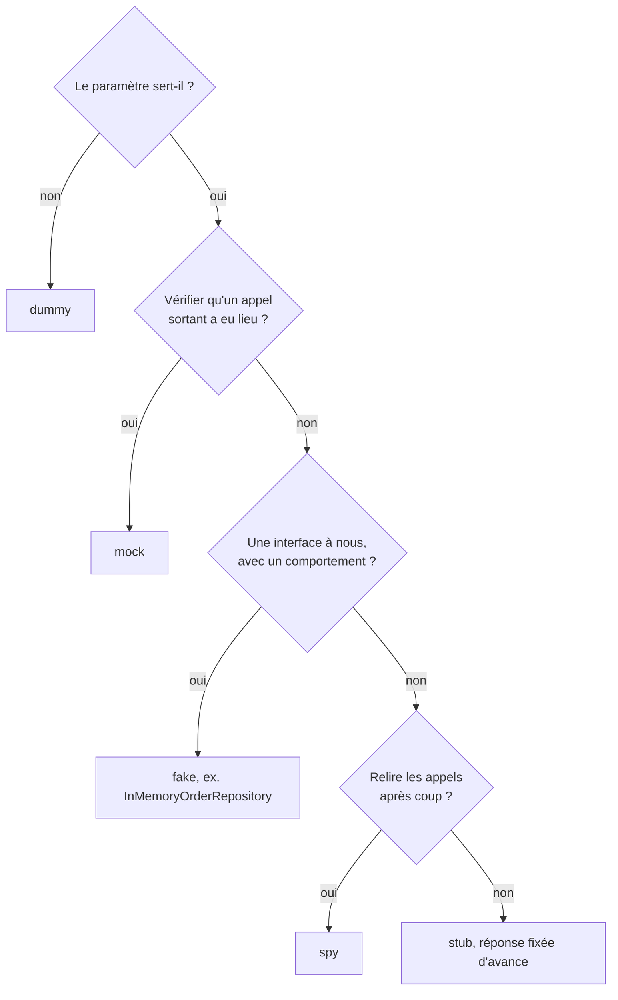

```python
# Exemple : un stub fixe la réponse, il reste vert si la vraie banque change
bank = MagicMock()
bank.get_balance.return_value = {"balance_cents": 1200}
```
Le problème de tout double, ici un stub : il répond ce que l'auteur attendait. Si la vraie banque renvoie `{"data": {"balance_cents": 1200}}`, le test reste vert et la prod casse. Voir [tests de contrat](#tests-de-contrat-et-mocks-dapi).

:material-book-open-variant: Doc de référence : [Martin Fowler, TestDouble](https://martinfowler.com/bliki/TestDouble.html) (2006) ; [Martin Fowler, Mocks Aren't Stubs](https://martinfowler.com/articles/mocksArentStubs.html) (2007)
{ .doc-ref }

### Test instable (flaky)
Un test qui passe ou échoue sans que le code change.

!!! noob "As noob"
    C'est une alarme qui sonne une nuit sur trois sans raison : au bout d'une semaine, on ne se lève plus, même le soir du vrai cambriolage. La phrase à retenir : **un test instable apprend à l'équipe à ignorer le rouge.**

```
run 1 : passed
run 2 : failed   TimeoutError: locator.click
run 3 : passed   (même commit)
```

:material-book-open-variant: Doc de référence : [Google Testing Blog, Flaky Tests at Google and How We Mitigate Them](https://testing.googleblog.com/2016/05/flaky-tests-at-google-and-how-we.html) (2016)
{ .doc-ref }

### Quality gate
Une règle automatique qui bloque une fusion si une condition n'est pas remplie.

```
Quality gate « Standard », nouveau code seulement
  nouveaux bugs         0       OK
  duplication           1,2 %   OK  (< 3 %)
  couverture            64 %    KO  (≥ 80 % requis)
résultat : MR bloquée
```

### Les familles de suites de test
Une suite, c'est un ensemble de tests qu'on lance ensemble. On les nomme selon leur but et leur durée.

| Suite               | But                                                          | Exemple                                              | Durée typique |
|---------------------|--------------------------------------------------------------|------------------------------------------------------|---------------|
| **health check**    | le service répond-il ?                                       | `GET /livez` renvoie 200                      | secondes      |
| **smoke test**      | les fonctions vitales marchent-elles, en gros ?              | la page d'accueil s'affiche, on peut se connecter, on peut ajouter au panier | quelques minutes |
| **régression**      | rien de ce qui marchait n'est cassé ?                        | les 180 tests E2E de l'application                   | de 15 min à plusieurs heures |
| **acceptance**      | la fonctionnalité fait-elle ce que le PO a demandé ?         | le scénario Gherkin « un client fermé est refusé »   | variable      |
| **performance**     | tient-il la charge ?                                         | k6 : 10 utilisateurs pendant 30 s                    | minutes       |
| **synthétique**     | la production marche-t-elle en ce moment, pour un utilisateur ? | toutes les 10 min, un robot se connecte en prod et ouvre son tableau de bord | secondes, en boucle |

« Smoke » vient de l'électronique : on branche l'appareil, et s'il ne sort pas de fumée, on peut commencer les vrais tests. Un smoke test rouge veut dire « inutile d'aller plus loin ». Il se lance juste après un <span class="term" data-term="deployment">déploiement</span> :
```
déploiement en intégration
  health check   OK     le service répond
  smoke          KO     la connexion échoue
  régression     non lancée : inutile, le parcours de base est cassé
```

### Test de performance
Un test de performance envoie du trafic simulé par des <span class="term" data-term="virtual-user">utilisateurs virtuels</span> (VU) et compare les temps de réponse à des seuils. Ci-dessous, 10 VU pendant 30 s ; le test échoue si plus de 5 % des requêtes dépassent 500 ms ou si plus de 1 % sont en erreur.

```js
import http from "k6/http";
import { check } from "k6";

// Exemple : 10 VU pendant 30 s, p95 sous 500 ms et moins de 1 % d'erreurs
export const options = {
  vus: 10,
  duration: "30s",
  thresholds: { http_req_duration: ["p(95)<500"], http_req_failed: ["rate<0.01"] },
};

// Exemple : ce que fait chaque VU, un GET puis une vérification du statut
export default function () {
  const res = http.get("https://staging.example.com/orders/42");
  check(res, { "status 200": (r) => r.status === 200 });
}
```

Sortie résumée (exemple, la mise en forme exacte dépend de la version de k6) :

```
$ k6 run orders.js
  ✓ http_req_duration..: avg=182ms med=160ms p(90)=310ms p(95)=420ms
  ✓ http_req_failed....: 0.21%  3 sur 1 412
    http_reqs..........: 1412   47/s
    vus................: 10
```
Un seuil franchi affiche `✗` et k6 sort avec un code non nul : le job de CI devient rouge. Comparatif des outils de charge dans [k6, JMeter, Locust](outils.md#k6-jmeter-locust).

:material-book-open-variant: Doc de référence : [Grafana k6, Thresholds](https://grafana.com/docs/k6/latest/using-k6/thresholds/) (consultée en novembre 2026)
{ .doc-ref }

### Tests synthétiques

<a class="pill pill-practice" href="../livraison/#tester-en-production" title="niveau 2 : elle est automatisée">Pratique · Tests en production · N2</a>
<a class="pill pill-dora" href="https://dora.dev/capabilities/monitoring-and-observability/">DORA · Monitoring and observability</a> <a class="pill pill-dora" href="https://dora.dev/capabilities/proactive-failure-notification/">DORA · Proactive failure notification</a>

Un **test synthétique** (*synthetic monitoring*) est un petit test de bout en bout qui tourne **en production, en boucle**, depuis l'extérieur, comme un faux utilisateur. Il ne vérifie pas une nouvelle version : il surveille que le service marche **maintenant**, et déclenche une <span class="term" data-term="alert-monitoring">alerte</span> sinon. « Synthétique » parce que le trafic est fabriqué, par opposition au trafic des vrais utilisateurs.

!!! noob "As noob"
    C'est un client mystère qui passe dans la boutique toutes les 10 minutes : il ne juge pas la nouvelle collection, il vérifie que la porte s'ouvre et que la caisse marche. La phrase à retenir : **le test synthétique surveille la production en continu, il ne valide pas une nouvelle version.**

```
toutes les 10 min, depuis Paris et Francfort :
  10:00  ouvrir /login, se connecter avec le compte robot, voir "Tableau de bord"   OK  4,1 s
  10:10  idem                                                                       OK  4,3 s
  10:20  idem                                                                       KO  la page de connexion ne répond plus
         alerte envoyée à l'astreinte, avant le premier ticket d'un client
```

La différence avec les autres suites :

| Question                       | Smoke / régression           | Test synthétique                      | RUM (*real user monitoring*)          |
|--------------------------------|------------------------------|---------------------------------------|---------------------------------------|
| Quand ?                        | après un déploiement, en <span class="term" data-term="ci">CI</span>  | en continu, toutes les N minutes      | en continu, à chaque visite réelle    |
| Où ?                           | intégration, staging         | production                            | production                            |
| Qui génère le trafic ?         | la CI                        | un robot, depuis plusieurs régions    | les vrais utilisateurs                |
| Sert à                         | bloquer une mauvaise version | détecter une panne, même la nuit sans trafic | mesurer ce que vivent les utilisateurs |
| Résultat                       | rouge ou vert dans la MR     | une alerte                            | des tableaux de bord                  |

Règles qui évitent les ennuis :

- **Compte dédié** : un compte robot réservé aux tests synthétiques, sans <span class="term" data-term="mfa">MFA</span>, avec ses identifiants dans un <span class="term" data-term="secret-manager">coffre à secrets</span>, jamais un compte personnel.
- **Lecture seule** si possible : un test qui crée une vraie commande en production toutes les 10 minutes pollue les données et les statistiques.
- **Peu de tests, les parcours vitaux** : connexion, page principale, paiement. Ce n'est pas une suite de régression.
- **Une seule source pour le code** : le test synthétique réutilise les mêmes <span class="term" data-term="page-object">page objects</span> et la même fonction de connexion que la suite E2E. Sinon, deux copies divergent, et celle qu'aucun <span class="term" data-term="ci-pipeline">pipeline</span> n'exécute casse en silence.

| Je veux... | J'utilise... |
|---|---|
| que l'astreinte sache que la connexion en prod est cassée avant que le premier client appelle le support, même la nuit quand personne n'utilise le site | un test synthétique, avec alerte |
| qu'une version où, par exemple, le bouton « Commander » ne marche plus n'arrive jamais jusqu'aux utilisateurs | smoke et régression en CI |
| savoir si la page met trop longtemps à s'afficher chez les vrais utilisateurs, avec leurs propres appareils | <span class="term" data-term="rum">RUM</span> |
| vérifier seulement que le service répond, sans dérouler de parcours, comme un `GET /livez` qui renvoie 200 | un health check (ou un test synthétique d'API) |

Les outils (Checkly, Datadog Synthetics) sont comparés dans [Panorama des outils techniques](outils.md#tests-synthetiques-checkly).

:material-book-open-variant: Doc de référence : [Google SRE Book, Monitoring Distributed Systems](https://sre.google/sre-book/monitoring-distributed-systems/) (2016) ; [Datadog, Synthetic Monitoring](https://docs.datadoghq.com/synthetics/) (consultée en novembre 2026)
{ .doc-ref }

### Le vocabulaire des tests

**pytest** : le framework de test le plus courant en Python. Un test est une fonction dont le nom commence par `test_`, rangée dans un fichier `test_*.py`, qui vérifie son résultat avec un simple `assert`. Ici dans `tests/test_orders.py` :
```python
# Exemple : la fonction testée
def order_total(lines):
    return sum(qty * price_cents for qty, price_cents in lines)


# Exemple : deux tests pytest, chacun une fonction test_ avec un assert
def test_total_of_two_lines():
    assert order_total([(2, 500), (1, 300)]) == 1300


def test_empty_order_costs_nothing():
    assert order_total([]) == 0
```
```
$ pytest tests/test_orders.py
============================= test session starts ==============================
collected 2 items

tests/test_orders.py ..                                                  [100%]

============================== 2 passed in 0.01s ===============================
```

**Assertion** : la ligne qui vérifie un résultat. Un test sans assertion ne vérifie rien.
```python
# Exemple : une assertion, la ligne qui vérifie le résultat
assert refund(1000, 500) == 500
```

**Fixture** : une fonction que pytest lance pour préparer ce dont un test a besoin (une base, un utilisateur, un client HTTP) et qui nettoie après. Le test la demande par le **nom de son paramètre** : pytest voit `customer` dans la signature, lance la fixture `customer`, et passe au test la valeur qu'elle `yield`. Le code après `yield` est le nettoyage, lancé même si le test échoue. `scope` dit combien de fois elle tourne : `function` (par défaut, à chaque test), `module` (une fois par fichier), `session` (une fois pour toute la suite, pour une ressource coûteuse).
```python
# Exemple : une fixture créée une fois par session, fermée à la fin
@pytest.fixture(scope="session")
def db():
    database = connect_test_database()
    yield database
    database.close()


# Exemple : une fixture par test, qui dépend de db et nettoie après
@pytest.fixture
def customer(db):
    user = db.create_user("ada")
    yield user
    db.delete_user(user.id)


# Exemple : le test reçoit les fixtures par le nom de ses paramètres
def test_new_customer_has_no_orders(db, customer):
    assert db.orders_of(customer.id) == []
```

**Harnais de test** : l'ensemble de ce qui permet de lancer les tests d'un projet : le framework, les fixtures, la config, les <span class="term" data-term="container">conteneurs</span>, la commande de lancement. « Pas encore de harnais » veut dire qu'aucun test ne peut tourner en CI pour l'instant.

**Marker (ou tag)** : une étiquette posée sur un test pour lancer un sous-ensemble.
```python
# Exemple : un marker pour lancer ce test avec pytest -m integration
@pytest.mark.integration
def test_order_is_saved(db): ...
```
```
$ pytest -m integration
$ npx playwright test --grep @smoke
```

**`@pytest.mark.parametrize`** : rejoue le même test avec plusieurs jeux de données. Chaque ligne devient un test distinct dans le rapport, et une ligne rouge n'empêche pas les autres de tourner.
```python
# Exemple : trois jeux de données, donc trois tests distincts dans le rapport
@pytest.mark.parametrize(
    ("lines", "expected"),
    [
        ([], 0),
        ([(1, 500)], 500),
        ([(2, 500), (1, 300)], 1300),
    ],
)
def test_order_total(lines, expected):
    assert order_total(lines) == expected
```
```
$ pytest -v tests/test_orders.py
tests/test_orders.py::test_order_total[lines0-0] PASSED
tests/test_orders.py::test_order_total[lines1-500] PASSED
tests/test_orders.py::test_order_total[lines2-1300] PASSED
```

**Sélecteur** : la façon dont un test E2E trouve un élément dans la page.
```typescript
// Bien : par rôle et libellé, comme un utilisateur, pas par classe CSS
page.getByRole("button", { name: "Commander" })
```
Par rôle et par libellé, comme un utilisateur, plutôt que par une classe CSS qui change au moindre restylage.

**Page Object** : une classe qui regroupe les sélecteurs et les actions d'une page, pour que les tests restent lisibles.
```typescript
// Exemple : le test appelle une action du Page Object, pas des sélecteurs
await loginPage.signIn("ada", password);
```

**Gherkin** : un format pour écrire un scénario en phrases, que des humains lisent et qu'un outil exécute. `Feature` (la fonctionnalité), `Scenario` (un cas), `Given` (le contexte), `When` (l'action), `Then` (le résultat attendu). `Scenario Outline` rejoue le même scénario avec plusieurs lignes de données (`Examples`).

**PO (Product Owner)** : la personne qui décide de ce que le produit doit faire, et donc de ce qu'un test d'acceptance doit prouver.

**Playwright Codegen** : un outil qui enregistre les clics dans un navigateur et génère le code du test. **HAR** : le fichier qui enregistre tout le trafic réseau de cette session, y compris les mots de passe et <span class="term" data-term="token-oauth">jetons</span>, d'où le nettoyage obligatoire.

:material-book-open-variant: Doc de référence : [pytest, How to use fixtures](https://docs.pytest.org/en/stable/how-to/fixtures.html) (consultée en novembre 2026) ; [Playwright, Locators](https://playwright.dev/docs/locators) (consultée en novembre 2026)
{ .doc-ref }

### Le vocabulaire des contrats

**Contrat d'API** : la description de ce qu'une API accepte et renvoie : routes, paramètres, formats, codes d'erreur.

**OpenAPI** : le format standard pour écrire ce contrat, en <span class="term" data-term="yaml">YAML</span> ou JSON. **AsyncAPI** : son équivalent pour les messages et événements.
```yaml
# Exemple : une route du contrat, paramètre requis et format de la réponse
/balance:
  get:
    parameters:
      - name: username
        required: true
    responses:
      "200":
        content:
          application/json:
            schema:
              properties:
                balance_cents: { type: integer }
```

**Dérive (drift)** : le vrai service ne correspond plus à son contrat, ou le code ne correspond plus au contrat commité.

:material-book-open-variant: Doc de référence : [OpenAPI Specification](https://spec.openapis.org/oas/latest.html) (consultée en novembre 2026) ; [AsyncAPI, Docs](https://www.asyncapi.com/docs) (consultée en novembre 2026)
{ .doc-ref }

### Le vocabulaire de la CI

**CI (intégration continue)** : à chaque push, une machine récupère le code et lance automatiquement le lint, les tests et les contrôles.

**Pipeline, stage, job** : le pipeline est l'ensemble des contrôles d'un push. Il est découpé en stages (étapes) qui contiennent des jobs (tâches).
```
pipeline #1234
├─ stage lint   : job ruff, job mypy
├─ stage test   : job unit, job integration
└─ stage e2e    : job playwright-checkout, job playwright-account
```

**Pipeline de push ou de MR** : un même commit peut déclencher un pipeline « branche » au push, et un pipeline « MR » parce qu'une MR est ouverte. Leurs règles peuvent différer.

**Artefact** : un fichier produit par un job et conservé après lui (rapport HTML, `junit.xml`, `coverage.xml`).

**<span class="term" data-term="junit-xml">JUnit XML</span>** : le format de fichier standard des résultats de tests, que GitLab, GitHub et les outils de reporting savent lire.

**Lint** : un outil qui analyse le code sans l'exécuter, pour trouver des erreurs et des écarts de style (ruff, ESLint). **Typage statique** : mypy ou TypeScript vérifient que les types sont cohérents avant l'exécution.

**Hook pre-commit** : un script lancé automatiquement à chaque `git commit`, sur le poste du développeur, pour lancer le lint avant même le push. `pre-commit` et `prek` sont deux outils qui les gèrent. Ce qu'on y met en plus du lint (secrets, SAST, code mort, règles d'architecture) est dans [Contrôles automatiques avant la fusion](livraison.md#controles-automatiques-avant-la-fusion).

**Épingler une version (pin)** : fixer la version exacte d'une <span class="term" data-term="dependency-software">dépendance</span> (`pytest==8.3.2`). **Lockfile** : le fichier qui épingle toutes les dépendances, y compris indirectes (`uv.lock`, `yarn.lock`), pour que tout le monde installe exactement les mêmes.

**`allow_failure`** : une option de GitLab CI qui laisse le pipeline vert même si ce job échoue.

**Shard** : un morceau d'une suite découpée pour tourner sur plusieurs machines en parallèle. `shard 2/4` = le 2e quart des tests.

**Sidecar** : un conteneur lancé à côté du job de CI (une base Postgres, un Redis), que les tests utilisent comme un vrai service.

**Docker-in-Docker (DinD)** : lancer <span class="term" data-term="docker">Docker</span> à l'intérieur d'un job de CI qui tourne lui-même dans un conteneur. Souvent interdit ou lent, d'où les sidecars.

**SAST** : un outil d'analyse de sécurité du code source, qui cherche des failles (injection SQL, secret en dur) sans exécuter le code.

**Déploiement canary** : la nouvelle version reçoit d'abord une petite part du trafic réel (5 %), et on compare ses indicateurs à ceux de l'ancienne avant d'élargir. **Déploiement blue-green** : deux environnements de production complets ; le nouveau (green) est testé sans utilisateurs, puis on bascule tout le trafic d'un coup. Les tests propres à chacun sont dans [Tester un déploiement canary](#tester-un-deploiement-canary) et [Tester un déploiement blue-green](#tester-un-deploiement-blue-green).

:material-book-open-variant: Doc de référence : [GitLab, CI/CD](https://docs.gitlab.com/ci/) (consultée en novembre 2026) ; [Martin Fowler, Continuous Integration](https://martinfowler.com/articles/continuousIntegration.html) (2024)
{ .doc-ref }

### Le vocabulaire de la mesure

**Nouveau code** : les lignes ajoutées ou modifiées par la MR, par opposition au code qui existait déjà.

**Dette technique** : les défauts de conception déjà présents dans le code, qui ralentissent les évolutions futures.

**Duplication** : la part du code copiée-collée à l'identique ailleurs dans le projet.

**Taux de réussite** : la part des tests passés parmi les tests réellement lancés : `passed / (total - skipped)`.

**p95** : 95 % des valeurs sont en dessous. Un temps de réponse p95 de 500 ms veut dire que 95 requêtes sur 100 répondent en moins de 500 ms.

**SLO (Service Level Objective)** : un objectif chiffré sur une fenêtre de temps, par exemple « 97 % de réussite sur 30 jours ».

**Mutation testing** : un outil modifie volontairement le code (il remplace `<=` par `<`, `+` par `-`...) puis relance les tests. Si aucun test n'échoue, c'est qu'aucun test ne vérifie cette ligne, même si elle est couverte.

**Quarantaine** : mettre un test instable de côté : il tourne toujours, mais ne bloque plus le pipeline, en attendant d'être réparé.

:material-book-open-variant: Doc de référence : [Google SRE Book, Service Level Objectives](https://sre.google/sre-book/service-level-objectives/) (2016) ; [Stryker Mutator](https://stryker-mutator.io/) (consultée en novembre 2026)
{ .doc-ref }

### Le vocabulaire de l'authentification dans les tests

**2FA (double authentification)** : en plus du mot de passe, un deuxième facteur. **TOTP** : un code à 6 chiffres qui change toutes les 30 secondes (application d'authentification). Si plusieurs tests parallèles partagent un compte 2FA, ils se gênent : le <span class="term" data-term="identity-provider">fournisseur d'identité</span> refuse les tentatives trop rapprochées.

**Fournisseur d'identité (IdP)** : le service qui gère les connexions (Okta, Auth0, Keycloak...).

**Jeton (token)** : la preuve de connexion envoyée à chaque appel d'API. Un test peut se connecter par API pour obtenir un jeton, sans passer par l'écran de connexion.

:material-book-open-variant: Doc de référence : [RFC 6238, TOTP](https://datatracker.ietf.org/doc/html/rfc6238) (2011)
{ .doc-ref }

## Les modèles de référence

<a class="pill pill-scope pill-scope-code" href="../architecture/#carte-des-echelles">Échelle · Code</a> <a class="pill pill-scope pill-scope-app" href="../architecture/#carte-des-echelles">Échelle · Application</a> <a class="pill pill-scope pill-scope-system" href="../architecture/#carte-des-echelles">Échelle · Système</a>

Quelques images reviennent dans toutes les discussions sur la qualité. Elles ne disent pas quel test écrire demain matin, mais elles donnent un vocabulaire commun pour répondre à quatre questions : quelle **forme** donner à la suite de tests, **quels types** de tests ne pas oublier, **quand** tester, et ce qu'on entend par **« qualité »**.

### Pyramide, trophée, nid d'abeille : la forme d'une suite

<span class="pill pill-status pill-status-ok" title="Toujours valable, vérifié en novembre 2026">Valable · 11/2026</span>

Les trois modèles répondent à la même question : **combien de tests de chaque niveau** ? Ils diffèrent sur l'étage qui porte la plus grande part.

- **<span class="term" data-term="test-pyramid">Pyramide des tests</span>** (Mike Cohn, « Succeeding with Agile », 2009) : une large base de tests unitaires, moins de tests d'intégration, très peu de tests de bout en bout. L'idée : plus un test est haut, plus il est lent, fragile et cher à diagnostiquer.
- **<span class="term" data-term="testing-trophy">Trophée des tests</span>** (Kent C. Dodds, 2018) : l'<span class="term" data-term="static-analysis">analyse statique</span> (typage, lint) sert de socle, et la plus grande part va aux tests d'intégration. Le slogan d'origine : « Write tests. Not too many. Mostly integration. » Pensé pour le front-end.
- **<span class="term" data-term="test-honeycomb">Nid d'abeille</span>** (André Schaffer, blog d'ingénierie de Spotify, « Testing of Microservices », 2018) : pour un <span class="term" data-term="microservice">microservice</span>, la plus grande part va aux tests d'intégration du service avec ses vraies dépendances. Peu de tests de détail d'implémentation en bas, peu de tests qui dépendent d'autres services déployés en haut.
- **<span class="term" data-term="ice-cream-cone">Cornet de glace</span>** (Alister Scott, « Testing Pyramids & Ice-Cream Cones », 2012, à vérifier) : l'anti-modèle, la pyramide à l'envers. Beaucoup de tests manuels et d'E2E, peu de tests unitaires. Ce n'est pas une cible, c'est un diagnostic.

!!! noob "As noob"
    Je pense à la construction d'une maison : beaucoup de contrôles rapides sur chaque brique (unitaires), moins sur les murs assemblés (intégration), et quelques visites complètes de la maison finie (bout en bout), longues et coûteuses. Les modèles se disputent surtout sur l'étage où mettre le plus d'effort. La phrase à retenir : **tester au plus bas ce qui peut l'être, et garder les tests de bout en bout pour les parcours qui comptent.**

La part de chaque étage, schématiquement :

<div class="diagram-grid">
<figure><svg viewBox="0 0 140 140" role="img" aria-label="Pyramide (Mike Cohn, 2009)"><polygon class="layer layer-3" points="70,10 90,50 50,50"/><polygon class="layer layer-2" points="50,50 90,50 110,90 30,90"/><polygon class="layer layer-1" points="30,90 110,90 130,130 10,130"/><text x="70" y="43" text-anchor="middle">E2E</text><text x="70" y="74" text-anchor="middle">intégration</text><text x="70" y="114" text-anchor="middle">unitaire</text></svg><figcaption>Pyramide (Mike Cohn, 2009)</figcaption></figure>
<figure><svg viewBox="0 0 140 140" role="img" aria-label="Trophée (Kent C. Dodds, 2018)"><polygon class="layer layer-1" points="45,10 95,10 95,30 45,30"/><polygon class="layer layer-3" points="20,30 120,30 110,80 30,80"/><polygon class="layer layer-2" points="45,80 95,80 90,105 50,105"/><polygon class="layer layer-2" points="25,110 115,110 115,130 25,130"/><text x="70" y="23" text-anchor="middle">E2E</text><text x="70" y="58" text-anchor="middle">intégration</text><text x="70" y="96" text-anchor="middle">unitaire</text><text x="70" y="123" text-anchor="middle">statique</text></svg><figcaption>Trophée (Kent C. Dodds, 2018)</figcaption></figure>
<figure><svg viewBox="0 0 140 140" role="img" aria-label="Nid d'abeille (Spotify, 2018)"><polygon class="layer layer-1" points="35,10 105,10 115.4,35 24.6,35"/><polygon class="layer layer-3" points="24.6,35 115.4,35 130,70 115.4,105 24.6,105 10,70"/><polygon class="layer layer-1" points="24.6,105 115.4,105 105,130 35,130"/><text x="70" y="26" text-anchor="middle">intégré</text><text x="70" y="73" text-anchor="middle">intégration</text><text x="70" y="121" text-anchor="middle">implémentation</text></svg><figcaption>Nid d'abeille (Spotify, 2018)</figcaption></figure>
<figure><svg viewBox="0 0 140 140" role="img" aria-label="Cornet de glace (anti-modèle)"><circle class="layer layer-3" cx="70" cy="28" r="22"/><polygon class="layer layer-2" points="30,50 110,50 95.9,80 44.1,80"/><polygon class="layer layer-1" points="44.1,80 95.9,80 84.1,105 55.9,105"/><polygon class="layer layer-1" points="55.9,105 84.1,105 70,135"/><text x="70" y="31" text-anchor="middle">manuel</text><text x="70" y="69" text-anchor="middle">E2E</text><text x="70" y="96" text-anchor="middle">intégration</text><text x="88" y="124" text-anchor="start">unitaire</text></svg><figcaption>Cornet de glace (anti-modèle)</figcaption></figure>
</div>

:material-book-open-variant: Doc de référence : [Martin Fowler, « TestPyramid »](https://martinfowler.com/bliki/TestPyramid.html) (2012) ; [Kent C. Dodds, « The Testing Trophy and Testing Classifications »](https://kentcdodds.com/blog/the-testing-trophy-and-testing-classifications) (2021) ; [Spotify Engineering, « Testing of Microservices »](https://engineering.atspotify.com/2018/01/testing-of-microservices) (2018)
{ .doc-ref }


Deux suites réelles, avec des chiffres d'exemple :

```
orders-service (API, peu de logique,       checkout-front (React)
beaucoup d'appels base et HTTP)
  E2E             :  10                      E2E                  :   8
  intégration     : 180                      composants intégrés  : 240
  unitaire        :  60                      unitaire             :  40
                                             statique             : TypeScript strict + ESLint
  forme : nid d'abeille                      forme : trophée
```

Ce qui compte plus que la forme : Martin Fowler (« On the Diverse And Fantastical Shapes of Testing », 2021) rappelle que ces images divergent surtout parce que chacun met une définition différente derrière « unitaire » et « intégration ». Un test unitaire qui utilise ses vrais collaborateurs ressemble beaucoup à un petit test d'intégration. La forme est un symptôme : le vrai objectif reste des tests rapides, fiables, qui échouent pour une seule raison lisible. C'est le sens de [la règle](#la-regle) de la section suivante.

| Contexte | Forme qui convient | Pourquoi |
|---|---|---|
| j'écris une bibliothèque ou un moteur de calcul, où l'essentiel tient dans des règles métier, comme le calcul des remises d'un panier | pyramide | la logique est dans le code pur, un test unitaire la prouve vite et précisément |
| je travaille sur un front-end, comme `checkout-front` en React | trophée | le typage attrape les fautes de frappe, la confiance vient des composants testés ensemble |
| mon microservice a peu de logique mais parle beaucoup à l'extérieur (base, HTTP, file de messages), comme `orders-service` | nid d'abeille | les bugs sont aux frontières : base, HTTP, file de messages |
| ma suite repose surtout sur des tests manuels ou des E2E, elle est lente et casse sans raison claire | cornet : à redresser | descendre chaque vérification au niveau le plus bas qui la prouve |

**Comment l'appliquer.** Compter les tests par niveau (un dossier ou un marker par niveau suffit), dessiner la forme actuelle, la comparer à la forme qui convient au contexte, puis descendre d'un niveau chaque vérification qui peut l'être. À refaire quand la suite devient lente ou instable, ou quand un nouveau service démarre.

### Les quadrants du test agile : ne pas oublier un type de test

<span class="pill pill-status pill-status-ok" title="Toujours valable, vérifié en novembre 2026">Valable · 11/2026</span>

Les **<span class="term" data-term="agile-testing-quadrants">quadrants du test agile</span>** (Brian Marick, 2003, repris par Lisa Crispin et Janet Gregory dans « Agile Testing », 2009) classent les tests selon deux axes :

- **orienté métier** ou **orienté technique** : qui sait dire si le résultat est bon, le métier ou l'équipe technique ?
- **guide l'équipe** ou **critique le produit** : le test aide-t-il à construire, ou cherche-t-il ce qui ne va pas dans ce qui est construit ?

!!! noob "As noob"
    C'est une liste de courses rangée par rayon : elle ne dit pas quoi cuisiner, elle évite d'oublier un rayon entier. La phrase à retenir : **les quadrants servent à repérer le type de test oublié, pas à fixer un ordre.**

```
                      orienté métier
                            │
   Q2 : tests fonctionnels, │ Q3 : tests exploratoires,
   exemples, scénarios      │ tests d'utilisabilité,
   Gherkin, prototypes      │ recette utilisateur
   (auto et manuel)         │ (surtout manuel)
guide ──────────────────────┼────────────────────── critique
l'équipe                    │                       le produit
   Q1 : tests unitaires,    │ Q4 : performance, charge,
   tests de composants      │ sécurité, résilience
   (automatisés)            │ (outils dédiés)
                            │
                     orienté technique
```

La numérotation n'est pas un ordre : les quatre quadrants se font en parallèle. Leur usage le plus utile est un contrôle de plan de test : si une fonctionnalité n'a rien en Q3 et Q4, on n'a cherché ni ce que le métier n'a pas imaginé (<span class="term" data-term="exploratory-testing">test exploratoire</span>), ni ce qui casse sous la charge ou face à un attaquant.

**Quand et comment.** En affinage d'une story ou au début d'une fonctionnalité : poser la grille et écrire au moins une ligne par quadrant, même « rien, parce que... ». Une case vide assumée est une décision ; une case vide oubliée est un trou.

:material-book-open-variant: Doc de référence : [Lisa Crispin, Using the Agile Testing Quadrants](https://lisacrispin.com/2011/11/08/using-the-agile-testing-quadrants/) (2011)
{ .doc-ref }

### Shift-left et shift-right : quand tester

<span class="pill pill-status pill-status-ok" title="Toujours valable, vérifié en novembre 2026">Valable · 11/2026</span>

```
besoin ── conception ── code ── MR ── recette ── production ── usage réel
<────── shift-left ──────────────┤               ├──────── shift-right ──────>
```

- **<span class="term" data-term="shift-left">Shift-left</span>** (terme popularisé par Larry Smith, Dr. Dobb's Journal, 2001) : vérifier plus tôt, là où un défaut coûte moins cher. Exemples : poser les questions de test pendant le cadrage (three amigos), écrire les exemples Gherkin avant le code, livrer les tests dans la même MR, faire tourner les hooks en local.
- **<span class="term" data-term="shift-right">Shift-right</span>** : continuer à vérifier en production, là où se trouvent les vrais usages et les vraies données. Exemples : [tests synthétiques](#tests-synthetiques), [déploiement canary](#tester-un-deploiement-canary), feature flags, alertes sur le taux d'erreur.

Les deux ne s'opposent pas : le shift-left réduit le nombre de défauts qui arrivent en production, le shift-right réduit le temps pendant lequel ceux qui passent restent invisibles.

!!! noob "As noob"
    Pour une voiture, le shift-left, c'est vérifier les plans et chaque pièce à l'usine ; le shift-right, c'est le voyant du tableau de bord qui s'allume une fois sur la route. La phrase à retenir : **tester tôt évite des défauts, surveiller en production raccourcit la vie de ceux qui passent quand même.**

### Les sept principes du test (ISTQB)

<span class="pill pill-status pill-status-ok" title="Toujours valable, vérifié en novembre 2026">Valable · 11/2026</span>

Le syllabus ISTQB Foundation (version 4.0, 2023) résume le métier en sept principes. Chacun répond à une idée reçue.

| Principe                                         | Ce qu'il veut dire, avec un exemple                                                        |
|--------------------------------------------------|--------------------------------------------------------------------------------------------|
| le test montre la présence de défauts, pas leur absence | 500 tests verts prouvent que ces 500 cas marchent, pas qu'il n'y a plus de bug       |
| le test exhaustif est impossible                  | un champ de 10 caractères a des milliards de valeurs : on choisit par partitions et valeurs limites |
| tester tôt fait gagner du temps et de l'argent    | une ambiguïté levée en cadrage coûte une question, la même en production coûte un incident |
| les défauts se regroupent                         | si 80 % des bugs de l'an dernier sont dans le module de facturation, on y teste davantage |
| les tests s'usent (paradoxe du pesticide)         | une suite qui ne change jamais ne trouve plus rien : il faut ajouter des cas et explorer |
| le test dépend du contexte                        | une application médicale et un site vitrine ne se testent pas avec la même rigueur      |
| l'absence de défaut ne suffit pas                 | un logiciel sans bug qui ne répond pas au besoin reste un échec                          |

**Quand s'en servir.** Pour argumenter, pas pour réciter : « on ne peut pas tout tester » (principe 2) justifie une sélection par les risques ; « les tests s'usent » (principe 5) justifie de réserver du temps au test exploratoire ; « les défauts se regroupent » (principe 4) justifie de concentrer l'effort sur les modules qui ont déjà le plus d'incidents.

:material-book-open-variant: Doc de référence : [ISTQB, Certified Tester Foundation Level v4.0](https://www.istqb.org/certifications/certified-tester-foundation-level-ctfl-v4-0/) (2023)
{ .doc-ref }

### Ce qu'on appelle « qualité » : ISO/IEC 25010

<span class="pill pill-status pill-status-ok" title="Toujours valable, vérifié en novembre 2026">Valable · 11/2026</span>

La norme **<span class="term" data-term="iso-25010">ISO/IEC 25010</span>** (première édition en 2011, révisée en 2023, à vérifier) découpe la qualité d'un produit logiciel en caractéristiques. Elle sert de liste de contrôle : une stratégie de test qui ne parle que de fonctionnel en oublie huit sur neuf. Noms de l'édition 2023 :

| Caractéristique                                     | Question                                          | Exemple de vérification                         |
|-----------------------------------------------------|---------------------------------------------------|-------------------------------------------------|
| adéquation fonctionnelle                            | fait-il ce qui est demandé, correctement ?        | tests unitaires, intégration, E2E               |
| efficacité de performance                           | tient-il la charge, avec quelles ressources ?     | k6 : p95 < 500 ms à 50 utilisateurs             |
| compatibilité                                       | cohabite-t-il et échange-t-il avec les autres ?   | test de contrat avec le partenaire              |
| capacité d'interaction (ex « utilisabilité »)       | peut-on s'en servir, y compris avec un handicap ? | audit d'accessibilité, test utilisateur         |
| fiabilité                                           | reste-t-il disponible, se relève-t-il ?           | test de bascule, SLO de disponibilité           |
| sécurité                                            | protège-t-il les données et les accès ?           | tests d'autorisation, scan de dépendances       |
| maintenabilité                                      | peut-on le modifier sans casser ?                 | quality gate, complexité, couverture du nouveau code |
| flexibilité (ex « portabilité »)                    | s'adapte-t-il à un autre environnement, à la croissance ? | même image Docker en local, en CI et en production |
| sûreté (ajoutée en 2023)                            | évite-t-il de mettre des personnes en danger ?    | arrêt sûr d'un automate sur une valeur aberrante |

**Quand et comment.** Au lancement d'un projet ou d'une stratégie de test : passer les neuf lignes avec le PO, en garder trois ou quatre prioritaires, et pour chacune écrire une exigence mesurable (« p95 < 500 ms à 50 utilisateurs ») et le test qui la vérifie. Les autres lignes sont écartées explicitement, avec la raison.

:material-book-open-variant: Doc de référence : [ISO 25000 portal, ISO/IEC 25010](https://iso25000.com/index.php/en/iso-25000-standards/iso-25010) (consultée en novembre 2026)
{ .doc-ref }

### Quel modèle pour quelle question

| Question | Modèle |
|---|---|
| mon équipe se demande combien de tests écrire à chaque niveau, par exemple au démarrage d'un nouveau service | pyramide, trophée ou nid d'abeille selon le contexte |
| ma suite est lente, elle casse sans raison claire, et je veux comprendre pourquoi | chercher le cornet de glace |
| je relis un plan de test et je veux savoir s'il manque tout un type de test, comme la charge ou la sécurité | quadrants du test agile |
| j'hésite à mettre l'effort avant la livraison (exemples écrits avant le code, tests dans la MR) ou après (surveillance en production) | shift-left et shift-right |
| on me demande pourquoi l'équipe ne teste pas tout, ou pourquoi une suite qui ne change plus ne trouve plus aucun bug | sept principes ISTQB |
| mon équipe dit « qualité » mais ne parle que de fonctionnel, et je veux lister le reste, comme la performance, la sécurité ou l'accessibilité | ISO/IEC 25010 |

Sources :

- [Mike Cohn, « Succeeding with Agile » (2009)](https://www.mountaingoatsoftware.com/books/succeeding-with-agile-software-development-using-scrum)
- [Martin Fowler, « TestPyramid » (2012)](https://martinfowler.com/bliki/TestPyramid.html)
- [Ham Vocke, « The Practical Test Pyramid » (2018)](https://martinfowler.com/articles/practical-test-pyramid.html)
- [Kent C. Dodds, « The Testing Trophy and Testing Classifications » (2021, le trophée date de 2018)](https://kentcdodds.com/blog/the-testing-trophy-and-testing-classifications)
- [André Schaffer, « Testing of Microservices », Spotify Engineering (2018)](https://engineering.atspotify.com/2018/01/testing-of-microservices)
- [Martin Fowler, « On the Diverse And Fantastical Shapes of Testing » (2021)](https://martinfowler.com/articles/2021-test-shapes.html)
- [Brian Marick, « Agile testing directions: tests and examples » (2003, lien à vérifier)](http://www.exampler.com/old-blog/2003/08/22/)
- [ISTQB, syllabus Certified Tester Foundation Level v4.0 (2023)](https://www.istqb.org/certifications/certified-tester-foundation-level-ctfl-v4-0/)
- [ISO/IEC 25010:2023, « Product quality model » (2023)](https://www.iso.org/standard/78176.html)

## Choisir le bon niveau de test

<a class="pill pill-scope pill-scope-code" href="../architecture/#carte-des-echelles">Échelle · Code</a> <a class="pill pill-scope pill-scope-app" href="../architecture/#carte-des-echelles">Échelle · Application</a>

### La règle

<span class="pill pill-status pill-status-ok" title="Toujours valable, vérifié en novembre 2026">Valable · 11/2026</span>

Je teste une API. Si une vraie requête peut prouver un comportement, je le teste avec une requête, contre de vrais voisins (la vraie base, le vrai serveur HTTP). Je garde les tests unitaires pour les règles métier pures et pour ce qu'aucun appel ne peut montrer. Je ne mets pas de double à travers une frontière (HTTP, base, file de messages) : le double répond ce que j'attends, pas ce que fait le vrai voisin, donc le bug passe.

Pourquoi, avec deux bugs réels :
- un test de stream <span class="term" data-term="mock">mocké</span> fabriquait un dernier lot que le vrai stream ne produit jamais. Un catalogue partiel était annoncé complet, et le test était vert ;
- un <span class="term" data-term="test-harness">harnais</span> d'intégration qui contournait l'authentification cachait une réponse `403` qui perdait son <span class="term" data-term="http-header">en-tête</span> `WWW-Authenticate`.

### La question à se poser
Pour chaque test unitaire d'une API : **une requête pourrait-elle le prouver ?** Si oui, c'est un test d'intégration qu'il faut.

| Ce que je veux prouver                               | Niveau                        |
|------------------------------------------------------|-------------------------------|
| la politique de mot de passe refuse « abc »          | unitaire                      |
| le calcul d'un percentile                            | unitaire                      |
| la route `/orders` renvoie 401 sans jeton            | intégration (requête réelle)  |
| un jeton expiré, de mauvaise <span class="term" data-term="token-audience">audience</span> ou au `kid` inconnu est refusé | intégration, avec un vrai émetteur qui signe |
| la commande est bien écrite en base                  | intégration (vrai Postgres)   |
| le client tient le retry sur un 503 que le vrai partenaire ne sait pas renvoyer | exception : socket scripté, documenté sur place |
| un client commande et voit « payé »                  | E2E                           |

Contrôle rapide sur une couche API :
```
$ grep -rn "unittest.mock" tests/
```
Le résultat devrait être vide.

### Organiser les tests
Deux markers suffisent, et le nom du fichier dit quel voisin est utilisé :
```
tests/
├─ unit/
│  └─ test_password_policy.py
└─ integration/
   ├─ conftest.py               (toutes les fixtures de conteneurs ici)
   ├─ test_orders_mysql.py
   ├─ test_reports_gcs.py
   └─ test_bank_contract.py
```

:material-book-open-variant: Doc de référence : [Martin Fowler, UnitTest](https://martinfowler.com/bliki/UnitTest.html) (2014) ; [Martin Fowler, IntegrationTest](https://martinfowler.com/bliki/IntegrationTest.html) (2018)
{ .doc-ref }

## Tests d'intégration avec Testcontainers

<a class="pill pill-scope pill-scope-app" href="../architecture/#carte-des-echelles">Échelle · Application</a> <a class="pill pill-scope pill-scope-system" href="../architecture/#carte-des-echelles">Échelle · Système</a> <span class="pill pill-status pill-status-ok" title="Toujours valable, vérifié en novembre 2026">Valable · 11/2026</span>

<a class="pill pill-practice" href="../livraison/#tests-fonctionnels-automatises" title="niveau 2 : elle est automatisée">Pratique · Tests fonctionnels · N2</a>
<a class="pill pill-dora" href="https://dora.dev/capabilities/test-automation/">DORA · Test automation</a> <a class="pill pill-dora" href="https://dora.dev/capabilities/test-data-management/">DORA · Test data management</a>


*Testcontainers : complémentaire de pytest*
{ .tool-rel }

### Le principe
Mon test a besoin d'une vraie base ou d'un vrai broker, comme Postgres, Redis ou RabbitMQ. Le test démarre lui-même un vrai <span class="term" data-term="container">conteneur</span> jetable, une fois par session : personne n'a à lancer `docker compose up` avant. Si <span class="term" data-term="docker">Docker</span> n'est pas là, le test est ignoré avec la raison, il n'échoue pas.

!!! noob "As noob"
    C'est un labo où chaque séance de travail reçoit des éprouvettes neuves, jetées à la fin : pas de restes de la séance précédente, et pas de paillasse à préparer à la main avant. La phrase à retenir : **le test démarre lui-même de vraies dépendances, et les jette à la fin.**

Pourquoi : avant, il fallait démarrer le broker à la main, et une sonde « est-il joignable ? » échouait au hasard, donc des tests rouges sans vrai bug. Avec <span class="term" data-term="testcontainers">Testcontainers</span>, le même test tourne sur le poste et en <span class="term" data-term="ci">CI</span>, sans checklist.

### L'exemple
```python
# Bien : un conteneur Redis jetable par session, ignoré si Docker manque
@pytest.fixture(scope="session")
def redis_url() -> Iterator[str]:
    require_docker()
    with RedisContainer("redis:7") as redis:
        host = redis.get_container_host_ip()
        port = redis.get_exposed_port(6379)
        yield f"redis://{host}:{port}/0"
```

Les 4 gestes :
1. démarrer le conteneur (`with RedisContainer(...)`) ;
2. demander le port choisi par Docker (`get_exposed_port(6379)`), jamais le port par défaut ;
3. `yield` les infos de connexion au test ;
4. la sortie du `with` supprime le conteneur.

*Docker : complémentaire de Kubernetes, Helm*
{ .tool-rel }


Le cycle de vie, pour toute la session :

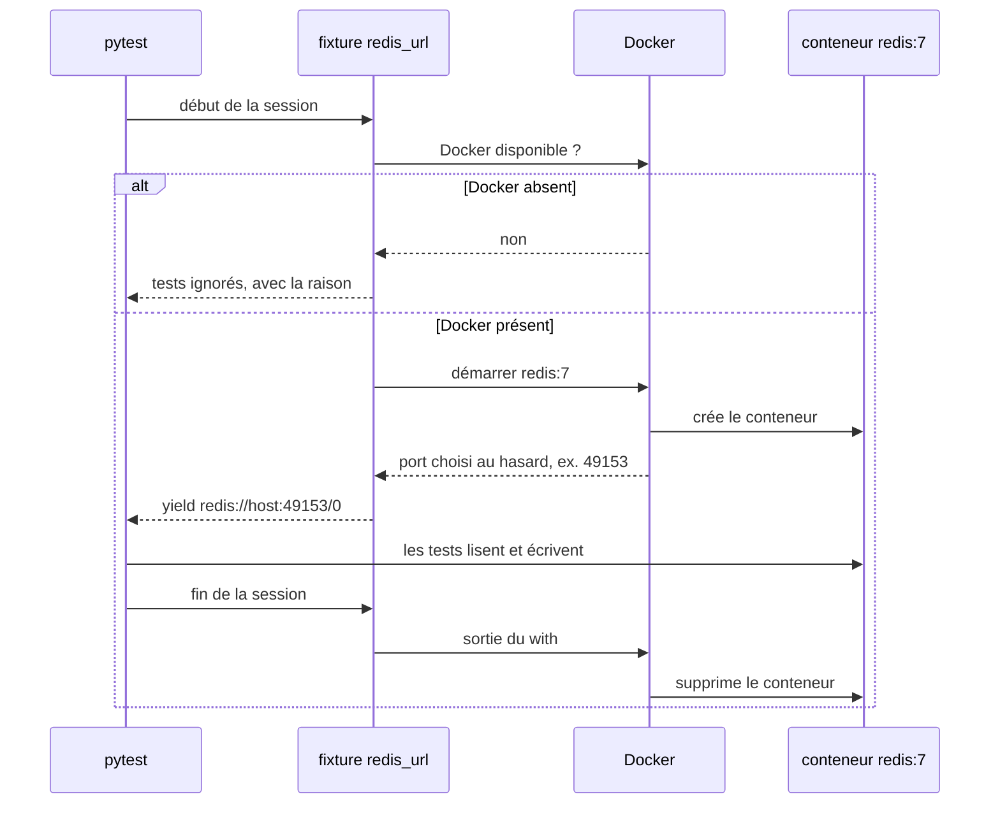

Bonnes pratiques :
- préfixer les ressources de test (`test_` pour les queues, schémas, buckets), pour éviter les collisions sur une instance partagée ;
- un test écrit **ses propres** données, ou restaure ce qu'il a changé ;
- en CI sans Docker-in-Docker : des services <span class="term" data-term="sidecar">sidecar</span>, et le même code de test pointé dessus par une variable (`INTEGRATION_EXTERNAL_SERVICES=true`).

### Tester un test
Un test vert ne prouve rien tant qu'on ne l'a pas vu rouge pour la bonne raison. 5 contrôles, dans l'ordre :

| Contrôle                                         | Résultat attendu                                         |
|--------------------------------------------------|----------------------------------------------------------|
| 1. arrêter Docker et lancer la suite             | tout est ignoré avec « Docker unavailable », rien n'échoue |
| 2. lancer deux fois de suite sans nettoyer       | toujours vert, sinon un test ne restaure pas ses données |
| 3. casser le code (retirer un `INCR`)            | le test devient rouge, l'<span class="term" data-term="assertion">assertion</span> nomme la différence   |
| 4. casser le voisin (mauvais tag d'image)        | l'échec dit quel voisin et pourquoi, pas un timeout muet |
| 5. `docker ps` pendant puis après la suite       | conteneurs sur ports aléatoires, tous disparus à la fin  |

:material-book-open-variant: Doc de référence : [Testcontainers, Getting started](https://testcontainers.com/getting-started/) (consultée en novembre 2026) ; [testcontainers-python](https://testcontainers-python.readthedocs.io/) (consultée en novembre 2026)
{ .doc-ref }

## Tests de contrat et mocks d'API

<a class="pill pill-scope pill-scope-system" href="../architecture/#carte-des-echelles">Échelle · Système</a>

<a class="pill pill-practice" href="../livraison/#tests-fonctionnels-automatises" title="niveau 2 : elle est automatisée">Pratique · Tests fonctionnels · N2</a> <a class="pill pill-practice" href="../api-rest-async/#api-management" title="niveau 3 : elle décide sans humain">Pratique · API management · N3</a>
<a class="pill pill-dora" href="https://dora.dev/capabilities/test-automation/">DORA · Test automation</a> <a class="pill pill-dora" href="https://dora.dev/capabilities/loosely-coupled-teams/">DORA · Loosely coupled teams</a>

### Le test de contrat

<span class="pill pill-status pill-status-ok" title="Toujours valable, vérifié en novembre 2026">Valable · 11/2026</span>

Un <span class="term" data-term="contract-test">test de contrat</span> vérifie que deux services sont d'accord sur la forme de leurs échanges : le fournisseur renvoie bien ce que son contrat promet, et le consommateur n'attend rien de plus. Il ne teste pas la logique métier, seulement les champs, les types et les codes de statut.

!!! noob "As noob"
    C'est la norme d'une prise électrique : le fabricant de la prise et celui de l'appareil ne se parlent pas, mais chacun vérifie son produit contre la même norme. Le test de contrat vérifie la forme de la prise, pas ce que fait l'appareil. La phrase à retenir : **le contrat attrape le partenaire qui change de format, là où un stub écrit à la main reste vert.**

```
contrat    : balance_cents: { type: integer }

AVANT  bank-partner : 200 {"data": {"balance_cents": 1200}}
       contrôle     : OK
APRÈS  bank-partner : 200 {"data": {"balance_cents": "1200"}}
       contrôle     : KO  '1200' is not of type 'integer'
```
Avec un stub écrit à la main, le même changement laisse le test vert : le stub renvoie toujours l'entier `1200`.

Variante **pilotée par le consommateur** (*consumer-driven contract*, outil Pact) : le consommateur écrit le contrat à partir de ses propres tests, et le fournisseur le rejoue contre son vrai code avant de livrer.

*Pact : complémentaire de Microcks, Prism*
{ .tool-rel }


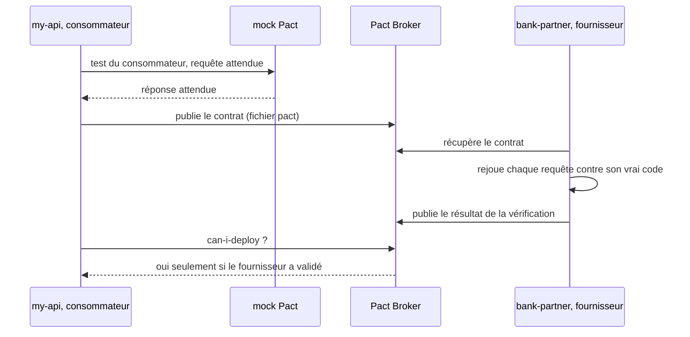

:material-book-open-variant: Doc de référence : [Martin Fowler, ContractTest](https://martinfowler.com/bliki/ContractTest.html) (2011) ; [Pact Docs](https://docs.pact.io/) (consultée en novembre 2026)
{ .doc-ref }

### Le problème des mocks écrits à la main
- **Les <span class="term" data-term="mock">mocks</span> mentent** : j'écris moi-même ce que l'API d'en face répond, et rien ne vérifie que ça colle au vrai <span class="term" data-term="api-contract">contrat</span>. L'API d'en face change, par exemple un entier devient du texte, mes tests restent verts, et la prod casse.
- **Double indirection** : un service mocke un client qui mocke lui-même HTTP. Chaque couche ajoute une supposition, donc la confiance baisse à chaque couche.
- **Les E2E sur un environnement partagé** tombent dès que cet environnement est indisponible. Et ils ne savent pas produire à la demande un 500, un timeout ou une donnée partielle, donc ces cas ne sont jamais testés.

### Mock piloté par contrat

<span class="pill pill-status pill-status-ok" title="Toujours valable, vérifié en novembre 2026">Valable · 11/2026</span>

Je veux tester mon service contre un partenaire sans écrire ses réponses à la main. Un outil lit le contrat <span class="term" data-term="openapi">OpenAPI</span> du service d'en face et sert des réponses conformes. Mon test fait de vrais appels HTTP, comme s'il parlait au vrai partenaire.

| Outil        | Ce qu'il fait                                                           | Quand l'utiliser                         |
|--------------|-------------------------------------------------------------------------|------------------------------------------|
| Microcks     | sert les exemples du contrat, choisit la réponse selon la requête       | tests d'intégration, scénarios d'erreur  |
| Prism        | sert un mock sur un port et **valide** chaque requête (paramètres, body, sécurité) | dev local, démo, front qui attend le back |
| <span class="term" data-term="schemathesis">schemathesis</span> | génère des requêtes à partir du contrat et vérifie les réponses         | contre le vrai service, pour détecter une <span class="term" data-term="contract-drift">dérive</span> |

Le même contrat sert deux fois : il alimente le mock, et il sert à interroger le vrai partenaire.

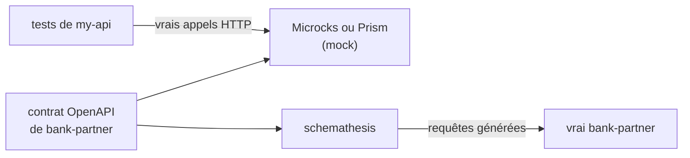

Exemple avec Prism :
```
$ prism mock bank-partner.openapi.yaml

$ curl -s -H 'X-Api-Key: any' 'localhost:4010/balance?username=ada'
200 {"data": {"balance_cents": 1200}}

$ curl -s 'localhost:4010/balance?username=ada'
401   (clé manquante)

$ curl -s -H 'X-Api-Key: any' 'localhost:4010/balance'
422   (username manquant)
```
Limite : Prism renvoie le même exemple pour `ada` et `grace`. Pour des réponses par client, Microcks.

*Microcks : concurrent de Prism ; complémentaire de Pact*<br>
*Prism : concurrent de Microcks ; complémentaire de Pact*
{ .tool-rel }


Scénarios d'erreur typiques à couvrir avec Microcks :
```
bank-partner renvoie 500       my-api répond 502 avec une erreur explicite
bank-partner renvoie 404       my-api répond « client inconnu », proprement
métadonnées partielles         my-api applique les valeurs par défaut prévues
```

:material-book-open-variant: Doc de référence : [Microcks, Documentation](https://microcks.io/documentation/) (consultée en novembre 2026) ; [Stoplight Prism](https://github.com/stoplightio/prism) (consultée en novembre 2026)
{ .doc-ref }

### Détecter que le partenaire a changé

<span class="pill pill-status pill-status-ok" title="Toujours valable, vérifié en novembre 2026">Valable · 11/2026</span>

Ma suite est verte contre des mocks : ça prouve que mon code respecte la **spécification**, pas que le partenaire la respecte encore. Si `bank-partner` change son format demain, je ne le verrai pas. Il faut donc un test qui interroge le vrai :
```
schemathesis : 50 requêtes générées (noms vides, accentués, très longs)
checks       : not_a_server_error, status_code_conformance, response_schema_conformance
```
Pour le voir rouge : changer `balance_cents` en `type: string` dans le contrat, il répond `Response violates schema`.

Règles :
- les exemples capturés ne s'éditent jamais à la main : on recapture et on relit le diff. Seuls les exemples d'erreur s'écrivent à la main ;
- le contrat de nos propres services est **généré par le code** (`mise run contracts:export`), et un test vérifie que le fichier commité est bien celui que le code produit.

*mise : concurrent de asdf ; complémentaire de uv*
{ .tool-rel }


:material-book-open-variant: Doc de référence : [Schemathesis, Documentation](https://schemathesis.readthedocs.io/) (consultée en novembre 2026)
{ .doc-ref }

## Concevoir les scénarios

<a class="pill pill-scope pill-scope-system" href="../architecture/#carte-des-echelles">Échelle · Système</a>

### Dessiner le parcours comme un graphe

<span class="pill pill-status pill-status-ok" title="Toujours valable, vérifié en novembre 2026">Valable · 11/2026</span>

Une liste de scénarios cache ce qui manque. Un graphe le montre : chaque scénario est un chemin, les transitions jamais parcourues sautent aux yeux.

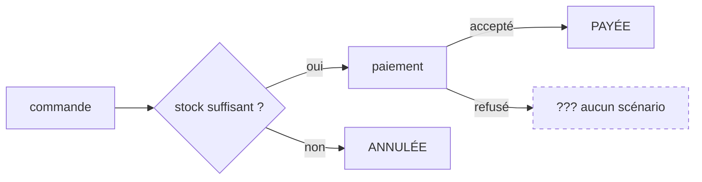

Exemples de trous trouvés comme ça :
- accès au compte : 23 transitions, dont 6 sans scénario (compte migré d'un ancien login, mot de passe faible refusé...) ;
- commande : rien pour un paiement refusé, ni pour un worker qui meurt au milieu et reçoit l'événement une 2e fois ;
- contrôle de fichiers : tout passe, mais aucun fichier d'exemple n'est cassé, donc rien ne prouve qu'un fichier vide ou mal nommé est détecté.

Workflow : la QA propose le graphe, le <span class="term" data-term="product-owner">PO</span> valide le parcours, chaque chemin devient un scénario.

### Gherkin avec un « Goal »

<span class="pill pill-status pill-status-ok" title="Toujours valable, vérifié en novembre 2026">Valable · 11/2026</span>

*Gherkin : complémentaire de Cucumber, pytest-bdd*
{ .tool-rel }

Le nom dit ce qui se passe, le `Goal` dit pourquoi c'est important : le risque couvert.

```gherkin
# Bien : le nom dit ce qui se passe, le Goal dit le risque couvert
@tool-playwright
Feature: Place an order

  Scenario: A closed customer is refused
    Goal: a customer the company no longer serves gets a 404,
    before any call to the bank or any visit counted.
    When "dennis" asks for a greeting
    Then the storefront answers 404
```

Bonnes pratiques :
- peu de scénarios d'acceptance, **un comportement chacun**, des phrases qu'un PO peut contester ;
- pas de détail technique dans les steps (pas de <span class="term" data-term="selector">sélecteur</span>, pas d'URL) ;
- un scénario n'écrit que ses propres données (nouvel utilisateur, une unité d'un produit à gros stock) ;
- un compte partagé est seulement lu : ne jamais lui envoyer un mauvais mot de passe, il pourrait se bloquer ;
- <span class="term" data-term="playwright">Playwright</span> : contexte neuf par scénario, éléments trouvés par rôle et label, `expect(...)`, jamais de `sleep`.

Un seuil de perf peut aussi être un scénario :
```gherkin
# Exemple : un seuil de performance écrit comme un scénario
Scenario: The storefront holds a small rush
  Goal: ten customers at once still get a fast answer.
  When 10 customers browse for 30 seconds
  Then less than 1% of requests fail
  And the p95 response time is under 500 ms
```

:material-book-open-variant: Doc de référence : [Cucumber, Gherkin Reference](https://cucumber.io/docs/gherkin/reference/) (consultée en novembre 2026)
{ .doc-ref }

### Outils Gherkin par langage

<span class="pill pill-status pill-status-ok" title="Toujours valable, vérifié en novembre 2026">Valable · 11/2026</span>

Le même fichier `.feature` s'exécute avec un outil propre à chaque langage : l'outil relie chaque phrase (`Given`, `When`, `Then`) à une fonction, la *step definition*.

| Langage | Outil | Remarque |
|---|---|---|
| Java, JavaScript, Ruby | Cucumber | l'outil d'origine du format Gherkin |
| Python | pytest-bdd, Behave | pytest-bdd réutilise les fixtures pytest, Behave a son propre lanceur |
| PHP | Behat | l'outil de référence de l'écosystème PHP (Symfony, Laravel) |
| .NET | Reqnroll | successeur open source de SpecFlow (2024, à vérifier) |
| TypeScript avec Playwright | playwright-bdd | génère des tests Playwright à partir des fichiers `.feature` |

**Quand utiliser Gherkin et le <span class="term" data-term="bdd">BDD</span>.** Quand le métier lit, conteste ou écrit vraiment les scénarios : le format est alors un contrat partagé. Quand seuls les développeurs les lisent, la couche de phrases coûte une indirection sans rien apporter : un test Playwright ou pytest bien nommé suffit.

*pytest : concurrent de unittest ; complémentaire de Testcontainers*
{ .tool-rel }


**Comment.** Écrire les scénarios en atelier avec le PO avant le code (three amigos), garder des steps réutilisables et sans détail technique, et ne pas dépasser une poignée de scénarios par fonctionnalité : le reste descend dans des tests plus bas.

:material-book-open-variant: Doc de référence : [pytest-bdd](https://pytest-bdd.readthedocs.io/) (consultée en novembre 2026) ; [Behat](https://docs.behat.org/) (consultée en novembre 2026)
{ .doc-ref }

### Scénario enregistré (Playwright Codegen)

<span class="pill pill-status pill-status-ok" title="Toujours valable, vérifié en novembre 2026">Valable · 11/2026</span>

*Playwright : concurrent de Cypress, Selenium ; complémentaire de Checkly*
{ .tool-rel }

Un PO clique le parcours, l'outil l'enregistre. Piège : la personne enregistre avec **son** compte sans le dire, et le test échoue pour tous les autres. D'où un gabarit qui oblige à expliciter :

```gherkin
# Bien : le gabarit oblige à dire quel compte et quelles données sont utilisés
Given "ada", a customer of the company who can order
And the stock of "BK-0004" holds at least 1 item
When ...
Then the page shows every step done and the order paid
```
Un `Then` est obligatoire : les clics disent ce qui a été fait, pas ce qui devait arriver. Et l'enregistrement (fichier <span class="term" data-term="har-file">HAR</span>) est **nettoyé de ses secrets avant toute autre étape** : en-têtes `Authorization` et `Cookie`, mots de passe, jetons.

:material-book-open-variant: Doc de référence : [Playwright, Test generator](https://playwright.dev/docs/codegen) (consultée en novembre 2026)
{ .doc-ref }

## Couverture de code

<a class="pill pill-scope pill-scope-code" href="../architecture/#carte-des-echelles">Échelle · Code</a>

### Ce qu'elle dit et ce qu'elle ne dit pas

<span class="pill pill-status pill-status-ok" title="Toujours valable, vérifié en novembre 2026">Valable · 11/2026</span>

La <span class="term" data-term="code-coverage">couverture</span> dit quel code a été **exécuté**, pas s'il a été **vérifié**.

!!! noob "As noob"
    La couverture, c'est la liste des salles d'un musée où le visiteur est passé : elle ne dit pas s'il a regardé les tableaux. La phrase à retenir : **du code couvert est du code exécuté, pas forcément du code vérifié.**

```python
# Exemple : la fonction testée
def refund(paid_cents, asked_cents):
    return min(paid_cents, asked_cents)

# À éviter : couverture 100 %, mais aucun assert, donc rien n'est vérifié
def test_refund():
    refund(1000, 500)
```
Couverture : 100 %. Vérification : aucune, il n'y a pas d'`assert`.

Règles :
- afficher la couverture unitaire et la couverture d'intégration **côte à côte, jamais additionnées** : une ligne exécutée par un <span class="term" data-term="integration-test">test d'intégration</span> ne prouve pas que sa règle est juste ;
- un composant à faible couverture unitaire mais testé en intégration est un indice : extraire ses règles dans un module pur ;
- commencer par les fichiers qui ont le plus de lignes non couvertes ;
- pour mesurer si les tests vérifient vraiment : <span class="term" data-term="mutation-testing">mutation testing</span> (mutmut, Stryker, Infection).

:material-book-open-variant: Doc de référence : [Martin Fowler, TestCoverage](https://martinfowler.com/bliki/TestCoverage.html) (2012) ; [Coverage.py](https://coverage.readthedocs.io/) (consultée en novembre 2026)
{ .doc-ref }

### Le piège du mapping inversé
Je traduis des valeurs d'un système à l'autre : `final` devient `album`, et `pending` reste `pending`. La 2e valeur s'écrit pareil des deux côtés. Donc si j'inverse le mapping par erreur, tous les tests sur `pending` passent quand même. Seul un test sur `final` révèle l'erreur.

```python
# Bien : les deux branches épinglées, une inversion fait échouer une assertion
assert to_legacy("final") == "album"
assert to_legacy("pending") == "pending"
```
Épingler les **deux** branches : une inversion fait alors échouer une assertion au lieu de zéro.

Même idée quand je renomme un paramètre : la route doit accepter le nouveau nom, et aussi **refuser** l'ancien. Une route qui accepte les deux n'a rien renommé.

### Le test à l'échelle du document

<span class="pill pill-status pill-status-ok" title="Toujours valable, vérifié en novembre 2026">Valable · 11/2026</span>

Je renomme un paramètre dans toute l'API, et je veux être sûr que l'ancien nom ne reste nulle part. Plutôt qu'un test par route, j'écris un test qui lit tout le contrat OpenAPI et vérifie la règle partout :
```python
# Bien : un seul test vérifie la règle sur tout le contrat, routes futures comprises
def test_no_route_uses_the_old_name(openapi):
    for path, params in all_parameters(openapi):
        assert "releaseStatus" not in params, path
```
Il couvre aussi les routes que personne n'a encore écrites.

### Carte de couverture fonctionnelle

<span class="pill pill-status pill-status-ok" title="Toujours valable, vérifié en novembre 2026">Valable · 11/2026</span>

Une page par système qui dit, **par domaine fonctionnel** (pas par repo), ce qui est prouvé, par quel module de test, et ce qui ne l'est pas.

```
Domaine « publication »
  prouvé     : transitions d'état (41 assertions), refus d'une transition interdite
  prouvé par : tests/integration/test_release_state.py
  NON prouvé : réponse lente du service amont, deux workflows concurrents,
               nettoyage après une création partielle
```
On la lit avant d'écrire un critère d'acceptance (pour ne pas en écrire un déjà couvert) et avant d'écrire un test (pour le placer là où il y a un trou). Le trou le plus fréquent : rien ne traverse une frontière entre deux repos dans une seule assertion, chaque repo prouve sa moitié.

## Quality gates

<a class="pill pill-scope pill-scope-code" href="../architecture/#carte-des-echelles">Échelle · Code</a>

### Deux gates suffisent

<span class="pill pill-status pill-status-ok" title="Toujours valable, vérifié en novembre 2026">Valable · 11/2026</span>

Deux quality gates : **Standard** pour un projet qui a déjà ses tests câblés en CI, **Starter** pour un projet qui n'a pas encore de harnais de test. **SonarQube** est un outil d'analyse statique qui note le code de A (le meilleur) à E sur trois axes : fiabilité (les bugs), sécurité (les vulnérabilités) et maintenabilité (la dette technique). La note de fiabilité se déduit du bug le plus grave trouvé : un seul nouveau bug critique la fait tomber à D (correspondance à vérifier dans la [documentation SonarQube](https://docs.sonarsource.com/), elle change selon la version).

| Condition, sur le nouveau code | Standard | Starter |
|--------------------------------|----------|---------|
| fiabilité A (aucun nouveau bug) | oui     | oui     |
| maintenabilité A               | oui      | oui     |
| duplication < 3 %              | oui      | oui     |
| couverture ≥ 80 %              | oui      | **non** |

Pourquoi seule la couverture change : ne pas ajouter de bug ou de duplication, c'est de la discipline, tenable dès le premier jour. La couverture demande un <span class="term" data-term="test-harness">harnais de test</span> câblé en <span class="term" data-term="ci">CI</span>, ça ne s'improvise pas dans une <span class="term" data-term="merge-request">MR</span>.

Où le gate se place dans le circuit d'une MR :

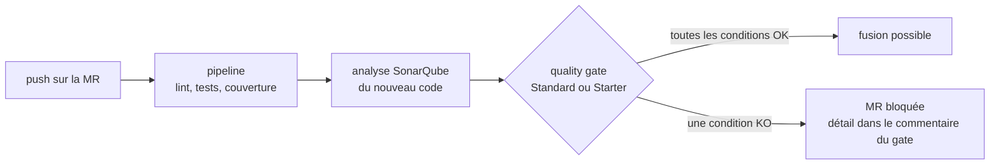

Choix assumés :
- **Starter retire la couverture, il ne l'abaisse pas.** Un seuil à 40 % serait un barreau du milieu où tout le monde s'installe pour toujours. Starter veut dire « pas encore de harnais », et il doit rester visiblement transitoire ;
- **aucune condition sur le code global** : sinon chaque projet échoue sur une <span class="term" data-term="technical-debt">dette</span> que la MR n'a pas créée ;
- **un gate qui tolère de nouveaux bugs** n'est pas un palier de maturité, c'est un permis de livrer des défauts.

### Pièges
- Un gate avec la duplication à 100 % ne peut jamais échouer, donc ne vérifie rien. Le vrai besoin était d'exclure les bons fichiers de l'analyse (`sonar.cpd.exclusions`).
- Supprimer un gate avant d'avoir réassigné ses projets les fait tomber en silence sur le gate par défaut. Ordre : réassigner, vérifier, supprimer.
- Deux outils qui bloquent la même MR pour la même raison (Sonar et un <span class="term" data-term="sast">SAST</span>) : deux backlogs, deux fois plus d'attente. Garder un seul bloquant, l'autre en visibilité.
- Calculer le « nouveau code » en CI demande l'historique complet (`GIT_DEPTH: 0`) : un clone superficiel n'a pas de point de départ commun avec main, et le diff revient faux **sans erreur**.

:material-book-open-variant: Doc de référence : [SonarQube Server, Introduction to quality gates](https://docs.sonarsource.com/sonarqube-server/latest/quality-standards-administration/managing-quality-gates/introduction-to-quality-gates/) (consultée en novembre 2026)
{ .doc-ref }

## CI et livraison

<a class="pill pill-scope pill-scope-app" href="../architecture/#carte-des-echelles">Échelle · Application</a> <a class="pill pill-scope pill-scope-infra" href="../architecture/#carte-des-echelles">Échelle · Infrastructure</a>

<a class="pill pill-practice" href="../livraison/#tests-fonctionnels-automatises" title="niveau 3 : elle décide sans humain">Pratique · Tests fonctionnels · N3</a> <a class="pill pill-practice" href="../livraison/#livraison-et-deploiement-continus" title="niveau 2 : elle est automatisée">Pratique · Déploiement continu · N2</a>
<a class="pill pill-dora" href="https://dora.dev/capabilities/continuous-integration/">DORA · Continuous integration</a> <a class="pill pill-dora" href="https://dora.dev/capabilities/deployment-automation/">DORA · Deployment automation</a>


### Ne jamais affaiblir un gate

<span class="pill pill-status pill-status-ok" title="Toujours valable, vérifié en novembre 2026">Valable · 11/2026</span>

`allow_failure: true` n'est jamais un moyen de débloquer une fusion.

Cas réel : une MR consomme une version de paquet pas encore publiée, le job est rouge. Le passer en `allow_failure` aurait fusionné un état cassé connu. Le job rouge disait en fait l'ordre des choses :
```
1. fusionner la MR de la dépendance, la version est publiée
2. relancer le pipeline du consommateur, il passe
```
Contrôle avant MR :
```
$ git diff origin/main...HEAD -- '*.yml' | grep -n "allow_failure"
```

### Local identique à la CI

<span class="pill pill-status pill-status-ok" title="Toujours valable, vérifié en novembre 2026">Valable · 11/2026</span>

Je veux qu'un vert en local veuille dire la même chose qu'un vert en CI. Pour ça : une version épinglée et un <span class="term" data-term="lockfile">lockfile</span> régénéré, jamais un paquet copié à la main par-dessus.

Cas réel : un wheel local installé par-dessus la version épinglée, dépendances sautées. Tests verts en local sur un environnement qu'aucun pipeline ne construira, et il manquait une dépendance.
```
$ pip check
$ pip show my-lib | grep Version      (comparer au lockfile)
```

### Lancer les hooks sur tout l'arbre

<span class="pill pill-status pill-status-ok" title="Toujours valable, vérifié en novembre 2026">Valable · 11/2026</span>

Je commite, le <span class="term" data-term="pre-commit-hook">hook</span> passe, et pourtant la CI est rouge. La raison : au commit, le hook ne voit que les fichiers stagés, alors que la CI vérifie tous les fichiers de la branche.

```
$ git add nouveau_fichier.py          (les fichiers non suivis sont invisibles aux hooks)
$ pre-commit run --all-files
```
Cas réel : 5 erreurs mypy invisibles en local, découvertes à la 3e itération de review. Un seul run sur tout l'arbre les trouvait. mypy peut donner des résultats différents selon les fichiers qu'on lui passe : ne jamais retirer un `type: ignore` sur la foi d'un run sur un seul fichier.

*mypy : complémentaire de ruff*
{ .tool-rel }


:material-book-open-variant: Doc de référence : [pre-commit](https://pre-commit.com/) (consultée en novembre 2026)
{ .doc-ref }

### Surveiller son pipeline

<span class="pill pill-status pill-status-ok" title="Toujours valable, vérifié en novembre 2026">Valable · 11/2026</span>

Un push n'est fini que quand son <span class="term" data-term="ci-pipeline">pipeline</span> a un verdict. Un vert local prouve le code, pas le pipeline (image réellement tirée, gate du nouveau code, parsing de la config).

Pièges :
- un même commit peut avoir **deux pipelines** (push et MR) avec des verdicts différents ;
- les conditions en échec d'un <span class="term" data-term="quality-gate">quality gate</span> sont dans **son commentaire sur la MR**, pas dans le log du job ;
- si quelque chose de rouge n'est pas à moi, je le dis et j'explique pourquoi, plutôt que de l'ignorer.

:material-book-open-variant: Doc de référence : [GitLab, CI/CD pipelines](https://docs.gitlab.com/ci/pipelines/) (consultée en novembre 2026)
{ .doc-ref }

### Tester un déploiement canary

<span class="pill pill-status pill-status-ok" title="Toujours valable, vérifié en novembre 2026">Valable · 11/2026</span>

<a class="pill pill-practice" href="../livraison/#deploiement-progressif" title="niveau 3 : elle décide sans humain">Pratique · Déploiement progressif · N3</a> <a class="pill pill-practice" href="../livraison/#tester-en-production" title="niveau 3 : elle décide sans humain">Pratique · Tests en production · N3</a>
<a class="pill pill-dora" href="https://dora.dev/capabilities/continuous-delivery/">DORA · Continuous delivery</a> <a class="pill pill-dora" href="https://dora.dev/capabilities/proactive-failure-notification/">DORA · Proactive failure notification</a>

Avec un <span class="term" data-term="canary-deployment">déploiement canary</span>, le test principal n'est pas une suite qu'on lance : c'est la **comparaison** des indicateurs de la nouvelle version (la canary) avec ceux de l'ancienne, sur le même trafic réel et la même fenêtre de temps. Des outils comme Argo Rollouts, Flagger ou Kayenta (Netflix et Google, 2018) font cette analyse et décident seuls d'élargir ou de revenir en arrière.

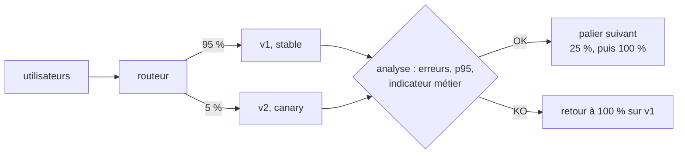

```
palier 1 : v2 reçoit 5 % du trafic pendant 15 min
  smoke test forcé sur v2 (en-tête X-Canary: 1)   vert
  erreurs   v1 0,4 %    v2 0,5 %    seuil : écart sous 0,5 point   OK
  p95       v1 210 ms   v2 380 ms   seuil : v2 sous 1,2 fois v1    KO
  décision automatique : retour à 100 % sur v1, alerte à l'équipe
```

Ce qu'il faut prévoir :

- **les critères avant de commencer** : métriques, seuils, durée de chaque palier, et au moins un indicateur métier (paniers validés, paiements acceptés), pas seulement des indicateurs techniques ;
- **un <span class="term" data-term="smoke-test">smoke test</span> qui vise la canary** : un en-tête ou une route qui force la nouvelle version, sinon 95 % des appels du test tombent sur l'ancienne ;
- **assez de trafic** : 5 % d'un service peu appelé à 3 h du matin, c'est peut-être 20 requêtes (exemple), trop peu pour conclure. Fixer un nombre minimal de requêtes par palier ;
- **un utilisateur reste sur la même version** (affinité de session) : sinon il passe de v1 à v2 d'une page à l'autre, et un E2E devient instable.

:material-book-open-variant: Doc de référence : [Danilo Sato, CanaryRelease](https://martinfowler.com/bliki/CanaryRelease.html) (2014) ; [Argo Rollouts](https://argo-rollouts.readthedocs.io/) (consultée en novembre 2026)
{ .doc-ref }

### Tester un déploiement blue-green

<span class="pill pill-status pill-status-ok" title="Toujours valable, vérifié en novembre 2026">Valable · 11/2026</span>

<a class="pill pill-practice" href="../livraison/#deploiement-progressif" title="niveau 2 : elle est automatisée">Pratique · Déploiement progressif · N2</a> <a class="pill pill-practice" href="../livraison/#tester-en-production" title="niveau 2 : elle est automatisée">Pratique · Tests en production · N2</a>
<a class="pill pill-dora" href="https://dora.dev/capabilities/continuous-delivery/">DORA · Continuous delivery</a>

Avec un <span class="term" data-term="blue-green-deployment">déploiement blue-green</span>, on teste **avant** la bascule : green tourne déjà en production, avec la vraie infrastructure et les vraies données, mais sans utilisateurs. On peut donc lancer dessus une vraie suite de tests.

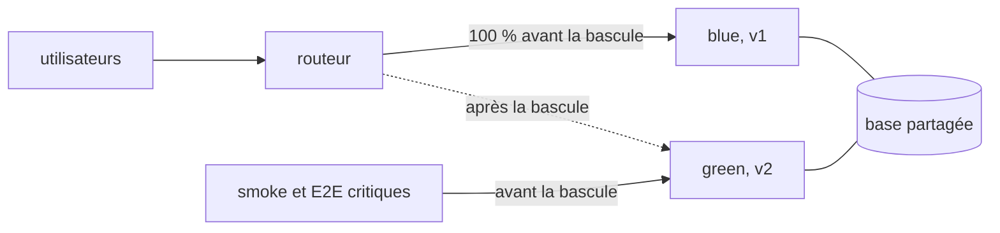

```
10:00  v2 déployée sur green, sans trafic ; blue (v1) sert 100 % des utilisateurs
10:05  smoke et E2E critiques sur https://green.my-api.example : 24/24 verts
10:20  bascule du routeur : green sert 100 %, blue reste prêt
10:20  tests synthétiques chaque minute sur l'URL publique, alertes surveillées
11:20  rien à signaler : blue est gardé 24 h, puis il recevra la prochaine version
```

Ce qu'il faut prévoir :

- **des comptes de test** : green utilise la base de production, chaque test y écrit de vraies données ;
- **une base compatible avec les deux versions** : blue et green partagent souvent la même base, le schéma doit accepter v1 et v2 (voir expand / contract dans [Versionner](api-rest-async.md#versionner)) ;
- **les requêtes en cours** : à la bascule, laisser finir les requêtes et les tâches lancées sur blue avant de l'arrêter ;
- **le coût** : deux environnements complets pendant la bascule.

|                | Canary                                                 | Blue-green                                         |
|----------------|--------------------------------------------------------|----------------------------------------------------|
| exposition     | progressive (5 %, 25 %, 100 %)                         | tout le trafic d'un coup                           |
| test principal | comparaison des métriques v1 et v2 sur du vrai trafic  | suite de tests sur green avant la bascule          |
| retour arrière | remettre la canary à 0 %                               | rebasculer le routeur sur blue                     |
| trouve bien    | les régressions qui n'apparaissent qu'avec du vrai trafic (performance, données réelles) | les erreurs de déploiement, de configuration, d'infrastructure |
| limite         | peu de trafic, verdict peu fiable                      | un bug que les tests ratent touche tout le monde à la bascule |
| coût           | faible                                                 | double infrastructure pendant la bascule           |

Les deux se combinent : déployer v2 sur green, la tester, puis lui envoyer le trafic par paliers comme une canary. Sources : Martin Fowler, « BlueGreenDeployment » (2010) ; Danilo Sato, « CanaryRelease » (2014), sur le site de Martin Fowler.

:material-book-open-variant: Doc de référence : [Martin Fowler, BlueGreenDeployment](https://martinfowler.com/bliki/BlueGreenDeployment.html) (2010)
{ .doc-ref }

## Tests instables et parallélisation

<a class="pill pill-scope pill-scope-code" href="../architecture/#carte-des-echelles">Échelle · Code</a>

<a class="pill pill-practice" href="../livraison/#tests-fonctionnels-automatises" title="niveau 4 : elle est pilotée par la mesure">Pratique · Tests fonctionnels · N4</a>
<a class="pill pill-dora" href="https://dora.dev/capabilities/test-automation/">DORA · Test automation</a>


### Paralléliser sans casser

<span class="pill pill-status pill-status-ok" title="Toujours valable, vérifié en novembre 2026">Valable · 11/2026</span>

Cas réel, environ 180 tests Playwright, 4 tentatives :

| Version               | Découpage                    | Durée du pipeline | Résultat                                       |
|-----------------------|------------------------------|----------|------------------------------------------------|
| v0                    | 7 jobs, un par application   | ~36 min  | fiable mais linéaire                           |
| v1                    | 14 <span class="term" data-term="test-shard">shards</span> sans limite        | variable | 11 crashs navigateur, connexions <span class="term" data-term="mfa">2FA</span> bloquées  |
| v2                    | `parallel: 2` par nombre de tests | 45 min, timeout | les 16 tests rouges dans le même shard, rapport perdu |
| v3                    | par application **et par tag** | ~14 min | 9 jobs, tous terminés et rapportés            |

Leçons :
- **paralléliser par compte de connexion**, un job par application ;
- **isoler les suites rouges ou lentes par tag**, pas par nombre de tests : `--grep-invert=@invoice` pour le reste, `--grep=@invoice` dans son propre job ;
- **la complétude passe avant la vitesse** : un job annulé ou en timeout perd tout son rapport, pas seulement les tests en échec.

:material-book-open-variant: Doc de référence : [Playwright, Sharding](https://playwright.dev/docs/test-sharding) (consultée en novembre 2026)
{ .doc-ref }

### Causes d'instabilité qui ne sont pas des bugs de test
| Symptôme                                              | Vraie cause                              | Correction                               |
|-------------------------------------------------------|------------------------------------------|------------------------------------------|
| `Target page, context or browser has been closed`     | `/dev/shm` (la mémoire partagée que Chromium utilise pour ses onglets) trop petite dans le conteneur, 64 Mo par défaut | lancer Chromium avec `--disable-dev-shm-usage` |
| jobs 8 à 12 fois plus lents, dashboard à 13 % de CPU  | jobs déclarant 250m de CPU en consommant 2 à 4 cœurs, nœuds saturés | déclarer la vraie consommation : `cpu: 2`, `memory: 4Gi` |
| `TOTP failed: Too many attempts`                      | un compte 2FA partagé par trop de jobs en parallèle | connexion par API sans navigateur dans le setup |

Une partie du « <span class="term" data-term="flaky-test">flaky</span> » est de la contention (ressources, connexion), pas un défaut du test ni du produit. Mesurer avant de mettre en <span class="term" data-term="test-quarantine">quarantaine</span>.

### Ce qui ne parallélise pas
J'enchaîne des paliers `health_check`, `smoke`, puis `regression`, en espérant aller plus vite. Ces paliers **ordonnent** le signal, ils ne vont pas plus vite : 741 s contre 745 s, et 44 % de connexions en plus. Et un vert sur les paliers rapides prédit peu, parce qu'ils ne couvrent que 23 % des tests.

### Stratégie face à un test instable

<span class="pill pill-status pill-status-ok" title="Toujours valable, vérifié en novembre 2026">Valable · 11/2026</span>

1. Le mettre en quarantaine : hors du chemin bloquant, avec un ticket, un propriétaire, une date limite.
2. Le laisser tourner pour mesurer son taux d'échec.
3. Chercher la cause : données partagées, attente fixe, ressource saturée, ordre des tests.
4. Pas de relance silencieuse : une relance doit laisser une trace, sinon le problème devient invisible.

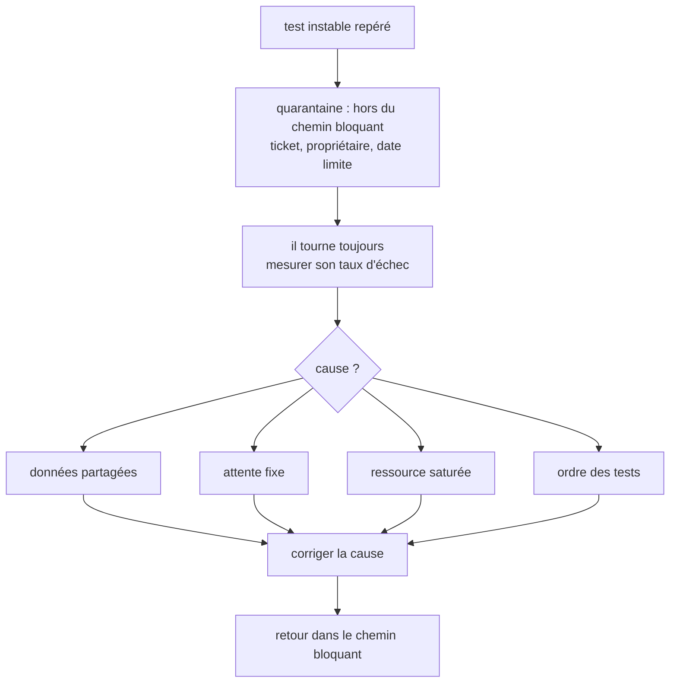

:material-book-open-variant: Doc de référence : [Martin Fowler, Eradicating Non-Determinism in Tests](https://martinfowler.com/articles/nonDeterminism.html) (2011) ; [Playwright, Retries](https://playwright.dev/docs/test-retries) (consultée en novembre 2026)
{ .doc-ref }

### Outils de diagnostic : ce qu'ils montrent vraiment
Un traceur ligne à ligne a été testé pour aider un agent à réparer les tests. Il montrait **où** le test cassait, pas **pourquoi**. La vraie cause, trouvée en lisant le code : un helper qui abandonnait **sans lever d'erreur**, si bien que le test continuait puis tombait en timeout plus loin. Ce qui reste utile seul : une capture par action, avec l'élément cliqué surligné, et `trace: retain-on-failure`.

:material-book-open-variant: Doc de référence : [Playwright, Trace viewer](https://playwright.dev/docs/trace-viewer) (consultée en novembre 2026)
{ .doc-ref }

## Résultats de tests et visibilité

### Le chemin d'un résultat de test

Un test qui tourne produit plus qu'un « vert » ou « rouge ». Chaque étape garde une partie de l'information, et chaque question se lit à un endroit différent :

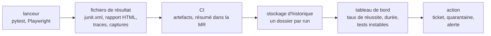

| Je veux savoir... | Je regarde... |
|---|---|
| si c'est ma MR qui casse quelque chose, quand le pipeline vient de passer au rouge et que je ne sais pas si c'est de ma faute | le résumé des tests dans la MR : nouveaux échecs par rapport à la branche principale |
| pourquoi ce test E2E échoue, en voyant ce que le navigateur a vraiment affiché, envoyé et reçu | la trace Playwright (DOM, réseau, console pas à pas), la capture d'écran et la vidéo du run |
| si un test qui passe un jour et échoue le lendemain est instable, ou s'il signale un vrai problème | son historique sur 30 jours : même commit, résultats différents |
| pourquoi la suite prend de plus en plus de temps, et quels tests la ralentissent | la durée par run et les 10 tests les plus lents, sur plusieurs semaines |
| si la qualité baisse vraiment, sans me laisser tromper par les MR encore en travaux | le taux de réussite par jour sur la branche principale, pas sur les MR en cours |

### Lire un échec : du rouge à la cause

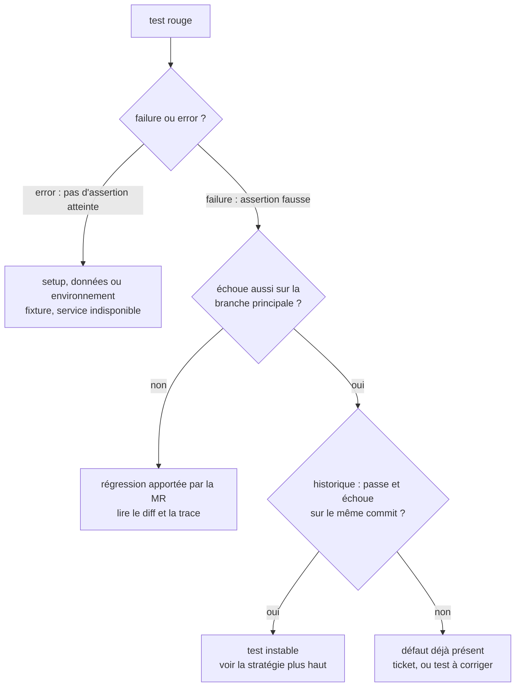

!!! noob "As noob"
    Un rapport de tests, c'est le bulletin de notes de l'application. Le résumé de la MR dit « as-tu eu la moyenne aujourd'hui ? », la trace d'un test rouge dit « où exactement tu t'es trompé », et l'historique dit « est-ce que tu progresses ou est-ce que tu rates toujours le même exercice ? ».

:material-book-open-variant: Doc de référence : [Playwright, Trace viewer](https://playwright.dev/docs/trace-viewer) (consultée en novembre 2026) ; [Playwright, Reporters](https://playwright.dev/docs/test-reporters) (consultée en novembre 2026)
{ .doc-ref }

### Failed ou error
```
<failure>  le test a tourné, une assertion n'a pas tenu   le produit se comporte mal
<error>    le test n'a jamais atteint d'assertion         le setup est cassé (fixture, page, service down)
```
Les afficher séparément : `8/10 passed · 2 errors` ne raconte pas la même histoire que `8/10 passed · 2 failed`.

### Garder l'historique

<span class="pill pill-status pill-status-ok" title="Toujours valable, vérifié en novembre 2026">Valable · 11/2026</span>

Les <span class="term" data-term="ci-artifact">artefacts</span> CI expirent (souvent 2 semaines). Pour suivre des tendances, envoyer chaque run vers un stockage :
```
test-reports/2026-10-23T09-15-00Z_pipeline-1234/
├─ junit.xml
└─ report.html
```
Une date ISO 8601 en UTC en tête du nom : l'ordre alphabétique est l'ordre chronologique. L'envoi doit tourner **quel que soit** le résultat des tests (dans GitLab CI, `artifacts: when: always` ou un `after_script`) et ne pas changer leur code de sortie. Des outils publics font ce travail d'historique : Allure Report, ReportPortal, ou les rapports de tests intégrés à GitLab et GitHub.

*GitLab CI : concurrent de GitHub Actions, Jenkins*<br>
*Allure : concurrent de ReportPortal*<br>
*ReportPortal : concurrent de Allure*
{ .tool-rel }


:material-book-open-variant: Doc de référence : [GitLab, Unit test reports](https://docs.gitlab.com/ci/testing/unit_test_reports/) (consultée en novembre 2026)
{ .doc-ref }

### Ajouter des métadonnées aux tests

<span class="pill pill-status pill-status-ok" title="Toujours valable, vérifié en novembre 2026">Valable · 11/2026</span>

```python
import allure
import pytest

# Exemple : des étiquettes pour relier tests et échecs à une fonctionnalité
@allure.feature("checkout")
@allure.story("paiement par carte")
@pytest.mark.smoke
def test_card_payment_is_accepted(): ...
```
Ces étiquettes (ici avec Allure Report, ou les `tag` de Playwright) permettent de répondre à « quelles fonctionnalités n'ont aucun test ? » ou « quelle fonctionnalité a le plus d'échecs ce mois-ci ? ». Le flaky n'existe pas comme champ natif : il se calcule (même test, même commit, résultats différents).

:material-book-open-variant: Doc de référence : [Allure Report, Documentation](https://allurereport.org/docs/) (consultée en novembre 2026)
{ .doc-ref }

## SLO sur les suites de test

<span class="pill pill-status pill-status-ok" title="Toujours valable, vérifié en novembre 2026">Valable · 11/2026</span>

Mon équipe s'épuise à analyser chaque run rouge, même quand c'est un test instable isolé. Au lieu de réagir à chaque run, je me fixe une cible de <span class="term" data-term="pass-rate">taux de réussite</span> sur une fenêtre de temps.

```
tests E2E  : taux de réussite ≥ 90 % sur 30 jours   (chiffre d'exemple)
tests API  : taux de réussite ≥ 98 % sur 30 jours   (chiffre d'exemple)

taux = passed / (total - skipped)
```
L'<span class="term" data-term="alert-monitoring">alerte</span> ne part que quand le **taux** casse la cible : un test instable isolé ne réveille personne, une vraie dégradation si.

Pièges :
- inclure les pipelines de MR, qui échouent plus par nature, rend le <span class="term" data-term="slo">SLO</span> « toujours cassé sur du bruit » ;
- poser des seuils sans regarder l'historique : ce sont des valeurs au hasard, à recalibrer.

:material-book-open-variant: Doc de référence : [Google SRE Workbook, Implementing SLOs](https://sre.google/workbook/implementing-slos/) (2018)
{ .doc-ref }

## Revue de code

<a class="pill pill-scope pill-scope-code" href="../architecture/#carte-des-echelles">Échelle · Code</a>

<a class="pill pill-practice" href="../livraison/#trunk-based-development" title="niveau 1 : la pratique est en place, même à la main">Pratique · Trunk-based development · N1</a>
<a class="pill pill-dora" href="https://dora.dev/capabilities/code-maintainability/">DORA · Code maintainability</a>


### Itérer jusqu'à zéro bloquant

<span class="pill pill-status pill-status-ok" title="Toujours valable, vérifié en novembre 2026">Valable · 11/2026</span>

```
passe 1 : tout remonter (bloquant, majeur, mineur, détail), puis trier
passe 2 : bloquants et majeurs à zéro
passe 3 : non-régression et verdict clair
```
Trois passes est un budget, pas un but : on s'arrête à deux si c'est propre.

| Niveau | Ce qu'il veut dire | Exemple |
|---|---|---|
| bloquant | ne peut pas être fusionné tel quel : bug, perte de données, faille | un remboursement calculé en `float`, qui perd des centimes |
| majeur | à corriger dans cette MR, sauf accord explicite | un appel HTTP sans timeout vers payments-service |
| mineur | améliore le code, peut partir dans un ticket | une fonction de 80 lignes à découper |
| détail | goût ou style, l'auteur décide | renommer `data` en `order` |

:material-book-open-variant: Doc de référence : [Google Engineering Practices, Code Review](https://google.github.io/eng-practices/review/) (consultée en novembre 2026)
{ .doc-ref }

### Prouver chaque remarque

<span class="pill pill-status pill-status-ok" title="Toujours valable, vérifié en novembre 2026">Valable · 11/2026</span>

Une revue avec 3 commentaires faux sur 5 coûte plus cher qu'aucune revue. Chaque remarque doit avoir :
- `fichier:ligne` ;
- un scénario concret qui casse ;
- une vérification dans le vrai code, pas dans le docstring ni de mémoire.

Sur une grosse branche, 2 « bloquants » sur la liste étaient faux. Auto-contrôle avant de poster : marquer chaque remarque « vérifiée » ou « supposée », et supprimer ou aller vérifier les supposées.

### Le style

<span class="pill pill-status pill-status-ok" title="Toujours valable, vérifié en novembre 2026">Valable · 11/2026</span>

Une ou deux phrases (le problème et le correctif), et une suggestion applicable plutôt que de la prose :

````
```suggestion:-0+0
const hasMultipleDestinations = targets.length > 1;
```
````
Quand on applique un retour, on résout la discussion. Pas besoin de répondre « merci, fait ».

:material-book-open-variant: Doc de référence : [GitLab, Suggest changes](https://docs.gitlab.com/user/project/merge_requests/reviews/suggestions/) (consultée en novembre 2026)
{ .doc-ref }

## Règles de code qui évitent des défauts

<a class="pill pill-scope pill-scope-code" href="../architecture/#carte-des-echelles">Échelle · Code</a>

### Pas de valeur de repli qui masque un trou

<span class="pill pill-status pill-status-ok" title="Toujours valable, vérifié en novembre 2026">Valable · 11/2026</span>

```typescript
// À éviter : si title est obligatoire, ce repli masque un trou de données
const title = release.title ?? release.name ?? "Untitled";
```
Si le <span class="term" data-term="api-contract">contrat</span> dit que `title` est obligatoire, ce repli fait passer un trou de données pour une donnée valide. Le jeu de test a l'air bon, l'interface aussi, et le trou n'apparaît qu'en <span class="term" data-term="production-env">production</span>.

```typescript
// Ce qui change : le champ manquant lève une erreur au lieu d'être masqué
if (release.title === undefined) {
  throw new MissingFieldError("release.title");
}
```
Règle : un défaut est légitime si le champ est **optionnel** dans le contrat, c'est un masque s'il est **obligatoire**.

### Pas de valeur magique

<span class="pill pill-status pill-status-ok" title="Toujours valable, vérifié en novembre 2026">Valable · 11/2026</span>

```python
# À éviter : 128 est un nombre magique, personne ne saura ce qu'il signifie
if luminance > 128:
```
Six mois plus tard, personne ne sait si 128 est un seuil, une taille de buffer ou une coïncidence.
```python
# Ce qui change : le nombre a un nom et une docstring qui dit son rôle
LUMINANCE_THRESHOLD = 128
"""Above this value, the text is drawn in black for contrast."""
```

### L'argent en centimes entiers

<span class="pill pill-status pill-status-ok" title="Toujours valable, vérifié en novembre 2026">Valable · 11/2026</span>

```python
# À éviter : l'argent en flottants, l'arrondi fausse le résultat
0.1 + 0.2        # 0.30000000000000004
# Bien : l'argent en centimes entiers, le calcul reste exact
10 + 20          # 30 centimes, exact
```

### Extraire au lieu d'empiler

<span class="pill pill-status pill-status-ok" title="Toujours valable, vérifié en novembre 2026">Valable · 11/2026</span>

Une nouvelle responsabilité devient son propre module, **dans le même changement**. Cas réel : un fichier de 1 385 lignes, grossi feature après feature avec une note « extraire plus tard ». Rien n'a jamais été extrait.
```
$ git diff origin/main...HEAD | grep -inE '^\+.*(todo|refactor later|extract later)'
```

### Extraire à la 2e occurrence

<span class="pill pill-status pill-status-ok" title="Toujours valable, vérifié en novembre 2026">Valable · 11/2026</span>

Un helper naît à la 2e copie, jamais à la 3e. Et pas d'abstraction pour un appelant qui n'existe pas encore.

:material-book-open-variant: Doc de référence : [Refactoring.com, Catalog](https://refactoring.com/catalog/) (consultée en novembre 2026) ; [Python Tutorial, Floating-Point Arithmetic](https://docs.python.org/3/tutorial/floatingpoint.html) (Python 3)
{ .doc-ref }

## Pièges à éviter

- **Un double à travers une frontière** : je remplace la base ou le partenaire HTTP par un mock dans un test d'API. Le mock répond ce que j'attends, pas ce que fait le vrai voisin, donc le test reste vert pendant que la production casse, comme la réponse `403` qui perdait son en-tête `WWW-Authenticate`. Je prouve le comportement par une vraie requête, contre de vrais voisins ([voir La règle](#la-regle)).
- **La couverture prise pour une preuve** : je me rassure avec 100 % de couverture. Un test sans `assert` exécute toute la fonction et ne vérifie rien, donc un bug passe malgré le chiffre. Je relis les assertions et j'essaie le mutation testing ([voir Ce qu'elle dit](#ce-quelle-dit-et-ce-quelle-ne-dit-pas)).
- **`allow_failure` pour débloquer une fusion** : je passe un job rouge en `allow_failure: true` parce qu'il attend une version de paquet pas encore publiée. J'ai fusionné un état cassé connu. Je lis l'ordre que le rouge m'indique, je fusionne la dépendance d'abord, puis je relance ([voir Ne jamais affaiblir un gate](#ne-jamais-affaiblir-un-gate)).
- **La relance silencieuse d'un test instable** : je relance le pipeline jusqu'au vert. L'équipe apprend à ignorer le rouge, et le jour d'un vrai bug personne ne regarde. Je mets le test en quarantaine avec un ticket, un propriétaire et une date limite, et je cherche la cause ([voir la stratégie](#strategie-face-a-un-test-instable)).
- **Les hooks sur les seuls fichiers stagés** : je me fie au hook du commit, qui ne voit que les fichiers stagés. La CI vérifie toute la branche et passe au rouge, parfois à la troisième itération de review. Je lance `pre-commit run --all-files` avant de pousser ([voir Lancer les hooks](#lancer-les-hooks-sur-tout-larbre)).
- **Un clone superficiel pour juger le nouveau code** : je laisse la CI cloner avec un historique partiel. Le diff du « nouveau code » revient faux sans aucune erreur, et le quality gate juge autre chose que ma MR. Je mets `GIT_DEPTH: 0` ([voir les pièges des gates](#pieges)).
- **Un SLO calculé sur les MR** : j'inclus les pipelines de MR dans le taux de réussite. Ils échouent plus par nature, donc le SLO est toujours cassé sur du bruit et plus personne ne lit l'alerte. Je calcule le taux sur la branche principale ([voir SLO](#slo-sur-les-suites-de-test)).
- **Une valeur de repli sur un champ obligatoire** : j'écris `release.title ?? "Untitled"` alors que le contrat rend `title` obligatoire. Un trou de données passe pour une donnée valide et n'apparaît qu'en production. Je lève une erreur au lieu de masquer le trou ([voir Pas de valeur de repli](#pas-de-valeur-de-repli-qui-masque-un-trou)).

## Ce qu'on demande en entretien

Les questions typiques :

- « Pyramide ou trophée des tests ? », « Comment répartis-tu tes tests entre unitaire, intégration et E2E ? » Pour répondre : je dis que la forme dépend du contexte, puis je donne ma règle : une vraie requête dès qu'elle peut prouver le comportement ([Pyramide, trophée, nid d'abeille](#pyramide-trophee-nid-dabeille-la-forme-dune-suite), [La règle](#la-regle)).
- « Comment construis-tu la stratégie de test d'une nouvelle fonctionnalité ? », « Le temps manque avant une mise en production, que testes-tu en priorité ? » Pour répondre : je liste les risques et je classe chacun par impact multiplié par probabilité, je dessine le parcours pour couvrir d'abord les chemins critiques, puis je choisis le niveau de test le plus bas qui prouve chaque comportement ; quand le temps manque, je teste ces chemins critiques et les zones qui ont déjà eu des incidents ([Les sept principes du test](#les-sept-principes-du-test-istqb), [Concevoir les scénarios](#concevoir-les-scenarios), [Choisir le bon niveau de test](#choisir-le-bon-niveau-de-test)).
- « Quelle différence entre un mock, un stub et un fake ? », « Quand faut-il mocker ? » Pour répondre : je donne le rôle de chaque double, puis je dis pourquoi un mock écrit à la main ment et ce que le test de contrat ajoute ([Double de test](#double-de-test-mock-stub-fake), [Tests de contrat et mocks d'API](#tests-de-contrat-et-mocks-dapi)).
- « Que fais-tu d'un test instable ? », « Comment accélères-tu une suite E2E trop lente ? » Pour répondre : je déroule la quarantaine avec ticket et mesure, et un découpage par compte et par tag ([Stratégie face à un test instable](#strategie-face-a-un-test-instable), [Paralléliser sans casser](#paralleliser-sans-casser)).
- « La couverture de code est-elle un bon indicateur ? », « Quel seuil imposer ? » Pour répondre : je distingue code exécuté et code vérifié, puis je parle d'un gate sur le nouveau code seulement ([Ce qu'elle dit et ce qu'elle ne dit pas](#ce-quelle-dit-et-ce-quelle-ne-dit-pas), [Deux gates suffisent](#deux-gates-suffisent)).
- « Comment testes-tu un déploiement canary ? Et un blue-green ? » Pour répondre : je compare les métriques par paliers pour le canary, et je teste green avant la bascule ([Tester un déploiement canary](#tester-un-deploiement-canary), [Tester un déploiement blue-green](#tester-un-deploiement-blue-green)), et [Déploiement progressif](livraison.md#deploiement-progressif) et [A/B testing](donnees-decision.md#ab-testing).
- « Qu'est-ce qui fait une bonne revue de code ? », « Comment rédiges-tu un bon rapport de bug ? » Pour répondre : je classe mes remarques par niveau de gravité et je prouve chacune par `fichier:ligne` et un scénario qui casse ; un rapport de bug suit la même logique, avec les étapes pour reproduire, le résultat attendu et le résultat obtenu, l'environnement et une preuve (capture, trace, journal) ([Prouver chaque remarque](#prouver-chaque-remarque), [Scénario enregistré](#scenario-enregistre-playwright-codegen)).

Ce qui fait une bonne réponse : un exemple vécu (ou réaliste) avec le bug que le test a attrapé ou laissé passer, puis la limite de l'outil cité. Un « ça dépend » suivi des critères vaut mieux qu'une règle récitée.

## Quoi utiliser dans quelle situation

| Situation | J'utilise |
|---|---|
| j'ai une règle de calcul sans base ni réseau, comme le total d'une commande ou une politique de mot de passe | test unitaire |
| je veux prouver qu'une route se comporte bien vue de l'extérieur, comme `/orders` qui renvoie 401 sans jeton | test d'intégration avec une vraie requête |
| mon code lit ou écrit dans une base, un <span class="term" data-term="cache-data">cache</span> ou une file de messages, et je veux le tester contre le vrai, pas contre une imitation | <span class="term" data-term="testcontainers">Testcontainers</span> |
| je dépends d'un service que je ne contrôle pas, comme `bank-partner`, que je ne peux ni modifier ni faire répondre une erreur à la demande | <span class="term" data-term="mock">mock</span> par contrat (Microcks) + un test du vrai (<span class="term" data-term="schemathesis">schemathesis</span>) |
| l'équipe front veut avancer alors que le back n'est pas encore prêt, et seul son contrat existe | Prism sur le contrat |
| un parcours dont la panne coûte cher, comme se connecter, commander et voir « payé » | E2E Playwright, peu nombreux |
| le PO veut lire et pouvoir contester ce que le produit promet, comme « un client fermé est refusé » | scénario Gherkin avec un `Goal` |
| je veux savoir quels parcours n'ont aucun test, comme un paiement refusé que personne n'a prévu | graphe de scénarios, carte de couverture |
| mes tests passent tous, mais je doute qu'ils vérifient vraiment quelque chose, comme un test sans `assert` qui couvre 100 % d'une fonction | <span class="term" data-term="mutation-testing">mutation testing</span> |
| je veux bloquer les nouveaux défauts d'une MR sans la punir pour la dette déjà présente dans le projet | <span class="term" data-term="quality-gate">quality gate</span> sur le nouveau code |
| un job de CI rouge bloque ma fusion, par exemple parce qu'il attend une version de paquet pas encore publiée | comprendre et séquencer, jamais `allow_failure` |
| un test passe ou échoue sans que le code change, et l'équipe commence à ignorer le rouge | <span class="term" data-term="test-quarantine">quarantaine</span> avec ticket, mesure, cause |
| mes E2E prennent trop de temps, et l'équipe attend le pipeline à chaque MR | paralléliser par compte et par tag |
| je veux voir si mes suites se dégradent au fil des semaines, sans réagir à chaque run rouge | historique des runs + <span class="term" data-term="slo">SLO</span> de taux de réussite |
| je veux essayer une nouvelle version sur une petite part des vrais utilisateurs, et revenir en arrière tout seul si elle fait moins bien que l'ancienne | canary : comparaison v1 et v2 par paliers, critères d'arrêt écrits avant |
| je veux tester la nouvelle version en production, sur la vraie infrastructure, avant qu'un seul utilisateur la voie | blue-green : tests sur green, puis bascule |
| mon équipe se demande combien de tests écrire à chaque niveau (unitaire, intégration, E2E) | pyramide, trophée ou nid d'abeille selon le contexte |
| je prépare un plan de test et je veux être sûr de n'oublier aucun type de test, comme l'exploratoire ou la charge | quadrants du test agile |
| je veux lister avec le PO ce que « qualité » recouvre au-delà de « ça marche », comme la performance, la sécurité ou l'accessibilité | ISO/IEC 25010 |
