# Security

!!! warning "Disclaimer"
    These notes are personal cheat sheets, not a source of truth. They reflect my own understanding and choices: their content remains subjective, despite the quotes and references it contains. It may be incomplete, simplified, inaccurate or outdated. Always check the official documentation before applying it. This content is provided as is, without any warranty: you use it at your own risk.

!!! abstract "Scales"
    The colored badges under the headings say at which scale a notion applies:

    - <span class="pill pill-scope pill-scope-code">Code</span> the classes, functions and modules of one program;
    - <span class="pill pill-scope pill-scope-app">Application</span> one service or application and its internal split;
    - <span class="pill pill-scope pill-scope-system">System</span> several services talking to each other over the network;
    - <span class="pill pill-scope pill-scope-infra">Infrastructure</span> servers, network, zones and clusters, physical or virtual;
    - <span class="pill pill-scope pill-scope-enterprise">Enterprise</span> the whole information system and its organization.

    Details and ambiguous words: [map of scales](architecture.md#map-of-scales).

This page covers the security topics I run into every day when developing and testing: who is allowed to do what (<span class="term" data-term="authentication">authentication</span>, <span class="term" data-term="authorization">authorization</span>), how it is proven (OAuth, <span class="term" data-term="openid-connect">OpenID Connect</span>, <span class="term" data-term="token-oauth">tokens</span>), what OAuth 2.1 changes, what Auth0 is, and the most common API vulnerabilities.

Domain, application and account names are examples.

:material-swap-horizontal: The tools mentioned on this page: which ones replace each other, which ones combine? See [Complementary or competing](outils.md#complementary-or-competing).
{ .doc-ref }

## Terminology

**Authentication**: checking **who** I am. "Are you really ada?" A password, a fingerprint, a code.

**Authorization**: checking **what** I am allowed to do. "Can ada see order 42?"

```
401 Unauthorized   I don't know who you are                 (authentication failed)
403 Forbidden      I know who you are, but the answer is no (authorization denied)
```

**Token**: a string that proves a login or a right, sent with every request instead of the password.

**Identity provider (IdP)**: the service that manages accounts and logins (Auth0, Okta, Keycloak, Entra ID). Applications delegate login to it instead of storing passwords themselves.

**MFA (multi-factor authentication)**: a second element on top of the password: a TOTP code that changes every 30 seconds, a notification on the phone, a physical key.

**Secret**: a piece of data that grants access and must never be public: password, API key, `client_secret`, <span class="term" data-term="private-key">private key</span>.

:material-book-open-variant: Reference docs: [OWASP, Authentication Cheat Sheet](https://cheatsheetseries.owasp.org/cheatsheets/Authentication_Cheat_Sheet.html) (accessed November 2026)
{ .doc-ref }

## OAuth and OpenID Connect

<a class="pill pill-scope pill-scope-system" href="../architecture/#map-of-scales">Scale · System</a>

### OAuth 2.0: delegating access
<span class="pill pill-status pill-status-ok" title="Still valid, checked November 2026">Current · 11/2026</span>

OAuth is an **authorization protocol**: it lets an application get limited access to a resource without ever knowing the user's password.

Everyday example: a planning tool wants to read my Google calendar. I don't give it my Google password. I log in at Google, I accept "read the calendar", and Google gives the tool a <span class="term" data-term="token-oauth">token</span> limited to that.

!!! noob "As noob"
    It is a valet key: I hand it to the valet to park the car, it starts the engine but opens neither the boot nor the glovebox, and I can take it back whenever I like. My real key never leaves my pocket. The one thing to remember: **OAuth gives an application a limited key, never my password.**

The four roles:

| Role                       | Who                                      | Example                         |
|----------------------------|------------------------------------------|---------------------------------|
| resource owner             | the user                                 | ada                             |
| client                     | the application that wants access        | the website or the mobile app   |
| authorization server       | the one that issues tokens               | Auth0                           |
| resource server            | the protected API                        | `orders-api`                    |

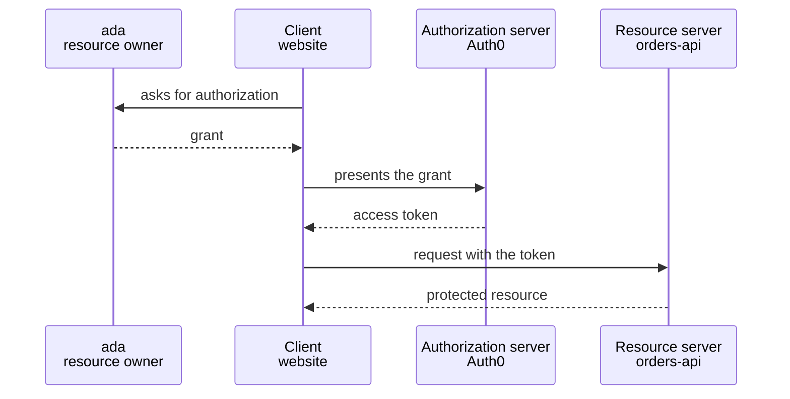

:material-book-open-variant: Reference docs: [RFC 6749, The OAuth 2.0 Authorization Framework](https://www.rfc-editor.org/rfc/rfc6749) (2012); [oauth.net, OAuth 2.0](https://oauth.net/2/) (accessed November 2026)
{ .doc-ref }

### OpenID Connect (OIDC): knowing who is logged in
<span class="pill pill-status pill-status-ok" title="Still valid, checked November 2026">Current · 11/2026</span>

OAuth says "this token can read orders", but not "who is logged in". **OIDC** (published in 2014) adds this identity layer on top of OAuth: in addition to the <span class="term" data-term="access-token">access token</span>, the client receives an **ID token** that says who the user is.

!!! noob "As noob"
    At a hotel, the room card opens my door but does not say my name: that is the access token, meant for the lock (the API). The guest card handed to the front desk says who I am: that is the ID token, meant for the application. The one thing to remember: **the access token opens doors, the ID token introduces the person.**

| Token          | For whom           | Used to                                       |
|----------------|--------------------|-----------------------------------------------|
| access token   | the API            | "this bearer is allowed to read orders"       |
| ID token       | the client application | "the logged-in user is ada, ada@example.com" |
| <span class="term" data-term="refresh-token">refresh token</span>  | the client application | get a new access token without asking to log in again |

Classic mistake: sending the ID token to the API instead of the access token. The ID token is meant for the client, not for granting rights on an API.

:material-book-open-variant: Reference docs: [OpenID Connect Core 1.0](https://openid.net/specs/openid-connect-core-1_0.html) (2014)
{ .doc-ref }

### JWT: what a token looks like
<span class="pill pill-status pill-status-ok" title="Still valid, checked November 2026">Current · 11/2026</span>

Many tokens are **JWTs** (JSON Web Tokens): three base64 parts, separated by dots.

!!! noob "As noob"
    A JWT is a postcard closed with a wax seal: anyone can read what is written, but nobody can change the text without breaking the seal. The API checks the seal, not the secrecy of the content. The one thing to remember: **a JWT cannot be forged, but it is not private.**

```
eyJhbGciOiJSUzI1NiIsImtpZCI6ImsxIn0.eyJpc3MiOi4uLn0.Zm9vYmFy...
└──── header ──────────────────────┘ └─ payload ──┘ └ signature ┘
```
Once decoded, the payload:
```json
{
  "iss": "https://my-tenant.eu.auth0.com/",
  "sub": "auth0|64f1c2",
  "aud": "https://orders-api.example.com",
  "exp": 1792500000,
  "scope": "read:orders"
}
```

| Field   | Meaning                                            | To check on the API side                 |
|---------|----------------------------------------------------|------------------------------------------|
| `iss`   | who issued the token                               | it is really my <span class="term" data-term="identity-provider">identity provider</span>        |
| `sub`   | for whom (the user's identifier)                   |                                          |
| `aud`   | which API it is meant for                          | it is really **my** API                  |
| `exp`   | expiration date                                    | not passed                               |
| `scope` | the rights granted                                 | contains the right required by the route |

Two things to remember:
- a JWT is **signed, not encrypted**: anyone can read its content (jwt.io decodes it). Never put sensitive data in it;
- the API checks the **signature** with the provider's <span class="term" data-term="public-key">public key</span>, published at a standard address (`/.well-known/jwks.json`). The `kid` field of the header says which key to use.

:material-book-open-variant: Reference docs: [RFC 7519, JSON Web Token](https://www.rfc-editor.org/rfc/rfc7519) (2015); [RFC 8725, JWT Best Current Practices](https://www.rfc-editor.org/rfc/rfc8725) (2020)
{ .doc-ref }

### Bearer token: whoever holds it can use it
<span class="pill pill-status pill-status-ok" title="Still valid, checked November 2026">Current · 11/2026</span>

Today, most APIs receive the token like this:
```
GET /orders/42
Authorization: Bearer eyJhbGciOi...
```
"Bearer" means **whoever holds the token can use it**, like a banknote. If the token leaks (in a log, a proxy, a browser extension), the thief can use it until it <span class="term" data-term="token-expiration">expires</span>. This is exactly what <span class="term" data-term="dpop">DPoP</span> fixes, see below.

:material-book-open-variant: Reference docs: [RFC 6750, Bearer Token Usage](https://www.rfc-editor.org/rfc/rfc6750) (2012)
{ .doc-ref }

### Scope
<span class="pill pill-status pill-status-ok" title="Still valid, checked November 2026">Current · 11/2026</span>

My statistics tool must read the orders, but has no reason to be able to change them. The **scope** handles that: it is a specific right, requested by the client and granted in the token, like `read:orders` or `write:orders`. **Least privilege** principle: only ask for what is needed. So the statistics tool asks only for `read:orders`, and if its token leaks, nobody can change an order with it.

:material-book-open-variant: Reference docs: [RFC 6749, Access Token Scope](https://www.rfc-editor.org/rfc/rfc6749#section-3.3) (2012)
{ .doc-ref }

## OAuth flows

<a class="pill pill-scope pill-scope-app" href="../architecture/#map-of-scales">Scale · Application</a>

A **flow** (grant) is the way the client gets its token. The right flow depends on the type of client: ada logging in on her phone does not get her token the way a batch running alone at night does.

### Authorization Code with PKCE: a person logs in
<span class="pill pill-status pill-status-ok" title="Still valid, checked November 2026">Current · 11/2026</span>

The flow for any application where a user logs in: website, mobile app, in-browser application (<span class="term" data-term="spa">SPA</span>), command-line tool.

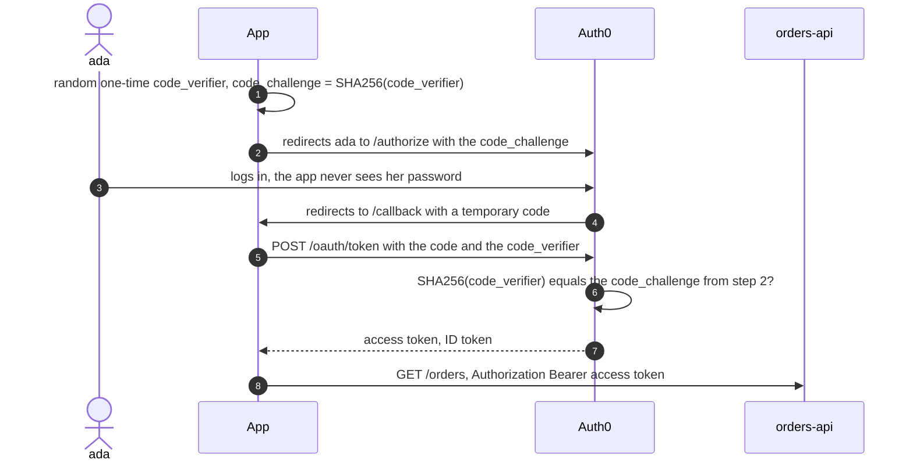

**PKCE** ("pixie", Proof Key for Code Exchange): if someone intercepts the code from step 4 (another app on the phone listening on the same <span class="term" data-term="redirect-uri">redirect address</span>), they can't do anything with it: they don't have the `code_verifier`, which never travelled before step 5.

!!! noob "As noob"
    At a cloakroom, I get a ticket to collect my coat (the code). With PKCE, I also leave the fingerprint of a secret word I keep to myself, and on the way back I need the ticket **and** the secret word. Someone who picks up my ticket leaves without the coat. The one thing to remember: **an intercepted code is useless without the secret that stayed in the application.**

The step 2 request:
```
https://my-tenant.eu.auth0.com/authorize
  ?response_type=code
  &client_id=abc123
  &redirect_uri=https://app.example.com/callback
  &scope=openid profile read:orders
  &audience=https://orders-api.example.com
  &code_challenge=E9Melhoa2OwvFrEMTJguCHaoeK1t8URWbuGJSstw-cM
  &code_challenge_method=S256
  &state=xyz789
```
`state` is a random value that the app checks on return, to make sure the response really matches its own request.

:material-book-open-variant: Reference docs: [RFC 7636, PKCE](https://www.rfc-editor.org/rfc/rfc7636) (2015); [RFC 6749, Authorization Code Grant](https://www.rfc-editor.org/rfc/rfc6749#section-4.1) (2012)
{ .doc-ref }

### Client Credentials: a service talks to a service
<span class="pill pill-status pill-status-ok" title="Still valid, checked November 2026">Current · 11/2026</span>

Here nobody logs in: a service needs a token for itself, and it authenticates with its own credentials (`client_id` and `client_secret`). Typical cases: a nightly batch, a service calling another one, automated tests calling an API.
```
$ curl -s https://my-tenant.eu.auth0.com/oauth/token \
    -H 'Content-Type: application/json' \
    -d '{
      "grant_type": "client_credentials",
      "client_id": "svc-reporting",
      "client_secret": "(from the secret manager)",
      "audience": "https://orders-api.example.com"
    }'
{"access_token": "eyJ...", "expires_in": 86400, "token_type": "Bearer"}
```

:material-book-open-variant: Reference docs: [RFC 6749, Client Credentials Grant](https://www.rfc-editor.org/rfc/rfc6749#section-4.4) (2012)
{ .doc-ref }

### Refresh Token: staying logged in
<span class="pill pill-status pill-status-ok" title="Still valid, checked November 2026">Current · 11/2026</span>

The access token is short-lived (from a few minutes to a few hours). The refresh token is used to get a new one without asking to log in again. Good practice: **rotation**, each refresh token is used only once and replaced by a new one. If an old one is reused, it is a sign of theft, and the provider <span class="term" data-term="token-revocation">revokes</span> the whole token family.

!!! noob "As noob"
    The refresh token is a single-use ticket to get a new day badge, and each visit to the desk gives me a new ticket. If an already used ticket shows up, the desk knows it was copied and cancels the whole series, mine included. The one thing to remember: **a reused ticket gives the theft away, and the provider cuts everything off.**

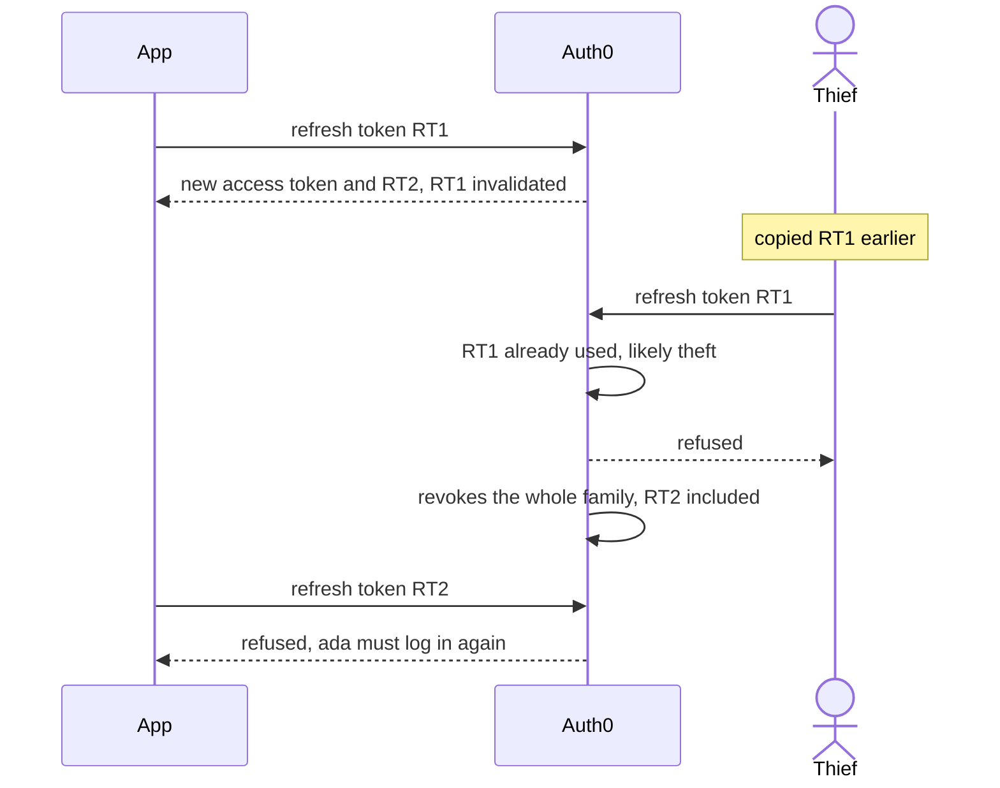

:material-book-open-variant: Reference docs: [RFC 9700, Best Current Practice for OAuth 2.0 Security](https://www.rfc-editor.org/rfc/rfc9700) (2025)
{ .doc-ref }

### Device Authorization: a device without a keyboard
<span class="pill pill-status pill-status-ok" title="Still valid, checked November 2026">Current · 11/2026</span>

My TV, my console or a command-line tool on a server must log in, but it has no browser, or typing a password with a remote control is painful. So the device shows a code, and I type it on my phone, where I log in as usual.
```
Go to https://example.com/activate and enter the code: WDJB-MJHT
```

:material-book-open-variant: Reference docs: [RFC 8628, OAuth 2.0 Device Authorization Grant](https://www.rfc-editor.org/rfc/rfc8628) (2019)
{ .doc-ref }

### Which flow for which client

| Client | Flow |
|---|---|
| I have a website with its own server, like an online shop where ada logs in to follow her orders | Authorization Code + PKCE |
| my application runs entirely in the browser (SPA), with no server of mine to keep a secret, like a React dashboard | Authorization Code + PKCE |
| my application is installed on the user's phone, like the mobile app of the same shop | Authorization Code + PKCE |
| nobody logs in: a service calls another one, a batch runs at night, or my automated tests call the API | <span class="term" data-term="client-credentials">Client Credentials</span> |
| the device has neither a handy keyboard nor a browser, like a TV or a command-line tool on a server | Device Authorization |
| my application shows its own form, asks for the user's password and sends it to the provider itself | **no longer do this** (see OAuth 2.1) |

:material-book-open-variant: Reference docs: [oauth.net, OAuth Grant Types](https://oauth.net/2/grant-types/) (accessed November 2026)
{ .doc-ref }

## OAuth 2.1

<a class="pill pill-scope pill-scope-app" href="../architecture/#map-of-scales">Scale · Application</a>

### What it is
<span class="pill pill-status pill-status-ok" title="Still valid, checked November 2026">Current · 11/2026</span>

OAuth 2.1 does not invent a new protocol. It is OAuth 2.0 **cleaned up**: it gathers in a single text the security best practices accumulated since 2012, and removes what turned out to be dangerous.

Status: it is still an IETF **draft** (version 16, September 2026), not a published standard. But the major providers, including Auth0, Okta and Microsoft, already apply its rules, and the <span class="term" data-term="mcp">MCP</span> protocol (the connectors of AI assistants) requires it.

*Okta: competes with Auth0, Keycloak*
{ .tool-rel }


### What changes

| Change                                             | Before (OAuth 2.0)                                         | With OAuth 2.1                                  |
|----------------------------------------------------|------------------------------------------------------------|-------------------------------------------------|
| **PKCE mandatory**                                 | recommended for mobile apps only                           | mandatory for **all** clients using Authorization Code |
| **Implicit flow removed** <span class="pill pill-status pill-status-obsolete" title="Deprecated by RFC 9700 (January 2025), removed from OAuth 2.1: replaced by Authorization Code + PKCE">Obsolete · 11/2026</span>                          | a <span class="term" data-term="spa">SPA</span> received the token directly in the URL (`#access_token=...`) | removed: a token in the URL leaks into history, logs, the Referer. SPAs use Authorization Code + <span class="term" data-term="pkce">PKCE</span> |
| **Password flow removed** <span class="pill pill-status pill-status-obsolete" title="Forbidden by RFC 9700 (January 2025), removed from OAuth 2.1: replaced by Authorization Code + PKCE">Obsolete · 11/2026</span>                          | the app asked for the password in its form and sent it itself | removed: the app must never see the password. Login happens at the identity provider |
| **exact redirect address**                         | some servers accepted wildcards (`https://*.example.com/*`) | **exact** match of the declared `redirect_uri` |
| **no token in the URL**                            | `GET /orders?access_token=eyJ...` tolerated                | forbidden, only in the `Authorization` header |
| **refresh tokens of public clients**               | reusable indefinitely                                      | single-use (rotation) or bound to a key (DPoP) |

"Public client": an application that cannot keep a <span class="term" data-term="secret">secret</span>, because its code is on the user's side (SPA, mobile app, CLI). As opposed to a "confidential client", a back end that keeps its `client_secret` on a server.

:material-book-open-variant: Reference docs: [IETF, The OAuth 2.1 Authorization Framework](https://datatracker.ietf.org/doc/draft-ietf-oauth-v2-1/) (draft, version 16, September 2026); [oauth.net, OAuth 2.1](https://oauth.net/2.1/) (accessed November 2026)
{ .doc-ref }

### Misconception: "with OAuth 2.1 and DPoP, there are no more passwords"
Not quite. What disappears is the **Password flow**: the application never receives the user's password anymore. But the user can still log in with a password, **on the identity provider's page**. Going fully passwordless is something else: **passkeys** (WebAuthn), a login with a fingerprint or a physical key, which the identity provider can offer in addition. DPoP, for its part, is not about the user's login but about protecting the token once obtained.

A **<span class="term" data-term="passkey">passkey</span>** is a key pair created by the device (phone, computer, physical key) for **a single site**: the private key stays on the device, the site keeps only the public key. **WebAuthn** (a W3C standard, first version in 2019) is the browser API that runs this exchange:
```
registration: the device creates a key pair for example.com and sends the public key to the site
login       :
1. the site sends a challenge: a random single-use value
2. ada unlocks the device (fingerprint, face, PIN), which signs the challenge with the private key
3. the site checks the signature with the registered public key: it is really ada
```
Nothing reusable travels, and the key is bound to the domain: a fake site `examp1e.com` cannot get a valid signature for `example.com`, which defeats phishing.

:material-book-open-variant: Reference docs: [W3C, Web Authentication Level 2](https://www.w3.org/TR/webauthn-2/) (2021)
{ .doc-ref }

## DPoP: a token that only works for its owner

<a class="pill pill-scope pill-scope-app" href="../architecture/#map-of-scales">Scale · Application</a>

### The problem
A stolen <span class="term" data-term="bearer-token">bearer token</span> works for the thief. Example: a token that shows up by mistake in a proxy log can be used by anyone who reads that log, until it expires.

### The idea
<span class="pill pill-status pill-status-ok" title="Still valid, checked November 2026">Current · 11/2026</span>

**DPoP** (Demonstrating Proof of Possession, RFC 9449, published in 2023) binds the token to a **key** that only the client holds. On every request, the client signs a small **proof** with its <span class="term" data-term="private-key">private key</span>. A token stolen without the key is useless.

!!! noob "As noob"
    A bearer token is a banknote: whoever picks it up can spend it. With DPoP, the token becomes a cheque in my name that must be signed on every use, and only I have the pen (the private key). The one thing to remember: **a stolen DPoP token is worthless without its owner's key.**

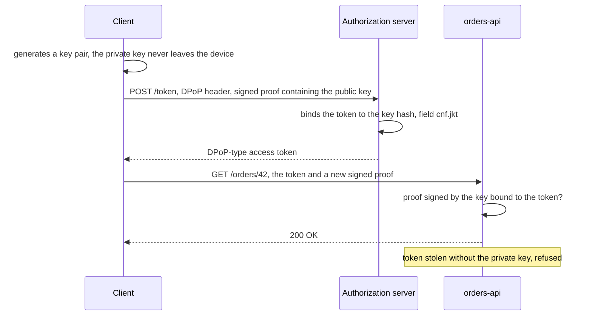

The request changes like this:
```
before (bearer)                             with DPoP
GET /orders/42                              GET /orders/42
Authorization: Bearer eyJhbGciOi...         Authorization: DPoP eyJhbGciOi...
                                            DPoP: eyJ0eXAiOiJkcG9wK2p3dCIs...
```

The proof is a small signed JWT, different for every request:
```json
{
  "htm": "GET",
  "htu": "https://orders-api.example.com/orders/42",
  "iat": 1792496000,
  "jti": "e1j3V_bKic8-LAEB",
  "ath": "fUHyO2r2Z3DZ53EsNrWBb0xWXoaNy59IiKCAqksmQEo"
}
```

| Field | Meaning                                              | What it prevents                                  |
|-------|------------------------------------------------------|---------------------------------------------------|
| `htm` | the HTTP method of this request                      | reusing the proof of a `GET` for a `DELETE`       |
| `htu` | the URL of this request                              | reusing the proof on another route                |
| `iat` | the creation time                                    | reusing an old proof                              |
| `jti` | a unique identifier                                  | replaying the exact same proof                    |
| `ath` | the hash of the access token                         | sticking the proof onto another token             |

### When to use it
| Situation | Is DPoP useful? |
|---|---|
| my SPA or mobile app keeps refresh tokens valid for a long time, so a token stolen from the browser or the phone would stay usable for a long time | yes: a stolen refresh token becomes useless |
| a token stolen on my API would do serious damage, like a payment API or a health data API | yes |
| two services talk on an internal network with tokens that expire very quickly, so a stolen token is not useful for long | lower priority |
| my client cannot keep a private key safe, for example a script that leaves it in plain text in a file | less benefit |

The cost: the client must manage a key and sign every request, and the API must check one more <span class="term" data-term="digital-signature">signature</span>. Recent libraries do it for me.

:material-book-open-variant: Reference docs: [RFC 9449, OAuth 2.0 DPoP](https://www.rfc-editor.org/rfc/rfc9449) (2023)
{ .doc-ref }

## Authorization server metadata

<a class="pill pill-scope pill-scope-system" href="../architecture/#map-of-scales">Scale · System</a>

### The address that describes everything
<span class="pill pill-status pill-status-ok" title="Still valid, checked November 2026">Current · 11/2026</span>

An authorization server publishes, at a standard address, the list of its <span class="term" data-term="endpoint">endpoints</span> and of what it can do. A client can thus configure itself from the provider's address alone.

| Address                                         | Standard                                |
|-------------------------------------------------|-----------------------------------------|
| `/.well-known/openid-configuration`             | OIDC discovery                          |
| `/.well-known/oauth-authorization-server`       | OAuth metadata (RFC 8414, 2018)               |
| `/.well-known/oauth-protected-resource`         | metadata of a protected API (RFC 9728, 2025): "to call me, go get a token from this server" |

```
$ curl -s https://my-tenant.eu.auth0.com/.well-known/openid-configuration | jq
{
  "issuer": "https://my-tenant.eu.auth0.com/",
  "authorization_endpoint": "https://my-tenant.eu.auth0.com/authorize",
  "token_endpoint": "https://my-tenant.eu.auth0.com/oauth/token",
  "jwks_uri": "https://my-tenant.eu.auth0.com/.well-known/jwks.json",
  "registration_endpoint": "https://my-tenant.eu.auth0.com/oidc/register",
  "code_challenge_methods_supported": ["S256", "plain"],
  ...
}
```
The exact values depend on the provider and its configuration. `registration_endpoint` only appears if <span class="term" data-term="dcr">dynamic registration</span> is enabled.

This is what the <span class="term" data-term="mcp">MCP</span> connectors of AI assistants do: the API answers `401` with the address of its metadata, the client reads it, finds the authorization server, and starts the login without any manual configuration.

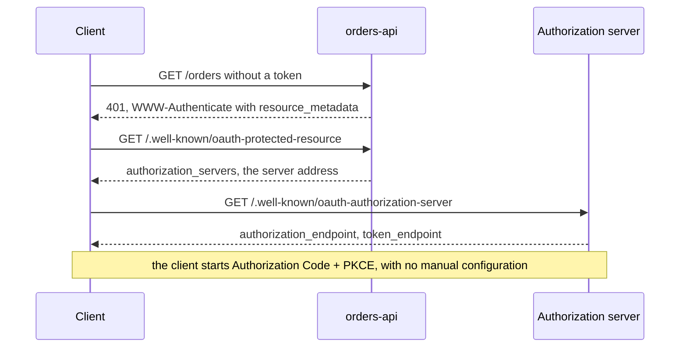

:material-book-open-variant: Reference docs: [RFC 8414, OAuth 2.0 Authorization Server Metadata](https://www.rfc-editor.org/rfc/rfc8414) (2018); [RFC 9728, OAuth 2.0 Protected Resource Metadata](https://www.rfc-editor.org/rfc/rfc9728) (2025)
{ .doc-ref }

## Dynamic Client Registration (DCR)

<a class="pill pill-scope pill-scope-system" href="../architecture/#map-of-scales">Scale · System</a>

### What it is
<span class="pill pill-status pill-status-ok" title="Still valid, checked November 2026">Current · 11/2026</span>

Normally, an administrator creates each client application by hand in the identity provider and gets its `client_id`. With **Dynamic Client Registration** (RFC 7591 from 2015, adopted by OIDC), an application registers **by itself** by calling an address:
```
POST /oidc/register
{
  "client_name": "My reporting tool",
  "redirect_uris": ["https://reporting.example.com/callback"]
}

201 Created
{"client_id": "k8Fj3...", "client_name": "My reporting tool"}
```
Useful when thousands of clients unknown in advance must connect, for example AI assistants plugging into <span class="term" data-term="mcp">MCP</span> servers.

:material-book-open-variant: Reference docs: [RFC 7591, OAuth 2.0 Dynamic Client Registration](https://www.rfc-editor.org/rfc/rfc7591) (2015)
{ .doc-ref }

### Why it is a problem
The registration address is **published in the metadata**, so everyone knows it. If it is open without control, **anyone can create an application** at the identity provider.

Concrete attack scenario:
```
1. the attacker reads registration_endpoint in /.well-known/openid-configuration
2. they register an app named "Official HR tool", with THEIR own redirect address
3. they send ada a login link to the company's REAL login page
4. ada sees the right domain, the right logo, and accepts
5. the code goes to the attacker's address, who gets a token on ada's behalf
```
Other risks: thousands of junk clients created in bulk, and fields like `logo_uri` or `jwks_uri` that make the server itself call addresses chosen by the attacker (<span class="term" data-term="ssrf">SSRF</span>, when the server is tricked into making requests to internal addresses).

### Countermeasures

| Countermeasure                                           | Effect                                                      |
|----------------------------------------------------------|-------------------------------------------------------------|
| disable DCR if it is not needed                          | the most common case: removes the risk                      |
| require an initial registration token                    | only clients that were given it can register                |
| mark registered clients as "third party"                 | mandatory consent screen, limited rights                    |
| limit the <span class="term" data-term="oauth-scope">scopes</span> granted to dynamic clients              | an unknown client cannot get admin rights                   |
| clearly show the client's domain on the consent screen   | the user sees that the app is not the one they think        |
| move to **Client ID Metadata Documents** (CIMD)          | see below                                                   |

### The alternative: Client ID Metadata Documents
<span class="pill pill-status pill-status-ok" title="Still valid, checked November 2026">Current · 11/2026</span>

Instead of registering, the client publishes its own description on **its** domain, and its `client_id` **is** the address of that description:
```
client_id = https://reporting.example.com/oauth-client.json
```
The authorization server downloads the description and checks that the requested redirect address is listed in it. There is no longer an open registration address, and a `client_id` proves at least control of the domain. This is the method the MCP specification now recommends (July 2026 revision), with DCR still possible for compatibility.

:material-book-open-variant: Reference docs: [IETF, OAuth Client ID Metadata Document](https://datatracker.ietf.org/doc/draft-ietf-oauth-client-id-metadata-document/) (draft, accessed November 2026)
{ .doc-ref }

## Auth0

<a class="pill pill-scope pill-scope-system" href="../architecture/#map-of-scales">Scale · System</a>

### Auth0 or OAuth: the difference

*Auth0: competes with Keycloak, Okta*
{ .tool-rel }

- **OAuth 2.0 / 2.1** and **OIDC** are **protocols**: written, public rules that anyone can implement.
- **Auth0** is a **product** (from the company Okta): an online <span class="term" data-term="identity-provider">identity provider</span> that **implements** these protocols and adds what a company needs around them: user management, login via Google or the company directory, <span class="term" data-term="mfa">MFA</span>, login screens, logs, custom rules.

Comparison: OAuth is to an identity provider what HTTP is to a web server. Auth0, Okta, Keycloak (open source) or Microsoft Entra ID are implementations.

*Keycloak: competes with Auth0, Okta*
{ .tool-rel }


:material-book-open-variant: Reference docs: [Auth0, OAuth 2.0 Authorization Framework](https://auth0.com/docs/authenticate/protocols/oauth) (accessed November 2026)
{ .doc-ref }

### Auth0 concepts
<span class="pill pill-status pill-status-ok" title="Still valid, checked November 2026">Current · 11/2026</span>

| Concept         | What it is                                                          | Example                                       |
|-----------------|---------------------------------------------------------------------|-----------------------------------------------|
| tenant          | an isolated Auth0 space, with its own domain                        | `my-tenant.eu.auth0.com`, one per environment |
| application     | an OAuth client (SPA, web, native, machine to machine)              | "Customer site", "Reporting batch"            |
| API             | a protected API, identified by its <span class="term" data-term="token-audience">audience</span>                         | audience `https://orders-api.example.com`     |
| permission      | a scope defined on an API                                           | `read:orders`, `write:orders`                 |
| connection      | a source of users                                                   | Auth0 database, Google, company directory     |
| action          | code run at a given point of the flow                               | add the user's role to the token at login     |
| organization    | a group of users, for a product sold to companies                   | one organization per B2B customer             |

:material-book-open-variant: Reference docs: [Auth0, Auth0 Overview](https://auth0.com/docs/get-started/auth0-overview) (accessed November 2026)
{ .doc-ref }

### The role of the audience
<span class="pill pill-status pill-status-ok" title="Still valid, checked November 2026">Current · 11/2026</span>

In Auth0, the token request specifies the target API with `audience`. The token received carries this audience in `aud`, and the API rejects a token meant for another API.
```
token requested with audience = https://orders-api.example.com
call to orders-api    : accepted
call to billing-api   : rejected (aud does not match)
```
Without `audience`, Auth0 may return a token that is not a JWT my API can use: a frequent cause of "my token is rejected".

:material-book-open-variant: Reference docs: [Auth0, Access Tokens](https://auth0.com/docs/secure/tokens/access-tokens) (accessed November 2026)
{ .doc-ref }

### Auth0 and OAuth 2.1
Auth0 makes it possible to apply the OAuth 2.1 rules: Authorization Code + <span class="term" data-term="pkce">PKCE</span> for SPAs and mobile apps, refresh token rotation, exact redirect addresses. The Password flow still exists for compatibility, but it should be disabled on applications that don't need it. DCR is disabled by default and is enabled at the <span class="term" data-term="tenant">tenant</span> level. Support for <span class="term" data-term="dpop">DPoP</span> and <span class="term" data-term="cimd">CIMD</span> depends on the version and the plan: check the Auth0 documentation before relying on it.

### Common Auth0 pitfalls, on the testing side

| Pitfall                                                      | Consequence                                        | Countermeasure                                 |
|--------------------------------------------------------------|----------------------------------------------------|------------------------------------------------|
| requesting a machine to machine token in every test          | monthly M2M token quota used up, then rejections   | request a token once and reuse it until it expires |
| logging in through the login screen in every E2E test        | slow, and MFA or the attempt limit blocks parallel tests | log in once, save the session, reuse it   |
| several parallel tests on one account with MFA               | "Too many attempts", flaky tests                   | one test account per worker, or login via API  |
| forgetting `audience`                                        | token rejected by the API                          | always specify the audience                    |
| bypassing authentication in integration tests                | rejections are never tested (expired token, wrong rights) | a real signing test token issuer, and rejection tests |
| the same tenant for prod and tests                           | a test can create or lock real accounts            | one tenant per environment                     |

## The most common API vulnerabilities

<a class="pill pill-scope pill-scope-code" href="../architecture/#map-of-scales">Scale · Code</a> <a class="pill pill-scope pill-scope-app" href="../architecture/#map-of-scales">Scale · Application</a>

The reference is the **OWASP API Security Top 10** (2023 edition), a list of the most frequent risks, published by a specialized foundation. The most useful ones to know, with their test:

| Vulnerability                             | Example                                                   | Test to write                                       |
|-------------------------------------------|-----------------------------------------------------------|-----------------------------------------------------|
| **BOLA** (access to someone else's objects) | ada changes `/orders/42` to `/orders/43` and sees grace's order | ada requests grace's order: `403` or `404` expected |
| broken authentication                     | an expired or badly signed token is accepted              | expired token, wrong audience, modified signature: `401` |
| excessive property exposure               | the response contains `password_hash` or internal fields  | check that the response only contains the contract's fields |
| no rate limiting                          | 10,000 requests per second accepted, or `?limit=1000000`  | above the threshold: `429`; `limit` capped          |
| reachable admin functions                 | a regular user calls `DELETE /admin/users/7`              | user without the admin role: `403`                  |
| <span class="term" data-term="ssrf">SSRF</span>                                      | `POST /import {"url": "http://169.254.169.254/"}` reads the server's secrets | an internal URL is rejected            |

BOLA is first on the list: it is also the easiest to test, and often forgotten.

:material-book-open-variant: Reference docs: [OWASP API Security Top 10](https://owasp.org/API-Security/editions/2023/en/0x11-t10/) (2023 edition)
{ .doc-ref }

### Injection
<span class="pill pill-status pill-status-ok" title="Still valid, checked November 2026">Current · 11/2026</span>

I build a query (SQL, system command) by pasting in text typed by the user, like the customer name they search for: they can then slip their own commands into the query, for example to read the whole table. Details and countermeasure on the [SQL](sql.md#security-sql-injection) page: always use <span class="term" data-term="parameterized-query">parameterized queries</span>.

:material-book-open-variant: Reference docs: [OWASP, SQL Injection Prevention Cheat Sheet](https://cheatsheetseries.owasp.org/cheatsheets/SQL_Injection_Prevention_Cheat_Sheet.html) (accessed November 2026)
{ .doc-ref }

### XSS, CSRF, CORS: browser-side vulnerabilities
<span class="pill pill-status pill-status-ok" title="Still valid, checked November 2026">Current · 11/2026</span>

| Acronym | What it is                                                                 | Countermeasure                                           |
|-------|------------------------------------------------------------------------------|----------------------------------------------------------|
| XSS   | the attacker's JavaScript runs in another user's page (a comment containing `<script>`) | escape output, never insert raw HTML, Content-Security-Policy header |
| <span class="term" data-term="csrf">CSRF</span>  | another site makes the victim's browser send a request, with the victim's <span class="term" data-term="cookie">cookies</span> | `SameSite` cookies, anti-CSRF token in forms     |
| <span class="term" data-term="cors">CORS</span>  | the rule that says which other sites may call my API from a browser          | list the allowed origins, never `*` with cookies         |

:material-book-open-variant: Reference docs: [OWASP, Cross Site Scripting Prevention Cheat Sheet](https://cheatsheetseries.owasp.org/cheatsheets/Cross_Site_Scripting_Prevention_Cheat_Sheet.html) (accessed November 2026)
{ .doc-ref }

### The origin
An **origin** is the scheme + host + port trio of an address. The browser isolates origins from each other: it is the basis of CSRF, CORS and <span class="term" data-term="samesite">SameSite</span>.
```
https://app.example.com:443/orders     reference origin
https://app.example.com/profile        same origin (the path does not count, 443 is the default port)
http://app.example.com                 other origin (different scheme)
https://api.example.com                other origin (different host)
https://app.example.com:8443           other origin (different port)
```

:material-book-open-variant: Reference docs: [RFC 6454, The Web Origin Concept](https://www.rfc-editor.org/rfc/rfc6454) (2011); [MDN, Same-origin policy](https://developer.mozilla.org/en-US/docs/Web/Security/Same-origin_policy) (accessed November 2026)
{ .doc-ref }

### CSRF and SameSite cookies
<span class="pill pill-status pill-status-ok" title="Still valid, checked November 2026">Current · 11/2026</span>

CSRF (Cross-Site Request Forgery) in three steps:
```
1. ada is logged in to orders-api.example.com, her browser keeps the cookie session=abc
2. ada opens evil.example, which contains a hidden form:
   <form action="https://orders-api.example.com/orders/42/cancel" method="POST"></form>
   and submits it automatically with JavaScript
3. the browser sends the request WITH the cookie session=abc: orders-api thinks it is ada and cancels the order
```

!!! noob "As noob"
    My browser is like an assistant who always wears my badge: a malicious site hands them a form, they drop it off at the bank, and the bank sees my badge and accepts it. The browser makes no difference between a click from me and a request slipped in by another site. The one thing to remember: **CSRF does not steal my cookie, it makes my browser act on my behalf.**

The main countermeasure is the cookie's `SameSite` attribute, which tells the browser not to attach the cookie to requests coming from another site:
```
Set-Cookie: session=abc; HttpOnly; Secure; SameSite=Lax; Path=/
```

| Attribute       | Effect                                                                |
|-----------------|-----------------------------------------------------------------------|
| `HttpOnly`      | the page's JavaScript cannot read the cookie (limits theft through XSS) |
| `Secure`        | the cookie is only sent over HTTPS                                    |
| `SameSite=Lax`  | no cookie on a `POST` coming from another site; sent on a plain clicked link (`GET`) |
| `SameSite=Strict` | never a cookie from another site, not even on a link                |
| `SameSite=None` | always sent (requires `Secure`): keep it for real cross-site needs    |

An API called only with `Authorization: Bearer ...` is not exposed to CSRF: the browser does not add that header on its own.

:material-book-open-variant: Reference docs: [OWASP, CSRF Prevention Cheat Sheet](https://cheatsheetseries.owasp.org/cheatsheets/Cross-Site_Request_Forgery_Prevention_Cheat_Sheet.html) (accessed November 2026); [MDN, Set-Cookie](https://developer.mozilla.org/en-US/docs/Web/HTTP/Headers/Set-Cookie) (accessed November 2026)
{ .doc-ref }

### CORS: the preflight request
<span class="pill pill-status pill-status-ok" title="Still valid, checked November 2026">Current · 11/2026</span>

By default, JavaScript on `https://app.example.com` cannot read the response of a call to `https://orders-api.example.com` (another origin). **CORS** (Cross-Origin Resource Sharing) lets the API say which origins it accepts. For a "non-simple" request (`PUT` or `DELETE` method, `Authorization` header, JSON body), the browser first sends an `OPTIONS` **preflight** request:
```
OPTIONS /orders/42 HTTP/1.1
Origin: https://app.example.com
Access-Control-Request-Method: DELETE
Access-Control-Request-Headers: authorization

HTTP/1.1 204 No Content
Access-Control-Allow-Origin: https://app.example.com
Access-Control-Allow-Methods: GET, POST, DELETE
Access-Control-Allow-Headers: authorization, content-type
Access-Control-Max-Age: 600
```
If the origin is not in the response, the browser does not send the `DELETE`. CORS protects browser users, not the API: `curl` ignores it completely, server-side authorization stays essential.

!!! noob "As noob"
    CORS is a guard posted in the browser, not in front of the API: before letting a page talk to another origin, it asks the API "do you accept visitors from this site?". Someone who comes in through another door (`curl`, a script) never meets that guard. The one thing to remember: **CORS protects a browser's user, the API's security stays on the server.**

:material-book-open-variant: Reference docs: [WHATWG, Fetch Standard, CORS protocol](https://fetch.spec.whatwg.org/#http-cors-protocol) (accessed November 2026); [MDN, CORS](https://developer.mozilla.org/en-US/docs/Web/HTTP/CORS) (accessed November 2026)
{ .doc-ref }

### Content-Security-Policy
<span class="pill pill-status pill-status-ok" title="Still valid, checked November 2026">Current · 11/2026</span>

The **Content-Security-Policy** (<span class="term" data-term="csp">CSP</span>) header tells the browser where the page may load code from. A script injected through XSS from another domain, or written inline in the page, is then blocked:
```
Content-Security-Policy: default-src 'self'; script-src 'self' https://cdn.example.com; object-src 'none'; frame-ancestors 'none'
```
Here: everything comes from the <span class="term" data-term="same-origin">same origin</span> by default, scripts also from `cdn.example.com`, no plugins, and the page cannot be shown in another site's iframe. Tip: start with `Content-Security-Policy-Report-Only` to see what would break without blocking anything.

:material-book-open-variant: Reference docs: [W3C, Content Security Policy Level 3](https://www.w3.org/TR/CSP3/) (accessed November 2026); [MDN, CSP](https://developer.mozilla.org/en-US/docs/Web/HTTP/CSP) (accessed November 2026)
{ .doc-ref }

## Secrets

<a class="pill pill-scope pill-scope-app" href="../architecture/#map-of-scales">Scale · Application</a> <a class="pill pill-scope pill-scope-infra" href="../architecture/#map-of-scales">Scale · Infrastructure</a>

<a class="pill pill-dora" href="https://dora.dev/capabilities/pervasive-security/">DORA · Pervasive security</a>


### What I must never do
```python
# Avoid: secret hardcoded in the code, it ends up in Git forever
API_KEY = "sk_live_51H8..."
```
A secret in the code ends up in Git, so in every clone, every fork, and the <span class="term" data-term="git-history">history</span> forever.

### Best practices
<span class="pill pill-status pill-status-ok" title="Still valid, checked November 2026">Current · 11/2026</span>

| Practice                                       | Example                                                      |
|------------------------------------------------|--------------------------------------------------------------|
| secrets in a dedicated manager                 | Vault, the cloud <span class="term" data-term="secret-manager">secret manager</span>, masked CI variables         |
| detect before the commit                       | gitleaks as a <span class="term" data-term="pre-commit-hook">pre-commit hook</span> and in CI                      |
| a committed secret is a compromised secret     | revoke it and generate a new one, even in a private repository |
| never a secret in the logs                     | mask `Authorization`, `password`, `token` before writing     |
| minimal rights                                 | a read-only account for tests that only read                 |
| short lifetime                                 | tokens that expire in hours, not months                      |

Changing a secret without downtime needs two valid versions during a short overlap: create the new one, let the applications pick it up, then revoke the old one. After a leak, it is the same sequence sped up, and if the secret is public, revoke the old version first and accept a short outage.

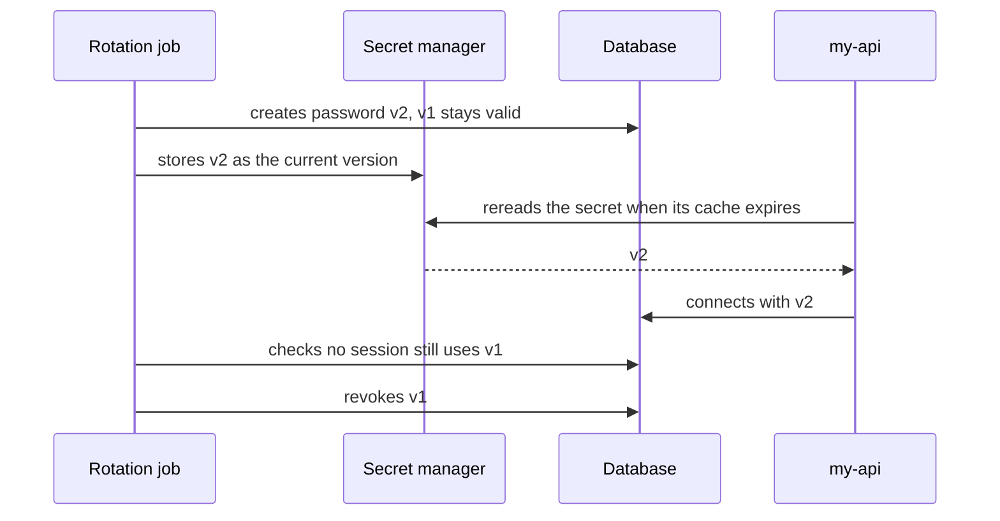

:material-book-open-variant: Reference docs: [OWASP, Secrets Management Cheat Sheet](https://cheatsheetseries.owasp.org/cheatsheets/Secrets_Management_Cheat_Sheet.html) (accessed November 2026); [gitleaks](https://github.com/gitleaks/gitleaks) (accessed November 2026)
{ .doc-ref }

### Storing a password
<span class="pill pill-status pill-status-ok" title="Still valid, checked November 2026">Current · 11/2026</span>

Never in plain text, never with a simple fast <span class="term" data-term="hash">hash</span> (MD5, SHA-256). With a **deliberately slow** algorithm and a <span class="term" data-term="salt">salt</span>: Argon2id, bcrypt or scrypt. The salt (a random value per user) prevents comparing millions of passwords at once against a precomputed table. The best option is still not to store passwords at all, by delegating login to an identity provider.

!!! noob "As noob"
    Hashing a password is putting it through a shredder: I cannot rebuild the page, only shred a candidate again and compare. A slow algorithm makes every guess expensive for an attacker, and the salt is a different ingredient added for each person, so that two identical passwords do not give the same result. The one thing to remember: **slow and salted, so that guessing is expensive, one account at a time.**

In Python, with the `argon2-cffi` library:
```python
from argon2 import PasswordHasher
from argon2.exceptions import VerifyMismatchError

ph = PasswordHasher()


# Good: argon2id, slow and salted, the salt is stored in the result
def hash_password(password: str) -> str:
    return ph.hash(password)


# Example: checks an attempt against the stored hash
def check_password(stored: str, attempt: str) -> bool:
    try:
        ph.verify(stored, attempt)
    except VerifyMismatchError:
        return False
    return True
```
The string stored in the database holds everything needed to verify later:
```
$argon2id$v=19$m=65536,t=3,p=4$c2VsYWxlYXRvaXJl$Zp3m0qN1YcG0...
 algo     version  parameters     salt (base64)   hash (base64)
```
`m` is the memory in KiB, `t` the number of passes, `p` the parallelism (library defaults, to check for the version in use). Since the parameters are in the string, they can be hardened later: `ph.check_needs_rehash(stored)` says whether to recompute the hash at the next successful login.

:material-book-open-variant: Reference docs: [OWASP, Password Storage Cheat Sheet](https://cheatsheetseries.owasp.org/cheatsheets/Password_Storage_Cheat_Sheet.html) (accessed November 2026); [RFC 9106, Argon2](https://www.rfc-editor.org/rfc/rfc9106) (2021)
{ .doc-ref }

## Threat modeling (STRIDE)

<a class="pill pill-scope pill-scope-system" href="../architecture/#map-of-scales">Scale · System</a>

<a class="pill pill-practice" href="../livraison/#design-before-coding">Practice · Technical design</a>
<a class="pill pill-dora" href="https://dora.dev/capabilities/pervasive-security/">DORA · Pervasive security</a>

### What it is
<span class="pill pill-status pill-status-ok" title="Still valid, checked November 2026">Current · 11/2026</span>

<span class="term" data-term="threat-modeling">Threat modeling</span> means drawing a system and listing what an attacker could do to it, **before** writing the code. A flaw found on a diagram costs one line of the diagram; found in production, it costs a redesign.

Adam Shostack ("Threat Modeling: Designing for Security", 2014) sums up the method in four questions:

| Question                                  | What I produce                                     |
|-------------------------------------------|----------------------------------------------------|
| what are we working on?                   | a data flow diagram                                |
| what can go wrong?                        | a list of threats, using the STRIDE grid           |
| what are we going to do about it?         | one measure per threat: fix, reduce, accept or transfer |
| did we do a good job?                     | tests and controls that prove the measures          |

:material-book-open-variant: Reference docs: [OWASP, Threat Modeling Cheat Sheet](https://cheatsheetseries.owasp.org/cheatsheets/Threat_Modeling_Cheat_Sheet.html) (accessed November 2026)
{ .doc-ref }

### The diagram: data flows and trust boundaries
I start from a <span class="term" data-term="data-flow-diagram">data flow diagram</span>: the actors, the processes, the stores and the arrows between them. A <span class="term" data-term="trust-boundary">trust boundary</span> is where data moves from one zone to another that does not trust it: internet to the API, the API to the database, a service to an external supplier. Threats concentrate on these boundaries.

!!! noob "As noob"
    A trust boundary is a border crossing: every time something passes from one country to another, what comes in is checked, because the receiving side does not know the sender. Problems mostly happen at those posts, rarely in the middle of a country. The one thing to remember: **draw the borders, then look for threats at each crossing.**

Example: a client uploads a profile picture to `my-api`, which stores it and has it resized.

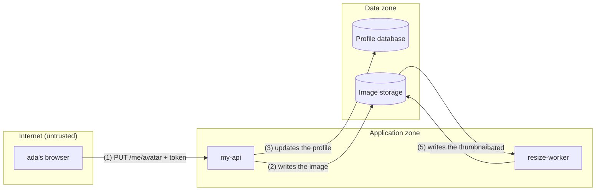

### The STRIDE grid
<span class="pill pill-status pill-status-ok" title="Still valid, checked November 2026">Current · 11/2026</span>

<span class="term" data-term="stride">STRIDE</span> (Loren Kohnfelder and Praerit Garg, Microsoft, 1999) gives six threat families to run over every element and every arrow of the diagram. Each letter is the violation of one security property.

| Letter | Threat                                  | Property violated | Example on the diagram                                  | Measure                                            |
|--------|-----------------------------------------|-------------------|---------------------------------------------------------|----------------------------------------------------|
| S      | spoofing                                | authentication    | a stolen token lets someone change ada's avatar (1)     | short tokens, <span class="term" data-term="dpop">DPoP</span> for public clients |
| T      | tampering                               | integrity         | the image is replaced in storage after the check (2, 4) | only the API writes to storage, SHA-256 hash checked by the worker |
| R      | repudiation                             | accountability    | "I never uploaded that image"                           | audit log: who, when, file hash                    |
| I      | information disclosure                  | confidentiality   | the storage is public, or a photo keeps its GPS coordinates | private storage, EXIF metadata stripped        |
| D      | denial of service                       | availability      | a 500 MB image or a decompression "bomb" blocks the worker (4) | maximum size, capped processing time, per-user quota |
| E      | elevation of privilege                  | authorization     | a flaw in the image library gives control of the worker | isolated worker, no outbound network, with <span class="term" data-term="least-privilege">least privilege</span> |

Each measure becomes a testable requirement: "a 21 MB image is rejected", "the bucket refuses an anonymous read". A threat I choose to keep becomes an <span class="term" data-term="accepted-risk">accepted risk</span>, written down, with an owner and a review date.

:material-book-open-variant: Reference docs: [Microsoft, Threat Modeling Tool threats (STRIDE)](https://learn.microsoft.com/en-us/azure/security/develop/threat-modeling-tool-threats) (accessed November 2026)
{ .doc-ref }

### When to do it
| Situation | Threat model? |
|---|---|
| I open a new door to the outside, like a public API, a file upload or a <span class="term" data-term="webhook">webhook</span> that a partner calls | yes, before development |
| my service will handle sensitive data it did not see before, like health, payment or identity data | yes |
| I plug in a new supplier, or data crosses a new trust boundary, like a call to an external payment service | yes |
| the architecture changes, for example I split a service in two or add a new store | yes, starting from the existing diagram |
| I fix a label or refactor without creating any new data flow | no |

Suggested format: one hour, the team that builds it, a diagram on the board. Redo the exercise each time the diagram changes rather than one big analysis once a year. The Threat Modeling Manifesto (group of authors, 2020) gives the principles to make it a team habit.

:material-book-open-variant: Reference docs: [Threat Modeling Manifesto](https://www.threatmodelingmanifesto.org/) (2020)
{ .doc-ref }

## Zero trust and service-to-service identity

<a class="pill pill-scope pill-scope-system" href="../architecture/#map-of-scales">Scale · System</a> <a class="pill pill-scope pill-scope-infra" href="../architecture/#map-of-scales">Scale · Infrastructure</a>

<a class="pill pill-dora" href="https://dora.dev/capabilities/pervasive-security/">DORA · Pervasive security</a>

### What it is
<span class="pill pill-status pill-status-ok" title="Still valid, checked November 2026">Current · 11/2026</span>

The classic model protects the **perimeter**: a firewall at the entrance, and everything inside trusts everything else. The problem: an attacker who takes over a single service, even a small internal tool, can then call all the others, payments-service included.

<span class="term" data-term="zero-trust">Zero trust</span> starts from the opposite assumption: the internal network is already compromised. Being in the cluster grants **no** rights; every call is authenticated, authorized and encrypted, as if it came from the internet. The reference is NIST SP 800-207 ("Zero Trust Architecture", August 2020).

!!! noob "As noob"
    In the perimeter model, once I am past the front desk of a building, my badge opens every floor. In zero trust, every door checks my badge and decides whether I may enter that particular room, even if I am already inside the building. The one thing to remember: **being inside proves nothing, every call shows who it is.**

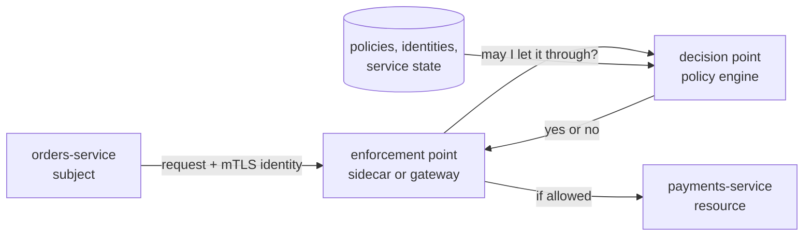

NIST SP 800-207 separates the **decision point** (which judges, from the policies) from the **enforcement point** (which blocks or lets through, as close to the service as possible). In a service mesh, the latter is the proxy running next to each service.

:material-book-open-variant: Reference docs: [NIST SP 800-207, Zero Trust Architecture](https://csrc.nist.gov/pubs/sp/800/207/final) (2020)
{ .doc-ref }

### The building blocks
<span class="pill pill-status pill-status-ok" title="Still valid, checked November 2026">Current · 11/2026</span>

| Building block                  | What it is                                                                   | Example                                         |
|---------------------------------|------------------------------------------------------------------------------|-------------------------------------------------|
| workload identity               | an identity given by the platform to the running service, with no secret copied by hand | the orders-service pod receives its identity at startup |
| SPIFFE                          | a standard that names each service with a URI and gives it a certificate that proves it | `spiffe://example.org/ns/prod/sa/orders-service` |
| mTLS                            | TLS where **both sides** present a certificate: each proves its identity to the other, and the exchange is encrypted | orders-service and payments-service verify each other |
| authorization policy            | a "who may call what" rule, deny by default                                  | only orders-service may call `POST /charges`    |
| <span class="term" data-term="short-lived-credential">short-lived credentials</span> | certificates and tokens that expire in minutes or hours, renewed automatically | certificate valid 1 h, token valid 5 min (example) |

A <span class="term" data-term="workload-identity">workload identity</span> replaces the shared API key: there is nothing left to steal in an environment variable, and nothing to rotate by hand. <span class="term" data-term="spiffe">SPIFFE</span> (a CNCF project, check its current status) is the most widespread format; SPIRE is its reference implementation, and several <span class="term" data-term="service-mesh">service meshes</span> (Istio, Linkerd) issue compatible identities.

*Istio: competes with Linkerd; complements Envoy*<br>
*Linkerd: competes with Istio*
{ .tool-rel }


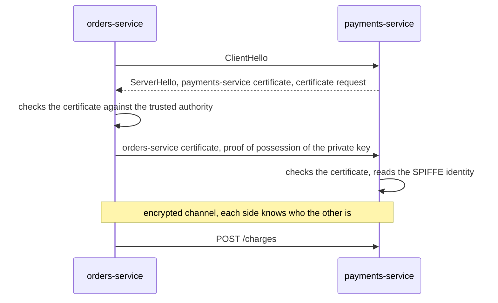

:material-book-open-variant: Reference docs: [SPIFFE, Overview](https://spiffe.io/docs/latest/spiffe-about/overview/) (accessed November 2026); [RFC 8446, TLS 1.3](https://www.rfc-editor.org/rfc/rfc8446) (2018)
{ .doc-ref }

### Before and after
```
before (perimeter)                           after (zero trust)
flat network, plain HTTP                     mTLS everywhere, encrypted and authenticated
one API key shared by all services           one SPIFFE identity per service
key never changed                            certificate renewed every hour
anyone can call anyone                       deny by default, rules per service and per route
one stolen key = access to everything        one compromised service = access to its allowed routes only
```

<span class="term" data-term="mtls">mTLS</span> proves **which service** is calling, not **on behalf of which user**. When orders-service acts for ada, it also passes a user token whose audience is payments-service, so the final service checks ada's rights and not only those of the calling service (token exchange: RFC 8693, 2020). A token can also be bound to the client's mTLS certificate (RFC 8705, 2020): stolen, it is useless without the certificate, as with DPoP.

### Link with Client Credentials
The [Client Credentials](#client-credentials-a-service-talks-to-a-service) flow is still valid for a service calling an OAuth-protected API, especially outside the cluster. But its `client_secret` is a long-lived secret to store and rotate. With a workload identity, the service authenticates with its certificate or a token signed by the platform, and several identity providers accept that token instead of the `client_secret` (workload identity federation, check per provider).

:material-book-open-variant: Reference docs: [RFC 8693, OAuth 2.0 Token Exchange](https://www.rfc-editor.org/rfc/rfc8693) (2020); [RFC 8705, OAuth 2.0 Mutual-TLS](https://www.rfc-editor.org/rfc/rfc8705) (2020)
{ .doc-ref }

### Where to start
1. Remove secrets shared between services: it is the most serious risk.
2. Give each service an identity and turn on mTLS in permissive mode (plain and encrypted both accepted), to measure who still talks in plain text.
3. Switch to strict mode service by service.
4. Write the authorization policies from the observed traffic, then enforce them deny by default.
5. Log every denial and track it during the transition.

:material-book-open-variant: Reference docs: [CISA, Zero Trust Maturity Model](https://www.cisa.gov/zero-trust-maturity-model) (version 2.0, 2023)
{ .doc-ref }

### A deny-by-default policy
<span class="pill pill-status pill-status-ok" title="Still valid, checked November 2026">Current · 11/2026</span>

Example with Istio: only orders-service's <span class="term" data-term="service-account">service account</span> may call `POST /charges` on payments-service.
```yaml
# Good: deny by default, only orders-service may call POST /charges
apiVersion: security.istio.io/v1
kind: AuthorizationPolicy
metadata:
  name: payments-allow-orders
  namespace: prod
spec:
  selector:
    matchLabels:
      app: payments-service
  action: ALLOW
  rules:
    - from:
        - source:
            principals: ["cluster.local/ns/prod/sa/orders-service"]
      to:
        - operation:
            methods: ["POST"]
            paths: ["/charges"]
```
As soon as an `ALLOW` policy targets a service, any request that matches no rule is denied (`403`): billing-service, a `GET /charges` from orders-service, or a call without an mTLS identity. The verified identity (`principals`) comes from the mTLS certificate, not from a header that could be forged.

:material-book-open-variant: Reference docs: [Istio, Authorization Policy](https://istio.io/latest/docs/reference/config/security/authorization-policy/) (accessed November 2026)
{ .doc-ref }

## Personal data and GDPR in the architecture

<a class="pill pill-scope pill-scope-system" href="../architecture/#map-of-scales">Scale · System</a> <a class="pill pill-scope pill-scope-enterprise" href="../architecture/#map-of-scales">Scale · Enterprise</a>

### What it is
The <span class="term" data-term="gdpr">GDPR</span> (EU regulation 2016/679, adopted in 2016 and applied since May 2018) governs any processing of **personal data**: any information relating to an identifiable person, directly (name, email) or indirectly (customer id, IP address).

Its article 25 requires <span class="term" data-term="privacy-by-design">data protection by design and by default</span>: protection is part of the architecture, and the default setting is the most protective one. For a technical team, it translates into five design decisions.

:material-book-open-variant: Reference docs: [Regulation (EU) 2016/679, GDPR](https://eur-lex.europa.eu/eli/reg/2016/679/oj) (2016)
{ .doc-ref }

### GDPR vocabulary
| Term                               | What it is                                                                   |
|------------------------------------|------------------------------------------------------------------------------|
| <span class="term" data-term="dpo">DPO</span> (Data Protection Officer)      | the person who advises on and monitors compliance in the organization (articles 37 to 39); the one to consult about a new processing |
| processing                         | any operation on personal data: collecting, storing, reading, sending, erasing |
| <span class="term" data-term="processing-register">record of processing activities</span>    | the written list of all the organization's processing, with purpose, data, recipients and retention (article 30) |
| <span class="term" data-term="legal-basis">legal basis</span>                        | the legal reason that allows a processing (article 6): consent, contract, legal obligation, vital interests, public task or legitimate interest. Without a legal basis, the processing is forbidden |
| adequacy decision                  | a European Commission decision recognizing that a non-EU country protects data well enough: transfers to it are free |
| <span class="term" data-term="standard-contractual-clauses">standard contractual clauses</span> (SCC) | a model contract published by the European Commission (June 2021 version), signed with a non-EU provider to frame a transfer to a country without an adequacy decision |

A register entry, as an example:
```
processing : order management       | purpose : deliver and invoice      | legal basis : contract (art. 6.1.b)
data       : name, address, e-mail  | recipients : orders-service, billing-service, carrier
retention  : 10 years after the order (accounting, to check per country) | transfers outside the EU : none
```

### The design decisions
| Principle                         | What it means                                                            | Architecture decision                                       |
|-----------------------------------|--------------------------------------------------------------------------|-------------------------------------------------------------|
| minimisation (art. 5)             | only collect what serves the stated purpose                              | no date of birth if age is never used                       |
| pseudonymisation (art. 4 and 25)  | replace the identity with an identifier, the mapping kept separately     | personal data in customers-service, the other services only see `customer_id` |
| retention period (art. 5)         | every piece of data has an end date                                      | automatic purge, log and topic retention configured         |
| data subject rights (art. 15 to 22) | access, rectification, erasure, portability                            | an erasure procedure that covers databases, logs, events and backups |
| transfers outside the EU (chapter V) | data only leaves the EU in regulated cases                            | choice of hosting regions and suppliers                     |

<span class="term" data-term="data-minimization">Minimisation</span> is the most cost-effective measure: data I don't have cannot leak, needs no purge and is never transferred.

:material-book-open-variant: Reference docs: [EDPB, Guidelines 4/2019 on Article 25](https://www.edpb.europa.eu/our-work-tools/our-documents/guidelines/guidelines-42019-article-25-data-protection-design-and_en) (version 2.0, 2020)
{ .doc-ref }

### Pseudonymisation or anonymisation
<span class="term" data-term="pseudonymization">Pseudonymisation</span> reduces exposure, but the data remains personal and the GDPR fully applies. Only true, irreversible <span class="term" data-term="data-anonymization">anonymisation</span> takes it out of the regulation. The difference, and the four ways to re-identify "anonymous" data, are detailed on the [AI at work](ia-entreprise.md#why-anonymous-mode-is-actually-pseudonymisation) page.

### Retention period
Each personal field has a purpose and a <span class="term" data-term="retention-period">retention period</span>, written in the record of processing activities. Forgotten copies are the trap: application logs, Kafka topics with unlimited <span class="term" data-term="message-retention">retention</span>, exports to a data warehouse, test environments fed with production data.

```
data                         period (example)            mechanism
active customer account      as long as the account exists   deletion at closure
order                        10 years (accounting obligation, check per country)  archive then purge
application logs             30 days                     log tool retention, no email in the logs
topic order.created          7 days                      the topic's retention.ms
```

### Right to erasure and event logs
<span class="pill pill-status pill-status-ok" title="Still valid, checked November 2026">Current · 11/2026</span>

The <span class="term" data-term="right-to-erasure">right to erasure</span> (article 17) is simple in a database, hard in an immutable <span class="term" data-term="event-log">event log</span> or a backup: an event published six months ago cannot be rewritten.

<span class="term" data-term="crypto-shredding">Crypto-shredding</span> addresses this case: each customer's personal fields are encrypted with **their own key**, stored in a <span class="term" data-term="kms">key management service</span>. Erasing the customer means destroying their key.

!!! noob "As noob"
    My personal data sits in a safe, and that safe is copied into archives that cannot be changed. Rather than going through every archive, I destroy the only key to the safe: the copies remain, but nobody can open them anymore. Limit: it all depends on really destroying the key, including in its backups. The one thing to remember: **here, erasing means throwing away the key.**

```
order.created event in Kafka
{ "order_id": "42", "customer_id": "cust-ada", "personal_data": "gAAAAABl...(encrypted with cust-ada's key)" }

ada requests erasure         : cust-ada's key is destroyed
replay six months later      : order_id and customer_id readable, personal_data unreadable everywhere
```

Two limits: a key restored from an old backup cancels the erasure, and the legal value of this method as erasure is still debated (check with the DPO). The best option is still to keep personal data out of events: publish only `customer_id`.

### Data residency
<span class="term" data-term="data-residency">Data residency</span> is the constraint on the country or region where data is stored **and processed**. A transfer outside the EU is only possible with a legal basis (adequacy decision, standard contractual clauses). Concrete consequences: pick a European region at the cloud provider, check where the side managed services run (logs, support, AI), and list the subprocessors. The framework for transfers to the United States has changed several times (Schrems II ruling in 2020, Data Privacy Framework in 2023): check it at decision time.

For high-risk processing (health data, large-scale monitoring), a <span class="term" data-term="dpia">data protection impact assessment (DPIA)</span> is mandatory before starting it (article 35).

:material-book-open-variant: Reference docs: [European Commission, Adequacy decisions](https://commission.europa.eu/law/law-topic/data-protection/international-dimension-data-protection/adequacy-decisions_en) (accessed November 2026)
{ .doc-ref }

## Security testing tools

<a class="pill pill-scope pill-scope-code" href="../architecture/#map-of-scales">Scale · Code</a> <a class="pill pill-scope pill-scope-app" href="../architecture/#map-of-scales">Scale · Application</a>

<a class="pill pill-dora" href="https://dora.dev/capabilities/pervasive-security/">DORA · Pervasive security</a>


| Tool                     | What it does                                                   | Example                                  |
|--------------------------|----------------------------------------------------------------|------------------------------------------|
| SAST                     | analyzes the source code without running it                    | detects a SQL query built by concatenation |
| dependency scan          | looks for known vulnerabilities in the libraries used          | "version 2.3 of this lib has a critical vulnerability" |
| secret scan              | looks for keys and passwords in the code and the history       | gitleaks                                 |
| DAST                     | attacks the running application from the outside               | OWASP ZAP on the integration environment |
| penetration test         | a specialist looks for vulnerabilities by hand                 | before a sensitive production release    |

Each tool runs where fixing what it finds is cheapest: as early as possible for what shows in the code, on the running application for the rest.

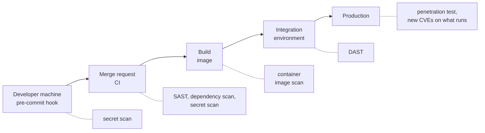

:material-book-open-variant: Reference docs: [OWASP, Web Security Testing Guide](https://owasp.org/www-project-web-security-testing-guide/) (accessed November 2026)
{ .doc-ref }

### Example: a dependency scan
<span class="pill pill-status pill-status-ok" title="Still valid, checked November 2026">Current · 11/2026</span>

The scan compares installed versions with a database of published vulnerabilities (CVE or GHSA identifiers). In Python with `pip-audit` (in JavaScript, `npm audit` does the same):
```
$ pip-audit -r requirements.txt
Found 1 known vulnerability in 1 package
Name     Version ID                  Fix Versions
-------- ------- ------------------- ------------
requests 2.31.0  GHSA-9wx4-h78v-vm56 2.32.0
```
Reading: `requests` 2.31.0 has a known vulnerability, fixed in 2.32.0 (illustrative output, to check). In CI, the command returns an error code when it finds a vulnerability, which blocks the pipeline; a tool like Renovate then opens the update.

*Renovate: competes with Dependabot; complements Snyk, Trivy*
{ .tool-rel }


:material-book-open-variant: Reference docs: [pip-audit](https://github.com/pypa/pip-audit) (accessed November 2026)
{ .doc-ref }

## Security operations

<a class="pill pill-scope pill-scope-infra" href="../architecture/#map-of-scales">Scale · Infrastructure</a> <a class="pill pill-scope pill-scope-enterprise" href="../architecture/#map-of-scales">Scale · Enterprise</a>

<a class="pill pill-dora" href="https://dora.dev/capabilities/pervasive-security/">DORA · Pervasive security</a>

!!! info "Section written in November 2026"
    Security products change name, scope and pricing model quickly. The names given are examples, not recommendations, and their features are to check at the time of reading.

The previous sections cover what goes **into** the code. This one covers the tools that run **around** it: they watch what happens in production, check the cloud configuration and keep the secrets. Most are owned by a security or platform team; development teams feed them (logs, policies, fixes) and receive their alerts.

| Family | The question it answers | Who looks at it day to day | Examples |
|---|---|---|---|
| SIEM | what happened, across every system at once? | security team, <span class="term" data-term="soc">SOC</span> | Splunk, Microsoft Sentinel, Elastic Security, Google SecOps |
| NDR | who talks to whom on the network, and is it normal? | security team, network team | Darktrace, Corelight, Zeek, Suricata |
| collaborative IPS | is this IP address already attacking someone elsewhere? | platform team, administrators | CrowdSec, fail2ban (local only) |
| CSPM and cloud governance | does the cloud configuration follow our rules? | platform team, FinOps, security | Cloud Custodian, Steampipe, Wiz, Security Command Center |
| secret manager | where do passwords live, and who reads them? | applications, CI, humans | HashiCorp Vault, the cloud's manager, 1Password, Bitwarden |
| SAST and SCA platform | which known flaws are in our code and dependencies? | development teams | SonarQube, Semgrep, Snyk, Aikido |

### SIEM: centralizing and correlating security logs
<span class="pill pill-status pill-status-ok" title="Still valid, checked November 2026">Current · 11/2026</span>

A <span class="term" data-term="siem">SIEM</span> (*Security Information and Event Management*) collects security logs from every system (logins, permission changes, firewalls, cloud, workstations), stores them in a common format and applies **correlation rules**: patterns that no single log shows.

**When**: several teams, several clouds or a regulatory obligation (log retention, intrusion detection, standards such as ISO 27001); someone is paid to watch the alerts. **Not yet**: a small team with nobody to triage alerts. Start then with the cloud audit logs and three or four well-chosen alerts.

**Why**: an attack leaves scattered traces. A failed login on my-api, a new token created, a bulk download from a bucket: each fact is ordinary, their sequence within ten minutes is not. The cost: a bill often based on ingested volume, rules to maintain, and <span class="term" data-term="false-positive">false positives</span> that wear the team out.

**How**, on the development side:

1. emit structured security logs: who (`user_id`), what (`event`), from where (`ip`), outcome; never a secret or a password;
2. send them to the same collector as the other logs, with a field that sets them apart;
3. write with the security team the two or three business-specific rules (a refund above a threshold, an export of the whole customer base).

```
10:02:11  my-api  login_failed   user=ada  ip=203.0.113.7
10:02:14  my-api  login_failed   user=ada  ip=203.0.113.7
   ... 38 failures in 2 minutes
10:04:03  my-api  login_success  user=ada  ip=203.0.113.7
10:06:40  my-api  export_orders  user=ada  rows=184000

rule: more than 20 failures then a success from the same IP, followed by an export
      within 15 minutes: SEV2 alert to the security team
```

Rules can be written in a neutral format, Sigma (open project started in 2017, to check), then translated for the SIEM in use. The IP addresses in the example are reserved for documentation (RFC 5737, 2010).

:material-book-open-variant: Reference docs: [NIST SP 800-92, Guide to Computer Security Log Management](https://csrc.nist.gov/pubs/sp/800/92/final) (2006); [Sigma](https://github.com/SigmaHQ/sigma) (accessed November 2026)
{ .doc-ref }

### Network detection (NDR)
<span class="pill pill-status pill-status-ok" title="Still valid, checked November 2026">Current · 11/2026</span>

An <span class="term" data-term="ndr">NDR</span> (*Network Detection and Response*) analyzes the network traffic itself, from a copy of that traffic (mirror port, cloud *packet mirroring*), instead of the logs applications choose to write.

**When**: a network with many machines I don't control closely (workstations, connected devices, old servers), a data center, an obligation to detect lateral movement. **Not yet**: a fully managed or serverless application, where there is little network of my own to observe; cloud logs (*VPC flow logs*) are often enough.

**Why**: an attacker who got in does not announce themselves in application logs, but they must talk on the network: scan neighbors, contact their command server at regular intervals, move data out. The cost: hardware or sensors, a lot of volume, and limited visibility into encrypted traffic (I see who talks to whom, how much and when, not the content).

**How**: two approaches that combine.

- **Signatures**: Suricata (open source) recognizes known attacks, like a network antivirus.
- **Behavior**: Darktrace (commercial) learns what is normal for each machine and flags deviations; Corelight (commercial) builds on Zeek, an open source engine that turns traffic into readable logs.

A line of `conn.log` produced by Zeek, simplified:
```
ts          id.orig_h   id.resp_h      id.resp_p  proto  duration  orig_bytes  resp_bytes
1730714400  10.0.4.12   198.51.100.20  443        tcp    3600.2    2147483648  5120
```
Reading: an internal machine sent 2 GiB to an external address over one hour, and received almost nothing back. It is not necessarily an attack (a backup?), but it is exactly the pattern of an exfiltration. Fields and format to check depending on the Zeek version.

:material-book-open-variant: Reference docs: [Zeek, documentation](https://docs.zeek.org/) (accessed November 2026); [Suricata, documentation](https://docs.suricata.io/) (accessed November 2026)
{ .doc-ref }

### Collaborative IPS: CrowdSec
<span class="pill pill-status pill-status-ok" title="Still valid, checked November 2026">Current · 11/2026</span>

An <span class="term" data-term="ips">IPS</span> (*Intrusion Prevention System*) detects an attack **and blocks it**, where an IDS only reports it. CrowdSec (open source, French company, launched in 2020, to check) adds a collective dimension: each installation shares the addresses it blocks, and receives in return a list of addresses already seen attacking elsewhere.

**When**: a service exposed to the internet that gets noise (brute force on a login page, scans, bots probing `/wp-admin` paths), especially on servers I run myself. **Not yet**, or with care: clients behind shared addresses (corporate networks, mobile carriers), where blocking one IP blocks hundreds of real users.

**Why**: <span class="term" data-term="rate-limit">rate limiting</span> slows an attacker down, it does not stop them, and it knows nothing of what they did elsewhere. The gain: known attackers are blocked before their first attempt. The cost: false positives, and sharing the observed addresses with the central service (to check in the service terms).

**How**: the agent reads logs (nginx, SSH), applies **scenarios** ("10 failed logins in 1 minute"), makes a **decision** (ban for 4 h); **bouncers** enforce the decision at the right place (firewall, nginx, <span class="term" data-term="cdn">CDN</span>).

*nginx: competes with Caddy, Traefik, Envoy; complements KrakenD*
{ .tool-rel }


```
$ cscli decisions list
 ID  Source    Scope:Value       Reason                          Action  Duration
 12  crowdsec  Ip:203.0.113.7    crowdsecurity/http-bf-wordpress  ban     3h52m
 13  CAPI      Ip:198.51.100.9   crowdsecurity/ssh-bf             ban     166h
```
The first decision comes from the local agent, the second from the community list. Illustrative output, columns to check depending on the version.

:material-book-open-variant: Reference docs: [CrowdSec, documentation](https://docs.crowdsec.net/) (accessed November 2026)
{ .doc-ref }

### CSPM and cloud governance as code
<span class="pill pill-status pill-status-ok" title="Still valid, checked November 2026">Current · 11/2026</span>

<span class="term" data-term="cspm">CSPM</span> (*Cloud Security Posture Management*) continuously checks the actual cloud configuration against rules: public bucket, unencrypted disk, SSH port open to the whole internet, service account with admin rights.

**When**: several cloud accounts or projects, several teams creating resources, changes made by hand in the console. **Not yet**: a single project fully managed as <span class="term" data-term="infrastructure-as-code">infrastructure as code</span> and reviewed; a scan of the Terraform code (Checkov, Trivy) is enough at first.

*Terraform: competes with OpenTofu, Pulumi; partly competes with Crossplane; complements Terragrunt, Packer, Ansible*<br>
*Trivy: partly competes with Snyk; complements Renovate*
{ .tool-rel }


**Why**: an infrastructure code scan sees what I **meant** to deploy; CSPM sees what **exists**, console clicks included. The cost: many findings on the first pass, to sort by risk, and automatic actions that can break a legitimate use.

**How**: three families of tools.

| Tool | What it does | When to pick it |
|---|---|---|
| commercial CSPM (Wiz, Prisma Cloud) or built into the cloud (Security Command Center, AWS Security Hub, Defender for Cloud) | ready-made rules, risk score, dashboard | I need a complete view fast, budget available |
| Cloud Custodian | YAML policies that filter resources and act on them | rules specific to the organization, with automatic remediation |
| Steampipe | queries cloud APIs in SQL, as if each resource type were a table | inventory, one-off questions, reports |

Cloud Custodian (a CNCF project, status to check) applies <span class="term" data-term="policy-as-code">policy as code</span>. Example for AWS: remove public access from buckets, and stop machines without a `team` tag in 3 days.
```yaml
policies:
  # Example: removes public access from S3 buckets
  - name: s3-no-public-grants
    resource: aws.s3
    filters:
      - type: global-grants
    actions:
      - type: delete-global-grants

  # Example: stops machines without a team tag within 3 days
  - name: ec2-missing-team-tag
    resource: aws.ec2
    filters:
      - "tag:team": absent
    actions:
      - type: mark-for-op
        op: stop
        days: 3
```
```bash
custodian run --dryrun -s out/ policies.yml
```
`--dryrun` lists the targeted resources without acting: always start there, then move to notification mode, and only then to automatic remediation (filter syntax to check in the documentation).

Steampipe does <span class="term" data-term="cloud-asset-inventory">cloud asset inventory</span> in SQL: each plugin (AWS, Google Cloud, Kubernetes, GitHub) exposes its resources as PostgreSQL tables, queried live through the APIs.

*PostgreSQL: competes with MySQL, MariaDB; partly competes with MongoDB; complements Redis, PgBouncer, BigQuery, Elasticsearch*<br>
*Kubernetes: competes with Cloud Run; complements Docker, Helm, Argo CD*
{ .tool-rel }

```sql
-- Example: lists the public S3 buckets
SELECT name, region, versioning_enabled
FROM aws_s3_bucket
WHERE bucket_policy_is_public;
```
```
 name               | region    | versioning_enabled
--------------------+-----------+-------------------
 my-test-reports    | eu-west-3 | false
```
Useful to answer "which buckets are public?" quickly without writing a script, and to join several sources (a project's service accounts and the code repositories that use them). Table and column names to check depending on the plugin version. The cloud's native inventories (Cloud Asset Inventory on Google, AWS Config) answer the same question without an extra tool.

The tags enforced here also serve cost tracking: see [Costs and savings](donnees-decision.md#costs-and-savings).

:material-book-open-variant: Reference docs: [Cloud Custodian, documentation](https://cloudcustodian.io/docs/) (accessed November 2026); [Steampipe, documentation](https://steampipe.io/docs) (accessed November 2026)
{ .doc-ref }

### Secret managers: for machines and for humans
<span class="pill pill-status pill-status-ok" title="Still valid, checked November 2026">Current · 11/2026</span>

The basic rules are in [Secrets](#secrets), and the introduction to Vault in the [tools overview](outils.md). What changes at the scale of an organization: separating **machine** secrets from **human** ones.

*Vault: competes with the clouds' secret managers*
{ .tool-rel }


| | Application secret manager | Password manager |
|---|---|---|
| for whom | applications, CI, scripts | people |
| examples | HashiCorp Vault, OpenBao (open source fork), Google Secret Manager, AWS Secrets Manager | 1Password, Bitwarden, Keeper |
| how I authenticate | platform identity (service account, CI OIDC) | company SSO and MFA |
| what it adds | <span class="term" data-term="dynamic-secret">dynamic secrets</span>, rotation, per-application audit log | shared vaults per team, temporary sharing, leak alerts |

**When**: an application <span class="term" data-term="secret-manager">secret manager</span> as soon as a secret is read by code; a <span class="term" data-term="password-manager">password manager</span> as soon as people share an access (a vendor console, a demo account). **Not**: a human password manager as the source of production secrets, except through its service accounts designed for that (feature to check per product).

**Why**: a secret copied into a `.env` file, a ticket or a message can no longer be revoked cleanly; nobody knows who has it. A manager tells who read what and when, and lets me change the secret in one place. The cost: one more critical dependency (if it goes down, starting applications no longer get their secrets) and a way to authenticate to it without creating a new secret to hide.

**How**: the application authenticates with its <span class="term" data-term="workload-identity">workload identity</span> (see [Zero trust](#zero-trust-and-service-to-service-identity)), then asks for a dynamic secret: a database account created for it, which expires on its own.
```
$ vault read database/creds/my-api-readonly
Key                Value
---                -----
lease_id           database/creds/my-api-readonly/Xy12...
lease_duration     1h
username           v-my-api-readonly-8f3k2
password           A1b2-C3d4-...
```
If stolen, this account is only good for one hour, and revoking the lease deletes it from the database. On the human side, the 1Password CLI reads a secret through a reference, without copying it into a file:
```bash
op read "op://team-core/my-api-staging-db/password"
```
(Outputs and syntaxes to check depending on the versions.)

:material-book-open-variant: Reference docs: [HashiCorp Vault, Database secrets engine](https://developer.hashicorp.com/vault/docs/secrets/databases) (accessed November 2026)
{ .doc-ref }

### SAST and SCA platforms
<span class="pill pill-status pill-status-ok" title="Still valid, checked November 2026">Current · 11/2026</span>

The [security testing tools](#security-testing-tools) table presents each technique on its own. <span class="term" data-term="sca">SCA</span> (*Software Composition Analysis*) extends the dependency scan: known vulnerabilities, licenses, indirect dependencies, component inventory (SBOM). A **platform** brings together <span class="term" data-term="sast">SAST</span>, SCA, secret scanning, container image and infrastructure code scanning, with a shared dashboard, deduplication, risk-based triage and comments in merge requests.

| Example | Starting point | Worth knowing |
|---|---|---|
| SonarQube | code quality, then security rules (SAST) | often already in place for quality; SCA added recently depending on the edition (to check) |
| Semgrep | SAST through rules written like code | open source engine, rules easy to write myself; paid platform on top |
| Snyk | SCA, then SAST (Snyk Code) and containers | large vulnerability database, prioritization by exploitability (to check) |
| Aikido | all-in-one for small and mid-size teams | bundles several open source scanners with shared triage (to check) |

**When**: more than a handful of repositories, several scanners each producing their own list, and nobody knows which vulnerabilities are really open. **Not yet**: one or two repositories, where `pip-audit`, gitleaks and a security linter in CI cover the essentials for free.

**Why**: without triage, a first scan produces hundreds of findings, and the team learns to ignore them. The platform reduces noise: duplicates merged, vulnerabilities ranked by whether the vulnerable code is actually called, exploitation score (<span class="term" data-term="epss">EPSS</span>). The cost: a license often per developer, and triage time.

**How**:

1. run the platform in non-blocking mode on every repository, to measure;
2. block the merge request only on **new** critical findings (the added code), not on the history;
3. handle the history in batches, from most to least exploitable;
4. write a few in-house rules for mistakes specific to the project.

The path of a finding, from detection to verification. An "accepted risk" always carries a review date, otherwise it becomes a forgotten vulnerability:

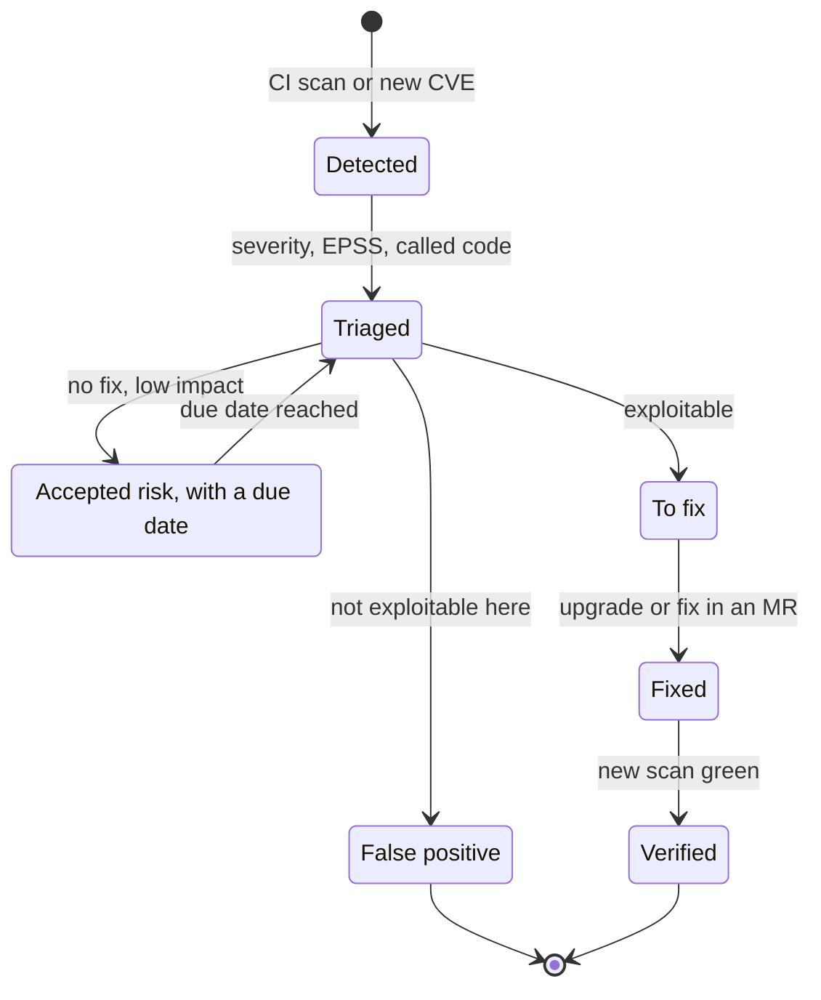

An in-house Semgrep rule that spots a SQL query built by concatenation (see [SQL injection](sql.md#security-sql-injection)):
```yaml
# Example: Semgrep rule flagging an SQL query built by concatenation
rules:
  - id: sql-string-concat
    languages: [python]
    severity: ERROR
    message: SQL query built by concatenation, use a parameterized query
    pattern: $DB.execute("..." + $X)
```

:material-book-open-variant: Reference docs: [OWASP, Source Code Analysis Tools](https://owasp.org/www-community/Source_Code_Analysis_Tools) (accessed November 2026); [Semgrep, documentation](https://semgrep.dev/docs/) (accessed November 2026)
{ .doc-ref }

### Which tool, for whom, when

| Tool | Who owns it | I adopt it when | I wait if |
|---|---|---|---|
| SIEM | security team or SOC | I have several systems whose traces must be connected, like failed logins on my-api followed by a big export, or a detection obligation | nobody can triage the alerts; I then start with the cloud audit logs and three or four well-chosen alerts |
| NDR | security and network team | I have my own network with many machines I don't control closely, like workstations, connected devices or old servers | everything is managed or serverless, so there is little network of my own to observe and cloud logs are often enough |
| CrowdSec | platform team | my service exposed on the internet gets brute force and scans, like bots probing `/wp-admin` | my clients are behind shared IPs, like a corporate network, and I have no allow list: blocking one IP would block hundreds of real users |
| CSPM, Cloud Custodian | platform and security | I have several cloud accounts and people change things by hand in the console, like a bucket left public | I have a single project, fully in IaC and reviewed: a scan of the Terraform code is enough at first |
| Steampipe | platform, security, FinOps | someone asks me a one-off inventory question, like "which buckets are public?", and I want to answer in SQL without writing a script | the cloud's native inventory, like AWS Config, already answers the question |
| application secret manager | platform, every application | as soon as code reads a first secret, like the database password my application needs to start | never: it is the baseline |
| password manager | every person, every team | as soon as humans share an access, like a supplier's console or a demo account | never: it is the baseline |
| SAST and SCA platform | development teams | I have many repositories, several scanners each producing their own list, and nobody knows any more which vulnerabilities are really open | I have one or two repositories, where `pip-audit`, gitleaks and a security linter in CI cover the essentials for free |

## Pitfalls to avoid

- **ID token sent to the API**: I send the ID token to the API instead of the access token, although it is made for the client application and grants no rights on an API. I always send the access token to the API, and keep the ID token to know who is logged in ([see OIDC](#openid-connect-oidc-knowing-who-is-logged-in)).
- **Sensitive data in a JWT**: I put confidential information in the token payload, although a JWT is signed, not encrypted: anyone reads it by pasting it into jwt.io. I only put identifiers and rights in it ([see JWT](#jwt-what-a-token-looks-like)).
- **Keeping the Implicit or Password flows**: I let my SPA receive the token in the URL, or my app ask for the password in its own form. The token leaks into history, logs and the Referer, and the app sees passwords it should never see. I use Authorization Code + PKCE for every login by a person ([see what changes with OAuth 2.1](#what-changes)).
- **Forgetting the audience**: I request a token from Auth0 without `audience`, and get a token my API cannot use, so every call is rejected. I always set the audience of the target API ([see the role of the audience](#the-role-of-the-audience)).
- **Committed secret "but the repo is private"**: I push an API key to Git thinking nobody will see it. It is in every clone and in the history forever. I revoke it and generate a new one right away, and I run gitleaks as a pre-commit hook ([see secrets](#secrets)).
- **Relying on CORS to protect the API**: I believe a list of allowed origins blocks unwanted calls, although `curl` or a script ignore CORS completely. I check authentication and rights on the server side, on every route ([see CORS](#cors-the-preflight-request)).
- **Open DCR without control**: I leave dynamic registration on although I do not need it. Anyone can create an "Official HR tool" app and get a token on behalf of ada. I disable it, or switch to CIMD ([see why it is a problem](#why-it-is-a-problem)).
- **No BOLA test**: I test that ada sees her orders, but never that she cannot see grace's. The day a route forgets the check, ada reads order 43 by changing the URL. I write one rejection test per route ([see the common vulnerabilities](#the-most-common-api-vulnerabilities)).

## What interviews ask

The typical questions:

- "What is the difference between authentication and authorization?", "401 or 403?" How I answer: I give a one-sentence definition of each, then the HTTP code that goes with it: 401 when I do not know who is calling, 403 when I know but they are not allowed ([Terminology](#terminology), and [Response codes](api-rest-async.md#response-codes)).
- "Explain OAuth 2.0", "Which flow for a SPA, a mobile app, a batch job?", "Why were the Implicit and Password flows abandoned?" How I answer: I draw Authorization Code + PKCE, then say which flow fits which client and what OAuth 2.1 removed ([OAuth flows](#oauth-flows), [What changes with OAuth 2.1](#what-changes)).
- "What is in a JWT, and what must the API check?", "What is a bearer token, and what is its risk?" How I answer: I list `iss`, `aud`, `exp`, `scope` and the signature, then show how DPoP makes a stolen token useless ([JWT](#jwt-what-a-token-looks-like), [DPoP](#dpop-a-token-that-only-works-for-its-owner)).
- "How do you test the security of an API?", "What is BOLA?", "CSRF, XSS, CORS: what is the difference?" How I answer: I start from the OWASP API Security Top 10 and give the rejection test for each vulnerability ([The most common API vulnerabilities](#the-most-common-api-vulnerabilities), [CSRF and SameSite cookies](#csrf-and-samesite-cookies)).
- "How do you manage secrets?", "A key has leaked, what do you do?", "How do you store a password?" How I answer: I talk about a secret manager, immediate revocation and Argon2id ([Secrets](#secrets), [Storing a password](#storing-a-password)).
- "Have you ever done threat modeling?", "What is zero trust?" How I answer: I walk through STRIDE on a small diagram, then the idea that being inside the network proves nothing ([Threat modeling: STRIDE](#threat-modeling-stride), [Zero trust and service-to-service identity](#zero-trust-and-service-to-service-identity), and [NIST SP 800-207](textes-fondateurs.md#nist-sp-800-207-zero-trust-architecture-2020)).

What makes a good answer: linking each mechanism to the attack it prevents ("PKCE, because an intercepted code must be useless"), then saying how I check it with a rejection test.

## What to use in which situation

| Situation | I use |
|---|---|
| ada must be able to log in to my app, on the website as on the phone | <span class="term" data-term="openid-connect">OIDC</span>, Authorization Code + <span class="term" data-term="pkce">PKCE</span>, at an identity provider |
| a service must call an API with nobody behind it, like a nightly batch that reads the orders | Client Credentials, token reused until it expires |
| I want a stolen token, for example one found in a log, to work for as short a time and as little as possible | short tokens, refresh token rotation, <span class="term" data-term="dpop">DPoP</span> |
| I want a client to find the identity provider's addresses by itself, without anyone copying them in by hand | `/.well-known/...` metadata |
| clients I do not know in advance must be able to connect, like AI assistants plugging into my MCP server | <span class="term" data-term="cimd">CIMD</span> preferably, otherwise controlled <span class="term" data-term="dcr">DCR</span> |
| all my client applications are known and created by hand by an administrator, so I do not need dynamic registration | DCR disabled |
| I want to be sure ada cannot see grace's order by changing the id in the URL | one <span class="term" data-term="bola">BOLA</span> test per route |
| a secret has leaked, for example an API key pushed to a repository by mistake | revoke it and generate a new one, right away |
| my app handles login itself and would have to keep its users' passwords | don't, otherwise Argon2id or bcrypt |
| I add an external entry point, like a file upload, or my service starts handling sensitive data | a one-hour threat model: data flow diagram, <span class="term" data-term="stride">STRIDE</span> grid, one test per measure |
| my services call each other inside a cluster, like orders-service calling payments-service, and a single hacked service must not open access to all the others | <span class="term" data-term="zero-trust">zero trust</span>: <span class="term" data-term="spiffe">SPIFFE</span> identity, <span class="term" data-term="mtls">mTLS</span>, deny-by-default policies |
| my services share the same API key, so a single stolen key opens everything | replace it with a workload identity, then revoke it |
| my team wants to add a personal field, like the customer's date of birth | a purpose, a retention period, otherwise don't collect it |
| other services need to know which customer it is, like billing-service invoicing an order | only pass them `customer_id` (<span class="term" data-term="pseudonymization">pseudonymisation</span>) |
| ada asks for her data to be erased, but it is also in an event log that cannot be rewritten | <span class="term" data-term="crypto-shredding">crypto-shredding</span>, to be validated with the DPO |
| my customers' data must stay in the EU, including in logs, support and side managed services | European region, subprocessors listed, transfers checked |
| an attack leaves traces in several systems, like failed logins on my-api then a big export, and I want to connect them | a SIEM, fed with structured security logs |
| an attacker may already be inside my own network, and leaves nothing in the application logs | network detection (NDR): Zeek, Suricata or a commercial product |
| my service exposed on the internet gets bursts of password guesses and bots probing `/wp-admin` | a collaborative IPS such as CrowdSec, on top of rate limiting |
| people create cloud resources by hand in the console, outside the rules, like a bucket left public | a CSPM or Cloud Custodian policies, first in `--dryrun` |
| someone asks me quickly "which buckets are public?" and I do not want to write a script | a SQL inventory (Steampipe) or the cloud's native inventory |
| my application needs a database password to start | a secret manager, ideally dynamic secrets |
| several people on the team must share an access, like a supplier's console or a demo account | a team password manager |
| my scanners produce hundreds of findings across many repositories, and nobody knows any more which ones are really open | a SAST and SCA platform, blocking only on new code |

## Further reading
- [Bearer of Good News: OAuth 2.0 to 2.1](https://bearer.sambego.tech/): a presentation on moving from OAuth 2.0 to 2.1 (publication date not given).
- [The OAuth 2.1 draft at the IETF (version 16, September 2026)](https://datatracker.ietf.org/doc/draft-ietf-oauth-v2-1/)
- [RFC 9449: DPoP (September 2023)](https://www.rfc-editor.org/rfc/rfc9449)
- [MCP specification: client registration (July 28, 2026 revision)](https://modelcontextprotocol.io/specification/2026-07-28/basic/authorization/client-registration)
- [OWASP API Security Top 10, 2023 edition](https://owasp.org/API-Security/)
- [Adam Shostack, Threat Modeling: Designing for Security (2014)](https://shostack.org/books/threat-modeling-book)
- [Threat Modeling Manifesto (2020)](https://www.threatmodelingmanifesto.org/)
- [OWASP Threat Modeling Cheat Sheet (publication date not given)](https://cheatsheetseries.owasp.org/cheatsheets/Threat_Modeling_Cheat_Sheet.html)
- [NIST SP 800-207, Zero Trust Architecture (August 2020)](https://csrc.nist.gov/pubs/sp/800/207/final)
- [SPIFFE: project overview (publication date not given)](https://spiffe.io/docs/latest/spiffe-about/overview/)
- [RFC 8693: OAuth 2.0 Token Exchange (January 2020)](https://www.rfc-editor.org/rfc/rfc8693)
- [RFC 8705: mTLS certificate-bound tokens (February 2020)](https://www.rfc-editor.org/rfc/rfc8705)
- [GDPR, Regulation (EU) 2016/679, official text (April 2016)](https://eur-lex.europa.eu/eli/reg/2016/679/oj)
- [EDPB, Guidelines 4/2019 on Article 25, version 2.0 (October 2020)](https://www.edpb.europa.eu/our-work-tools/our-documents/guidelines/guidelines-42019-article-25-data-protection-design-and_en)
- [NIST SP 800-92, Guide to Computer Security Log Management (September 2006)](https://csrc.nist.gov/pubs/sp/800/92/final)
- [Sigma, generic detection rule format (open project, publication date not given)](https://github.com/SigmaHQ/sigma)
- [Zeek documentation (publication date not given, to check)](https://docs.zeek.org/)
- [CrowdSec documentation (publication date not given, to check)](https://docs.crowdsec.net/)
- [Cloud Custodian documentation (publication date not given, to check)](https://cloudcustodian.io/docs/)
- [Steampipe documentation (publication date not given, to check)](https://steampipe.io/docs)
- [HashiCorp Vault, database dynamic secrets (publication date not given, to check)](https://developer.hashicorp.com/vault/docs/secrets/databases)
- [Semgrep documentation, writing rules (publication date not given, to check)](https://semgrep.dev/docs/writing-rules/overview)
- [RFC 5737: IPv4 address blocks reserved for documentation (January 2010)](https://www.rfc-editor.org/rfc/rfc5737)
