# Sécurité

!!! warning "Avertissement"
    Ces notes sont des pense-bêtes personnels, pas une source de vérité. Elles reflètent ma compréhension et mes choix : leur contenu reste subjectif, malgré les citations et les références qu'il contient. Il peut être incomplet, simplifié, inexact ou dépassé. Vérifiez toujours dans la documentation officielle avant de l'appliquer. Ce contenu est fourni tel quel, sans aucune garantie : son utilisation se fait sous votre seule responsabilité.

!!! abstract "Les échelles"
    Les pastilles de couleur sous les titres disent à quelle échelle une notion s'applique :

    - <span class="pill pill-scope pill-scope-code">Code</span> les classes, fonctions et modules d'un programme ;
    - <span class="pill pill-scope pill-scope-app">Application</span> un service ou une application et son découpage interne ;
    - <span class="pill pill-scope pill-scope-system">Système</span> plusieurs services qui communiquent par le réseau ;
    - <span class="pill pill-scope pill-scope-infra">Infrastructure</span> les serveurs, le réseau, les zones et les clusters, physiques ou virtuels ;
    - <span class="pill pill-scope pill-scope-enterprise">Entreprise</span> le système d'information entier et son organisation.

    Détail et mots ambigus : [carte des échelles](architecture.md#carte-des-echelles).

Cette page couvre la sécurité qu'on croise tous les jours en développant et en testant : qui a le droit de faire quoi (<span class="term" data-term="authentication">authentification</span>, <span class="term" data-term="authorization">autorisation</span>), comment c'est prouvé (OAuth, <span class="term" data-term="openid-connect">OpenID Connect</span>, <span class="term" data-term="token-oauth">jetons</span>), ce que change OAuth 2.1, ce qu'est Auth0, et les failles les plus courantes des API.

Les noms de domaines, d'applications et de comptes sont des exemples.

:material-swap-horizontal: Les outils cités dans cette page : lesquels se remplacent, lesquels se combinent ? Voir [Complémentaires ou concurrents](outils.md#complementaires-ou-concurrents).
{ .doc-ref }

## Vocabulaire

**Authentification** : vérifier **qui** je suis. « Tu es bien ada ? » Un mot de passe, une empreinte, un code.

**Autorisation** : vérifier **ce que** j'ai le droit de faire. « Ada peut-elle voir la commande 42 ? »

```
401 Unauthorized   je ne sais pas qui tu es            (authentification ratée)
403 Forbidden      je sais qui tu es, mais c'est non   (autorisation refusée)
```

**Jeton (token)** : une chaîne de caractères qui prouve une connexion ou un droit, envoyée à chaque requête au lieu du mot de passe.

**Fournisseur d'identité (IdP)** : le service qui gère les comptes et les connexions (Auth0, Okta, Keycloak, Entra ID). Les applications lui délèguent la connexion au lieu de stocker elles-mêmes les mots de passe.

**MFA (authentification multifacteur)** : un deuxième élément en plus du mot de passe : un code TOTP qui change toutes les 30 secondes, une notification sur le téléphone, une clé physique.

**Secret** : une donnée qui donne un accès et ne doit jamais être publique : mot de passe, clé d'API, `client_secret`, <span class="term" data-term="private-key">clé privée</span>.

:material-book-open-variant: Doc de référence : [OWASP, Authentication Cheat Sheet](https://cheatsheetseries.owasp.org/cheatsheets/Authentication_Cheat_Sheet.html) (consultée en novembre 2026)
{ .doc-ref }

## OAuth et OpenID Connect

<a class="pill pill-scope pill-scope-system" href="../architecture/#carte-des-echelles">Échelle · Système</a>

### OAuth 2.0 : déléguer un accès
<span class="pill pill-status pill-status-ok" title="Toujours valable, vérifié en novembre 2026">Valable · 11/2026</span>

OAuth est un **protocole d'autorisation** : il permet à une application d'obtenir un accès limité à une ressource, sans jamais connaître le mot de passe de l'utilisateur.

Exemple de la vie courante : un outil de planning veut lire mon agenda Google. Je ne lui donne pas mon mot de passe Google. Je me connecte chez Google, j'accepte « lire l'agenda », et Google donne à l'outil un <span class="term" data-term="token-oauth">jeton</span> limité à ça.

!!! noob "As noob"
    C'est la clé de voiturier : je la donne au voiturier pour garer la voiture, elle démarre le moteur mais n'ouvre ni le coffre ni la boîte à gants, et je peux la reprendre quand je veux. Ma vraie clé, elle, ne quitte jamais ma poche. La phrase à retenir : **OAuth donne à une application une clé limitée, jamais mon mot de passe.**

Les quatre rôles :

| Rôle                       | Qui                                      | Exemple                         |
|----------------------------|------------------------------------------|---------------------------------|
| propriétaire de la ressource | l'utilisateur                          | ada                             |
| client                     | l'application qui veut l'accès           | le site web ou l'appli mobile   |
| serveur d'autorisation     | celui qui délivre les jetons             | Auth0                           |
| serveur de ressources      | l'API protégée                           | `orders-api`                    |

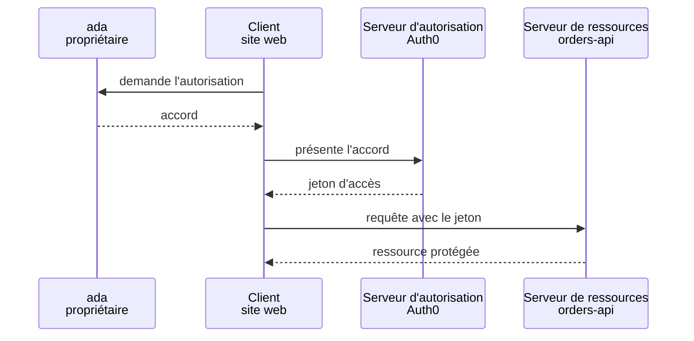

:material-book-open-variant: Doc de référence : [RFC 6749, The OAuth 2.0 Authorization Framework](https://www.rfc-editor.org/rfc/rfc6749) (2012) ; [oauth.net, OAuth 2.0](https://oauth.net/2/) (consultée en novembre 2026)
{ .doc-ref }

### OpenID Connect (OIDC) : savoir qui est connecté
<span class="pill pill-status pill-status-ok" title="Toujours valable, vérifié en novembre 2026">Valable · 11/2026</span>

OAuth dit « ce jeton peut lire les commandes », mais pas « qui est connecté ». **OIDC** (publié en 2014) ajoute cette couche d'identité au-dessus d'OAuth : en plus du <span class="term" data-term="access-token">jeton d'accès</span>, le client reçoit un **ID token** qui dit qui est l'utilisateur.

!!! noob "As noob"
    À l'hôtel, la carte de chambre ouvre ma porte mais ne dit pas mon nom : c'est le jeton d'accès, fait pour la serrure (l'API). La fiche d'accueil remise à la réception dit qui je suis : c'est l'ID token, fait pour l'application. La phrase à retenir : **l'access token ouvre des portes, l'ID token présente la personne.**

| Jeton          | Pour qui           | Sert à                                        |
|----------------|--------------------|-----------------------------------------------|
| access token   | l'API              | « ce porteur a le droit de lire les commandes » |
| ID token       | l'application cliente | « l'utilisateur connecté est ada, ada@example.com » |
| <span class="term" data-term="refresh-token">refresh token</span>  | l'application cliente | obtenir un nouvel access token sans redemander la connexion |

Erreur classique : envoyer l'ID token à l'API à la place de l'access token. L'ID token est fait pour le client, pas pour donner des droits sur une API.

:material-book-open-variant: Doc de référence : [OpenID Connect Core 1.0](https://openid.net/specs/openid-connect-core-1_0.html) (2014)
{ .doc-ref }

### JWT : à quoi ressemble un jeton
<span class="pill pill-status pill-status-ok" title="Toujours valable, vérifié en novembre 2026">Valable · 11/2026</span>

Beaucoup de jetons sont des **JWT** (JSON Web Token) : trois parties en base64, séparées par des points.

!!! noob "As noob"
    Un JWT, c'est une carte postale fermée par un cachet de cire : tout le monde peut lire ce qui est écrit, mais personne ne peut modifier le texte sans briser le cachet. L'API vérifie le cachet, pas le secret du contenu. La phrase à retenir : **un JWT est infalsifiable, pas confidentiel.**

```
eyJhbGciOiJSUzI1NiIsImtpZCI6ImsxIn0.eyJpc3MiOi4uLn0.Zm9vYmFy...
└──── en-tête ────────────────────┘ └─ contenu ──┘ └ signature ┘
```
Une fois décodé, le contenu :
```json
{
  "iss": "https://my-tenant.eu.auth0.com/",
  "sub": "auth0|64f1c2",
  "aud": "https://orders-api.example.com",
  "exp": 1792500000,
  "scope": "read:orders"
}
```

| Champ   | Sens                                               | À vérifier côté API                      |
|---------|----------------------------------------------------|------------------------------------------|
| `iss`   | qui a émis le jeton                                | c'est bien mon <span class="term" data-term="identity-provider">fournisseur d'identité</span>    |
| `sub`   | pour qui (l'identifiant de l'utilisateur)          |                                          |
| `aud`   | pour quelle API il est fait                        | c'est bien **mon** API                   |
| `exp`   | date d'expiration                                  | pas dépassée                             |
| `scope` | les droits accordés                                | contient le droit demandé par la route   |

Deux choses à retenir :
- un JWT est **signé, pas chiffré** : n'importe qui peut lire son contenu (jwt.io le décode). Jamais de donnée sensible dedans ;
- l'API vérifie la **signature** avec la <span class="term" data-term="public-key">clé publique</span> du fournisseur, publiée à une adresse standard (`/.well-known/jwks.json`). Le champ `kid` de l'en-tête dit quelle clé utiliser.

:material-book-open-variant: Doc de référence : [RFC 7519, JSON Web Token](https://www.rfc-editor.org/rfc/rfc7519) (2015) ; [RFC 8725, JWT Best Current Practices](https://www.rfc-editor.org/rfc/rfc8725) (2020)
{ .doc-ref }

### Bearer token : le jeton « au porteur »
<span class="pill pill-status pill-status-ok" title="Toujours valable, vérifié en novembre 2026">Valable · 11/2026</span>

Aujourd'hui, la plupart des API reçoivent le jeton comme ceci :
```
GET /orders/42
Authorization: Bearer eyJhbGciOi...
```
« Bearer » veut dire « porteur » : **celui qui a le jeton peut s'en servir**, comme un billet de banque. Si le jeton fuit (dans un log, un proxy, une extension de navigateur), le voleur peut l'utiliser jusqu'à son <span class="term" data-term="token-expiration">expiration</span>. C'est précisément ce que <span class="term" data-term="dpop">DPoP</span> corrige, voir plus bas.

:material-book-open-variant: Doc de référence : [RFC 6750, Bearer Token Usage](https://www.rfc-editor.org/rfc/rfc6750) (2012)
{ .doc-ref }

### Scope
<span class="pill pill-status pill-status-ok" title="Toujours valable, vérifié en novembre 2026">Valable · 11/2026</span>

Mon outil de statistiques doit lire les commandes, mais n'a aucune raison de pouvoir les modifier. Le **scope** règle ça : c'est un droit précis, demandé par le client et accordé dans le jeton, comme `read:orders` ou `write:orders`. Principe du **moindre privilège** : ne demander que ce dont on a besoin. L'outil de statistiques demande donc seulement `read:orders`, et si son jeton fuit, personne ne peut modifier une commande avec.

:material-book-open-variant: Doc de référence : [RFC 6749, Access Token Scope](https://www.rfc-editor.org/rfc/rfc6749#section-3.3) (2012)
{ .doc-ref }

## Les flux OAuth

<a class="pill pill-scope pill-scope-app" href="../architecture/#carte-des-echelles">Échelle · Application</a>

Un **flux** (grant) est la façon dont le client obtient son jeton. Le bon flux dépend du type de client : ada qui se connecte sur son téléphone n'obtient pas son jeton comme un batch qui tourne seul la nuit.

### Authorization Code avec PKCE : une personne se connecte
<span class="pill pill-status pill-status-ok" title="Toujours valable, vérifié en novembre 2026">Valable · 11/2026</span>

Le flux pour toute application où un utilisateur se connecte : site web, application mobile, application dans le navigateur (<span class="term" data-term="spa">SPA</span>), outil en ligne de commande.

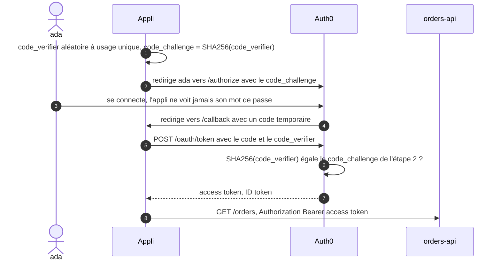

**PKCE** (« pixie », Proof Key for Code Exchange) : si quelqu'un intercepte le code de l'étape 4 (une autre appli sur le téléphone qui écoute la même <span class="term" data-term="redirect-uri">adresse de retour</span>), il ne peut rien en faire : il n'a pas le `code_verifier`, qui n'a jamais circulé avant l'étape 5.

!!! noob "As noob"
    Au vestiaire, on me donne un ticket pour récupérer mon manteau (le code). Avec PKCE, je dépose en plus l'empreinte d'un mot secret que je garde pour moi, et au retour il faut le ticket **et** le mot secret. Quelqu'un qui ramasse mon ticket repart sans manteau. La phrase à retenir : **un code intercepté ne sert à rien sans le secret resté dans l'application.**

La requête de l'étape 2 :
```
https://my-tenant.eu.auth0.com/authorize
  ?response_type=code
  &client_id=abc123
  &redirect_uri=https://app.example.com/callback
  &scope=openid profile read:orders
  &audience=https://orders-api.example.com
  &code_challenge=E9Melhoa2OwvFrEMTJguCHaoeK1t8URWbuGJSstw-cM
  &code_challenge_method=S256
  &state=xyz789
```
`state` est une valeur aléatoire que l'appli vérifie au retour, pour s'assurer que la réponse correspond bien à sa propre demande.

:material-book-open-variant: Doc de référence : [RFC 7636, PKCE](https://www.rfc-editor.org/rfc/rfc7636) (2015) ; [RFC 6749, Authorization Code Grant](https://www.rfc-editor.org/rfc/rfc6749#section-4.1) (2012)
{ .doc-ref }

### Client Credentials : un service parle à un service
<span class="pill pill-status pill-status-ok" title="Toujours valable, vérifié en novembre 2026">Valable · 11/2026</span>

Ici, personne ne se connecte : c'est un service qui a besoin d'un jeton pour lui-même, et il s'authentifie avec ses propres identifiants (`client_id` et `client_secret`). Cas typiques : un batch nocturne, un service qui en appelle un autre, des tests automatisés qui appellent une API.
```
$ curl -s https://my-tenant.eu.auth0.com/oauth/token \
    -H 'Content-Type: application/json' \
    -d '{
      "grant_type": "client_credentials",
      "client_id": "svc-reporting",
      "client_secret": "(depuis le gestionnaire de secrets)",
      "audience": "https://orders-api.example.com"
    }'
{"access_token": "eyJ...", "expires_in": 86400, "token_type": "Bearer"}
```

:material-book-open-variant: Doc de référence : [RFC 6749, Client Credentials Grant](https://www.rfc-editor.org/rfc/rfc6749#section-4.4) (2012)
{ .doc-ref }

### Refresh Token : rester connecté
<span class="pill pill-status pill-status-ok" title="Toujours valable, vérifié en novembre 2026">Valable · 11/2026</span>

L'access token dure peu (de quelques minutes à quelques heures). Le refresh token permet d'en obtenir un nouveau sans redemander la connexion. Bonne pratique : la **rotation**, chaque refresh token ne sert qu'une fois et est remplacé par un nouveau. Si un ancien est réutilisé, c'est le signe d'un vol, et le fournisseur <span class="term" data-term="token-revocation">révoque</span> toute la famille de jetons.

!!! noob "As noob"
    Le refresh token est un ticket à usage unique pour obtenir un nouveau badge du jour, et chaque passage au guichet me rend un nouveau ticket. Si un ticket déjà utilisé se présente, le guichet sait qu'il a été copié et annule toute la série, le mien compris. La phrase à retenir : **un ticket réutilisé trahit le vol, et le fournisseur coupe tout.**

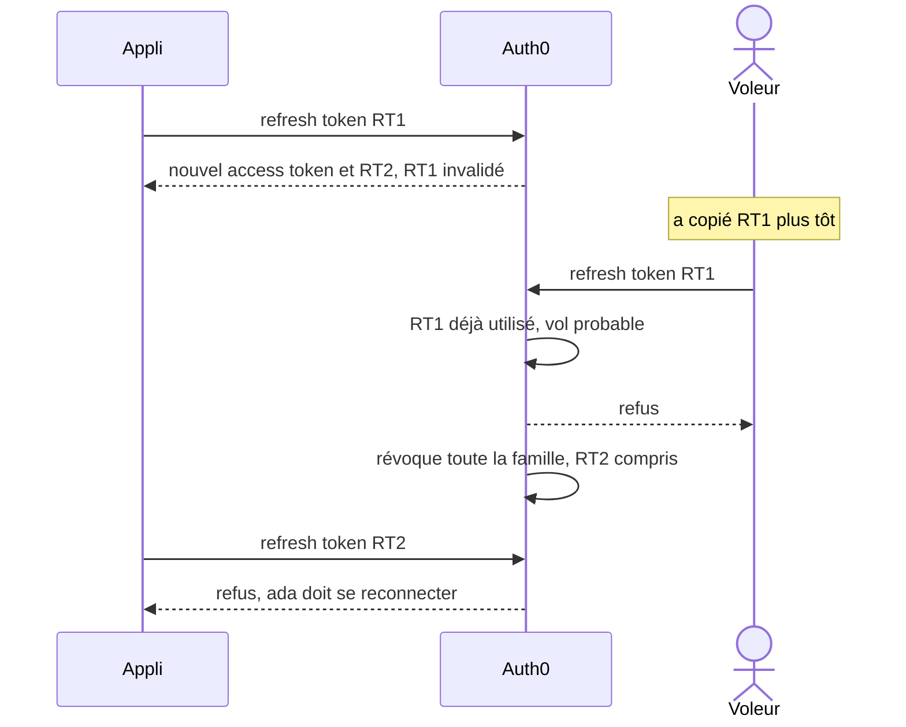

:material-book-open-variant: Doc de référence : [RFC 9700, Best Current Practice for OAuth 2.0 Security](https://www.rfc-editor.org/rfc/rfc9700) (2025)
{ .doc-ref }

### Device Authorization : un appareil sans clavier
<span class="pill pill-status pill-status-ok" title="Toujours valable, vérifié en novembre 2026">Valable · 11/2026</span>

Ma télé, ma console ou un outil en ligne de commande sur un serveur doit se connecter, mais il n'a pas de navigateur, ou taper un mot de passe avec une télécommande est pénible. L'appareil affiche donc un code, et je le saisis sur mon téléphone, où je me connecte normalement.
```
Rendez-vous sur https://example.com/activate et entrez le code : WDJB-MJHT
```

:material-book-open-variant: Doc de référence : [RFC 8628, OAuth 2.0 Device Authorization Grant](https://www.rfc-editor.org/rfc/rfc8628) (2019)
{ .doc-ref }

### Quel flux pour quel client

| Client | Flux |
|---|---|
| j'ai un site web avec son propre serveur, comme une boutique en ligne où ada se connecte pour suivre ses commandes | Authorization Code + PKCE |
| mon application tourne entièrement dans le navigateur (SPA), sans serveur à moi pour garder un secret, comme un tableau de bord en React | Authorization Code + PKCE |
| mon application est installée sur le téléphone de l'utilisateur, comme l'appli mobile de la même boutique | Authorization Code + PKCE |
| personne ne se connecte : un service en appelle un autre, un batch tourne la nuit, ou mes tests automatisés appellent l'API | <span class="term" data-term="client-credentials">Client Credentials</span> |
| l'appareil n'a ni clavier pratique ni navigateur, comme une télé ou un outil en ligne de commande sur un serveur | Device Authorization |
| mon application affiche son propre formulaire, demande le mot de passe de l'utilisateur et l'envoie elle-même au fournisseur | **à ne plus faire** (voir OAuth 2.1) |

:material-book-open-variant: Doc de référence : [oauth.net, OAuth Grant Types](https://oauth.net/2/grant-types/) (consultée en novembre 2026)
{ .doc-ref }

## OAuth 2.1

<a class="pill pill-scope pill-scope-app" href="../architecture/#carte-des-echelles">Échelle · Application</a>

### Ce que c'est
<span class="pill pill-status pill-status-ok" title="Toujours valable, vérifié en novembre 2026">Valable · 11/2026</span>

OAuth 2.1 n'invente pas de nouveau protocole. C'est OAuth 2.0 **nettoyé** : il regroupe en un seul texte les bonnes pratiques de sécurité accumulées depuis 2012, et retire ce qui s'est révélé dangereux.

Statut : c'est encore un **brouillon** de l'IETF (version 16, septembre 2026), pas une norme publiée. Mais les grands fournisseurs, dont Auth0, Okta et Microsoft, en appliquent déjà les règles, et le protocole <span class="term" data-term="mcp">MCP</span> (les connecteurs des assistants IA) l'exige.

*Okta : concurrent de Auth0, Keycloak*
{ .tool-rel }


### Ce qui change

| Changement                                         | Avant (OAuth 2.0)                                          | Avec OAuth 2.1                                  |
|----------------------------------------------------|------------------------------------------------------------|-------------------------------------------------|
| **PKCE obligatoire**                               | recommandé pour les applis mobiles seulement               | obligatoire pour **tous** les clients qui utilisent Authorization Code |
| **flux Implicit supprimé** <span class="pill pill-status pill-status-obsolete" title="Déconseillé par la RFC 9700 (janvier 2025), retiré d'OAuth 2.1 : remplacé par Authorization Code + PKCE">Obsolète · 11/2026</span>                         | une <span class="term" data-term="spa">SPA</span> recevait le jeton directement dans l'URL (`#access_token=...`) | supprimé : le jeton dans l'URL fuit dans l'historique, les logs, le Referer. Les SPA utilisent Authorization Code + <span class="term" data-term="pkce">PKCE</span> |
| **flux Password supprimé** <span class="pill pill-status pill-status-obsolete" title="Interdit par la RFC 9700 (janvier 2025), retiré d'OAuth 2.1 : remplacé par Authorization Code + PKCE">Obsolète · 11/2026</span>                         | l'appli demandait le mot de passe dans son formulaire et l'envoyait elle-même | supprimé : l'appli ne doit jamais voir le mot de passe. La connexion se fait chez le fournisseur d'identité |
| **adresse de retour exacte**                       | certains serveurs acceptaient des jokers (`https://*.example.com/*`) | comparaison **exacte** de la `redirect_uri` déclarée |
| **pas de jeton dans l'URL**                        | `GET /orders?access_token=eyJ...` toléré                   | interdit, uniquement dans l'en-tête `Authorization` |
| **refresh tokens des clients publics**             | réutilisables indéfiniment                                 | à usage unique (rotation) ou liés à une clé (DPoP) |

« Client public » : une application qui ne peut pas garder un <span class="term" data-term="secret">secret</span>, parce que son code est chez l'utilisateur (SPA, appli mobile, CLI). Par opposition au « client confidentiel », un back-end qui garde son `client_secret` sur un serveur.

:material-book-open-variant: Doc de référence : [IETF, The OAuth 2.1 Authorization Framework](https://datatracker.ietf.org/doc/draft-ietf-oauth-v2-1/) (brouillon, version 16, septembre 2026) ; [oauth.net, OAuth 2.1](https://oauth.net/2.1/) (consultée en novembre 2026)
{ .doc-ref }

### Idée reçue : « avec OAuth 2.1 et DPoP, il n'y a plus de mots de passe »
Pas tout à fait. Ce qui disparaît, c'est le **flux Password** : l'application ne reçoit plus jamais le mot de passe de l'utilisateur. Mais l'utilisateur peut toujours se connecter avec un mot de passe, **sur la page du fournisseur d'identité**. Se passer complètement de mot de passe, c'est autre chose : les **passkeys** (WebAuthn), une connexion par empreinte ou par clé physique, que le fournisseur d'identité peut proposer en plus. DPoP, lui, ne concerne pas la connexion de l'utilisateur, mais la protection du jeton une fois obtenu.

Une **<span class="term" data-term="passkey">passkey</span>** est une paire de clés créée par l'appareil (téléphone, ordinateur, clé physique) pour **un seul site** : la clé privée reste sur l'appareil, le site ne garde que la clé publique. **WebAuthn** (norme du W3C, première version en 2019) est l'API du navigateur qui fait ce dialogue :
```
inscription : l'appareil crée une paire de clés pour example.com et envoie la clé publique au site
connexion   :
1. le site envoie un défi (challenge) : une valeur aléatoire à usage unique
2. ada déverrouille l'appareil (empreinte, visage, code), qui signe le défi avec la clé privée
3. le site vérifie la signature avec la clé publique enregistrée : c'est bien ada
```
Rien de réutilisable ne circule, et la clé est liée au domaine : un faux site `examp1e.com` ne peut pas obtenir de signature valable pour `example.com`, ce qui rend l'hameçonnage inopérant.

:material-book-open-variant: Doc de référence : [W3C, Web Authentication Level 2](https://www.w3.org/TR/webauthn-2/) (2021)
{ .doc-ref }

## DPoP : un jeton qui ne sert qu'à son propriétaire

<a class="pill pill-scope pill-scope-app" href="../architecture/#carte-des-echelles">Échelle · Application</a>

### Le problème
Un <span class="term" data-term="bearer-token">bearer token</span> volé marche pour le voleur. Exemple : un jeton qui apparaît par erreur dans un log de proxy est utilisable par toute personne qui lit ce log, jusqu'à son expiration.

### L'idée
<span class="pill pill-status pill-status-ok" title="Toujours valable, vérifié en novembre 2026">Valable · 11/2026</span>

**DPoP** (Demonstrating Proof of Possession, RFC 9449, publiée en 2023) lie le jeton à une **clé** que seul le client possède. À chaque requête, le client signe une petite **preuve** avec sa <span class="term" data-term="private-key">clé privée</span>. Un jeton volé sans la clé ne sert à rien.

!!! noob "As noob"
    Un bearer token est un billet de banque : qui le ramasse peut le dépenser. Avec DPoP, le jeton devient un chèque à mon nom qu'il faut signer à chaque utilisation, et moi seul ai le stylo (la clé privée). La phrase à retenir : **un jeton DPoP volé ne vaut rien sans la clé de son propriétaire.**

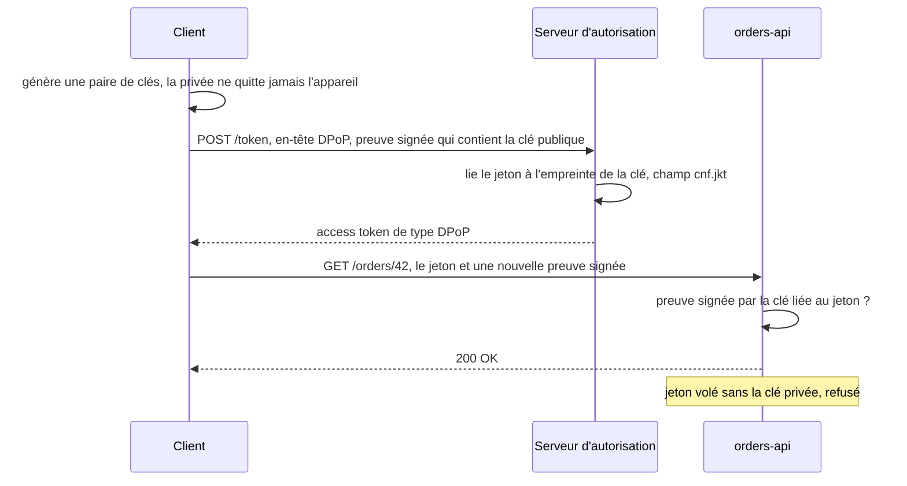

La requête change ainsi :
```
avant (bearer)                              avec DPoP
GET /orders/42                              GET /orders/42
Authorization: Bearer eyJhbGciOi...         Authorization: DPoP eyJhbGciOi...
                                            DPoP: eyJ0eXAiOiJkcG9wK2p3dCIs...
```

La preuve est un petit JWT signé, différent à chaque requête :
```json
{
  "htm": "GET",
  "htu": "https://orders-api.example.com/orders/42",
  "iat": 1792496000,
  "jti": "e1j3V_bKic8-LAEB",
  "ath": "fUHyO2r2Z3DZ53EsNrWBb0xWXoaNy59IiKCAqksmQEo"
}
```

| Champ | Sens                                                 | Ce que ça empêche                                 |
|-------|------------------------------------------------------|---------------------------------------------------|
| `htm` | la méthode HTTP de cette requête                     | réutiliser la preuve d'un `GET` pour un `DELETE`  |
| `htu` | l'URL de cette requête                               | réutiliser la preuve sur une autre route          |
| `iat` | l'heure de création                                  | réutiliser une vieille preuve                     |
| `jti` | un identifiant unique                                | rejouer exactement la même preuve                 |
| `ath` | l'empreinte du jeton d'accès                         | coller la preuve sur un autre jeton               |

### Quand l'utiliser
| Situation | DPoP utile ? |
|---|---|
| ma SPA ou mon appli mobile garde des refresh tokens valables longtemps, donc un jeton volé dans le navigateur ou sur le téléphone resterait utilisable longtemps | oui : un refresh token volé devient inutile |
| un jeton volé sur mon API ferait des dégâts graves, comme une API de paiement ou de données de santé | oui |
| deux services se parlent sur un réseau interne avec des jetons qui expirent très vite, donc un jeton volé ne sert pas longtemps | moins prioritaire |
| mon client ne sait pas garder une clé privée à l'abri, par exemple un script qui la laisse en clair dans un fichier | l'intérêt diminue |

Le coût : le client doit gérer une clé et signer à chaque requête, et l'API doit vérifier une <span class="term" data-term="digital-signature">signature</span> de plus. Les bibliothèques récentes le font pour moi.

:material-book-open-variant: Doc de référence : [RFC 9449, OAuth 2.0 DPoP](https://www.rfc-editor.org/rfc/rfc9449) (2023)
{ .doc-ref }

## Les métadonnées du serveur d'autorisation

<a class="pill pill-scope pill-scope-system" href="../architecture/#carte-des-echelles">Échelle · Système</a>

### L'adresse qui décrit tout
<span class="pill pill-status pill-status-ok" title="Toujours valable, vérifié en novembre 2026">Valable · 11/2026</span>

Un serveur d'autorisation publie à une adresse standard la liste de ses <span class="term" data-term="endpoint">points d'entrée</span> et de ce qu'il sait faire. Un client peut ainsi se configurer tout seul, à partir de la seule adresse du fournisseur.

| Adresse                                         | Norme                                   |
|-------------------------------------------------|-----------------------------------------|
| `/.well-known/openid-configuration`             | découverte OIDC                         |
| `/.well-known/oauth-authorization-server`       | métadonnées OAuth (RFC 8414, 2018)            |
| `/.well-known/oauth-protected-resource`         | métadonnées d'une API protégée (RFC 9728, 2025) : « pour m'appeler, va chercher un jeton chez tel serveur » |

```
$ curl -s https://my-tenant.eu.auth0.com/.well-known/openid-configuration | jq
{
  "issuer": "https://my-tenant.eu.auth0.com/",
  "authorization_endpoint": "https://my-tenant.eu.auth0.com/authorize",
  "token_endpoint": "https://my-tenant.eu.auth0.com/oauth/token",
  "jwks_uri": "https://my-tenant.eu.auth0.com/.well-known/jwks.json",
  "registration_endpoint": "https://my-tenant.eu.auth0.com/oidc/register",
  "code_challenge_methods_supported": ["S256", "plain"],
  ...
}
```
Les valeurs exactes dépendent du fournisseur et de sa configuration. `registration_endpoint` n'apparaît que si l'<span class="term" data-term="dcr">enregistrement dynamique</span> est activé.

C'est ce que font les connecteurs <span class="term" data-term="mcp">MCP</span> des assistants IA : l'API répond `401` avec l'adresse de ses métadonnées, le client les lit, trouve le serveur d'autorisation, et lance la connexion sans aucune configuration manuelle.

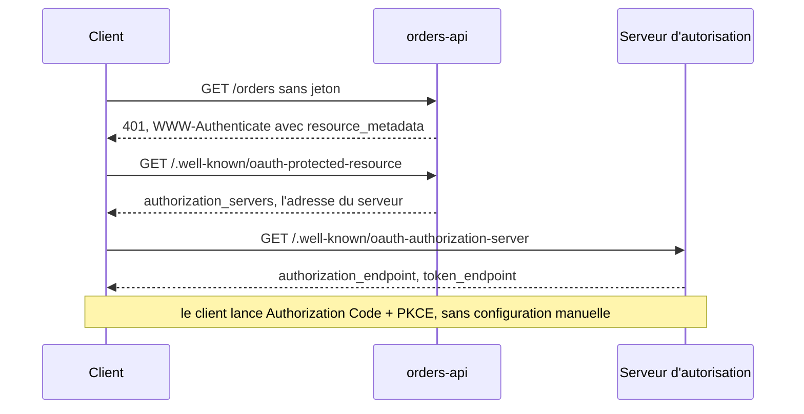

:material-book-open-variant: Doc de référence : [RFC 8414, OAuth 2.0 Authorization Server Metadata](https://www.rfc-editor.org/rfc/rfc8414) (2018) ; [RFC 9728, OAuth 2.0 Protected Resource Metadata](https://www.rfc-editor.org/rfc/rfc9728) (2025)
{ .doc-ref }

## Enregistrement dynamique des clients (DCR)

<a class="pill pill-scope pill-scope-system" href="../architecture/#carte-des-echelles">Échelle · Système</a>

### Ce que c'est
<span class="pill pill-status pill-status-ok" title="Toujours valable, vérifié en novembre 2026">Valable · 11/2026</span>

Normalement, un administrateur crée chaque application cliente à la main dans le fournisseur d'identité, et obtient son `client_id`. Avec le **Dynamic Client Registration** (RFC 7591 de 2015, repris par OIDC), une application s'enregistre **toute seule** en appelant une adresse :
```
POST /oidc/register
{
  "client_name": "Mon outil de reporting",
  "redirect_uris": ["https://reporting.example.com/callback"]
}

201 Created
{"client_id": "k8Fj3...", "client_name": "Mon outil de reporting"}
```
Utile quand des milliers de clients inconnus à l'avance doivent se connecter, par exemple les assistants IA qui se branchent sur des serveurs <span class="term" data-term="mcp">MCP</span>.

:material-book-open-variant: Doc de référence : [RFC 7591, OAuth 2.0 Dynamic Client Registration](https://www.rfc-editor.org/rfc/rfc7591) (2015)
{ .doc-ref }

### Pourquoi c'est un souci
L'adresse d'enregistrement est **publiée dans les métadonnées**, donc connue de tout le monde. Si elle est ouverte sans contrôle, **n'importe qui peut créer une application** chez le fournisseur d'identité.

Scénario d'attaque concret :
```
1. l'attaquant lit registration_endpoint dans /.well-known/openid-configuration
2. il enregistre une appli nommée « Outil RH officiel », avec SA propre adresse de retour
3. il envoie à ada un lien de connexion vers la VRAIE page de connexion de l'entreprise
4. ada voit le bon domaine, le bon logo, et accepte
5. le code part vers l'adresse de l'attaquant, qui obtient un jeton au nom d'ada
```
D'autres risques : des milliers de clients parasites créés en masse, et des champs comme `logo_uri` ou `jwks_uri` qui font que le serveur va lui-même appeler des adresses choisies par l'attaquant (<span class="term" data-term="ssrf">SSRF</span>, quand on fait faire au serveur des requêtes vers des adresses internes).

### Les parades

| Parade                                                   | Effet                                                       |
|----------------------------------------------------------|-------------------------------------------------------------|
| désactiver le DCR si on n'en a pas besoin                | le cas le plus fréquent : supprime le risque                |
| exiger un jeton d'enregistrement initial                 | seuls les clients à qui on l'a donné peuvent s'enregistrer  |
| marquer les clients enregistrés comme « tiers »          | écran de consentement obligatoire, droits limités           |
| limiter les <span class="term" data-term="oauth-scope">scopes</span> accordés aux clients dynamiques       | un client inconnu ne peut pas obtenir de droits d'admin     |
| afficher clairement le domaine du client sur l'écran de consentement | l'utilisateur voit que l'appli n'est pas celle qu'il croit |
| passer aux **Client ID Metadata Documents** (CIMD)       | voir ci-dessous                                             |

### L'alternative : Client ID Metadata Documents
<span class="pill pill-status pill-status-ok" title="Toujours valable, vérifié en novembre 2026">Valable · 11/2026</span>

Au lieu de s'enregistrer, le client publie sa propre fiche sur **son** domaine, et son `client_id` **est** l'adresse de cette fiche :
```
client_id = https://reporting.example.com/oauth-client.json
```
Le serveur d'autorisation télécharge la fiche et vérifie que l'adresse de retour demandée y figure. Il n'y a plus d'adresse d'enregistrement ouverte, et un `client_id` prouve au minimum qu'on contrôle le domaine. C'est la méthode que la spécification MCP recommande désormais (révision de juillet 2026), le DCR restant possible pour la compatibilité.

:material-book-open-variant: Doc de référence : [IETF, OAuth Client ID Metadata Document](https://datatracker.ietf.org/doc/draft-ietf-oauth-client-id-metadata-document/) (brouillon, consultée en novembre 2026)
{ .doc-ref }

## Auth0

<a class="pill pill-scope pill-scope-system" href="../architecture/#carte-des-echelles">Échelle · Système</a>

### Auth0 ou OAuth : la différence

*Auth0 : concurrent de Keycloak, Okta*
{ .tool-rel }

- **OAuth 2.0 / 2.1** et **OIDC** sont des **protocoles** : des règles écrites, publiques, que n'importe qui peut implémenter.
- **Auth0** est un **produit** (de la société Okta) : un <span class="term" data-term="identity-provider">fournisseur d'identité</span> en ligne qui **implémente** ces protocoles, et ajoute ce dont une entreprise a besoin autour : la gestion des utilisateurs, la connexion via Google ou l'annuaire de l'entreprise, la <span class="term" data-term="mfa">MFA</span>, les écrans de connexion, les journaux, les règles personnalisées.

Comparaison : OAuth est au fournisseur d'identité ce que HTTP est à un serveur web. Auth0, Okta, Keycloak (open source) ou Microsoft Entra ID sont des implémentations.

*Keycloak : concurrent de Auth0, Okta*
{ .tool-rel }


:material-book-open-variant: Doc de référence : [Auth0, OAuth 2.0 Authorization Framework](https://auth0.com/docs/authenticate/protocols/oauth) (consultée en novembre 2026)
{ .doc-ref }

### Les concepts d'Auth0
<span class="pill pill-status pill-status-ok" title="Toujours valable, vérifié en novembre 2026">Valable · 11/2026</span>

| Concept         | Ce que c'est                                                        | Exemple                                       |
|-----------------|---------------------------------------------------------------------|-----------------------------------------------|
| tenant          | un espace Auth0 isolé, avec son domaine                             | `my-tenant.eu.auth0.com`, un par environnement |
| application     | un client OAuth (SPA, web, natif, machine to machine)               | « Site client », « Batch reporting »          |
| API             | une API protégée, identifiée par son <span class="term" data-term="token-audience">audience</span>                       | audience `https://orders-api.example.com`     |
| permission      | un scope défini sur une API                                         | `read:orders`, `write:orders`                 |
| connection      | une source d'utilisateurs                                           | base Auth0, Google, annuaire d'entreprise     |
| action          | du code exécuté à un moment du parcours                             | ajouter le rôle de l'utilisateur dans le jeton à la connexion |
| organization    | un groupe d'utilisateurs, pour un produit vendu à des entreprises   | une organisation par client B2B               |

:material-book-open-variant: Doc de référence : [Auth0, Auth0 Overview](https://auth0.com/docs/get-started/auth0-overview) (consultée en novembre 2026)
{ .doc-ref }

### Le rôle de l'audience
<span class="pill pill-status pill-status-ok" title="Toujours valable, vérifié en novembre 2026">Valable · 11/2026</span>

Dans Auth0, la demande de jeton précise l'API visée avec `audience`. Le jeton reçu porte cette audience dans `aud`, et l'API refuse un jeton fait pour une autre API.
```
jeton demandé avec audience = https://orders-api.example.com
appel à orders-api    : accepté
appel à billing-api   : refusé (aud ne correspond pas)
```
Sans `audience`, Auth0 peut renvoyer un jeton qui n'est pas un JWT exploitable par mon API : c'est une cause fréquente de « mon jeton est refusé ».

:material-book-open-variant: Doc de référence : [Auth0, Access Tokens](https://auth0.com/docs/secure/tokens/access-tokens) (consultée en novembre 2026)
{ .doc-ref }

### Auth0 et OAuth 2.1
Auth0 permet d'appliquer les règles d'OAuth 2.1 : Authorization Code + <span class="term" data-term="pkce">PKCE</span> pour les SPA et les applis mobiles, rotation des refresh tokens, adresses de retour exactes. Le flux Password existe encore pour la compatibilité, mais il faut le désactiver sur les applications qui n'en ont pas besoin. Le DCR est désactivé par défaut et s'active au niveau du <span class="term" data-term="tenant">tenant</span>. Le support de <span class="term" data-term="dpop">DPoP</span> et des <span class="term" data-term="cimd">CIMD</span> dépend de la version et du plan : à vérifier dans la documentation Auth0 avant de s'y fier.

### Pièges fréquents avec Auth0, côté tests

| Piège                                                        | Conséquence                                        | Parade                                         |
|--------------------------------------------------------------|----------------------------------------------------|------------------------------------------------|
| demander un jeton machine to machine à chaque test           | quota mensuel de jetons M2M consommé, puis refus   | demander un jeton une fois et le réutiliser jusqu'à expiration |
| se connecter par l'écran de login dans chaque test E2E       | lent, et la MFA ou la limite de tentatives bloque les tests parallèles | se connecter une fois, sauvegarder la session, la réutiliser |
| plusieurs tests en parallèle sur un compte avec MFA          | « Too many attempts », tests instables             | un compte de test par worker, ou connexion par API |
| oublier `audience`                                           | jeton refusé par l'API                             | toujours préciser l'audience                   |
| contourner l'authentification dans les tests d'intégration   | on ne teste jamais les refus (jeton expiré, mauvais droits) | un vrai émetteur de jetons de test qui signe, et des tests de refus |
| le même tenant pour la prod et les tests                     | un test peut créer ou bloquer de vrais comptes     | un tenant par environnement                    |

## Les failles les plus courantes des API

<a class="pill pill-scope pill-scope-code" href="../architecture/#carte-des-echelles">Échelle · Code</a> <a class="pill pill-scope pill-scope-app" href="../architecture/#carte-des-echelles">Échelle · Application</a>

La référence est l'**OWASP API Security Top 10** (édition 2023), une liste des risques les plus fréquents, publiée par une fondation spécialisée. Les plus utiles à connaître, avec leur test :

| Faille                                    | Exemple                                                   | Test à écrire                                       |
|-------------------------------------------|-----------------------------------------------------------|-----------------------------------------------------|
| **BOLA** (accès aux objets d'un autre)    | ada change `/orders/42` en `/orders/43` et voit la commande de grace | ada demande la commande de grace : `403` ou `404` attendu |
| authentification cassée                   | un jeton expiré ou mal signé est accepté                  | jeton expiré, mauvaise audience, signature modifiée : `401` |
| exposition excessive de propriétés        | la réponse contient `password_hash` ou des champs internes | vérifier que la réponse ne contient que les champs du contrat |
| absence de limite                         | 10 000 requêtes par seconde acceptées, ou `?limit=1000000` | au-delà du seuil : `429` ; `limit` plafonné         |
| fonctions d'admin accessibles             | un utilisateur normal appelle `DELETE /admin/users/7`     | utilisateur sans rôle admin : `403`                 |
| <span class="term" data-term="ssrf">SSRF</span>                                      | `POST /import {"url": "http://169.254.169.254/"}` lit les secrets du serveur | une URL interne est refusée                        |

Le BOLA est le premier de la liste : c'est aussi le plus simple à tester, et souvent oublié.

:material-book-open-variant: Doc de référence : [OWASP API Security Top 10](https://owasp.org/API-Security/editions/2023/en/0x11-t10/) (édition 2023)
{ .doc-ref }

### Injection
<span class="pill pill-status pill-status-ok" title="Toujours valable, vérifié en novembre 2026">Valable · 11/2026</span>

Je construis une requête (SQL, commande système) en collant du texte tapé par l'utilisateur, comme le nom de client qu'il recherche : il peut alors glisser ses propres ordres dans la requête, par exemple pour lire toute la table. Détails et parade dans la page [SQL](sql.md#securite-linjection-sql) : toujours des <span class="term" data-term="parameterized-query">requêtes paramétrées</span>.

:material-book-open-variant: Doc de référence : [OWASP, SQL Injection Prevention Cheat Sheet](https://cheatsheetseries.owasp.org/cheatsheets/SQL_Injection_Prevention_Cheat_Sheet.html) (consultée en novembre 2026)
{ .doc-ref }

### XSS, CSRF, CORS : les failles côté navigateur
<span class="pill pill-status pill-status-ok" title="Toujours valable, vérifié en novembre 2026">Valable · 11/2026</span>

| Sigle | Ce que c'est                                                                 | Parade                                                   |
|-------|------------------------------------------------------------------------------|----------------------------------------------------------|
| XSS   | du JavaScript de l'attaquant s'exécute dans la page d'un autre utilisateur (un commentaire contenant `<script>`) | échapper l'affichage, ne jamais insérer du HTML brut, en-tête Content-Security-Policy |
| <span class="term" data-term="csrf">CSRF</span>  | un autre site fait envoyer une requête par le navigateur de la victime, avec ses <span class="term" data-term="cookie">cookies</span> | cookies `SameSite`, jeton anti-CSRF dans les formulaires |
| <span class="term" data-term="cors">CORS</span>  | la règle qui dit quels autres sites ont le droit d'appeler mon API depuis un navigateur | lister les origines autorisées, jamais `*` avec des cookies |

:material-book-open-variant: Doc de référence : [OWASP, Cross Site Scripting Prevention Cheat Sheet](https://cheatsheetseries.owasp.org/cheatsheets/Cross_Site_Scripting_Prevention_Cheat_Sheet.html) (consultée en novembre 2026)
{ .doc-ref }

### L'origine
Une **origine** est le trio schéma + hôte + port d'une adresse. Le navigateur isole les origines entre elles : c'est la base de CSRF, CORS et <span class="term" data-term="samesite">SameSite</span>.
```
https://app.example.com:443/orders     origine de référence
https://app.example.com/profile        même origine (le chemin ne compte pas, 443 est le port par défaut)
http://app.example.com                 autre origine (schéma différent)
https://api.example.com                autre origine (hôte différent)
https://app.example.com:8443           autre origine (port différent)
```

:material-book-open-variant: Doc de référence : [RFC 6454, The Web Origin Concept](https://www.rfc-editor.org/rfc/rfc6454) (2011) ; [MDN, Same-origin policy](https://developer.mozilla.org/en-US/docs/Web/Security/Same-origin_policy) (consultée en novembre 2026)
{ .doc-ref }

### CSRF et cookies SameSite
<span class="pill pill-status pill-status-ok" title="Toujours valable, vérifié en novembre 2026">Valable · 11/2026</span>

Le CSRF (Cross-Site Request Forgery, falsification de requête intersite) en trois temps :
```
1. ada est connectée à orders-api.example.com, son navigateur garde le cookie session=abc
2. ada ouvre evil.example, qui contient un formulaire caché :
   <form action="https://orders-api.example.com/orders/42/cancel" method="POST"></form>
   et le soumet automatiquement en JavaScript
3. le navigateur envoie la requête AVEC le cookie session=abc : orders-api croit que c'est ada et annule la commande
```

!!! noob "As noob"
    Mon navigateur est comme un employé qui porte mon badge en permanence : un site malveillant lui tend un formulaire, il le dépose à la banque, et la banque voit mon badge et l'accepte. Le navigateur ne fait pas de différence entre un clic de ma part et une demande glissée par un autre site. La phrase à retenir : **le CSRF ne vole pas mon cookie, il fait agir mon navigateur à ma place.**

La parade principale est l'attribut `SameSite` du cookie, qui dit au navigateur de ne pas joindre le cookie aux requêtes venues d'un autre site :
```
Set-Cookie: session=abc; HttpOnly; Secure; SameSite=Lax; Path=/
```

| Attribut        | Effet                                                                 |
|-----------------|-----------------------------------------------------------------------|
| `HttpOnly`      | le JavaScript de la page ne peut pas lire le cookie (limite le vol par XSS) |
| `Secure`        | le cookie ne part qu'en HTTPS                                         |
| `SameSite=Lax`  | pas de cookie sur un `POST` venu d'un autre site ; envoyé sur un simple lien cliqué (`GET`) |
| `SameSite=Strict` | jamais de cookie depuis un autre site, même sur un lien            |
| `SameSite=None` | toujours envoyé (exige `Secure`) : à réserver aux vrais besoins intersites |

Une API appelée uniquement avec `Authorization: Bearer ...` n'est pas exposée au CSRF : le navigateur n'ajoute pas cet en-tête tout seul.

:material-book-open-variant: Doc de référence : [OWASP, CSRF Prevention Cheat Sheet](https://cheatsheetseries.owasp.org/cheatsheets/Cross-Site_Request_Forgery_Prevention_Cheat_Sheet.html) (consultée en novembre 2026) ; [MDN, Set-Cookie](https://developer.mozilla.org/en-US/docs/Web/HTTP/Headers/Set-Cookie) (consultée en novembre 2026)
{ .doc-ref }

### CORS : la requête de pré-vérification
<span class="pill pill-status pill-status-ok" title="Toujours valable, vérifié en novembre 2026">Valable · 11/2026</span>

Par défaut, le JavaScript de `https://app.example.com` ne peut pas lire la réponse d'un appel vers `https://orders-api.example.com` (autre origine). **CORS** (Cross-Origin Resource Sharing) permet à l'API de dire quelles origines elle accepte. Pour une requête « non simple » (méthode `PUT` ou `DELETE`, en-tête `Authorization`, corps JSON), le navigateur envoie d'abord une requête `OPTIONS` de **pré-vérification** (preflight) :
```
OPTIONS /orders/42 HTTP/1.1
Origin: https://app.example.com
Access-Control-Request-Method: DELETE
Access-Control-Request-Headers: authorization

HTTP/1.1 204 No Content
Access-Control-Allow-Origin: https://app.example.com
Access-Control-Allow-Methods: GET, POST, DELETE
Access-Control-Allow-Headers: authorization, content-type
Access-Control-Max-Age: 600
```
Si l'origine n'est pas dans la réponse, le navigateur n'envoie pas le `DELETE`. CORS protège les utilisateurs d'un navigateur, pas l'API : `curl` l'ignore complètement, l'autorisation côté serveur reste indispensable.

!!! noob "As noob"
    CORS est un vigile placé dans le navigateur, pas devant l'API : avant de laisser une page parler à une autre origine, il demande à l'API « acceptes-tu les visiteurs venant de ce site ? ». Quelqu'un qui passe par une autre porte (`curl`, un script) ne croise jamais ce vigile. La phrase à retenir : **CORS protège l'utilisateur d'un navigateur, la sécurité de l'API reste côté serveur.**

:material-book-open-variant: Doc de référence : [WHATWG, Fetch Standard, CORS protocol](https://fetch.spec.whatwg.org/#http-cors-protocol) (consultée en novembre 2026) ; [MDN, CORS](https://developer.mozilla.org/en-US/docs/Web/HTTP/CORS) (consultée en novembre 2026)
{ .doc-ref }

### Content-Security-Policy
<span class="pill pill-status pill-status-ok" title="Toujours valable, vérifié en novembre 2026">Valable · 11/2026</span>

L'en-tête **Content-Security-Policy** (<span class="term" data-term="csp">CSP</span>) dit au navigateur d'où la page a le droit de charger du code. Un script injecté par XSS depuis un autre domaine, ou écrit en ligne dans la page, est alors bloqué :
```
Content-Security-Policy: default-src 'self'; script-src 'self' https://cdn.example.com; object-src 'none'; frame-ancestors 'none'
```
Ici : tout vient de la <span class="term" data-term="same-origin">même origine</span> par défaut, les scripts aussi depuis `cdn.example.com`, aucun plugin, et la page ne peut pas être affichée dans une iframe d'un autre site. Astuce : commencer par `Content-Security-Policy-Report-Only` pour voir ce qui casserait sans rien bloquer.

:material-book-open-variant: Doc de référence : [W3C, Content Security Policy Level 3](https://www.w3.org/TR/CSP3/) (consultée en novembre 2026) ; [MDN, CSP](https://developer.mozilla.org/en-US/docs/Web/HTTP/CSP) (consultée en novembre 2026)
{ .doc-ref }

## Les secrets

<a class="pill pill-scope pill-scope-app" href="../architecture/#carte-des-echelles">Échelle · Application</a> <a class="pill pill-scope pill-scope-infra" href="../architecture/#carte-des-echelles">Échelle · Infrastructure</a>

<a class="pill pill-dora" href="https://dora.dev/capabilities/pervasive-security/">DORA · Pervasive security</a>


### Ce qu'il ne faut jamais faire
```python
# À éviter : secret en dur dans le code, il finit dans Git pour toujours
API_KEY = "sk_live_51H8..."
```
Un secret dans le code finit dans Git, donc dans chaque clone, chaque fork, et l'<span class="term" data-term="git-history">historique</span> pour toujours.

### Les bonnes pratiques
<span class="pill pill-status pill-status-ok" title="Toujours valable, vérifié en novembre 2026">Valable · 11/2026</span>

| Pratique                                       | Exemple                                                      |
|------------------------------------------------|--------------------------------------------------------------|
| secrets dans un gestionnaire dédié             | Vault, <span class="term" data-term="secret-manager">gestionnaire de secrets</span> du cloud, variables masquées de la CI |
| détecter avant le commit                       | gitleaks en <span class="term" data-term="pre-commit-hook">hook pre-commit</span> et dans la CI                    |
| un secret commité est un secret compromis      | le révoquer et en générer un nouveau, même dans un dépôt privé |
| jamais de secret dans les logs                 | masquer `Authorization`, `password`, `token` avant d'écrire  |
| droits minimaux                                | un compte en lecture seule pour les tests qui ne font que lire |
| durée de vie courte                            | des jetons qui expirent en heures, pas en mois               |

Changer un secret sans coupure demande deux versions valides pendant un court recouvrement : on crée la nouvelle, les applications la prennent, puis on révoque l'ancienne. Après une fuite, c'est le même déroulé en accéléré, et si le secret est public, on révoque l'ancienne version d'abord en acceptant une courte coupure.

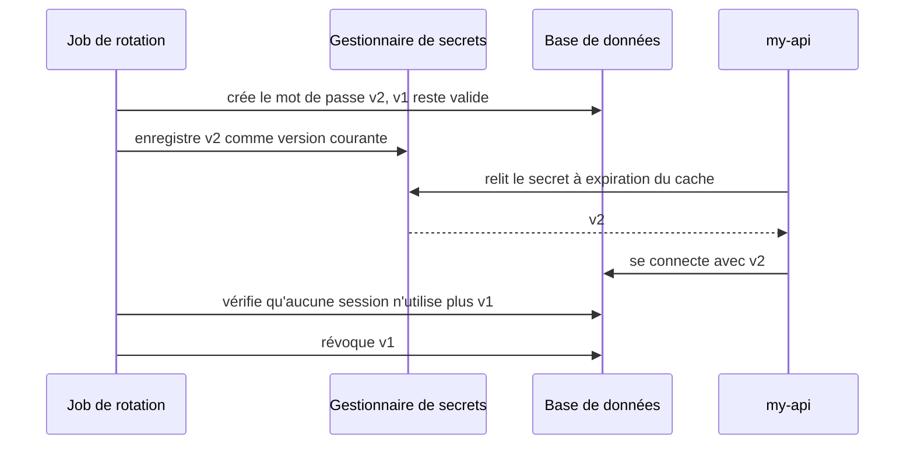

:material-book-open-variant: Doc de référence : [OWASP, Secrets Management Cheat Sheet](https://cheatsheetseries.owasp.org/cheatsheets/Secrets_Management_Cheat_Sheet.html) (consultée en novembre 2026) ; [gitleaks](https://github.com/gitleaks/gitleaks) (consultée en novembre 2026)
{ .doc-ref }

### Stocker un mot de passe
<span class="pill pill-status pill-status-ok" title="Toujours valable, vérifié en novembre 2026">Valable · 11/2026</span>

Jamais en clair, jamais avec un simple <span class="term" data-term="hash">hachage</span> rapide (MD5, SHA-256). Avec un algorithme **volontairement lent** et un <span class="term" data-term="salt">sel</span> : Argon2id, bcrypt ou scrypt. Le sel (une valeur aléatoire par utilisateur) empêche de comparer d'un coup des millions de mots de passe à une table précalculée. Le mieux reste de ne pas stocker de mots de passe du tout, en déléguant la connexion à un fournisseur d'identité.

!!! noob "As noob"
    Hacher un mot de passe, c'est le passer au broyeur : on ne peut pas reconstituer la feuille, seulement broyer de nouveau un candidat et comparer. Un algorithme lent rend chaque essai coûteux pour un attaquant, et le sel est un ingrédient différent ajouté pour chaque personne, pour que deux mots de passe identiques ne donnent pas le même résultat. La phrase à retenir : **lent et salé, pour que deviner coûte cher, compte par compte.**

En Python, avec la bibliothèque `argon2-cffi` :
```python
from argon2 import PasswordHasher
from argon2.exceptions import VerifyMismatchError

ph = PasswordHasher()


# Bien : argon2id, lent et salé, le sel est stocké dans le résultat
def hash_password(password: str) -> str:
    return ph.hash(password)


# Exemple : vérifie un essai contre l'empreinte stockée
def check_password(stored: str, attempt: str) -> bool:
    try:
        ph.verify(stored, attempt)
    except VerifyMismatchError:
        return False
    return True
```
La chaîne stockée en base contient tout ce qu'il faut pour vérifier plus tard :
```
$argon2id$v=19$m=65536,t=3,p=4$c2VsYWxlYXRvaXJl$Zp3m0qN1YcG0...
 algo     version  paramètres     sel (base64)    empreinte (base64)
```
`m` est la mémoire en Kio, `t` le nombre de passes, `p` le parallélisme (valeurs par défaut de la bibliothèque, à vérifier selon la version). Comme les paramètres sont dans la chaîne, on peut les durcir plus tard : `ph.check_needs_rehash(stored)` dit s'il faut recalculer l'empreinte à la prochaine connexion réussie.

:material-book-open-variant: Doc de référence : [OWASP, Password Storage Cheat Sheet](https://cheatsheetseries.owasp.org/cheatsheets/Password_Storage_Cheat_Sheet.html) (consultée en novembre 2026) ; [RFC 9106, Argon2](https://www.rfc-editor.org/rfc/rfc9106) (2021)
{ .doc-ref }

## Modéliser les menaces (STRIDE)

<a class="pill pill-scope pill-scope-system" href="../architecture/#carte-des-echelles">Échelle · Système</a>

<a class="pill pill-practice" href="../livraison/#concevoir-avant-de-coder">Pratique · Conception technique</a>
<a class="pill pill-dora" href="https://dora.dev/capabilities/pervasive-security/">DORA · Pervasive security</a>

### Ce que c'est
<span class="pill pill-status pill-status-ok" title="Toujours valable, vérifié en novembre 2026">Valable · 11/2026</span>

La <span class="term" data-term="threat-modeling">modélisation des menaces</span> consiste à dessiner un système et à lister ce qu'un attaquant pourrait y faire, **avant** d'écrire le code. Une faille trouvée sur un schéma coûte une ligne de schéma ; trouvée en production, elle coûte une refonte.

Adam Shostack (« Threat Modeling: Designing for Security », 2014) résume la méthode en quatre questions :

| Question                                  | Ce qu'on produit                                   |
|-------------------------------------------|----------------------------------------------------|
| sur quoi travaille-t-on ?                 | un schéma des flux de données                      |
| qu'est-ce qui peut mal tourner ?          | une liste de menaces, avec la grille STRIDE        |
| que fait-on contre ?                      | une mesure par menace : corriger, réduire, accepter ou transférer |
| a-t-on bien travaillé ?                   | des tests et des contrôles qui prouvent les mesures |

:material-book-open-variant: Doc de référence : [OWASP, Threat Modeling Cheat Sheet](https://cheatsheetseries.owasp.org/cheatsheets/Threat_Modeling_Cheat_Sheet.html) (consultée en novembre 2026)
{ .doc-ref }

### Le schéma : flux de données et frontières de confiance
On part d'un <span class="term" data-term="data-flow-diagram">diagramme de flux de données</span> : les acteurs, les traitements, les stockages et les flèches entre eux. Une <span class="term" data-term="trust-boundary">frontière de confiance</span> est l'endroit où une donnée passe d'une zone à une autre qui ne lui fait pas confiance : internet vers l'API, l'API vers la base, un service vers un fournisseur externe. C'est sur ces frontières que se concentrent les menaces.

!!! noob "As noob"
    Une frontière de confiance, c'est la douane : à chaque passage d'un pays à un autre, on contrôle ce qui entre, parce que celui qui reçoit ne connaît pas celui qui envoie. Les problèmes arrivent surtout à ces postes, rarement au milieu d'un pays. La phrase à retenir : **dessine les frontières, puis cherche les menaces à chaque passage.**

Exemple : un client envoie une photo de profil à `my-api`, qui la stocke et la fait redimensionner.

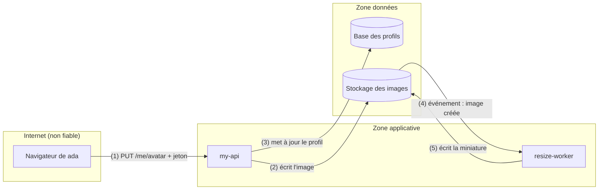

### La grille STRIDE
<span class="pill pill-status pill-status-ok" title="Toujours valable, vérifié en novembre 2026">Valable · 11/2026</span>

<span class="term" data-term="stride">STRIDE</span> (Loren Kohnfelder et Praerit Garg, Microsoft, 1999) donne six familles de menaces à passer sur chaque élément et chaque flèche du schéma. Chaque lettre est la violation d'une propriété de sécurité.

| Lettre | Menace                                  | Propriété violée  | Exemple sur le schéma                                   | Mesure                                             |
|--------|-----------------------------------------|-------------------|---------------------------------------------------------|----------------------------------------------------|
| S      | usurpation d'identité (spoofing)        | authentification  | un jeton volé permet de changer l'avatar de ada (1)     | jetons courts, <span class="term" data-term="dpop">DPoP</span> pour les clients publics |
| T      | altération (tampering)                  | intégrité         | l'image est remplacée dans le stockage après le contrôle (2, 4) | seule l'API écrit dans le stockage, empreinte SHA-256 vérifiée par le worker |
| R      | répudiation                             | traçabilité       | « je n'ai jamais envoyé cette image »                   | journal d'audit : qui, quand, empreinte du fichier |
| I      | divulgation d'information               | confidentialité   | le stockage est public, ou une photo garde ses coordonnées GPS | stockage privé, métadonnées EXIF supprimées       |
| D      | déni de service                         | disponibilité     | une image de 500 Mo ou une « bombe » de décompression bloque le worker (4) | taille maximale, temps de traitement limité, quota par utilisateur |
| E      | élévation de privilèges                 | autorisation      | une faille de la bibliothèque d'images donne la main sur le worker | worker isolé, sans réseau sortant, avec le <span class="term" data-term="least-privilege">moindre privilège</span> |

Chaque mesure devient une exigence testable : « une image de 21 Mo est refusée », « le bucket refuse une lecture anonyme ». Une menace qu'on choisit de garder devient un <span class="term" data-term="accepted-risk">risque accepté</span>, écrit, avec un responsable et une date de revue.

:material-book-open-variant: Doc de référence : [Microsoft, Threat Modeling Tool threats (STRIDE)](https://learn.microsoft.com/en-us/azure/security/develop/threat-modeling-tool-threats) (consultée en novembre 2026)
{ .doc-ref }

### Quand le faire
| Situation | Modélisation ? |
|---|---|
| j'ouvre une nouvelle porte vers l'extérieur, comme une API publique, un envoi de fichiers ou un <span class="term" data-term="webhook">webhook</span> qu'un partenaire appelle | oui, avant le développement |
| mon service va manipuler des données sensibles qu'il ne voyait pas avant, comme des données de santé, de paiement ou d'identité | oui |
| je branche un nouveau fournisseur, ou une donnée passe une nouvelle frontière de confiance, comme un envoi vers un service de paiement externe | oui |
| l'architecture change, par exemple je découpe un service en deux ou j'ajoute un nouveau stockage | oui, en reprenant le schéma existant |
| je corrige un libellé ou je refactore sans créer de nouveau flux de données | non |

Format conseillé : une heure, l'équipe qui construit, un schéma au tableau. On refait l'exercice à chaque changement de schéma plutôt qu'une grande analyse une fois par an. Le Threat Modeling Manifesto (collectif d'auteurs, 2020) donne les principes pour en faire une habitude d'équipe.

:material-book-open-variant: Doc de référence : [Threat Modeling Manifesto](https://www.threatmodelingmanifesto.org/) (2020)
{ .doc-ref }

## Zero trust et identité entre services

<a class="pill pill-scope pill-scope-system" href="../architecture/#carte-des-echelles">Échelle · Système</a> <a class="pill pill-scope pill-scope-infra" href="../architecture/#carte-des-echelles">Échelle · Infrastructure</a>

<a class="pill pill-dora" href="https://dora.dev/capabilities/pervasive-security/">DORA · Pervasive security</a>

### Ce que c'est
<span class="pill pill-status pill-status-ok" title="Toujours valable, vérifié en novembre 2026">Valable · 11/2026</span>

Le modèle classique protège le **périmètre** : un pare-feu à l'entrée, et tout ce qui est à l'intérieur se fait confiance. Le problème : un attaquant qui prend la main sur un seul service, même un petit outil interne, peut ensuite appeler tous les autres, payments-service compris.

Le <span class="term" data-term="zero-trust">zero trust</span> part de l'hypothèse inverse : le réseau interne est déjà compromis. Être dans le cluster ne donne **aucun** droit ; chaque appel est authentifié, autorisé et chiffré, comme s'il venait d'internet. La référence est le NIST SP 800-207 (« Zero Trust Architecture », août 2020).

!!! noob "As noob"
    Dans le modèle du périmètre, une fois passé l'accueil d'un immeuble, mon badge ouvre tous les étages. En zero trust, chaque porte vérifie mon badge et décide si j'ai le droit d'entrer dans cette pièce-là, même si je suis déjà dans le bâtiment. La phrase à retenir : **être à l'intérieur ne prouve rien, chaque appel montre qui il est.**

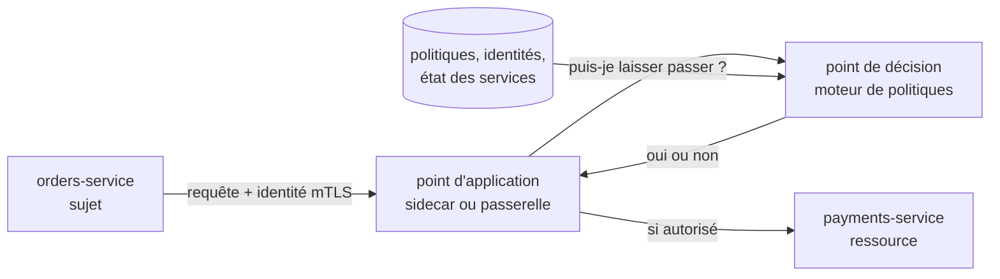

Le NIST SP 800-207 sépare le **point de décision** (qui juge, à partir des politiques) du **point d'application** (qui bloque ou laisse passer, au plus près du service). Dans un service mesh, le second est le proxy placé à côté de chaque service.

:material-book-open-variant: Doc de référence : [NIST SP 800-207, Zero Trust Architecture](https://csrc.nist.gov/pubs/sp/800/207/final) (2020)
{ .doc-ref }

### Les briques
<span class="pill pill-status pill-status-ok" title="Toujours valable, vérifié en novembre 2026">Valable · 11/2026</span>

| Brique                          | Ce que c'est                                                                 | Exemple                                         |
|---------------------------------|------------------------------------------------------------------------------|-------------------------------------------------|
| identité de charge de travail   | une identité donnée par la plateforme au service qui tourne, sans secret copié à la main | le pod de orders-service reçoit son identité au démarrage |
| SPIFFE                          | un standard qui nomme chaque service par une URI et lui fournit un certificat qui le prouve | `spiffe://example.org/ns/prod/sa/orders-service` |
| mTLS                            | TLS où **les deux côtés** présentent un certificat : chacun prouve son identité à l'autre, et l'échange est chiffré | orders-service et payments-service se vérifient mutuellement |
| politique d'autorisation        | une règle « qui peut appeler quoi », en refus par défaut                     | seul orders-service peut appeler `POST /charges` |
| <span class="term" data-term="short-lived-credential">identifiants à courte durée de vie</span> | des certificats et jetons qui expirent en minutes ou en heures, renouvelés automatiquement | certificat valable 1 h, jeton valable 5 min (exemple) |

Une <span class="term" data-term="workload-identity">identité de charge de travail</span> remplace la clé d'API partagée : il n'y a plus rien à voler dans une variable d'environnement, et rien à faire tourner à la main. <span class="term" data-term="spiffe">SPIFFE</span> (projet de la CNCF, à vérifier pour son statut actuel) est le format le plus répandu ; SPIRE est son implémentation de référence, et plusieurs <span class="term" data-term="service-mesh">service mesh</span> (Istio, Linkerd) délivrent des identités compatibles.

*Istio : concurrent de Linkerd ; complémentaire de Envoy*<br>
*Linkerd : concurrent de Istio*
{ .tool-rel }


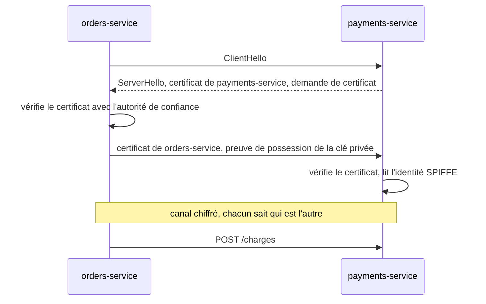

:material-book-open-variant: Doc de référence : [SPIFFE, Overview](https://spiffe.io/docs/latest/spiffe-about/overview/) (consultée en novembre 2026) ; [RFC 8446, TLS 1.3](https://www.rfc-editor.org/rfc/rfc8446) (2018)
{ .doc-ref }

### Avant et après
```
avant (périmètre)                            après (zero trust)
réseau plat, HTTP en clair                   mTLS partout, chiffré et authentifié
une clé d'API commune à tous les services    une identité SPIFFE par service
clé jamais changée                           certificat renouvelé toutes les heures
tout le monde peut appeler tout le monde     refus par défaut, règles par service et par route
une clé volée = accès à tout                 un service compromis = accès à ses seules routes autorisées
```

Le <span class="term" data-term="mtls">mTLS</span> prouve **quel service** appelle, pas **pour quel utilisateur**. Quand orders-service agit pour ada, il transmet aussi un jeton utilisateur dont l'audience est payments-service, pour que le service final vérifie les droits de ada et pas seulement ceux du service appelant (échange de jeton : RFC 8693, 2020). Un jeton peut aussi être lié au certificat mTLS du client (RFC 8705, 2020) : volé, il ne sert à rien sans le certificat, comme avec DPoP.

### Lien avec Client Credentials
Le flux [Client Credentials](#client-credentials-un-service-parle-a-un-service) reste valable pour un service qui appelle une API protégée par OAuth, notamment hors du cluster. Mais son `client_secret` est un secret long à stocker et à faire tourner. Avec une identité de charge de travail, le service s'authentifie avec son certificat ou un jeton signé par la plateforme, et plusieurs fournisseurs d'identité acceptent ce jeton à la place du `client_secret` (fédération d'identité de charge de travail, à vérifier selon le fournisseur).

:material-book-open-variant: Doc de référence : [RFC 8693, OAuth 2.0 Token Exchange](https://www.rfc-editor.org/rfc/rfc8693) (2020) ; [RFC 8705, OAuth 2.0 Mutual-TLS](https://www.rfc-editor.org/rfc/rfc8705) (2020)
{ .doc-ref }

### Par où commencer
1. Supprimer les secrets partagés entre services : c'est le risque le plus grave.
2. Donner une identité à chaque service et activer le mTLS en mode permissif (clair et chiffré acceptés), pour mesurer qui parle encore en clair.
3. Passer service par service en mode strict.
4. Écrire les politiques d'autorisation à partir du trafic observé, puis les appliquer en refus par défaut.
5. Journaliser chaque refus et le suivre pendant la transition.

:material-book-open-variant: Doc de référence : [CISA, Zero Trust Maturity Model](https://www.cisa.gov/zero-trust-maturity-model) (version 2.0, 2023)
{ .doc-ref }

### Une politique en refus par défaut
<span class="pill pill-status pill-status-ok" title="Toujours valable, vérifié en novembre 2026">Valable · 11/2026</span>

Exemple avec Istio : seul le <span class="term" data-term="service-account">compte de service</span> de orders-service peut appeler `POST /charges` sur payments-service.
```yaml
# Bien : refus par défaut, seul orders-service peut faire POST /charges
apiVersion: security.istio.io/v1
kind: AuthorizationPolicy
metadata:
  name: payments-allow-orders
  namespace: prod
spec:
  selector:
    matchLabels:
      app: payments-service
  action: ALLOW
  rules:
    - from:
        - source:
            principals: ["cluster.local/ns/prod/sa/orders-service"]
      to:
        - operation:
            methods: ["POST"]
            paths: ["/charges"]
```
Dès qu'une politique `ALLOW` vise un service, toute requête qui ne correspond à aucune règle est refusée (`403`) : billing-service, un `GET /charges` de orders-service ou un appel sans identité mTLS. L'identité vérifiée (`principals`) vient du certificat mTLS, pas d'un en-tête qu'on pourrait forger.

:material-book-open-variant: Doc de référence : [Istio, Authorization Policy](https://istio.io/latest/docs/reference/config/security/authorization-policy/) (consultée en novembre 2026)
{ .doc-ref }

## Données personnelles et RGPD dans l'architecture

<a class="pill pill-scope pill-scope-system" href="../architecture/#carte-des-echelles">Échelle · Système</a> <a class="pill pill-scope pill-scope-enterprise" href="../architecture/#carte-des-echelles">Échelle · Entreprise</a>

### Ce que c'est
Le <span class="term" data-term="gdpr">RGPD</span> (règlement européen 2016/679, adopté en 2016 et appliqué depuis mai 2018) encadre tout traitement de **données personnelles** : toute information qui se rapporte à une personne identifiable, directement (nom, e-mail) ou indirectement (identifiant client, adresse IP).

Son article 25 impose la <span class="term" data-term="privacy-by-design">protection des données dès la conception et par défaut</span> : la protection fait partie de l'architecture, et le réglage par défaut est le plus protecteur. Pour une équipe technique, ça se traduit par cinq décisions de conception.

:material-book-open-variant: Doc de référence : [Règlement (UE) 2016/679, RGPD](https://eur-lex.europa.eu/eli/reg/2016/679/oj) (2016)
{ .doc-ref }

### Les mots du RGPD
| Terme                              | Ce que c'est                                                                 |
|------------------------------------|------------------------------------------------------------------------------|
| <span class="term" data-term="dpo">DPO</span> (délégué à la protection des données) | la personne chargée de conseiller et de contrôler la conformité dans l'organisation (articles 37 à 39) ; c'est elle qu'on consulte sur un nouveau traitement |
| traitement                         | toute opération sur des données personnelles : collecter, stocker, consulter, envoyer, effacer |
| <span class="term" data-term="processing-register">registre des traitements</span>           | la liste écrite de tous les traitements de l'organisation, avec leur finalité, leurs données, leurs destinataires et leur durée (article 30) |
| <span class="term" data-term="legal-basis">base légale</span>                        | la raison juridique qui autorise un traitement (article 6) : consentement, contrat, obligation légale, intérêts vitaux, mission d'intérêt public ou intérêt légitime. Sans base légale, le traitement est interdit |
| décision d'adéquation              | décision de la Commission européenne qui reconnaît qu'un pays hors UE protège suffisamment les données : les transferts vers lui sont libres |
| <span class="term" data-term="standard-contractual-clauses">clauses contractuelles types</span> (CCT) | un contrat modèle publié par la Commission européenne (version de juin 2021), signé avec un fournisseur hors UE pour encadrer un transfert vers un pays sans décision d'adéquation |

Une entrée du registre, en exemple :
```
traitement : gestion des commandes  | finalité : livrer et facturer       | base légale : contrat (art. 6.1.b)
données    : nom, adresse, e-mail   | destinataires : orders-service, billing-service, transporteur
durée      : 10 ans après la commande (comptabilité, à vérifier par pays) | transferts hors UE : aucun
```

### Les décisions de conception
| Principe                          | Ce qu'il veut dire                                                       | Décision d'architecture                                     |
|-----------------------------------|--------------------------------------------------------------------------|-------------------------------------------------------------|
| minimisation (art. 5)             | ne collecter que ce qui sert la finalité annoncée                        | pas de date de naissance si l'âge n'est jamais utilisé       |
| pseudonymisation (art. 4 et 25)   | remplacer l'identité par un identifiant, la correspondance gardée à part | les données personnelles dans customers-service, les autres services ne voient que `customer_id` |
| durée de conservation (art. 5)    | chaque donnée a une date de fin                                          | purge automatique, rétention des logs et des topics réglée  |
| droits des personnes (art. 15 à 22) | accès, rectification, effacement, portabilité                          | une procédure d'effacement qui couvre bases, logs, événements et sauvegardes |
| transferts hors UE (chapitre V)   | les données ne quittent l'UE que dans des cas encadrés                   | choix des régions d'hébergement et des fournisseurs         |

La <span class="term" data-term="data-minimization">minimisation</span> est la mesure la plus rentable : une donnée qu'on n'a pas ne fuit pas, ne se purge pas et ne se transfère pas.

:material-book-open-variant: Doc de référence : [CEPD, lignes directrices 4/2019 sur l'article 25](https://www.edpb.europa.eu/our-work-tools/our-documents/guidelines/guidelines-42019-article-25-data-protection-design-and_en) (version 2.0, 2020)
{ .doc-ref }

### Pseudonymisation ou anonymisation
La <span class="term" data-term="pseudonymization">pseudonymisation</span> réduit l'exposition, mais les données restent personnelles et le RGPD s'applique entièrement. Seule une vraie <span class="term" data-term="data-anonymization">anonymisation</span>, irréversible, les fait sortir du règlement. La différence, et les quatre façons de réidentifier une donnée « anonyme », sont détaillées dans la page [IA en entreprise](ia-entreprise.md#pourquoi-le-mode-anonyme-est-en-realite-de-la-pseudonymisation).

### Durée de conservation
Chaque champ personnel a une finalité et une <span class="term" data-term="retention-period">durée de conservation</span>, écrites dans le registre des traitements. Les copies oubliées sont le piège : logs applicatifs, topics Kafka à <span class="term" data-term="message-retention">rétention</span> illimitée, exports dans un entrepôt de données, environnements de test alimentés avec des données de production.

```
donnée                       durée (exemple)             mécanisme
compte client actif          tant que le compte existe   suppression à la clôture
commande                     10 ans (obligation comptable, à vérifier par pays)  archivage puis purge
logs applicatifs             30 jours                    rétention de l'outil de logs, pas d'e-mail dans les logs
topic order.created          7 jours                     retention.ms du topic
```

### Droit à l'effacement et journaux d'événements
<span class="pill pill-status pill-status-ok" title="Toujours valable, vérifié en novembre 2026">Valable · 11/2026</span>

Le <span class="term" data-term="right-to-erasure">droit à l'effacement</span> (article 17) est simple dans une base, difficile dans un <span class="term" data-term="event-log">journal d'événements</span> immuable ou une sauvegarde : on ne réécrit pas un événement publié il y a six mois.

Le <span class="term" data-term="crypto-shredding">crypto-shredding</span> répond à ce cas : les champs personnels de chaque client sont chiffrés avec **sa propre clé**, stockée dans un <span class="term" data-term="kms">service de gestion de clés</span>. Effacer le client revient à détruire sa clé.

!!! noob "As noob"
    Mes données personnelles sont rangées dans un coffre, et ce coffre est recopié dans des archives qu'on ne peut pas modifier. Plutôt que de fouiller toutes les archives, on détruit la seule clé du coffre : les copies restent, mais plus personne ne peut les ouvrir. Limite : tout dépend de la destruction réelle de la clé, y compris dans ses sauvegardes. La phrase à retenir : **effacer, ici, c'est jeter la clé.**

```
événement order.created dans Kafka
{ "order_id": "42", "customer_id": "cust-ada", "personal_data": "gAAAAABl...(chiffré avec la clé de cust-ada)" }

ada demande l'effacement   : la clé de cust-ada est détruite
rejeu six mois plus tard   : order_id et customer_id lisibles, personal_data illisible partout
```

Deux limites : une clé restaurée depuis une vieille sauvegarde annule l'effacement, et la valeur juridique de cette méthode comme effacement reste débattue (à vérifier avec le DPO). Le mieux reste de ne pas mettre de données personnelles dans les événements : ne publier que `customer_id`.

### Résidence des données
La <span class="term" data-term="data-residency">résidence des données</span> est la contrainte sur le pays ou la région où les données sont stockées **et traitées**. Un transfert hors UE n'est possible qu'avec une base légale (décision d'adéquation, clauses contractuelles types). Conséquences concrètes : choisir une région européenne chez le fournisseur cloud, vérifier où tournent les services managés annexes (logs, support, IA), et lister les sous-traitants. Le cadre des transferts vers les États-Unis a changé plusieurs fois (arrêt Schrems II en 2020, Data Privacy Framework en 2023) : à vérifier au moment de décider.

Pour un traitement à risque élevé (données de santé, suivi à grande échelle), une <span class="term" data-term="dpia">analyse d'impact (AIPD)</span> est obligatoire avant de le lancer (article 35).

:material-book-open-variant: Doc de référence : [Commission européenne, décisions d'adéquation](https://commission.europa.eu/law/law-topic/data-protection/international-dimension-data-protection/adequacy-decisions_en) (consultée en novembre 2026)
{ .doc-ref }

## Les outils de test de sécurité

<a class="pill pill-scope pill-scope-code" href="../architecture/#carte-des-echelles">Échelle · Code</a> <a class="pill pill-scope pill-scope-app" href="../architecture/#carte-des-echelles">Échelle · Application</a>

<a class="pill pill-dora" href="https://dora.dev/capabilities/pervasive-security/">DORA · Pervasive security</a>


| Outil                    | Ce qu'il fait                                                  | Exemple                                  |
|--------------------------|----------------------------------------------------------------|------------------------------------------|
| SAST                     | analyse le code source sans l'exécuter                         | détecte une requête SQL construite par concaténation |
| scan de dépendances      | cherche les failles connues dans les bibliothèques utilisées  | « la version 2.3 de cette lib a une faille critique » |
| scan de secrets          | cherche des clés et mots de passe dans le code et l'historique | gitleaks                                 |
| DAST                     | attaque l'application qui tourne, de l'extérieur               | OWASP ZAP sur l'environnement d'intégration |
| test d'intrusion         | une personne spécialisée cherche des failles à la main        | avant une mise en production sensible    |

Chaque outil tourne là où il est le moins cher de corriger ce qu'il trouve : le plus tôt possible pour ce qui se voit dans le code, sur l'application qui tourne pour le reste.

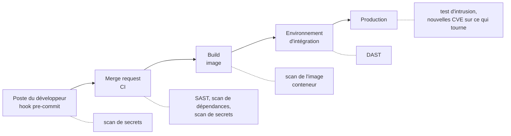

:material-book-open-variant: Doc de référence : [OWASP, Web Security Testing Guide](https://owasp.org/www-project-web-security-testing-guide/) (consultée en novembre 2026)
{ .doc-ref }

### Exemple : un scan de dépendances
<span class="pill pill-status pill-status-ok" title="Toujours valable, vérifié en novembre 2026">Valable · 11/2026</span>

Le scan compare les versions installées à une base de failles publiées (identifiants CVE ou GHSA). En Python avec `pip-audit` (en JavaScript, `npm audit` fait la même chose) :
```
$ pip-audit -r requirements.txt
Found 1 known vulnerability in 1 package
Name     Version ID                  Fix Versions
-------- ------- ------------------- ------------
requests 2.31.0  GHSA-9wx4-h78v-vm56 2.32.0
```
Lecture : `requests` 2.31.0 a une faille connue, corrigée en 2.32.0 (sortie illustrative, à vérifier). En CI, la commande renvoie un code d'erreur quand elle trouve une faille, ce qui bloque le pipeline ; un outil comme Renovate ouvre ensuite la mise à jour.

*Renovate : concurrent de Dependabot ; complémentaire de Snyk, Trivy*
{ .tool-rel }


:material-book-open-variant: Doc de référence : [pip-audit](https://github.com/pypa/pip-audit) (consultée en novembre 2026)
{ .doc-ref }

## Opérations de sécurité

<a class="pill pill-scope pill-scope-infra" href="../architecture/#carte-des-echelles">Échelle · Infrastructure</a> <a class="pill pill-scope pill-scope-enterprise" href="../architecture/#carte-des-echelles">Échelle · Entreprise</a>

<a class="pill pill-dora" href="https://dora.dev/capabilities/pervasive-security/">DORA · Pervasive security</a>

!!! info "Section rédigée en novembre 2026"
    Les produits de sécurité changent vite de nom, de périmètre et de modèle de prix. Les noms cités sont des exemples, pas des recommandations, et leurs fonctions sont à vérifier au moment de la lecture.

Les sections précédentes parlent de ce qu'on met **dans** le code. Celle-ci parle des outils qui tournent **autour** : ils surveillent ce qui se passe en production, vérifient la configuration du cloud et gardent les secrets. La plupart sont tenus par une équipe sécurité ou plateforme ; les équipes de développement les alimentent (journaux, politiques, corrections) et reçoivent leurs alertes.

| Famille | La question à laquelle elle répond | Qui la regarde au quotidien | Exemples |
|---|---|---|---|
| SIEM | que s'est-il passé, sur tous les systèmes à la fois ? | équipe sécurité, <span class="term" data-term="soc">SOC</span> | Splunk, Microsoft Sentinel, Elastic Security, Google SecOps |
| NDR | qui parle à qui sur le réseau, et est-ce normal ? | équipe sécurité, équipe réseau | Darktrace, Corelight, Zeek, Suricata |
| IPS collaboratif | cette adresse IP attaque-t-elle déjà quelqu'un ailleurs ? | équipe plateforme, administrateurs | CrowdSec, fail2ban (local seulement) |
| CSPM et gouvernance cloud | la configuration du cloud respecte-t-elle nos règles ? | équipe plateforme, FinOps, sécurité | Cloud Custodian, Steampipe, Wiz, Security Command Center |
| gestionnaire de secrets | où vivent les mots de passe, et qui les lit ? | applications, CI, humains | HashiCorp Vault, gestionnaire du cloud, 1Password, Bitwarden |
| plateforme SAST et SCA | quelles failles connues sont dans notre code et nos dépendances ? | équipes de développement | SonarQube, Semgrep, Snyk, Aikido |

### SIEM : centraliser et corréler les journaux de sécurité
<span class="pill pill-status pill-status-ok" title="Toujours valable, vérifié en novembre 2026">Valable · 11/2026</span>

Un <span class="term" data-term="siem">SIEM</span> (*Security Information and Event Management*) collecte les journaux de sécurité de tous les systèmes (connexions, changements de droits, pare-feu, cloud, postes de travail), les range dans un format commun et applique des **règles de corrélation** : des motifs qu'aucun journal ne montre seul.

**Quand** : plusieurs équipes, plusieurs clouds ou une obligation réglementaire (conservation des journaux, détection d'intrusion, normes comme ISO 27001) ; quelqu'un est payé pour regarder les alertes. **Pas encore** : une petite équipe sans personne pour trier les alertes. Commencer alors par les journaux d'audit du cloud et trois ou quatre alertes bien choisies.

**Pourquoi** : une attaque laisse des traces dispersées. Un échec de connexion sur my-api, un nouveau jeton créé, un téléchargement massif depuis un bucket : chaque fait est banal, leur enchaînement en dix minutes ne l'est pas. Le coût : une facture souvent au volume ingéré, des règles à maintenir, et des <span class="term" data-term="false-positive">faux positifs</span> qui fatiguent l'équipe.

**Comment**, côté développement :

1. émettre des journaux de sécurité structurés : qui (`user_id`), quoi (`event`), d'où (`ip`), résultat ; jamais de secret ni de mot de passe ;
2. les envoyer vers le même collecteur que les autres journaux, avec un champ qui les distingue ;
3. écrire avec l'équipe sécurité les deux ou trois règles propres au métier (un remboursement au-dessus d'un seuil, un export de toute la base client).

```
10:02:11  my-api  login_failed   user=ada  ip=203.0.113.7
10:02:14  my-api  login_failed   user=ada  ip=203.0.113.7
   ... 38 échecs en 2 minutes
10:04:03  my-api  login_success  user=ada  ip=203.0.113.7
10:06:40  my-api  export_orders  user=ada  rows=184000

règle : plus de 20 échecs puis un succès depuis la même IP, suivi d'un export
        dans les 15 minutes : alerte SEV2 vers l'équipe sécurité
```

Les règles peuvent s'écrire dans un format neutre, Sigma (projet ouvert lancé en 2017, à vérifier), puis être traduites pour le SIEM utilisé. Les adresses IP de l'exemple sont réservées à la documentation (RFC 5737, 2010).

:material-book-open-variant: Doc de référence : [NIST SP 800-92, Guide to Computer Security Log Management](https://csrc.nist.gov/pubs/sp/800/92/final) (2006) ; [Sigma](https://github.com/SigmaHQ/sigma) (consultée en novembre 2026)
{ .doc-ref }

### Détection réseau (NDR)
<span class="pill pill-status pill-status-ok" title="Toujours valable, vérifié en novembre 2026">Valable · 11/2026</span>

Un <span class="term" data-term="ndr">NDR</span> (*Network Detection and Response*) analyse le trafic réseau lui-même, à partir d'une copie de ce trafic (port miroir, *packet mirroring* du cloud), au lieu des journaux que les applications veulent bien écrire.

**Quand** : un réseau avec beaucoup de machines qu'on ne contrôle pas finement (postes, objets connectés, serveurs anciens), un centre de données, une obligation de détecter les mouvements latéraux. **Pas encore** : une application entièrement managée ou serverless, où il y a peu de réseau à soi à observer ; les journaux du cloud (*VPC flow logs*) suffisent souvent.

**Pourquoi** : un attaquant qui est entré ne s'annonce pas dans les journaux applicatifs, mais il doit parler sur le réseau : scanner les voisins, contacter son serveur de commande à intervalles réguliers, sortir des données. Le coût : du matériel ou des capteurs, beaucoup de volume, et une vision limitée dans le trafic chiffré (on voit qui parle à qui, combien et quand, pas le contenu).

**Comment** : deux approches qui se combinent.

- **Signatures** : Suricata (open source) reconnaît des attaques connues, comme un antivirus réseau.
- **Comportement** : Darktrace (commercial) apprend ce qui est normal pour chaque machine et signale l'écart ; Corelight (commercial) s'appuie sur Zeek, un moteur open source qui transforme le trafic en journaux lisibles.

Une ligne de `conn.log` produite par Zeek, simplifiée :
```
ts          id.orig_h   id.resp_h      id.resp_p  proto  duration  orig_bytes  resp_bytes
1730714400  10.0.4.12   198.51.100.20  443        tcp    3600.2    2147483648  5120
```
Lecture : une machine interne a envoyé 2 Gio vers une adresse externe pendant une heure, et n'a presque rien reçu en retour. Ce n'est pas forcément une attaque (une sauvegarde ?), mais c'est exactement le motif d'une exfiltration. Champs et format à vérifier selon la version de Zeek.

:material-book-open-variant: Doc de référence : [Zeek, documentation](https://docs.zeek.org/) (consultée en novembre 2026) ; [Suricata, documentation](https://docs.suricata.io/) (consultée en novembre 2026)
{ .doc-ref }

### IPS collaboratif : CrowdSec
<span class="pill pill-status pill-status-ok" title="Toujours valable, vérifié en novembre 2026">Valable · 11/2026</span>

Un <span class="term" data-term="ips">IPS</span> (*Intrusion Prevention System*) détecte une attaque **et la bloque**, là où un IDS se contente de la signaler. CrowdSec (open source, société française, lancé en 2020, à vérifier) ajoute une dimension collective : chaque installation partage les adresses qu'elle bloque, et reçoit en retour une liste d'adresses déjà vues en train d'attaquer ailleurs.

**Quand** : un service exposé sur internet qui subit du bruit (force brute sur une page de connexion, scans, robots qui testent des chemins `/wp-admin`), surtout sur des serveurs qu'on gère soi-même. **Pas encore**, ou avec prudence : des clients derrière des adresses partagées (réseaux d'entreprise, opérateurs mobiles), où bloquer une IP bloque des centaines de vrais utilisateurs.

**Pourquoi** : la <span class="term" data-term="rate-limit">limitation de débit</span> ralentit un attaquant, elle ne l'arrête pas, et elle ne sait rien de ce qu'il a fait ailleurs. Le gain : les attaquants connus sont bloqués avant leur première tentative. Le coût : des faux positifs, et le partage des adresses observées avec le service central (à vérifier dans les conditions du service).

**Comment** : l'agent lit des journaux (nginx, SSH), applique des **scénarios** (« 10 échecs de connexion en 1 minute »), prend une **décision** (bannir 4 h) ; des **bouncers** appliquent la décision au bon endroit (pare-feu, nginx, <span class="term" data-term="cdn">CDN</span>).

*nginx : concurrent de Caddy, Traefik, Envoy ; complémentaire de KrakenD*
{ .tool-rel }


```
$ cscli decisions list
 ID  Source    Scope:Value       Reason                          Action  Duration
 12  crowdsec  Ip:203.0.113.7    crowdsecurity/http-bf-wordpress  ban     3h52m
 13  CAPI      Ip:198.51.100.9   crowdsecurity/ssh-bf             ban     166h
```
La première décision vient de l'agent local, la seconde de la liste communautaire. Sortie illustrative, colonnes à vérifier selon la version.

:material-book-open-variant: Doc de référence : [CrowdSec, documentation](https://docs.crowdsec.net/) (consultée en novembre 2026)
{ .doc-ref }

### CSPM et gouvernance cloud en code
<span class="pill pill-status pill-status-ok" title="Toujours valable, vérifié en novembre 2026">Valable · 11/2026</span>

Le <span class="term" data-term="cspm">CSPM</span> (*Cloud Security Posture Management*) vérifie en continu la configuration réelle du cloud contre des règles : bucket public, disque non chiffré, port SSH ouvert à tout internet, compte de service avec des droits d'administration.

**Quand** : plusieurs comptes ou projets cloud, plusieurs équipes qui créent des ressources, des changements faits à la main dans la console. **Pas encore** : un seul projet entièrement géré en <span class="term" data-term="infrastructure-as-code">infrastructure as code</span> et relu en revue ; un scan du code Terraform (Checkov, Trivy) suffit au début.

*Terraform : concurrent de OpenTofu, Pulumi ; concurrent en partie de Crossplane ; complémentaire de Terragrunt, Packer, Ansible*<br>
*Trivy : concurrent en partie de Snyk ; complémentaire de Renovate*
{ .tool-rel }


**Pourquoi** : le scan du code d'infrastructure voit ce qu'on **voulait** déployer ; le CSPM voit ce qui **existe**, clics dans la console compris. Le coût : beaucoup de constats au premier passage, à trier par risque, et des actions automatiques qui peuvent casser un usage légitime.

**Comment** : trois familles d'outils.

| Outil | Ce qu'il fait | Quand le choisir |
|---|---|---|
| CSPM commercial (Wiz, Prisma Cloud) ou intégré au cloud (Security Command Center, AWS Security Hub, Defender for Cloud) | règles prêtes à l'emploi, score de risque, tableau de bord | besoin d'une vue complète vite, budget disponible |
| Cloud Custodian | des politiques en YAML qui filtrent des ressources et agissent dessus | des règles propres à l'organisation, avec correction automatique |
| Steampipe | interroge les API du cloud en SQL, comme si chaque type de ressource était une table | inventaire, questions ponctuelles, rapports |

Cloud Custodian (projet de la CNCF, à vérifier pour son statut) applique de la <span class="term" data-term="policy-as-code">politique en code</span>. Exemple pour AWS : retirer l'accès public des buckets, et arrêter dans 3 jours les machines sans étiquette `team`.
```yaml
policies:
  # Exemple : retire l'accès public des buckets S3
  - name: s3-no-public-grants
    resource: aws.s3
    filters:
      - type: global-grants
    actions:
      - type: delete-global-grants

  # Exemple : arrête sous 3 jours les machines sans étiquette team
  - name: ec2-missing-team-tag
    resource: aws.ec2
    filters:
      - "tag:team": absent
    actions:
      - type: mark-for-op
        op: stop
        days: 3
```
```bash
custodian run --dryrun -s out/ policies.yml
```
`--dryrun` liste les ressources visées sans agir : toujours commencer par là, puis passer en mode notification, puis seulement en correction automatique (syntaxe des filtres à vérifier dans la documentation).

Steampipe fait de l'<span class="term" data-term="cloud-asset-inventory">inventaire des ressources cloud</span> en SQL : chaque plugin (AWS, Google Cloud, Kubernetes, GitHub) expose ses ressources comme des tables PostgreSQL, interrogées en direct par les API.

*PostgreSQL : concurrent de MySQL, MariaDB ; concurrent en partie de MongoDB ; complémentaire de Redis, PgBouncer, BigQuery, Elasticsearch*<br>
*Kubernetes : concurrent de Cloud Run ; complémentaire de Docker, Helm, Argo CD*
{ .tool-rel }

```sql
-- Exemple : liste les buckets S3 publics
SELECT name, region, versioning_enabled
FROM aws_s3_bucket
WHERE bucket_policy_is_public;
```
```
 name               | region    | versioning_enabled
--------------------+-----------+-------------------
 my-test-reports    | eu-west-3 | false
```
Utile pour répondre vite à « quels buckets sont publics ? » sans écrire de script, et pour joindre plusieurs sources (les comptes de service d'un projet et les dépôts de code qui les utilisent). Noms de tables et de colonnes à vérifier selon la version du plugin. Les inventaires natifs du cloud (Cloud Asset Inventory chez Google, AWS Config) répondent à la même question sans outil en plus.

Les étiquettes imposées ici servent aussi au suivi des coûts : voir [Coûts et économies](donnees-decision.md#couts-et-economies).

:material-book-open-variant: Doc de référence : [Cloud Custodian, documentation](https://cloudcustodian.io/docs/) (consultée en novembre 2026) ; [Steampipe, documentation](https://steampipe.io/docs) (consultée en novembre 2026)
{ .doc-ref }

### Gestionnaires de secrets : pour les machines et pour les humains
<span class="pill pill-status pill-status-ok" title="Toujours valable, vérifié en novembre 2026">Valable · 11/2026</span>

Les règles de base sont dans [Les secrets](#les-secrets), et la présentation de Vault dans le [panorama des outils](outils.md). Ce qui change à l'échelle d'une organisation : séparer les secrets des **machines** de ceux des **humains**.

*Vault : concurrent de les gestionnaires de secrets des clouds*
{ .tool-rel }


| | Gestionnaire de secrets applicatif | Gestionnaire de mots de passe |
|---|---|---|
| pour qui | applications, CI, scripts | personnes |
| exemples | HashiCorp Vault, OpenBao (fork open source), Google Secret Manager, AWS Secrets Manager | 1Password, Bitwarden, Keeper |
| comment on s'authentifie | identité de la plateforme (compte de service, OIDC de la CI) | SSO de l'entreprise et MFA |
| ce qu'il sait faire de plus | <span class="term" data-term="dynamic-secret">secrets dynamiques</span>, rotation, journal d'audit par application | coffres partagés par équipe, partage temporaire, alerte de fuite |

**Quand** : un <span class="term" data-term="secret-manager">gestionnaire de secrets</span> applicatif dès qu'un secret est lu par du code ; un <span class="term" data-term="password-manager">gestionnaire de mots de passe</span> dès que des personnes partagent un accès (console d'un fournisseur, compte de démonstration). **Pas** : un gestionnaire de mots de passe humain comme source des secrets de production, sauf avec ses comptes de service prévus pour cela (fonction à vérifier selon le produit).

**Pourquoi** : un secret copié dans un fichier `.env`, un ticket ou un message ne se révoque plus proprement ; personne ne sait qui l'a. Un gestionnaire dit qui a lu quoi et quand, et permet de changer le secret en un seul endroit. Le coût : une dépendance critique de plus (s'il tombe, les applications qui démarrent n'ont plus leurs secrets) et une façon de s'authentifier auprès de lui sans créer un nouveau secret à cacher.

**Comment** : l'application s'authentifie avec son <span class="term" data-term="workload-identity">identité de charge de travail</span> (voir [Zero trust](#zero-trust-et-identite-entre-services)), puis demande un secret dynamique : un compte de base créé pour elle, qui expire seul.
```
$ vault read database/creds/my-api-readonly
Key                Value
---                -----
lease_id           database/creds/my-api-readonly/Xy12...
lease_duration     1h
username           v-my-api-readonly-8f3k2
password           A1b2-C3d4-...
```
Volé, ce compte ne sert qu'une heure, et la révocation du bail le supprime de la base. Côté humain, la CLI de 1Password lit un secret par une référence, sans le copier dans un fichier :
```bash
op read "op://team-core/my-api-staging-db/password"
```
(Sorties et syntaxes à vérifier selon les versions.)

:material-book-open-variant: Doc de référence : [HashiCorp Vault, Database secrets engine](https://developer.hashicorp.com/vault/docs/secrets/databases) (consultée en novembre 2026)
{ .doc-ref }

### Plateformes SAST et SCA
<span class="pill pill-status pill-status-ok" title="Toujours valable, vérifié en novembre 2026">Valable · 11/2026</span>

Le tableau des [outils de test de sécurité](#les-outils-de-test-de-securite) présente chaque technique seule. Le <span class="term" data-term="sca">SCA</span> (*Software Composition Analysis*) élargit le scan de dépendances : failles connues, licences, dépendances indirectes, inventaire des composants (SBOM). Une **plateforme** réunit <span class="term" data-term="sast">SAST</span>, SCA, scan de secrets, d'images de conteneur et de code d'infrastructure, avec un tableau de bord commun, la suppression des doublons, le tri par risque et des commentaires dans les merge requests.

| Exemple | Point de départ | À retenir |
|---|---|---|
| SonarQube | qualité du code, puis règles de sécurité (SAST) | souvent déjà en place pour la qualité ; SCA ajouté récemment selon les éditions (à vérifier) |
| Semgrep | SAST par règles écrites comme du code | moteur open source, règles faciles à écrire soi-même ; plateforme payante au-dessus |
| Snyk | SCA, puis SAST (Snyk Code) et conteneurs | forte base de failles, priorisation par exploitabilité (à vérifier) |
| Aikido | tout-en-un pour petites et moyennes équipes | réunit plusieurs scanners open source avec un tri commun (à vérifier) |

**Quand** : plus d'une poignée de dépôts, plusieurs scanners qui sortent chacun leur liste, et personne ne sait quelles failles sont vraiment ouvertes. **Pas encore** : un ou deux dépôts, où `pip-audit`, gitleaks et un linter de sécurité dans la CI couvrent l'essentiel gratuitement.

**Pourquoi** : sans tri, un premier scan sort des centaines de constats, et l'équipe apprend à les ignorer. La plateforme réduit le bruit : doublons fusionnés, failles classées selon que le code vulnérable est réellement appelé, score d'exploitation (<span class="term" data-term="epss">EPSS</span>). Le coût : une licence souvent par développeur, et du temps de tri.

**Comment** :

1. lancer la plateforme en mode non bloquant sur tous les dépôts, pour mesurer ;
2. bloquer la merge request seulement sur les **nouveaux** constats critiques (le code ajouté), pas sur l'historique ;
3. traiter l'historique par lots, du plus exploitable au moins exploitable ;
4. écrire quelques règles maison pour les erreurs propres au projet.

Le parcours d'un constat, de la détection à la vérification. Un « risque accepté » porte toujours une date de réexamen, sinon il devient une faille oubliée :

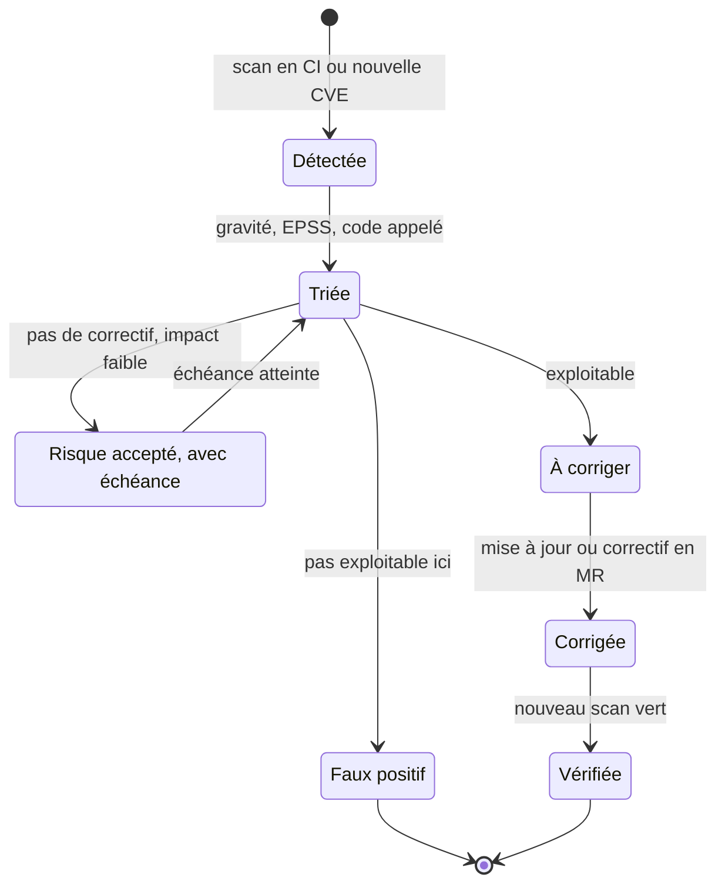

Une règle Semgrep maison qui repère une requête SQL construite par concaténation (voir [l'injection SQL](sql.md#securite-linjection-sql)) :
```yaml
# Exemple : règle Semgrep qui signale une requête SQL construite par concaténation
rules:
  - id: sql-string-concat
    languages: [python]
    severity: ERROR
    message: Requête SQL construite par concaténation, utiliser une requête paramétrée
    pattern: $DB.execute("..." + $X)
```

:material-book-open-variant: Doc de référence : [OWASP, Source Code Analysis Tools](https://owasp.org/www-community/Source_Code_Analysis_Tools) (consultée en novembre 2026) ; [Semgrep, documentation](https://semgrep.dev/docs/) (consultée en novembre 2026)
{ .doc-ref }

### Quel outil, pour qui, quand

| Outil | Qui le porte | Je l'adopte quand | J'attends si |
|---|---|---|---|
| SIEM | équipe sécurité ou SOC | j'ai plusieurs systèmes dont il faut relier les traces, comme des échecs de connexion sur my-api suivis d'un gros export, ou une obligation de détection | personne ne peut trier les alertes ; je commence alors par les journaux d'audit du cloud et trois ou quatre alertes bien choisies |
| NDR | équipe sécurité et réseau | j'ai mon propre réseau avec beaucoup de machines que je ne contrôle pas finement, comme des postes, des objets connectés ou des serveurs anciens | tout est managé ou serverless, donc il y a peu de réseau à moi à observer et les journaux du cloud suffisent souvent |
| CrowdSec | équipe plateforme | mon service exposé sur internet reçoit de la force brute et des scans, comme des robots qui testent `/wp-admin` | mes clients sont derrière des IP partagées, comme un réseau d'entreprise, et je n'ai pas de liste d'exceptions : bloquer une IP bloquerait des centaines de vrais utilisateurs |
| CSPM, Cloud Custodian | plateforme et sécurité | j'ai plusieurs comptes cloud et des gens changent des choses à la main dans la console, comme un bucket laissé public | j'ai un seul projet, entièrement en IaC et relu en revue : un scan du code Terraform suffit au début |
| Steampipe | plateforme, sécurité, FinOps | on me pose une question d'inventaire ponctuelle, comme « quels buckets sont publics ? », et je veux répondre en SQL sans écrire de script | l'inventaire natif du cloud, comme AWS Config, répond déjà à la question |
| gestionnaire de secrets applicatif | plateforme, chaque application | dès que du code lit un premier secret, comme le mot de passe de base de données dont mon application a besoin pour démarrer | jamais : c'est le minimum |
| gestionnaire de mots de passe | chaque personne, chaque équipe | dès que des humains partagent un accès, comme la console d'un fournisseur ou un compte de démonstration | jamais : c'est le minimum |
| plateforme SAST et SCA | équipes de développement | j'ai beaucoup de dépôts, plusieurs scanners qui sortent chacun leur liste, et plus personne ne sait quelles failles sont vraiment ouvertes | j'ai un ou deux dépôts, où `pip-audit`, gitleaks et un linter de sécurité dans la CI couvrent l'essentiel gratuitement |

## Pièges à éviter

- **ID token envoyé à l'API** : j'envoie l'ID token à l'API à la place de l'access token, alors qu'il est fait pour l'application cliente et ne donne aucun droit sur une API. J'envoie toujours l'access token à l'API, et je garde l'ID token pour savoir qui est connecté ([voir OIDC](#openid-connect-oidc-savoir-qui-est-connecte)).
- **Donnée sensible dans un JWT** : je mets une information confidentielle dans le contenu du jeton, alors qu'un JWT est signé mais pas chiffré : n'importe qui la lit en le collant dans jwt.io. Je n'y mets que des identifiants et des droits ([voir JWT](#jwt-a-quoi-ressemble-un-jeton)).
- **Garder les flux Implicit ou Password** : je laisse ma SPA recevoir le jeton dans l'URL, ou mon appli demander le mot de passe dans son propre formulaire. Le jeton fuit dans l'historique, les logs et le Referer, et l'appli voit des mots de passe qu'elle ne devrait jamais voir. J'utilise Authorization Code + PKCE pour toute connexion d'une personne ([voir ce qui change avec OAuth 2.1](#ce-qui-change)).
- **Oublier l'audience** : je demande un jeton à Auth0 sans `audience`, et je reçois un jeton que mon API ne sait pas exploiter, donc chaque appel est refusé. Je précise toujours l'audience de l'API visée ([voir le rôle de l'audience](#le-role-de-laudience)).
- **Secret commité « mais le dépôt est privé »** : je pousse une clé d'API dans Git en me disant que personne ne la verra. Elle est dans chaque clone et dans l'historique pour toujours. Je la révoque et j'en génère une nouvelle tout de suite, et je mets gitleaks en hook pre-commit ([voir les secrets](#les-secrets)).
- **Compter sur CORS pour protéger l'API** : je crois qu'une liste d'origines autorisées empêche les appels non voulus, alors que `curl` ou un script ignorent CORS complètement. Je vérifie l'authentification et les droits côté serveur, sur chaque route ([voir CORS](#cors-la-requete-de-pre-verification)).
- **DCR ouvert sans contrôle** : je laisse l'enregistrement dynamique actif alors que je n'en ai pas besoin. N'importe qui peut créer une appli « Outil RH officiel » et obtenir un jeton au nom d'ada. Je le désactive, ou je passe aux CIMD ([voir pourquoi c'est un souci](#pourquoi-cest-un-souci)).
- **Pas de test BOLA** : je teste qu'ada voit ses commandes, mais jamais qu'elle ne voit pas celles de grace. Le jour où une route oublie le contrôle, ada lit la commande 43 en changeant l'URL. J'écris un test de refus par route ([voir les failles courantes](#les-failles-les-plus-courantes-des-api)).

## Ce qu'on demande en entretien

Les questions typiques :

- « Quelle différence entre authentification et autorisation ? », « 401 ou 403 ? » Pour répondre : je donne la définition en une phrase chacune, puis le code HTTP qui va avec : 401 quand je ne sais pas qui appelle, 403 quand je le sais mais qu'il n'a pas le droit ([Vocabulaire](#vocabulaire), et [Les codes de réponse](api-rest-async.md#les-codes-de-reponse)).
- « Explique OAuth 2.0 », « Quel flux pour une SPA, une appli mobile, un batch ? », « Pourquoi le flux Implicit et le flux Password sont-ils abandonnés ? » Pour répondre : je dessine Authorization Code + PKCE, puis je dis quel flux va avec quel client et ce qu'OAuth 2.1 a retiré ([Les flux OAuth](#les-flux-oauth), [Ce qui change avec OAuth 2.1](#ce-qui-change)).
- « Qu'y a-t-il dans un JWT, et que doit vérifier l'API ? », « Qu'est-ce qu'un bearer token, et quel est son risque ? » Pour répondre : je cite `iss`, `aud`, `exp`, `scope` et la signature, puis je montre comment DPoP rend un jeton volé inutile ([JWT](#jwt-a-quoi-ressemble-un-jeton), [DPoP](#dpop-un-jeton-qui-ne-sert-qua-son-proprietaire)).
- « Comment testes-tu la sécurité d'une API ? », « Qu'est-ce que le BOLA ? », « CSRF, XSS, CORS : quelle différence ? » Pour répondre : je pars de l'OWASP API Security Top 10 et je donne le test de refus de chaque faille ([Les failles les plus courantes des API](#les-failles-les-plus-courantes-des-api), [CSRF et cookies SameSite](#csrf-et-cookies-samesite)).
- « Comment gères-tu les secrets ? », « Une clé a fuité, que fais-tu ? », « Comment stocker un mot de passe ? » Pour répondre : je parle gestionnaire de secrets, révocation immédiate et Argon2id ([Les secrets](#les-secrets), [Stocker un mot de passe](#stocker-un-mot-de-passe)).
- « As-tu déjà fait une modélisation des menaces ? », « Qu'est-ce que le zero trust ? » Pour répondre : je déroule STRIDE sur un petit schéma, puis l'idée qu'être dans le réseau ne prouve rien ([Modéliser les menaces : STRIDE](#modeliser-les-menaces-stride), [Zero trust et identité entre services](#zero-trust-et-identite-entre-services), et [NIST SP 800-207](textes-fondateurs.md#nist-sp-800-207-zero-trust-architecture-2020)).

Ce qui fait une bonne réponse : relier chaque mécanisme à l'attaque qu'il empêche (« PKCE, parce qu'un code intercepté ne doit servir à rien »), puis dire comment je le vérifie par un test de refus.

## Quoi utiliser dans quelle situation

| Situation | J'utilise |
|---|---|
| ada doit pouvoir se connecter à mon appli, sur le site comme sur le téléphone | <span class="term" data-term="openid-connect">OIDC</span>, Authorization Code + <span class="term" data-term="pkce">PKCE</span>, chez un fournisseur d'identité |
| un service doit appeler une API sans personne derrière, comme un batch nocturne qui lit les commandes | Client Credentials, jeton réutilisé jusqu'à expiration |
| je veux qu'un jeton volé, par exemple retrouvé dans un log, serve le moins longtemps et le moins possible | jetons courts, rotation des refresh tokens, <span class="term" data-term="dpop">DPoP</span> |
| je veux qu'un client trouve tout seul les adresses du fournisseur d'identité, sans qu'on les lui recopie à la main | métadonnées `/.well-known/...` |
| des clients que je ne connais pas à l'avance doivent pouvoir se connecter, comme des assistants IA qui se branchent sur mon serveur MCP | <span class="term" data-term="cimd">CIMD</span> de préférence, sinon <span class="term" data-term="dcr">DCR</span> contrôlé |
| toutes mes applications clientes sont connues et créées à la main par un administrateur, donc je n'ai pas besoin d'enregistrement dynamique | DCR désactivé |
| je veux être sûr qu'ada ne peut pas voir la commande de grace en changeant l'identifiant dans l'URL | un test <span class="term" data-term="bola">BOLA</span> par route |
| un secret a fuité, par exemple une clé d'API poussée par erreur dans un dépôt | le révoquer et en générer un nouveau, tout de suite |
| mon appli gère elle-même la connexion et devrait garder les mots de passe de ses utilisateurs | ne pas le faire, sinon Argon2id ou bcrypt |
| j'ajoute une entrée externe, comme un envoi de fichiers, ou mon service commence à manipuler des données sensibles | une modélisation des menaces d'une heure : schéma de flux, grille <span class="term" data-term="stride">STRIDE</span>, un test par mesure |
| mes services s'appellent entre eux dans un cluster, comme orders-service qui appelle payments-service, et un seul service piraté ne doit pas ouvrir l'accès à tous les autres | <span class="term" data-term="zero-trust">zero trust</span> : identité <span class="term" data-term="spiffe">SPIFFE</span>, <span class="term" data-term="mtls">mTLS</span>, politiques en refus par défaut |
| mes services partagent la même clé d'API, donc une seule clé volée ouvre tout | la remplacer par une identité de charge de travail, puis la révoquer |
| mon équipe veut ajouter un champ personnel, comme la date de naissance du client | une finalité, une durée de conservation, sinon ne pas le collecter |
| d'autres services ont besoin de savoir de quel client il s'agit, comme billing-service qui facture une commande | ne leur transmettre que `customer_id` (<span class="term" data-term="pseudonymization">pseudonymisation</span>) |
| ada demande l'effacement de ses données, mais elles sont aussi dans un journal d'événements qu'on ne réécrit pas | <span class="term" data-term="crypto-shredding">crypto-shredding</span>, à valider avec le DPO |
| les données de mes clients doivent rester dans l'UE, y compris dans les logs, le support et les services managés annexes | région européenne, sous-traitants listés, transferts vérifiés |
| une attaque laisse des traces dans plusieurs systèmes, comme des échecs de connexion sur my-api puis un gros export, et je veux les relier | un SIEM, alimenté par des journaux de sécurité structurés |
| un attaquant est peut-être déjà entré sur mon propre réseau, et il ne laisse rien dans les journaux applicatifs | une détection réseau (NDR) : Zeek, Suricata ou un produit commercial |
| mon service exposé sur internet reçoit des rafales d'essais de mots de passe et des robots qui testent `/wp-admin` | un IPS collaboratif comme CrowdSec, en plus de la limitation de débit |
| des gens créent des ressources cloud à la main dans la console, hors des règles, comme un bucket laissé public | un CSPM ou des politiques Cloud Custodian, d'abord en `--dryrun` |
| on me demande vite « quels buckets sont publics ? » et je ne veux pas écrire de script | un inventaire en SQL (Steampipe) ou l'inventaire natif du cloud |
| mon application a besoin d'un mot de passe de base de données pour démarrer | un gestionnaire de secrets, idéalement des secrets dynamiques |
| plusieurs personnes de l'équipe doivent partager un accès, comme la console d'un fournisseur ou un compte de démonstration | un gestionnaire de mots de passe d'équipe |
| mes scanners sortent des centaines de constats sur beaucoup de dépôts, et plus personne ne sait lesquels sont vraiment ouverts | une plateforme SAST et SCA, bloquante seulement sur le nouveau code |

## Pour aller plus loin
- [Bearer of Good News : OAuth 2.0 to 2.1](https://bearer.sambego.tech/) : une présentation sur le passage d'OAuth 2.0 à 2.1 (date de publication non indiquée).
- [Le brouillon OAuth 2.1 à l'IETF (version 16, septembre 2026)](https://datatracker.ietf.org/doc/draft-ietf-oauth-v2-1/)
- [RFC 9449 : DPoP (septembre 2023)](https://www.rfc-editor.org/rfc/rfc9449)
- [Spécification MCP : enregistrement des clients (révision du 28 juillet 2026)](https://modelcontextprotocol.io/specification/2026-07-28/basic/authorization/client-registration)
- [OWASP API Security Top 10, édition 2023](https://owasp.org/API-Security/)
- [Adam Shostack, Threat Modeling: Designing for Security (2014)](https://shostack.org/books/threat-modeling-book)
- [Threat Modeling Manifesto (2020)](https://www.threatmodelingmanifesto.org/)
- [OWASP Threat Modeling Cheat Sheet (date de publication non indiquée)](https://cheatsheetseries.owasp.org/cheatsheets/Threat_Modeling_Cheat_Sheet.html)
- [NIST SP 800-207, Zero Trust Architecture (août 2020)](https://csrc.nist.gov/pubs/sp/800/207/final)
- [SPIFFE : présentation du projet (date de publication non indiquée)](https://spiffe.io/docs/latest/spiffe-about/overview/)
- [RFC 8693 : OAuth 2.0 Token Exchange (janvier 2020)](https://www.rfc-editor.org/rfc/rfc8693)
- [RFC 8705 : jetons liés au certificat mTLS (février 2020)](https://www.rfc-editor.org/rfc/rfc8705)
- [RGPD, règlement (UE) 2016/679, texte officiel (avril 2016)](https://eur-lex.europa.eu/eli/reg/2016/679/oj)
- [CEPD, lignes directrices 4/2019 sur l'article 25, version 2.0 (octobre 2020)](https://www.edpb.europa.eu/our-work-tools/our-documents/guidelines/guidelines-42019-article-25-data-protection-design-and_en)
- [NIST SP 800-92, Guide to Computer Security Log Management (septembre 2006)](https://csrc.nist.gov/pubs/sp/800/92/final)
- [Sigma, format générique de règles de détection (projet ouvert, date de publication non indiquée)](https://github.com/SigmaHQ/sigma)
- [Documentation de Zeek (date de publication non indiquée, à vérifier)](https://docs.zeek.org/)
- [Documentation de CrowdSec (date de publication non indiquée, à vérifier)](https://docs.crowdsec.net/)
- [Documentation de Cloud Custodian (date de publication non indiquée, à vérifier)](https://cloudcustodian.io/docs/)
- [Documentation de Steampipe (date de publication non indiquée, à vérifier)](https://steampipe.io/docs)
- [HashiCorp Vault, secrets dynamiques de base de données (date de publication non indiquée, à vérifier)](https://developer.hashicorp.com/vault/docs/secrets/databases)
- [Documentation de Semgrep, écriture de règles (date de publication non indiquée, à vérifier)](https://semgrep.dev/docs/writing-rules/overview)
- [RFC 5737 : adresses IPv4 réservées à la documentation (janvier 2010)](https://www.rfc-editor.org/rfc/rfc5737)
