# SQL

!!! warning "Disclaimer"
    These notes are personal cheat sheets, not a source of truth. They reflect my own understanding and choices: their content remains subjective, despite the quotes and references it contains. It may be incomplete, simplified, inaccurate or outdated. Always check the official documentation before applying it. This content is provided as is, without any warranty: you use it at your own risk.

!!! abstract "Scales"
    The colored badges under the headings say at which scale a notion applies:

    - <span class="pill pill-scope pill-scope-code">Code</span> the classes, functions and modules of one program;
    - <span class="pill pill-scope pill-scope-app">Application</span> one service or application and its internal split;
    - <span class="pill pill-scope pill-scope-system">System</span> several services talking to each other over the network;
    - <span class="pill pill-scope pill-scope-infra">Infrastructure</span> servers, network, zones and clusters, physical or virtual;
    - <span class="pill pill-scope pill-scope-enterprise">Enterprise</span> the whole information system and its organization.

    Details and ambiguous words: [map of scales](architecture.md#map-of-scales).

SQL is the language for reading and modifying the data of a <span class="term" data-term="relational-database">relational database</span> (MySQL, PostgreSQL, SQL Server...). On the QA side, it is mostly used for three things: finding test data, checking the state after an action, and understanding why a <span class="term" data-term="db-query">query</span> is slow. This page starts from the basics and goes all the way to the pitfalls that skew results.

*PostgreSQL: competes with MySQL, MariaDB; partly competes with MongoDB; complements Redis, PgBouncer, BigQuery, Elasticsearch*<br>
*MySQL: competes with PostgreSQL, MariaDB; complements Redis, ProxySQL, Vitess*
{ .tool-rel }


All examples use this small fictitious <span class="term" data-term="db-schema">schema</span>:

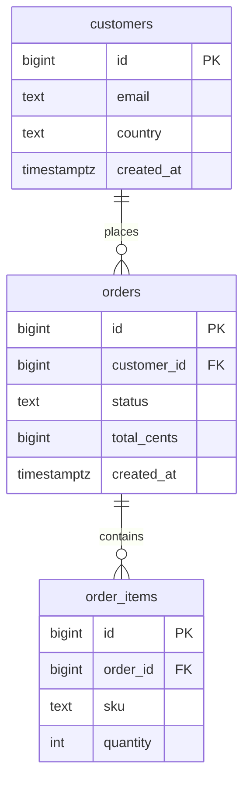

:material-swap-horizontal: The tools mentioned on this page: which ones replace each other, which ones combine? See [Complementary or competing](outils.md#complementary-or-competing).
{ .doc-ref }

## Terminology

**Relational database**: data is stored in **tables**, made of **rows** (a record) and **columns** (a field).

**Primary key (PK)**: the column that uniquely identifies each row, often `id`.

**Foreign key (FK)**: a column that points to the <span class="term" data-term="primary-key">primary key</span> of another table. `orders.customer_id` points to `customers.id`: each order belongs to a customer.

**NULL**: the absence of a value. It is neither `0` nor an empty string. An order without a delivery date has `delivered_at = NULL`.

**Index**: a structure that finds rows without reading the whole table, like the index of a book.

**Transaction**: a group of operations that all succeed or all fail.

**Schema**: the structure of the database, i.e. its tables, columns and <span class="term" data-term="db-constraint">constraints</span>. **Migration**: a versioned script that evolves the schema (adding a column...).

:material-book-open-variant: Reference docs: [PostgreSQL, Constraints](https://www.postgresql.org/docs/current/ddl-constraints.html) (version 18, 2025); [MySQL, FOREIGN KEY Constraints](https://dev.mysql.com/doc/refman/8.4/en/create-table-foreign-keys.html) (MySQL 8.4)
{ .doc-ref }

## Reading data

<a class="pill pill-scope pill-scope-code" href="../architecture/#map-of-scales">Scale · Code</a>

### SELECT, WHERE, ORDER BY, LIMIT
```sql
-- Good: named columns and an explicit ORDER BY, so the result stays stable
SELECT id, status, total_cents
FROM orders
WHERE status = 'paid'
  AND created_at >= '2026-10-01'
ORDER BY created_at DESC
LIMIT 10;
```
The 10 latest paid orders since October 1st.

Rules:
- never `SELECT *` in code: if a column is added, the result changes. For exploration, it is fine;
- always `ORDER BY` if the order matters: without it, the <span class="term" data-term="database">database</span> returns <span class="term" data-term="db-row">rows</span> in whatever order suits it, and that order can change.

### Useful filters
```sql
-- Example: four common filters, list, range, text pattern, missing value
WHERE status IN ('paid', 'shipped')
WHERE total_cents BETWEEN 1000 AND 5000
WHERE email LIKE '%@example.com'
WHERE delivered_at IS NULL
```

### Count first
<span class="pill pill-status pill-status-ok" title="Still valid, checked November 2026">Current · 11/2026</span>

Before reading or modifying, count. It avoids displaying a million rows, or modifying a million.
```sql
-- Good: count before reading or changing
SELECT COUNT(*) FROM orders WHERE status = 'pending';
```
```
12          I can look at the rows
2,400,000   I filter further first
```

:material-book-open-variant: Reference docs: [PostgreSQL, SELECT](https://www.postgresql.org/docs/current/sql-select.html) (version 18, 2025); [MySQL, SELECT Statement](https://dev.mysql.com/doc/refman/8.4/en/select.html) (MySQL 8.4)
{ .doc-ref }

## Joining tables

<a class="pill pill-scope pill-scope-code" href="../architecture/#map-of-scales">Scale · Code</a>

A <span class="term" data-term="sql-join">join</span> pairs each row of one table with the rows of another table that satisfy the `ON` condition. The drawings below sum up which rows remain: `customers` on the left, `orders` on the right, the coloured part is what the query returns.

!!! noob "As noob"
    A join staples to each customer card the receipts that carry its number: a customer with two receipts gives two pairs. The kind of join only says what to do with cards that have no receipt and receipts that have no card. The one thing to remember: **a join builds pairs of rows, so it can return more rows than there are customers.**

<div class="diagram-grid">
<figure><svg viewBox="0 0 160 100" role="img" aria-label="INNER JOIN: the coloured part is returned"><path class="hit" d="M80,16.28 A35,35 0 0,1 80,73.72 A35,35 0 0,1 80,16.28 Z"/><circle class="set" cx="60" cy="45" r="35"/><circle class="set" cx="100" cy="45" r="35"/><text x="40" y="95" text-anchor="middle">customers</text><text x="120" y="95" text-anchor="middle">orders</text></svg><figcaption><code>INNER JOIN</code></figcaption></figure>
<figure><svg viewBox="0 0 160 100" role="img" aria-label="LEFT JOIN: the coloured part is returned"><circle class="hit" cx="60" cy="45" r="35"/><circle class="set" cx="60" cy="45" r="35"/><circle class="set" cx="100" cy="45" r="35"/><text x="40" y="95" text-anchor="middle">customers</text><text x="120" y="95" text-anchor="middle">orders</text></svg><figcaption><code>LEFT JOIN</code></figcaption></figure>
<figure><svg viewBox="0 0 160 100" role="img" aria-label="RIGHT JOIN: the coloured part is returned"><circle class="hit" cx="100" cy="45" r="35"/><circle class="set" cx="60" cy="45" r="35"/><circle class="set" cx="100" cy="45" r="35"/><text x="40" y="95" text-anchor="middle">customers</text><text x="120" y="95" text-anchor="middle">orders</text></svg><figcaption><code>RIGHT JOIN</code></figcaption></figure>
<figure><svg viewBox="0 0 160 100" role="img" aria-label="FULL OUTER JOIN: the coloured part is returned"><path class="hit" d="M80,16.28 A35,35 0 1,0 80,73.72 A35,35 0 0,1 80,16.28 Z"/><path class="hit" d="M80,16.28 A35,35 0 0,1 80,73.72 A35,35 0 0,1 80,16.28 Z"/><path class="hit" d="M80,16.28 A35,35 0 1,1 80,73.72 A35,35 0 0,0 80,16.28 Z"/><circle class="set" cx="60" cy="45" r="35"/><circle class="set" cx="100" cy="45" r="35"/><text x="40" y="95" text-anchor="middle">customers</text><text x="120" y="95" text-anchor="middle">orders</text></svg><figcaption><code>FULL OUTER JOIN</code></figcaption></figure>
<figure><svg viewBox="0 0 160 100" role="img" aria-label="LEFT JOIN ... WHERE o.id IS NULL: the coloured part is returned"><path class="hit" d="M80,16.28 A35,35 0 1,0 80,73.72 A35,35 0 0,1 80,16.28 Z"/><circle class="set" cx="60" cy="45" r="35"/><circle class="set" cx="100" cy="45" r="35"/><text x="40" y="95" text-anchor="middle">customers</text><text x="120" y="95" text-anchor="middle">orders</text></svg><figcaption><code>LEFT JOIN ... WHERE o.id IS NULL</code></figcaption></figure>
<figure><svg viewBox="0 0 160 100" role="img" aria-label="FULL OUTER JOIN ... IS NULL: the coloured part is returned"><path class="hit" d="M80,16.28 A35,35 0 1,0 80,73.72 A35,35 0 0,1 80,16.28 Z"/><path class="hit" d="M80,16.28 A35,35 0 1,1 80,73.72 A35,35 0 0,0 80,16.28 Z"/><circle class="set" cx="60" cy="45" r="35"/><circle class="set" cx="100" cy="45" r="35"/><text x="40" y="95" text-anchor="middle">customers</text><text x="120" y="95" text-anchor="middle">orders</text></svg><figcaption><code>FULL OUTER JOIN ... IS NULL</code></figcaption></figure>
</div>

The same data set, row by row. ada has two orders, grace and linus none, and order 12 points to a customer 4 who no longer exists:

```
customers            orders
id  email            id  customer_id
1   ada              10  1
2   grace            11  1
3   linus            12  4
```

| Join | Rows returned (email, order id) | Count |
|---|---|---|
| `INNER JOIN` | (ada, 10) (ada, 11) | 2 |
| `LEFT JOIN` | (ada, 10) (ada, 11) (grace, NULL) (linus, NULL) | 4 |
| `RIGHT JOIN` | (ada, 10) (ada, 11) (NULL, 12) | 3 |
| `FULL OUTER JOIN` | (ada, 10) (ada, 11) (grace, NULL) (linus, NULL) (NULL, 12) | 5 |
| `LEFT JOIN ... WHERE o.id IS NULL` | (grace, NULL) (linus, NULL) | 2 |
| `FULL OUTER JOIN ... IS NULL` | (grace, NULL) (linus, NULL) (NULL, 12) | 3 |
| `CROSS JOIN` | every customer with every order | 3 x 3 = 9 |

Circles are a handy but imperfect picture: a join is not a set intersection, it pairs rows. ada comes out twice because she has two orders (see [the multiplication trap](#the-multiplication-trap)), which no circle shows.

:material-book-open-variant: Reference docs: [PostgreSQL, Joined Tables](https://www.postgresql.org/docs/current/queries-table-expressions.html#QUERIES-JOIN) (version 18, 2025); [MySQL, JOIN Clause](https://dev.mysql.com/doc/refman/8.4/en/join.html) (MySQL 8.4)
{ .doc-ref }

### INNER JOIN: what exists on both sides
```sql
-- Example: INNER JOIN, paid orders with the customer's email
SELECT c.email, o.id, o.total_cents
FROM orders o
JOIN customers c ON c.id = o.customer_id
WHERE o.status = 'paid';
```
Paid orders with the customer's email. An order without a matching customer does not appear.

### LEFT JOIN: everything on the left, even without a match
```sql
-- Example: LEFT JOIN, every customer, even those without an order
SELECT c.email, o.id
FROM customers c
LEFT JOIN orders o ON o.customer_id = c.id;
```
All customers, with their orders. A customer without orders appears once, with `o.id = NULL`.

### Finding what is missing: LEFT JOIN ... IS NULL
```sql
-- Example: customers who never ordered
SELECT c.id, c.email
FROM customers c
LEFT JOIN orders o ON o.customer_id = c.id
WHERE o.id IS NULL;
```
Customers who have **never** ordered. Very useful to find <span class="term" data-term="test-data">test data</span> ("a customer without orders") or inconsistencies ("orders without items").

```sql
-- Example: orders without items, an inconsistency
SELECT o.id
FROM orders o
LEFT JOIN order_items i ON i.order_id = o.id
WHERE i.id IS NULL;
```

### RIGHT JOIN, FULL OUTER JOIN, CROSS JOIN

```sql
-- Example: orphans on both sides, customers without orders and orders without customer
SELECT c.email, o.id
FROM customers c
FULL OUTER JOIN orders o ON o.customer_id = c.id
WHERE c.id IS NULL OR o.id IS NULL;
```
Both kinds of orphans at once: customers without orders and orders without a customer. Handy for a consistency check after a migration.

| Join | What it is for |
|---|---|
| `RIGHT JOIN` | the mirror of `LEFT JOIN`. Swapping the tables and writing a `LEFT JOIN` reads more easily |
| `FULL OUTER JOIN` | comparing two tables and seeing what is missing on either side |
| `CROSS JOIN` | every combination (Cartesian product): generating a test set "every country x every payment method". On two large tables, the result explodes |

MySQL has no `FULL OUTER JOIN`: get it with a `UNION` of a `LEFT JOIN` and a `RIGHT JOIN`.

### The multiplication trap
A `JOIN` on a "<span class="term" data-term="one-to-many">one to many</span>" relationship repeats rows.
```sql
-- Avoid: wrong total, each order counts once per item
SELECT SUM(o.total_cents)
FROM orders o
JOIN order_items i ON i.order_id = o.id;
```
An order with 3 items counts 3 times in the sum: the total is wrong. Sum over `orders` alone, or <span class="term" data-term="aggregation">aggregate</span> the items before the join.

## Grouping and aggregating

<a class="pill pill-scope pill-scope-code" href="../architecture/#map-of-scales">Scale · Code</a>

### GROUP BY
```sql
-- Example: order count and total per status
SELECT status, COUNT(*) AS order_count, SUM(total_cents) AS total
FROM orders
GROUP BY status;
```
```
status     order_count   total
paid               820   2,460,000
pending             12      36,000
cancelled           45     135,000
```

### HAVING: filtering after grouping
`WHERE` filters <span class="term" data-term="db-row">rows</span> before grouping, `HAVING` filters groups after.

!!! noob "As noob"
    I think of sorting mail: `WHERE` throws away the letters I do not care about before making piles, `HAVING` then throws away whole piles that do not fit (for example those with fewer than 5 letters). The one thing to remember: **`WHERE` filters rows, `HAVING` filters groups: we write `HAVING COUNT(*) > 5`, never `WHERE COUNT(*) > 5`.**

The order in which the database logically evaluates a query is not the order in which it is written. That is why an alias defined in `SELECT` is not known yet in `WHERE` (the optimizer may then reorder the actual execution):

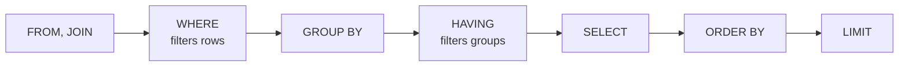

```sql
-- Example: HAVING filters groups, customers with more than 5 orders
SELECT customer_id, COUNT(*) AS order_count
FROM orders
GROUP BY customer_id
HAVING COUNT(*) > 5;
```
Customers who placed more than 5 orders.

### Finding duplicates
```sql
-- Example: emails that appear more than once
SELECT email, COUNT(*)
FROM customers
GROUP BY email
HAVING COUNT(*) > 1;
```

### COUNT(*) or COUNT(column)
```
COUNT(*)              counts all rows
COUNT(delivered_at)   counts only the rows where delivered_at is not NULL
COUNT(DISTINCT customer_id)   counts the distinct customers
```

:material-book-open-variant: Reference docs: [PostgreSQL, GROUP BY and HAVING Clauses](https://www.postgresql.org/docs/current/queries-table-expressions.html#QUERIES-GROUP) (version 18, 2025); [MySQL, Aggregate Functions](https://dev.mysql.com/doc/refman/8.4/en/aggregate-functions.html) (MySQL 8.4)
{ .doc-ref }

## More advanced queries

<a class="pill pill-scope pill-scope-code" href="../architecture/#map-of-scales">Scale · Code</a>

### Subquery and CTE (WITH)
A **<span class="term" data-term="cte">CTE</span>** gives a name to an intermediate <span class="term" data-term="db-query">query</span>, so the query reads from top to bottom.
```sql
-- Example: the CTE names the "big customers" step, then the query reads their emails
WITH big_customers AS (
    SELECT customer_id
    FROM orders
    GROUP BY customer_id
    HAVING SUM(total_cents) > 100000
)
SELECT c.email
FROM customers c
JOIN big_customers b ON b.customer_id = c.id;
```
Customers who spent more than €1,000.

A **<span class="term" data-term="subquery">subquery</span>** is a query placed inside another one, here in the `WHERE`: the emails of customers with at least one refunded order.
```sql
-- Example: subquery in the WHERE, customers with a refunded order
SELECT email
FROM customers
WHERE id IN (SELECT customer_id FROM orders WHERE status = 'refunded');
```

| I want... | I use |
|---|---|
| to keep only the rows that have something elsewhere, once in the query, like "customers with at least one refunded order" | `IN (SELECT ...)` or `EXISTS` subquery |
| to compute an intermediate result I reuse, or to split a long query into steps that read top to bottom, like "first the big customers, then their emails" | CTE |

### Window functions
Compute over a group of <span class="term" data-term="db-row">rows</span> **without** collapsing them into one.

!!! noob "As noob"
    `GROUP BY` melts the rows of a group into one, like summing up a class by its average. A window function keeps each student on their own row and writes next to it something computed over their class (their rank, the class average). The one thing to remember: **same per-group computation, but no row disappears.**

```sql
-- Example: each order's rank for its customer, without merging rows
SELECT customer_id, id, created_at,
       ROW_NUMBER() OVER (PARTITION BY customer_id ORDER BY created_at DESC) AS order_rank
FROM orders;
```
Each order keeps its row, with its rank for its customer: `order_rank = 1` is each customer's latest order.

### CASE
```sql
-- Example: CASE sorts each order into large, medium or small
SELECT id,
       CASE WHEN total_cents >= 10000 THEN 'large'
            WHEN total_cents >= 2000  THEN 'medium'
            ELSE 'small' END AS size
FROM orders;
```

:material-book-open-variant: Reference docs: [PostgreSQL, WITH Queries](https://www.postgresql.org/docs/current/queries-with.html) (version 18, 2025); [PostgreSQL, Window Functions](https://www.postgresql.org/docs/current/tutorial-window.html) (version 18, 2025); [PostgreSQL, Conditional Expressions](https://www.postgresql.org/docs/current/functions-conditional.html) (version 18, 2025)
{ .doc-ref }

## Modifying data

<a class="pill pill-scope pill-scope-code" href="../architecture/#map-of-scales">Scale · Code</a>

### INSERT, UPDATE, DELETE
```sql
-- Example: add a customer
INSERT INTO customers (email, country) VALUES ('ada@example.com', 'FR');

-- Example: change an order, always with a WHERE
UPDATE orders SET status = 'cancelled' WHERE id = 42;

-- Example: delete an order, always with a WHERE
DELETE FROM orders WHERE id = 42;
```
The danger: an `UPDATE` or a `DELETE` **without `WHERE`** hits the whole <span class="term" data-term="db-table">table</span>.

:material-book-open-variant: Reference docs: [PostgreSQL, Data Manipulation](https://www.postgresql.org/docs/current/dml.html) (version 18, 2025)
{ .doc-ref }

### Try before committing: the transaction
<span class="pill pill-status pill-status-ok" title="Still valid, checked November 2026">Current · 11/2026</span>

```sql
-- Good: try the change inside a transaction before committing it
BEGIN;
UPDATE orders SET status = 'cancelled' WHERE customer_id = 7;
-- Example: count the affected rows, then undo everything (COMMIT if the count is right)
SELECT COUNT(*) FROM orders WHERE customer_id = 7 AND status = 'cancelled';
ROLLBACK;
```
I see how many <span class="term" data-term="db-row">rows</span> would be affected, then `ROLLBACK` undoes everything. If it looks right, I run it again with `COMMIT` instead.

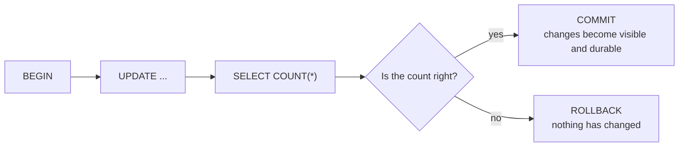

Rule: before any `UPDATE` or `DELETE`, run the same `WHERE` in a `SELECT COUNT(*)`.

:material-book-open-variant: Reference docs: [PostgreSQL, Transactions](https://www.postgresql.org/docs/current/tutorial-transactions.html) (version 18, 2025); [MySQL, START TRANSACTION, COMMIT, and ROLLBACK](https://dev.mysql.com/doc/refman/8.4/en/commit.html) (MySQL 8.4)
{ .doc-ref }

### What a transaction guarantees (ACID)
- **Atomicity**: all or nothing. The debit and credit of a transfer go through together, or neither does.
- **Consistency**: <span class="term" data-term="db-constraint">constraints</span> (<span class="term" data-term="foreign-key">foreign keys</span>, uniqueness) are respected at the end.
- **Isolation**: two parallel <span class="term" data-term="db-transaction">transactions</span> don't see each other's unfinished changes (depending on the chosen <span class="term" data-term="isolation-level">isolation level</span>).
- **Durability**: once committed, the change survives a crash.

!!! noob "As noob"
    I think of a bank transfer: money never leaves one account without reaching the other, the rules declared in the database stay true, nobody sees the transfer half done, and once confirmed, a power cut does not erase it. Limit: depending on the isolation level chosen, two parallel transactions can still interfere in subtle ways. The one thing to remember: **a transaction succeeds as a whole or leaves no trace.**

:material-book-open-variant: Reference docs: [PostgreSQL, Transaction Isolation](https://www.postgresql.org/docs/current/transaction-iso.html) (version 18, 2025); [MySQL and the ACID Model](https://dev.mysql.com/doc/refman/8.4/en/mysql-acid.html) (MySQL 8.4)
{ .doc-ref }

## Performance

<a class="pill pill-scope pill-scope-code" href="../architecture/#map-of-scales">Scale · Code</a> <a class="pill pill-scope pill-scope-infra" href="../architecture/#map-of-scales">Scale · Infrastructure</a>

### Finding slow queries
<span class="pill pill-status pill-status-ok" title="Still valid, checked November 2026">Current · 11/2026</span>

Before optimizing, find out **which** query costs. Three sources, from closest to the user to closest to the database:

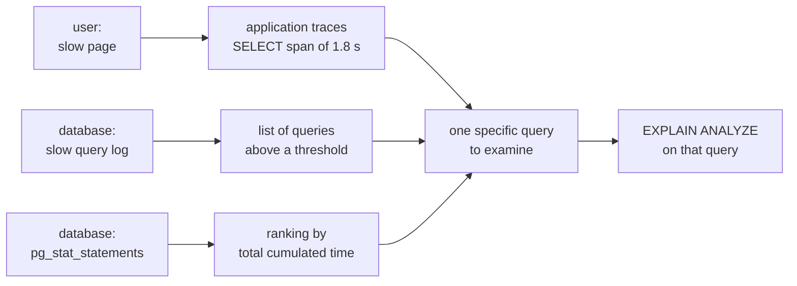

| Source | What it shows | Setting (example) |
|---|---|---|
| traces (OpenTelemetry, APM) | which page or call is slow, and which SQL query inside that call | driver or ORM instrumentation |
| slow query log | every query longer than a threshold, with its text | MySQL: `slow_query_log = ON`, `long_query_time = 1`; PostgreSQL: `log_min_duration_statement = 1000` (ms) |
| `pg_stat_statements` (PostgreSQL), `performance_schema` (MySQL) | every query grouped by shape, with call count and cumulated time | extension enabled in `shared_preload_libraries` |
| `auto_explain` (PostgreSQL) | the execution plan of slow queries, written to the logs | `auto_explain.log_min_duration = 1000` |

```sql
-- Good: rank queries by total cumulative time, not by average duration
SELECT calls,
       round(total_exec_time) AS total_ms,
       round(mean_exec_time, 1) AS mean_ms,
       left(query, 60) AS query
FROM pg_stat_statements
ORDER BY total_exec_time DESC
LIMIT 3;
```
```
 calls   | total_ms | mean_ms | query
---------+----------+---------+------------------------------------------------------------
 2100000 |  6300000 |     3.0 | SELECT * FROM orders WHERE customer_id = $1
      40 |    96000 |  2400.0 | SELECT country, SUM(total_cents) FROM orders GROUP BY coun
    9000 |    45000 |     5.0 | UPDATE orders SET status = $1 WHERE id = $2
```
Example numbers. The top query only takes 3 ms, but it runs 2 million times: it is the one keeping the database busy. The 2.4 s report stands out more in the slow query log, yet weighs 65 times less.

!!! noob "As noob"
    A slow query is not necessarily the most expensive one. Rank by **total time** first (mean duration x number of calls): saving 2 ms on a query called a million times pays more than saving 2 s on a report run once a day.

:material-book-open-variant: Reference docs: [PostgreSQL, pg_stat_statements](https://www.postgresql.org/docs/current/pgstatstatements.html) (version 18, 2025); [MySQL, The Slow Query Log](https://dev.mysql.com/doc/refman/8.4/en/slow-query-log.html) (MySQL 8.4); [PostgreSQL, auto_explain](https://www.postgresql.org/docs/current/auto-explain.html) (version 18, 2025)
{ .doc-ref }

### EXPLAIN
<span class="pill pill-status pill-status-ok" title="Still valid, checked November 2026">Current · 11/2026</span>

`EXPLAIN` shows how the database plans to run the <span class="term" data-term="db-query">query</span>, without running it.
```sql
-- Example: see the planned execution, without running the query
EXPLAIN SELECT * FROM orders WHERE customer_id = 7;
```
```
type: ALL    rows: 2,400,000     the database reads the whole table: no index used
```
After `CREATE INDEX idx_orders_customer ON orders (customer_id);`:
```
type: ref    rows: 14            the database goes straight to the customer's 14 rows
```
`EXPLAIN ANALYZE` (PostgreSQL, MySQL 8) actually runs it and gives the real timings.

The outputs above are MySQL's. PostgreSQL says the same thing with other words:

| MySQL | PostgreSQL | What it means |
|---|---|---|
| `type: ALL` | `Seq Scan on orders` | reads the whole table, row by row |
| `type: ref` | `Index Scan using idx_orders_customer` | direct access through the index |
| `rows: 14` | `rows=14` | estimated number of rows, not an exact count |

:material-book-open-variant: Reference docs: [PostgreSQL, Using EXPLAIN](https://www.postgresql.org/docs/current/using-explain.html) (version 18, 2025); [MySQL, Optimizing Queries with EXPLAIN](https://dev.mysql.com/doc/refman/8.4/en/using-explain.html) (MySQL 8.4)
{ .doc-ref }

### When an index helps
<span class="pill pill-status pill-status-ok" title="Still valid, checked November 2026">Current · 11/2026</span>

A B-tree index, the default type in PostgreSQL and MySQL (InnoDB), is a sorted tree. For `WHERE customer_id = 7`, the database walks down from the root to the right leaf in a few reads, instead of scanning the whole table. Leaves are chained together (dotted lines), which also serves ranges (`BETWEEN`, `>=`) and `ORDER BY`.

!!! noob "As noob"
    An index is the index at the back of a book: to find "transaction", I go to the letter T then to the right page, instead of reading all 800 pages. In exchange, every page added means updating the index. The one thing to remember: **an index speeds up reads that filter on its column and slows every write a little.**

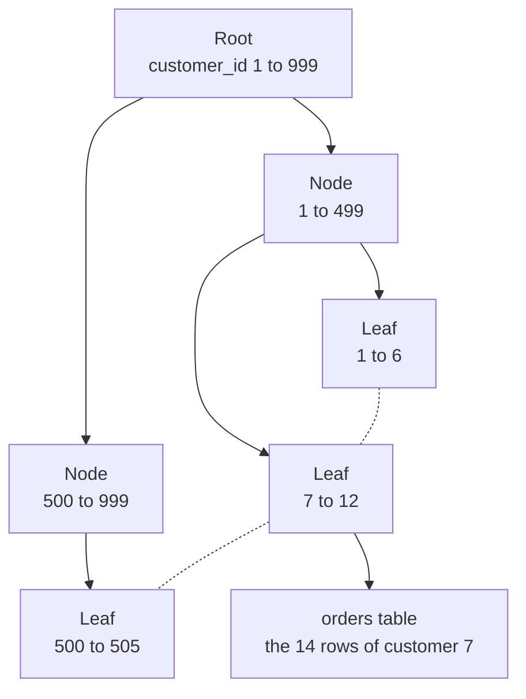

| Situation | Is an <span class="term" data-term="db-index">index</span> useful? |
|---|---|
| my queries often filter, join or sort on the same column, like `customer_id` to show a customer's orders | yes |
| the column has only a few distinct values, like `status` which is `paid`, `pending` or `cancelled`: each value covers a big share of the table | often not very useful on its own |
| the table has only a few hundred rows, reading it whole is already instant | useless |
| the table mostly receives writes and few reads, like <span class="term" data-term="logs">logs</span> or events | each index slows down writes |
| my query passes the column through a function before comparing, like `WHERE LOWER(email) = '...'` | the index on `email` is **not** used, because of the function |
| I search for the end of a text, like every email in `WHERE email LIKE '%@example.com'` | not used (the leading `%` prevents it) |

:material-book-open-variant: Reference docs: [Markus Winand, Anatomy of an SQL Index](https://use-the-index-luke.com/sql/anatomy) (accessed November 2026); [PostgreSQL, Index Types](https://www.postgresql.org/docs/current/indexes-types.html) (version 18, 2025)
{ .doc-ref }

### Making a query fast: the loop
<span class="pill pill-status pill-status-ok" title="Still valid, checked November 2026">Current · 11/2026</span>

Optimizing is not guesswork: measure, change **one thing**, measure the same query again with the same parameters.

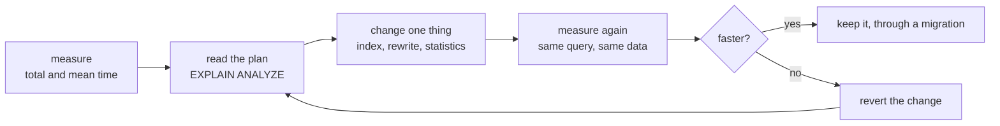

Before and after, in PostgreSQL:
```
EXPLAIN ANALYZE SELECT id, total_cents FROM orders WHERE customer_id = 7 ORDER BY created_at DESC LIMIT 10;

Limit  (actual time=812.4..812.4 rows=10)
  ->  Sort  (actual time=812.4..812.4 rows=10)
        ->  Seq Scan on orders  (actual time=0.1..809.9 rows=14)
              Filter: (customer_id = 7)
              Rows Removed by Filter: 2399986
Execution Time: 812.6 ms
```
`CREATE INDEX CONCURRENTLY idx_orders_customer_created ON orders (customer_id, created_at DESC);`
```
Limit  (actual time=0.04..0.06 rows=10)
  ->  Index Scan using idx_orders_customer_created on orders  (actual time=0.04..0.05 rows=10)
        Index Cond: (customer_id = 7)
Execution Time: 0.1 ms
```
The two-column index serves both the filter and the sort: no more full table read, no more sort.

| What I see in the plan | What it means | What I try |
|---|---|---|
| `Seq Scan` with many `Rows Removed by Filter` | the whole table is read to keep few rows | an index on the filtered column |
| `Sort` right after a scan, with `LIMIT` | every row is sorted to keep 10 | an index that follows the sort order |
| estimated `rows=` far from the actual `rows=` | statistics are wrong, so is the chosen plan | `ANALYZE orders;` then read the plan again |
| `Sort Method: external merge  Disk` | the sort spills from memory to disk | reduce rows before sorting, or raise `work_mem` for that query |
| `Nested Loop` with thousands of loops | a join done row by row | an index on the join column, or a rewrite |
| no slow step, but many calls | the query is fast, the application calls it too often | batch the calls (see [N+1](#the-n1-problem)), add a cache |

!!! noob "As noob"
    `EXPLAIN` is the route the GPS plans, `EXPLAIN ANALYZE` is the trip actually driven, stopwatch in hand. I look for the step where time explodes, fix it, then drive the same trip again to check.

:material-book-open-variant: Reference docs: [PostgreSQL, Performance Tips](https://www.postgresql.org/docs/current/performance-tips.html) (version 18, 2025); [Markus Winand, Use The Index, Luke](https://use-the-index-luke.com/) (accessed November 2026)
{ .doc-ref }

### The N+1 problem
<span class="pill pill-status pill-status-ok" title="Still valid, checked November 2026">Current · 11/2026</span>

```python
# Avoid: one query per order, 101 round trips (N+1)
orders = db.query("SELECT * FROM orders LIMIT 100")
for order in orders:
    customer = db.query("SELECT * FROM customers WHERE id = %s", order.customer_id)
```
1 query for the orders, then 100 for the customers: 101 <span class="term" data-term="round-trip">round trips</span>. A single query with `JOIN` does the same thing. <span class="term" data-term="orm">ORMs</span> (SQLAlchemy, Doctrine, Prisma) cause it easily: watch for it in <span class="term" data-term="trace-distributed">traces</span>, where we see 100 identical `SELECT` <span class="term" data-term="span">spans</span>.

*SQLAlchemy: complements Alembic*
{ .tool-rel }


!!! noob "As noob"
    It is like going to the supermarket once to read the shopping list, then making 100 round trips, one per item, instead of grabbing everything in one go. Each trip is short, it is their number that costs. The one thing to remember: **one query per item of a list is an N+1: group them into a single query (`JOIN` or `IN`).**

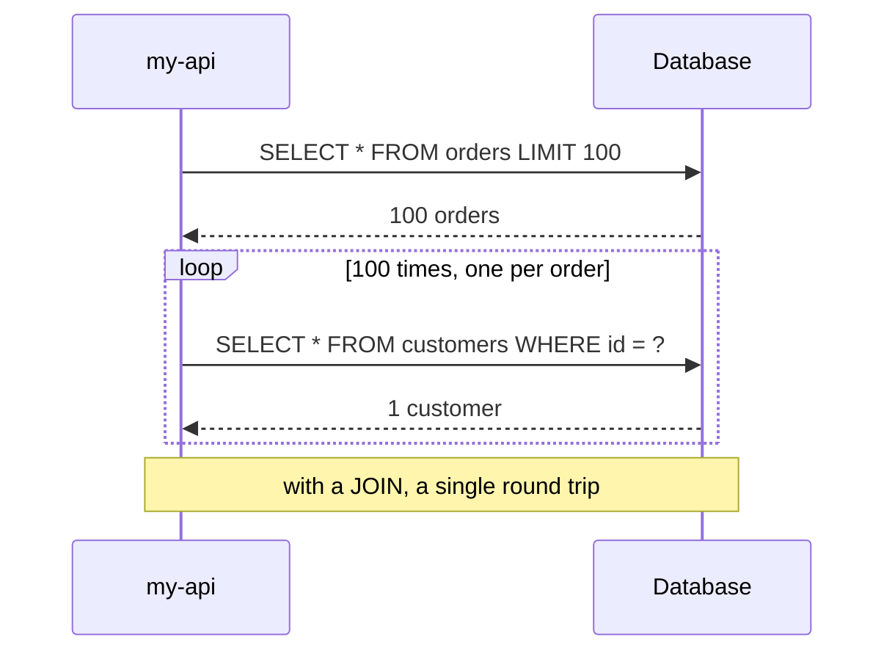

:material-book-open-variant: Reference docs: [Markus Winand, Nested Loops and the N+1 problem](https://use-the-index-luke.com/sql/join/nested-loops-join-n1-problem) (accessed November 2026)
{ .doc-ref }

## Scaling a database

<a class="pill pill-scope pill-scope-system" href="../architecture/#map-of-scales">Scale · System</a> <a class="pill pill-scope pill-scope-infra" href="../architecture/#map-of-scales">Scale · Infrastructure</a>

<a class="pill pill-practice" href="../livraison/#design-before-coding">Practice · Technical design</a>

A database "saturates" when it can no longer keep up: queries getting slower and slower, CPU at 90%, disk full, too many connections. The temptation is to jump straight to the most impressive solution (spreading the data over several machines). In practice, we climb a ladder: we start with what is cheap and easy to undo, and only go to the next rung when the measurements call for it.

### Two meanings of "vertical" and "horizontal"

Both words are used for two different things. Mixing them up is the most common mistake.

| | Vertical | Horizontal |
|---|---|---|
| **The machine** | <span class="term" data-term="vertical-scaling">scale up</span>: the same database on a bigger machine (more CPUs, more memory, a faster disk) | <span class="term" data-term="horizontal-scaling">scale out</span>: several machines (read copies, or a slice of the data on each machine) |
| **The data** | <span class="term" data-term="vertical-partitioning">vertical partitioning</span>: split by columns or by domain (heavy columns in another table, the catalog and the orders in two databases) | horizontal partitioning: split by rows (October orders on one side, November orders on the other) |

Horizontal partitioning can stay on a single machine (table partitioning) or spread over several: that is <span class="term" data-term="sharding">sharding</span>.

### The ladder, from cheapest to most expensive

| Step | What it fixes | Cost | Rollback |
|---|---|---|---|
| 1. Queries and indexes | slowness caused by a badly written or unindexed query | low | easy |
| 2. Connection pooler | too many open connections | low | easy |
| 3. Cache | the same reads repeated | medium (invalidation) | easy |
| 4. Bigger machine | CPU, memory or disk maxed out | money, one restart | easy |
| 5. Read replicas | many more reads than writes | medium (stale data) | easy |
| 6. Table partitioning | huge tables, heavy indexes | medium | possible |
| 7. Archiving cold data | volume that grows without being read | medium | possible |
| 8. Sharding | writes or volume beyond the biggest machine | very high | nearly impossible |

### Queries, indexes, connections and cache
<span class="pill pill-status pill-status-ok" title="Still valid, checked November 2026">Current · 11/2026</span>

Before paying for a machine, check what it is doing. The [Performance](#performance) section above covers the essentials: `EXPLAIN`, a missing index, the N+1 problem. On PostgreSQL, the `pg_stat_statements` extension lists the queries that consume the most total time; often, three queries make up half of the load.

```sql
-- Example: the 3 queries that use the most total time
SELECT calls, round(total_exec_time) AS total_ms, round(mean_exec_time) AS mean_ms, query
FROM pg_stat_statements ORDER BY total_exec_time DESC LIMIT 3;
```
```
 calls  | total_ms | mean_ms | query
--------+----------+---------+------------------------------------------------
 912000 |  1824000 |       2 | SELECT * FROM orders WHERE customer_id = $1
   1400 |   980000 |     700 | SELECT ... FROM invoices JOIN orders ... GROUP BY
     12 |   310000 |   25833 | UPDATE products SET stock = ...
```
The first one is fast but called very often (probably an N+1), the second one is slow on every call (time for an `EXPLAIN ANALYZE`). Example numbers; the `total_exec_time` and `mean_exec_time` columns are those of PostgreSQL 13 and later (before: `total_time`, `mean_time`).

Next, connections. Each PostgreSQL connection is a process that costs memory. Twenty instances of my-api with 50 connections each make 1,000 connections (example). A <span class="term" data-term="connection-pooler">connection pooler</span> (PgBouncer, or the hosting provider's) shares them:

```
my-api (20 instances x 50 connections) ──> PgBouncer ──> PostgreSQL (100 real connections)
```

Finally, a <span class="term" data-term="cache-data">cache</span> (Redis, or the application's memory) avoids reading the same product sheet a hundred times. The price: deciding when the cached data becomes wrong.

*Redis: complements PostgreSQL, MySQL*
{ .tool-rel }


:material-book-open-variant: Reference docs: [PostgreSQL, pg_stat_statements](https://www.postgresql.org/docs/current/pgstatstatements.html) (version 18, 2025)
{ .doc-ref }

### Database proxies and poolers
<span class="pill pill-status pill-status-ok" title="Still valid, checked November 2026">Current · 11/2026</span>

The pooler from the previous section does only one thing: share connections. A <span class="term" data-term="database-proxy">database proxy</span> sits in the same place, between the application and the database, but understands the queries: it sends reads to replicas and writes to the primary, switches to a new primary on its own, and can block or rewrite a query.

A plain pooler only does the left part of the drawing; a proxy also sorts traffic between primary and replicas:

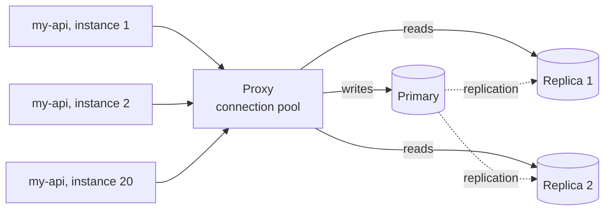

| Tool | For which database | What it does |
|---|---|---|
| PgBouncer | PostgreSQL | lightweight pooler, nothing else |
| ProxySQL | MySQL, MariaDB | pooler, rule-based read/write routing, query cache, failover |
| Pgpool-II, PgCat | PostgreSQL | pooler and read load balancing (to check depending on the version) |
| the provider's proxy (RDS Proxy, Cloud SQL connector) | managed database | pooler or secure connection, run by the provider (features to check) |

**When**: I have many instances of my-api or serverless functions, and each opens its own connections; the database refuses connections (`too many connections`) while its CPU is quiet; or I have read replicas the application cannot use on its own. **Not yet**: my application runs on a few instances with a well-tuned internal pool (the ORM's or the driver's): one more component to monitor brings me nothing.

**Why**: a PostgreSQL connection costs a process and several megabytes of memory; a thousand idle connections weigh as much as queries. The gain: the database keeps a fixed number of connections whatever the application does. The cost: one more hop (to be doubled so it does not become a <span class="term" data-term="spof">single point of failure</span>), a few tenths of a millisecond of latency (order of magnitude, to check), and session features that break depending on the mode.

**How**, with PgBouncer: the **mode** decides when a real connection goes back to the pool.

*PgBouncer: complements PostgreSQL*
{ .tool-rel }


| Mode | Connection returned | Saving | What breaks |
|---|---|---|---|
| `session` | when the client disconnects | small | nothing |
| `transaction` | at the end of each transaction | large | session `SET`, advisory locks, `LISTEN`, temporary tables; prepared statements before PgBouncer 1.21 (2023, to check) |
| `statement` | after each query | maximum | any multi-statement transaction |

```ini
# Example: the database PgBouncer forwards connections to
[databases]
orders = host=orders-db.internal port=5432 dbname=orders

# Example: transaction mode, 2,000 client connections for 50 real ones
[pgbouncer]
listen_port = 6432
pool_mode = transaction
max_client_conn = 2000
default_pool_size = 50
```
The my-api instances connect to port 6432 instead of 5432; 2,000 connections on the application side become 50 real connections per database and user pair (example values).

With ProxySQL, routing is configured through rules in its admin interface, which speaks the MySQL protocol. Here, `SELECT ... FOR UPDATE` goes to the primary (group 10), other `SELECT` statements to the replicas (group 20), everything else to the user's default group, the primary:
```sql
-- Example: FOR UPDATE to the primary (group 10), other SELECTs to the replicas (20)
INSERT INTO mysql_query_rules (rule_id, active, match_digest, destination_hostgroup, apply)
VALUES (1, 1, '^SELECT.*FOR UPDATE', 10, 1),
       (2, 1, '^SELECT', 20, 1);
-- Example: apply the rules now, then keep them after a restart
LOAD MYSQL QUERY RULES TO RUNTIME;
SAVE MYSQL QUERY RULES TO DISK;
```
The trap: a read right after a write goes to a lagging replica, and the user does not see what they just saved (see [Read replicas](#read-replicas)). Reads that must see the latest write stay on the primary, through a rule or a comment in the query.

### A bigger machine
<span class="pill pill-status pill-status-ok" title="Still valid, checked November 2026">Current · 11/2026</span>

Going from 16 to 32 CPUs takes one restart at most hosting providers, without changing a line of code. It is often the best effort/gain ratio, as long as a bigger machine exists. Limit: the bottleneck is not always the CPU. If queries wait for locks (<span class="term" data-term="lock-contention">lock contention</span>), doubling the machine changes almost nothing.

### Read replicas
<span class="pill pill-status pill-status-ok" title="Still valid, checked November 2026">Current · 11/2026</span>

A <span class="term" data-term="read-replica">read replica</span> is a copy of the database, kept up to date by <span class="term" data-term="replication">replication</span>, that answers reads. All writes still go to the primary. The trap: the copy lags behind, the <span class="term" data-term="replication-lag">replication lag</span>.

!!! noob "As noob"
    A replica is a photocopy of a ledger kept up to date by a courier: several people can read it to spare the original, but the courier always lags a little, and what was just written in the original may not be there yet. The one thing to remember: **reading from a replica means accepting slightly old data.**

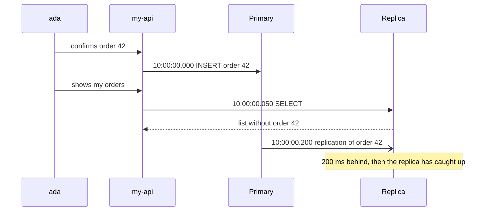

Countermeasure: read from the primary right after a write by the user ("read your own writes"), and monitor the lag as a metric in its own right. On the test side: a test that writes then reads back through a replica can fail randomly.

:material-book-open-variant: Reference docs: [PostgreSQL, High Availability, Load Balancing, and Replication](https://www.postgresql.org/docs/current/high-availability.html) (version 18, 2025); [MySQL, Replication](https://dev.mysql.com/doc/refman/8.4/en/replication.html) (MySQL 8.4)
{ .doc-ref }

### Partitioning a table
<span class="pill pill-status pill-status-ok" title="Still valid, checked November 2026">Current · 11/2026</span>

<span class="term" data-term="table-partitioning">Table partitioning</span> splits a big table into several physical tables, on the same machine. The application keeps writing `SELECT ... FROM orders`; the database only reads the relevant partitions. PostgreSQL does it natively since version 10 (2017), with "declarative" partitioning:

!!! noob "As noob"
    Partitioning is filing invoices in a binder with one tab per month instead of a single pile: for November, I only open the November tab. Everything stays in the same cabinet (the same machine), and the application still sees one binder. The one thing to remember: **partitioning only helps if queries filter on the partition column.**

```sql
-- Example: parent table partitioned by date, created_at is part of the primary key
CREATE TABLE orders (
    id           bigint      NOT NULL,
    customer_id  bigint      NOT NULL,
    status       text        NOT NULL,
    total_cents  bigint      NOT NULL,
    created_at   timestamptz NOT NULL,
    PRIMARY KEY (id, created_at)
) PARTITION BY RANGE (created_at);

-- Example: one partition per month, created in advance
CREATE TABLE orders_2026_10 PARTITION OF orders
    FOR VALUES FROM ('2026-10-01') TO ('2026-11-01');
CREATE TABLE orders_2026_11 PARTITION OF orders
    FOR VALUES FROM ('2026-11-01') TO ('2026-12-01');
```

```sql
-- Good: the filter is on the partition column, only November is read
EXPLAIN SELECT * FROM orders WHERE created_at >= '2026-11-01';
```
```
Seq Scan on orders_2026_11      a single partition read, October is skipped
```

This automatic skipping is called <span class="term" data-term="partition-pruning">partition pruning</span>. Two rules: the partition column must be part of the primary key, and queries must filter on it, otherwise the database reads every partition. Partitions must also be created ahead of time (a monthly job, or the `pg_partman` extension).

### Archiving cold data
<span class="pill pill-status pill-status-ok" title="Still valid, checked November 2026">Current · 11/2026</span>

<span class="term" data-term="cold-data">Cold data</span> (orders older than two years, past logs) weighs down indexes and backups without being read. With a table partitioned by month, archiving becomes simple:

```sql
-- Good: detach a partition to archive it, without blocking running queries
ALTER TABLE orders DETACH PARTITION orders_2024_01 CONCURRENTLY;
```

The detached partition becomes a normal table, which we export to cheaper storage and then drop. `DETACH ... CONCURRENTLY` exists since PostgreSQL 14 (2021) and does not block running queries. Without partitions, a batched `DELETE` is needed, much slower.

### Sharding, last
<span class="pill pill-status pill-status-ok" title="Still valid, checked November 2026">Current · 11/2026</span>

Sharding spreads the rows of one table over several databases. It is the only step that really increases **write** capacity, and the hardest to undo. Four points decide whether it succeeds.

!!! noob "As noob"
    Sharding is opening several branches instead of enlarging the head office: each customer belongs to one branch according to a rule (their number, for example). It multiplies the counters, but any question about all customers means calling every branch. The one thing to remember: **sharding adds write capacity, at the cost of much harder queries and transactions across machines.**

**The shard key.** The <span class="term" data-term="partition-key">partition key</span> decides which database each row goes to. We pick it from the dominant query: if 95% of queries filter on `customer_id` (example), that is the one. Once chosen, changing the key means rewriting all the data.

**The hot shard.** If one customer places 15% of the orders, its shard saturates while the others sleep: that is a <span class="term" data-term="hot-key">hot key</span>. Give it a dedicated database, or add a second element to the key.

**Cross-shard queries.** A join or a report over all customers becomes a <span class="term" data-term="cross-shard-query">cross-shard query</span>: query every database, then merge. Transactions across two shards lose the simple ACID guarantees. Reports therefore move to a <span class="term" data-term="data-warehouse">data warehouse</span>.

**Resharding.** Going from 4 to 8 databases means moving data: <span class="term" data-term="resharding">resharding</span>. The classic trick: many <span class="term" data-term="logical-shard">logical shards</span> (256, for example) spread over few databases, and a <span class="term" data-term="shard-router">routing layer</span> that holds the mapping table. We then move whole shards, without recomputing the location of each row.

```python
# Good: many logical shards on few databases, movable as a whole
LOGICAL_SHARDS = 256

# Example: the logical shard is computed from the sharding key
def logical_shard(customer_id: int) -> int:
    return customer_id % LOGICAL_SHARDS

# Example: placement table, 64 shards per database; going to 8 databases changes only it
placement = {shard: f"orders-db-{shard // 64}" for shard in range(LOGICAL_SHARDS)}
```

The path of a query for customer 1234: the routing layer computes the logical shard, then the placement table gives the database. Going from 4 to 8 databases only changes that table.

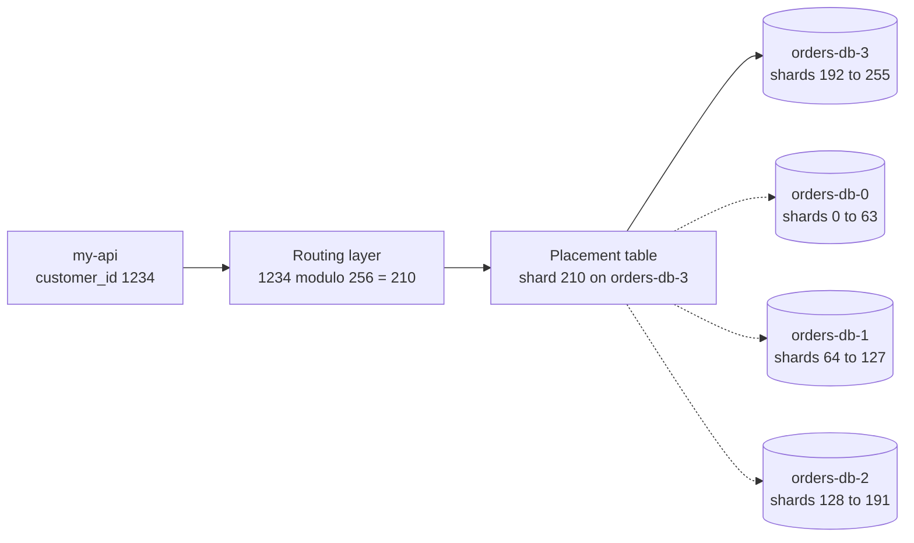

Rather than writing this routing in-house, tools provide it on top of a well-known database: Vitess for MySQL, Citus for PostgreSQL. Another option is <span class="term" data-term="distributed-sql">distributed SQL</span> (CockroachDB, YugabyteDB, Spanner): the database spreads and rebalances on its own, with transactions across machines, at the cost of higher write latency and incomplete SQL compatibility (to check for each product).

*Vitess: partly competes with Citus, CockroachDB, YugabyteDB, Spanner; complements MySQL*<br>
*Citus: partly competes with Vitess, CockroachDB, YugabyteDB, Spanner; complements PostgreSQL*<br>
*CockroachDB: competes with YugabyteDB, Spanner; partly competes with Vitess, Citus*<br>
*YugabyteDB: competes with CockroachDB, Spanner*<br>
*Spanner: competes with CockroachDB, YugabyteDB*
{ .tool-rel }


### I want... I use...

| I want... | I use... |
|---|---|
| to know which query really keeps the database busy, before touching anything | `pg_stat_statements`, then `EXPLAIN ANALYZE` |
| to run more instances of my-api without the database refusing connections with `too many connections` | a connection pooler (PgBouncer) |
| to send reads to the replicas and writes to the primary, without changing the application code | a database proxy (ProxySQL for MySQL) |
| to stop reading the same data a hundred times, like the same product page shown on every visit | a cache, with an invalidation rule |
| to gain headroom fast, without touching the code, because the CPU or memory is maxed out | a bigger machine |
| to handle far more reads than writes, like a catalog viewed a thousand times for each order placed | read replicas, handling the lag |
| to lighten a huge table, like years of orders that queries almost always filter by date | table partitioning, by date most of the time |
| to get rid of old data nobody reads anymore, like orders older than two years | detach and archive old partitions |
| heavy reports that no longer slow down the database the application needs | a data warehouse fed continuously |
| to write more than the biggest machine can take | sharding (Vitess, Citus) or distributed SQL |

References: PostgreSQL documentation, [Table Partitioning](https://www.postgresql.org/docs/current/ddl-partitioning.html) chapter (version 18, 2025); Martin Kleppmann, "Designing Data-Intensive Applications", chapters 5 and 6 (2017); [PgBouncer, configuration documentation](https://www.pgbouncer.org/config.html) and [ProxySQL, query rules](https://proxysql.com/documentation/proxysql-read-write-split-howto/) (publication dates not given, to check); [Vitess](https://vitess.io/docs/) and [Citus](https://docs.citusdata.com/) (publication dates not given, to check).

## Zero-downtime schema migrations

<a class="pill pill-scope pill-scope-app" href="../architecture/#map-of-scales">Scale · Application</a> <a class="pill pill-scope pill-scope-infra" href="../architecture/#map-of-scales">Scale · Infrastructure</a>

<a class="pill pill-practice" href="../livraison/#continuous-delivery-and-deployment">Practice · Continuous deployment</a>
<a class="pill pill-dora" href="https://dora.dev/capabilities/database-change-management/">DORA · Database change management</a>

The problem: my team ships with progressive <span class="term" data-term="continuous-deployment">continuous deployment</span>, so for a few minutes the old and the new version of the application run **at the same time** on the same schema. If my migration breaks either of them, for example by renaming a column the old version still reads, production crashes. And if my migration takes a lock on a big table, every query on that table waits, so the application looks frozen.

### Expand / contract
<span class="pill pill-status pill-status-ok" title="Still valid, checked November 2026">Current · 11/2026</span>

<span class="term" data-term="expand-contract">Expand / contract</span> (or *parallel change*, described by Danilo Sato in 2014) splits a breaking change into steps that both versions support:

1. **Expand**: add the new thing next to the old one;
2. **Migrate**: write to both, copy the existing data, switch the reads;
3. **Contract**: remove the old thing, once nothing uses it anymore.

Each step is a separate deployment, reversible until the contract.

!!! noob "As noob"
    It is replacing a bridge without closing the road: build the new one alongside, send traffic over both, then over the new one only, and tear down the old one once nobody uses it. The one thing to remember: **never a breaking change in one go: add, switch, then remove.**

Applied to the example below, each box is one deployment:

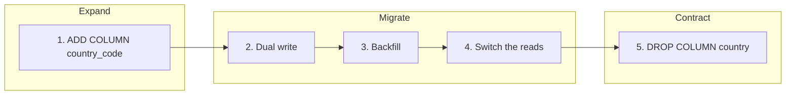

### Example: renaming `customers.country` to `customers.country_code`

`ALTER TABLE customers RENAME COLUMN country TO country_code;` is instant, but the instances still on the old version read `country` and crash the second it runs. Instead:

| Deployment | Database | Application |
|---|---|---|
| 1. Expand | `ALTER TABLE customers ADD COLUMN country_code text;` | unchanged |
| 2. Dual write | no change | writes `country` and `country_code`, reads `country` |
| 3. Backfill | batched copy (below) | unchanged |
| 4. Switch the reads | no change | reads `country_code` (behind a <span class="term" data-term="feature-flag">feature flag</span>), writes both |
| 5. Contract | `ALTER TABLE customers DROP COLUMN country;` | only writes `country_code` |

Step 2 on the application side, in the same statement:
```python
# What changes: also writes country_code, on top of country, in the same query
def update_country(conn, customer_id: int, code: str) -> None:
    conn.execute(
        "UPDATE customers SET country = %s, country_code = %s WHERE id = %s",
        (code, code, customer_id),
    )
```
If version 1 (which only writes `country`) is still running during the deployment, its writes leave `country_code` empty: the backfill of step 3 catches up on those rows.

Between step 4 and step 5, wait until no deployed version reads `country` anymore (a few stable days, for example).

### Batched backfill
<span class="pill pill-status pill-status-ok" title="Still valid, checked November 2026">Current · 11/2026</span>

The <span class="term" data-term="backfill">backfill</span> copies the existing rows. A single `UPDATE` over 40 million rows (example) would hold locks for a long time and blow up the replica lag. Split it:

```sql
-- Good: copy in batches of 5,000 rows, repeated until zero rows change
UPDATE customers
SET country_code = country
WHERE id IN (
    SELECT id FROM customers
    WHERE country_code IS NULL AND country IS NOT NULL
    ORDER BY id
    LIMIT 5000
);
```

A job repeats this query, with a short pause between batches, until zero rows are modified. Then a check: `SELECT COUNT(*) FROM customers WHERE country_code IS DISTINCT FROM country;` must return 0 before step 4. `IS DISTINCT FROM` compares while treating `NULL` as a value: `NULL = 'FR'` gives `NULL` (the row would be missed), whereas `NULL IS DISTINCT FROM 'FR'` gives `true` (the row is counted).

### Locks: lock_timeout
<span class="pill pill-status pill-status-ok" title="Still valid, checked November 2026">Current · 11/2026</span>

An `ALTER TABLE` asks for an exclusive <span class="term" data-term="db-lock">lock</span>. If it waits behind a long query, every query arriving after it waits too: the table looks blocked, while the migration has not done anything yet. The <span class="term" data-term="lock-timeout">lock timeout</span> cuts it short:

!!! noob "As noob"
    I think of a queue at a counter: the migration wants the counter all to itself, waits behind a very slow customer, and everyone arriving after it waits too, even those who needed just a second. `lock_timeout` tells it: "if you do not get the counter within 2 seconds, leave the queue and come back later". The one thing to remember: **a migration waiting for a lock blocks everyone behind it.**

```sql
-- Good: give up if the lock is not acquired within 2 seconds
SET lock_timeout = '2s';
-- Example: step 1 (expand), add the new column
ALTER TABLE customers ADD COLUMN country_code text;
```

If the lock is not obtained within 2 seconds, the migration fails cleanly and we run it again later. Better a migration that fails than a frozen production.

The lock queue, and what `lock_timeout` changes:

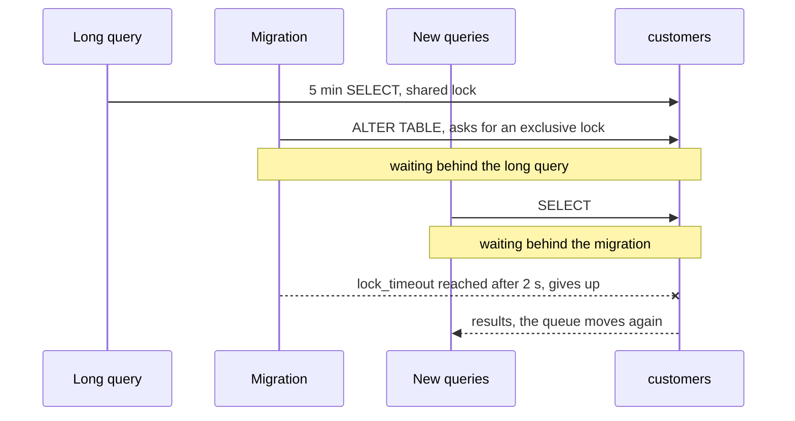

:material-book-open-variant: Reference docs: [PostgreSQL, Explicit Locking](https://www.postgresql.org/docs/current/explicit-locking.html) (version 18, 2025); [PostgreSQL, Client Connection Defaults (lock_timeout)](https://www.postgresql.org/docs/current/runtime-config-client.html) (version 18, 2025)
{ .doc-ref }

### Indexes and constraints without blocking
<span class="pill pill-status pill-status-ok" title="Still valid, checked November 2026">Current · 11/2026</span>

A classic `CREATE INDEX` blocks writes on the table for its whole build. The non-blocking version:

```sql
-- Good: builds the index without blocking writes
CREATE INDEX CONCURRENTLY idx_customers_country_code ON customers (country_code);
```

It is slower, cannot run inside a transaction, and leaves an index marked `INVALID` if it fails: drop it and start again.

For a constraint, same idea in two steps, with a <span class="term" data-term="not-valid-constraint">NOT VALID constraint</span>:

```sql
-- Good: instant, the constraint applies to new writes only
ALTER TABLE customers
    ADD CONSTRAINT customers_country_code_not_null CHECK (country_code IS NOT NULL) NOT VALID;

-- Good: then checks existing rows, with a light lock
ALTER TABLE customers VALIDATE CONSTRAINT customers_country_code_not_null;
```

The first command is instant and applies to new writes; the second checks the existing rows with a light lock that lets reads and writes through. Since PostgreSQL 12 (2019), a `SET NOT NULL` run afterwards reuses this validated constraint and does not scan the table again (to check on my version).

### Schema migration tools
<span class="pill pill-status pill-status-ok" title="Still valid, checked November 2026">Current · 11/2026</span>

The steps above say **what** to change and in which order. A <span class="term" data-term="schema-migration-tool">schema migration tool</span> takes care of **when** and **where**: it stores each change in a versioned file, records in a database table which ones have already run, and applies the next ones in order, the same way locally, in staging and in production.

| Tool | Ecosystem | Migration format | History table |
|---|---|---|---|
| Flyway | Java, or any language through its CLI | numbered SQL files (`V7__add_country_code.sql`) | `flyway_schema_history` |
| Liquibase | Java, or CLI | *changesets* in SQL, YAML, XML or JSON, with rollback and preconditions | `databasechangelog` |
| Alembic | Python, with SQLAlchemy | chained Python files (`down_revision`), autogeneration from the models | `alembic_version` |
| Doctrine Migrations | PHP, often with Symfony | PHP classes, generated by diffing against the entities | `doctrine_migration_versions` |

Other frameworks have their own (Rails, Django, Laravel, Prisma): same principle.

**When**: as soon as a database lives longer than a prototype and exists in more than one environment. **Not**: for test data (that is the job of datasets), nor for a data warehouse whose tables are rebuilt by the transformation tool (dbt, see [Data and decisions](donnees-decision.md#data-platform)).

*dbt: complements Airflow, Fivetran, Airbyte, BigQuery, Snowflake*
{ .tool-rel }


**Why**: without a tool, everyone runs their `ALTER` by hand, and nobody knows whether staging has the same schema as production. The gain: the schema state is readable in Git, replayable on a <span class="term" data-term="throwaway-database">throwaway database</span>, and checked in CI. The cost: discipline (never edit a migration that has already run: Flyway and Liquibase compare a checksum and refuse to go on) and a decision on when migrations run.

*Flyway: competes with Liquibase, Alembic*<br>
*Liquibase: competes with Flyway, Alembic*
{ .tool-rel }


**How**: step 1 of the example (expand), written for Alembic.

*Alembic: competes with Flyway, Liquibase; complements SQLAlchemy*
{ .tool-rel }

```python
"""Add customers.country_code.

Revision ID: 3f2a9c1d7b10
Revises: 9b41e0c2d5aa
"""
import sqlalchemy as sa
from alembic import op

# Example: chaining to the previous migration
revision = "3f2a9c1d7b10"
down_revision = "9b41e0c2d5aa"


# Good: lock_timeout before the ALTER, new nullable column (expand)
def upgrade() -> None:
    op.execute("SET lock_timeout = '2s'")
    op.add_column("customers", sa.Column("country_code", sa.Text(), nullable=True))


# Example: rollback, drop the column
def downgrade() -> None:
    op.drop_column("customers", "country_code")
```
The same thing for Flyway fits in a `V7__add_customers_country_code.sql` file holding the two SQL lines of step 1:
```
$ flyway migrate
Successfully validated 7 migrations
Current version of schema "public": 6
Migrating schema "public" to version "7 - add customers country code"
Successfully applied 1 migration to schema "public", now at version v7
```
(Illustrative output, to check depending on the version.)

What the tool does not do, and the rules that go with it:

- **it does not make a migration zero-downtime**: it runs it. Each expand / contract step stays a separate migration, shipped in a separate deployment;
- **run migrations once**, in a dedicated deployment step (a job before the instances are updated), not at the startup of every instance; Flyway and Liquibase take a lock to prevent two concurrent runs, but a startup stuck behind a long migration makes the health probes fail;
- **operations that refuse transactions** (`CREATE INDEX CONCURRENTLY`) need an option: `autocommit_block()` in Alembic, a non-transactional migration in Flyway (to check depending on the version);
- **rolling back with `downgrade` is often an illusion** once data has been written: prepare a forward corrective migration instead;
- **in CI**, apply every migration to an empty database, then check that the resulting schema matches the models (`alembic check`, `doctrine:schema:validate`).

### I want... I use...

| I want... | I use... |
|---|---|
| to rename a column or change its type while the old version of the application still reads it, like `country` becoming `country_code` | expand / contract over several deployments |
| to fill a new column on millions of existing rows, without blocking the table or letting the replicas fall behind | a batched backfill, then a check query |
| a migration stuck behind a long query that does not freeze all of production | `SET lock_timeout` before each `ALTER` |
| to add an index on a big table while the application keeps writing to it | `CREATE INDEX CONCURRENTLY` |
| to add a constraint on a big table without blocking it while every row is read again | `NOT VALID`, then `VALIDATE CONSTRAINT` |
| the same schema locally, in staging and in production, and to know which changes already ran | a migration tool: Flyway, Liquibase, Alembic, Doctrine Migrations |
| migrations that run only once, even when twenty instances start at the same time | a dedicated job before the instances are deployed |
| to move all the data to another database while the application keeps running | <span class="term" data-term="cdc">CDC</span> rather than a <span class="term" data-term="dual-write">dual write</span> coded in the application |

References: Danilo Sato, ["ParallelChange"](https://martinfowler.com/bliki/ParallelChange.html) (2014); Scott Ambler and Pramod Sadalage, "Refactoring Databases" (2006); PostgreSQL documentation, [CREATE INDEX](https://www.postgresql.org/docs/current/sql-createindex.html) and [ALTER TABLE](https://www.postgresql.org/docs/current/sql-altertable.html) (version 18, 2025); [Flyway](https://documentation.red-gate.com/flyway), [Liquibase](https://docs.liquibase.com/), [Alembic](https://alembic.sqlalchemy.org/) and [Doctrine Migrations](https://www.doctrine-project.org/projects/migrations.html) documentation (publication dates not given, to check).

## Pitfalls that skew results

<a class="pill pill-scope pill-scope-code" href="../architecture/#map-of-scales">Scale · Code</a>

### NULL is not compared with =
```sql
-- Avoid: = NULL is never true
WHERE delivered_at = NULL        never returns anything
-- Good: IS NULL tests for a missing value
WHERE delivered_at IS NULL       correct
```
And `WHERE status != 'paid'` **excludes** <span class="term" data-term="db-row">rows</span> where `status` is `NULL`.

:material-book-open-variant: Reference docs: [PostgreSQL, Comparison Functions and Operators](https://www.postgresql.org/docs/current/functions-comparison.html) (version 18, 2025); [MySQL, Working with NULL Values](https://dev.mysql.com/doc/refman/8.4/en/working-with-null.html) (MySQL 8.4)
{ .doc-ref }

### Dates and time zones
```sql
-- Avoid: only returns orders placed at exactly midnight
WHERE created_at BETWEEN '2026-10-20' AND '2026-10-20'
```
Only returns orders placed at exactly midnight: `'2026-10-20'` means `2026-10-20 00:00:00`. I write instead:
```sql
-- What changes: end excluded at the next day, the whole day is included
WHERE created_at >= '2026-10-20' AND created_at < '2026-10-21'
```
And know whether dates are stored in <span class="term" data-term="utc">UTC</span> or local time: an order placed at 12:30 am Paris time is still on the 19th in UTC.

:material-book-open-variant: Reference docs: [PostgreSQL, Date/Time Types](https://www.postgresql.org/docs/current/datatype-datetime.html) (version 18, 2025); [MySQL, Time Zone Support](https://dev.mysql.com/doc/refman/8.4/en/time-zone-support.html) (MySQL 8.4)
{ .doc-ref }

### Money
Never as `FLOAT`: `0.1 + 0.2` is not exactly `0.3`. I use integer cents (`total_cents INT`) or `DECIMAL(12, 2)`.

:material-book-open-variant: Reference docs: [PostgreSQL, Numeric Types](https://www.postgresql.org/docs/current/datatype-numeric.html) (version 18, 2025); [MySQL, Fixed-Point Types](https://dev.mysql.com/doc/refman/8.4/en/fixed-point-types.html) (MySQL 8.4)
{ .doc-ref }

### Comparing text
Depending on the database and its configuration ("<span class="term" data-term="collation">collation</span>"), `'Ada' = 'ada'` can be true (MySQL by default) or false (PostgreSQL). A test that passes on one can fail on the other.

:material-book-open-variant: Reference docs: [PostgreSQL, Collation Support](https://www.postgresql.org/docs/current/collation.html) (version 18, 2025); [MySQL, Character Sets and Collations in General](https://dev.mysql.com/doc/refman/8.4/en/charset-general.html) (MySQL 8.4)
{ .doc-ref }

## Security: SQL injection

<a class="pill pill-scope pill-scope-code" href="../architecture/#map-of-scales">Scale · Code</a> <span class="pill pill-status pill-status-ok" title="Still valid, checked November 2026">Current · 11/2026</span>

My code builds a <span class="term" data-term="db-query">query</span> by pasting in text typed by the user, like the email from a search form. That user can then type SQL instead of an email, and rewrite my query.
```python
# Avoid: the input is pasted into the query text
email = request.args["email"]
db.query(f"SELECT * FROM customers WHERE email = '{email}'")
```
If the user sends `' OR '1'='1`, the query becomes:
```sql
-- Example: the resulting query, it returns every customer
SELECT * FROM customers WHERE email = '' OR '1'='1'
```
and returns **all** customers.

The countermeasure: <span class="term" data-term="parameterized-query">parameterized queries</span>. The database receives the query and the value separately, so the value can never become SQL.

!!! noob "As noob"
    It is the difference between dictating a letter to someone who writes down everything I say, including "and add a 1,000 EUR transfer", and handing them a form whose "name" box can only hold a name. With a parameterized query, the value stays in its box, whatever it contains. The one thing to remember: **never paste user input into the text of a query.**

```python
# What changes: parameterized query, the value is sent separately and stays data
db.query("SELECT * FROM customers WHERE email = %s", (email,))
```

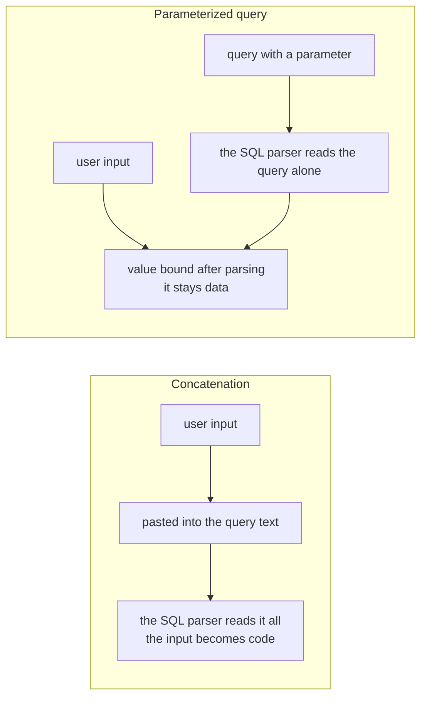

:material-book-open-variant: Reference docs: [OWASP, SQL Injection Prevention Cheat Sheet](https://cheatsheetseries.owasp.org/cheatsheets/SQL_Injection_Prevention_Cheat_Sheet.html) (accessed November 2026); [OWASP, Query Parameterization Cheat Sheet](https://cheatsheetseries.owasp.org/cheatsheets/Query_Parameterization_Cheat_Sheet.html) (accessed November 2026)
{ .doc-ref }

## SQL for QA

<a class="pill pill-scope pill-scope-code" href="../architecture/#map-of-scales">Scale · Code</a>

| I want to... | Typical query |
|---|---|
| find a customer who has not ordered anything yet, to test the "first order" flow | `LEFT JOIN orders ... WHERE o.id IS NULL LIMIT 1` |
| check that a click on "Order" created exactly one row, and not two because of a double submit | `SELECT COUNT(*) ... WHERE order_id = 42` equal to 1 |
| find inconsistent data, like an order saved without any item | `LEFT JOIN order_items ... WHERE i.id IS NULL` |
| spot duplicates, like two customers with the same email | `GROUP BY ... HAVING COUNT(*) > 1` |
| know how many orders are in each status, to pick my test data | `GROUP BY status` |
| see how many rows a change would touch, without really changing anything | `BEGIN; UPDATE ...; SELECT ...; ROLLBACK;` |
| understand why a page that reads the database is slow | `EXPLAIN` then check the indexes |

Best practices:
- on a <span class="term" data-term="shared-environment">shared environment</span>, other testers and other tests use the same data: I **read** rather than write, and never modify data another test uses, or that test fails for no visible reason;
- in <span class="term" data-term="automated-test">automated tests</span>, I use one <span class="term" data-term="throwaway-database">throwaway database</span> per session (<span class="term" data-term="testcontainers">Testcontainers</span>) and have each test create its own data, so no test depends on what another one left behind;
- to explore, I connect with a <span class="term" data-term="read-only-account">read-only account</span>: a typo, like a `DELETE` without `WHERE`, cannot break anything.

*Testcontainers: complements pytest*
{ .tool-rel }


:material-book-open-variant: Reference docs: [Testcontainers](https://testcontainers.com/) (accessed November 2026); [PostgreSQL, GRANT](https://www.postgresql.org/docs/current/sql-grant.html) (version 18, 2025)
{ .doc-ref }

## Pitfalls to avoid

- **Blind UPDATE or DELETE**: I run an `UPDATE` or a `DELETE` without counting the target rows, or I forget the `WHERE`. The whole table changes at once. I first run the same `WHERE` in a `SELECT COUNT(*)`, inside a transaction I can undo with `ROLLBACK` ([see the transaction](#try-before-committing-the-transaction)).
- **Sum after a join**: I run `SUM(o.total_cents)` after a `JOIN` on the items. An order with 3 items counts 3 times, so the total is wrong. I sum on `orders` alone, or aggregate the items before the join ([see the multiplication trap](#the-multiplication-trap)).
- **Comparing with NULL**: I write `WHERE delivered_at = NULL`, or count on `status != 'paid'` to get everything except paid orders. The first never returns anything, the second misses the rows where `status` is `NULL`. I use `IS NULL` and `IS DISTINCT FROM` ([see NULL](#null-is-not-compared-with)).
- **N+1 hidden by the ORM**: I loop over a list and let the ORM load each related item. 100 orders make 101 round trips to the database. I group them into a single query with `JOIN` or `IN`, and watch for repeated `SELECT` spans in the traces ([see the N+1 problem](#the-n1-problem)).
- **Optimizing by guesswork**: I go after the slowest query in the slow query log, or change three things at once. I miss the 3 ms query called 2 million times, and I do not know which change helped. I rank by total time, change one thing and measure again ([see finding slow queries](#finding-slow-queries), [the loop](#making-a-query-fast-the-loop)).
- **Renaming a column in a single migration**: I run `RENAME COLUMN` during a progressive deployment. The instances still on the old version read the old name and crash the second the migration runs. I split it into expand / contract, one deployment per step ([see expand / contract](#expand-contract)).
- **Input pasted into the query**: I build the query by pasting the text the user typed. With `' OR '1'='1`, they get every customer. I always use parameterized queries ([see SQL injection](#security-sql-injection)).
- **Sharding too early**: I spread the data over several databases at the first slowdowns. I pay the complexity of cross-shard queries for a problem an index or a replica would have solved, and going back is almost impossible. I climb the ladder one step at a time, based on measurements ([see the ladder](#the-ladder-from-cheapest-to-most-expensive)).

## What interviews ask

The typical questions:

- "What is the difference between INNER JOIN and LEFT JOIN?", "How do you find customers who never ordered?" How I answer: I give the number of rows returned on a small example, then the `LEFT JOIN ... IS NULL` pattern ([Joining tables](#joining-tables), [Finding what is missing](#finding-what-is-missing-left-join-is-null)).
- "WHERE or HAVING?", "How do you find duplicates?" How I answer: I recall that `WHERE` filters rows before grouping and `HAVING` filters groups after, with `GROUP BY ... HAVING COUNT(*) > 1` ([HAVING: filtering after grouping](#having-filtering-after-grouping)).
- "How do you find the second largest amount, or the last three orders of each customer?" How I answer: I use a window function, `ROW_NUMBER() OVER (PARTITION BY customer_id ORDER BY created_at DESC)`, then keep the ranks I want in an outer query, because a `WHERE` cannot filter on the rank directly ([Window functions](#window-functions)).
- "A page is slow because of the database, what do you do?", "What is an index, and when is it useless?", "What is the N+1 problem?" How I answer: I walk through measure, read the plan with `EXPLAIN ANALYZE`, change one thing, measure again ([Performance](#performance), [The N+1 problem](#the-n1-problem)), and [GraphQL server-side pitfalls](api-rest-async.md#server-side-pitfalls).
- "How do you check a test's effect in the database?", "What is a transaction, what does ACID mean?" How I answer: I show the `BEGIN ... ROLLBACK` and the typical QA queries ([What a transaction guarantees (ACID)](#what-a-transaction-guarantees-acid), [SQL for QA](#sql-for-qa)).
- "How do you protect against SQL injection?" How I answer: I show the concatenated query, the `' OR '1'='1` input, then the parameterized query ([Security: SQL injection](#security-sql-injection)).
- "Your database is saturated, what do you do?", "How do you rename a column without downtime?" How I answer: I climb the ladder from cheapest to most expensive, then walk through expand / contract ([Scaling a database](#scaling-a-database), [Zero-downtime schema migrations](#zero-downtime-schema-migrations)).

What makes a good answer: writing the query on a small dataset, saying how many rows it returns, then naming the trap that would skew it (`NULL`, multiplication, time zone).
