# SQL

!!! warning "Disclaimer"
    These notes are personal cheat sheets, not a source of truth. They reflect my own understanding and choices: their content remains subjective, despite the quotes and references it contains. It may be incomplete, simplified, inaccurate or outdated. Always check the official documentation before applying it. This content is provided as is, without any warranty: you use it at your own risk.

!!! audience "Who and what for"
    - **Roles**: QA engineer, back-end developer, data engineer, SRE, tech lead
    - **Uses**: I prepare a technical interview with a SQL exercise; I look in the database for a customer without orders for a test; I use `EXPLAIN` to understand why a page is slow; I review a merge request that renames a column or adds an index on a large table

!!! abstract "Scales"
    The colored badges under the headings say at which scale a notion applies:

    - <span class="pill pill-scope pill-scope-code">Code</span> the classes, functions and modules of one program;
    - <span class="pill pill-scope pill-scope-app">Application</span> one service or application and its internal split;
    - <span class="pill pill-scope pill-scope-system">System</span> several services talking to each other over the network;
    - <span class="pill pill-scope pill-scope-infra">Infrastructure</span> servers, network, zones and clusters, physical or virtual;
    - <span class="pill pill-scope pill-scope-enterprise">Enterprise</span> the whole information system and its organization.

    Details and ambiguous words: [map of scales](architecture.md#map-of-scales).

SQL is the language for reading and modifying the data of a <span class="term" data-term="relational-database">relational database</span> (MySQL, PostgreSQL, SQL Server...). On the QA side, it is mostly used for three things: finding test data, checking the state after an action, and understanding why a <span class="term" data-term="db-query">query</span> is slow. This page starts from the basics and goes all the way to the pitfalls that skew results.

*PostgreSQL: competes with MySQL, MariaDB; partly competes with MongoDB; complements Redis, PgBouncer, BigQuery, Elasticsearch*<br>
*MySQL: competes with PostgreSQL, MariaDB; complements Redis, ProxySQL, Vitess*
{ .tool-rel }


All examples use this small fictitious <span class="term" data-term="db-schema">schema</span>:

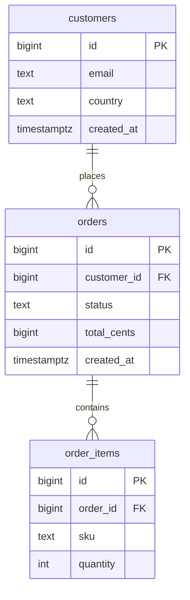

:material-swap-horizontal: The tools mentioned on this page: which ones replace each other, which ones combine? See [Complementary or competing](outils.md#complementary-or-competing).
{ .doc-ref }

## Terminology

**Relational database**: data is stored in **tables**, made of **rows** (a record) and **columns** (a field).

**Primary key (PK)**: the column that uniquely identifies each row, often `id`.

**Foreign key (FK)**: a column that points to the <span class="term" data-term="primary-key">primary key</span> of another table. `orders.customer_id` points to `customers.id`: each order belongs to a customer.

**NULL**: the absence of a value. It is neither `0` nor an empty string. An order without a delivery date has `delivered_at = NULL`.

**Index**: a structure that finds rows without reading the whole table, like the index of a book.

**Transaction**: a group of operations that all succeed or all fail.

**Schema**: the structure of the database, i.e. its tables, columns and <span class="term" data-term="db-constraint">constraints</span>. **Migration**: a versioned script that evolves the schema (adding a column...).

**<span class="term" data-term="sli">SLI</span>**: the indicator I measure to know whether a solution works. Example: the share of `SELECT` queries of the "my orders" page served in under 50 ms.

**<span class="term" data-term="slo">SLO</span>**: the internal target the team sets on that SLI. Example: 95% of those queries under 50 ms over a rolling 30 days.

**<span class="term" data-term="sla">SLA</span>**: the contractual promise to a customer, with a penalty if it is missed, usually looser than the SLO to keep a margin. Example: the application database available 99.9% of the month, otherwise a credit on the invoice.

:material-book-open-variant: Reference docs: [PostgreSQL, Constraints](https://www.postgresql.org/docs/current/ddl-constraints.html) (version 18, 2025); [MySQL, FOREIGN KEY Constraints](https://dev.mysql.com/doc/refman/8.4/en/create-table-foreign-keys.html) (MySQL 8.4)
{ .doc-ref }

## Reading data

<a class="pill pill-scope pill-scope-code" href="../architecture/#map-of-scales">Scale · Code</a>

### SELECT, WHERE, ORDER BY, LIMIT
``` { .sql .ex-bad title="Avoid" }
-- Avoid: SELECT * and LIMIT without ORDER BY, the 10 rows returned change from one call to the next
SELECT * FROM orders WHERE status = 'paid' LIMIT 10;
```

``` { .sql .ex-good title="Recommended" }
-- Good: named columns and an explicit ORDER BY, so the result stays stable
SELECT id, status, total_cents
FROM orders
WHERE status = 'paid'
  AND created_at >= '2026-10-01'
ORDER BY created_at DESC
LIMIT 10;
```
The 10 latest paid orders since October 1st.

Rules:
- never `SELECT *` in code: if a column is added, the result changes. For exploration, it is fine;
- always `ORDER BY` if the order matters: without it, the <span class="term" data-term="database">database</span> returns <span class="term" data-term="db-row">rows</span> in whatever order suits it, and that order can change.

### Useful filters
``` { .sql .ex-ref title="Reference" }
-- Example: four common filters, list, range, text pattern, missing value
WHERE status IN ('paid', 'shipped')
WHERE total_cents BETWEEN 1000 AND 5000
WHERE email LIKE '%@example.com'
WHERE delivered_at IS NULL
```

**Risks.** `BETWEEN` includes both bounds: on dates, `BETWEEN '2026-10-01' AND '2026-10-31'` misses everything that happened on the 31st after midnight, so I write `>=` and `<` (see [dates](#dates-and-time-zones)). `LIKE '%@example.com'`, with a leading `%`, cannot use the index and reads the whole table: on a large production table, I filter on an indexed column first.

### Count first
<span class="pill pill-status pill-status-ok" title="Still valid, checked November 2026">Current · 11/2026</span>

Before reading or modifying, count. It avoids displaying a million rows, or modifying a million.
``` { .sql .ex-bad title="Avoid" }
-- Avoid: read everything without knowing how many rows are coming
SELECT * FROM orders WHERE status = 'pending';
```

``` { .sql .ex-good title="Recommended" }
-- Good: count before reading or changing
SELECT COUNT(*) FROM orders WHERE status = 'pending';
```
Without counting, the SQL client tries to load 2.4 million rows: it freezes for minutes, and the database reads the whole table for nothing.
``` { .text .ex-illus title="Illustration" }
12          I can look at the rows
2,400,000   I filter further first
```

**Risks.** On a very large table, `COUNT(*)` often reads the whole table or a whole index (especially on PostgreSQL): on production, I filter on an indexed column or count on a replica. The count can also change between the moment I count and the moment I modify: I count and modify in the same transaction (see [the transaction](#try-before-committing-the-transaction)).

:material-book-open-variant: Reference docs: [PostgreSQL, SELECT](https://www.postgresql.org/docs/current/sql-select.html) (version 18, 2025); [MySQL, SELECT Statement](https://dev.mysql.com/doc/refman/8.4/en/select.html) (MySQL 8.4)
{ .doc-ref }

!!! maturity "Measuring maturity"
    | Level | What I see in the team |
    |---|---|
    | N1 | someone counts rows before reading a large table, but others still run `SELECT *` without `LIMIT` on production |
    | N2 | the rule "count first, named columns, explicit `ORDER BY`" is written in the review guide, and a SQL linter flags `SELECT *` in code on every MR |
    | N3 | the exploration account has a `statement_timeout` that cuts a query that runs too long by itself, and the shared SQL client adds a default `LIMIT` |
    | N4 | the team tracks the number of exploration queries cut by the timeout and the volume they read, and adjusts the timeout and indexes from these numbers |

    **I measure**: the share of queries in the code that name their columns, counted by the linter in CI; the number of queries cut by `statement_timeout` per week, read in the database logs.

## Joining tables

<a class="pill pill-scope pill-scope-code" href="../architecture/#map-of-scales">Scale · Code</a>

A <span class="term" data-term="sql-join">join</span> pairs each row of one table with the rows of another table that satisfy the `ON` condition. The drawings below sum up which rows remain: `customers` on the left, `orders` on the right, the coloured part is what the query returns.

!!! noob "As noob"
    A join staples to each customer card the receipts that carry its number: a customer with two receipts gives two pairs. The kind of join only says what to do with cards that have no receipt and receipts that have no card. The one thing to remember: **a join builds pairs of rows, so it can return more rows than there are customers.**

<div class="diagram-grid">
<figure><svg viewBox="0 0 160 100" role="img" aria-label="INNER JOIN: the coloured part is returned"><path class="hit" d="M80,16.28 A35,35 0 0,1 80,73.72 A35,35 0 0,1 80,16.28 Z"/><circle class="set" cx="60" cy="45" r="35"/><circle class="set" cx="100" cy="45" r="35"/><text x="40" y="95" text-anchor="middle">customers</text><text x="120" y="95" text-anchor="middle">orders</text></svg><figcaption><code>INNER JOIN</code></figcaption></figure>
<figure><svg viewBox="0 0 160 100" role="img" aria-label="LEFT JOIN: the coloured part is returned"><circle class="hit" cx="60" cy="45" r="35"/><circle class="set" cx="60" cy="45" r="35"/><circle class="set" cx="100" cy="45" r="35"/><text x="40" y="95" text-anchor="middle">customers</text><text x="120" y="95" text-anchor="middle">orders</text></svg><figcaption><code>LEFT JOIN</code></figcaption></figure>
<figure><svg viewBox="0 0 160 100" role="img" aria-label="RIGHT JOIN: the coloured part is returned"><circle class="hit" cx="100" cy="45" r="35"/><circle class="set" cx="60" cy="45" r="35"/><circle class="set" cx="100" cy="45" r="35"/><text x="40" y="95" text-anchor="middle">customers</text><text x="120" y="95" text-anchor="middle">orders</text></svg><figcaption><code>RIGHT JOIN</code></figcaption></figure>
<figure><svg viewBox="0 0 160 100" role="img" aria-label="FULL OUTER JOIN: the coloured part is returned"><path class="hit" d="M80,16.28 A35,35 0 1,0 80,73.72 A35,35 0 0,1 80,16.28 Z"/><path class="hit" d="M80,16.28 A35,35 0 0,1 80,73.72 A35,35 0 0,1 80,16.28 Z"/><path class="hit" d="M80,16.28 A35,35 0 1,1 80,73.72 A35,35 0 0,0 80,16.28 Z"/><circle class="set" cx="60" cy="45" r="35"/><circle class="set" cx="100" cy="45" r="35"/><text x="40" y="95" text-anchor="middle">customers</text><text x="120" y="95" text-anchor="middle">orders</text></svg><figcaption><code>FULL OUTER JOIN</code></figcaption></figure>
<figure><svg viewBox="0 0 160 100" role="img" aria-label="LEFT JOIN ... WHERE o.id IS NULL: the coloured part is returned"><path class="hit" d="M80,16.28 A35,35 0 1,0 80,73.72 A35,35 0 0,1 80,16.28 Z"/><circle class="set" cx="60" cy="45" r="35"/><circle class="set" cx="100" cy="45" r="35"/><text x="40" y="95" text-anchor="middle">customers</text><text x="120" y="95" text-anchor="middle">orders</text></svg><figcaption><code>LEFT JOIN ... WHERE o.id IS NULL</code></figcaption></figure>
<figure><svg viewBox="0 0 160 100" role="img" aria-label="FULL OUTER JOIN ... IS NULL: the coloured part is returned"><path class="hit" d="M80,16.28 A35,35 0 1,0 80,73.72 A35,35 0 0,1 80,16.28 Z"/><path class="hit" d="M80,16.28 A35,35 0 1,1 80,73.72 A35,35 0 0,0 80,16.28 Z"/><circle class="set" cx="60" cy="45" r="35"/><circle class="set" cx="100" cy="45" r="35"/><text x="40" y="95" text-anchor="middle">customers</text><text x="120" y="95" text-anchor="middle">orders</text></svg><figcaption><code>FULL OUTER JOIN ... IS NULL</code></figcaption></figure>
</div>

The same data set, row by row. ada has two orders, grace and linus none, and order 12 points to a customer 4 who no longer exists:

``` { .text .ex-illus title="Illustration" }
customers            orders
id  email            id  customer_id
1   ada              10  1
2   grace            11  1
3   linus            12  4
```

| Join | Rows returned (email, order id) | Count |
|---|---|---|
| `INNER JOIN` | (ada, 10) (ada, 11) | 2 |
| `LEFT JOIN` | (ada, 10) (ada, 11) (grace, NULL) (linus, NULL) | 4 |
| `RIGHT JOIN` | (ada, 10) (ada, 11) (NULL, 12) | 3 |
| `FULL OUTER JOIN` | (ada, 10) (ada, 11) (grace, NULL) (linus, NULL) (NULL, 12) | 5 |
| `LEFT JOIN ... WHERE o.id IS NULL` | (grace, NULL) (linus, NULL) | 2 |
| `FULL OUTER JOIN ... IS NULL` | (grace, NULL) (linus, NULL) (NULL, 12) | 3 |
| `CROSS JOIN` | every customer with every order | 3 x 3 = 9 |

Circles are a handy but imperfect picture: a join is not a set intersection, it pairs rows. ada comes out twice because she has two orders (see [the multiplication trap](#the-multiplication-trap)), which no circle shows.

:material-book-open-variant: Reference docs: [PostgreSQL, Joined Tables](https://www.postgresql.org/docs/current/queries-table-expressions.html#QUERIES-JOIN) (version 18, 2025); [MySQL, JOIN Clause](https://dev.mysql.com/doc/refman/8.4/en/join.html) (MySQL 8.4)
{ .doc-ref }

### INNER JOIN: what exists on both sides
``` { .sql .ex-ref title="Reference" }
-- Example: INNER JOIN, paid orders with the customer's email
SELECT c.email, o.id, o.total_cents
FROM orders o
JOIN customers c ON c.id = o.customer_id
WHERE o.status = 'paid';
```
Paid orders with the customer's email. An order without a matching customer does not appear.

**Risks.** An `INNER JOIN` silently drops rows with no match: a "revenue per customer" report that joins `customers` loses the orders whose customer was deleted, and the total no longer matches accounting. When I count or sum, I compare the number of rows with and without the join.

### LEFT JOIN: everything on the left, even without a match
``` { .sql .ex-ref title="Reference" }
-- Example: LEFT JOIN, every customer, even those without an order
SELECT c.email, o.id
FROM customers c
LEFT JOIN orders o ON o.customer_id = c.id;
```
All customers, with their orders. A customer without orders appears once, with `o.id = NULL`.

Common trap: a filter on the right-hand table placed in the `WHERE` cancels the `LEFT JOIN`. For a customer without a paid order, `o.status` is `NULL`, the `WHERE` drops their row, and the query behaves like an `INNER JOIN`: the report "every customer and their paid orders" silently loses the customers who paid nothing.

``` { .sql .ex-bad title="Avoid" }
-- Avoid: the WHERE on o drops the customers without a paid order
SELECT c.email, o.id
FROM customers c
LEFT JOIN orders o ON o.customer_id = c.id
WHERE o.status = 'paid';
```

``` { .sql .ex-good title="Recommended" }
-- Good: the filter in the ON, every customer stays, with o.id NULL if they paid nothing
SELECT c.email, o.id
FROM customers c
LEFT JOIN orders o ON o.customer_id = c.id AND o.status = 'paid';
```

### Finding what is missing: LEFT JOIN ... IS NULL
``` { .sql .ex-ref title="Reference" }
-- Example: customers who never ordered
SELECT c.id, c.email
FROM customers c
LEFT JOIN orders o ON o.customer_id = c.id
WHERE o.id IS NULL;
```
Customers who have **never** ordered. Very useful to find <span class="term" data-term="test-data">test data</span> ("a customer without orders") or inconsistencies ("orders without items").

``` { .sql .ex-ref title="Reference" }
-- Example: orders without items, an inconsistency
SELECT o.id
FROM orders o
LEFT JOIN order_items i ON i.order_id = o.id
WHERE i.id IS NULL;
```

**Risks.** Without an index on the join column (`orders.customer_id`), the query scans the right-hand table for each customer and becomes very slow on production. And if I test `IS NULL` on a column that can be `NULL` while the row exists, I count rows that are there as "missing": I always test the primary key of the right-hand table (`o.id IS NULL`).

### RIGHT JOIN, FULL OUTER JOIN, CROSS JOIN

``` { .sql .ex-ref title="Reference" }
-- Example: orphans on both sides, customers without orders and orders without customer
SELECT c.email, o.id
FROM customers c
FULL OUTER JOIN orders o ON o.customer_id = c.id
WHERE c.id IS NULL OR o.id IS NULL;
```
Both kinds of orphans at once: customers without orders and orders without a customer. Handy for a consistency check after a migration.

| Join | What it is for |
|---|---|
| `RIGHT JOIN` | the mirror of `LEFT JOIN`. Swapping the tables and writing a `LEFT JOIN` reads more easily |
| `FULL OUTER JOIN` | comparing two tables and seeing what is missing on either side |
| `CROSS JOIN` | every combination (Cartesian product): generating a test set "every country x every payment method". On two large tables, the result explodes |

MySQL has no `FULL OUTER JOIN`: get it with a `UNION` of a `LEFT JOIN` and a `RIGHT JOIN`.

### The multiplication trap
A `JOIN` on a "<span class="term" data-term="one-to-many">one to many</span>" relationship repeats rows.
``` { .sql .ex-bad title="Avoid" }
-- Avoid: wrong total, each order counts once per item
SELECT SUM(o.total_cents)
FROM orders o
JOIN order_items i ON i.order_id = o.id;
```
An order with 3 items counts 3 times in the sum: the total is wrong. Sum over `orders` alone, or <span class="term" data-term="aggregation">aggregate</span> the items before the join.

!!! maturity "Measuring maturity"
    | Level | What I see in the team |
    |---|---|
    | N1 | one person knows the `LEFT JOIN ... IS NULL` pattern and uses it by hand to find a customer without orders or orphan orders |
    | N2 | consistency queries (orders without items, items without orders) are versioned in the repository and run by a job after each migration |
    | N3 | foreign keys in the database stop orphans from being created, and a red consistency check blocks the release |
    | N4 | the team tracks the number of orphans found per week and of wrong totals caught in review, and adds a constraint where the numbers show a gap |

    **I measure**: the number of orphan rows returned by the consistency queries, read in the job output; the share of schema relations covered by a foreign key, read in `information_schema`.

## Grouping and aggregating

<a class="pill pill-scope pill-scope-code" href="../architecture/#map-of-scales">Scale · Code</a>

### GROUP BY
``` { .sql .ex-ref title="Reference" }
-- Example: order count and total per status
SELECT status, COUNT(*) AS order_count, SUM(total_cents) AS total
FROM orders
GROUP BY status;
```
``` { .text .ex-ref title="Reference" }
status     order_count   total
paid               820   2,460,000
pending             12      36,000
cancelled           45     135,000
```

**Risks.** A `SELECT` column missing from the `GROUP BY` is rejected by PostgreSQL, but MySQL accepts it when the `ONLY_FULL_GROUP_BY` mode is disabled, and then returns a value picked arbitrarily within the group: the report looks right and is not. `NULL` values also form their own group, which a test expecting a fixed list of statuses easily forgets.

### HAVING: filtering after grouping
`WHERE` filters <span class="term" data-term="db-row">rows</span> before grouping, `HAVING` filters groups after.

!!! noob "As noob"
    I think of sorting mail: `WHERE` throws away the letters I do not care about before making piles, `HAVING` then throws away whole piles that do not fit (for example those with fewer than 5 letters). The one thing to remember: **`WHERE` filters rows, `HAVING` filters groups: we write `HAVING COUNT(*) > 5`, never `WHERE COUNT(*) > 5`.**

The order in which the database logically evaluates a query is not the order in which it is written. That is why an alias defined in `SELECT` is not known yet in `WHERE` (the optimizer may then reorder the actual execution):

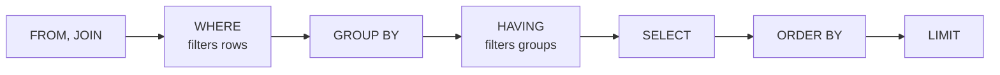

``` { .sql .ex-ref title="Reference" }
-- Example: HAVING filters groups, customers with more than 5 orders
SELECT customer_id, COUNT(*) AS order_count
FROM orders
GROUP BY customer_id
HAVING COUNT(*) > 5;
```
Customers who placed more than 5 orders.

**Risks.** Putting a row filter in `HAVING`, like `GROUP BY status HAVING status = 'paid'`, forces the database to group the whole table before discarding groups: the result is right, but the query is much slower. What filters rows goes in `WHERE`, what filters aggregates goes in `HAVING`.

### Finding duplicates
``` { .sql .ex-ref title="Reference" }
-- Example: emails that appear more than once
SELECT email, COUNT(*)
FROM customers
GROUP BY email
HAVING COUNT(*) > 1;
```

**Risks.** Grouping compares exact values: `Ada@example.com` and `ada@example.com`, with an uppercase letter or a trailing space, do not come out as duplicates. I normalize in the query (`GROUP BY LOWER(TRIM(email))`), then I add a unique constraint on the normalized value so duplicates do not come back.

### COUNT(*) or COUNT(column)
``` { .text .ex-ref title="Reference" }
COUNT(*)              counts all rows
COUNT(delivered_at)   counts only the rows where delivered_at is not NULL
COUNT(DISTINCT customer_id)   counts the distinct customers
```

:material-book-open-variant: Reference docs: [PostgreSQL, GROUP BY and HAVING Clauses](https://www.postgresql.org/docs/current/queries-table-expressions.html#QUERIES-GROUP) (version 18, 2025); [MySQL, Aggregate Functions](https://dev.mysql.com/doc/refman/8.4/en/aggregate-functions.html) (MySQL 8.4)
{ .doc-ref }

## More advanced queries

<a class="pill pill-scope pill-scope-code" href="../architecture/#map-of-scales">Scale · Code</a>

### Subquery and CTE (WITH)
A **<span class="term" data-term="cte">CTE</span>** gives a name to an intermediate <span class="term" data-term="db-query">query</span>, so the query reads from top to bottom.
``` { .sql .ex-ref title="Reference" }
-- Example: the CTE names the "big customers" step, then the query reads their emails
WITH big_customers AS (
    SELECT customer_id
    FROM orders
    GROUP BY customer_id
    HAVING SUM(total_cents) > 100000
)
SELECT c.email
FROM customers c
JOIN big_customers b ON b.customer_id = c.id;
```
Customers who spent more than €1,000.

!!! noob "As noob"
    A CTE is a recipe step I give a name to: "make the dough", then "fill the dough made above". Without it, I write everything in one go, with brackets inside brackets, and nobody can tell where each step starts. The line to remember: **a CTE usually does not make the query faster, it makes it readable from top to bottom.**

A **<span class="term" data-term="subquery">subquery</span>** is a query placed inside another one, here in the `WHERE`: the emails of customers with at least one refunded order.
``` { .sql .ex-ref title="Reference" }
-- Example: subquery in the WHERE, customers with a refunded order
SELECT email
FROM customers
WHERE id IN (SELECT customer_id FROM orders WHERE status = 'refunded');
```

Trap: `NOT IN` with a subquery that contains a single `NULL` returns **no** row. `id NOT IN (7, NULL)` means `id <> 7 AND id <> NULL`, and `id <> NULL` is never true. One guest order saved with `customer_id` set to `NULL` is enough for "customers without orders" to answer zero customers.

``` { .sql .ex-bad title="Avoid" }
-- Avoid: a single NULL customer_id in orders, and the query returns nothing
SELECT email
FROM customers
WHERE id NOT IN (SELECT customer_id FROM orders);
```

``` { .sql .ex-good title="Recommended" }
-- Good: NOT EXISTS is not thrown off by NULLs
SELECT email
FROM customers c
WHERE NOT EXISTS (SELECT 1 FROM orders o WHERE o.customer_id = c.id);
```

| I want... | I use |
|---|---|
| to keep only the rows that have something elsewhere, once in the query, like "customers with at least one refunded order" | `IN (SELECT ...)` or `EXISTS` subquery |
| to compute an intermediate result I reuse, or to split a long query into steps that read top to bottom, like "first the big customers, then their emails" | CTE |

**Risks.** Before PostgreSQL 12 (2019), a CTE was always computed in full before the main query, which stopped it from using the outer query's indexes: a query rewritten "for readability" could become much slower (`MATERIALIZED` and `NOT MATERIALIZED` let me choose since then, to check on my version). I read the plan with `EXPLAIN` after every rewrite.

### Window functions
Compute over a group of <span class="term" data-term="db-row">rows</span> **without** collapsing them into one.

!!! noob "As noob"
    `GROUP BY` melts the rows of a group into one, like summing up a class by its average. A window function keeps each student on their own row and writes next to it something computed over their class (their rank, the class average). The one thing to remember: **same per-group computation, but no row disappears.**

``` { .sql .ex-ref title="Reference" }
-- Example: each order's rank for its customer, without merging rows
SELECT customer_id, id, created_at,
       ROW_NUMBER() OVER (PARTITION BY customer_id ORDER BY created_at DESC) AS order_rank
FROM orders;
```
Each order keeps its row, with its rank for its customer: `order_rank = 1` is each customer's latest order.

**Risks.** A window function sorts each partition: on millions of rows, the sort can spill to disk and the query gets longer. And I cannot filter on its result in the `WHERE` of the same query: I wrap it in a subquery or a CTE, otherwise the database rejects the query.

### CASE
``` { .sql .ex-ref title="Reference" }
-- Example: CASE sorts each order into large, medium or small
SELECT id,
       CASE WHEN total_cents >= 10000 THEN 'large'
            WHEN total_cents >= 2000  THEN 'medium'
            ELSE 'small' END AS size
FROM orders;
```

**Risks.** `WHEN` clauses are read in order and the first true one wins: if I write `>= 2000` before `>= 10000`, no order is ever classified as "large". Without `ELSE`, a value that matches no case becomes `NULL`, and it disappears from the counts by size.

:material-book-open-variant: Reference docs: [PostgreSQL, WITH Queries](https://www.postgresql.org/docs/current/queries-with.html) (version 18, 2025); [PostgreSQL, Window Functions](https://www.postgresql.org/docs/current/tutorial-window.html) (version 18, 2025); [PostgreSQL, Conditional Expressions](https://www.postgresql.org/docs/current/functions-conditional.html) (version 18, 2025)
{ .doc-ref }

## Modifying data

<a class="pill pill-scope pill-scope-code" href="../architecture/#map-of-scales">Scale · Code</a>

### INSERT, UPDATE, DELETE
``` { .sql .ex-ref title="Reference" }
-- Example: add a customer
INSERT INTO customers (email, country) VALUES ('ada@example.com', 'FR');

-- Example: change an order, always with a WHERE
UPDATE orders SET status = 'cancelled' WHERE id = 42;

-- Example: delete an order, always with a WHERE
DELETE FROM orders WHERE id = 42;
```
The danger: an `UPDATE` or a `DELETE` **without `WHERE`** hits the whole <span class="term" data-term="db-table">table</span>.

The mistake mostly happens in a SQL client where I select part of the text before running it: if the selection stops before the `WHERE` line, the database receives a valid query that hits everything.

``` { .sql .ex-bad title="Avoid" }
-- Avoid: the WHERE line was not selected, every order becomes cancelled
UPDATE orders SET status = 'cancelled'
```

:material-book-open-variant: Reference docs: [PostgreSQL, Data Manipulation](https://www.postgresql.org/docs/current/dml.html) (version 18, 2025)
{ .doc-ref }

### Try before committing: the transaction
<span class="pill pill-status pill-status-ok" title="Still valid, checked November 2026">Current · 11/2026</span>

``` { .sql .ex-bad title="Avoid" }
-- Avoid: run the UPDATE directly, committed at once (autocommit)
UPDATE orders SET status = 'cancelled' WHERE customer_id = 17;
```
In autocommit, a typo in the `WHERE` (17 instead of 7) cancels another customer's orders right away, and only a backup restore brings them back.

``` { .sql .ex-good title="Recommended" }
-- Good: try the change inside a transaction before committing it
BEGIN;
UPDATE orders SET status = 'cancelled' WHERE customer_id = 7;
-- Example: count the affected rows, then undo everything (COMMIT if the count is right)
SELECT COUNT(*) FROM orders WHERE customer_id = 7 AND status = 'cancelled';
ROLLBACK;
```
I see how many <span class="term" data-term="db-row">rows</span> would be affected, then `ROLLBACK` undoes everything. If it looks right, I run it again with `COMMIT` instead.

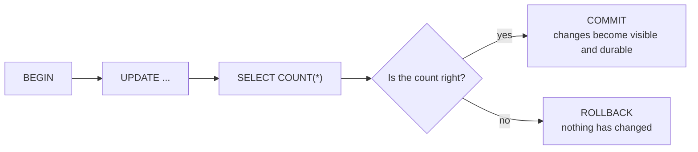

Rule: before any `UPDATE` or `DELETE`, run the same `WHERE` in a `SELECT COUNT(*)`.

**Risks.** A transaction opened then forgotten in my SQL client keeps its locks: other people's `UPDATE` statements on the same rows wait, and the application seems frozen. I keep the transaction short, I always end with `COMMIT` or `ROLLBACK`, and an `idle_in_transaction_session_timeout` (PostgreSQL) cuts forgotten sessions.

:material-book-open-variant: Reference docs: [PostgreSQL, Transactions](https://www.postgresql.org/docs/current/tutorial-transactions.html) (version 18, 2025); [MySQL, START TRANSACTION, COMMIT, and ROLLBACK](https://dev.mysql.com/doc/refman/8.4/en/commit.html) (MySQL 8.4)
{ .doc-ref }

### What a transaction guarantees (ACID)
- **Atomicity**: all or nothing. The debit and credit of a transfer go through together, or neither does.
- **Consistency**: <span class="term" data-term="db-constraint">constraints</span> (<span class="term" data-term="foreign-key">foreign keys</span>, uniqueness) are respected at the end.
- **Isolation**: two parallel <span class="term" data-term="db-transaction">transactions</span> don't see each other's unfinished changes (depending on the chosen <span class="term" data-term="isolation-level">isolation level</span>).
- **Durability**: once committed, the change survives a crash.

!!! noob "As noob"
    I think of a bank transfer: money never leaves one account without reaching the other, the rules declared in the database stay true, nobody sees the transfer half done, and once confirmed, a power cut does not erase it. Limit: depending on the isolation level chosen, two parallel transactions can still interfere in subtle ways. The one thing to remember: **a transaction succeeds as a whole or leaves no trace.**

:material-book-open-variant: Reference docs: [PostgreSQL, Transaction Isolation](https://www.postgresql.org/docs/current/transaction-iso.html) (version 18, 2025); [MySQL and the ACID Model](https://dev.mysql.com/doc/refman/8.4/en/mysql-acid.html) (MySQL 8.4)
{ .doc-ref }

!!! maturity "Measuring maturity"
    | Level | What I see in the team |
    |---|---|
    | N1 | before a manual `UPDATE` or `DELETE`, someone runs the same `WHERE` in a `SELECT COUNT(*)`, when they think of it |
    | N2 | every data fix in production goes through a script reviewed in an MR, run in a transaction that shows the expected count before the `COMMIT` |
    | N3 | the SQL client refuses an `UPDATE` or a `DELETE` without `WHERE` by itself (`sql_safe_updates` in MySQL, for example), and the exploration account only has read rights |
    | N4 | the team tracks the number of data fixes per month and of incidents caused by a manual change, and reduces write access from these numbers |

    **I measure**: the share of production data changes made through a reviewed script, read by comparing the MR tool with the database audit log; the number of human accounts with a write right, read in the `GRANT` statements.

## Concurrent writes

<a class="pill pill-scope pill-scope-code" href="../architecture/#map-of-scales">Scale · Code</a> <a class="pill pill-scope pill-scope-app" href="../architecture/#map-of-scales">Scale · Application</a>

My application runs on several instances, so two requests can change the same row in the same millisecond: two transfers from the same account, two customers booking the last seat of a concert. A transaction alone is not always enough: depending on the isolation level, both can read the same value before either of them writes. This section gives the four tools, from the simplest to the heaviest: the atomic `UPDATE`, the pessimistic lock, the optimistic lock, the isolation level.

### Race condition and lost update
<a class="pill pill-scope pill-scope-code" href="../architecture/#map-of-scales">Scale · Code</a> <span class="pill pill-status pill-status-ok" title="Still valid, checked November 2026">Current · 11/2026</span>

A <span class="term" data-term="race-condition">race condition</span> is a bug that depends on the order in which two simultaneous operations run. The dangerous pattern has three steps: read, decide, write. Between the read and the write, another request can slip in, and one of the two writes erases the other: that is a <span class="term" data-term="lost-update">lost update</span>.

``` { .python .ex-bad title="Avoid" }
# Avoid: read, decide, write in three steps, two requests read "1 seat" and both book it
seats = db.query_one("SELECT seats_left FROM events WHERE id = %s", event_id)
if seats > 0:
    db.execute("UPDATE events SET seats_left = %s WHERE id = %s", seats - 1, event_id)
    db.execute("INSERT INTO bookings (event_id, user_id) VALUES (%s, %s)", event_id, user_id)
```

What happens when ada and grace click on the last seat at the same time:

| Time | ada's request | grace's request |
|---|---|---|
| 0 ms | reads `seats_left = 1` | |
| 1 ms | | reads `seats_left = 1` |
| 2 ms | writes `seats_left = 0`, creates her booking | |
| 3 ms | | writes `seats_left = 0`, creates her booking |

Two bookings for one seat, and the counter says 0: nothing flags the error. The local test, with a single user, never sees it.

!!! noob "As noob"
    Two customers look at the last cake in the shop window. Each says "there is one left, I'll take it", and the seller charges both before going to fetch it. The only fix: take the cake out of the window at the very moment it is paid for. The one thing to remember: **reading then writing in two steps leaves a window open; I let the database check and write in a single statement.**

The first fix, the simplest: an <span class="term" data-term="atomic-operation">atomic operation</span>, where the check sits in the `WHERE` of the `UPDATE`.

``` { .python .ex-good title="Recommended" }
# Good: check and write in a single statement, the database serializes the two UPDATEs on the row
with db.transaction():
    updated = db.execute(
        "UPDATE events SET seats_left = seats_left - 1 WHERE id = %s AND seats_left > 0",
        event_id,
    )
    if updated.rowcount == 0:
        raise EventFull(event_id)
    db.execute("INSERT INTO bookings (event_id, user_id) VALUES (%s, %s)", event_id, user_id)
```

The second `UPDATE` waits for the row lock taken by the first one, then re-evaluates its `WHERE` on the new value: `seats_left = 0`, so no row changes, and grace gets "sold out". I add two safety nets in the schema, which hold even with ten servers: a <span class="term" data-term="unique-constraint">unique constraint</span> on `(event_id, user_id)` against the double click, and `CHECK (seats_left >= 0)`. To get columns of the changed row back without a separate `SELECT`, `RETURNING` exists on PostgreSQL and SQLite (since version 3.35, 2021), not on MySQL.

**When**: whenever the rule fits in a single row (a stock, a balance, a status moving from `pending` to `paying`). **Why**: no lock to manage in the code, no extra service. **How**: the condition goes in the `WHERE`, then I check the number of changed rows, and I prove it with a test that fires 20 bookings in parallel on an event with 5 seats and counts exactly 5 bookings.

**Risks.** The atomic `UPDATE` only protects what fits in a single row: if the rule depends on several rows, the window stays open (see [Pessimistic lock](#pessimistic-lock-for-update)). Forgetting to check the number of modified rows amounts to ignoring the "sold out": the booking is created anyway.

:material-book-open-variant: Reference docs: [PostgreSQL, Transaction Isolation, Read Committed](https://www.postgresql.org/docs/current/transaction-iso.html) (version 18, 2025)
{ .doc-ref }

### Pessimistic lock (FOR UPDATE)
<a class="pill pill-scope pill-scope-code" href="../architecture/#map-of-scales">Scale · Code</a> <span class="pill pill-status pill-status-ok" title="Still valid, checked November 2026">Current · 11/2026</span>

When the rule spans several rows or needs code between the read and the write, a single `UPDATE` is no longer enough. A transfer reads two balances, checks the first, debits one, credits the other. The <span class="term" data-term="pessimistic-locking">pessimistic lock</span> locks the rows as soon as they are read with `SELECT ... FOR UPDATE`: any other transaction that wants to change or lock them waits until mine ends.

``` { .python .ex-bad title="Avoid" }
# Avoid: lock in transfer order, A to B and B to A at the same time wait for each other
def transfer_bad(db, src, dst, amount):
    with db.transaction():
        db.execute("SELECT balance FROM accounts WHERE id = %s FOR UPDATE", src)
        db.execute("SELECT balance FROM accounts WHERE id = %s FOR UPDATE", dst)
```

``` { .python .ex-good title="Recommended" }
# Good: lock both accounts in one query, always by increasing id
def transfer(db, src, dst, amount):
    with db.transaction():
        rows = db.query(
            "SELECT id, balance FROM accounts WHERE id IN (%s, %s) ORDER BY id FOR UPDATE",
            src, dst,
        )
        balances = {row.id: row.balance for row in rows}
        if balances[src] < amount:
            raise InsufficientFunds(src)
        db.execute("UPDATE accounts SET balance = balance - %s WHERE id = %s", amount, src)
        db.execute("UPDATE accounts SET balance = balance + %s WHERE id = %s", amount, dst)
```

In the first version, the A to B transfer locks A then waits for B, while the B to A transfer locks B then waits for A: that is a <span class="term" data-term="deadlock">deadlock</span>, and the database cancels one of them. Always locking in the same order avoids it (the locking order of an `ORDER BY ... FOR UPDATE` is to check for each engine).

A variant for a job table read by several workers: `SKIP LOCKED` skips rows that are already locked instead of waiting for them (PostgreSQL 9.5, 2016; MySQL 8.0, 2018).

``` { .sql .ex-bad title="Avoid" }
-- Avoid: all workers want the same first job and wait behind each other
SELECT id, payload FROM jobs WHERE status = 'pending' ORDER BY created_at LIMIT 1 FOR UPDATE;
```

``` { .sql .ex-good title="Recommended" }
-- Good: each worker takes the first free job, without waiting for the ones already taken
SELECT id, payload FROM jobs WHERE status = 'pending' ORDER BY created_at LIMIT 1 FOR UPDATE SKIP LOCKED;
```

!!! noob "As noob"
    I take the key of the meeting room before going in: as long as I hold it, nobody else enters, not even to glance at the whiteboard. It is safe, but everybody waits at the door if I stay long. The one thing to remember: **I lock as soon as I read, and I keep the transaction as short as possible.**

**When**: conflicts are frequent (the same account, the same job queue), and the rule touches several rows. **Not**: while a human fills in a form, nor around an HTTP call to an external service: the database would hold the lock while the network drags, and requests would pile up behind it (see [lock contention](#a-bigger-machine)). **Why**: the second transaction rereads the up-to-date value instead of acting on a stale one. The cost: waiting, and deadlocks if the order is not fixed.

:material-book-open-variant: Reference docs: [PostgreSQL, SELECT, The Locking Clause](https://www.postgresql.org/docs/current/sql-select.html) (version 18, 2025); [PostgreSQL, Explicit Locking](https://www.postgresql.org/docs/current/explicit-locking.html) (version 18, 2025)
{ .doc-ref }

### Optimistic lock (version column)
<a class="pill pill-scope pill-scope-code" href="../architecture/#map-of-scales">Scale · Code</a> <a class="pill pill-scope pill-scope-app" href="../architecture/#map-of-scales">Scale · Application</a> <span class="pill pill-status pill-status-ok" title="Still valid, checked November 2026">Current · 11/2026</span>

ada opens the page of order 42 to fix the address, and takes five minutes. Meanwhile, grace changes the delivery method of the same order. Holding a database lock for five minutes is impossible. The <span class="term" data-term="optimistic-locking">optimistic lock</span> blocks nothing: each row carries a `version` number, and the write only goes through if the version has not changed since the read (H. T. Kung and John T. Robinson, 1981; "Optimistic Offline Lock" in Martin Fowler, 2002).

``` { .python .ex-bad title="Avoid" }
# Avoid: write without checking, ada's save silently overwrites grace's change
db.execute("UPDATE orders SET shipping_address = %s WHERE id = %s", address, order_id)
```

``` { .python .ex-good title="Recommended" }
# Good: write only if the version read has not changed, otherwise report the conflict
updated = db.execute(
    "UPDATE orders SET shipping_address = %s, version = version + 1 "
    "WHERE id = %s AND version = %s",
    address, order_id, read_version,
)
if updated.rowcount == 0:
    raise ConflictError(order_id)
```

ada read version 7. grace saves first: the row moves to version 8. When ada saves, `WHERE version = 7` finds nothing: 0 rows changed, the API answers `409` (or `412` with an `If-Match` header, see [the response codes](api-rest-async.md#response-codes)), and the screen offers ada to reload the page. ORMs do it for me: `version_id_col` in SQLAlchemy, `@Version` in Hibernate and Doctrine.

**When**: conflicts are rare and edits are long (a form, an editor, an API with `ETag`). **Not**: when conflicts are frequent, like a heavily used counter: most writes would fail and have to start over. **Why**: no waiting, no lock held between two HTTP requests. The cost: handling the conflict on the client side.

| I want... | I use... |
|---|---|
| to decrement a stock or a seat count without ever going below zero, like the last seat of a concert | an atomic `UPDATE ... WHERE seats_left > 0`, and I check the number of changed rows |
| the same customer not to book twice by double-clicking "Book" | a unique constraint on `(event_id, user_id)` |
| to read several rows, apply a business rule, then change them, like a transfer between two accounts | `SELECT ... FOR UPDATE`, rows locked by increasing id |
| several workers to share a job table without ever taking the same job twice | `FOR UPDATE SKIP LOCKED` |
| someone editing a page for five minutes not to overwrite the change a colleague made in the meantime | an optimistic lock: `version` column, conflict returned as `409` |
| to protect a rule that spans several rows, like "at least one doctor on call" | `SERIALIZABLE` with a retry (see [Isolation levels](#isolation-levels)) |

:material-book-open-variant: Reference docs: [Martin Fowler, Optimistic Offline Lock](https://martinfowler.com/eaaCatalog/optimisticOfflineLock.html) (Patterns of Enterprise Application Architecture, 2002)
{ .doc-ref }

### Isolation levels
<a class="pill pill-scope pill-scope-code" href="../architecture/#map-of-scales">Scale · Code</a> <span class="pill pill-status pill-status-ok" title="Still valid, checked November 2026">Current · 11/2026</span>

The <span class="term" data-term="isolation-level">isolation level</span> says what a transaction sees of the transactions running at the same time. Each level prevents some anomalies:

- **Dirty read** (<span class="term" data-term="dirty-read">dirty read</span>): I read a change another transaction has not committed yet, and may roll back.
- **<span class="term" data-term="non-repeatable-read">Non-repeatable read</span>**: I reread the same row in my transaction and its value has changed, because another transaction changed and committed it in the meantime.
- **<span class="term" data-term="phantom-read">Phantom read</span>**: I rerun the same `WHERE status = 'pending'` query and new rows show up, inserted in the meantime.
- **Write skew** (<span class="term" data-term="write-skew">write skew</span>): two transactions read the same rows, each changes a different row, and together they break a rule neither broke alone. Two doctors on call each check "there are two of us, I can leave", and both leave (Martin Kleppmann's example, "Designing Data-Intensive Applications", 2017).

What the SQL standard (SQL-92) guarantees at a minimum:

| Level | Dirty read | Non-repeatable read | Phantom read |
|---|---|---|---|
| `READ UNCOMMITTED` | possible | possible | possible |
| `READ COMMITTED` | prevented | possible | possible |
| `REPEATABLE READ` | prevented | prevented | possible |
| `SERIALIZABLE` | prevented | prevented | prevented |

Engines often go further than the standard, and the standard says nothing about lost updates or write skew. What to know:

| Engine | Default level | To remember |
|---|---|---|
| PostgreSQL | `READ COMMITTED` | `READ UNCOMMITTED` behaves like `READ COMMITTED`; `REPEATABLE READ` works on a snapshot taken at the start, also prevents phantom reads and rejects a lost update with an error, but lets write skew through; `SERIALIZABLE` (since version 9.1, 2011) prevents it too, by cancelling one of the transactions |
| MySQL InnoDB | `REPEATABLE READ` | plain reads read a snapshot, but `UPDATE` and `SELECT ... FOR UPDATE` read the latest committed value: a lost update stays possible without a lock (to check on my version) |

!!! noob "As noob"
    Each transaction works on a photo of the data. In `READ COMMITTED`, the photo is retaken at each query, so two reads can differ. In `REPEATABLE READ`, a single photo is taken at the start of the transaction. In `SERIALIZABLE`, the database also checks, at the end, that the result is the same as if the transactions had run one after the other, otherwise it cancels one. Limit: the picture fits PostgreSQL; other engines take locks instead of photos. The one thing to remember: **the stricter the level, the fewer anomalies, but the more transactions to retry.**

In `SERIALIZABLE`, a transaction can fail with SQLSTATE `40001` (serialization failure): this is expected, and the code must retry the whole transaction.

``` { .python .ex-bad title="Avoid" }
# Avoid: SERIALIZABLE without a retry, every conflict becomes a 500 error for the user
with db.transaction(isolation="serializable"):
    work(db)
```

``` { .python .ex-good title="Recommended" }
# Good: retry the whole transaction when the database reports a serialization failure (SQLSTATE 40001)
MAX_ATTEMPTS = 3


def run_serializable(db, work):
    for attempt in range(1, MAX_ATTEMPTS + 1):
        try:
            with db.transaction(isolation="serializable"):
                return work(db)
        except SerializationFailure:
            if attempt == MAX_ATTEMPTS:
                raise
```

``` { .sql .ex-ref title="Reference" }
-- Example: read the default level, then open a stricter transaction (PostgreSQL)
SHOW default_transaction_isolation;
BEGIN ISOLATION LEVEL SERIALIZABLE;
SELECT COUNT(*) FROM doctors WHERE on_call;
UPDATE doctors SET on_call = false WHERE id = 7;
COMMIT;
```

**When**: I keep the default level and explicitly protect the few sensitive writes (atomic `UPDATE`, `FOR UPDATE`, version). I move to `SERIALIZABLE` for a rule that spans several rows and that I cannot lock simply. **Why**: a stricter level closes anomalies without changing the business logic. The cost: more cancelled transactions, so a retry loop is mandatory, and some overhead.

:material-book-open-variant: Reference docs: [PostgreSQL, Transaction Isolation](https://www.postgresql.org/docs/current/transaction-iso.html) (version 18, 2025); [PostgreSQL, Serialization Failure Handling](https://www.postgresql.org/docs/current/mvcc-serialization-failure-handling.html) (version 18, 2025); [MySQL, Transaction Isolation Levels](https://dev.mysql.com/doc/refman/8.4/en/innodb-transaction-isolation-levels.html) (MySQL 8.4)
{ .doc-ref }

!!! maturity "Measuring maturity"
    | Level | What I see in the team |
    |---|---|
    | N1 | one person knows the read, decide, write pattern and fixes it when support reports a double booking |
    | N2 | every sensitive rule (stock, balance, seat) has its protection named in review (atomic `UPDATE`, `FOR UPDATE`, `version` column) and a test that fires 20 writes in parallel |
    | N3 | schema constraints (uniqueness, `CHECK (seats_left >= 0)`) reject a faulty write by themselves, and the code automatically retries a transaction that hit a serialization failure |
    | N4 | the team tracks the rate of deadlocks, `409` conflicts and retries, and changes its locking strategy when these numbers rise |

    **I measure**: the number of deadlocks and serialization failures per day, read in `pg_stat_database` (`deadlocks` column) or the database logs; the rate of `409` responses on version-protected routes, read in the API metrics.

## Performance

<a class="pill pill-scope pill-scope-code" href="../architecture/#map-of-scales">Scale · Code</a> <a class="pill pill-scope pill-scope-infra" href="../architecture/#map-of-scales">Scale · Infrastructure</a>

### Finding slow queries
<span class="pill pill-status pill-status-ok" title="Still valid, checked November 2026">Current · 11/2026</span>

Before optimizing, find out **which** query costs. Three sources, from closest to the user to closest to the database:

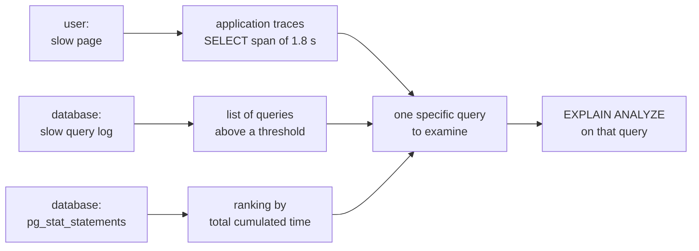

| Source | What it shows | Setting (example) |
|---|---|---|
| traces (OpenTelemetry, APM) | which page or call is slow, and which SQL query inside that call | driver or ORM instrumentation |
| slow query log | every query longer than a threshold, with its text | MySQL: `slow_query_log = ON`, `long_query_time = 1`; PostgreSQL: `log_min_duration_statement = 1000` (ms) |
| `pg_stat_statements` (PostgreSQL), `performance_schema` (MySQL) | every query grouped by shape, with call count and cumulated time | extension enabled in `shared_preload_libraries` |
| `auto_explain` (PostgreSQL) | the execution plan of slow queries, written to the logs | `auto_explain.log_min_duration = 1000` |

``` { .sql .ex-bad title="Avoid" }
-- Avoid: rank by average duration
SELECT calls, round(mean_exec_time, 1) AS mean_ms, left(query, 60) AS query
FROM pg_stat_statements
ORDER BY mean_exec_time DESC
LIMIT 3;
```

``` { .sql .ex-good title="Recommended" }
-- Good: rank queries by total cumulative time, not by average duration
SELECT calls,
       round(total_exec_time) AS total_ms,
       round(mean_exec_time, 1) AS mean_ms,
       left(query, 60) AS query
FROM pg_stat_statements
ORDER BY total_exec_time DESC
LIMIT 3;
```
``` { .text .ex-ref title="Reference" }
 calls   | total_ms | mean_ms | query
---------+----------+---------+------------------------------------------------------------
 2100000 |  6300000 |     3.0 | SELECT * FROM orders WHERE customer_id = $1
      40 |    96000 |  2400.0 | SELECT country, SUM(total_cents) FROM orders GROUP BY coun
    9000 |    45000 |     5.0 | UPDATE orders SET status = $1 WHERE id = $2
```
Example numbers. The top query only takes 3 ms, but it runs 2 million times: it is the one keeping the database busy. The 2.4 s report stands out more in the slow query log, yet weighs 65 times less. Ranked by average duration, the list puts that report on top and pushes the 3 ms query to the bottom: I optimise the report, and the database stays just as busy.

!!! noob "As noob"
    A slow query is not necessarily the most expensive one. Rank by **total time** first (mean duration x number of calls): saving 2 ms on a query called a million times pays more than saving 2 s on a report run once a day.

**Risks.** A threshold that is too low (`log_min_duration_statement = 0`) writes every query to the logs: the disk fills up, and the logs cost more than they bring. Logged query texts can contain personal data, like an email in a `WHERE`: I set the log retention and I prefer the normalized forms of `pg_stat_statements`, where values are replaced by `$1`.

:material-book-open-variant: Reference docs: [PostgreSQL, pg_stat_statements](https://www.postgresql.org/docs/current/pgstatstatements.html) (version 18, 2025); [MySQL, The Slow Query Log](https://dev.mysql.com/doc/refman/8.4/en/slow-query-log.html) (MySQL 8.4); [PostgreSQL, auto_explain](https://www.postgresql.org/docs/current/auto-explain.html) (version 18, 2025)
{ .doc-ref }

### EXPLAIN
<span class="pill pill-status pill-status-ok" title="Still valid, checked November 2026">Current · 11/2026</span>

`EXPLAIN` shows how the database plans to run the <span class="term" data-term="db-query">query</span>, without running it.
``` { .sql .ex-ref title="Reference" }
-- Example: see the planned execution, without running the query
EXPLAIN SELECT * FROM orders WHERE customer_id = 7;
```
``` { .text .ex-ref title="Reference" }
type: ALL    rows: 2,400,000     the database reads the whole table: no index used
```
After `CREATE INDEX idx_orders_customer ON orders (customer_id);`:
``` { .text .ex-ref title="Reference" }
type: ref    rows: 14            the database goes straight to the customer's 14 rows
```
`EXPLAIN ANALYZE` (PostgreSQL, MySQL 8) actually runs it and gives the real timings.

The outputs above are MySQL's. PostgreSQL says the same thing with other words:

| MySQL | PostgreSQL | What it means |
|---|---|---|
| `type: ALL` | `Seq Scan on orders` | reads the whole table, row by row |
| `type: ref` | `Index Scan using idx_orders_customer` | direct access through the index |
| `rows: 14` | `rows=14` | estimated number of rows, not an exact count |

**Risks.** `EXPLAIN ANALYZE` really runs the query: on an `UPDATE` or a `DELETE`, it modifies the data, so I wrap it in `BEGIN; ... ROLLBACK;`. And the plan obtained on a 100-row development database says nothing about the production one: I read it on comparable volumes.

:material-book-open-variant: Reference docs: [PostgreSQL, Using EXPLAIN](https://www.postgresql.org/docs/current/using-explain.html) (version 18, 2025); [MySQL, Optimizing Queries with EXPLAIN](https://dev.mysql.com/doc/refman/8.4/en/using-explain.html) (MySQL 8.4)
{ .doc-ref }

### When an index helps
<span class="pill pill-status pill-status-ok" title="Still valid, checked November 2026">Current · 11/2026</span>

A B-tree index, the default type in PostgreSQL and MySQL (InnoDB), is a sorted tree. For `WHERE customer_id = 7`, the database walks down from the root to the right leaf in a few reads, instead of scanning the whole table. Leaves are chained together (dotted lines), which also serves ranges (`BETWEEN`, `>=`) and `ORDER BY`.

!!! noob "As noob"
    An index is the index at the back of a book: to find "transaction", I go to the letter T then to the right page, instead of reading all 800 pages. In exchange, every page added means updating the index. The one thing to remember: **an index speeds up reads that filter on its column and slows every write a little.**

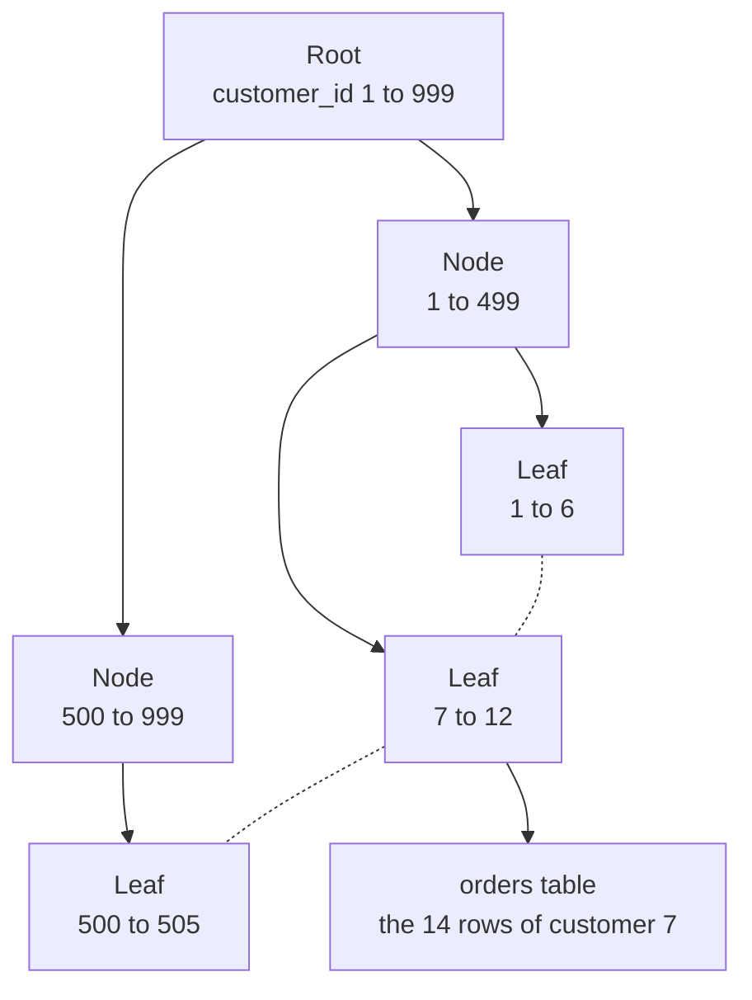

| Situation | Is an <span class="term" data-term="db-index">index</span> useful? |
|---|---|
| my queries often filter, join or sort on the same column, like `customer_id` to show a customer's orders | yes |
| the column has only a few distinct values, like `status` which is `paid`, `pending` or `cancelled`: each value covers a big share of the table | often not very useful on its own |
| the table has only a few hundred rows, reading it whole is already instant | useless |
| the table mostly receives writes and few reads, like <span class="term" data-term="logs">logs</span> or events | each index slows down writes |
| my query passes the column through a function before comparing, like `WHERE LOWER(email) = '...'` | the index on `email` is **not** used, because of the function |
| I search for the end of a text, like every email in `WHERE email LIKE '%@example.com'` | not used (the leading `%` prevents it) |

The function case is the sneakiest: the query works, just slowly, and nothing warns me. On PostgreSQL, an index on the expression itself solves it:

``` { .sql .ex-bad title="Avoid" }
-- Avoid: LOWER() on the column, the index on email is not used, the whole table is read
SELECT id FROM customers WHERE LOWER(email) = 'ada@example.com';
```

``` { .sql .ex-good title="Recommended" }
-- Good: an index on the LOWER(email) expression, which the same query uses
CREATE INDEX idx_customers_email_lower ON customers (LOWER(email));
SELECT id FROM customers WHERE LOWER(email) = 'ada@example.com';
```

:material-book-open-variant: Reference docs: [Markus Winand, Anatomy of an SQL Index](https://use-the-index-luke.com/sql/anatomy) (accessed November 2026); [PostgreSQL, Index Types](https://www.postgresql.org/docs/current/indexes-types.html) (version 18, 2025)
{ .doc-ref }

### Making a query fast: the loop
<span class="pill pill-status pill-status-ok" title="Still valid, checked November 2026">Current · 11/2026</span>

Optimizing is not guesswork: measure, change **one thing**, measure the same query again with the same parameters.

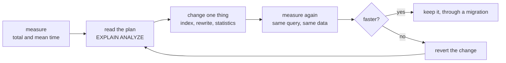

Before and after, in PostgreSQL:
``` { .text .ex-ref title="Reference" }
EXPLAIN ANALYZE SELECT id, total_cents FROM orders WHERE customer_id = 7 ORDER BY created_at DESC LIMIT 10;

Limit  (actual time=812.4..812.4 rows=10)
  ->  Sort  (actual time=812.4..812.4 rows=10)
        ->  Seq Scan on orders  (actual time=0.1..809.9 rows=14)
              Filter: (customer_id = 7)
              Rows Removed by Filter: 2399986
Execution Time: 812.6 ms
```
`CREATE INDEX CONCURRENTLY idx_orders_customer_created ON orders (customer_id, created_at DESC);`
``` { .text .ex-ref title="Reference" }
Limit  (actual time=0.04..0.06 rows=10)
  ->  Index Scan using idx_orders_customer_created on orders  (actual time=0.04..0.05 rows=10)
        Index Cond: (customer_id = 7)
Execution Time: 0.1 ms
```
The two-column index serves both the filter and the sort: no more full table read, no more sort.

| What I see in the plan | What it means | What I try |
|---|---|---|
| `Seq Scan` with many `Rows Removed by Filter` | the whole table is read to keep few rows | an index on the filtered column |
| `Sort` right after a scan, with `LIMIT` | every row is sorted to keep 10 | an index that follows the sort order |
| estimated `rows=` far from the actual `rows=` | statistics are wrong, so is the chosen plan | `ANALYZE orders;` then read the plan again |
| `Sort Method: external merge  Disk` | the sort spills from memory to disk | reduce rows before sorting, or raise `work_mem` for that query |
| `Nested Loop` with thousands of loops | a join done row by row | an index on the join column, or a rewrite |
| no slow step, but many calls | the query is fast, the application calls it too often | batch the calls (see [N+1](#the-n1-problem)), add a cache |

!!! noob "As noob"
    `EXPLAIN` is the route the GPS plans, `EXPLAIN ANALYZE` is the trip actually driven, stopwatch in hand. I look for the step where time explodes, fix it, then drive the same trip again to check.

**Risks.** The second try benefits from the cache: the same query run again right away looks faster without my change having anything to do with it. I compare measurements taken in the same conditions (several runs, warm cache on both sides). And a `CREATE INDEX` without `CONCURRENTLY` run in production "to try" blocks writes for its whole build (see [Indexes and constraints without blocking](#indexes-and-constraints-without-blocking)).

:material-book-open-variant: Reference docs: [PostgreSQL, Performance Tips](https://www.postgresql.org/docs/current/performance-tips.html) (version 18, 2025); [Markus Winand, Use The Index, Luke](https://use-the-index-luke.com/) (accessed November 2026)
{ .doc-ref }

### The N+1 problem
<span class="pill pill-status pill-status-ok" title="Still valid, checked November 2026">Current · 11/2026</span>

``` { .python .ex-bad title="Avoid" }
# Avoid: one query per order, 101 round trips (N+1)
orders = db.query("SELECT * FROM orders LIMIT 100")
for order in orders:
    customer = db.query("SELECT * FROM customers WHERE id = %s", order.customer_id)
```
1 query for the orders, then 100 for the customers: 101 <span class="term" data-term="round-trip">round trips</span>. A single query with `JOIN` does the same thing. <span class="term" data-term="orm">ORMs</span> (SQLAlchemy, Doctrine, Prisma) cause it easily: watch for it in <span class="term" data-term="trace-distributed">traces</span>, where we see 100 identical `SELECT` <span class="term" data-term="span">spans</span>.

*SQLAlchemy: complements Alembic*
{ .tool-rel }


!!! noob "As noob"
    It is like going to the supermarket once to read the shopping list, then making 100 round trips, one per item, instead of grabbing everything in one go. Each trip is short, it is their number that costs. The one thing to remember: **one query per item of a list is an N+1: group them into a single query (`JOIN` or `IN`).**

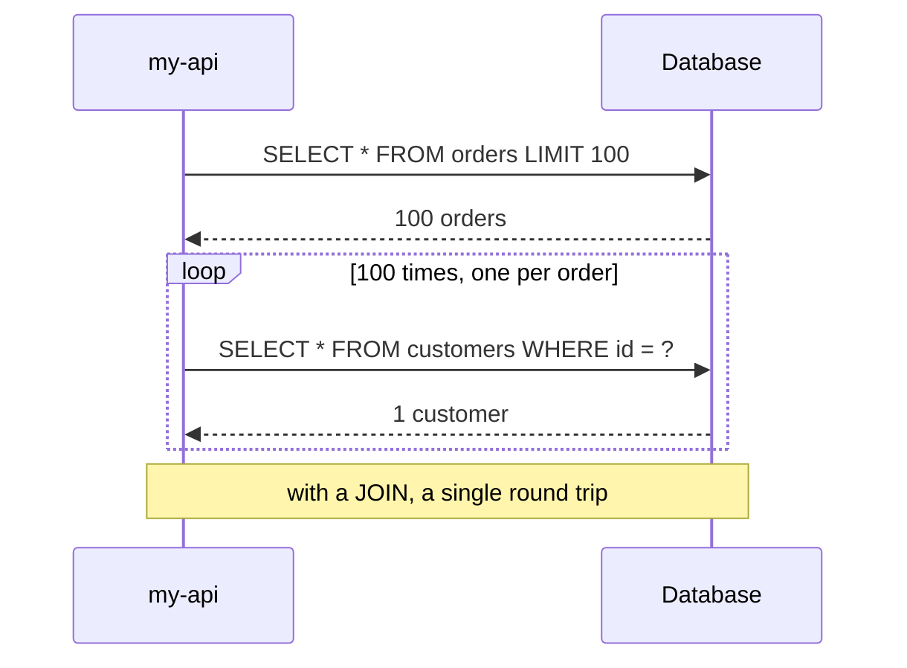

``` { .python .ex-good title="Recommended" }
# What changes: a single JOIN, a single round trip for the 100 orders and their customers
rows = db.query(
    "SELECT o.id, o.total_cents, c.email "
    "FROM orders o JOIN customers c ON c.id = o.customer_id LIMIT 100"
)
```

:material-book-open-variant: Reference docs: [Markus Winand, Nested Loops and the N+1 problem](https://use-the-index-luke.com/sql/join/nested-loops-join-n1-problem) (accessed November 2026)
{ .doc-ref }

!!! maturity "Measuring maturity"
    | Level | What I see in the team |
    |---|---|
    | N1 | when a page is slow, someone runs `EXPLAIN ANALYZE` by hand on the suspect query |
    | N2 | `pg_stat_statements` and the slow query log are enabled everywhere, and traces show the SQL query behind each slow call |
    | N3 | an alert fires by itself when a query's total time crosses a threshold, and a CI test fails if a list goes from 2 to 51 queries |
    | N4 | the team reviews the ranking by total time every month, sets a latency target per route and picks its optimizations from these numbers |

    **I measure**: the p95 duration of the SQL queries of the main routes, read in the APM; the number of SQL queries per HTTP call on list pages, read in the traces.

## ORM: accessing the database from code

<a class="pill pill-scope pill-scope-code" href="../architecture/#map-of-scales">Scale · Code</a> <a class="pill pill-scope pill-scope-app" href="../architecture/#map-of-scales">Scale · Application</a>

My team does not write all the SQL by hand: an <span class="term" data-term="orm">ORM</span> (SQLAlchemy, Doctrine, Hibernate, Eloquent, Prisma) maps code classes to tables and generates the queries. It saves time on everyday work (create, read, update an order and its items), but it hides choices that weigh on performance and on how I test. Three questions keep coming back: which family of ORM, when to switch to SQL, and when to load related data.

### Active Record or Data Mapper
<a class="pill pill-scope pill-scope-code" href="../architecture/#map-of-scales">Scale · Code</a> <span class="pill pill-status pill-status-ok" title="Still valid, checked November 2026">Current · 11/2026</span>

Martin Fowler named the two families in "Patterns of Enterprise Application Architecture" (2002):

- **<span class="term" data-term="active-record">Active Record</span>**: an object matches a row and knows how to save itself (`order.save()`). Examples: Eloquent (Laravel), Active Record (Rails), the Django ORM.
- **<span class="term" data-term="data-mapper">Data Mapper</span>**: the business object knows nothing about the database; a separate component (the session, the entity manager) reads and writes it. Examples: SQLAlchemy, Doctrine, Hibernate.

``` { .python .ex-ref title="Reference" }
# Example: Active Record (Django), the object carries its own save
order = Order.objects.get(id=42)
order.status = "paid"
order.save()

# Example: Data Mapper (SQLAlchemy), the session reads and writes an object unaware of the database
order = session.get(Order, 42)
order.status = "paid"
session.commit()
```

!!! noob "As noob"
    With Active Record, each index card knows how to file itself in the cabinet. With Data Mapper, the cards know nothing about the cabinet: the archivist files them and takes them out. The one thing to remember: **Active Record is simpler, Data Mapper separates business rules from storage.**

| | Active Record | Data Mapper |
|---|---|---|
| Strength | very little code for CRUD, one table per screen | business rules testable without a database, schema free to differ from the objects |
| Cost | the business logic depends on the database, unit tests need a database or many mocks | more code (mapping, session), learning curve |
| I choose it when | my application is mostly forms over tables, like a back office | my business rules are rich, like a pricing calculation, and I want to test them alone |

**When**: the choice often comes with the framework (Laravel, Rails, Django: Active Record; Symfony, Spring: Data Mapper). I question it when business rules grow inside objects that also run their own queries. **How**: with Data Mapper, I hide data access behind a repository (*Repository*, Eric Evans, "Domain-Driven Design", 2003), which can use the ORM or SQL.

:material-book-open-variant: Reference docs: [Martin Fowler, Active Record](https://martinfowler.com/eaaCatalog/activeRecord.html) and [Data Mapper](https://martinfowler.com/eaaCatalog/dataMapper.html) (Patterns of Enterprise Application Architecture, 2002)
{ .doc-ref }

### ORM, query builder or hand-written SQL
<a class="pill pill-scope pill-scope-code" href="../architecture/#map-of-scales">Scale · Code</a> <span class="pill pill-status pill-status-ok" title="Still valid, checked November 2026">Current · 11/2026</span>

A <span class="term" data-term="query-builder">query builder</span> builds SQL with functions of the language, without hiding that it is SQL: SQLAlchemy Core, Knex, Kysely, jOOQ, the Doctrine QueryBuilder. It keeps parameters and composition (adding a filter depending on a form), without going through objects.

My monthly report of revenue by status and by week, written with the ORM, loads 2 million orders as objects and takes 6 minutes (example figures):

``` { .python .ex-bad title="Avoid" }
# Avoid: load 2 million rows as objects to add them up in Python
totals = defaultdict(int)
for order in session.scalars(select(Order)):
    totals[(order.status, order.created_at.isocalendar().week)] += order.total_cents
```

``` { .python .ex-good title="Recommended" }
# Good: the database aggregates, the query builder keeps parameters, a few hundred rows come back
week = func.date_trunc("week", Order.created_at)
rows = session.execute(
    select(Order.status, week.label("week"), func.sum(Order.total_cents))
    .where(Order.created_at >= start)
    .group_by(Order.status, week)
).all()
```

Aggregation is the database's job: it reads the rows where they live and returns only the result.

| I want... | I use... |
|---|---|
| to create, read and update an order with its items, the everyday case of an application | the ORM |
| to build a query whose filters depend on a search form, without concatenating text | a query builder |
| to write a report that aggregates millions of rows, or a heavily used query whose plan I want to read | hand-written SQL, always parameterized (see [SQL injection](#security-sql-injection)) |

**When**: I do not set the three against each other; I set a team rule, for example "aggregation or more than three joins: SQL". **Why**: the ORM's productivity on everyday work, without its traps on heavy queries. **How**: I turn on SQL logs in development (`echo=True` in SQLAlchemy), because an ORM nobody looks at ends up generating N+1s, and I read the plan of important queries with [`EXPLAIN`](#explain). Martin Fowler sums it up in "ORM Hate" (2012): an ORM solves the everyday problem well, it does not excuse me from knowing SQL.

**Risks.** Hand-written SQL escapes the ORM's checks: a column renamed in the model breaks the query only at run time, so I cover each manual query with a test on a real database. Conversely, leaving everything to the ORM hides heavy queries until production reveals them.

:material-book-open-variant: Reference docs: [SQLAlchemy, ORM Querying Guide](https://docs.sqlalchemy.org/en/20/orm/queryguide/index.html) (version 2.0, accessed November 2026)
{ .doc-ref }

### Lazy or eager loading
<a class="pill pill-scope pill-scope-code" href="../architecture/#map-of-scales">Scale · Code</a> <span class="pill pill-status pill-status-ok" title="Still valid, checked November 2026">Current · 11/2026</span>

By default, many ORMs do <span class="term" data-term="lazy-loading">lazy loading</span> (*Lazy Load*, Fowler, 2002): `order.customer` only runs its query on first access. Handy for a single record, disastrous in a loop: it is the classic cause of the [N+1 problem](#the-n1-problem). <span class="term" data-term="eager-loading">Eager loading</span> asks the ORM to load related data upfront, in one or two queries.

``` { .python .ex-bad title="Avoid" }
# Avoid: lazy loading in a loop, one query per order to read its customer
orders = session.scalars(select(Order).limit(50)).all()
for order in orders:
    print(order.customer.email)
```

``` { .python .ex-good title="Recommended" }
# Good: eager loading, the customer through a join, the items through a second IN query
orders = session.scalars(
    select(Order)
    .options(joinedload(Order.customer), selectinload(Order.items))
    .limit(50)
).all()
```

The first version runs 51 queries (101 if I also show the items); the second runs 2, whatever the number of orders. `joinedload` fits a "single" relation (an order has one customer); `selectinload` fits a collection (an order has items), so the join does not multiply rows. The equivalents: `JOIN FETCH` in Hibernate and Doctrine, `with()` in Eloquent, `include` in Prisma.

**When**: eager loading as soon as I show a list with related data; lazy loading for a rarely read relation on a single record. **How**: I can forbid lazy loading where it is dangerous (`lazy="raise"` in SQLAlchemy raises an error instead of running a hidden query), and I write a test that renders the list with 5 then 50 orders and checks that the number of queries does not change.

**Risks.** Eager loading applied everywhere loads data the screen does not show: a customer page that loads every item of every order in advance brings back thousands of useless rows. I add it list by list, based on what each screen shows.

:material-book-open-variant: Reference docs: [SQLAlchemy, Relationship Loading Techniques](https://docs.sqlalchemy.org/en/20/orm/queryguide/relationships.html) (version 2.0, accessed November 2026)
{ .doc-ref }

!!! maturity "Measuring maturity"
    | Level | What I see in the team |
    |---|---|
    | N1 | everyone writes data access as they like, ORM or SQL, and SQL logs are only looked at when something is slow |
    | N2 | a written team rule says when to switch to SQL, SQL logs are on in development, and eager loading is asked for in review on every list |
    | N3 | lazy loading is forbidden where it is dangerous (`lazy="raise"`) and a test counts queries, so an N+1 breaks CI without a human review |
    | N4 | the team tracks the number of N+1 found and the share of slow queries generated by the ORM, and adjusts its ORM or SQL rule from these numbers |

    **I measure**: the number of tests that check a query count, counted in the repository; the share of the top 10 `pg_stat_statements` queries generated by the ORM, read by cross-checking with traces.

## Scaling a database

<a class="pill pill-scope pill-scope-system" href="../architecture/#map-of-scales">Scale · System</a> <a class="pill pill-scope pill-scope-infra" href="../architecture/#map-of-scales">Scale · Infrastructure</a>

<a class="pill pill-practice" href="../livraison/#design-before-coding">Practice · Technical design</a>

A database "saturates" when it can no longer keep up: queries getting slower and slower, CPU at 90%, disk full, too many connections. The temptation is to jump straight to the most impressive solution (spreading the data over several machines). In practice, we climb a ladder: we start with what is cheap and easy to undo, and only go to the next rung when the measurements call for it.

### Two meanings of "vertical" and "horizontal"

Both words are used for two different things. Mixing them up is the most common mistake.

| | Vertical | Horizontal |
|---|---|---|
| **The machine** | <span class="term" data-term="vertical-scaling">scale up</span>: the same database on a bigger machine (more CPUs, more memory, a faster disk) | <span class="term" data-term="horizontal-scaling">scale out</span>: several machines (read copies, or a slice of the data on each machine) |
| **The data** | <span class="term" data-term="vertical-partitioning">vertical partitioning</span>: split by columns or by domain (heavy columns in another table, the catalog and the orders in two databases) | horizontal partitioning: split by rows (October orders on one side, November orders on the other) |

Horizontal partitioning can stay on a single machine (table partitioning) or spread over several: that is <span class="term" data-term="sharding">sharding</span>.

### The ladder, from cheapest to most expensive

| Step | What it fixes | Cost | Rollback |
|---|---|---|---|
| 1. Queries and indexes | slowness caused by a badly written or unindexed query | low | easy |
| 2. Connection pooler | too many open connections | low | easy |
| 3. Cache | the same reads repeated | medium (invalidation) | easy |
| 4. Bigger machine | CPU, memory or disk maxed out | money, one restart | easy |
| 5. Read replicas | many more reads than writes | medium (stale data) | easy |
| 6. Table partitioning | huge tables, heavy indexes | medium | possible |
| 7. Archiving cold data | volume that grows without being read | medium | possible |
| 8. Sharding | writes or volume beyond the biggest machine | very high | nearly impossible |

### Queries, indexes, connections and cache
<span class="pill pill-status pill-status-ok" title="Still valid, checked November 2026">Current · 11/2026</span>

Before paying for a machine, check what it is doing. The [Performance](#performance) section above covers the essentials: `EXPLAIN`, a missing index, the N+1 problem. On PostgreSQL, the `pg_stat_statements` extension lists the queries that consume the most total time; often, three queries make up half of the load.

``` { .sql .ex-ref title="Reference" }
-- Example: the 3 queries that use the most total time
SELECT calls, round(total_exec_time) AS total_ms, round(mean_exec_time) AS mean_ms, query
FROM pg_stat_statements ORDER BY total_exec_time DESC LIMIT 3;
```
``` { .text .ex-ref title="Reference" }
 calls  | total_ms | mean_ms | query
--------+----------+---------+------------------------------------------------
 912000 |  1824000 |       2 | SELECT * FROM orders WHERE customer_id = $1
   1400 |   980000 |     700 | SELECT ... FROM invoices JOIN orders ... GROUP BY
     12 |   310000 |   25833 | UPDATE products SET stock = ...
```
The first one is fast but called very often (probably an N+1), the second one is slow on every call (time for an `EXPLAIN ANALYZE`). Example numbers; the `total_exec_time` and `mean_exec_time` columns are those of PostgreSQL 13 and later (before: `total_time`, `mean_time`).

Next, connections. Each PostgreSQL connection is a process that costs memory. Twenty instances of my-api with 50 connections each make 1,000 connections (example). A <span class="term" data-term="connection-pooler">connection pooler</span> (PgBouncer, or the hosting provider's) shares them:

``` { .text .ex-illus title="Illustration" }
my-api (20 instances x 50 connections) ──> PgBouncer ──> PostgreSQL (100 real connections)
```

!!! noob "As noob"
    It is a company switchboard: 1,000 employees, but 100 outside lines, because nobody is on the phone all the time. The switchboard lends a free line to whoever needs one and takes it back as soon as they hang up. The line to remember: **the pooler shares a few real connections among many clients that only use them for a moment.**

Finally, a <span class="term" data-term="cache-data">cache</span> (Redis, or the application's memory) avoids reading the same product sheet a hundred times. The price: deciding when the cached data becomes wrong.

*Redis: complements PostgreSQL, MySQL*
{ .tool-rel }


:material-book-open-variant: Reference docs: [PostgreSQL, pg_stat_statements](https://www.postgresql.org/docs/current/pgstatstatements.html) (version 18, 2025)
{ .doc-ref }

### Database proxies and poolers
<span class="pill pill-status pill-status-ok" title="Still valid, checked November 2026">Current · 11/2026</span>

The pooler from the previous section does only one thing: share connections. A <span class="term" data-term="database-proxy">database proxy</span> sits in the same place, between the application and the database, but understands the queries: it sends reads to replicas and writes to the primary, switches to a new primary on its own, and can block or rewrite a query.

A plain pooler only does the left part of the drawing; a proxy also sorts traffic between primary and replicas:

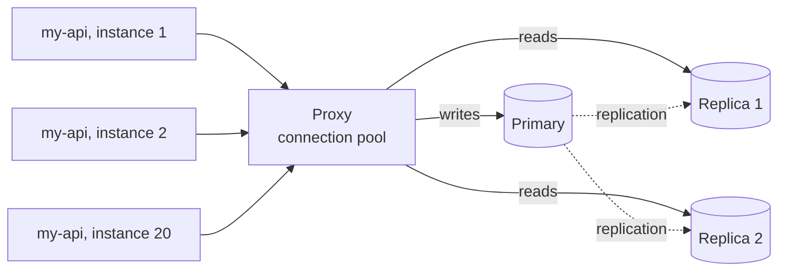

| Tool | For which database | What it does |
|---|---|---|
| PgBouncer | PostgreSQL | lightweight pooler, nothing else |
| ProxySQL | MySQL, MariaDB | pooler, rule-based read/write routing, query cache, failover |
| Pgpool-II, PgCat | PostgreSQL | pooler and read load balancing (to check depending on the version) |
| the provider's proxy (RDS Proxy, Cloud SQL connector) | managed database | pooler or secure connection, run by the provider (features to check) |

**When**: I have many instances of my-api or serverless functions, and each opens its own connections; the database refuses connections (`too many connections`) while its CPU is quiet; or I have read replicas the application cannot use on its own. **Not yet**: my application runs on a few instances with a well-tuned internal pool (the ORM's or the driver's): one more component to monitor brings me nothing.

**Why**: a PostgreSQL connection costs a process and several megabytes of memory; a thousand idle connections weigh as much as queries. The gain: the database keeps a fixed number of connections whatever the application does. The cost: one more hop (to be doubled so it does not become a <span class="term" data-term="spof">single point of failure</span>), a few tenths of a millisecond of latency (order of magnitude, to check), and session features that break depending on the mode.

**How**, with PgBouncer: the **mode** decides when a real connection goes back to the pool.

*PgBouncer: complements PostgreSQL*
{ .tool-rel }


| Mode | Connection returned | Saving | What breaks |
|---|---|---|---|
| `session` | when the client disconnects | small | nothing |
| `transaction` | at the end of each transaction | large | session `SET`, advisory locks, `LISTEN`, temporary tables; prepared statements before PgBouncer 1.21 (2023, to check) |
| `statement` | after each query | maximum | any multi-statement transaction |

``` { .ini .ex-ref title="Reference" }
# Example: the database PgBouncer forwards connections to
[databases]
orders = host=orders-db.internal port=5432 dbname=orders

# Example: transaction mode, 2,000 client connections for 50 real ones
[pgbouncer]
listen_port = 6432
pool_mode = transaction
max_client_conn = 2000
default_pool_size = 50
```
The my-api instances connect to port 6432 instead of 5432; 2,000 connections on the application side become 50 real connections per database and user pair (example values).

With ProxySQL, routing is configured through rules in its admin interface, which speaks the MySQL protocol. Here, `SELECT ... FOR UPDATE` goes to the primary (group 10), other `SELECT` statements to the replicas (group 20), everything else to the user's default group, the primary:
``` { .sql .ex-ref title="Reference" }
-- Example: FOR UPDATE to the primary (group 10), other SELECTs to the replicas (20)
INSERT INTO mysql_query_rules (rule_id, active, match_digest, destination_hostgroup, apply)
VALUES (1, 1, '^SELECT.*FOR UPDATE', 10, 1),
       (2, 1, '^SELECT', 20, 1);
-- Example: apply the rules now, then keep them after a restart
LOAD MYSQL QUERY RULES TO RUNTIME;
SAVE MYSQL QUERY RULES TO DISK;
```
The trap: a read right after a write goes to a lagging replica, and the user does not see what they just saved (see [Read replicas](#read-replicas)). Reads that must see the latest write stay on the primary, through a rule or a comment in the query.

### A bigger machine
<span class="pill pill-status pill-status-ok" title="Still valid, checked November 2026">Current · 11/2026</span>

Going from 16 to 32 CPUs takes one restart at most hosting providers, without changing a line of code. It is often the best effort/gain ratio, as long as a bigger machine exists. Limit: the bottleneck is not always the CPU. If queries wait for locks (<span class="term" data-term="lock-contention">lock contention</span>), doubling the machine changes almost nothing.

### Read replicas
<span class="pill pill-status pill-status-ok" title="Still valid, checked November 2026">Current · 11/2026</span>

A <span class="term" data-term="read-replica">read replica</span> is a copy of the database, kept up to date by <span class="term" data-term="replication">replication</span>, that answers reads. All writes still go to the primary. The trap: the copy lags behind, the <span class="term" data-term="replication-lag">replication lag</span>.

!!! noob "As noob"
    A replica is a photocopy of a ledger kept up to date by a courier: several people can read it to spare the original, but the courier always lags a little, and what was just written in the original may not be there yet. The one thing to remember: **reading from a replica means accepting slightly old data.**

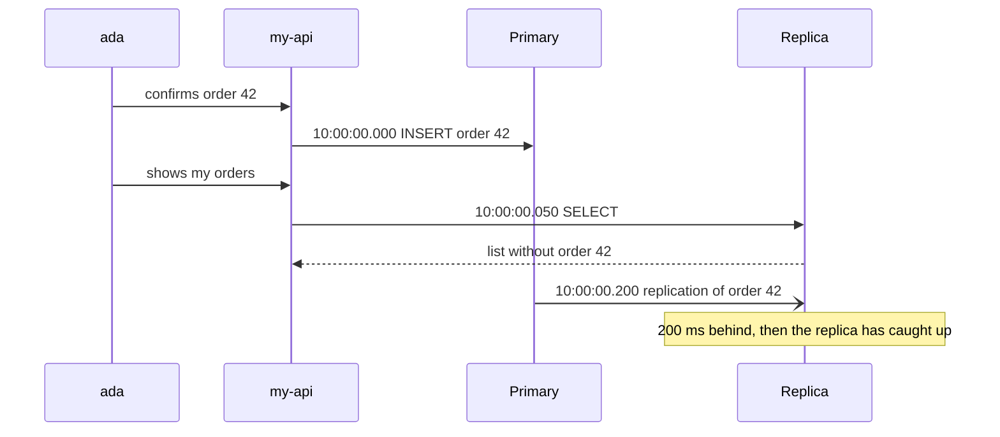

Countermeasure: read from the primary right after a write by the user ("read your own writes"), and monitor the lag as a metric in its own right. On the test side: a test that writes then reads back through a replica can fail randomly.

:material-book-open-variant: Reference docs: [PostgreSQL, High Availability, Load Balancing, and Replication](https://www.postgresql.org/docs/current/high-availability.html) (version 18, 2025); [MySQL, Replication](https://dev.mysql.com/doc/refman/8.4/en/replication.html) (MySQL 8.4)
{ .doc-ref }

### Partitioning a table
<span class="pill pill-status pill-status-ok" title="Still valid, checked November 2026">Current · 11/2026</span>

<span class="term" data-term="table-partitioning">Table partitioning</span> splits a big table into several physical tables, on the same machine. The application keeps writing `SELECT ... FROM orders`; the database only reads the relevant partitions. PostgreSQL does it natively since version 10 (2017), with "declarative" partitioning:

!!! noob "As noob"
    Partitioning is filing invoices in a binder with one tab per month instead of a single pile: for November, I only open the November tab. Everything stays in the same cabinet (the same machine), and the application still sees one binder. The one thing to remember: **partitioning only helps if queries filter on the partition column.**

``` { .sql .ex-ref title="Reference" }
-- Example: parent table partitioned by date, created_at is part of the primary key
CREATE TABLE orders (
    id           bigint      NOT NULL,
    customer_id  bigint      NOT NULL,
    status       text        NOT NULL,
    total_cents  bigint      NOT NULL,
    created_at   timestamptz NOT NULL,
    PRIMARY KEY (id, created_at)
) PARTITION BY RANGE (created_at);

-- Example: one partition per month, created in advance
CREATE TABLE orders_2026_10 PARTITION OF orders
    FOR VALUES FROM ('2026-10-01') TO ('2026-11-01');
CREATE TABLE orders_2026_11 PARTITION OF orders
    FOR VALUES FROM ('2026-11-01') TO ('2026-12-01');
```

``` { .sql .ex-bad title="Avoid" }
-- Avoid: the function on created_at prevents pruning, every partition is read
EXPLAIN SELECT * FROM orders WHERE date_trunc('month', created_at) = '2026-11-01';
```

``` { .sql .ex-good title="Recommended" }
-- Good: the filter is on the partition column, only November is read
EXPLAIN SELECT * FROM orders WHERE created_at >= '2026-11-01';
```
``` { .text .ex-ref title="Reference" }
Seq Scan on orders_2026_11      a single partition read, October is skipped
```

This automatic skipping is called <span class="term" data-term="partition-pruning">partition pruning</span>. Two rules: the partition column must be part of the primary key, and queries must filter on it, otherwise the database reads every partition. Partitions must also be created ahead of time (a monthly job, or the `pg_partman` extension).

**Risks.** If the job that creates partitions in advance stops, the first order of the next month has no partition to go to and the `INSERT` fails; with a default partition, rows pile up there silently and pruning stops helping. I monitor the number of future partitions and alert when less than two months of headroom remain.

### Archiving cold data
<span class="pill pill-status pill-status-ok" title="Still valid, checked November 2026">Current · 11/2026</span>

<span class="term" data-term="cold-data">Cold data</span> (orders older than two years, past logs) weighs down indexes and backups without being read. With a table partitioned by month, archiving becomes simple:

``` { .sql .ex-bad title="Avoid" }
-- Avoid: detach without CONCURRENTLY
ALTER TABLE orders DETACH PARTITION orders_2024_01;
```

``` { .sql .ex-good title="Recommended" }
-- Good: detach a partition to archive it, without blocking running queries
ALTER TABLE orders DETACH PARTITION orders_2024_01 CONCURRENTLY;
```
Without `CONCURRENTLY`, the `ALTER` asks for an exclusive lock on `orders`: it waits for a running report to finish, and every new read of `orders` queues behind it, so the "My orders" page keeps spinning.

The detached partition becomes a normal table, which we export to cheaper storage and then drop. `DETACH ... CONCURRENTLY` exists since PostgreSQL 14 (2021) and does not block running queries. Without partitions, a batched `DELETE` is needed, much slower.

!!! noob "As noob"
    It is moving the boxes of past years down to the cellar: the office stays clear, I find this year's files faster, and the old boxes can still be opened if needed, just more slowly. The line to remember: **what nobody reads any more should not weigh down everyday indexes and backups.**

**Risks.** Dropping an archived partition is final: if the export was incomplete, or if a legal obligation requires keeping those orders, they are lost. I check the export (row count, reading back a sample) before dropping, and I confirm the retention period with the business.

### Sharding, last
<span class="pill pill-status pill-status-ok" title="Still valid, checked November 2026">Current · 11/2026</span>

Sharding spreads the rows of one table over several databases. It is the only step that really increases **write** capacity, and the hardest to undo. Four points decide whether it succeeds.

!!! noob "As noob"
    Sharding is opening several branches instead of enlarging the head office: each customer belongs to one branch according to a rule (their number, for example). It multiplies the counters, but any question about all customers means calling every branch. The one thing to remember: **sharding adds write capacity, at the cost of much harder queries and transactions across machines.**

**The shard key.** The <span class="term" data-term="partition-key">partition key</span> decides which database each row goes to. We pick it from the dominant query: if 95% of queries filter on `customer_id` (example), that is the one. Once chosen, changing the key means rewriting all the data.

**The hot shard.** If one customer places 15% of the orders, its shard saturates while the others sleep: that is a <span class="term" data-term="hot-key">hot key</span>. Give it a dedicated database, or add a second element to the key.

**Cross-shard queries.** A join or a report over all customers becomes a <span class="term" data-term="cross-shard-query">cross-shard query</span>: query every database, then merge. Transactions across two shards lose the simple ACID guarantees. Reports therefore move to a <span class="term" data-term="data-warehouse">data warehouse</span>.

**Resharding.** Going from 4 to 8 databases means moving data: <span class="term" data-term="resharding">resharding</span>. The classic trick: many <span class="term" data-term="logical-shard">logical shards</span> (256, for example) spread over few databases, and a <span class="term" data-term="shard-router">routing layer</span> that holds the mapping table. We then move whole shards, without recomputing the location of each row.

``` { .python .ex-bad title="Avoid" }
# Avoid: the database computed straight from the number of databases
def shard_db(customer_id: int) -> str:
    return f"orders-db-{customer_id % 4}"
```

``` { .python .ex-good title="Recommended" }
# Good: many logical shards on few databases, movable as a whole
LOGICAL_SHARDS = 256

# Example: the logical shard is computed from the sharding key
def logical_shard(customer_id: int) -> int:
    return customer_id % LOGICAL_SHARDS

# Example: placement table, 64 shards per database; going to 8 databases changes only it
placement = {shard: f"orders-db-{shard // 64}" for shard in range(LOGICAL_SHARDS)}
```

With `customer_id % 4`, going to 8 databases changes the database of half the customers: until their rows are copied, `my-api` looks in the new database and the customer sees an empty order history.

The path of a query for customer 1234: the routing layer computes the logical shard, then the placement table gives the database. Going from 4 to 8 databases only changes that table.

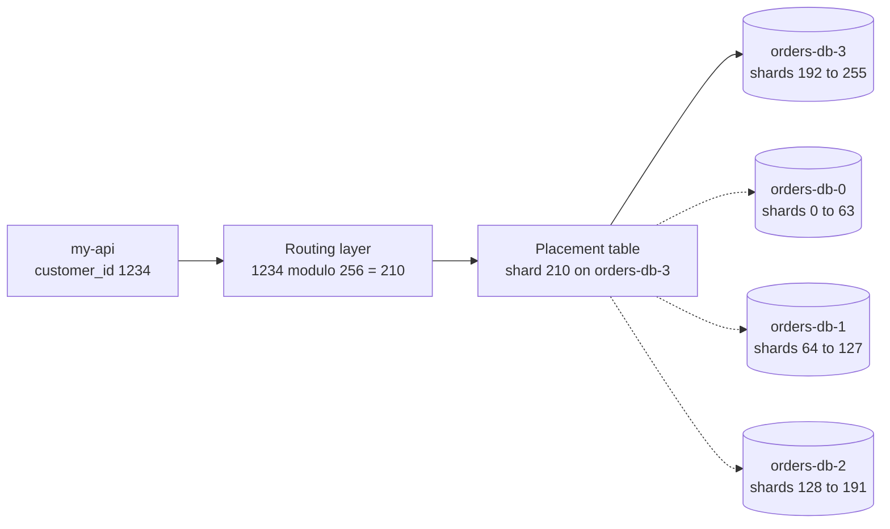

Rather than writing this routing in-house, tools provide it on top of a well-known database: Vitess for MySQL, Citus for PostgreSQL. Another option is <span class="term" data-term="distributed-sql">distributed SQL</span> (CockroachDB, YugabyteDB, Spanner): the database spreads and rebalances on its own, with transactions across machines, at the cost of higher write latency and incomplete SQL compatibility (to check for each product).

*Vitess: partly competes with Citus, CockroachDB, YugabyteDB, Spanner; complements MySQL*<br>
*Citus: partly competes with Vitess, CockroachDB, YugabyteDB, Spanner; complements PostgreSQL*<br>
*CockroachDB: competes with YugabyteDB, Spanner; partly competes with Vitess, Citus*<br>
*YugabyteDB: competes with CockroachDB, Spanner*<br>
*Spanner: competes with CockroachDB, YugabyteDB*
{ .tool-rel }


### I want... I use...

| I want... | I use... |
|---|---|
| to know which query really keeps the database busy, before touching anything | `pg_stat_statements`, then `EXPLAIN ANALYZE` |
| to run more instances of my-api without the database refusing connections with `too many connections` | a connection pooler (PgBouncer) |
| to send reads to the replicas and writes to the primary, without changing the application code | a database proxy (ProxySQL for MySQL) |
| to stop reading the same data a hundred times, like the same product page shown on every visit | a cache, with an invalidation rule |
| to gain headroom fast, without touching the code, because the CPU or memory is maxed out | a bigger machine |
| to handle far more reads than writes, like a catalog viewed a thousand times for each order placed | read replicas, handling the lag |
| to lighten a huge table, like years of orders that queries almost always filter by date | table partitioning, by date most of the time |
| to get rid of old data nobody reads anymore, like orders older than two years | detach and archive old partitions |
| heavy reports that no longer slow down the database the application needs | a data warehouse fed continuously |
| to write more than the biggest machine can take | sharding (Vitess, Citus) or distributed SQL |

References: PostgreSQL documentation, [Table Partitioning](https://www.postgresql.org/docs/current/ddl-partitioning.html) chapter (version 18, 2025); Martin Kleppmann, "Designing Data-Intensive Applications", chapters 5 and 6 (2017); [PgBouncer, configuration documentation](https://www.pgbouncer.org/config.html) and [ProxySQL, query rules](https://proxysql.com/documentation/proxysql-read-write-split-howto/) (publication dates not given, to check); [Vitess](https://vitess.io/docs/) and [Citus](https://docs.citusdata.com/) (publication dates not given, to check).

!!! maturity "Measuring maturity"
    | Level | What I see in the team |
    |---|---|
    | N1 | when the database saturates, the team upsizes the machine without knowing which query loads it |
    | N2 | the team tracks CPU, connections, replication lag and table sizes, and each move to the next step of the ladder is written in an architecture decision |
    | N3 | the pooler shields the database from connection spikes by itself, next month's partitions are created by a job, and an alert fires on replication lag |
    | N4 | the team projects growth (volume, writes per second) from its measurements and decides on the next step months before saturation |

    **I measure**: the remaining headroom, like CPU at peak and connections relative to the maximum, read in the database monitoring; the p99 replication lag, read in the replica metrics.

## Zero-downtime schema migrations

<a class="pill pill-scope pill-scope-app" href="../architecture/#map-of-scales">Scale · Application</a> <a class="pill pill-scope pill-scope-infra" href="../architecture/#map-of-scales">Scale · Infrastructure</a>

<a class="pill pill-practice" href="../livraison/#continuous-delivery-and-deployment">Practice · Continuous deployment</a>
<a class="pill pill-dora" href="https://dora.dev/capabilities/database-change-management/">DORA · Database change management</a>

The problem: my team ships with progressive <span class="term" data-term="continuous-deployment">continuous deployment</span>, so for a few minutes the old and the new version of the application run **at the same time** on the same schema. If my migration breaks either of them, for example by renaming a column the old version still reads, production crashes. And if my migration takes a lock on a big table, every query on that table waits, so the application looks frozen.

### Expand / contract
<span class="pill pill-status pill-status-ok" title="Still valid, checked November 2026">Current · 11/2026</span>

<span class="term" data-term="expand-contract">Expand / contract</span> (or *parallel change*, described by Danilo Sato in 2014) splits a breaking change into steps that both versions support:

1. **Expand**: add the new thing next to the old one;
2. **Migrate**: write to both, copy the existing data, switch the reads;
3. **Contract**: remove the old thing, once nothing uses it anymore.

Each step is a separate deployment, reversible until the contract.

!!! noob "As noob"
    It is replacing a bridge without closing the road: build the new one alongside, send traffic over both, then over the new one only, and tear down the old one once nobody uses it. The one thing to remember: **never a breaking change in one go: add, switch, then remove.**

Applied to the example below, each box is one deployment:

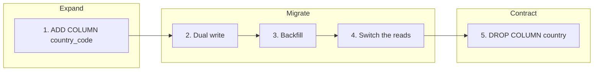

**Risks.** A forgotten contract leaves two columns forever, and the dual write ends up diverging the day new code writes only one of them. Each expand opens a contract ticket with a date. The cost: five deployments instead of one, so I keep the method for breaking changes.

### Example: renaming `customers.country` to `customers.country_code`

`ALTER TABLE customers RENAME COLUMN country TO country_code;` is instant, but the instances still on the old version read `country` and crash the second it runs. Instead:

| Deployment | Database | Application |
|---|---|---|
| 1. Expand | `ALTER TABLE customers ADD COLUMN country_code text;` | unchanged |
| 2. Dual write | no change | writes `country` and `country_code`, reads `country` |
| 3. Backfill | batched copy (below) | unchanged |
| 4. Switch the reads | no change | reads `country_code` (behind a <span class="term" data-term="feature-flag">feature flag</span>), writes both |
| 5. Contract | `ALTER TABLE customers DROP COLUMN country;` | only writes `country_code` |

Step 2 on the application side, in the same statement:
``` { .python .ex-good title="Recommended" }
# What changes: also writes country_code, on top of country, in the same query
def update_country(conn, customer_id: int, code: str) -> None:
    conn.execute(
        "UPDATE customers SET country = %s, country_code = %s WHERE id = %s",
        (code, code, customer_id),
    )
```
If version 1 (which only writes `country`) is still running during the deployment, its writes leave `country_code` empty: the backfill of step 3 catches up on those rows.

Between step 4 and step 5, wait until no deployed version reads `country` anymore (a few stable days, for example).

### Batched backfill
<span class="pill pill-status pill-status-ok" title="Still valid, checked November 2026">Current · 11/2026</span>

The <span class="term" data-term="backfill">backfill</span> copies the existing rows. A single `UPDATE` over 40 million rows (example) would hold locks for a long time and blow up the replica lag. Split it:

``` { .sql .ex-bad title="Avoid" }
-- Avoid: a single UPDATE on 40 million rows, locks held for a long time and replicas lagging
UPDATE customers SET country_code = country WHERE country_code IS NULL;
```

``` { .sql .ex-good title="Recommended" }
-- Good: copy in batches of 5,000 rows, repeated until zero rows change
UPDATE customers
SET country_code = country
WHERE id IN (
    SELECT id FROM customers
    WHERE country_code IS NULL AND country IS NOT NULL
    ORDER BY id
    LIMIT 5000
);
```

A job repeats this query, with a short pause between batches, until zero rows are modified. Then a check: `SELECT COUNT(*) FROM customers WHERE country_code IS DISTINCT FROM country;` must return 0 before step 4. `IS DISTINCT FROM` compares while treating `NULL` as a value: `NULL = 'FR'` gives `NULL` (the row would be missed), whereas `NULL IS DISTINCT FROM 'FR'` gives `true` (the row is counted).

!!! noob "As noob"
    It is moving a library box by box instead of blocking the staircase for a whole day with one huge load: between two boxes, the neighbours can get through. The line to remember: **I copy in small batches, with a pause, and check at the end that no row was forgotten.**

**Risks.** Without an index covering the condition (`country_code IS NULL`), each batch rereads the rows already copied and the job slows down batch after batch. A job stopped midway leaves rows not copied: it must be able to resume where it stopped, and the final check query stays mandatory.

### Locks: lock_timeout
<span class="pill pill-status pill-status-ok" title="Still valid, checked November 2026">Current · 11/2026</span>

An `ALTER TABLE` asks for an exclusive <span class="term" data-term="db-lock">lock</span>. If it waits behind a long query, every query arriving after it waits too: the table looks blocked, while the migration has not done anything yet. The <span class="term" data-term="lock-timeout">lock timeout</span> cuts it short:

!!! noob "As noob"
    I think of a queue at a counter: the migration wants the counter all to itself, waits behind a very slow customer, and everyone arriving after it waits too, even those who needed just a second. `lock_timeout` tells it: "if you do not get the counter within 2 seconds, leave the queue and come back later". The one thing to remember: **a migration waiting for a lock blocks everyone behind it.**

``` { .sql .ex-bad title="Avoid" }
-- Avoid: with no wait limit, the ALTER waits behind the long query and blocks the whole queue
ALTER TABLE customers ADD COLUMN country_code text;
```

``` { .sql .ex-good title="Recommended" }
-- Good: give up if the lock is not acquired within 2 seconds
SET lock_timeout = '2s';
-- Example: step 1 (expand), add the new column
ALTER TABLE customers ADD COLUMN country_code text;
```

If the lock is not obtained within 2 seconds, the migration fails cleanly and we run it again later. Better a migration that fails than a frozen production.

The lock queue, and what `lock_timeout` changes:

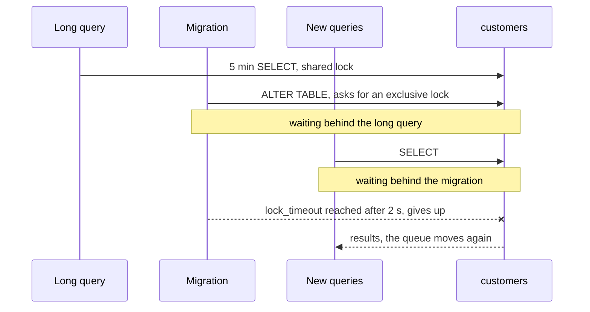

**Risks.** With a short `lock_timeout`, the migration can fail on every attempt if the table is constantly busy with long queries: it needs an automatic retry with a pause, or a quieter time. Without `lock_timeout`, it is the opposite risk: all of production waits behind the migration.

:material-book-open-variant: Reference docs: [PostgreSQL, Explicit Locking](https://www.postgresql.org/docs/current/explicit-locking.html) (version 18, 2025); [PostgreSQL, Client Connection Defaults (lock_timeout)](https://www.postgresql.org/docs/current/runtime-config-client.html) (version 18, 2025)
{ .doc-ref }

### Indexes and constraints without blocking
<span class="pill pill-status pill-status-ok" title="Still valid, checked November 2026">Current · 11/2026</span>

A classic `CREATE INDEX` blocks writes on the table for its whole build. The non-blocking version:

``` { .sql .ex-bad title="Avoid" }
-- Avoid: plain CREATE INDEX, writes on customers wait for the whole build
CREATE INDEX idx_customers_country_code ON customers (country_code);
```

``` { .sql .ex-good title="Recommended" }
-- Good: builds the index without blocking writes
CREATE INDEX CONCURRENTLY idx_customers_country_code ON customers (country_code);
```

It is slower, cannot run inside a transaction, and leaves an index marked `INVALID` if it fails: drop it and start again.

!!! noob "As noob"
    A plain `CREATE INDEX` is closing a road to resurface it: fast, but nobody gets through. `CONCURRENTLY` is resurfacing it lane by lane while traffic keeps moving: slower, and if the work stops halfway, I first have to clear the unfinished site (the `INVALID` index) before starting again. The line to remember: **on a production table, I build indexes without blocking writes.**

For a constraint, same idea in two steps, with a <span class="term" data-term="not-valid-constraint">NOT VALID constraint</span>:

``` { .sql .ex-good title="Recommended" }
-- Good: instant, the constraint applies to new writes only
ALTER TABLE customers
    ADD CONSTRAINT customers_country_code_not_null CHECK (country_code IS NOT NULL) NOT VALID;

-- Good: then checks existing rows, with a light lock
ALTER TABLE customers VALIDATE CONSTRAINT customers_country_code_not_null;
```

The first command is instant and applies to new writes; the second checks the existing rows with a light lock that lets reads and writes through. Since PostgreSQL 12 (2019), a `SET NOT NULL` run afterwards reuses this validated constraint and does not scan the table again (to check on my version).

### Schema migration tools
<span class="pill pill-status pill-status-ok" title="Still valid, checked November 2026">Current · 11/2026</span>

The steps above say **what** to change and in which order. A <span class="term" data-term="schema-migration-tool">schema migration tool</span> takes care of **when** and **where**: it stores each change in a versioned file, records in a database table which ones have already run, and applies the next ones in order, the same way locally, in staging and in production.

| Tool | Ecosystem | Migration format | History table |
|---|---|---|---|
| Flyway | Java, or any language through its CLI | numbered SQL files (`V7__add_country_code.sql`) | `flyway_schema_history` |
| Liquibase | Java, or CLI | *changesets* in SQL, YAML, XML or JSON, with rollback and preconditions | `databasechangelog` |
| Alembic | Python, with SQLAlchemy | chained Python files (`down_revision`), autogeneration from the models | `alembic_version` |
| Doctrine Migrations | PHP, often with Symfony | PHP classes, generated by diffing against the entities | `doctrine_migration_versions` |

Other frameworks have their own (Rails, Django, Laravel, Prisma): same principle.

**When**: as soon as a database lives longer than a prototype and exists in more than one environment. **Not**: for test data (that is the job of datasets), nor for a data warehouse whose tables are rebuilt by the transformation tool (dbt, see [Data and decisions](donnees-decision.md#data-platform)).

*dbt: complements Airflow, Fivetran, Airbyte, BigQuery, Snowflake*
{ .tool-rel }


**Why**: without a tool, everyone runs their `ALTER` by hand, and nobody knows whether staging has the same schema as production. The gain: the schema state is readable in Git, replayable on a <span class="term" data-term="throwaway-database">throwaway database</span>, and checked in CI. The cost: discipline (never edit a migration that has already run: Flyway and Liquibase compare a checksum and refuse to go on) and a decision on when migrations run.

*Flyway: competes with Liquibase, Alembic*<br>
*Liquibase: competes with Flyway, Alembic*
{ .tool-rel }


**How**: step 1 of the example (expand), written for Alembic.

*Alembic: competes with Flyway, Liquibase; complements SQLAlchemy*
{ .tool-rel }

``` { .python .ex-bad title="Avoid" }
# Avoid: the ALTER without lock_timeout
def upgrade() -> None:
    op.add_column("customers", sa.Column("country_code", sa.Text(), nullable=True))
```
Without `lock_timeout`, the `ALTER` waits behind a long transaction reading `customers`, and every query on `customers` piles up behind it: user login stays blocked until that transaction ends.

``` { .python .ex-good title="Recommended" }
"""Add customers.country_code.

Revision ID: 3f2a9c1d7b10
Revises: 9b41e0c2d5aa
"""
import sqlalchemy as sa
from alembic import op

# Example: chaining to the previous migration
revision = "3f2a9c1d7b10"
down_revision = "9b41e0c2d5aa"


# Good: lock_timeout before the ALTER, new nullable column (expand)
def upgrade() -> None:
    op.execute("SET lock_timeout = '2s'")
    op.add_column("customers", sa.Column("country_code", sa.Text(), nullable=True))


# Example: rollback, drop the column
def downgrade() -> None:
    op.drop_column("customers", "country_code")
```
The same thing for Flyway fits in a `V7__add_customers_country_code.sql` file holding the two SQL lines of step 1:
``` { .text .ex-ref title="Reference" }
$ flyway migrate
Successfully validated 7 migrations
Current version of schema "public": 6
Migrating schema "public" to version "7 - add customers country code"
Successfully applied 1 migration to schema "public", now at version v7
```
(Illustrative output, to check depending on the version.)

What the tool does not do, and the rules that go with it:

- **it does not make a migration zero-downtime**: it runs it. Each expand / contract step stays a separate migration, shipped in a separate deployment;
- **run migrations once**, in a dedicated deployment step (a job before the instances are updated), not at the startup of every instance; Flyway and Liquibase take a lock to prevent two concurrent runs, but a startup stuck behind a long migration makes the health probes fail;
- **operations that refuse transactions** (`CREATE INDEX CONCURRENTLY`) need an option: `autocommit_block()` in Alembic, a non-transactional migration in Flyway (to check depending on the version);
- **rolling back with `downgrade` is often an illusion** once data has been written: prepare a forward corrective migration instead;
- **in CI**, apply every migration to an empty database, then check that the resulting schema matches the models (`alembic check`, `doctrine:schema:validate`).

### I want... I use...

| I want... | I use... |
|---|---|
| to rename a column or change its type while the old version of the application still reads it, like `country` becoming `country_code` | expand / contract over several deployments |
| to fill a new column on millions of existing rows, without blocking the table or letting the replicas fall behind | a batched backfill, then a check query |
| a migration stuck behind a long query that does not freeze all of production | `SET lock_timeout` before each `ALTER` |
| to add an index on a big table while the application keeps writing to it | `CREATE INDEX CONCURRENTLY` |
| to add a constraint on a big table without blocking it while every row is read again | `NOT VALID`, then `VALIDATE CONSTRAINT` |
| the same schema locally, in staging and in production, and to know which changes already ran | a migration tool: Flyway, Liquibase, Alembic, Doctrine Migrations |
| migrations that run only once, even when twenty instances start at the same time | a dedicated job before the instances are deployed |
| to move all the data to another database while the application keeps running | <span class="term" data-term="cdc">CDC</span> rather than a <span class="term" data-term="dual-write">dual write</span> coded in the application |

References: Danilo Sato, ["ParallelChange"](https://martinfowler.com/bliki/ParallelChange.html) (2014); Scott Ambler and Pramod Sadalage, "Refactoring Databases" (2006); PostgreSQL documentation, [CREATE INDEX](https://www.postgresql.org/docs/current/sql-createindex.html) and [ALTER TABLE](https://www.postgresql.org/docs/current/sql-altertable.html) (version 18, 2025); [Flyway](https://documentation.red-gate.com/flyway), [Liquibase](https://docs.liquibase.com/), [Alembic](https://alembic.sqlalchemy.org/) and [Doctrine Migrations](https://www.doctrine-project.org/projects/migrations.html) documentation (publication dates not given, to check).

!!! maturity "Measuring maturity"
    | Level | What I see in the team |
    |---|---|
    | N1 | migrations go through a tool, but a column rename still ships in a single step, and people cross their fingers during the deployment |
    | N2 | every breaking change follows expand / contract over several MRs, with `lock_timeout` and `CREATE INDEX CONCURRENTLY`, and CI applies every migration on an empty database |
    | N3 | a migration linter rejects a `RENAME COLUMN` or an index without `CONCURRENTLY` by itself, and a migration that does not get its lock fails without freezing production |
    | N4 | the team tracks how long migrations hold locks and the number of schema-related incidents, and tightens its rules from these numbers |

    **I measure**: the share of the year's migrations done without downtime, read by cross-checking the migration tool history and the incidents; the longest lock wait per migration, read in the database logs (`log_lock_waits`).

## Pitfalls that skew results

<a class="pill pill-scope pill-scope-code" href="../architecture/#map-of-scales">Scale · Code</a>

### NULL is not compared with =
``` { .sql .ex-bad title="Avoid" }
-- Avoid: = NULL is never true
WHERE delivered_at = NULL        never returns anything
```

``` { .sql .ex-good title="Recommended" }
-- Good: IS NULL tests for a missing value
WHERE delivered_at IS NULL       correct
```
And `WHERE status != 'paid'` **excludes** <span class="term" data-term="db-row">rows</span> where `status` is `NULL`.

!!! noob "As noob"
    `NULL` does not mean "empty" or "zero", it means "I don't know". To the question "is the unknown delivery date October 20?", the only honest answer is "I don't know", and a `WHERE` only keeps the rows where the answer is "yes". The line to remember: **any comparison with `NULL` gives "unknown", so I test for absence with `IS NULL`.**

:material-book-open-variant: Reference docs: [PostgreSQL, Comparison Functions and Operators](https://www.postgresql.org/docs/current/functions-comparison.html) (version 18, 2025); [MySQL, Working with NULL Values](https://dev.mysql.com/doc/refman/8.4/en/working-with-null.html) (MySQL 8.4)
{ .doc-ref }

### Dates and time zones
``` { .sql .ex-bad title="Avoid" }
-- Avoid: only returns orders placed at exactly midnight
WHERE created_at BETWEEN '2026-10-20' AND '2026-10-20'
```
Only returns orders placed at exactly midnight: `'2026-10-20'` means `2026-10-20 00:00:00`. I write instead:
``` { .sql .ex-good title="Recommended" }
-- What changes: end excluded at the next day, the whole day is included
WHERE created_at >= '2026-10-20' AND created_at < '2026-10-21'
```
And know whether dates are stored in <span class="term" data-term="utc">UTC</span> or local time: an order placed at 12:30 am Paris time is still on the 19th in UTC.

!!! noob "As noob"
    A date without a time zone is a meeting set at "9 am" without saying in which city: a colleague in Montreal and I in Paris will not show up at the same time. The database preferably keeps the exact instant in UTC, and the application converts it to the person's local time when displaying it. The line to remember: **I store in UTC and convert on display.**

:material-book-open-variant: Reference docs: [PostgreSQL, Date/Time Types](https://www.postgresql.org/docs/current/datatype-datetime.html) (version 18, 2025); [MySQL, Time Zone Support](https://dev.mysql.com/doc/refman/8.4/en/time-zone-support.html) (MySQL 8.4)
{ .doc-ref }

### Money
Never as `FLOAT`: `0.1 + 0.2` is not exactly `0.3`. I use integer cents (`total_cents INT`) or `DECIMAL(12, 2)`.

``` { .sql .ex-bad title="Avoid" }
-- Avoid: FLOAT keeps an approximation, sums drift by a few cents and the accounting reconciliation never adds up
CREATE TABLE payments (id bigint PRIMARY KEY, amount FLOAT NOT NULL);
```

``` { .sql .ex-good title="Recommended" }
-- Good: integer cents, exact, converted to euros only on display
CREATE TABLE payments (id bigint PRIMARY KEY, amount_cents bigint NOT NULL);
```

:material-book-open-variant: Reference docs: [PostgreSQL, Numeric Types](https://www.postgresql.org/docs/current/datatype-numeric.html) (version 18, 2025); [MySQL, Fixed-Point Types](https://dev.mysql.com/doc/refman/8.4/en/fixed-point-types.html) (MySQL 8.4)
{ .doc-ref }

### Comparing text
Depending on the database and its configuration ("<span class="term" data-term="collation">collation</span>"), `'Ada' = 'ada'` can be true (MySQL by default) or false (PostgreSQL). A test that passes on one can fail on the other.

:material-book-open-variant: Reference docs: [PostgreSQL, Collation Support](https://www.postgresql.org/docs/current/collation.html) (version 18, 2025); [MySQL, Character Sets and Collations in General](https://dev.mysql.com/doc/refman/8.4/en/charset-general.html) (MySQL 8.4)
{ .doc-ref }

!!! maturity "Measuring maturity"
    | Level | What I see in the team |
    |---|---|
    | N1 | one person knows the `NULL`, date and money pitfalls, and flags them when reviewing a query |
    | N2 | test datasets deliberately contain `NULL` values, dates around midnight UTC and amounts with cents |
    | N3 | the schema prevents errors by itself: amounts as integers or `DECIMAL`, `timestamptz` columns, `NOT NULL` by default, a fixed collation |
    | N4 | the team tracks the number of gaps found in accounting reconciliation and of time zone bugs, and fixes the schema where they cluster |

    **I measure**: the number of money columns in `FLOAT` and of dates without a time zone, read in `information_schema`; the gap in cents between the database and accounting at the monthly reconciliation.

## Security: SQL injection

<a class="pill pill-scope pill-scope-code" href="../architecture/#map-of-scales">Scale · Code</a> <span class="pill pill-status pill-status-ok" title="Still valid, checked November 2026">Current · 11/2026</span>

My code builds a <span class="term" data-term="db-query">query</span> by pasting in text typed by the user, like the email from a search form. That user can then type SQL instead of an email, and rewrite my query.
``` { .python .ex-bad title="Avoid" }
# Avoid: the input is pasted into the query text
email = request.args["email"]
db.query(f"SELECT * FROM customers WHERE email = '{email}'")
```
If the user sends `' OR '1'='1`, the query becomes:
``` { .sql .ex-illus title="Illustration" }
-- Example: the resulting query, it returns every customer
SELECT * FROM customers WHERE email = '' OR '1'='1'
```
and returns **all** customers.

The countermeasure: <span class="term" data-term="parameterized-query">parameterized queries</span>. The database receives the query and the value separately, so the value can never become SQL.

!!! noob "As noob"
    It is the difference between dictating a letter to someone who writes down everything I say, including "and add a 1,000 EUR transfer", and handing them a form whose "name" box can only hold a name. With a parameterized query, the value stays in its box, whatever it contains. The one thing to remember: **never paste user input into the text of a query.**

``` { .python .ex-good title="Recommended" }
# What changes: parameterized query, the value is sent separately and stays data
db.query("SELECT * FROM customers WHERE email = %s", (email,))
```

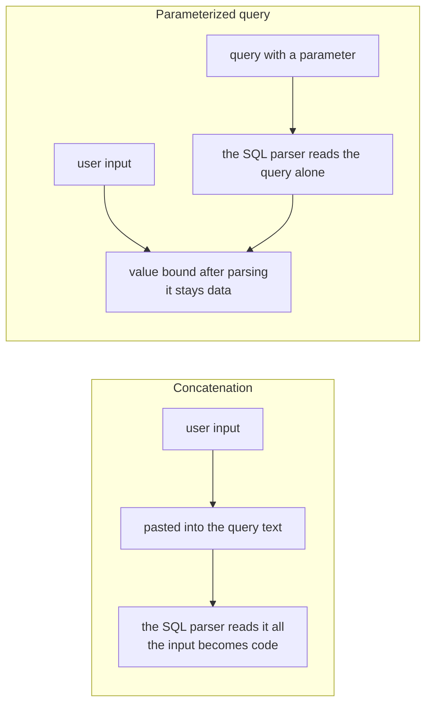

**Risks.** A parameter only replaces a value, never a table name, a column name or a sort direction: `ORDER BY %s` does not work, and the temptation is to paste text again. For those cases, I check the input against a closed list (`{"date": "created_at", "total": "total_cents"}`). A parameterized query does not protect against an overly powerful database account either: the application only has the rights it needs.

:material-book-open-variant: Reference docs: [OWASP, SQL Injection Prevention Cheat Sheet](https://cheatsheetseries.owasp.org/cheatsheets/SQL_Injection_Prevention_Cheat_Sheet.html) (accessed November 2026); [OWASP, Query Parameterization Cheat Sheet](https://cheatsheetseries.owasp.org/cheatsheets/Query_Parameterization_Cheat_Sheet.html) (accessed November 2026)
{ .doc-ref }

!!! maturity "Measuring maturity"
    | Level | What I see in the team |
    |---|---|
    | N1 | developers know they must parameterize, and review spots a concatenation when it sees one |
    | N2 | a SAST rule flags any query built by concatenation or f-string, on every MR |
    | N3 | the SAST rule blocks the MR, and the application's database account only has the rights it needs, so an injection cannot drop a table |
    | N4 | the team tracks the number of injection findings per month and their time to fix, and adds custom rules where they keep coming back |

    **I measure**: the number of open "SQL injection" findings, read in the SAST tool; the share of repositories where this scan runs on every MR, read in the CI configuration.

## SQL for QA

<a class="pill pill-scope pill-scope-code" href="../architecture/#map-of-scales">Scale · Code</a>

| I want to... | Typical query |
|---|---|
| find a customer who has not ordered anything yet, to test the "first order" flow | `LEFT JOIN orders ... WHERE o.id IS NULL LIMIT 1` |
| check that a click on "Order" created exactly one row, and not two because of a double submit | `SELECT COUNT(*) ... WHERE order_id = 42` equal to 1 |
| find inconsistent data, like an order saved without any item | `LEFT JOIN order_items ... WHERE i.id IS NULL` |
| spot duplicates, like two customers with the same email | `GROUP BY ... HAVING COUNT(*) > 1` |
| know how many orders are in each status, to pick my test data | `GROUP BY status` |
| see how many rows a change would touch, without really changing anything | `BEGIN; UPDATE ...; SELECT ...; ROLLBACK;` |
| understand why a page that reads the database is slow | `EXPLAIN` then check the indexes |

Best practices:
- on a <span class="term" data-term="shared-environment">shared environment</span>, other testers and other tests use the same data: I **read** rather than write, and never modify data another test uses, or that test fails for no visible reason;
- in <span class="term" data-term="automated-test">automated tests</span>, I use one <span class="term" data-term="throwaway-database">throwaway database</span> per session (<span class="term" data-term="testcontainers">Testcontainers</span>) and have each test create its own data, so no test depends on what another one left behind;
- to explore, I connect with a <span class="term" data-term="read-only-account">read-only account</span>: a typo, like a `DELETE` without `WHERE`, cannot break anything.

*Testcontainers: complements pytest*
{ .tool-rel }


:material-book-open-variant: Reference docs: [Testcontainers](https://testcontainers.com/) (accessed November 2026); [PostgreSQL, GRANT](https://www.postgresql.org/docs/current/sql-grant.html) (version 18, 2025)
{ .doc-ref }

!!! maturity "Measuring maturity"
    | Level | What I see in the team |
    |---|---|
    | N1 | testers write their queries by hand on the shared environment, with their own account |
    | N2 | QA's typical queries are versioned, and automated tests create their data on a throwaway database per session |
    | N3 | exploration goes through a read-only account, so a typo breaks nothing, and each test isolates its data without intervention |
    | N4 | the team tracks the rate of flaky tests caused by shared data and the time spent preparing data, and invests in datasets from these numbers |

    **I measure**: the share of test failures caused by data modified by another test, read in the CI history; the number of test accounts with write access on the shared environment.

## Measuring success

I know a solution on this page works when a measurement taken before moves afterwards, over a comparable time window. Before adding an index or fixing an N+1, I record a baseline: for example, the p95 of the `GET /orders` route over the last seven days and its number of SQL queries per call. I take the same measurement seven days after the deployment, on comparable traffic. The guard metric is the cost of writes: an index that speeds up reads must not push up `INSERT` duration or replica lag.

| Solution or situation | Success indicator (SLI) | Likely SLO | Likely SLA |
|---|---|---|---|
| adding an index or rewriting a slow query | p95 query duration, read in `pg_stat_statements` or the APM | p95 under 50 ms over a rolling 30 days | n/a: no external contract, the database is not sold on its own |
| fixing an N+1 or switching to eager loading on an API route | share of the route's calls served in under 300 ms | 99% under 300 ms over 30 days | 95% under 1 s per month, with a credit if missed; looser than the SLO to keep a margin |
| read replicas | replication lag | p99 under 1 s, because a "my orders" screen read from a replica must not lose the order just placed | n/a: no external contract |
| a bigger machine, a pooler, automatic failover | share of minutes when the database accepts connections and writes | 99.95% per month, about 22 min of tolerated downtime | 99.9% per month, about 43 min, with penalties in the application's service contract |
| zero-downtime schema migration | share of migrations with no error and no query blocked more than 2 s | 100% of the year's migrations, a single frozen production costing more than all the precautions | n/a: no external contract |
| protecting concurrent writes | number of double bookings or negative balances found by consistency checks | zero per month | n/a: no external contract, even if the terms of sale cover a seat sold twice |
| isolating test data (throwaway database, read-only account) | share of CI failures caused by another test's data | under 1% of failures | n/a: no external contract |

[Take with caution: example orders of magnitude, to set with the business]

!!! noob "As noob"
    The SLO is the speed I set myself on the motorway to be sure I never get flashed; the SLA is the limit on the sign, with a fine if I go over it. I drive below the limit to keep a margin for the unexpected. The takeaway: **the SLO is my internal target, the SLA is the looser promise made to the customer, with a penalty.**

## Pitfalls to avoid

- **Blind UPDATE or DELETE**: I run an `UPDATE` or a `DELETE` without counting the target rows, or I forget the `WHERE`. The whole table changes at once. I first run the same `WHERE` in a `SELECT COUNT(*)`, inside a transaction I can undo with `ROLLBACK` ([see the transaction](#try-before-committing-the-transaction)).
- **Sum after a join**: I run `SUM(o.total_cents)` after a `JOIN` on the items. An order with 3 items counts 3 times, so the total is wrong. I sum on `orders` alone, or aggregate the items before the join ([see the multiplication trap](#the-multiplication-trap)).
- **Comparing with NULL**: I write `WHERE delivered_at = NULL`, or count on `status != 'paid'` to get everything except paid orders. The first never returns anything, the second misses the rows where `status` is `NULL`. I use `IS NULL` and `IS DISTINCT FROM` ([see NULL](#null-is-not-compared-with)).
- **N+1 hidden by the ORM**: I loop over a list and let the ORM load each related item. 100 orders make 101 round trips to the database. I group them into a single query with `JOIN` or `IN`, and watch for repeated `SELECT` spans in the traces ([see the N+1 problem](#the-n1-problem)).
- **Optimizing by guesswork**: I go after the slowest query in the slow query log, or change three things at once. I miss the 3 ms query called 2 million times, and I do not know which change helped. I rank by total time, change one thing and measure again ([see finding slow queries](#finding-slow-queries), [the loop](#making-a-query-fast-the-loop)).
- **Renaming a column in a single migration**: I run `RENAME COLUMN` during a progressive deployment. The instances still on the old version read the old name and crash the second the migration runs. I split it into expand / contract, one deployment per step ([see expand / contract](#expand-contract)).
- **Input pasted into the query**: I build the query by pasting the text the user typed. With `' OR '1'='1`, they get every customer. I always use parameterized queries ([see SQL injection](#security-sql-injection)).
- **Sharding too early**: I spread the data over several databases at the first slowdowns. I pay the complexity of cross-shard queries for a problem an index or a replica would have solved, and going back is almost impossible. I climb the ladder one step at a time, based on measurements ([see the ladder](#the-ladder-from-cheapest-to-most-expensive)).

## What interviews ask

The typical questions:

- "What is the difference between INNER JOIN and LEFT JOIN?", "How do you find customers who never ordered?" How I answer: I give the number of rows returned on a small example, then the `LEFT JOIN ... IS NULL` pattern ([Joining tables](#joining-tables), [Finding what is missing](#finding-what-is-missing-left-join-is-null)).
- "WHERE or HAVING?", "How do you find duplicates?" How I answer: I recall that `WHERE` filters rows before grouping and `HAVING` filters groups after, with `GROUP BY ... HAVING COUNT(*) > 1` ([HAVING: filtering after grouping](#having-filtering-after-grouping)).
- "How do you find the second largest amount, or the last three orders of each customer?" How I answer: I use a window function, `ROW_NUMBER() OVER (PARTITION BY customer_id ORDER BY created_at DESC)`, then keep the ranks I want in an outer query, because a `WHERE` cannot filter on the rank directly ([Window functions](#window-functions)).
- "A page is slow because of the database, what do you do?", "What is an index, and when is it useless?", "What is the N+1 problem?" How I answer: I walk through measure, read the plan with `EXPLAIN ANALYZE`, change one thing, measure again ([Performance](#performance), [The N+1 problem](#the-n1-problem)), and [GraphQL server-side pitfalls](api-rest-async.md#server-side-pitfalls).
- "How do you check a test's effect in the database?", "What is a transaction, what does ACID mean?" How I answer: I show the `BEGIN ... ROLLBACK` and the typical QA queries ([What a transaction guarantees (ACID)](#what-a-transaction-guarantees-acid), [SQL for QA](#sql-for-qa)).
- "Two people book the last seat at the same time, what happens?", "Optimistic or pessimistic lock?", "What is PostgreSQL's default isolation level?" How I answer: I show the read, decide, write pattern and its timeline, then the atomic `UPDATE ... WHERE seats_left > 0`; I pick the pessimistic lock when conflicts are frequent and the optimistic one when they are rare; I name `READ COMMITTED` for PostgreSQL and `REPEATABLE READ` for MySQL, and the write skew only `SERIALIZABLE` prevents ([Concurrent writes](#concurrent-writes), [Isolation levels](#isolation-levels)).
- "ORM or hand-written SQL?", "Active Record or Data Mapper?" How I answer: the ORM for everyday work, parameterized SQL for aggregations and critical queries, with a team rule; then the difference between an object that saves itself and a session that saves an object unaware of the database ([ORM: accessing the database from code](#orm-accessing-the-database-from-code), [Lazy or eager loading](#lazy-or-eager-loading)).
- "How do you protect against SQL injection?" How I answer: I show the concatenated query, the `' OR '1'='1` input, then the parameterized query ([Security: SQL injection](#security-sql-injection)).
- "Your database is saturated, what do you do?", "How do you rename a column without downtime?" How I answer: I climb the ladder from cheapest to most expensive, then walk through expand / contract ([Scaling a database](#scaling-a-database), [Zero-downtime schema migrations](#zero-downtime-schema-migrations)).
- "How do you know a database optimization really worked?" How I answer: I give a baseline before (p95 and queries per call over seven days), the same measurement after on comparable traffic, the cost of writes as a guard metric, then I tell the internal SLO apart from the SLA promised to the customer ([Measuring success](#measuring-success)).

What makes a good answer: writing the query on a small dataset, saying how many rows it returns, then naming the trap that would skew it (`NULL`, multiplication, time zone).
