# SQL

!!! warning "Avertissement"
    Ces notes sont des pense-bêtes personnels, pas une source de vérité. Elles reflètent ma compréhension et mes choix : leur contenu reste subjectif, malgré les citations et les références qu'il contient. Il peut être incomplet, simplifié, inexact ou dépassé. Vérifiez toujours dans la documentation officielle avant de l'appliquer. Ce contenu est fourni tel quel, sans aucune garantie : son utilisation se fait sous votre seule responsabilité.

!!! audience "Pour qui, pour quoi"
    - **Métiers** : QA, développeur back-end, data engineer, SRE, tech lead
    - **Usages** : je prépare un entretien technique avec un exercice SQL ; je cherche en base un client sans commande pour un test ; je comprends avec `EXPLAIN` pourquoi une page est lente ; je relis une MR qui renomme une colonne ou ajoute un index sur une grosse table

!!! abstract "Les échelles"
    Les pastilles de couleur sous les titres disent à quelle échelle une notion s'applique :

    - <span class="pill pill-scope pill-scope-code">Code</span> les classes, fonctions et modules d'un programme ;
    - <span class="pill pill-scope pill-scope-app">Application</span> un service ou une application et son découpage interne ;
    - <span class="pill pill-scope pill-scope-system">Système</span> plusieurs services qui communiquent par le réseau ;
    - <span class="pill pill-scope pill-scope-infra">Infrastructure</span> les serveurs, le réseau, les zones et les clusters, physiques ou virtuels ;
    - <span class="pill pill-scope pill-scope-enterprise">Entreprise</span> le système d'information entier et son organisation.

    Détail et mots ambigus : [carte des échelles](architecture.md#carte-des-echelles).

SQL est le langage pour lire et modifier les données d'une <span class="term" data-term="relational-database">base relationnelle</span> (MySQL, PostgreSQL, SQL Server...). Côté QA, il sert surtout à trois choses : trouver des données de test, vérifier l'état après une action, et comprendre pourquoi une <span class="term" data-term="db-query">requête</span> est lente. Cette page part des bases et va jusqu'aux pièges qui faussent les résultats.

*PostgreSQL : concurrent de MySQL, MariaDB ; concurrent en partie de MongoDB ; complémentaire de Redis, PgBouncer, BigQuery, Elasticsearch*<br>
*MySQL : concurrent de PostgreSQL, MariaDB ; complémentaire de Redis, ProxySQL, Vitess*
{ .tool-rel }


Tous les exemples utilisent ce petit <span class="term" data-term="db-schema">schéma</span> fictif :

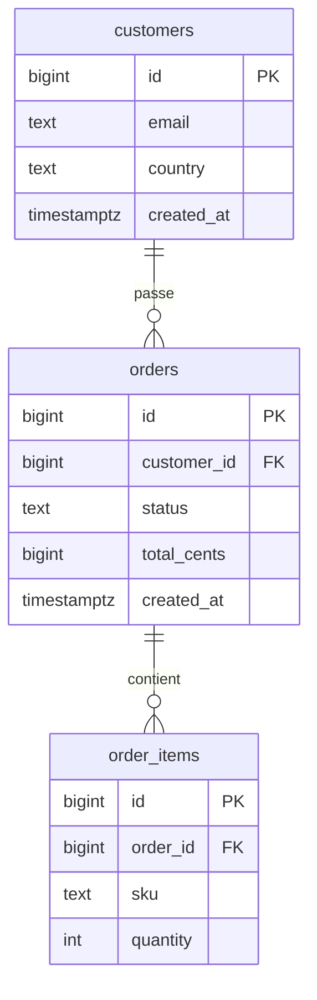

:material-swap-horizontal: Les outils cités dans cette page : lesquels se remplacent, lesquels se combinent ? Voir [Complémentaires ou concurrents](outils.md#complementaires-ou-concurrents).
{ .doc-ref }

## Vocabulaire

**Base relationnelle** : les données sont rangées dans des **tables**, faites de **lignes** (un enregistrement) et de **colonnes** (un champ).

**Clé primaire (PK)** : la colonne qui identifie chaque ligne de façon unique, souvent `id`.

**Clé étrangère (FK)** : une colonne qui pointe vers la <span class="term" data-term="primary-key">clé primaire</span> d'une autre table. `orders.customer_id` pointe vers `customers.id` : chaque commande appartient à un client.

**NULL** : l'absence de valeur. Ce n'est ni `0`, ni une chaîne vide. Une commande sans date de livraison a `delivered_at = NULL`.

**Index** : une structure qui permet de retrouver des lignes sans lire toute la table, comme l'index d'un livre.

**Transaction** : un groupe d'opérations qui réussissent toutes ou échouent toutes.

**Schéma** : la structure de la base, c'est-à-dire ses tables, colonnes et <span class="term" data-term="db-constraint">contraintes</span>. **Migration** : un script versionné qui fait évoluer le schéma (ajouter une colonne...).

**<span class="term" data-term="sli">SLI</span>** : l'indicateur que je mesure pour savoir si une solution marche. Exemple : la part des requêtes `SELECT` de la page « mes commandes » servies en moins de 50 ms.

**<span class="term" data-term="slo">SLO</span>** : l'objectif interne que l'équipe se fixe sur ce SLI. Exemple : 95 % de ces requêtes sous 50 ms sur 30 jours glissants.

**<span class="term" data-term="sla">SLA</span>** : la promesse faite par contrat à un client, avec une pénalité si elle n'est pas tenue, en général plus lâche que le SLO pour garder de la marge. Exemple : la base de l'application disponible 99,9 % du mois, sinon un avoir sur la facture.

:material-book-open-variant: Doc de référence : [PostgreSQL, Constraints](https://www.postgresql.org/docs/current/ddl-constraints.html) (version 18, 2025) ; [MySQL, FOREIGN KEY Constraints](https://dev.mysql.com/doc/refman/8.4/en/create-table-foreign-keys.html) (MySQL 8.4)
{ .doc-ref }

## Lire des données

<a class="pill pill-scope pill-scope-code" href="../architecture/#carte-des-echelles">Échelle · Code</a>

### SELECT, WHERE, ORDER BY, LIMIT
``` { .sql .ex-bad title="À éviter" }
-- À éviter : SELECT * et LIMIT sans ORDER BY, les 10 lignes renvoyées changent d'un appel à l'autre
SELECT * FROM orders WHERE status = 'paid' LIMIT 10;
```

``` { .sql .ex-good title="Recommandé" }
-- Bien : colonnes nommées et ORDER BY explicite, le résultat reste stable
SELECT id, status, total_cents
FROM orders
WHERE status = 'paid'
  AND created_at >= '2026-10-01'
ORDER BY created_at DESC
LIMIT 10;
```
Les 10 dernières commandes payées depuis le 1er octobre.

Règles :
- jamais de `SELECT *` dans du code : si une colonne est ajoutée, le résultat change. En exploration, c'est acceptable ;
- toujours `ORDER BY` si l'ordre compte : sans lui, la <span class="term" data-term="database">base</span> renvoie les <span class="term" data-term="db-row">lignes</span> dans l'ordre qui l'arrange, et cet ordre peut changer.

### Filtres utiles
``` { .sql .ex-ref title="Référence" }
-- Exemple : quatre filtres courants, liste, plage, motif de texte, valeur absente
WHERE status IN ('paid', 'shipped')
WHERE total_cents BETWEEN 1000 AND 5000
WHERE email LIKE '%@example.com'
WHERE delivered_at IS NULL
```

**Risques.** `BETWEEN` inclut ses deux bornes : sur des dates, `BETWEEN '2026-10-01' AND '2026-10-31'` oublie tout ce qui s'est passé le 31 après minuit, donc j'écris `>=` et `<` (voir [les dates](#les-dates-et-les-fuseaux-horaires)). `LIKE '%@example.com'`, avec un `%` en tête, ne peut pas utiliser l'index et lit toute la table : sur une grosse table de production, je filtre d'abord sur une colonne indexée.

### Compter d'abord
<span class="pill pill-status pill-status-ok" title="Toujours valable, vérifié en novembre 2026">Valable · 11/2026</span>

Avant de lire ou de modifier, compter. Ça évite d'afficher un million de lignes, ou d'en modifier un million.
``` { .sql .ex-bad title="À éviter" }
-- À éviter : tout lire sans savoir combien de lignes arrivent
SELECT * FROM orders WHERE status = 'pending';
```

``` { .sql .ex-good title="Recommandé" }
-- Bien : compter avant de lire ou de modifier
SELECT COUNT(*) FROM orders WHERE status = 'pending';
```
Sans compter, le client SQL tente de charger 2,4 millions de lignes : il se fige plusieurs minutes, et la base lit toute la table pour rien.
``` { .text .ex-illus title="Illustration" }
12          je peux regarder les lignes
2 400 000   je filtre davantage avant
```

**Risques.** Sur une très grosse table, `COUNT(*)` lit souvent toute la table ou tout un index (surtout sur PostgreSQL) : sur la production, je filtre sur une colonne indexée ou je compte sur un réplica. Le compte peut aussi changer entre le moment où je compte et celui où je modifie : je compte et je modifie dans la même transaction (voir [la transaction](#essayer-avant-de-valider-la-transaction)).

:material-book-open-variant: Doc de référence : [PostgreSQL, SELECT](https://www.postgresql.org/docs/current/sql-select.html) (version 18, 2025) ; [MySQL, SELECT Statement](https://dev.mysql.com/doc/refman/8.4/en/select.html) (MySQL 8.4)
{ .doc-ref }

!!! maturity "Mesurer la maturité"
    | Niveau | Ce que j'observe dans l'équipe |
    |---|---|
    | N1 | quelqu'un compte les lignes avant de lire une grosse table, mais d'autres lancent encore des `SELECT *` sans `LIMIT` sur la production |
    | N2 | la règle « compter d'abord, colonnes nommées, `ORDER BY` explicite » est écrite dans le guide de revue, et un linter SQL signale les `SELECT *` dans le code à chaque MR |
    | N3 | le compte d'exploration a un `statement_timeout` qui coupe seul une requête trop longue, et le client SQL partagé ajoute un `LIMIT` par défaut |
    | N4 | l'équipe suit le nombre de requêtes d'exploration coupées par le délai et le volume qu'elles lisent, et ajuste le délai et les index d'après ces chiffres |

    **Je mesure** : la part des requêtes du code qui nomment leurs colonnes, comptée par le linter en CI ; le nombre de requêtes coupées par `statement_timeout` par semaine, lu dans les logs de la base.

## Joindre des tables

<a class="pill pill-scope pill-scope-code" href="../architecture/#carte-des-echelles">Échelle · Code</a>

Une <span class="term" data-term="sql-join">jointure</span> associe chaque ligne d'une table aux lignes d'une autre table qui vérifient la condition `ON`. Les dessins ci-dessous résument quelles lignes restent : à gauche `customers`, à droite `orders`, la partie colorée est ce que la requête renvoie.

!!! noob "As noob"
    Une jointure, c'est agrafer à chaque fiche client les tickets de caisse qui portent son numéro : un client avec deux tickets donne deux paires. Le type de jointure dit seulement quoi faire des fiches sans ticket et des tickets sans fiche. La phrase à retenir : **une jointure fabrique des paires de lignes, elle peut donc renvoyer plus de lignes qu'il n'y a de clients.**

<div class="diagram-grid">
<figure><svg viewBox="0 0 160 100" role="img" aria-label="INNER JOIN : la partie colorée est renvoyée"><path class="hit" d="M80,16.28 A35,35 0 0,1 80,73.72 A35,35 0 0,1 80,16.28 Z"/><circle class="set" cx="60" cy="45" r="35"/><circle class="set" cx="100" cy="45" r="35"/><text x="40" y="95" text-anchor="middle">customers</text><text x="120" y="95" text-anchor="middle">orders</text></svg><figcaption><code>INNER JOIN</code></figcaption></figure>
<figure><svg viewBox="0 0 160 100" role="img" aria-label="LEFT JOIN : la partie colorée est renvoyée"><circle class="hit" cx="60" cy="45" r="35"/><circle class="set" cx="60" cy="45" r="35"/><circle class="set" cx="100" cy="45" r="35"/><text x="40" y="95" text-anchor="middle">customers</text><text x="120" y="95" text-anchor="middle">orders</text></svg><figcaption><code>LEFT JOIN</code></figcaption></figure>
<figure><svg viewBox="0 0 160 100" role="img" aria-label="RIGHT JOIN : la partie colorée est renvoyée"><circle class="hit" cx="100" cy="45" r="35"/><circle class="set" cx="60" cy="45" r="35"/><circle class="set" cx="100" cy="45" r="35"/><text x="40" y="95" text-anchor="middle">customers</text><text x="120" y="95" text-anchor="middle">orders</text></svg><figcaption><code>RIGHT JOIN</code></figcaption></figure>
<figure><svg viewBox="0 0 160 100" role="img" aria-label="FULL OUTER JOIN : la partie colorée est renvoyée"><path class="hit" d="M80,16.28 A35,35 0 1,0 80,73.72 A35,35 0 0,1 80,16.28 Z"/><path class="hit" d="M80,16.28 A35,35 0 0,1 80,73.72 A35,35 0 0,1 80,16.28 Z"/><path class="hit" d="M80,16.28 A35,35 0 1,1 80,73.72 A35,35 0 0,0 80,16.28 Z"/><circle class="set" cx="60" cy="45" r="35"/><circle class="set" cx="100" cy="45" r="35"/><text x="40" y="95" text-anchor="middle">customers</text><text x="120" y="95" text-anchor="middle">orders</text></svg><figcaption><code>FULL OUTER JOIN</code></figcaption></figure>
<figure><svg viewBox="0 0 160 100" role="img" aria-label="LEFT JOIN ... WHERE o.id IS NULL : la partie colorée est renvoyée"><path class="hit" d="M80,16.28 A35,35 0 1,0 80,73.72 A35,35 0 0,1 80,16.28 Z"/><circle class="set" cx="60" cy="45" r="35"/><circle class="set" cx="100" cy="45" r="35"/><text x="40" y="95" text-anchor="middle">customers</text><text x="120" y="95" text-anchor="middle">orders</text></svg><figcaption><code>LEFT JOIN ... WHERE o.id IS NULL</code></figcaption></figure>
<figure><svg viewBox="0 0 160 100" role="img" aria-label="FULL OUTER JOIN ... IS NULL : la partie colorée est renvoyée"><path class="hit" d="M80,16.28 A35,35 0 1,0 80,73.72 A35,35 0 0,1 80,16.28 Z"/><path class="hit" d="M80,16.28 A35,35 0 1,1 80,73.72 A35,35 0 0,0 80,16.28 Z"/><circle class="set" cx="60" cy="45" r="35"/><circle class="set" cx="100" cy="45" r="35"/><text x="40" y="95" text-anchor="middle">customers</text><text x="120" y="95" text-anchor="middle">orders</text></svg><figcaption><code>FULL OUTER JOIN ... IS NULL</code></figcaption></figure>
</div>

Le même jeu de données, ligne par ligne. ada a deux commandes, grace et linus aucune, et la commande 12 pointe vers un client 4 qui n'existe plus :

``` { .text .ex-illus title="Illustration" }
customers            orders
id  email            id  customer_id
1   ada              10  1
2   grace            11  1
3   linus            12  4
```

| Jointure | Lignes renvoyées (email, id de commande) | Nombre |
|---|---|---|
| `INNER JOIN` | (ada, 10) (ada, 11) | 2 |
| `LEFT JOIN` | (ada, 10) (ada, 11) (grace, NULL) (linus, NULL) | 4 |
| `RIGHT JOIN` | (ada, 10) (ada, 11) (NULL, 12) | 3 |
| `FULL OUTER JOIN` | (ada, 10) (ada, 11) (grace, NULL) (linus, NULL) (NULL, 12) | 5 |
| `LEFT JOIN ... WHERE o.id IS NULL` | (grace, NULL) (linus, NULL) | 2 |
| `FULL OUTER JOIN ... IS NULL` | (grace, NULL) (linus, NULL) (NULL, 12) | 3 |
| `CROSS JOIN` | chaque client avec chaque commande | 3 x 3 = 9 |

Les cercles sont une image commode mais imparfaite : une jointure n'est pas une intersection d'ensembles, elle associe des lignes. ada sort deux fois parce qu'elle a deux commandes (voir [le piège de la multiplication](#le-piege-de-la-multiplication)), ce qu'aucun cercle ne montre.

:material-book-open-variant: Doc de référence : [PostgreSQL, Joined Tables](https://www.postgresql.org/docs/current/queries-table-expressions.html#QUERIES-JOIN) (version 18, 2025) ; [MySQL, JOIN Clause](https://dev.mysql.com/doc/refman/8.4/en/join.html) (MySQL 8.4)
{ .doc-ref }

### INNER JOIN : ce qui existe des deux côtés
``` { .sql .ex-ref title="Référence" }
-- Exemple : INNER JOIN, les commandes payées avec l'e-mail du client
SELECT c.email, o.id, o.total_cents
FROM orders o
JOIN customers c ON c.id = o.customer_id
WHERE o.status = 'paid';
```
Les commandes payées avec l'email du client. Une commande sans client correspondant n'apparaît pas.

**Risques.** Un `INNER JOIN` fait disparaître sans bruit les lignes sans correspondance : un rapport « chiffre d'affaires par client » qui joint `customers` perd les commandes dont le client a été supprimé, et le total ne colle plus à la comptabilité. Quand je compte ou je somme, je compare le nombre de lignes avec et sans la jointure.

### LEFT JOIN : tout à gauche, même sans correspondance
``` { .sql .ex-ref title="Référence" }
-- Exemple : LEFT JOIN, tous les clients, même ceux sans commande
SELECT c.email, o.id
FROM customers c
LEFT JOIN orders o ON o.customer_id = c.id;
```
Tous les clients, avec leurs commandes. Un client sans commande apparaît une fois, avec `o.id = NULL`.

Piège fréquent : un filtre sur la table de droite placé dans le `WHERE` annule le `LEFT JOIN`. Pour un client sans commande payée, `o.status` vaut `NULL`, le `WHERE` élimine sa ligne, et la requête se comporte comme un `INNER JOIN` : le rapport « tous les clients et leurs commandes payées » perd sans bruit les clients qui n'ont rien payé.

``` { .sql .ex-bad title="À éviter" }
-- À éviter : le WHERE sur o élimine les clients sans commande payée
SELECT c.email, o.id
FROM customers c
LEFT JOIN orders o ON o.customer_id = c.id
WHERE o.status = 'paid';
```

``` { .sql .ex-good title="Recommandé" }
-- Bien : le filtre dans le ON, chaque client reste, avec o.id à NULL s'il n'a rien payé
SELECT c.email, o.id
FROM customers c
LEFT JOIN orders o ON o.customer_id = c.id AND o.status = 'paid';
```

### Trouver ce qui manque : LEFT JOIN ... IS NULL
``` { .sql .ex-ref title="Référence" }
-- Exemple : les clients qui n'ont jamais commandé
SELECT c.id, c.email
FROM customers c
LEFT JOIN orders o ON o.customer_id = c.id
WHERE o.id IS NULL;
```
Les clients qui n'ont **jamais** commandé. Très utile pour trouver des <span class="term" data-term="test-data">données de test</span> (« un client sans commande ») ou des incohérences (« des commandes sans articles »).

``` { .sql .ex-ref title="Référence" }
-- Exemple : les commandes sans articles, une incohérence
SELECT o.id
FROM orders o
LEFT JOIN order_items i ON i.order_id = o.id
WHERE i.id IS NULL;
```

**Risques.** Sans index sur la colonne de jointure (`orders.customer_id`), la requête parcourt la table de droite pour chaque client et devient très lente sur la production. Et si je teste `IS NULL` sur une colonne qui peut valoir `NULL` alors que la ligne existe, je compte comme « manquantes » des lignes bien présentes : je teste toujours la clé primaire de la table de droite (`o.id IS NULL`).

### RIGHT JOIN, FULL OUTER JOIN, CROSS JOIN

``` { .sql .ex-ref title="Référence" }
-- Exemple : les orphelins des deux côtés, clients sans commande et commandes sans client
SELECT c.email, o.id
FROM customers c
FULL OUTER JOIN orders o ON o.customer_id = c.id
WHERE c.id IS NULL OR o.id IS NULL;
```
Les deux sortes d'orphelins d'un coup : les clients sans commande et les commandes sans client. Pratique pour un contrôle de cohérence après une migration.

| Jointure | À quoi elle sert |
|---|---|
| `RIGHT JOIN` | le miroir de `LEFT JOIN`. On préfère inverser les tables et écrire un `LEFT JOIN`, plus facile à lire |
| `FULL OUTER JOIN` | comparer deux tables et voir ce qui manque d'un côté ou de l'autre |
| `CROSS JOIN` | toutes les combinaisons (produit cartésien) : générer un jeu de test « chaque pays x chaque moyen de paiement ». Sur deux grosses tables, le résultat explose |

MySQL n'a pas de `FULL OUTER JOIN` : on l'obtient avec un `UNION` d'un `LEFT JOIN` et d'un `RIGHT JOIN`.

### Le piège de la multiplication
Un `JOIN` sur une relation « <span class="term" data-term="one-to-many">un à plusieurs</span> » répète les lignes.
``` { .sql .ex-bad title="À éviter" }
-- À éviter : total faux, chaque commande compte une fois par article
SELECT SUM(o.total_cents)
FROM orders o
JOIN order_items i ON i.order_id = o.id;
```
Une commande de 3 articles compte 3 fois dans la somme : le total est faux. Faire la somme sur `orders` seule, ou <span class="term" data-term="aggregation">agréger</span> les articles avant la jointure.

!!! maturity "Mesurer la maturité"
    | Niveau | Ce que j'observe dans l'équipe |
    |---|---|
    | N1 | une personne connaît le motif `LEFT JOIN ... IS NULL` et l'utilise à la main pour trouver un client sans commande ou des commandes orphelines |
    | N2 | les requêtes de cohérence (commandes sans articles, articles sans commande) sont versionnées dans le dépôt et lancées par un job après chaque migration |
    | N3 | les clés étrangères en base empêchent les orphelins de se créer, et un contrôle de cohérence rouge bloque la mise en production |
    | N4 | l'équipe suit le nombre d'orphelins trouvés par semaine et de totaux faux attrapés en revue, et ajoute une contrainte là où les chiffres montrent un trou |

    **Je mesure** : le nombre de lignes orphelines renvoyées par les requêtes de cohérence, lu dans la sortie du job ; la part des relations du schéma couvertes par une clé étrangère, lue dans `information_schema`.

## Regrouper et agréger

<a class="pill pill-scope pill-scope-code" href="../architecture/#carte-des-echelles">Échelle · Code</a>

### GROUP BY
``` { .sql .ex-ref title="Référence" }
-- Exemple : nombre et total des commandes par statut
SELECT status, COUNT(*) AS nb, SUM(total_cents) AS total
FROM orders
GROUP BY status;
```
``` { .text .ex-ref title="Référence" }
status     nb     total
paid       820    2 460 000
pending     12       36 000
cancelled   45      135 000
```

**Risques.** Une colonne du `SELECT` absente du `GROUP BY` est refusée par PostgreSQL, mais MySQL l'accepte quand le mode `ONLY_FULL_GROUP_BY` est désactivé, et renvoie alors une valeur prise au hasard dans le groupe : le rapport a l'air juste et ne l'est pas. Les `NULL` forment aussi leur propre groupe, qu'un test qui attend une liste fixe de statuts oublie facilement.

### HAVING : filtrer après le regroupement
`WHERE` filtre les <span class="term" data-term="db-row">lignes</span> avant de regrouper, `HAVING` filtre les groupes après.

!!! noob "As noob"
    Je pense à un tri de courrier : `WHERE` jette les lettres qui ne m'intéressent pas avant de les ranger en piles, `HAVING` jette ensuite les piles entières qui ne conviennent pas (par exemple celles de moins de 5 lettres). La phrase à retenir : **`WHERE` filtre des lignes, `HAVING` filtre des groupes : on écrit `HAVING COUNT(*) > 5`, jamais `WHERE COUNT(*) > 5`.**

L'ordre dans lequel la base évalue logiquement une requête n'est pas l'ordre dans lequel on l'écrit. C'est pour cela qu'un alias défini dans `SELECT` n'est pas encore connu dans `WHERE` (l'optimiseur peut ensuite réorganiser l'exécution réelle) :

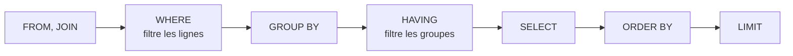

``` { .sql .ex-ref title="Référence" }
-- Exemple : HAVING filtre les groupes, les clients de plus de 5 commandes
SELECT customer_id, COUNT(*) AS nb
FROM orders
GROUP BY customer_id
HAVING COUNT(*) > 5;
```
Les clients qui ont passé plus de 5 commandes.

**Risques.** Mettre dans `HAVING` un filtre qui porte sur les lignes, comme `GROUP BY status HAVING status = 'paid'`, oblige la base à regrouper toute la table avant de jeter les groupes : le résultat est juste, mais la requête est bien plus lente. Ce qui filtre des lignes va dans `WHERE`, ce qui filtre des agrégats va dans `HAVING`.

### Trouver des doublons
``` { .sql .ex-ref title="Référence" }
-- Exemple : les e-mails présents plus d'une fois
SELECT email, COUNT(*)
FROM customers
GROUP BY email
HAVING COUNT(*) > 1;
```

**Risques.** Le regroupement compare les valeurs exactes : `Ada@example.com` et `ada@example.com`, avec une majuscule ou une espace en trop, ne sortent pas comme doublons. Je normalise dans la requête (`GROUP BY LOWER(TRIM(email))`), puis je pose une contrainte d'unicité sur la valeur normalisée pour que les doublons ne reviennent pas.

### COUNT(*) ou COUNT(colonne)
``` { .text .ex-ref title="Référence" }
COUNT(*)              compte toutes les lignes
COUNT(delivered_at)   compte seulement les lignes où delivered_at n'est pas NULL
COUNT(DISTINCT customer_id)   compte les clients différents
```

:material-book-open-variant: Doc de référence : [PostgreSQL, GROUP BY and HAVING Clauses](https://www.postgresql.org/docs/current/queries-table-expressions.html#QUERIES-GROUP) (version 18, 2025) ; [MySQL, Aggregate Functions](https://dev.mysql.com/doc/refman/8.4/en/aggregate-functions.html) (MySQL 8.4)
{ .doc-ref }

## Requêtes plus avancées

<a class="pill pill-scope pill-scope-code" href="../architecture/#carte-des-echelles">Échelle · Code</a>

### Sous-requête et CTE (WITH)
Une **<span class="term" data-term="cte">CTE</span>** donne un nom à une <span class="term" data-term="db-query">requête</span> intermédiaire, pour lire la requête de haut en bas.
``` { .sql .ex-ref title="Référence" }
-- Exemple : la CTE nomme l'étape « gros clients », puis la requête lit leurs e-mails
WITH big_customers AS (
    SELECT customer_id
    FROM orders
    GROUP BY customer_id
    HAVING SUM(total_cents) > 100000
)
SELECT c.email
FROM customers c
JOIN big_customers b ON b.customer_id = c.id;
```
Les clients qui ont dépensé plus de 1 000 €.

!!! noob "As noob"
    Une CTE, c'est une étape de recette à laquelle je donne un nom : « préparer la pâte », puis « garnir la pâte préparée ». Sans elle, j'écris tout d'une traite, avec des parenthèses dans des parenthèses, et plus personne ne sait où commence chaque étape. La phrase à retenir : **la CTE ne rend en général pas la requête plus rapide, elle la rend lisible de haut en bas.**

Une **<span class="term" data-term="subquery">sous-requête</span>** est une requête placée dans une autre, ici dans le `WHERE` : les e-mails des clients qui ont au moins une commande remboursée.
``` { .sql .ex-ref title="Référence" }
-- Exemple : sous-requête dans le WHERE, clients avec une commande remboursée
SELECT email
FROM customers
WHERE id IN (SELECT customer_id FROM orders WHERE status = 'refunded');
```

Piège : `NOT IN` avec une sous-requête qui contient un seul `NULL` ne renvoie **aucune** ligne. `id NOT IN (7, NULL)` revient à `id <> 7 AND id <> NULL`, et `id <> NULL` n'est jamais vrai. Il suffit d'une commande invitée enregistrée avec `customer_id` à `NULL` pour que « les clients sans commande » réponde zéro client.

``` { .sql .ex-bad title="À éviter" }
-- À éviter : un seul customer_id NULL dans orders, et la requête ne renvoie rien
SELECT email
FROM customers
WHERE id NOT IN (SELECT customer_id FROM orders);
```

``` { .sql .ex-good title="Recommandé" }
-- Bien : NOT EXISTS n'est pas gêné par les NULL
SELECT email
FROM customers c
WHERE NOT EXISTS (SELECT 1 FROM orders o WHERE o.customer_id = c.id);
```

| Je veux... | J'utilise |
|---|---|
| garder seulement les lignes qui ont quelque chose ailleurs, une seule fois dans la requête, comme « les clients qui ont au moins une commande remboursée » | sous-requête `IN (SELECT ...)` ou `EXISTS` |
| calculer un résultat intermédiaire que je réutilise, ou découper une requête longue en étapes lisibles de haut en bas, comme « d'abord les gros clients, puis leurs e-mails » | CTE |

**Risques.** Avant PostgreSQL 12 (2019), une CTE était toujours calculée en entier avant la requête principale, ce qui l'empêchait d'utiliser les index de la requête englobante : une requête réécrite « pour la lisibilité » pouvait devenir beaucoup plus lente (`MATERIALIZED` et `NOT MATERIALIZED` permettent de choisir depuis, à vérifier sur ma version). Je relis le plan avec `EXPLAIN` après chaque réécriture.

### Fonctions de fenêtre
Calculer sur un groupe de <span class="term" data-term="db-row">lignes</span> **sans** les regrouper en une seule.

!!! noob "As noob"
    `GROUP BY` fond les lignes d'un groupe en une seule, comme on résume une classe par sa moyenne. Une fonction de fenêtre laisse chaque élève sur sa ligne et écrit à côté une information calculée sur sa classe (son rang, la moyenne de la classe). La phrase à retenir : **même calcul par groupe, mais aucune ligne ne disparaît.**

``` { .sql .ex-ref title="Référence" }
-- Exemple : le rang de chaque commande pour son client, sans fusionner les lignes
SELECT customer_id, id, created_at,
       ROW_NUMBER() OVER (PARTITION BY customer_id ORDER BY created_at DESC) AS rang
FROM orders;
```
Chaque commande garde sa ligne, avec son rang pour son client : `rang = 1`, c'est la dernière commande de chaque client.

**Risques.** Une fonction de fenêtre trie chaque partition : sur des millions de lignes, le tri peut déborder sur le disque et la requête s'allonge. Et je ne peux pas filtrer sur son résultat dans le `WHERE` de la même requête : je l'enveloppe dans une sous-requête ou une CTE, sinon la base refuse la requête.

### CASE
``` { .sql .ex-ref title="Référence" }
-- Exemple : CASE classe chaque commande en gros, moyen ou petit
SELECT id,
       CASE WHEN total_cents >= 10000 THEN 'gros'
            WHEN total_cents >= 2000  THEN 'moyen'
            ELSE 'petit' END AS taille
FROM orders;
```

**Risques.** Les `WHEN` sont lus dans l'ordre et le premier vrai gagne : si j'écris `>= 2000` avant `>= 10000`, aucune commande n'est jamais classée « gros ». Sans `ELSE`, une valeur qui ne correspond à aucun cas devient `NULL`, et elle disparaît des comptes par taille.

:material-book-open-variant: Doc de référence : [PostgreSQL, WITH Queries](https://www.postgresql.org/docs/current/queries-with.html) (version 18, 2025) ; [PostgreSQL, Window Functions](https://www.postgresql.org/docs/current/tutorial-window.html) (version 18, 2025) ; [PostgreSQL, Conditional Expressions](https://www.postgresql.org/docs/current/functions-conditional.html) (version 18, 2025)
{ .doc-ref }

## Modifier des données

<a class="pill pill-scope pill-scope-code" href="../architecture/#carte-des-echelles">Échelle · Code</a>

### INSERT, UPDATE, DELETE
``` { .sql .ex-ref title="Référence" }
-- Exemple : ajouter un client
INSERT INTO customers (email, country) VALUES ('ada@example.com', 'FR');

-- Exemple : modifier une commande, toujours avec un WHERE
UPDATE orders SET status = 'cancelled' WHERE id = 42;

-- Exemple : supprimer une commande, toujours avec un WHERE
DELETE FROM orders WHERE id = 42;
```
Le danger : un `UPDATE` ou un `DELETE` **sans `WHERE`** touche toute la <span class="term" data-term="db-table">table</span>.

L'erreur arrive surtout dans un client SQL où je sélectionne une partie du texte avant de l'exécuter : si la sélection s'arrête avant la ligne du `WHERE`, la base reçoit une requête valide qui touche tout.

``` { .sql .ex-bad title="À éviter" }
-- À éviter : la ligne du WHERE n'était pas sélectionnée, toutes les commandes passent en cancelled
UPDATE orders SET status = 'cancelled'
```

:material-book-open-variant: Doc de référence : [PostgreSQL, Data Manipulation](https://www.postgresql.org/docs/current/dml.html) (version 18, 2025)
{ .doc-ref }

### Essayer avant de valider : la transaction
<span class="pill pill-status pill-status-ok" title="Toujours valable, vérifié en novembre 2026">Valable · 11/2026</span>

``` { .sql .ex-bad title="À éviter" }
-- À éviter : lancer l'UPDATE directement, validé aussitôt (autocommit)
UPDATE orders SET status = 'cancelled' WHERE customer_id = 17;
```
En autocommit, une faute de frappe dans le `WHERE` (17 au lieu de 7) annule tout de suite les commandes d'un autre client, et seule une restauration de sauvegarde les ramène.

``` { .sql .ex-good title="Recommandé" }
-- Bien : essayer le changement dans une transaction avant de le valider
BEGIN;
UPDATE orders SET status = 'cancelled' WHERE customer_id = 7;
-- Exemple : compter les lignes touchées, puis tout annuler (COMMIT si le compte est bon)
SELECT COUNT(*) FROM orders WHERE customer_id = 7 AND status = 'cancelled';
ROLLBACK;
```
Je vois combien de <span class="term" data-term="db-row">lignes</span> seraient touchées, puis `ROLLBACK` annule tout. Si c'est bon, je relance avec `COMMIT` à la place.

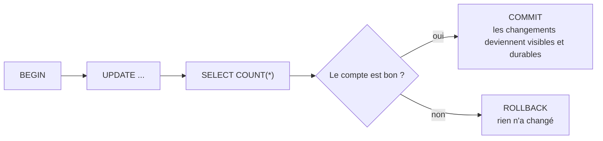

Règle : avant tout `UPDATE` ou `DELETE`, lancer le même `WHERE` dans un `SELECT COUNT(*)`.

**Risques.** Une transaction ouverte puis oubliée dans mon client SQL garde ses verrous : les `UPDATE` des autres sur les mêmes lignes attendent, et l'application semble figée. Je garde la transaction courte, je termine toujours par `COMMIT` ou `ROLLBACK`, et un `idle_in_transaction_session_timeout` (PostgreSQL) coupe les sessions oubliées.

:material-book-open-variant: Doc de référence : [PostgreSQL, Transactions](https://www.postgresql.org/docs/current/tutorial-transactions.html) (version 18, 2025) ; [MySQL, START TRANSACTION, COMMIT, and ROLLBACK](https://dev.mysql.com/doc/refman/8.4/en/commit.html) (MySQL 8.4)
{ .doc-ref }

### Ce qu'une transaction garantit (ACID)
- **Atomicité** : tout ou rien. Débit et crédit d'un virement passent ensemble, ou aucun.
- **Cohérence** : les <span class="term" data-term="db-constraint">contraintes</span> (<span class="term" data-term="foreign-key">clés étrangères</span>, unicité) sont respectées à la fin.
- **Isolation** : deux <span class="term" data-term="db-transaction">transactions</span> en parallèle ne voient pas les modifications inachevées l'une de l'autre (selon le <span class="term" data-term="isolation-level">niveau d'isolation</span> choisi).
- **Durabilité** : une fois validée, la modification survit à une panne.

!!! noob "As noob"
    Je pense à un virement : l'argent ne quitte jamais un compte sans arriver sur l'autre, les règles déclarées dans la base restent respectées, personne ne voit le virement à moitié fait, et une fois confirmé, une coupure de courant ne l'efface pas. Limite : selon le niveau d'isolation choisi, deux transactions en parallèle peuvent encore se gêner de façon subtile. La phrase à retenir : **une transaction réussit en entier ou ne laisse aucune trace.**

:material-book-open-variant: Doc de référence : [PostgreSQL, Transaction Isolation](https://www.postgresql.org/docs/current/transaction-iso.html) (version 18, 2025) ; [MySQL and the ACID Model](https://dev.mysql.com/doc/refman/8.4/en/mysql-acid.html) (MySQL 8.4)
{ .doc-ref }

!!! maturity "Mesurer la maturité"
    | Niveau | Ce que j'observe dans l'équipe |
    |---|---|
    | N1 | avant un `UPDATE` ou un `DELETE` à la main, quelqu'un lance le même `WHERE` dans un `SELECT COUNT(*)`, quand il y pense |
    | N2 | toute correction de données en production passe par un script relu en MR, exécuté dans une transaction qui affiche le compte attendu avant le `COMMIT` |
    | N3 | le client SQL refuse seul un `UPDATE` ou un `DELETE` sans `WHERE` (`sql_safe_updates` dans MySQL, par exemple), et le compte d'exploration n'a que des droits de lecture |
    | N4 | l'équipe suit le nombre de corrections de données par mois et d'incidents causés par une modification à la main, et réduit les accès en écriture d'après ces chiffres |

    **Je mesure** : la part des modifications de données en production passées par un script relu, lue en comparant l'outil de MR au journal d'audit de la base ; le nombre de comptes humains avec un droit d'écriture, lu dans les `GRANT`.

## Modéliser une table

<a class="pill pill-scope pill-scope-code" href="../architecture/#carte-des-echelles">Échelle · Code</a> <a class="pill pill-scope pill-scope-app" href="../architecture/#carte-des-echelles">Échelle · Application</a>

Avant d'écrire `CREATE TABLE`, je pars du métier : quelles choses je range (clients, commandes, articles), comment elles se relient (un client passe plusieurs commandes), et quelles règles ne doivent jamais être violées (une commande a toujours un client, un montant n'est jamais négatif). Deux décisions en découlent : où vit chaque information, et quelles règles la base fait respecter elle-même.

### Les formes normales, en clair
<span class="pill pill-status pill-status-ok" title="Toujours valable, vérifié en novembre 2026">Valable · 11/2026</span>

La <span class="term" data-term="db-normalization">normalisation</span> range chaque fait à un seul endroit, pour éviter les copies qui finissent par diverger. Edgar F. Codd a posé le modèle relationnel en 1970, puis les deuxième et troisième formes normales en 1971. En mots simples :

| Forme normale | Ce qu'elle demande | Exemple de violation |
|---|---|---|
| 1re (1NF) | une seule valeur par case, pas de liste dans une colonne | `orders.skus = 'A12,B7,C3'` : impossible de compter ou de joindre proprement les articles |
| 2e (2NF) | chaque colonne dépend de toute la clé, pas d'une partie | dans `order_items (order_id, sku, quantity, product_name)`, le nom du produit ne dépend que de `sku` |
| 3e (3NF) | chaque colonne dépend de la clé, et pas d'une autre colonne | `orders.customer_email` dépend du client, pas de la commande |

``` { .sql .ex-bad title="À éviter" }
-- À éviter : le nom du client est recopié dans chaque commande
CREATE TABLE orders (
    id            bigint PRIMARY KEY,
    customer_name text,
    total_cents   bigint
);
```
Si ada change de nom, ses anciennes commandes gardent l'ancien : la base a deux vérités, et le rapport « commandes par client » compte deux clients au lieu d'un.

``` { .sql .ex-good title="Recommandé" }
-- Bien : le nom vit dans customers, la commande pointe vers le client
CREATE TABLE customers (
    id    bigint PRIMARY KEY,
    email text   NOT NULL UNIQUE,
    name  text   NOT NULL
);

CREATE TABLE orders (
    id          bigint PRIMARY KEY,
    customer_id bigint NOT NULL REFERENCES customers (id),
    total_cents bigint NOT NULL CHECK (total_cents >= 0)
);
```

**Quand** : par défaut, pour toute donnée qu'on modifie. **Pourquoi** : une modification se fait à un seul endroit, donc aucune incohérence possible. **Le coût** : plus de jointures à la lecture.

:material-book-open-variant: Doc de référence : [Wikipedia, Database normalization](https://en.wikipedia.org/wiki/Database_normalization) (consultée en novembre 2026)
{ .doc-ref }

### Les contraintes : la base garde les règles
<span class="pill pill-status pill-status-ok" title="Toujours valable, vérifié en novembre 2026">Valable · 11/2026</span>

Le code de l'application vérifie déjà que l'e-mail est unique et que le montant est positif. Mais le code a des bugs, un script de correction passe à côté, une deuxième application écrit dans la même base, et deux requêtes simultanées passent toutes les deux le contrôle (voir [Race condition](#race-condition-et-mise-a-jour-perdue)). Une <span class="term" data-term="db-constraint">contrainte</span> déclarée dans le schéma, elle, refuse l'écriture fautive quelle que soit sa provenance.

| Contrainte | Ce qu'elle refuse, même si le code a un bug |
|---|---|
| `PRIMARY KEY` | deux lignes avec le même identifiant |
| `NOT NULL` | une commande sans client ou sans montant |
| `UNIQUE` sur `email` | deux comptes avec le même e-mail, même créés à la même milliseconde |
| `CHECK (total_cents >= 0)` | un montant négatif |
| `FOREIGN KEY` (`REFERENCES customers`) | une commande pour un client qui n'existe pas, ou la suppression d'un client qui a des commandes |

Le code garde sa vérification pour renvoyer un message clair à l'utilisateur ; la contrainte est le filet. Côté API, je traduis l'erreur de la base (SQLSTATE `23505` pour l'unicité, `23503` pour une clé étrangère sur PostgreSQL) en `409` plutôt qu'en `500`.

**Risques.** Ajouter une contrainte sur une grosse table existante la lit en entier et peut bloquer les écritures : je passe par `NOT VALID` puis `VALIDATE CONSTRAINT` (voir [Index et contraintes sans bloquer](#index-et-contraintes-sans-bloquer)). Et les lignes existantes qui violent déjà la règle font échouer la validation : je les compte et je les corrige avant.

:material-book-open-variant: Doc de référence : [PostgreSQL, Constraints](https://www.postgresql.org/docs/current/ddl-constraints.html) (version 18, 2025)
{ .doc-ref }

### Quand dénormaliser
<span class="pill pill-status pill-status-ok" title="Toujours valable, vérifié en novembre 2026">Valable · 11/2026</span>

Dénormaliser, c'est recopier volontairement une information pour lire plus vite. Je le fais seulement pour un besoin mesuré, et je sais qui tient la copie à jour.

| Situation | Je dénormalise ? |
|---|---|
| la commande doit garder le prix payé, même si le prix du produit change le lendemain | oui : `order_items.unit_price_cents` est un fait historique, pas une copie |
| la liste des clients affiche leur nombre de commandes, et `COUNT(*)` à chaque affichage est mesuré trop lent | oui, avec un compteur tenu dans la même transaction que l'insertion, ou une vue matérialisée |
| je veux juste éviter une jointure sur `customers` qui prend 2 ms | non : la jointure est indexée et le gain ne vaut pas le risque de divergence |
| un entrepôt de données pour l'analyse, alimenté chaque nuit | oui : les tables d'analyse sont faites pour être lues, pas modifiées |

**Risques.** Une copie que personne ne met à jour diverge en silence : je nomme la source de vérité, je mets à jour la copie dans la même transaction, et une requête de contrôle compare les deux de temps en temps.

!!! maturity "Mesurer la maturité"
    | Niveau | Ce que j'observe dans l'équipe |
    |---|---|
    | N1 | les tables ont une clé primaire, et quelqu'un pense aux `NOT NULL` et aux clés étrangères à la création |
    | N2 | chaque règle métier qui doit toujours tenir (unicité, montant positif, lien vers le parent) a sa contrainte, vérifiée en revue de migration |
    | N3 | la base refuse seule les écritures fautives, l'API les traduit en `409`, et un linter de migrations signale une colonne sans `NOT NULL` ou une clé étrangère sans index |
    | N4 | l'équipe suit le nombre de lignes incohérentes trouvées par les requêtes de contrôle et ajoute une contrainte à chaque incohérence qui revient |

    **Je mesure** : le nombre de lignes orphelines ou en double trouvées par les requêtes de contrôle chaque semaine ; la part des tables avec clés étrangères déclarées, lue dans `information_schema.table_constraints`.

## Écritures concurrentes

<a class="pill pill-scope pill-scope-code" href="../architecture/#carte-des-echelles">Échelle · Code</a> <a class="pill pill-scope pill-scope-app" href="../architecture/#carte-des-echelles">Échelle · Application</a>

Mon application tourne sur plusieurs instances, donc deux requêtes peuvent modifier la même ligne à la même milliseconde : deux virements depuis le même compte, deux clients qui réservent la dernière place d'un concert. Une transaction seule ne suffit pas toujours : selon le niveau d'isolation, les deux peuvent lire la même valeur avant que l'une d'elles écrive. Cette section donne les quatre outils, du plus simple au plus lourd : l'`UPDATE` atomique, le verrou pessimiste, le verrou optimiste, le niveau d'isolation, plus la contrainte d'exclusion pour les créneaux qui ne doivent pas se chevaucher.

### Race condition et mise à jour perdue
<a class="pill pill-scope pill-scope-code" href="../architecture/#carte-des-echelles">Échelle · Code</a> <span class="pill pill-status pill-status-ok" title="Toujours valable, vérifié en novembre 2026">Valable · 11/2026</span>

Une <span class="term" data-term="race-condition">race condition</span> est un bug qui dépend de l'ordre dans lequel deux traitements simultanés s'exécutent. Le motif dangereux tient en trois étapes : lire, décider, écrire. Entre la lecture et l'écriture, une autre requête peut passer, et l'une des deux écritures efface l'autre : c'est une <span class="term" data-term="lost-update">mise à jour perdue</span>.

``` { .python .ex-bad title="À éviter" }
# À éviter : lire, décider, écrire en trois étapes, deux requêtes lisent "1 place" et réservent toutes les deux
seats = db.query_one("SELECT seats_left FROM events WHERE id = %s", event_id)
if seats > 0:
    db.execute("UPDATE events SET seats_left = %s WHERE id = %s", seats - 1, event_id)
    db.execute("INSERT INTO bookings (event_id, user_id) VALUES (%s, %s)", event_id, user_id)
```

Ce qui se passe quand ada et grace cliquent en même temps sur la dernière place :

| Temps | Requête d'ada | Requête de grace |
|---|---|---|
| 0 ms | lit `seats_left = 1` | |
| 1 ms | | lit `seats_left = 1` |
| 2 ms | écrit `seats_left = 0`, crée sa réservation | |
| 3 ms | | écrit `seats_left = 0`, crée sa réservation |

Deux réservations pour une place, et le compteur dit 0 : rien ne signale l'erreur. Le test local, avec un seul utilisateur, ne la voit jamais.

!!! noob "As noob"
    Deux clients regardent le dernier gâteau en vitrine. Chacun dit « il en reste un, je le prends », et le vendeur encaisse les deux avant d'aller le chercher. La seule parade : retirer le gâteau de la vitrine au moment même où on l'encaisse. La phrase à retenir : **lire puis écrire en deux temps laisse une fenêtre ouverte ; je fais vérifier et écrire par la base en une seule instruction.**

La première parade, la plus simple : une <span class="term" data-term="atomic-operation">opération atomique</span>, où la vérification est dans le `WHERE` de l'`UPDATE`.

``` { .python .ex-good title="Recommandé" }
# Bien : la vérification et l'écriture dans une seule instruction, la base sérialise les deux UPDATE sur la ligne
with db.transaction():
    updated = db.execute(
        "UPDATE events SET seats_left = seats_left - 1 WHERE id = %s AND seats_left > 0",
        event_id,
    )
    if updated.rowcount == 0:
        raise EventFull(event_id)
    db.execute("INSERT INTO bookings (event_id, user_id) VALUES (%s, %s)", event_id, user_id)
```

Le second `UPDATE` attend le verrou de la ligne posé par le premier, puis réévalue son `WHERE` sur la nouvelle valeur : `seats_left = 0`, donc aucune ligne modifiée, et grace reçoit « complet ». Je complète par deux filets posés dans le schéma, qui tiennent même avec dix serveurs : une <span class="term" data-term="unique-constraint">contrainte d'unicité</span> sur `(event_id, user_id)` contre le double clic, et `CHECK (seats_left >= 0)`. Pour récupérer des colonnes de la ligne modifiée sans `SELECT` séparé, `RETURNING` existe sur PostgreSQL et SQLite (depuis la version 3.35, 2021), pas sur MySQL.

**Quand** : chaque fois que la règle tient dans une seule ligne (un stock, un solde, un statut qui passe de `pending` à `paying`). **Pourquoi** : aucun verrou à gérer dans le code, aucun service en plus. **Comment** : la condition dans le `WHERE`, puis je vérifie le nombre de lignes modifiées, et je le prouve par un test qui lance 20 réservations en parallèle sur un événement de 5 places et compte exactement 5 réservations.

**Risques.** L'`UPDATE` atomique ne protège que ce qui tient dans une seule ligne : si la règle dépend de plusieurs lignes, la fenêtre reste ouverte (voir [Verrou pessimiste](#verrou-pessimiste-for-update)). Oublier de vérifier le nombre de lignes modifiées revient à ignorer le « complet » : la réservation est créée quand même.

:material-book-open-variant: Doc de référence : [PostgreSQL, Transaction Isolation, Read Committed](https://www.postgresql.org/docs/current/transaction-iso.html) (version 18, 2025)
{ .doc-ref }

### Verrou pessimiste (FOR UPDATE)
<a class="pill pill-scope pill-scope-code" href="../architecture/#carte-des-echelles">Échelle · Code</a> <span class="pill pill-status pill-status-ok" title="Toujours valable, vérifié en novembre 2026">Valable · 11/2026</span>

Quand la règle porte sur plusieurs lignes ou demande du code entre la lecture et l'écriture, un seul `UPDATE` ne suffit plus. Un virement lit deux soldes, vérifie le premier, débite l'un, crédite l'autre. Le <span class="term" data-term="pessimistic-locking">verrou pessimiste</span> verrouille les lignes dès leur lecture avec `SELECT ... FOR UPDATE` : toute autre transaction qui veut les modifier ou les verrouiller attend la fin de la mienne.

``` { .python .ex-bad title="À éviter" }
# À éviter : verrouiller dans l'ordre du virement, A vers B et B vers A en même temps s'attendent mutuellement
def transfer_bad(db, src, dst, amount):
    with db.transaction():
        db.execute("SELECT balance FROM accounts WHERE id = %s FOR UPDATE", src)
        db.execute("SELECT balance FROM accounts WHERE id = %s FOR UPDATE", dst)
```

``` { .python .ex-good title="Recommandé" }
# Bien : verrouiller les deux comptes en une requête, toujours par identifiant croissant
def transfer(db, src, dst, amount):
    with db.transaction():
        rows = db.query(
            "SELECT id, balance FROM accounts WHERE id IN (%s, %s) ORDER BY id FOR UPDATE",
            src, dst,
        )
        balances = {row.id: row.balance for row in rows}
        if balances[src] < amount:
            raise InsufficientFunds(src)
        db.execute("UPDATE accounts SET balance = balance - %s WHERE id = %s", amount, src)
        db.execute("UPDATE accounts SET balance = balance + %s WHERE id = %s", amount, dst)
```

Dans la première version, le virement A vers B verrouille A puis attend B, pendant que le virement B vers A verrouille B puis attend A : c'est un <span class="term" data-term="deadlock">interblocage</span>, et la base en annule un. Verrouiller toujours dans le même ordre l'évite (l'ordre de verrouillage d'un `ORDER BY ... FOR UPDATE` est à vérifier selon le moteur).

Variante pour une table de tâches lue par plusieurs workers : `SKIP LOCKED` saute les lignes déjà verrouillées au lieu de les attendre (PostgreSQL 9.5, 2016 ; MySQL 8.0, 2018).

``` { .sql .ex-bad title="À éviter" }
-- À éviter : tous les workers veulent la même première tâche et attendent les uns derrière les autres
SELECT id, payload FROM jobs WHERE status = 'pending' ORDER BY created_at LIMIT 1 FOR UPDATE;
```

``` { .sql .ex-good title="Recommandé" }
-- Bien : chaque worker prend la première tâche libre, sans attendre celles déjà prises
SELECT id, payload FROM jobs WHERE status = 'pending' ORDER BY created_at LIMIT 1 FOR UPDATE SKIP LOCKED;
```

!!! noob "As noob"
    Je prends la clé de la salle de réunion avant d'y entrer : tant que je l'ai, personne d'autre n'entre, même pour jeter un œil au tableau. C'est sûr, mais tout le monde attend devant la porte si je reste longtemps. La phrase à retenir : **je verrouille dès la lecture, et je garde la transaction la plus courte possible.**

**Quand** : les conflits sont fréquents (le même compte, la même file de tâches), et la règle touche plusieurs lignes. **Pas** : pendant qu'un humain remplit un formulaire, ni autour d'un appel HTTP à un service externe : la base garderait le verrou pendant que le réseau traîne, et les requêtes s'empileraient derrière (voir [contention sur les verrous](#une-machine-plus-grosse)). **Pourquoi** : la seconde transaction relit la valeur à jour au lieu d'agir sur une valeur périmée. Le coût : de l'attente, et des interblocages si l'ordre n'est pas fixe.

:material-book-open-variant: Doc de référence : [PostgreSQL, SELECT, The Locking Clause](https://www.postgresql.org/docs/current/sql-select.html) (version 18, 2025) ; [PostgreSQL, Explicit Locking](https://www.postgresql.org/docs/current/explicit-locking.html) (version 18, 2025)
{ .doc-ref }

### Verrou optimiste (colonne version)
<a class="pill pill-scope pill-scope-code" href="../architecture/#carte-des-echelles">Échelle · Code</a> <a class="pill pill-scope pill-scope-app" href="../architecture/#carte-des-echelles">Échelle · Application</a> <span class="pill pill-status pill-status-ok" title="Toujours valable, vérifié en novembre 2026">Valable · 11/2026</span>

ada ouvre la fiche de la commande 42 pour corriger l'adresse, et met cinq minutes. Pendant ce temps, grace change le mode de livraison de la même commande. Impossible de tenir un verrou en base pendant cinq minutes. Le <span class="term" data-term="optimistic-locking">verrou optimiste</span> ne bloque rien : chaque ligne porte un numéro de `version`, et l'écriture ne passe que si la version n'a pas changé depuis la lecture (H. T. Kung et John T. Robinson, 1981 ; « Optimistic Offline Lock » chez Martin Fowler, 2002).

``` { .python .ex-bad title="À éviter" }
# À éviter : écrire sans vérifier, la sauvegarde d'ada écrase en silence la modification de grace
db.execute("UPDATE orders SET shipping_address = %s WHERE id = %s", address, order_id)
```

``` { .python .ex-good title="Recommandé" }
# Bien : écrire seulement si la version lue n'a pas changé, sinon signaler le conflit
updated = db.execute(
    "UPDATE orders SET shipping_address = %s, version = version + 1 "
    "WHERE id = %s AND version = %s",
    address, order_id, read_version,
)
if updated.rowcount == 0:
    raise ConflictError(order_id)
```

ada a lu la version 7. grace enregistre d'abord : la ligne passe en version 8. Quand ada enregistre, `WHERE version = 7` ne trouve plus rien : 0 ligne modifiée, l'API répond `409` (ou `412` avec un en-tête `If-Match`, voir [les codes de réponse](api-rest-async.md#les-codes-de-reponse)), et l'écran propose à ada de recharger la fiche. Les ORM le font tout seuls : `version_id_col` dans SQLAlchemy, `@Version` dans Hibernate et Doctrine.

**Quand** : les conflits sont rares et les modifications longues (un formulaire, un éditeur, une API avec `ETag`). **Pas** : quand les conflits sont fréquents, comme un compteur très sollicité : la plupart des écritures échoueraient et devraient recommencer. **Pourquoi** : aucune attente, aucun verrou tenu entre deux requêtes HTTP. Le coût : gérer le conflit côté client.

| Je veux... | J'utilise... |
|---|---|
| décrémenter un stock ou un nombre de places sans jamais passer sous zéro, comme la dernière place d'un concert | un `UPDATE ... WHERE seats_left > 0` atomique, et je vérifie le nombre de lignes modifiées |
| qu'un même client ne réserve pas deux fois en double-cliquant sur « Réserver » | une contrainte d'unicité sur `(event_id, user_id)` |
| lire plusieurs lignes, appliquer une règle métier, puis les modifier, comme un virement entre deux comptes | `SELECT ... FOR UPDATE`, lignes verrouillées par identifiant croissant |
| que plusieurs workers se partagent une table de tâches sans jamais prendre deux fois la même | `FOR UPDATE SKIP LOCKED` |
| qu'une personne qui édite une fiche pendant cinq minutes n'écrase pas la modification faite entre-temps par une collègue | un verrou optimiste : colonne `version`, conflit renvoyé en `409` |
| empêcher deux réservations d'un même prestataire sur des créneaux qui se chevauchent, comme 10 h à 11 h et 10 h 30 à 11 h 30 | une contrainte d'exclusion PostgreSQL (voir [Contrainte d'exclusion](#contrainte-dexclusion-pas-de-creneaux-qui-se-chevauchent)) |
| protéger une règle qui porte sur plusieurs lignes, comme « au moins un médecin de garde » | `SERIALIZABLE` avec nouvelle tentative (voir [Niveaux d'isolation](#niveaux-disolation)) |

:material-book-open-variant: Doc de référence : [Martin Fowler, Optimistic Offline Lock](https://martinfowler.com/eaaCatalog/optimisticOfflineLock.html) (Patterns of Enterprise Application Architecture, 2002)
{ .doc-ref }

### Contrainte d'exclusion : pas de créneaux qui se chevauchent
<a class="pill pill-scope pill-scope-code" href="../architecture/#carte-des-echelles">Échelle · Code</a> <span class="pill pill-status pill-status-ok" title="Toujours valable, vérifié en novembre 2026">Valable · 11/2026</span>

Mon application réserve des créneaux chez un prestataire : ada prend 10 h à 11 h, grace demande 10 h 30 à 11 h 30 au même moment. Une contrainte d'unicité ne sert à rien ici : les deux créneaux sont différents, ils se **chevauchent**. Le réflexe « je vérifie qu'aucune réservation ne chevauche, puis j'insère » est le motif lire, décider, écrire de la [race condition](#race-condition-et-mise-a-jour-perdue) : les deux requêtes vérifient en même temps, ne voient rien, et insèrent toutes les deux. Et aucune ligne n'existe encore à verrouiller avec `FOR UPDATE`.

``` { .python .ex-bad title="À éviter" }
# À éviter : vérifier puis insérer, deux requêtes simultanées ne voient aucun chevauchement et insèrent toutes les deux
overlap = db.query_one(
    "SELECT 1 FROM bookings WHERE provider_id = %s AND status <> 'cancelled' "
    "AND starts_at < %s AND ends_at > %s",
    provider_id, ends_at, starts_at,
)
if overlap is None:
    db.execute("INSERT INTO bookings (provider_id, starts_at, ends_at, status) VALUES (%s, %s, %s, 'confirmed')",
               provider_id, starts_at, ends_at)
```

Une <span class="term" data-term="exclusion-constraint">contrainte d'exclusion</span> (PostgreSQL, depuis la version 9.0, 2010) généralise l'unicité : elle refuse deux lignes qui vérifient **ensemble** une condition, ici « même prestataire **et** plages qui se chevauchent ». Elle s'appuie sur un index GiST ; l'extension `btree_gist` permet d'y mettre aussi l'égalité sur `provider_id`.

``` { .sql .ex-good title="Recommandé" }
-- Bien : la base refuse deux réservations actives qui se chevauchent pour le même prestataire
CREATE EXTENSION IF NOT EXISTS btree_gist;

CREATE TABLE bookings (
    id          bigint    PRIMARY KEY,
    provider_id bigint    NOT NULL,
    during      tstzrange NOT NULL,
    status      text      NOT NULL,
    EXCLUDE USING gist (provider_id WITH =, during WITH &&) WHERE (status <> 'cancelled')
);
```

``` { .sql .ex-ref title="Référence" }
-- Exemple : la seconde réservation chevauche la première et est refusée
INSERT INTO bookings VALUES (1, 7, '[2026-11-20 10:00, 2026-11-20 11:00)', 'confirmed');
INSERT INTO bookings VALUES (2, 7, '[2026-11-20 10:30, 2026-11-20 11:30)', 'confirmed');
-- ERROR:  conflicting key value violates exclusion constraint "bookings_provider_id_during_excl"
```

Ce qu'il faut comprendre de la déclaration :

- `tstzrange` est une plage de dates avec fuseau. `[` inclut la borne, `)` l'exclut : 10 h à 11 h et 11 h à 12 h ne se chevauchent pas, deux rendez-vous peuvent s'enchaîner.
- `&&` veut dire « se chevauchent » ; `=` sur `provider_id` limite la règle au même prestataire.
- `WHERE (status <> 'cancelled')` : une réservation annulée libère le créneau.

Côté code, j'insère directement et j'attrape l'erreur SQLSTATE `23P01` (`exclusion_violation`) pour répondre `409` avec « créneau déjà pris ». Comme pour l'`UPDATE` atomique, je le prouve par un test qui lance 20 réservations simultanées du même créneau et compte exactement une réservation.

!!! noob "As noob"
    Un agenda papier où chaque rendez-vous est un trait de crayon sur la journée : la secrétaire refuse d'en tracer un qui recouvre un trait existant pour le même médecin. Deux secrétaires au téléphone en même temps ne peuvent pas tricher, parce que c'est l'agenda lui-même qui refuse. La phrase à retenir : **pour « pas de chevauchement », je déclare la règle dans la table, je ne la vérifie pas avant d'insérer.**

**Quand** : réservations de salles, de prestataires, de véhicules, périodes de prix ou de contrat qui ne doivent pas se recouvrir. **Pas** : sur MySQL, qui n'a pas d'équivalent : je verrouille alors la ligne du prestataire avec `SELECT ... FOR UPDATE` avant de vérifier et d'insérer, ou je découpe le temps en créneaux fixes avec une contrainte d'unicité sur `(provider_id, slot_start)`. **Pourquoi** : la règle tient même avec dix instances de l'API, sans verrou dans le code.

**Risques.** Ajouter la contrainte sur une table existante construit l'index et échoue si des chevauchements existent déjà : je les cherche et je les corrige d'abord, et je mesure la durée du verrou sur une copie de la table (une contrainte d'exclusion ne peut pas être ajoutée en `NOT VALID`, à vérifier sur ma version). Un index GiST est plus lent à mettre à jour qu'un B-tree : sur une table qui reçoit des milliers d'insertions par seconde, je mesure avant.

:material-book-open-variant: Doc de référence : [PostgreSQL, Constraints, Exclusion Constraints](https://www.postgresql.org/docs/current/ddl-constraints.html#DDL-CONSTRAINTS-EXCLUSION) (version 18, 2025) ; [PostgreSQL, Range Types](https://www.postgresql.org/docs/current/rangetypes.html) (version 18, 2025) ; [PostgreSQL, btree_gist](https://www.postgresql.org/docs/current/btree-gist.html) (version 18, 2025)
{ .doc-ref }

### Niveaux d'isolation
<a class="pill pill-scope pill-scope-code" href="../architecture/#carte-des-echelles">Échelle · Code</a> <span class="pill pill-status pill-status-ok" title="Toujours valable, vérifié en novembre 2026">Valable · 11/2026</span>

Le <span class="term" data-term="isolation-level">niveau d'isolation</span> dit ce qu'une transaction voit des transactions qui tournent en même temps. Chaque niveau empêche certaines anomalies :

- **Lecture sale** (<span class="term" data-term="dirty-read">dirty read</span>) : je lis une modification qu'une autre transaction n'a pas encore validée, et qu'elle annulera peut-être.
- **<span class="term" data-term="non-repeatable-read">Lecture non répétable</span>** : je relis la même ligne dans ma transaction et sa valeur a changé, parce qu'une autre transaction l'a modifiée et validée entre-temps.
- **<span class="term" data-term="phantom-read">Lecture fantôme</span>** (phantom read) : je relance la même requête `WHERE status = 'pending'` et de nouvelles lignes apparaissent, insérées entre-temps.
- **Écriture biaisée** (<span class="term" data-term="write-skew">write skew</span>) : deux transactions lisent les mêmes lignes, chacune modifie une ligne différente, et ensemble elles cassent une règle qu'aucune n'a cassée seule. Deux médecins de garde vérifient chacun « nous sommes deux, je peux partir », et partent tous les deux (exemple de Martin Kleppmann, « Designing Data-Intensive Applications », 2017).

Ce que la norme SQL (SQL-92) garantit au minimum :

| Niveau | Lecture sale | Lecture non répétable | Lecture fantôme |
|---|---|---|---|
| `READ UNCOMMITTED` | possible | possible | possible |
| `READ COMMITTED` | empêchée | possible | possible |
| `REPEATABLE READ` | empêchée | empêchée | possible |
| `SERIALIZABLE` | empêchée | empêchée | empêchée |

Les moteurs vont souvent plus loin que la norme, et la norme ne parle ni de mise à jour perdue ni d'écriture biaisée. Ce qu'il faut savoir :

| Moteur | Niveau par défaut | À retenir |
|---|---|---|
| PostgreSQL | `READ COMMITTED` | `READ UNCOMMITTED` se comporte comme `READ COMMITTED` ; `REPEATABLE READ` travaille sur une photo prise au début, empêche aussi les lectures fantômes et refuse une mise à jour perdue par une erreur, mais laisse passer l'écriture biaisée ; `SERIALIZABLE` (depuis la version 9.1, 2011) l'empêche aussi, en annulant l'une des transactions |
| MySQL InnoDB | `REPEATABLE READ` | les lectures simples lisent une photo, mais les `UPDATE` et `SELECT ... FOR UPDATE` lisent la dernière valeur validée : une mise à jour perdue reste possible sans verrou (à vérifier sur ma version) |

!!! noob "As noob"
    Chaque transaction travaille sur une photo des données. En `READ COMMITTED`, la photo est reprise à chaque requête, donc deux lectures peuvent différer. En `REPEATABLE READ`, une seule photo est prise au début de la transaction. En `SERIALIZABLE`, la base vérifie en plus, à la fin, que le résultat est le même que si les transactions étaient passées l'une après l'autre, sinon elle en annule une. Limite : l'image vaut pour PostgreSQL ; d'autres moteurs posent des verrous au lieu de photos. La phrase à retenir : **plus le niveau est strict, moins d'anomalies, mais plus de transactions à relancer.**

En `SERIALIZABLE`, une transaction peut échouer avec l'erreur SQLSTATE `40001` (échec de sérialisation) : c'est normal, et le code doit relancer la transaction entière.

``` { .python .ex-bad title="À éviter" }
# À éviter : SERIALIZABLE sans nouvelle tentative, chaque conflit devient une erreur 500 pour l'utilisateur
with db.transaction(isolation="serializable"):
    work(db)
```

``` { .python .ex-good title="Recommandé" }
# Bien : relancer toute la transaction quand la base signale un échec de sérialisation (SQLSTATE 40001)
MAX_ATTEMPTS = 3


def run_serializable(db, work):
    for attempt in range(1, MAX_ATTEMPTS + 1):
        try:
            with db.transaction(isolation="serializable"):
                return work(db)
        except SerializationFailure:
            if attempt == MAX_ATTEMPTS:
                raise
```

``` { .sql .ex-ref title="Référence" }
-- Exemple : lire le niveau par défaut, puis ouvrir une transaction plus stricte (PostgreSQL)
SHOW default_transaction_isolation;
BEGIN ISOLATION LEVEL SERIALIZABLE;
SELECT COUNT(*) FROM doctors WHERE on_call;
UPDATE doctors SET on_call = false WHERE id = 7;
COMMIT;
```

**Quand** : je garde le niveau par défaut et je protège explicitement les quelques écritures sensibles (`UPDATE` atomique, `FOR UPDATE`, version). Je monte en `SERIALIZABLE` pour une règle qui porte sur plusieurs lignes et que je ne sais pas verrouiller simplement. **Pourquoi** : un niveau plus strict ferme des anomalies sans changer la logique métier. Le coût : plus de transactions annulées, donc une boucle de nouvelle tentative obligatoire, et un peu de surcoût.

:material-book-open-variant: Doc de référence : [PostgreSQL, Transaction Isolation](https://www.postgresql.org/docs/current/transaction-iso.html) (version 18, 2025) ; [PostgreSQL, Serialization Failure Handling](https://www.postgresql.org/docs/current/mvcc-serialization-failure-handling.html) (version 18, 2025) ; [MySQL, Transaction Isolation Levels](https://dev.mysql.com/doc/refman/8.4/en/innodb-transaction-isolation-levels.html) (MySQL 8.4)
{ .doc-ref }

!!! maturity "Mesurer la maturité"
    | Niveau | Ce que j'observe dans l'équipe |
    |---|---|
    | N1 | une personne connaît le motif lire, décider, écrire et le corrige quand le support remonte une double réservation |
    | N2 | chaque règle sensible (stock, solde, place) a sa protection nommée en revue (`UPDATE` atomique, `FOR UPDATE`, colonne `version`) et un test qui lance 20 écritures en parallèle |
    | N3 | les contraintes du schéma (unicité, `CHECK (seats_left >= 0)`) refusent seules une écriture fautive, et le code relance automatiquement une transaction en échec de sérialisation |
    | N4 | l'équipe suit le taux d'interblocages, de conflits `409` et de nouvelles tentatives, et change de stratégie de verrouillage quand ces chiffres montent |

    **Je mesure** : le nombre d'interblocages et d'échecs de sérialisation par jour, lus dans `pg_stat_database` (colonne `deadlocks`) ou les logs de la base ; le taux de réponses `409` sur les routes protégées par une version, lu dans les métriques de l'API.

## Performances

<a class="pill pill-scope pill-scope-code" href="../architecture/#carte-des-echelles">Échelle · Code</a> <a class="pill pill-scope pill-scope-infra" href="../architecture/#carte-des-echelles">Échelle · Infrastructure</a>

### Trouver les requêtes lentes
<span class="pill pill-status pill-status-ok" title="Toujours valable, vérifié en novembre 2026">Valable · 11/2026</span>

Avant d'optimiser, savoir **quelle** requête coûte. Trois sources, de la plus proche de l'utilisateur à la plus proche de la base :

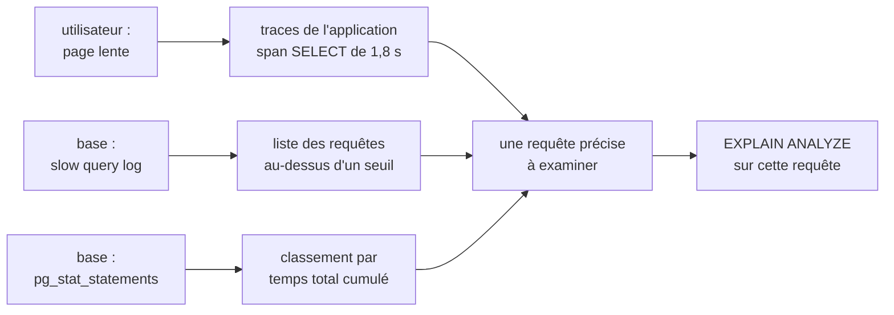

| Source | Ce qu'elle montre | Réglage (exemple) |
|---|---|---|
| traces (OpenTelemetry, APM) | quelle page ou quel appel est lent, et quelle requête SQL dans cet appel | instrumentation du driver ou de l'ORM |
| slow query log | chaque requête plus longue qu'un seuil, avec son texte | MySQL : `slow_query_log = ON`, `long_query_time = 1` ; PostgreSQL : `log_min_duration_statement = 1000` (ms) |
| `pg_stat_statements` (PostgreSQL), `performance_schema` (MySQL) | toutes les requêtes regroupées par forme, avec nombre d'appels et temps cumulé | extension à activer dans `shared_preload_libraries` |
| `auto_explain` (PostgreSQL) | le plan d'exécution des requêtes lentes, écrit dans les logs | `auto_explain.log_min_duration = 1000` |

``` { .sql .ex-bad title="À éviter" }
-- À éviter : classer par durée moyenne
SELECT calls, round(mean_exec_time, 1) AS mean_ms, left(query, 60) AS query
FROM pg_stat_statements
ORDER BY mean_exec_time DESC
LIMIT 3;
```

``` { .sql .ex-good title="Recommandé" }
-- Bien : classer les requêtes par temps total cumulé, pas par durée moyenne
SELECT calls,
       round(total_exec_time) AS total_ms,
       round(mean_exec_time, 1) AS mean_ms,
       left(query, 60) AS query
FROM pg_stat_statements
ORDER BY total_exec_time DESC
LIMIT 3;
```
``` { .text .ex-ref title="Référence" }
 calls   | total_ms | mean_ms | query
---------+----------+---------+------------------------------------------------------------
 2100000 |  6300000 |     3.0 | SELECT * FROM orders WHERE customer_id = $1
      40 |    96000 |  2400.0 | SELECT country, SUM(total_cents) FROM orders GROUP BY coun
    9000 |    45000 |     5.0 | UPDATE orders SET status = $1 WHERE id = $2
```
Chiffres d'exemple. La requête en tête ne prend que 3 ms, mais elle tourne 2 millions de fois : c'est elle qui occupe la base. Le rapport à 2,4 s se voit davantage dans le slow query log, mais pèse 65 fois moins. Classée par durée moyenne, la liste met ce rapport en tête et relègue la requête à 3 ms en bas : j'optimise le rapport, et la base reste aussi chargée.

!!! noob "As noob"
    Une requête lente n'est pas forcément la plus coûteuse. Classe d'abord par **temps total** (durée moyenne x nombre d'appels) : gagner 2 ms sur une requête appelée un million de fois rapporte plus que gagner 2 s sur un rapport lancé une fois par jour.

**Risques.** Un seuil trop bas (`log_min_duration_statement = 0`) écrit chaque requête dans les logs : le disque se remplit, et les logs coûtent plus que ce qu'ils rapportent. Les textes de requêtes journalisés peuvent contenir des données personnelles, comme un e-mail dans un `WHERE` : je règle la rétention des logs et je préfère les formes normalisées de `pg_stat_statements`, où les valeurs sont remplacées par `$1`.

:material-book-open-variant: Doc de référence : [PostgreSQL, pg_stat_statements](https://www.postgresql.org/docs/current/pgstatstatements.html) (version 18, 2025) ; [MySQL, The Slow Query Log](https://dev.mysql.com/doc/refman/8.4/en/slow-query-log.html) (MySQL 8.4) ; [PostgreSQL, auto_explain](https://www.postgresql.org/docs/current/auto-explain.html) (version 18, 2025)
{ .doc-ref }

### EXPLAIN
<span class="pill pill-status pill-status-ok" title="Toujours valable, vérifié en novembre 2026">Valable · 11/2026</span>

`EXPLAIN` montre comment la base compte exécuter la <span class="term" data-term="db-query">requête</span>, sans l'exécuter.
``` { .sql .ex-ref title="Référence" }
-- Exemple : voir le plan prévu, sans exécuter la requête
EXPLAIN SELECT * FROM orders WHERE customer_id = 7;
```
``` { .text .ex-ref title="Référence" }
type: ALL    rows: 2 400 000     la base lit toute la table : pas d'index utilisé
```
Après `CREATE INDEX idx_orders_customer ON orders (customer_id);` :
``` { .text .ex-ref title="Référence" }
type: ref    rows: 14            la base va directement aux 14 lignes du client
```
`EXPLAIN ANALYZE` (PostgreSQL, MySQL 8) l'exécute vraiment et donne les temps réels.

Les sorties ci-dessus sont celles de MySQL. PostgreSQL dit la même chose avec d'autres mots :

| MySQL | PostgreSQL | Ce que ça veut dire |
|---|---|---|
| `type: ALL` | `Seq Scan on orders` | lecture de toute la table, ligne par ligne |
| `type: ref` | `Index Scan using idx_orders_customer` | accès direct par l'index |
| `rows: 14` | `rows=14` | estimation du nombre de lignes, pas un compte exact |

**Risques.** `EXPLAIN ANALYZE` exécute vraiment la requête : sur un `UPDATE` ou un `DELETE`, il modifie les données, donc je l'enveloppe dans `BEGIN; ... ROLLBACK;`. Et le plan obtenu sur une base de développement de 100 lignes ne dit rien de celui de la production : je le lis sur des volumes comparables.

:material-book-open-variant: Doc de référence : [PostgreSQL, Using EXPLAIN](https://www.postgresql.org/docs/current/using-explain.html) (version 18, 2025) ; [MySQL, Optimizing Queries with EXPLAIN](https://dev.mysql.com/doc/refman/8.4/en/using-explain.html) (MySQL 8.4)
{ .doc-ref }

### Quand un index aide
<span class="pill pill-status pill-status-ok" title="Toujours valable, vérifié en novembre 2026">Valable · 11/2026</span>

Un index B-tree, le type par défaut de PostgreSQL et de MySQL (InnoDB), est un arbre trié. Pour `WHERE customer_id = 7`, la base descend de la racine jusqu'à la bonne feuille en quelques lectures, au lieu de parcourir toute la table. Les feuilles sont chaînées entre elles (pointillés), ce qui sert aussi aux plages (`BETWEEN`, `>=`) et à `ORDER BY`.

!!! noob "As noob"
    Un index, c'est l'index à la fin d'un livre : pour trouver « transaction », je vais à la lettre T puis à la bonne page, au lieu de lire les 800 pages. En échange, chaque page ajoutée oblige à remettre l'index à jour. La phrase à retenir : **un index accélère les lectures qui filtrent sur sa colonne et ralentit un peu chaque écriture.**

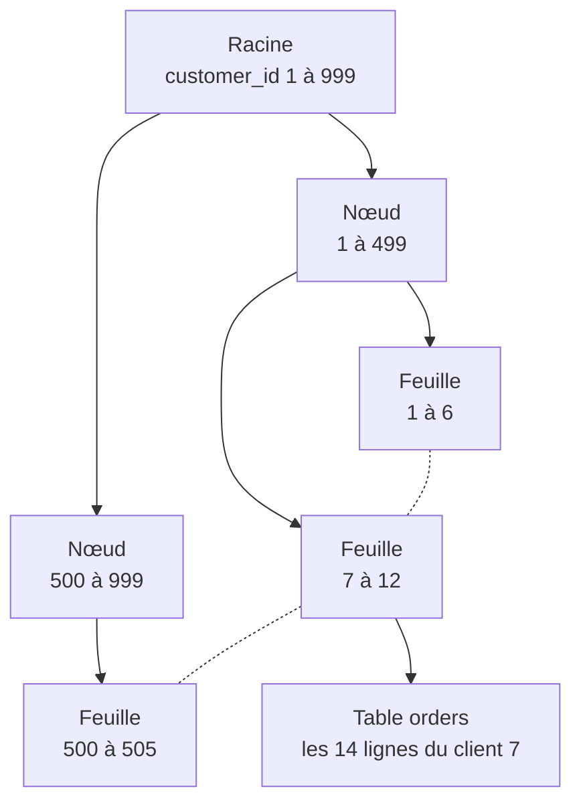

| Situation | <span class="term" data-term="db-index">Index</span> utile ? |
|---|---|
| mes requêtes filtrent, joignent ou trient souvent sur la même colonne, comme `customer_id` pour afficher les commandes d'un client | oui |
| la colonne n'a que quelques valeurs différentes, comme `status` qui vaut `paid`, `pending` ou `cancelled` : chaque valeur couvre une grosse part de la table | souvent peu utile seul |
| la table ne fait que quelques centaines de lignes, la lire en entier est déjà instantané | inutile |
| la table reçoit surtout des écritures et peu de lectures, comme des <span class="term" data-term="logs">logs</span> ou des événements | chaque index ralentit les écritures |
| ma requête passe la colonne dans une fonction avant de comparer, comme `WHERE LOWER(email) = '...'` | l'index sur `email` n'est **pas** utilisé, à cause de la fonction |
| je cherche une fin de texte, comme tous les e-mails en `WHERE email LIKE '%@example.com'` | pas utilisé (le `%` au début empêche) |

Le cas de la fonction est le plus sournois : la requête marche, juste lentement, et rien ne prévient. Sur PostgreSQL, un index sur l'expression elle-même règle le problème :

``` { .sql .ex-bad title="À éviter" }
-- À éviter : LOWER() sur la colonne, l'index sur email ne sert pas, toute la table est lue
SELECT id FROM customers WHERE LOWER(email) = 'ada@example.com';
```

``` { .sql .ex-good title="Recommandé" }
-- Bien : un index sur l'expression LOWER(email), que la même requête utilise
CREATE INDEX idx_customers_email_lower ON customers (LOWER(email));
SELECT id FROM customers WHERE LOWER(email) = 'ada@example.com';
```

:material-book-open-variant: Doc de référence : [Markus Winand, Anatomy of an SQL Index](https://use-the-index-luke.com/sql/anatomy) (consultée en novembre 2026) ; [PostgreSQL, Index Types](https://www.postgresql.org/docs/current/indexes-types.html) (version 18, 2025)
{ .doc-ref }

### Index composite : l'ordre des colonnes et l'index couvrant
<span class="pill pill-status pill-status-ok" title="Toujours valable, vérifié en novembre 2026">Valable · 11/2026</span>

Ma page « mes commandes » filtre sur un client et trie par date : `WHERE customer_id = 123 ORDER BY created_at DESC LIMIT 50`. Un index sur `customer_id` seul trouve les commandes du client, mais la base doit ensuite toutes les trier pour garder les 50 plus récentes. Un <span class="term" data-term="composite-index">index composite</span> porte plusieurs colonnes, triées dans l'ordre où je les déclare : d'abord par client, puis, à l'intérieur de chaque client, par date. La base saute au client 123, lit ses commandes déjà rangées par date et s'arrête à 50.

**La règle d'ordre** (Markus Winand, « SQL Performance Explained », 2012) : les colonnes comparées par **égalité** d'abord, puis la colonne de **plage** (`>=`, `BETWEEN`) ou de **tri**. Un index composite sert aussi aux requêtes qui n'utilisent que ses premières colonnes : `(customer_id, created_at)` sert `WHERE customer_id = 123`, mais pas `WHERE created_at >= '2026-01-01'` seul.

``` { .sql .ex-bad title="À éviter" }
-- À éviter : la plage en premier, la base parcourt toutes les commandes de l'année, tous clients confondus, pour garder celles du client 123
CREATE INDEX idx_orders_created_customer ON orders (created_at, customer_id);
SELECT id, created_at, status FROM orders
WHERE customer_id = 123 AND created_at >= '2026-01-01';
```

``` { .sql .ex-good title="Recommandé" }
-- Bien : l'égalité en premier, la base saute au client 123 puis lit seulement sa tranche de dates
CREATE INDEX idx_orders_customer_created ON orders (customer_id, created_at);
SELECT id, created_at, status FROM orders
WHERE customer_id = 123 AND created_at >= '2026-01-01';
```

Je le vérifie avec `EXPLAIN` avant et après. Sur MySQL, la colonne `Extra` dit si la base trie elle-même les lignes (sorties simplifiées, chiffres d'exemple) :

``` { .text .ex-ref title="Référence · avant, index sur customer_id seul" }
EXPLAIN SELECT id, created_at, status FROM orders WHERE customer_id = 123 ORDER BY created_at DESC LIMIT 50;

type: ref    key: idx_orders_customer            rows: 3200    Extra: Using filesort
```
``` { .text .ex-ref title="Référence · après, index (customer_id, created_at)" }
type: ref    key: idx_orders_customer_created    rows: 3200    Extra: Backward index scan
```
`Using filesort` a disparu : la base lit l'index dans l'ordre (à l'envers ici, d'où `Backward index scan` sur MySQL 8, ce qui est normal) et s'arrête après 50 lignes, même si l'estimation `rows` ne change pas. Sur PostgreSQL, c'est l'étape `Sort` qui disparaît du plan (voir [la boucle](#rendre-une-requete-rapide-la-boucle)).

**L'index couvrant.** Si toutes les colonnes que la requête lit sont dans l'index, la base n'a même plus besoin d'aller lire la table : c'est un <span class="term" data-term="covering-index">index couvrant</span>. En InnoDB (MySQL), chaque index secondaire contient déjà la clé primaire `id`, donc `(customer_id, created_at, status)` couvre `SELECT id, created_at, status`, et `EXPLAIN` affiche `Using index`. PostgreSQL (depuis la version 11, 2018) ajoute des colonnes transportées sans les trier avec `INCLUDE`, et le plan affiche `Index Only Scan` :

``` { .sql .ex-ref title="Référence" }
-- Exemple : index couvrant PostgreSQL, status est transporté dans l'index sans servir au tri
CREATE INDEX CONCURRENTLY idx_orders_customer_created_cov
    ON orders (customer_id, created_at DESC) INCLUDE (status);
```

!!! noob "As noob"
    Un annuaire est trié par nom, puis par prénom. Trouver tous les « Martin » prénommés de A à C est rapide ; trouver tous les prénoms « Ada », quel que soit le nom, oblige à lire tout l'annuaire. Et si l'annuaire donne déjà le numéro de téléphone, je n'ai pas besoin d'aller frapper chez la personne : c'est l'index couvrant. La phrase à retenir : **l'égalité d'abord, la plage ou le tri ensuite, et je vérifie avec `EXPLAIN`.**

| Je veux... | J'utilise... |
|---|---|
| afficher les 50 dernières commandes d'un client, comme la page « mes commandes » | un index `(customer_id, created_at)` |
| filtrer sur un client et un statut, puis sur une période, comme « les commandes payées du client 123 en 2026 » | les deux égalités d'abord : `(customer_id, status, created_at)` |
| éviter la lecture de la table pour une requête très fréquente qui lit peu de colonnes | un index couvrant : les colonnes lues ajoutées en fin d'index, ou `INCLUDE` sur PostgreSQL |
| chercher seulement par date, sur toutes les commandes, comme un rapport mensuel | un index séparé sur `created_at` : `(customer_id, created_at)` ne le sert pas |

**Risques.** Chaque index ralentit chaque `INSERT` et chaque `UPDATE` des colonnes qu'il contient, et prend de la place : je ne crée pas un index par requête. Un index `(customer_id)` devient redondant à côté de `(customer_id, created_at)`, je le supprime après avoir vérifié qu'aucun plan ne l'utilise seul. Un index couvrant trop large grossit vite. Sur PostgreSQL, un `Index Only Scan` lit quand même la table pour les pages que `VACUUM` n'a pas encore marquées visibles : `Heap Fetches` dans le plan dit combien.

:material-book-open-variant: Doc de référence : [Markus Winand, Concatenated Indexes](https://use-the-index-luke.com/sql/where-clause/the-equals-operator/concatenated-keys) (consultée en novembre 2026) ; [Markus Winand, Index-Only Scan](https://use-the-index-luke.com/sql/clustering/index-only-scan-covering-index) (consultée en novembre 2026) ; [PostgreSQL, Multicolumn Indexes](https://www.postgresql.org/docs/current/indexes-multicolumn.html) (version 18, 2025) ; [PostgreSQL, Index-Only Scans and Covering Indexes](https://www.postgresql.org/docs/current/indexes-index-only-scans.html) (version 18, 2025)
{ .doc-ref }

### Rendre une requête rapide : la boucle
<span class="pill pill-status pill-status-ok" title="Toujours valable, vérifié en novembre 2026">Valable · 11/2026</span>

On n'optimise pas au jugé : on mesure, on change **une seule chose**, on remesure la même requête avec les mêmes paramètres.

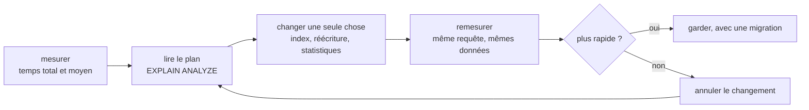

Avant et après, en PostgreSQL :
``` { .text .ex-ref title="Référence" }
EXPLAIN ANALYZE SELECT id, total_cents FROM orders WHERE customer_id = 7 ORDER BY created_at DESC LIMIT 10;

Limit  (actual time=812.4..812.4 rows=10)
  ->  Sort  (actual time=812.4..812.4 rows=10)
        ->  Seq Scan on orders  (actual time=0.1..809.9 rows=14)
              Filter: (customer_id = 7)
              Rows Removed by Filter: 2399986
Execution Time: 812.6 ms
```
`CREATE INDEX CONCURRENTLY idx_orders_customer_created ON orders (customer_id, created_at DESC);`
``` { .text .ex-ref title="Référence" }
Limit  (actual time=0.04..0.06 rows=10)
  ->  Index Scan using idx_orders_customer_created on orders  (actual time=0.04..0.05 rows=10)
        Index Cond: (customer_id = 7)
Execution Time: 0.1 ms
```
L'index sur deux colonnes sert à la fois au filtre et au tri : plus de lecture de toute la table, plus de tri.

| Ce que je vois dans le plan | Ce que ça veut dire | Ce que j'essaie |
|---|---|---|
| `Seq Scan` avec beaucoup de `Rows Removed by Filter` | la table est lue en entier pour garder peu de lignes | un index sur la colonne du filtre |
| `Sort` juste après un scan, avec `LIMIT` | toutes les lignes sont triées pour en garder 10 | un index qui suit l'ordre du tri |
| `rows=` estimé très loin du `rows=` réel | les statistiques sont fausses, le plan choisi aussi | `ANALYZE orders;` puis relire le plan |
| `Sort Method: external merge  Disk` | le tri déborde de la mémoire sur le disque | réduire les lignes avant le tri, ou augmenter `work_mem` pour cette requête |
| `Nested Loop` avec des milliers de boucles | une jointure faite ligne par ligne | un index sur la colonne de jointure, ou une réécriture |
| aucune étape lente, mais beaucoup d'appels | la requête est rapide, c'est l'application qui l'appelle trop | regrouper les appels (voir [N+1](#le-probleme-n1)), ajouter un cache |

!!! noob "As noob"
    `EXPLAIN` est l'itinéraire que le GPS prévoit, `EXPLAIN ANALYZE` est le trajet réellement fait, chrono en main. Je cherche l'étape où le temps explose, je la corrige, puis je refais le même trajet pour vérifier.

**Risques.** Le deuxième essai profite du cache : la même requête relancée tout de suite paraît plus rapide sans que mon changement y soit pour rien. Je compare des mesures prises dans les mêmes conditions (plusieurs passages, cache chaud des deux côtés). Et un `CREATE INDEX` sans `CONCURRENTLY` lancé en production « pour essayer » bloque les écritures pendant toute sa construction (voir [Index et contraintes sans bloquer](#index-et-contraintes-sans-bloquer)).

:material-book-open-variant: Doc de référence : [PostgreSQL, Performance Tips](https://www.postgresql.org/docs/current/performance-tips.html) (version 18, 2025) ; [Markus Winand, Use The Index, Luke](https://use-the-index-luke.com/) (consultée en novembre 2026)
{ .doc-ref }

### Le problème N+1
<span class="pill pill-status pill-status-ok" title="Toujours valable, vérifié en novembre 2026">Valable · 11/2026</span>

``` { .python .ex-bad title="À éviter" }
# À éviter : une requête par commande, 101 allers-retours (N+1)
orders = db.query("SELECT * FROM orders LIMIT 100")
for order in orders:
    customer = db.query("SELECT * FROM customers WHERE id = %s", order.customer_id)
```
1 requête pour les commandes, puis 100 pour les clients : 101 <span class="term" data-term="round-trip">allers-retours</span>. Une seule requête avec `JOIN` fait la même chose. Les <span class="term" data-term="orm">ORM</span> (SQLAlchemy, Doctrine, Prisma) le provoquent facilement : à surveiller dans les <span class="term" data-term="trace-distributed">traces</span>, où l'on voit 100 <span class="term" data-term="span">spans</span> `SELECT` identiques.

*SQLAlchemy : complémentaire de Alembic*
{ .tool-rel }


!!! noob "As noob"
    C'est comme aller au supermarché une fois pour lire la liste de courses, puis faire 100 allers-retours, un par article, au lieu de tout prendre en un passage. Chaque trajet est court, c'est leur nombre qui coûte. La phrase à retenir : **une requête par élément d'une liste, c'est un N+1 : on regroupe en une seule requête (`JOIN` ou `IN`).**

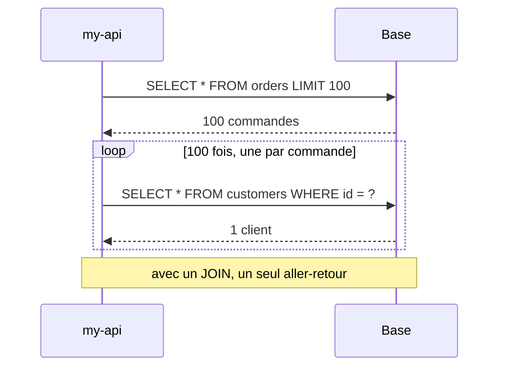

``` { .python .ex-good title="Recommandé" }
# Ce qui change : un seul JOIN, un seul aller-retour pour les 100 commandes et leurs clients
rows = db.query(
    "SELECT o.id, o.total_cents, c.email "
    "FROM orders o JOIN customers c ON c.id = o.customer_id LIMIT 100"
)
```

:material-book-open-variant: Doc de référence : [Markus Winand, Nested Loops and the N+1 problem](https://use-the-index-luke.com/sql/join/nested-loops-join-n1-problem) (consultée en novembre 2026)
{ .doc-ref }

!!! maturity "Mesurer la maturité"
    | Niveau | Ce que j'observe dans l'équipe |
    |---|---|
    | N1 | quand une page est lente, quelqu'un lance `EXPLAIN ANALYZE` à la main sur la requête suspecte |
    | N2 | `pg_stat_statements` et le slow query log sont activés partout, et les traces montrent la requête SQL derrière chaque appel lent |
    | N3 | une alerte se déclenche seule quand le temps total d'une requête dépasse un seuil, et un test de la CI échoue si une liste passe de 2 à 51 requêtes |
    | N4 | l'équipe revoit chaque mois le classement par temps total, fixe un objectif de latence par route et choisit ses optimisations d'après ces chiffres |

    **Je mesure** : le p95 de la durée des requêtes SQL des routes principales, lu dans l'APM ; le nombre de requêtes SQL par appel HTTP sur les pages de liste, lu dans les traces.

## ORM : accéder à la base depuis le code

<a class="pill pill-scope pill-scope-code" href="../architecture/#carte-des-echelles">Échelle · Code</a> <a class="pill pill-scope pill-scope-app" href="../architecture/#carte-des-echelles">Échelle · Application</a>

Mon équipe n'écrit pas tout le SQL à la main : un <span class="term" data-term="orm">ORM</span> (SQLAlchemy, Doctrine, Hibernate, Eloquent, Prisma) associe des classes du code à des tables et génère les requêtes. Il fait gagner du temps sur le courant (créer, lire, modifier une commande et ses articles), mais il cache des choix qui pèsent sur les performances et sur la façon de tester. Trois questions reviennent : quelle famille d'ORM, quand passer au SQL, et quand charger les données liées.

### Active Record ou Data Mapper
<a class="pill pill-scope pill-scope-code" href="../architecture/#carte-des-echelles">Échelle · Code</a> <span class="pill pill-status pill-status-ok" title="Toujours valable, vérifié en novembre 2026">Valable · 11/2026</span>

Martin Fowler a nommé les deux familles dans « Patterns of Enterprise Application Architecture » (2002) :

- **<span class="term" data-term="active-record">Active Record</span>** : un objet correspond à une ligne et sait s'enregistrer lui-même (`order.save()`). Exemples : Eloquent (Laravel), Active Record (Rails), l'ORM de Django.
- **<span class="term" data-term="data-mapper">Data Mapper</span>** : l'objet métier ne sait rien de la base ; un composant à part (la session, l'entity manager) le lit et l'écrit. Exemples : SQLAlchemy, Doctrine, Hibernate.

``` { .python .ex-ref title="Référence" }
# Exemple : Active Record (Django), l'objet porte lui-même sa sauvegarde
order = Order.objects.get(id=42)
order.status = "paid"
order.save()

# Exemple : Data Mapper (SQLAlchemy), la session lit et écrit un objet qui ignore la base
order = session.get(Order, 42)
order.status = "paid"
session.commit()
```

!!! noob "As noob"
    Avec Active Record, chaque fiche sait se ranger elle-même dans le classeur. Avec Data Mapper, les fiches ne savent rien du classeur : c'est l'archiviste qui les range et les ressort. La phrase à retenir : **Active Record est plus simple, Data Mapper sépare les règles métier du stockage.**

| | Active Record | Data Mapper |
|---|---|---|
| Point fort | très peu de code pour un CRUD, une table par écran | règles métier testables sans base, schéma libre de différer des objets |
| Coût | le métier dépend de la base, les tests unitaires demandent une base ou beaucoup de mocks | plus de code (mapping, session), courbe d'apprentissage |
| Je le choisis quand | mon application est surtout des formulaires sur des tables, comme un back-office | mes règles métier sont riches, comme un calcul de tarifs, et je veux les tester seules |

**Quand** : le choix vient souvent avec le framework (Laravel, Rails, Django : Active Record ; Symfony, Spring : Data Mapper). Je le remets en question quand les règles métier grossissent dans des objets qui font aussi leurs requêtes. **Comment** : avec Data Mapper, je cache l'accès aux données derrière un dépôt (*Repository*, Eric Evans, « Domain-Driven Design », 2003), qui peut utiliser l'ORM ou du SQL.

:material-book-open-variant: Doc de référence : [Martin Fowler, Active Record](https://martinfowler.com/eaaCatalog/activeRecord.html) et [Data Mapper](https://martinfowler.com/eaaCatalog/dataMapper.html) (Patterns of Enterprise Application Architecture, 2002)
{ .doc-ref }

### ORM, query builder ou SQL écrit à la main
<a class="pill pill-scope pill-scope-code" href="../architecture/#carte-des-echelles">Échelle · Code</a> <span class="pill pill-status pill-status-ok" title="Toujours valable, vérifié en novembre 2026">Valable · 11/2026</span>

Un <span class="term" data-term="query-builder">query builder</span> construit du SQL avec des fonctions du langage, sans cacher que c'est du SQL : SQLAlchemy Core, Knex, Kysely, jOOQ, le QueryBuilder de Doctrine. Il garde les paramètres et la composition (ajouter un filtre selon un formulaire), sans passer par des objets.

Mon rapport mensuel du chiffre d'affaires par statut et par semaine, écrit avec l'ORM, charge 2 millions de commandes en objets et met 6 minutes (chiffres d'exemple) :

``` { .python .ex-bad title="À éviter" }
# À éviter : charger 2 millions de lignes en objets pour les additionner en Python
totals = defaultdict(int)
for order in session.scalars(select(Order)):
    totals[(order.status, order.created_at.isocalendar().week)] += order.total_cents
```

``` { .python .ex-good title="Recommandé" }
# Bien : la base agrège, le query builder garde les paramètres, quelques centaines de lignes reviennent
week = func.date_trunc("week", Order.created_at)
rows = session.execute(
    select(Order.status, week.label("week"), func.sum(Order.total_cents))
    .where(Order.created_at >= start)
    .group_by(Order.status, week)
).all()
```

L'agrégation est le travail de la base : elle lit les lignes là où elles sont et ne renvoie que le résultat.

| Je veux... | J'utilise... |
|---|---|
| créer, lire et modifier une commande avec ses articles, le cas courant d'une application | l'ORM |
| construire une requête dont les filtres dépendent d'un formulaire de recherche, sans concaténer de texte | un query builder |
| écrire un rapport qui agrège des millions de lignes, ou une requête très sollicitée dont je veux lire le plan | du SQL écrit à la main, toujours paramétré (voir [l'injection SQL](#securite-linjection-sql)) |

**Quand** : je n'oppose pas les trois ; je fixe une règle d'équipe, par exemple « agrégation ou plus de trois jointures : SQL ». **Pourquoi** : la productivité de l'ORM sur le courant, sans ses pièges sur les requêtes lourdes. **Comment** : j'active les logs SQL en développement (`echo=True` dans SQLAlchemy), parce qu'un ORM qu'on ne regarde jamais finit par générer des N+1, et je lis le plan des requêtes importantes avec [`EXPLAIN`](#explain). Martin Fowler le résume dans « ORM Hate » (2012) : un ORM règle bien le problème courant, il ne dispense pas de connaître SQL.

**Risques.** Le SQL écrit à la main échappe aux vérifications de l'ORM : une colonne renommée dans le modèle casse la requête seulement à l'exécution, donc je couvre chaque requête manuelle par un test sur une vraie base. À l'inverse, tout laisser à l'ORM cache les requêtes lourdes jusqu'à ce que la production les révèle.

:material-book-open-variant: Doc de référence : [SQLAlchemy, ORM Querying Guide](https://docs.sqlalchemy.org/en/20/orm/queryguide/index.html) (version 2.0, consultée en novembre 2026)
{ .doc-ref }

### Chargement paresseux ou anticipé
<a class="pill pill-scope pill-scope-code" href="../architecture/#carte-des-echelles">Échelle · Code</a> <span class="pill pill-status pill-status-ok" title="Toujours valable, vérifié en novembre 2026">Valable · 11/2026</span>

Par défaut, beaucoup d'ORM font du <span class="term" data-term="lazy-loading">chargement paresseux</span> (*Lazy Load*, Fowler, 2002) : `order.customer` ne lance la requête qu'au premier accès. Pratique pour une fiche seule, désastreux dans une boucle : c'est la cause classique du [problème N+1](#le-probleme-n1). Le <span class="term" data-term="eager-loading">chargement anticipé</span> demande à l'ORM de charger les données liées d'avance, en une ou deux requêtes.

``` { .python .ex-bad title="À éviter" }
# À éviter : chargement paresseux dans une boucle, une requête par commande pour lire son client
orders = session.scalars(select(Order).limit(50)).all()
for order in orders:
    print(order.customer.email)
```

``` { .python .ex-good title="Recommandé" }
# Bien : chargement anticipé, le client par jointure, les articles par une seconde requête IN
orders = session.scalars(
    select(Order)
    .options(joinedload(Order.customer), selectinload(Order.items))
    .limit(50)
).all()
```

La première version fait 51 requêtes (101 si j'affiche aussi les articles) ; la seconde en fait 2, quel que soit le nombre de commandes. `joinedload` convient à une relation « un seul » (une commande a un client) ; `selectinload` à une collection (une commande a des articles), pour ne pas multiplier les lignes de la jointure. Les équivalents : `JOIN FETCH` dans Hibernate et Doctrine, `with()` dans Eloquent, `include` dans Prisma.

**Quand** : chargement anticipé dès que j'affiche une liste avec des données liées ; chargement paresseux pour une relation rarement lue sur une fiche seule. **Comment** : je peux interdire le chargement paresseux là où il est dangereux (`lazy="raise"` dans SQLAlchemy lève une erreur au lieu de lancer une requête cachée), et j'écris un test qui affiche la liste avec 5 puis 50 commandes et vérifie que le nombre de requêtes ne change pas.

**Risques.** Le chargement anticipé mis partout charge des données que l'écran n'affiche pas : une fiche client qui charge d'avance tous les articles de toutes ses commandes ramène des milliers de lignes inutiles. Je l'ajoute liste par liste, d'après ce que chaque écran affiche.

:material-book-open-variant: Doc de référence : [SQLAlchemy, Relationship Loading Techniques](https://docs.sqlalchemy.org/en/20/orm/queryguide/relationships.html) (version 2.0, consultée en novembre 2026)
{ .doc-ref }

!!! maturity "Mesurer la maturité"
    | Niveau | Ce que j'observe dans l'équipe |
    |---|---|
    | N1 | chacun écrit ses accès comme il veut, ORM ou SQL, et les logs SQL ne sont regardés qu'en cas de lenteur |
    | N2 | une règle d'équipe écrite dit quand passer au SQL, les logs SQL sont actifs en développement, et le chargement anticipé est demandé en revue sur chaque liste |
    | N3 | le chargement paresseux est interdit là où il est dangereux (`lazy="raise"`) et un test compte les requêtes, donc un N+1 casse la CI sans revue humaine |
    | N4 | l'équipe suit le nombre de N+1 détectés et la part des requêtes lentes générées par l'ORM, et ajuste sa règle ORM ou SQL d'après ces chiffres |

    **Je mesure** : le nombre de tests qui vérifient un nombre de requêtes, compté dans le dépôt ; la part des requêtes du top 10 de `pg_stat_statements` générées par l'ORM, lue en croisant avec les traces.

## Faire grandir une base de données

<a class="pill pill-scope pill-scope-system" href="../architecture/#carte-des-echelles">Échelle · Système</a> <a class="pill pill-scope pill-scope-infra" href="../architecture/#carte-des-echelles">Échelle · Infrastructure</a>

<a class="pill pill-practice" href="../livraison/#concevoir-avant-de-coder">Pratique · Conception technique</a>

Une base « sature » quand elle ne suit plus : requêtes de plus en plus lentes, processeur à 90 %, disque plein, trop de connexions. La tentation est de sauter tout de suite à la solution la plus impressionnante (répartir les données sur plusieurs machines). En pratique, on monte une échelle : on commence par ce qui coûte peu et se défait facilement, et on ne passe à l'étage suivant que si les mesures le demandent.

### Deux sens pour « vertical » et « horizontal »

Les deux mots servent pour deux choses différentes. Les confondre est l'erreur la plus courante.

| | Vertical | Horizontal |
|---|---|---|
| **La machine** | <span class="term" data-term="vertical-scaling">scale up</span> : la même base sur une machine plus grosse (plus de processeurs, de mémoire, un disque plus rapide) | <span class="term" data-term="horizontal-scaling">scale out</span> : plusieurs machines (des copies en lecture, ou des morceaux de données sur chaque machine) |
| **Les données** | <span class="term" data-term="vertical-partitioning">partitionnement vertical</span> : découper par colonnes ou par domaine (les colonnes lourdes dans une autre table, le catalogue et les commandes dans deux bases) | partitionnement horizontal : découper par lignes (les commandes d'octobre d'un côté, celles de novembre de l'autre) |

Le partitionnement horizontal peut rester sur une seule machine (partitionnement de table) ou s'étaler sur plusieurs : c'est alors le <span class="term" data-term="sharding">sharding</span>.

### L'échelle, du moins cher au plus cher

| Étape | Ce qu'elle règle | Coût | Retour arrière |
|---|---|---|---|
| 1. Requêtes et index | lenteurs dues à une requête mal écrite ou sans index | faible | facile |
| 2. Pooler de connexions | trop de connexions ouvertes | faible | facile |
| 3. Cache | les mêmes lectures répétées | moyen (invalidation) | facile |
| 4. Machine plus grosse | processeur, mémoire ou disque au maximum | argent, un redémarrage | facile |
| 5. Réplicas en lecture | beaucoup plus de lectures que d'écritures | moyen (données en retard) | facile |
| 6. Partitionnement de table | tables énormes, index lourds | moyen | possible |
| 7. Archivage des données froides | volume qui grossit sans être lu | moyen | possible |
| 8. Sharding | écritures ou volume au-delà de la plus grosse machine | très élevé | presque impossible |

### Requêtes, index, connexions et cache
<span class="pill pill-status pill-status-ok" title="Toujours valable, vérifié en novembre 2026">Valable · 11/2026</span>

Avant de payer une machine, vérifier ce qu'elle fait. La section [Performances](#performances) plus haut couvre l'essentiel : `EXPLAIN`, un index manquant, le problème N+1. Sur PostgreSQL, l'extension `pg_stat_statements` liste les requêtes qui consomment le plus de temps au total ; souvent, trois requêtes font la moitié de la charge.

``` { .sql .ex-ref title="Référence" }
-- Exemple : les 3 requêtes qui consomment le plus de temps au total
SELECT calls, round(total_exec_time) AS total_ms, round(mean_exec_time) AS mean_ms, query
FROM pg_stat_statements ORDER BY total_exec_time DESC LIMIT 3;
```
``` { .text .ex-ref title="Référence" }
 calls  | total_ms | mean_ms | query
--------+----------+---------+------------------------------------------------
 912000 |  1824000 |       2 | SELECT * FROM orders WHERE customer_id = $1
   1400 |   980000 |     700 | SELECT ... FROM invoices JOIN orders ... GROUP BY
     12 |   310000 |   25833 | UPDATE products SET stock = ...
```
La première est rapide mais appelée très souvent (un N+1 probable), la deuxième est lente à chaque appel (un `EXPLAIN ANALYZE` s'impose). Chiffres d'exemple ; les colonnes `total_exec_time` et `mean_exec_time` sont celles de PostgreSQL 13 et plus (avant : `total_time`, `mean_time`).

Ensuite, les connexions. Chaque connexion PostgreSQL est un processus qui coûte de la mémoire. Vingt instances de my-api avec 50 connexions chacune, cela fait 1 000 connexions (exemple). Un <span class="term" data-term="connection-pooler">pooler de connexions</span> (PgBouncer, ou celui de l'hébergeur) les partage :

``` { .text .ex-illus title="Illustration" }
my-api (20 instances x 50 connexions) ──> PgBouncer ──> PostgreSQL (100 connexions réelles)
```

!!! noob "As noob"
    C'est le standard téléphonique d'une entreprise : 1 000 employés, mais 100 lignes extérieures, parce que personne ne téléphone tout le temps. Le standard prête une ligne libre à qui en a besoin et la reprend dès qu'il raccroche. La phrase à retenir : **le pooler partage peu de vraies connexions entre beaucoup de clients qui ne s'en servent qu'un instant.**

Enfin, un <span class="term" data-term="cache-data">cache</span> (Redis, ou la mémoire de l'application) évite de relire cent fois la même fiche produit. Le prix : décider quand la donnée en cache devient fausse.

*Redis : complémentaire de PostgreSQL, MySQL*
{ .tool-rel }


:material-book-open-variant: Doc de référence : [PostgreSQL, pg_stat_statements](https://www.postgresql.org/docs/current/pgstatstatements.html) (version 18, 2025)
{ .doc-ref }

### Pooler et proxy de base de données
<span class="pill pill-status pill-status-ok" title="Toujours valable, vérifié en novembre 2026">Valable · 11/2026</span>

Le pooler de la section précédente ne fait qu'une chose : partager les connexions. Un <span class="term" data-term="database-proxy">proxy de base de données</span> se place au même endroit, entre l'application et la base, mais comprend les requêtes : il envoie les lectures aux réplicas et les écritures au primaire, bascule seul vers un nouveau primaire, peut bloquer ou réécrire une requête.

Un pooler seul fait la partie gauche du dessin ; un proxy ajoute le tri entre primaire et réplicas :

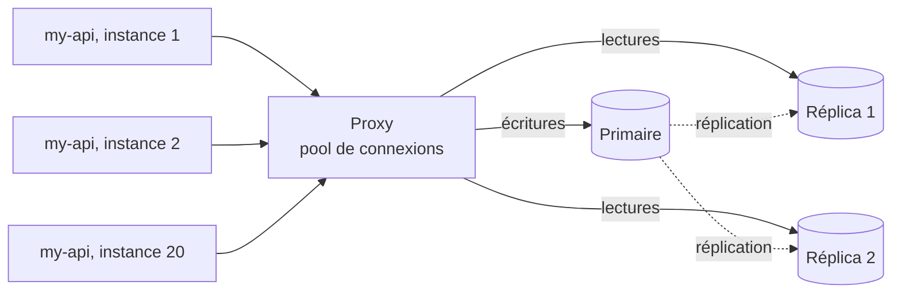

| Outil | Pour quelle base | Ce qu'il fait |
|---|---|---|
| PgBouncer | PostgreSQL | pooler léger, rien d'autre |
| ProxySQL | MySQL, MariaDB | pooler, routage lecture/écriture par règles, cache de requêtes, bascule |
| Pgpool-II, PgCat | PostgreSQL | pooler et répartition des lectures (à vérifier selon la version) |
| proxy de l'hébergeur (RDS Proxy, connecteur Cloud SQL) | base managée | pooler ou connexion sécurisée, géré par l'hébergeur (fonctions à vérifier) |

**Quand** : j'ai beaucoup d'instances de my-api ou de fonctions serverless, et chacune ouvre ses propres connexions ; la base refuse des connexions (`too many connections`) alors que son processeur est calme ; ou j'ai des réplicas en lecture que l'application ne sait pas utiliser seule. **Pas encore** : mon application tourne sur quelques instances avec un pool interne bien réglé (celui de l'ORM ou du pilote) : un composant de plus à surveiller ne m'apporte rien.

**Pourquoi** : une connexion PostgreSQL coûte un processus et plusieurs mégaoctets de mémoire ; mille connexions inactives pèsent autant que des requêtes. Le gain : la base garde un nombre de connexions fixe quoi que fasse l'application. Le coût : un point de passage de plus (à doubler pour ne pas créer un <span class="term" data-term="spof">point de défaillance unique</span>), une latence de quelques dixièmes de milliseconde (ordre de grandeur, à vérifier), et des fonctions de session qui cassent selon le mode.

**Comment**, avec PgBouncer : le **mode** décide quand une connexion réelle est rendue au pool.

*PgBouncer : complémentaire de PostgreSQL*
{ .tool-rel }


| Mode | Connexion rendue | Économie | Ce qui casse |
|---|---|---|---|
| `session` | quand le client se déconnecte | faible | rien |
| `transaction` | à la fin de chaque transaction | forte | `SET` de session, verrous consultatifs, `LISTEN`, tables temporaires ; requêtes préparées avant PgBouncer 1.21 (2023, à vérifier) |
| `statement` | après chaque requête | maximale | toute transaction de plusieurs requêtes |

``` { .ini .ex-ref title="Référence" }
# Exemple : la base vers laquelle PgBouncer relaie les connexions
[databases]
orders = host=orders-db.internal port=5432 dbname=orders

# Exemple : mode transaction, 2 000 connexions client pour 50 connexions réelles
[pgbouncer]
listen_port = 6432
pool_mode = transaction
max_client_conn = 2000
default_pool_size = 50
```
Les instances de my-api se connectent au port 6432 au lieu de 5432 ; 2 000 connexions côté application deviennent 50 connexions réelles par couple base et utilisateur (valeurs d'exemple).

Avec ProxySQL, le routage se configure par des règles dans son interface d'administration, qui parle le protocole MySQL. Ici, les `SELECT ... FOR UPDATE` vont au primaire (groupe 10), les autres `SELECT` aux réplicas (groupe 20), tout le reste au groupe par défaut de l'utilisateur, le primaire :
``` { .sql .ex-ref title="Référence" }
-- Exemple : FOR UPDATE vers le primaire (groupe 10), autres SELECT vers les réplicas (20)
INSERT INTO mysql_query_rules (rule_id, active, match_digest, destination_hostgroup, apply)
VALUES (1, 1, '^SELECT.*FOR UPDATE', 10, 1),
       (2, 1, '^SELECT', 20, 1);
-- Exemple : appliquer les règles tout de suite, puis les garder après un redémarrage
LOAD MYSQL QUERY RULES TO RUNTIME;
SAVE MYSQL QUERY RULES TO DISK;
```
Le piège : une lecture juste après une écriture part vers un réplica en retard, et l'utilisateur ne voit pas ce qu'il vient d'enregistrer (voir [Des réplicas en lecture](#des-replicas-en-lecture)). Les lectures qui doivent voir la dernière écriture restent au primaire, par une règle ou un commentaire dans la requête.

### Une machine plus grosse
<span class="pill pill-status pill-status-ok" title="Toujours valable, vérifié en novembre 2026">Valable · 11/2026</span>

Passer de 16 à 32 processeurs se fait en un redémarrage chez la plupart des hébergeurs, sans changer une ligne de code. C'est souvent le meilleur rapport effort/gain, tant qu'une machine plus grosse existe. Limite : le goulot n'est pas toujours le processeur. Si les requêtes attendent des verrous (<span class="term" data-term="lock-contention">contention sur les verrous</span>), doubler la machine ne change presque rien.

### Des réplicas en lecture
<span class="pill pill-status pill-status-ok" title="Toujours valable, vérifié en novembre 2026">Valable · 11/2026</span>

Un <span class="term" data-term="read-replica">réplica en lecture</span> est une copie de la base, tenue à jour par <span class="term" data-term="replication">réplication</span>, qui répond aux lectures. Toutes les écritures vont toujours sur la base principale. Le piège : la copie a du retard, le <span class="term" data-term="replication-lag">retard de réplication</span>.

!!! noob "As noob"
    Un réplica, c'est la photocopie d'un registre tenue à jour par un coursier : on peut la consulter à plusieurs pour soulager l'original, mais le coursier a toujours un peu de retard, et ce qu'on vient d'écrire dans l'original peut ne pas encore y figurer. La phrase à retenir : **lire sur un réplica, c'est accepter de lire une donnée un peu ancienne.**

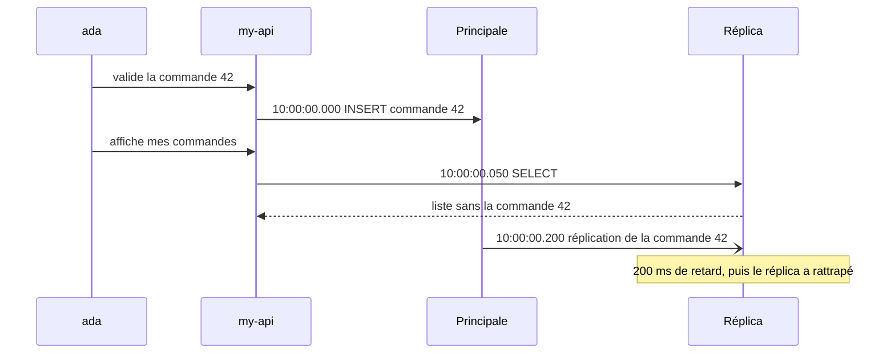

Parade : lire sur la principale juste après une écriture de l'utilisateur (« lire ses propres écritures »), et surveiller le retard comme une métrique à part entière. Côté test : un test qui écrit puis relit via un réplica peut échouer de façon aléatoire.

:material-book-open-variant: Doc de référence : [PostgreSQL, High Availability, Load Balancing, and Replication](https://www.postgresql.org/docs/current/high-availability.html) (version 18, 2025) ; [MySQL, Replication](https://dev.mysql.com/doc/refman/8.4/en/replication.html) (MySQL 8.4)
{ .doc-ref }

### Partitionner une table
<span class="pill pill-status pill-status-ok" title="Toujours valable, vérifié en novembre 2026">Valable · 11/2026</span>

Le <span class="term" data-term="table-partitioning">partitionnement de table</span> découpe une grosse table en plusieurs tables physiques, sur la même machine. L'application continue d'écrire `SELECT ... FROM orders` ; la base ne lit que les partitions concernées. PostgreSQL le fait nativement depuis la version 10 (2017), avec le partitionnement « déclaratif » :

!!! noob "As noob"
    Partitionner, c'est ranger les factures dans un classeur à onglets par mois au lieu d'un seul tas : pour novembre, je n'ouvre que l'onglet novembre. Tout reste dans le même meuble (la même machine), et l'application voit toujours un seul classeur. La phrase à retenir : **le partitionnement n'aide que si les requêtes filtrent sur la colonne de découpage.**

``` { .sql .ex-ref title="Référence" }
-- Exemple : table mère partitionnée par date, created_at fait partie de la clé primaire
CREATE TABLE orders (
    id           bigint      NOT NULL,
    customer_id  bigint      NOT NULL,
    status       text        NOT NULL,
    total_cents  bigint      NOT NULL,
    created_at   timestamptz NOT NULL,
    PRIMARY KEY (id, created_at)
) PARTITION BY RANGE (created_at);

-- Exemple : une partition par mois, créée à l'avance
CREATE TABLE orders_2026_10 PARTITION OF orders
    FOR VALUES FROM ('2026-10-01') TO ('2026-11-01');
CREATE TABLE orders_2026_11 PARTITION OF orders
    FOR VALUES FROM ('2026-11-01') TO ('2026-12-01');
```

``` { .sql .ex-bad title="À éviter" }
-- À éviter : la fonction sur created_at empêche l'élagage, toutes les partitions sont lues
EXPLAIN SELECT * FROM orders WHERE date_trunc('month', created_at) = '2026-11-01';
```

``` { .sql .ex-good title="Recommandé" }
-- Bien : le filtre porte sur la colonne de partition, seule novembre est lue
EXPLAIN SELECT * FROM orders WHERE created_at >= '2026-11-01';
```
``` { .text .ex-ref title="Référence" }
Seq Scan on orders_2026_11      une seule partition lue, octobre est ignoré
```

Ce tri automatique s'appelle l'<span class="term" data-term="partition-pruning">élagage de partitions</span>. Deux règles : la colonne de partition doit faire partie de la clé primaire, et les requêtes doivent filtrer sur elle, sinon la base lit toutes les partitions. Il faut aussi créer les partitions à l'avance (un job mensuel, ou l'extension `pg_partman`).

**Risques.** Si le job qui crée les partitions à l'avance s'arrête, la première commande du mois suivant n'a aucune partition où aller et l'`INSERT` échoue ; avec une partition par défaut, elle s'y entasse sans bruit et l'élagage ne sert plus. Je surveille le nombre de partitions futures et j'alerte quand il reste moins de deux mois d'avance.

### Archiver les données froides
<span class="pill pill-status pill-status-ok" title="Toujours valable, vérifié en novembre 2026">Valable · 11/2026</span>

Les <span class="term" data-term="cold-data">données froides</span> (commandes de plus de deux ans, journaux passés) alourdissent les index et les sauvegardes sans être lues. Avec une table partitionnée par mois, archiver devient simple :

``` { .sql .ex-bad title="À éviter" }
-- À éviter : détacher sans CONCURRENTLY
ALTER TABLE orders DETACH PARTITION orders_2024_01;
```

``` { .sql .ex-good title="Recommandé" }
-- Bien : détacher une partition pour l'archiver, sans bloquer les requêtes en cours
ALTER TABLE orders DETACH PARTITION orders_2024_01 CONCURRENTLY;
```
Sans `CONCURRENTLY`, l'`ALTER` demande un verrou exclusif sur `orders` : il attend la fin d'un rapport en cours, et toutes les nouvelles lectures de `orders` font la queue derrière lui, si bien que la page « Mes commandes » tourne dans le vide.

La partition détachée devient une table normale, que l'on exporte vers un stockage moins cher puis que l'on supprime. `DETACH ... CONCURRENTLY` existe depuis PostgreSQL 14 (2021) et ne bloque pas les requêtes en cours. Sans partitions, il faut un `DELETE` par lots, bien plus lent.

!!! noob "As noob"
    C'est descendre à la cave les cartons des années passées : le bureau reste dégagé, je retrouve plus vite les dossiers de l'année, et les vieux cartons restent consultables si besoin, juste plus lentement. La phrase à retenir : **ce que plus personne ne lit n'a pas à alourdir les index et les sauvegardes de tous les jours.**

**Risques.** Supprimer une partition archivée est définitif : si l'export était incomplet, ou si une obligation légale impose de garder ces commandes, elles sont perdues. Je vérifie l'export (nombre de lignes, relecture d'un échantillon) avant de supprimer, et je confirme la durée de conservation avec le métier.

### Sharder, en dernier
<span class="pill pill-status pill-status-ok" title="Toujours valable, vérifié en novembre 2026">Valable · 11/2026</span>

Le sharding répartit les lignes d'une même table sur plusieurs bases. C'est la seule étape qui augmente vraiment la capacité d'**écriture**, et la plus difficile à défaire. Quatre points décident de son succès.

!!! noob "As noob"
    Sharder, c'est ouvrir plusieurs agences au lieu d'agrandir le siège : chaque client est rattaché à une agence selon une règle (son numéro, par exemple). Ça multiplie les guichets, mais toute question qui concerne tous les clients oblige à appeler toutes les agences. La phrase à retenir : **le sharding ajoute de la capacité d'écriture, au prix de requêtes et de transactions entre machines bien plus compliquées.**

**La clé de sharding.** La <span class="term" data-term="partition-key">clé de partition</span> décide sur quelle base va chaque ligne. On la choisit d'après la requête dominante : si 95 % des requêtes filtrent sur `customer_id` (exemple), c'est elle. Une fois choisie, changer de clé revient à réécrire toutes les données.

**Le shard chaud.** Si un client fait 15 % des commandes, son shard sature pendant que les autres dorment : c'est une <span class="term" data-term="hot-key">clé chaude</span>. On lui donne une base dédiée, ou on ajoute un deuxième élément à la clé.

**Les requêtes inter-shards.** Une jointure ou un rapport sur tous les clients devient une <span class="term" data-term="cross-shard-query">requête inter-shards</span> : interroger chaque base puis fusionner. Les transactions entre deux shards perdent les garanties ACID simples. Les rapports partent donc vers un <span class="term" data-term="data-warehouse">entrepôt de données</span>.

**Le repartitionnement.** Passer de 4 à 8 bases impose de déplacer des données : le <span class="term" data-term="resharding">repartitionnement</span>. L'astuce classique : beaucoup de <span class="term" data-term="logical-shard">shards logiques</span> (256, par exemple) répartis sur peu de bases, et une <span class="term" data-term="shard-router">couche de routage</span> qui tient la table de correspondance. On déplace alors des shards entiers, sans recalculer la place de chaque ligne.

``` { .python .ex-bad title="À éviter" }
# À éviter : la base calculée directement depuis le nombre de bases
def shard_db(customer_id: int) -> str:
    return f"orders-db-{customer_id % 4}"
```

``` { .python .ex-good title="Recommandé" }
# Bien : beaucoup de shards logiques sur peu de bases, déplaçables en bloc
LOGICAL_SHARDS = 256

# Exemple : le shard logique se calcule à partir de la clé de sharding
def logical_shard(customer_id: int) -> int:
    return customer_id % LOGICAL_SHARDS

# Exemple : table de placement, 64 shards par base ; passer à 8 bases ne change qu'elle
placement = {shard: f"orders-db-{shard // 64}" for shard in range(LOGICAL_SHARDS)}
```

Avec `customer_id % 4`, passer à 8 bases change la base de la moitié des clients : tant que leurs lignes ne sont pas recopiées, `my-api` cherche dans la nouvelle base et le client voit un historique de commandes vide.

Le trajet d'une requête pour le client 1234 : la couche de routage calcule le shard logique, puis la table de placement donne la base. Passer de 4 à 8 bases ne change que cette table.

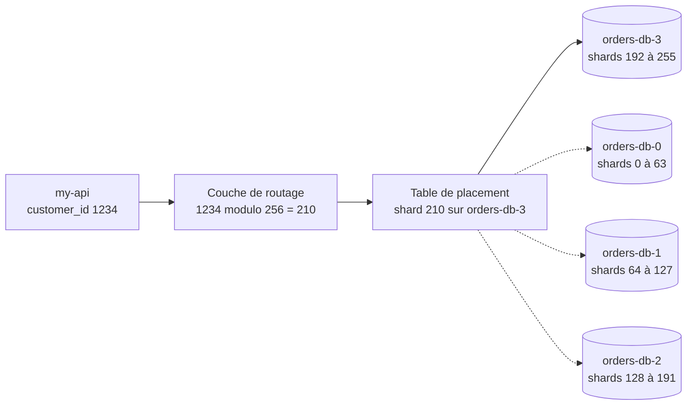

Plutôt que d'écrire ce routage soi-même, des outils le fournissent au-dessus d'une base connue : Vitess pour MySQL, Citus pour PostgreSQL. Autre option, le <span class="term" data-term="distributed-sql">SQL distribué</span> (CockroachDB, YugabyteDB, Spanner) : la base répartit et rééquilibre seule, avec des transactions entre machines, au prix d'une latence d'écriture plus élevée et d'une compatibilité SQL incomplète (à vérifier pour chaque produit).

*Vitess : concurrent en partie de Citus, CockroachDB, YugabyteDB, Spanner ; complémentaire de MySQL*<br>
*Citus : concurrent en partie de Vitess, CockroachDB, YugabyteDB, Spanner ; complémentaire de PostgreSQL*<br>
*CockroachDB : concurrent de YugabyteDB, Spanner ; concurrent en partie de Vitess, Citus*<br>
*YugabyteDB : concurrent de CockroachDB, Spanner*<br>
*Spanner : concurrent de CockroachDB, YugabyteDB*
{ .tool-rel }


### Je veux... j'utilise...

| Je veux... | J'utilise... |
|---|---|
| savoir quelle requête occupe vraiment la base, avant de toucher à quoi que ce soit | `pg_stat_statements`, puis `EXPLAIN ANALYZE` |
| lancer plus d'instances de my-api sans que la base refuse les connexions avec `too many connections` | un pooler de connexions (PgBouncer) |
| envoyer les lectures aux réplicas et les écritures au primaire, sans changer le code de l'application | un proxy de base de données (ProxySQL pour MySQL) |
| ne plus relire cent fois la même donnée, comme la même fiche produit affichée à chaque visite | un cache, avec une règle d'invalidation |
| gagner de la marge vite, sans toucher au code, parce que le processeur ou la mémoire sont au maximum | une machine plus grosse |
| tenir beaucoup plus de lectures que d'écritures, comme un catalogue consulté mille fois pour une commande passée | des réplicas en lecture, en gérant le retard |
| alléger une table énorme, comme des années de commandes que les requêtes filtrent presque toujours par date | le partitionnement de table, par date le plus souvent |
| me débarrasser des vieilles données que plus personne ne lit, comme les commandes de plus de deux ans | détacher et archiver les partitions anciennes |
| que les rapports lourds ne ralentissent plus la base dont l'application a besoin | un entrepôt de données alimenté en continu |
| écrire plus que ce que la plus grosse machine peut encaisser | le sharding (Vitess, Citus) ou le SQL distribué |

Références : documentation PostgreSQL, chapitre [Table Partitioning](https://www.postgresql.org/docs/current/ddl-partitioning.html) (version 18, 2025) ; Martin Kleppmann, « Designing Data-Intensive Applications », chapitres 5 et 6 (2017) ; [PgBouncer, documentation de configuration](https://www.pgbouncer.org/config.html) et [ProxySQL, règles de requêtes](https://proxysql.com/documentation/proxysql-read-write-split-howto/) (dates de publication non indiquées, à vérifier) ; [Vitess](https://vitess.io/docs/) et [Citus](https://docs.citusdata.com/) (dates de publication non indiquées, à vérifier).

!!! maturity "Mesurer la maturité"
    | Niveau | Ce que j'observe dans l'équipe |
    |---|---|
    | N1 | quand la base sature, l'équipe agrandit la machine, sans savoir quelle requête la charge |
    | N2 | l'équipe suit le processeur, les connexions, le retard de réplication et la taille des tables, et chaque passage à l'étage suivant de l'échelle est écrit dans une décision d'architecture |
    | N3 | le pooler protège seul la base des pics de connexions, les partitions du mois suivant sont créées par un job, et une alerte se déclenche sur le retard de réplication |
    | N4 | l'équipe projette la croissance (volume, écritures par seconde) à partir de ses mesures et décide de l'étage suivant des mois avant la saturation |

    **Je mesure** : la marge restante, comme le processeur au pic et le nombre de connexions rapporté au maximum, lue dans le monitoring de la base ; le retard de réplication au p99, lu dans les métriques des réplicas.

## Migrer un schéma sans interruption

<a class="pill pill-scope pill-scope-app" href="../architecture/#carte-des-echelles">Échelle · Application</a> <a class="pill pill-scope pill-scope-infra" href="../architecture/#carte-des-echelles">Échelle · Infrastructure</a>

<a class="pill pill-practice" href="../livraison/#livraison-et-deploiement-continus">Pratique · Déploiement continu</a>
<a class="pill pill-dora" href="https://dora.dev/capabilities/database-change-management/">DORA · Database change management</a>

Le problème : mon équipe livre en <span class="term" data-term="continuous-deployment">déploiement continu</span> progressif, donc pendant quelques minutes l'ancienne et la nouvelle version de l'application tournent **en même temps** sur le même schéma. Si ma migration casse l'une des deux, par exemple en renommant une colonne que l'ancienne version lit encore, la production plante. Et si ma migration pose un verrou sur une grosse table, toutes les requêtes sur cette table attendent, donc l'application semble figée.

### Expand / contract
<span class="pill pill-status pill-status-ok" title="Toujours valable, vérifié en novembre 2026">Valable · 11/2026</span>

L'<span class="term" data-term="expand-contract">expand / contract</span> (ou *parallel change*, décrit par Danilo Sato en 2014) découpe un changement cassant en étapes que les deux versions acceptent :

1. **Expand** : ajouter le nouveau à côté de l'ancien ;
2. **Migrate** : écrire dans les deux, recopier l'existant, basculer les lectures ;
3. **Contract** : retirer l'ancien, quand plus rien ne s'en sert.

Chaque étape est un déploiement séparé, réversible jusqu'au contract.

!!! noob "As noob"
    C'est remplacer un pont sans couper la route : on construit le nouveau à côté, on fait passer les voitures sur les deux, puis sur le nouveau seul, et on démolit l'ancien quand plus personne ne l'emprunte. La phrase à retenir : **jamais de changement cassant en une fois : ajouter, basculer, puis retirer.**

Appliqué à l'exemple ci-dessous, chaque case est un déploiement :

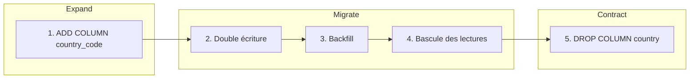

**Risques.** Le contract oublié laisse deux colonnes pour toujours, et la double écriture finit par diverger le jour où un nouveau code n'écrit plus que l'une des deux. Chaque expand ouvre un ticket de contract avec une date. Le coût : cinq déploiements au lieu d'un, donc je réserve la méthode aux changements cassants.

### Exemple : renommer `customers.country` en `customers.country_code`

`ALTER TABLE customers RENAME COLUMN country TO country_code;` est instantané, mais les instances encore en ancienne version lisent `country` et plantent à la seconde où il passe. À la place :

| Déploiement | Base | Application |
|---|---|---|
| 1. Expand | `ALTER TABLE customers ADD COLUMN country_code text;` | inchangée |
| 2. Double écriture | aucun changement | écrit `country` et `country_code`, lit `country` |
| 3. Backfill | recopie par lots (ci-dessous) | inchangée |
| 4. Bascule des lectures | aucun changement | lit `country_code` (derrière un <span class="term" data-term="feature-flag">feature flag</span>), écrit les deux |
| 5. Contract | `ALTER TABLE customers DROP COLUMN country;` | n'écrit plus que `country_code` |

L'étape 2 côté application, dans la même requête :
``` { .python .ex-good title="Recommandé" }
# Ce qui change : écrit aussi country_code, en plus de country, dans la même requête
def update_country(conn, customer_id: int, code: str) -> None:
    conn.execute(
        "UPDATE customers SET country = %s, country_code = %s WHERE id = %s",
        (code, code, customer_id),
    )
```
Si la version 1 (qui n'écrit que `country`) tourne encore pendant le déploiement, ses écritures laissent `country_code` vide : c'est le backfill de l'étape 3 qui rattrape ces lignes.

Entre l'étape 4 et l'étape 5, on attend que plus aucune version déployée ne lise `country` (quelques jours stables, par exemple).

### Backfill par lots
<span class="pill pill-status pill-status-ok" title="Toujours valable, vérifié en novembre 2026">Valable · 11/2026</span>

Le <span class="term" data-term="backfill">backfill</span> recopie les lignes existantes. Un seul `UPDATE` sur 40 millions de lignes (exemple) tiendrait des verrous longtemps et ferait exploser le retard des réplicas. On découpe :

``` { .sql .ex-bad title="À éviter" }
-- À éviter : un seul UPDATE sur 40 millions de lignes, verrous tenus longtemps et réplicas en retard
UPDATE customers SET country_code = country WHERE country_code IS NULL;
```

``` { .sql .ex-good title="Recommandé" }
-- Bien : recopie par lots de 5 000 lignes, répétée jusqu'à zéro ligne modifiée
UPDATE customers
SET country_code = country
WHERE id IN (
    SELECT id FROM customers
    WHERE country_code IS NULL AND country IS NOT NULL
    ORDER BY id
    LIMIT 5000
);
```

Un job répète cette requête, avec une courte pause entre les lots, jusqu'à zéro ligne modifiée. Puis une vérification : `SELECT COUNT(*) FROM customers WHERE country_code IS DISTINCT FROM country;` doit renvoyer 0 avant l'étape 4. `IS DISTINCT FROM` compare en traitant `NULL` comme une valeur : `NULL = 'FR'` donne `NULL` (la ligne serait oubliée), alors que `NULL IS DISTINCT FROM 'FR'` donne `true` (la ligne est comptée).

!!! noob "As noob"
    C'est déménager une bibliothèque carton par carton plutôt que de bloquer l'escalier toute une journée avec un seul énorme chargement : entre deux cartons, les voisins peuvent passer. La phrase à retenir : **je recopie par petits lots, avec une pause, et je vérifie à la fin qu'aucune ligne n'a été oubliée.**

**Risques.** Sans index qui couvre la condition (`country_code IS NULL`), chaque lot relit les lignes déjà recopiées et le job ralentit lot après lot. Un job arrêté en route laisse des lignes non recopiées : il doit pouvoir reprendre là où il s'est arrêté, et la requête de vérification finale reste obligatoire.

### Les verrous : lock_timeout
<span class="pill pill-status pill-status-ok" title="Toujours valable, vérifié en novembre 2026">Valable · 11/2026</span>

Un `ALTER TABLE` demande un <span class="term" data-term="db-lock">verrou</span> exclusif. S'il attend derrière une longue requête, toutes les requêtes qui arrivent après lui attendent aussi : la table semble bloquée, alors que la migration n'a encore rien fait. Le <span class="term" data-term="lock-timeout">délai d'attente de verrou</span> coupe court :

!!! noob "As noob"
    Je pense à une file au guichet : la migration veut le guichet pour elle seule, attend derrière un client très long, et tous ceux qui arrivent derrière elle attendent aussi, même ceux qui n'en avaient que pour une seconde. `lock_timeout` lui dit : « si tu n'as pas le guichet en 2 secondes, sors de la file et reviens plus tard ». La phrase à retenir : **une migration qui attend un verrou bloque tout le monde derrière elle.**

``` { .sql .ex-bad title="À éviter" }
-- À éviter : sans délai d'attente, l'ALTER patiente derrière la longue requête et bloque toute la file
ALTER TABLE customers ADD COLUMN country_code text;
```

``` { .sql .ex-good title="Recommandé" }
-- Bien : abandonner si le verrou n'est pas obtenu en 2 secondes
SET lock_timeout = '2s';
-- Exemple : l'étape 1 (expand), ajout de la nouvelle colonne
ALTER TABLE customers ADD COLUMN country_code text;
```

Si le verrou n'est pas obtenu en 2 secondes, la migration échoue proprement et on la relance plus tard. Mieux vaut une migration qui échoue qu'une production figée.

La file d'attente des verrous, et ce que `lock_timeout` y change :

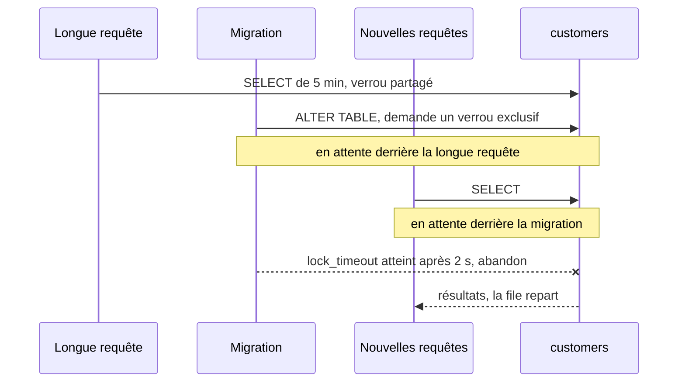

**Risques.** Avec un `lock_timeout` court, la migration peut échouer à chaque essai si la table est sans cesse occupée par de longues requêtes : il faut une relance automatique avec une pause, ou une heure plus calme. Sans `lock_timeout`, c'est le risque inverse : toute la production attend derrière la migration.

:material-book-open-variant: Doc de référence : [PostgreSQL, Explicit Locking](https://www.postgresql.org/docs/current/explicit-locking.html) (version 18, 2025) ; [PostgreSQL, Client Connection Defaults (lock_timeout)](https://www.postgresql.org/docs/current/runtime-config-client.html) (version 18, 2025)
{ .doc-ref }

### Index et contraintes sans bloquer
<span class="pill pill-status pill-status-ok" title="Toujours valable, vérifié en novembre 2026">Valable · 11/2026</span>

Un `CREATE INDEX` classique bloque les écritures sur la table pendant toute sa construction. La version sans blocage :

``` { .sql .ex-bad title="À éviter" }
-- À éviter : CREATE INDEX classique, les écritures sur customers attendent toute la construction
CREATE INDEX idx_customers_country_code ON customers (country_code);
```

``` { .sql .ex-good title="Recommandé" }
-- Bien : construit l'index sans bloquer les écritures
CREATE INDEX CONCURRENTLY idx_customers_country_code ON customers (country_code);
```

Elle est plus lente, ne peut pas tourner dans une transaction, et laisse un index marqué `INVALID` si elle échoue : il faut le supprimer et recommencer.

!!! noob "As noob"
    Le `CREATE INDEX` classique, c'est fermer une route pour la refaire : rapide, mais plus personne ne passe. `CONCURRENTLY`, c'est la refaire voie par voie en laissant circuler : plus long, et si le chantier s'arrête en route, il faut d'abord retirer le chantier inachevé (l'index `INVALID`) avant de recommencer. La phrase à retenir : **sur une table en production, je construis les index sans bloquer les écritures.**

Pour une contrainte, même idée en deux temps, avec une <span class="term" data-term="not-valid-constraint">contrainte NOT VALID</span> :

``` { .sql .ex-good title="Recommandé" }
-- Bien : instantané, la contrainte vaut pour les nouvelles écritures seulement
ALTER TABLE customers
    ADD CONSTRAINT customers_country_code_not_null CHECK (country_code IS NOT NULL) NOT VALID;

-- Bien : vérifie ensuite les lignes existantes, avec un verrou léger
ALTER TABLE customers VALIDATE CONSTRAINT customers_country_code_not_null;
```

La première commande est instantanée et s'applique aux nouvelles écritures ; la seconde vérifie les lignes existantes avec un verrou léger, qui laisse passer lectures et écritures. Depuis PostgreSQL 12 (2019), un `SET NOT NULL` posé ensuite réutilise cette contrainte validée et ne relit pas la table (à vérifier sur ma version).

### Outils de migration de schéma
<span class="pill pill-status pill-status-ok" title="Toujours valable, vérifié en novembre 2026">Valable · 11/2026</span>

Les étapes ci-dessus disent **quoi** changer et dans quel ordre. Un <span class="term" data-term="schema-migration-tool">outil de migration de schéma</span> s'occupe de **quand** et **où** : il range chaque changement dans un fichier versionné, retient dans une table de la base lesquels sont déjà passés, et applique les suivants dans l'ordre, de la même façon en local, en recette et en production.

| Outil | Écosystème | Format des migrations | Table d'historique |
|---|---|---|---|
| Flyway | Java, ou n'importe quel langage par sa CLI | fichiers SQL numérotés (`V7__add_country_code.sql`) | `flyway_schema_history` |
| Liquibase | Java, ou CLI | *changesets* en SQL, YAML, XML ou JSON, avec retour arrière et préconditions | `databasechangelog` |
| Alembic | Python, avec SQLAlchemy | fichiers Python chaînés (`down_revision`), génération automatique à partir des modèles | `alembic_version` |
| Doctrine Migrations | PHP, souvent avec Symfony | classes PHP, générées par différence avec les entités | `doctrine_migration_versions` |

D'autres frameworks ont le leur (Rails, Django, Laravel, Prisma) : même principe.

**Quand** : dès qu'une base vit plus longtemps qu'un prototype et existe dans plus d'un environnement. **Pas** : pour des données de test (c'est le rôle des jeux de données), ni pour un entrepôt de données dont les tables sont reconstruites par l'outil de transformation (dbt, voir [Données et décision](donnees-decision.md#plateforme-de-donnees)).

*dbt : complémentaire de Airflow, Fivetran, Airbyte, BigQuery, Snowflake*
{ .tool-rel }


**Pourquoi** : sans outil, chacun lance ses `ALTER` à la main, et personne ne sait si la recette a le même schéma que la production. Le gain : l'état du schéma est lisible dans Git, rejouable sur une <span class="term" data-term="throwaway-database">base jetable</span>, et vérifié en CI. Le coût : une discipline (ne jamais modifier une migration déjà appliquée : Flyway et Liquibase comparent une somme de contrôle et refusent de continuer) et une décision sur le moment où les migrations tournent.

*Flyway : concurrent de Liquibase, Alembic*<br>
*Liquibase : concurrent de Flyway, Alembic*
{ .tool-rel }


**Comment** : l'étape 1 de l'exemple (expand), écrite pour Alembic.

*Alembic : concurrent de Flyway, Liquibase ; complémentaire de SQLAlchemy*
{ .tool-rel }

``` { .python .ex-bad title="À éviter" }
# À éviter : l'ALTER sans lock_timeout
def upgrade() -> None:
    op.add_column("customers", sa.Column("country_code", sa.Text(), nullable=True))
```
Sans `lock_timeout`, l'`ALTER` attend derrière une longue transaction qui lit `customers`, et toutes les requêtes sur `customers` s'empilent derrière lui : la connexion des utilisateurs reste bloquée jusqu'à la fin de cette transaction.

``` { .python .ex-good title="Recommandé" }
"""Add customers.country_code.

Revision ID: 3f2a9c1d7b10
Revises: 9b41e0c2d5aa
"""
import sqlalchemy as sa
from alembic import op

# Exemple : chaînage avec la migration précédente
revision = "3f2a9c1d7b10"
down_revision = "9b41e0c2d5aa"


# Bien : lock_timeout avant l'ALTER, nouvelle colonne nullable (expand)
def upgrade() -> None:
    op.execute("SET lock_timeout = '2s'")
    op.add_column("customers", sa.Column("country_code", sa.Text(), nullable=True))


# Exemple : retour arrière, retirer la colonne
def downgrade() -> None:
    op.drop_column("customers", "country_code")
```
La même chose pour Flyway tient dans un fichier `V7__add_customers_country_code.sql` qui contient les deux lignes SQL de l'étape 1 :
``` { .text .ex-ref title="Référence" }
$ flyway migrate
Successfully validated 7 migrations
Current version of schema "public": 6
Migrating schema "public" to version "7 - add customers country code"
Successfully applied 1 migration to schema "public", now at version v7
```
(Sortie illustrative, à vérifier selon la version.)

Ce que l'outil ne fait pas, et les règles qui vont avec :

- **il ne rend pas une migration sans interruption** : il l'exécute. Chaque étape d'expand / contract reste une migration séparée, livrée dans un déploiement séparé ;
- **lancer les migrations une seule fois**, dans une étape dédiée du déploiement (un job avant la mise à jour des instances), pas au démarrage de chaque instance ; Flyway et Liquibase posent un verrou pour éviter deux exécutions en même temps, mais un démarrage bloqué derrière une longue migration fait échouer les sondes de santé ;
- **les opérations qui refusent les transactions** (`CREATE INDEX CONCURRENTLY`) demandent une option : `autocommit_block()` dans Alembic, une migration non transactionnelle dans Flyway (à vérifier selon la version) ;
- **le retour arrière par `downgrade` est souvent illusoire** une fois que des données ont été écrites : on prépare plutôt une migration corrective vers l'avant ;
- **en CI**, appliquer toutes les migrations sur une base vide, puis vérifier que le schéma obtenu correspond aux modèles (`alembic check`, `doctrine:schema:validate`).

### Je veux... j'utilise...

| Je veux... | J'utilise... |
|---|---|
| renommer une colonne ou changer son type alors que l'ancienne version de l'application la lit encore, comme `country` qui devient `country_code` | expand / contract en plusieurs déploiements |
| remplir une nouvelle colonne sur des millions de lignes existantes, sans bloquer la table ni faire décrocher les réplicas | un backfill par lots, puis une requête de vérification |
| qu'une migration coincée derrière une longue requête ne fige pas toute la production | `SET lock_timeout` avant chaque `ALTER` |
| ajouter un index sur une grosse table pendant que l'application continue d'y écrire | `CREATE INDEX CONCURRENTLY` |
| ajouter une contrainte sur une grosse table sans la bloquer le temps de relire toutes les lignes | `NOT VALID`, puis `VALIDATE CONSTRAINT` |
| que le schéma soit le même en local, en recette et en production, et savoir quels changements sont déjà passés | un outil de migration : Flyway, Liquibase, Alembic, Doctrine Migrations |
| que les migrations ne tournent qu'une fois, même quand vingt instances démarrent en même temps | un job dédié avant le déploiement des instances |
| déménager toutes les données vers une autre base pendant que l'application continue de tourner | du <span class="term" data-term="cdc">CDC</span> plutôt qu'une <span class="term" data-term="dual-write">double écriture</span> codée dans l'application |

Références : Danilo Sato, [« ParallelChange »](https://martinfowler.com/bliki/ParallelChange.html) (2014) ; Scott Ambler et Pramod Sadalage, « Refactoring Databases » (2006) ; documentation PostgreSQL, [CREATE INDEX](https://www.postgresql.org/docs/current/sql-createindex.html) et [ALTER TABLE](https://www.postgresql.org/docs/current/sql-altertable.html) (version 18, 2025) ; documentations de [Flyway](https://documentation.red-gate.com/flyway), [Liquibase](https://docs.liquibase.com/), [Alembic](https://alembic.sqlalchemy.org/) et [Doctrine Migrations](https://www.doctrine-project.org/projects/migrations.html) (dates de publication non indiquées, à vérifier).

!!! maturity "Mesurer la maturité"
    | Niveau | Ce que j'observe dans l'équipe |
    |---|---|
    | N1 | les migrations passent par un outil, mais un renommage de colonne part encore en une seule étape, et on croise les doigts pendant le déploiement |
    | N2 | chaque changement cassant suit expand / contract en plusieurs MR, avec `lock_timeout` et `CREATE INDEX CONCURRENTLY`, et la CI applique toutes les migrations sur une base vide |
    | N3 | un linter de migrations refuse seul un `RENAME COLUMN` ou un index sans `CONCURRENTLY`, et une migration qui n'obtient pas son verrou échoue sans figer la production |
    | N4 | l'équipe suit la durée des verrous pris par les migrations et le nombre d'incidents liés au schéma, et durcit ses règles d'après ces chiffres |

    **Je mesure** : la part des migrations de l'année passées sans interruption, lue en croisant l'historique de l'outil de migration et les incidents ; la durée maximale d'attente de verrou par migration, lue dans les logs de la base (`log_lock_waits`).

## Les pièges qui faussent les résultats

<a class="pill pill-scope pill-scope-code" href="../architecture/#carte-des-echelles">Échelle · Code</a>

### NULL ne se compare pas avec =
``` { .sql .ex-bad title="À éviter" }
-- À éviter : = NULL ne vaut jamais vrai
WHERE delivered_at = NULL        ne renvoie jamais rien
```

``` { .sql .ex-good title="Recommandé" }
-- Bien : IS NULL teste l'absence de valeur
WHERE delivered_at IS NULL       correct
```
Et `WHERE status != 'paid'` **exclut** les <span class="term" data-term="db-row">lignes</span> où `status` est `NULL`.

!!! noob "As noob"
    `NULL` ne veut pas dire « vide » ou « zéro », mais « je ne sais pas ». À la question « la date de livraison inconnue est-elle le 20 octobre ? », la seule réponse honnête est « je ne sais pas », et un `WHERE` ne garde que les lignes où la réponse est « oui ». La phrase à retenir : **toute comparaison avec `NULL` donne « inconnu », donc je teste l'absence avec `IS NULL`.**

:material-book-open-variant: Doc de référence : [PostgreSQL, Comparison Functions and Operators](https://www.postgresql.org/docs/current/functions-comparison.html) (version 18, 2025) ; [MySQL, Working with NULL Values](https://dev.mysql.com/doc/refman/8.4/en/working-with-null.html) (MySQL 8.4)
{ .doc-ref }

### Les dates et les fuseaux horaires
``` { .sql .ex-bad title="À éviter" }
-- À éviter : ne renvoie que les commandes de minuit pile
WHERE created_at BETWEEN '2026-10-20' AND '2026-10-20'
```
Ne renvoie que les commandes de minuit pile : `'2026-10-20'` veut dire `2026-10-20 00:00:00`. Écrire plutôt :
``` { .sql .ex-good title="Recommandé" }
-- Ce qui change : fin exclue au lendemain, toute la journée est prise
WHERE created_at >= '2026-10-20' AND created_at < '2026-10-21'
```
Et savoir si les dates sont stockées en <span class="term" data-term="utc">UTC</span> ou en heure locale : une commande passée à 0 h 30 heure de Paris est encore le 19 en UTC.

!!! noob "As noob"
    Une date sans fuseau, c'est un rendez-vous fixé à « 9 h » sans dire dans quelle ville : un collègue à Montréal et moi à Paris ne serons pas là en même temps. La base garde de préférence l'instant exact en UTC, et l'application le convertit dans l'heure de la personne au moment de l'afficher. La phrase à retenir : **je stocke en UTC et je convertis à l'affichage.**

:material-book-open-variant: Doc de référence : [PostgreSQL, Date/Time Types](https://www.postgresql.org/docs/current/datatype-datetime.html) (version 18, 2025) ; [MySQL, Time Zone Support](https://dev.mysql.com/doc/refman/8.4/en/time-zone-support.html) (MySQL 8.4)
{ .doc-ref }

### L'argent
Jamais en `FLOAT` : `0.1 + 0.2` ne fait pas exactement `0.3`. En centimes entiers (`total_cents INT`) ou en `DECIMAL(12, 2)`.

``` { .sql .ex-bad title="À éviter" }
-- À éviter : FLOAT garde une approximation, les sommes dérivent de quelques centimes et le rapprochement comptable ne tombe jamais juste
CREATE TABLE payments (id bigint PRIMARY KEY, amount FLOAT NOT NULL);
```

``` { .sql .ex-good title="Recommandé" }
-- Bien : des centimes entiers, exacts, convertis en euros seulement à l'affichage
CREATE TABLE payments (id bigint PRIMARY KEY, amount_cents bigint NOT NULL);
```

:material-book-open-variant: Doc de référence : [PostgreSQL, Numeric Types](https://www.postgresql.org/docs/current/datatype-numeric.html) (version 18, 2025) ; [MySQL, Fixed-Point Types](https://dev.mysql.com/doc/refman/8.4/en/fixed-point-types.html) (MySQL 8.4)
{ .doc-ref }

### Comparer des textes
Selon la base et sa configuration (« <span class="term" data-term="collation">collation</span> »), `'Ada' = 'ada'` peut être vrai (MySQL par défaut) ou faux (PostgreSQL). Un test qui passe sur l'un peut échouer sur l'autre.

:material-book-open-variant: Doc de référence : [PostgreSQL, Collation Support](https://www.postgresql.org/docs/current/collation.html) (version 18, 2025) ; [MySQL, Character Sets and Collations in General](https://dev.mysql.com/doc/refman/8.4/en/charset-general.html) (MySQL 8.4)
{ .doc-ref }

!!! maturity "Mesurer la maturité"
    | Niveau | Ce que j'observe dans l'équipe |
    |---|---|
    | N1 | une personne connaît les pièges `NULL`, dates et argent, et les signale quand elle relit une requête |
    | N2 | les jeux de données de test contiennent exprès des `NULL`, des dates autour de minuit UTC et des montants à centimes |
    | N3 | le schéma empêche seul les erreurs : montants en entiers ou en `DECIMAL`, colonnes `timestamptz`, `NOT NULL` par défaut, collation fixée |
    | N4 | l'équipe suit le nombre d'écarts au rapprochement comptable et de bugs de fuseau horaire, et corrige le schéma là où ils se concentrent |

    **Je mesure** : le nombre de colonnes monétaires en `FLOAT` et de dates sans fuseau, lu dans `information_schema` ; l'écart en centimes entre la base et la comptabilité au rapprochement mensuel.

## Sécurité : l'injection SQL

<a class="pill pill-scope pill-scope-code" href="../architecture/#carte-des-echelles">Échelle · Code</a> <span class="pill pill-status pill-status-ok" title="Toujours valable, vérifié en novembre 2026">Valable · 11/2026</span>

Mon code construit une <span class="term" data-term="db-query">requête</span> en collant dedans un texte tapé par l'utilisateur, comme l'e-mail d'un formulaire de recherche. Cet utilisateur peut alors taper du SQL à la place de l'e-mail, et réécrire ma requête.
``` { .python .ex-bad title="À éviter" }
# À éviter : la saisie est collée dans le texte de la requête
email = request.args["email"]
db.query(f"SELECT * FROM customers WHERE email = '{email}'")
```
Si l'utilisateur envoie `' OR '1'='1`, la requête devient :
``` { .sql .ex-illus title="Illustration" }
-- Exemple : la requête obtenue, elle renvoie tous les clients
SELECT * FROM customers WHERE email = '' OR '1'='1'
```
et renvoie **tous** les clients.

La parade : les <span class="term" data-term="parameterized-query">requêtes paramétrées</span>. La base reçoit la requête et la valeur séparément, la valeur ne peut jamais devenir du SQL.

!!! noob "As noob"
    C'est la différence entre dicter une lettre à quelqu'un qui recopie tout ce que je dis, y compris « et ajoute un virement de 1 000 € », et lui tendre un formulaire dont la case « nom » ne peut contenir qu'un nom. Avec une requête paramétrée, la valeur reste dans sa case, quoi qu'elle contienne. La phrase à retenir : **ne jamais coller une saisie utilisateur dans le texte d'une requête.**

``` { .python .ex-good title="Recommandé" }
# Ce qui change : requête paramétrée, valeur envoyée séparément, elle reste une donnée
db.query("SELECT * FROM customers WHERE email = %s", (email,))
```

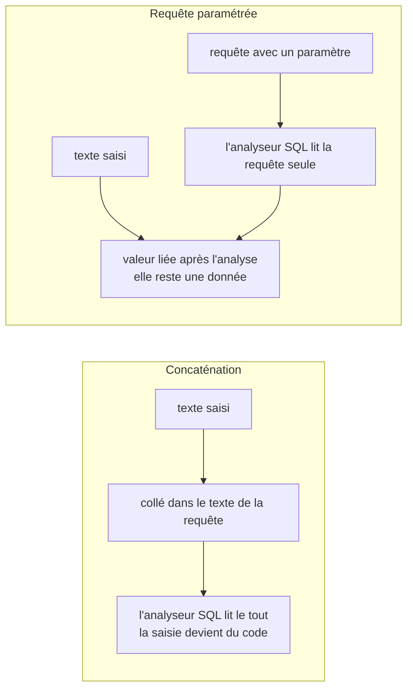

**Risques.** Un paramètre ne remplace qu'une valeur, jamais un nom de table, de colonne ou un sens de tri : `ORDER BY %s` ne marche pas, et la tentation est de recoller du texte. Pour ces cas, je vérifie la saisie contre une liste fermée (`{"date": "created_at", "total": "total_cents"}`). Une requête paramétrée ne protège pas non plus d'un compte de base trop puissant : l'application n'a que les droits dont elle a besoin.

:material-book-open-variant: Doc de référence : [OWASP, SQL Injection Prevention Cheat Sheet](https://cheatsheetseries.owasp.org/cheatsheets/SQL_Injection_Prevention_Cheat_Sheet.html) (consultée en novembre 2026) ; [OWASP, Query Parameterization Cheat Sheet](https://cheatsheetseries.owasp.org/cheatsheets/Query_Parameterization_Cheat_Sheet.html) (consultée en novembre 2026)
{ .doc-ref }

!!! maturity "Mesurer la maturité"
    | Niveau | Ce que j'observe dans l'équipe |
    |---|---|
    | N1 | les développeurs savent qu'il faut paramétrer, et la revue repère une concaténation quand elle la voit |
    | N2 | une règle SAST signale toute requête construite par concaténation ou par f-string, à chaque MR |
    | N3 | la règle SAST bloque la MR, et le compte de base de l'application n'a que les droits dont elle a besoin, donc une injection ne peut pas supprimer de table |
    | N4 | l'équipe suit le nombre de constats d'injection par mois et leur délai de correction, et ajoute des règles maison là où ils reviennent |

    **Je mesure** : le nombre de constats « injection SQL » ouverts, lu dans l'outil SAST ; la part des dépôts où ce scan tourne à chaque MR, lue dans la configuration de la CI.

## SQL pour la QA

<a class="pill pill-scope pill-scope-code" href="../architecture/#carte-des-echelles">Échelle · Code</a>

| Je veux... | Requête type |
|---|---|
| trouver un client qui n'a encore rien commandé, pour tester le parcours « première commande » | `LEFT JOIN orders ... WHERE o.id IS NULL LIMIT 1` |
| vérifier qu'un clic sur « Commander » a créé une seule ligne, et pas deux à cause d'un double envoi | `SELECT COUNT(*) ... WHERE order_id = 42` égal à 1 |
| trouver des données incohérentes, comme une commande enregistrée sans aucun article | `LEFT JOIN order_items ... WHERE i.id IS NULL` |
| repérer des doublons, comme deux clients avec le même e-mail | `GROUP BY ... HAVING COUNT(*) > 1` |
| savoir combien de commandes sont dans chaque statut, pour choisir mes données de test | `GROUP BY status` |
| voir combien de lignes une modification toucherait, sans rien changer pour de vrai | `BEGIN; UPDATE ...; SELECT ...; ROLLBACK;` |
| comprendre pourquoi une page qui lit la base est lente | `EXPLAIN` puis vérifier les index |

Bonnes pratiques :
- sur un <span class="term" data-term="shared-environment">environnement partagé</span>, d'autres testeurs et d'autres tests utilisent les mêmes données : je **lis** plutôt que d'écrire, et je ne modifie jamais une donnée qu'un autre test utilise, sinon c'est son test qui échoue sans raison apparente ;
- dans les <span class="term" data-term="automated-test">tests automatisés</span>, j'utilise une <span class="term" data-term="throwaway-database">base jetable</span> par session (<span class="term" data-term="testcontainers">Testcontainers</span>) et je fais créer à chaque test ses propres données, pour qu'aucun test ne dépende de ce qu'un autre a laissé ;
- pour explorer, je me connecte avec un <span class="term" data-term="read-only-account">compte en lecture seule</span> : une erreur de frappe, comme un `DELETE` sans `WHERE`, ne pourra rien casser.

*Testcontainers : complémentaire de pytest*
{ .tool-rel }


:material-book-open-variant: Doc de référence : [Testcontainers](https://testcontainers.com/) (consultée en novembre 2026) ; [PostgreSQL, GRANT](https://www.postgresql.org/docs/current/sql-grant.html) (version 18, 2025)
{ .doc-ref }

!!! maturity "Mesurer la maturité"
    | Niveau | Ce que j'observe dans l'équipe |
    |---|---|
    | N1 | les testeurs écrivent leurs requêtes à la main sur l'environnement partagé, avec leur propre compte |
    | N2 | les requêtes types de la QA sont versionnées, et les tests automatisés créent leurs données sur une base jetable par session |
    | N3 | l'exploration passe par un compte en lecture seule, donc une erreur de frappe ne casse rien, et chaque test isole ses données sans intervention |
    | N4 | l'équipe suit le taux de tests instables dus aux données partagées et le temps passé à préparer des données, et investit dans les jeux de données d'après ces chiffres |

    **Je mesure** : la part des échecs de tests dus à des données modifiées par un autre test, lue dans l'historique de la CI ; le nombre de comptes de test avec droit d'écriture sur l'environnement partagé.

## Mesurer le succès

Je sais qu'une solution de cette page marche quand une mesure prise avant bouge après, sur une fenêtre de temps comparable. Avant d'ajouter un index ou de corriger un N+1, je note une base : par exemple, le p95 de la route `GET /orders` sur les sept derniers jours et son nombre de requêtes SQL par appel. Je reprends la même mesure sept jours après le déploiement, sur un trafic comparable. La métrique garde-fou est le coût des écritures : un index qui accélère les lectures ne doit faire grimper ni la durée des `INSERT` ni le retard des réplicas.

| Solution ou situation | Indicateur de succès (SLI) | SLO probable | SLA probable |
|---|---|---|---|
| ajouter un index ou réécrire une requête lente | p95 de la durée de la requête, lu dans `pg_stat_statements` ou l'APM | p95 sous 50 ms sur 30 jours glissants | sans objet : pas de contrat externe, la base n'est pas vendue seule |
| corriger un N+1 ou passer au chargement anticipé sur une route d'API | part des appels de la route servis en moins de 300 ms | 99 % sous 300 ms sur 30 jours | 95 % sous 1 s par mois, avec un avoir si non tenu ; plus lâche que le SLO pour garder de la marge |
| des réplicas en lecture | retard de réplication | p99 sous 1 s, parce qu'un écran « mes commandes » lu sur un réplica ne doit pas perdre la commande qu'on vient de passer | sans objet : pas de contrat externe |
| une machine plus grosse, un pooler, une bascule automatique | part des minutes où la base accepte connexions et écritures | 99,95 % par mois, soit environ 22 min d'indisponibilité tolérée | 99,9 % par mois, soit environ 43 min, avec pénalités dans le contrat de service de l'application |
| migrer un schéma sans interruption | part des migrations sans erreur ni requête bloquée plus de 2 s | 100 % des migrations de l'année, une seule production figée coûtant plus que toutes les précautions | sans objet : pas de contrat externe |
| protéger les écritures concurrentes | nombre de doubles réservations ou de soldes négatifs trouvés par les contrôles de cohérence | zéro par mois | sans objet : pas de contrat externe, même si les conditions de vente couvrent une place vendue deux fois |
| isoler les données de test (base jetable, compte en lecture seule) | part des échecs de CI dus aux données d'un autre test | moins de 1 % des échecs | sans objet : pas de contrat externe |

[À prendre avec précaution : ordres de grandeur d'exemple, à fixer avec le métier]

!!! noob "As noob"
    Le SLO, c'est la vitesse que je m'impose sur l'autoroute pour être sûr de ne jamais flasher ; le SLA, c'est la limite affichée sur le panneau, avec une amende si je la dépasse. Je roule en dessous de la limite pour garder de la marge en cas d'imprévu. La phrase à retenir : **le SLO est ma cible interne, le SLA est la promesse plus lâche faite au client, avec une pénalité.**

## Pièges à éviter

| Piège | Ce qui se passe | Solution |
| --- | --- | --- |
| **UPDATE ou DELETE lancé à l'aveugle** : j'exécute un `UPDATE` ou un `DELETE` sans avoir compté les lignes visées, ou j'oublie le `WHERE`. | Toute la table est modifiée d'un coup. | Je lance d'abord le même `WHERE` dans un `SELECT COUNT(*)`, dans une transaction que je peux annuler par `ROLLBACK` ([La transaction](#essayer-avant-de-valider-la-transaction)). |
| **Somme après une jointure** : je fais un `SUM(o.total_cents)` après un `JOIN` sur les articles. | Une commande de 3 articles compte 3 fois, donc le total est faux. | Je fais la somme sur `orders` seule, ou j'agrège les articles avant la jointure ([Le piège de la multiplication](#le-piege-de-la-multiplication)). |
| **Comparer avec NULL** : j'écris `WHERE delivered_at = NULL`, ou je compte sur `status != 'paid'` pour tout prendre sauf les commandes payées. | La première ne renvoie jamais rien, la seconde oublie les lignes où `status` est `NULL`. | J'utilise `IS NULL` et `IS DISTINCT FROM` ([NULL](#null-ne-se-compare-pas-avec)). |
| **N+1 caché par l'ORM** : je boucle sur une liste et je laisse l'ORM charger chaque élément lié. | 100 commandes font 101 allers-retours vers la base. | Je regroupe en une seule requête avec `JOIN` ou `IN`, et je surveille les spans `SELECT` répétés dans les traces ([Le problème N+1](#le-probleme-n1)). |
| **Optimiser au jugé** : je m'attaque à la requête la plus lente du slow query log, ou je change trois choses à la fois. | Je rate la requête de 3 ms appelée 2 millions de fois, et je ne sais pas quel changement a aidé. | Je classe par temps total, je change une seule chose et je remesure ([Trouver les requêtes lentes](#trouver-les-requetes-lentes), [la boucle](#rendre-une-requete-rapide-la-boucle)). |
| **Renommer une colonne en une seule migration** : je lance `RENAME COLUMN` pendant un déploiement progressif. | Les instances encore en ancienne version lisent l'ancien nom et plantent à la seconde où la migration passe. | Je découpe en expand / contract, un déploiement par étape ([Expand / contract](#expand-contract)). |
| **Saisie collée dans la requête** : je construis la requête en y collant le texte tapé par l'utilisateur. | Avec `' OR '1'='1`, il récupère tous les clients. | J'utilise toujours des requêtes paramétrées ([L'injection SQL](#securite-linjection-sql)). |
| **Sharder trop tôt** : je répartis les données sur plusieurs bases dès les premières lenteurs. | Je paie la complexité des requêtes inter-shards pour un problème qu'un index ou un réplica aurait réglé, et le retour arrière est presque impossible. | Je monte l'échelle marche par marche, sur mesure ([L'échelle](#lechelle-du-moins-cher-au-plus-cher)). |

## Ce qu'on demande en entretien

Les questions typiques :

- « Quelle différence entre INNER JOIN et LEFT JOIN ? », « Comment trouver les clients qui n'ont jamais commandé ? » Pour répondre : je donne le nombre de lignes renvoyées sur un petit exemple, puis le motif `LEFT JOIN ... IS NULL` ([Joindre des tables](#joindre-des-tables), [Trouver ce qui manque](#trouver-ce-qui-manque-left-join-is-null)).
- « WHERE ou HAVING ? », « Comment trouver des doublons ? » Pour répondre : je rappelle que `WHERE` filtre les lignes avant le regroupement et `HAVING` les groupes après, avec `GROUP BY ... HAVING COUNT(*) > 1` ([HAVING : filtrer après le regroupement](#having-filtrer-apres-le-regroupement)).
- « Comment trouves-tu le deuxième plus gros montant, ou les trois dernières commandes de chaque client ? » Pour répondre : j'utilise une fonction de fenêtre, `ROW_NUMBER() OVER (PARTITION BY customer_id ORDER BY created_at DESC)`, puis je garde les rangs voulus dans une requête englobante, parce qu'un `WHERE` ne peut pas filtrer sur le rang directement ([Fonctions de fenêtre](#fonctions-de-fenetre)).
- « Comment modélises-tu une table ? », « Pourquoi mettre des contraintes en base si le code vérifie déjà ? », « Quand dénormaliser ? » Pour répondre : je pars des entités et des règles métier, je normalise par défaut (chaque fait à un seul endroit), je pose `NOT NULL`, `UNIQUE`, `CHECK` et les clés étrangères parce que la contrainte tient même quand le code a un bug, et je ne dénormalise que pour un besoin mesuré ([Modéliser une table](#modeliser-une-table)).
- « Dans quel ordre mets-tu les colonnes d'un index composite ? », « Qu'est-ce qu'un index couvrant ? » Pour répondre : l'égalité d'abord, puis la plage ou le tri, avec `(customer_id, created_at)` pour « les 50 dernières commandes d'un client » ; je montre `Using filesort` qui disparaît dans `EXPLAIN`, puis l'index couvrant qui évite de lire la table (`INCLUDE` sur PostgreSQL) ([Index composite](#index-composite-lordre-des-colonnes-et-lindex-couvrant)).
- « Une page est lente à cause de la base, que fais-tu ? », « Qu'est-ce qu'un index, et quand ne sert-il à rien ? », « Qu'est-ce que le problème N+1 ? » Pour répondre : je déroule mesurer, lire le plan avec `EXPLAIN ANALYZE`, changer une seule chose, remesurer ([Performances](#performances), [Le problème N+1](#le-probleme-n1)), et [Les pièges côté serveur de GraphQL](api-rest-async.md#les-pieges-cote-serveur).
- « Comment vérifies-tu en base l'effet d'un test ? », « Qu'est-ce qu'une transaction, que veut dire ACID ? » Pour répondre : je montre le `BEGIN ... ROLLBACK` et les requêtes types de la QA ([Ce qu'une transaction garantit (ACID)](#ce-quune-transaction-garantit-acid), [SQL pour la QA](#sql-pour-la-qa)).
- « Deux personnes réservent la dernière place en même temps, que se passe-t-il ? », « Verrou optimiste ou pessimiste ? », « Quel est le niveau d'isolation par défaut de PostgreSQL ? » Pour répondre : je montre le motif lire, décider, écrire et sa chronologie, puis l'`UPDATE ... WHERE seats_left > 0` atomique ; je choisis le verrou pessimiste quand les conflits sont fréquents et l'optimiste quand ils sont rares ; je cite `READ COMMITTED` pour PostgreSQL et `REPEATABLE READ` pour MySQL, et l'écriture biaisée que seul `SERIALIZABLE` empêche ([Écritures concurrentes](#ecritures-concurrentes), [Niveaux d'isolation](#niveaux-disolation)).
- « Comment empêches-tu deux réservations du même créneau ? » Pour répondre : je montre pourquoi « vérifier puis insérer » laisse passer deux requêtes simultanées, puis la contrainte d'exclusion `EXCLUDE USING gist (provider_id WITH =, during WITH &&)` avec `btree_gist` et une plage `tstzrange`, et l'erreur `23P01` traduite en `409` ([Contrainte d'exclusion](#contrainte-dexclusion-pas-de-creneaux-qui-se-chevauchent)).
- « ORM ou SQL écrit à la main ? », « Active Record ou Data Mapper ? » Pour répondre : l'ORM pour le courant, le SQL paramétré pour les agrégations et les requêtes critiques, avec une règle d'équipe ; puis la différence entre un objet qui s'enregistre lui-même et une session qui enregistre un objet ignorant la base ([ORM : accéder à la base depuis le code](#orm-acceder-a-la-base-depuis-le-code), [Chargement paresseux ou anticipé](#chargement-paresseux-ou-anticipe)).
- « Comment te protèges-tu de l'injection SQL ? » Pour répondre : je montre la requête concaténée, la saisie `' OR '1'='1`, puis la requête paramétrée ([Sécurité : l'injection SQL](#securite-linjection-sql)).
- « Ta base sature, que fais-tu ? », « Comment renommer une colonne sans interruption ? » Pour répondre : je monte l'échelle du moins cher au plus cher, puis je déroule expand / contract ([Faire grandir une base de données](#faire-grandir-une-base-de-donnees), [Migrer un schéma sans interruption](#migrer-un-schema-sans-interruption)).
- « Comment sais-tu qu'une optimisation de base a vraiment marché ? » Pour répondre : je donne une base avant (p95 et nombre de requêtes par appel sur sept jours), la même mesure après sur un trafic comparable, le coût des écritures comme garde-fou, puis je distingue le SLO interne du SLA promis au client ([Mesurer le succès](#mesurer-le-succes)).

Ce qui fait une bonne réponse : écrire la requête sur un petit jeu de données, dire combien de lignes elle renvoie, puis citer le piège qui la fausserait (`NULL`, multiplication, fuseau horaire).

Les questions par métier, avec des réponses plus détaillées et des exercices corrigés : [Staff Engineer](../entretiens/staff-engineer/questions.md), [QA Engineer](../entretiens/qa-engineer/questions.md), [Software Engineer](../entretiens/software-engineer/questions.md), [Software Architect](../entretiens/software-architect/questions.md).
