# SQL

!!! warning "Avertissement"
    Ces notes sont des pense-bêtes personnels, pas une source de vérité. Elles reflètent ma compréhension et mes choix : leur contenu reste subjectif, malgré les citations et les références qu'il contient. Il peut être incomplet, simplifié, inexact ou dépassé. Vérifiez toujours dans la documentation officielle avant de l'appliquer. Ce contenu est fourni tel quel, sans aucune garantie : son utilisation se fait sous votre seule responsabilité.

!!! abstract "Les échelles"
    Les pastilles de couleur sous les titres disent à quelle échelle une notion s'applique :

    - <span class="pill pill-scope pill-scope-code">Code</span> les classes, fonctions et modules d'un programme ;
    - <span class="pill pill-scope pill-scope-app">Application</span> un service ou une application et son découpage interne ;
    - <span class="pill pill-scope pill-scope-system">Système</span> plusieurs services qui communiquent par le réseau ;
    - <span class="pill pill-scope pill-scope-infra">Infrastructure</span> les serveurs, le réseau, les zones et les clusters, physiques ou virtuels ;
    - <span class="pill pill-scope pill-scope-enterprise">Entreprise</span> le système d'information entier et son organisation.

    Détail et mots ambigus : [carte des échelles](architecture.md#carte-des-echelles).

SQL est le langage pour lire et modifier les données d'une <span class="term" data-term="relational-database">base relationnelle</span> (MySQL, PostgreSQL, SQL Server...). Côté QA, il sert surtout à trois choses : trouver des données de test, vérifier l'état après une action, et comprendre pourquoi une <span class="term" data-term="db-query">requête</span> est lente. Cette page part des bases et va jusqu'aux pièges qui faussent les résultats.

*PostgreSQL : concurrent de MySQL, MariaDB ; concurrent en partie de MongoDB ; complémentaire de Redis, PgBouncer, BigQuery, Elasticsearch*<br>
*MySQL : concurrent de PostgreSQL, MariaDB ; complémentaire de Redis, ProxySQL, Vitess*
{ .tool-rel }


Tous les exemples utilisent ce petit <span class="term" data-term="db-schema">schéma</span> fictif :

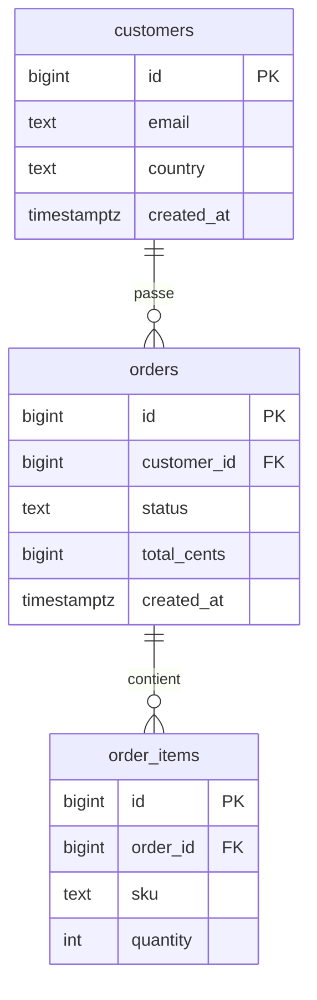

:material-swap-horizontal: Les outils cités dans cette page : lesquels se remplacent, lesquels se combinent ? Voir [Complémentaires ou concurrents](outils.md#complementaires-ou-concurrents).
{ .doc-ref }

## Vocabulaire

**Base relationnelle** : les données sont rangées dans des **tables**, faites de **lignes** (un enregistrement) et de **colonnes** (un champ).

**Clé primaire (PK)** : la colonne qui identifie chaque ligne de façon unique, souvent `id`.

**Clé étrangère (FK)** : une colonne qui pointe vers la <span class="term" data-term="primary-key">clé primaire</span> d'une autre table. `orders.customer_id` pointe vers `customers.id` : chaque commande appartient à un client.

**NULL** : l'absence de valeur. Ce n'est ni `0`, ni une chaîne vide. Une commande sans date de livraison a `delivered_at = NULL`.

**Index** : une structure qui permet de retrouver des lignes sans lire toute la table, comme l'index d'un livre.

**Transaction** : un groupe d'opérations qui réussissent toutes ou échouent toutes.

**Schéma** : la structure de la base, c'est-à-dire ses tables, colonnes et <span class="term" data-term="db-constraint">contraintes</span>. **Migration** : un script versionné qui fait évoluer le schéma (ajouter une colonne...).

:material-book-open-variant: Doc de référence : [PostgreSQL, Constraints](https://www.postgresql.org/docs/current/ddl-constraints.html) (version 18, 2025) ; [MySQL, FOREIGN KEY Constraints](https://dev.mysql.com/doc/refman/8.4/en/create-table-foreign-keys.html) (MySQL 8.4)
{ .doc-ref }

## Lire des données

<a class="pill pill-scope pill-scope-code" href="../architecture/#carte-des-echelles">Échelle · Code</a>

### SELECT, WHERE, ORDER BY, LIMIT
```sql
-- Bien : colonnes nommées et ORDER BY explicite, le résultat reste stable
SELECT id, status, total_cents
FROM orders
WHERE status = 'paid'
  AND created_at >= '2026-10-01'
ORDER BY created_at DESC
LIMIT 10;
```
Les 10 dernières commandes payées depuis le 1er octobre.

Règles :
- jamais de `SELECT *` dans du code : si une colonne est ajoutée, le résultat change. En exploration, c'est acceptable ;
- toujours `ORDER BY` si l'ordre compte : sans lui, la <span class="term" data-term="database">base</span> renvoie les <span class="term" data-term="db-row">lignes</span> dans l'ordre qui l'arrange, et cet ordre peut changer.

### Filtres utiles
```sql
-- Exemple : quatre filtres courants, liste, plage, motif de texte, valeur absente
WHERE status IN ('paid', 'shipped')
WHERE total_cents BETWEEN 1000 AND 5000
WHERE email LIKE '%@example.com'
WHERE delivered_at IS NULL
```

### Compter d'abord
<span class="pill pill-status pill-status-ok" title="Toujours valable, vérifié en novembre 2026">Valable · 11/2026</span>

Avant de lire ou de modifier, compter. Ça évite d'afficher un million de lignes, ou d'en modifier un million.
```sql
-- Bien : compter avant de lire ou de modifier
SELECT COUNT(*) FROM orders WHERE status = 'pending';
```
```
12          je peux regarder les lignes
2 400 000   je filtre davantage avant
```

:material-book-open-variant: Doc de référence : [PostgreSQL, SELECT](https://www.postgresql.org/docs/current/sql-select.html) (version 18, 2025) ; [MySQL, SELECT Statement](https://dev.mysql.com/doc/refman/8.4/en/select.html) (MySQL 8.4)
{ .doc-ref }

## Joindre des tables

<a class="pill pill-scope pill-scope-code" href="../architecture/#carte-des-echelles">Échelle · Code</a>

Une <span class="term" data-term="sql-join">jointure</span> associe chaque ligne d'une table aux lignes d'une autre table qui vérifient la condition `ON`. Les dessins ci-dessous résument quelles lignes restent : à gauche `customers`, à droite `orders`, la partie colorée est ce que la requête renvoie.

!!! noob "As noob"
    Une jointure, c'est agrafer à chaque fiche client les tickets de caisse qui portent son numéro : un client avec deux tickets donne deux paires. Le type de jointure dit seulement quoi faire des fiches sans ticket et des tickets sans fiche. La phrase à retenir : **une jointure fabrique des paires de lignes, elle peut donc renvoyer plus de lignes qu'il n'y a de clients.**

<div class="diagram-grid">
<figure><svg viewBox="0 0 160 100" role="img" aria-label="INNER JOIN : la partie colorée est renvoyée"><path class="hit" d="M80,16.28 A35,35 0 0,1 80,73.72 A35,35 0 0,1 80,16.28 Z"/><circle class="set" cx="60" cy="45" r="35"/><circle class="set" cx="100" cy="45" r="35"/><text x="40" y="95" text-anchor="middle">customers</text><text x="120" y="95" text-anchor="middle">orders</text></svg><figcaption><code>INNER JOIN</code></figcaption></figure>
<figure><svg viewBox="0 0 160 100" role="img" aria-label="LEFT JOIN : la partie colorée est renvoyée"><circle class="hit" cx="60" cy="45" r="35"/><circle class="set" cx="60" cy="45" r="35"/><circle class="set" cx="100" cy="45" r="35"/><text x="40" y="95" text-anchor="middle">customers</text><text x="120" y="95" text-anchor="middle">orders</text></svg><figcaption><code>LEFT JOIN</code></figcaption></figure>
<figure><svg viewBox="0 0 160 100" role="img" aria-label="RIGHT JOIN : la partie colorée est renvoyée"><circle class="hit" cx="100" cy="45" r="35"/><circle class="set" cx="60" cy="45" r="35"/><circle class="set" cx="100" cy="45" r="35"/><text x="40" y="95" text-anchor="middle">customers</text><text x="120" y="95" text-anchor="middle">orders</text></svg><figcaption><code>RIGHT JOIN</code></figcaption></figure>
<figure><svg viewBox="0 0 160 100" role="img" aria-label="FULL OUTER JOIN : la partie colorée est renvoyée"><path class="hit" d="M80,16.28 A35,35 0 1,0 80,73.72 A35,35 0 0,1 80,16.28 Z"/><path class="hit" d="M80,16.28 A35,35 0 0,1 80,73.72 A35,35 0 0,1 80,16.28 Z"/><path class="hit" d="M80,16.28 A35,35 0 1,1 80,73.72 A35,35 0 0,0 80,16.28 Z"/><circle class="set" cx="60" cy="45" r="35"/><circle class="set" cx="100" cy="45" r="35"/><text x="40" y="95" text-anchor="middle">customers</text><text x="120" y="95" text-anchor="middle">orders</text></svg><figcaption><code>FULL OUTER JOIN</code></figcaption></figure>
<figure><svg viewBox="0 0 160 100" role="img" aria-label="LEFT JOIN ... WHERE o.id IS NULL : la partie colorée est renvoyée"><path class="hit" d="M80,16.28 A35,35 0 1,0 80,73.72 A35,35 0 0,1 80,16.28 Z"/><circle class="set" cx="60" cy="45" r="35"/><circle class="set" cx="100" cy="45" r="35"/><text x="40" y="95" text-anchor="middle">customers</text><text x="120" y="95" text-anchor="middle">orders</text></svg><figcaption><code>LEFT JOIN ... WHERE o.id IS NULL</code></figcaption></figure>
<figure><svg viewBox="0 0 160 100" role="img" aria-label="FULL OUTER JOIN ... IS NULL : la partie colorée est renvoyée"><path class="hit" d="M80,16.28 A35,35 0 1,0 80,73.72 A35,35 0 0,1 80,16.28 Z"/><path class="hit" d="M80,16.28 A35,35 0 1,1 80,73.72 A35,35 0 0,0 80,16.28 Z"/><circle class="set" cx="60" cy="45" r="35"/><circle class="set" cx="100" cy="45" r="35"/><text x="40" y="95" text-anchor="middle">customers</text><text x="120" y="95" text-anchor="middle">orders</text></svg><figcaption><code>FULL OUTER JOIN ... IS NULL</code></figcaption></figure>
</div>

Le même jeu de données, ligne par ligne. ada a deux commandes, grace et linus aucune, et la commande 12 pointe vers un client 4 qui n'existe plus :

```
customers            orders
id  email            id  customer_id
1   ada              10  1
2   grace            11  1
3   linus            12  4
```

| Jointure | Lignes renvoyées (email, id de commande) | Nombre |
|---|---|---|
| `INNER JOIN` | (ada, 10) (ada, 11) | 2 |
| `LEFT JOIN` | (ada, 10) (ada, 11) (grace, NULL) (linus, NULL) | 4 |
| `RIGHT JOIN` | (ada, 10) (ada, 11) (NULL, 12) | 3 |
| `FULL OUTER JOIN` | (ada, 10) (ada, 11) (grace, NULL) (linus, NULL) (NULL, 12) | 5 |
| `LEFT JOIN ... WHERE o.id IS NULL` | (grace, NULL) (linus, NULL) | 2 |
| `FULL OUTER JOIN ... IS NULL` | (grace, NULL) (linus, NULL) (NULL, 12) | 3 |
| `CROSS JOIN` | chaque client avec chaque commande | 3 x 3 = 9 |

Les cercles sont une image commode mais imparfaite : une jointure n'est pas une intersection d'ensembles, elle associe des lignes. ada sort deux fois parce qu'elle a deux commandes (voir [le piège de la multiplication](#le-piege-de-la-multiplication)), ce qu'aucun cercle ne montre.

:material-book-open-variant: Doc de référence : [PostgreSQL, Joined Tables](https://www.postgresql.org/docs/current/queries-table-expressions.html#QUERIES-JOIN) (version 18, 2025) ; [MySQL, JOIN Clause](https://dev.mysql.com/doc/refman/8.4/en/join.html) (MySQL 8.4)
{ .doc-ref }

### INNER JOIN : ce qui existe des deux côtés
```sql
-- Exemple : INNER JOIN, les commandes payées avec l'e-mail du client
SELECT c.email, o.id, o.total_cents
FROM orders o
JOIN customers c ON c.id = o.customer_id
WHERE o.status = 'paid';
```
Les commandes payées avec l'email du client. Une commande sans client correspondant n'apparaît pas.

### LEFT JOIN : tout à gauche, même sans correspondance
```sql
-- Exemple : LEFT JOIN, tous les clients, même ceux sans commande
SELECT c.email, o.id
FROM customers c
LEFT JOIN orders o ON o.customer_id = c.id;
```
Tous les clients, avec leurs commandes. Un client sans commande apparaît une fois, avec `o.id = NULL`.

### Trouver ce qui manque : LEFT JOIN ... IS NULL
```sql
-- Exemple : les clients qui n'ont jamais commandé
SELECT c.id, c.email
FROM customers c
LEFT JOIN orders o ON o.customer_id = c.id
WHERE o.id IS NULL;
```
Les clients qui n'ont **jamais** commandé. Très utile pour trouver des <span class="term" data-term="test-data">données de test</span> (« un client sans commande ») ou des incohérences (« des commandes sans articles »).

```sql
-- Exemple : les commandes sans articles, une incohérence
SELECT o.id
FROM orders o
LEFT JOIN order_items i ON i.order_id = o.id
WHERE i.id IS NULL;
```

### RIGHT JOIN, FULL OUTER JOIN, CROSS JOIN

```sql
-- Exemple : les orphelins des deux côtés, clients sans commande et commandes sans client
SELECT c.email, o.id
FROM customers c
FULL OUTER JOIN orders o ON o.customer_id = c.id
WHERE c.id IS NULL OR o.id IS NULL;
```
Les deux sortes d'orphelins d'un coup : les clients sans commande et les commandes sans client. Pratique pour un contrôle de cohérence après une migration.

| Jointure | À quoi elle sert |
|---|---|
| `RIGHT JOIN` | le miroir de `LEFT JOIN`. On préfère inverser les tables et écrire un `LEFT JOIN`, plus facile à lire |
| `FULL OUTER JOIN` | comparer deux tables et voir ce qui manque d'un côté ou de l'autre |
| `CROSS JOIN` | toutes les combinaisons (produit cartésien) : générer un jeu de test « chaque pays x chaque moyen de paiement ». Sur deux grosses tables, le résultat explose |

MySQL n'a pas de `FULL OUTER JOIN` : on l'obtient avec un `UNION` d'un `LEFT JOIN` et d'un `RIGHT JOIN`.

### Le piège de la multiplication
Un `JOIN` sur une relation « <span class="term" data-term="one-to-many">un à plusieurs</span> » répète les lignes.
```sql
-- À éviter : total faux, chaque commande compte une fois par article
SELECT SUM(o.total_cents)
FROM orders o
JOIN order_items i ON i.order_id = o.id;
```
Une commande de 3 articles compte 3 fois dans la somme : le total est faux. Faire la somme sur `orders` seule, ou <span class="term" data-term="aggregation">agréger</span> les articles avant la jointure.

## Regrouper et agréger

<a class="pill pill-scope pill-scope-code" href="../architecture/#carte-des-echelles">Échelle · Code</a>

### GROUP BY
```sql
-- Exemple : nombre et total des commandes par statut
SELECT status, COUNT(*) AS nb, SUM(total_cents) AS total
FROM orders
GROUP BY status;
```
```
status     nb     total
paid       820    2 460 000
pending     12       36 000
cancelled   45      135 000
```

### HAVING : filtrer après le regroupement
`WHERE` filtre les <span class="term" data-term="db-row">lignes</span> avant de regrouper, `HAVING` filtre les groupes après.

!!! noob "As noob"
    Je pense à un tri de courrier : `WHERE` jette les lettres qui ne m'intéressent pas avant de les ranger en piles, `HAVING` jette ensuite les piles entières qui ne conviennent pas (par exemple celles de moins de 5 lettres). La phrase à retenir : **`WHERE` filtre des lignes, `HAVING` filtre des groupes : on écrit `HAVING COUNT(*) > 5`, jamais `WHERE COUNT(*) > 5`.**

L'ordre dans lequel la base évalue logiquement une requête n'est pas l'ordre dans lequel on l'écrit. C'est pour cela qu'un alias défini dans `SELECT` n'est pas encore connu dans `WHERE` (l'optimiseur peut ensuite réorganiser l'exécution réelle) :

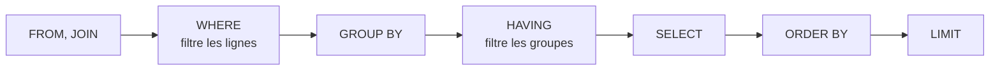

```sql
-- Exemple : HAVING filtre les groupes, les clients de plus de 5 commandes
SELECT customer_id, COUNT(*) AS nb
FROM orders
GROUP BY customer_id
HAVING COUNT(*) > 5;
```
Les clients qui ont passé plus de 5 commandes.

### Trouver des doublons
```sql
-- Exemple : les e-mails présents plus d'une fois
SELECT email, COUNT(*)
FROM customers
GROUP BY email
HAVING COUNT(*) > 1;
```

### COUNT(*) ou COUNT(colonne)
```
COUNT(*)              compte toutes les lignes
COUNT(delivered_at)   compte seulement les lignes où delivered_at n'est pas NULL
COUNT(DISTINCT customer_id)   compte les clients différents
```

:material-book-open-variant: Doc de référence : [PostgreSQL, GROUP BY and HAVING Clauses](https://www.postgresql.org/docs/current/queries-table-expressions.html#QUERIES-GROUP) (version 18, 2025) ; [MySQL, Aggregate Functions](https://dev.mysql.com/doc/refman/8.4/en/aggregate-functions.html) (MySQL 8.4)
{ .doc-ref }

## Requêtes plus avancées

<a class="pill pill-scope pill-scope-code" href="../architecture/#carte-des-echelles">Échelle · Code</a>

### Sous-requête et CTE (WITH)
Une **<span class="term" data-term="cte">CTE</span>** donne un nom à une <span class="term" data-term="db-query">requête</span> intermédiaire, pour lire la requête de haut en bas.
```sql
-- Exemple : la CTE nomme l'étape « gros clients », puis la requête lit leurs e-mails
WITH big_customers AS (
    SELECT customer_id
    FROM orders
    GROUP BY customer_id
    HAVING SUM(total_cents) > 100000
)
SELECT c.email
FROM customers c
JOIN big_customers b ON b.customer_id = c.id;
```
Les clients qui ont dépensé plus de 1 000 €.

Une **<span class="term" data-term="subquery">sous-requête</span>** est une requête placée dans une autre, ici dans le `WHERE` : les e-mails des clients qui ont au moins une commande remboursée.
```sql
-- Exemple : sous-requête dans le WHERE, clients avec une commande remboursée
SELECT email
FROM customers
WHERE id IN (SELECT customer_id FROM orders WHERE status = 'refunded');
```

| Je veux... | J'utilise |
|---|---|
| garder seulement les lignes qui ont quelque chose ailleurs, une seule fois dans la requête, comme « les clients qui ont au moins une commande remboursée » | sous-requête `IN (SELECT ...)` ou `EXISTS` |
| calculer un résultat intermédiaire que je réutilise, ou découper une requête longue en étapes lisibles de haut en bas, comme « d'abord les gros clients, puis leurs e-mails » | CTE |

### Fonctions de fenêtre
Calculer sur un groupe de <span class="term" data-term="db-row">lignes</span> **sans** les regrouper en une seule.

!!! noob "As noob"
    `GROUP BY` fond les lignes d'un groupe en une seule, comme on résume une classe par sa moyenne. Une fonction de fenêtre laisse chaque élève sur sa ligne et écrit à côté une information calculée sur sa classe (son rang, la moyenne de la classe). La phrase à retenir : **même calcul par groupe, mais aucune ligne ne disparaît.**

```sql
-- Exemple : le rang de chaque commande pour son client, sans fusionner les lignes
SELECT customer_id, id, created_at,
       ROW_NUMBER() OVER (PARTITION BY customer_id ORDER BY created_at DESC) AS rang
FROM orders;
```
Chaque commande garde sa ligne, avec son rang pour son client : `rang = 1`, c'est la dernière commande de chaque client.

### CASE
```sql
-- Exemple : CASE classe chaque commande en gros, moyen ou petit
SELECT id,
       CASE WHEN total_cents >= 10000 THEN 'gros'
            WHEN total_cents >= 2000  THEN 'moyen'
            ELSE 'petit' END AS taille
FROM orders;
```

:material-book-open-variant: Doc de référence : [PostgreSQL, WITH Queries](https://www.postgresql.org/docs/current/queries-with.html) (version 18, 2025) ; [PostgreSQL, Window Functions](https://www.postgresql.org/docs/current/tutorial-window.html) (version 18, 2025) ; [PostgreSQL, Conditional Expressions](https://www.postgresql.org/docs/current/functions-conditional.html) (version 18, 2025)
{ .doc-ref }

## Modifier des données

<a class="pill pill-scope pill-scope-code" href="../architecture/#carte-des-echelles">Échelle · Code</a>

### INSERT, UPDATE, DELETE
```sql
-- Exemple : ajouter un client
INSERT INTO customers (email, country) VALUES ('ada@example.com', 'FR');

-- Exemple : modifier une commande, toujours avec un WHERE
UPDATE orders SET status = 'cancelled' WHERE id = 42;

-- Exemple : supprimer une commande, toujours avec un WHERE
DELETE FROM orders WHERE id = 42;
```
Le danger : un `UPDATE` ou un `DELETE` **sans `WHERE`** touche toute la <span class="term" data-term="db-table">table</span>.

:material-book-open-variant: Doc de référence : [PostgreSQL, Data Manipulation](https://www.postgresql.org/docs/current/dml.html) (version 18, 2025)
{ .doc-ref }

### Essayer avant de valider : la transaction
<span class="pill pill-status pill-status-ok" title="Toujours valable, vérifié en novembre 2026">Valable · 11/2026</span>

```sql
-- Bien : essayer le changement dans une transaction avant de le valider
BEGIN;
UPDATE orders SET status = 'cancelled' WHERE customer_id = 7;
-- Exemple : compter les lignes touchées, puis tout annuler (COMMIT si le compte est bon)
SELECT COUNT(*) FROM orders WHERE customer_id = 7 AND status = 'cancelled';
ROLLBACK;
```
Je vois combien de <span class="term" data-term="db-row">lignes</span> seraient touchées, puis `ROLLBACK` annule tout. Si c'est bon, je relance avec `COMMIT` à la place.

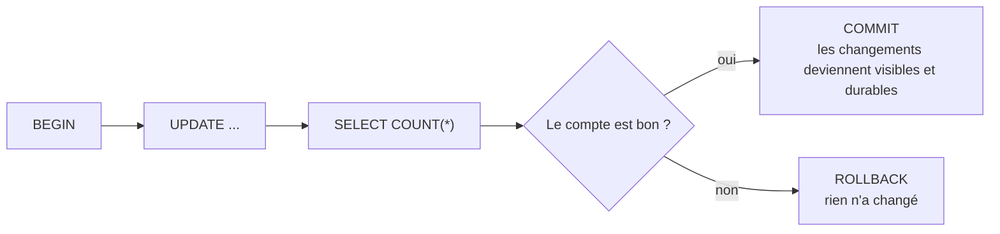

Règle : avant tout `UPDATE` ou `DELETE`, lancer le même `WHERE` dans un `SELECT COUNT(*)`.

:material-book-open-variant: Doc de référence : [PostgreSQL, Transactions](https://www.postgresql.org/docs/current/tutorial-transactions.html) (version 18, 2025) ; [MySQL, START TRANSACTION, COMMIT, and ROLLBACK](https://dev.mysql.com/doc/refman/8.4/en/commit.html) (MySQL 8.4)
{ .doc-ref }

### Ce qu'une transaction garantit (ACID)
- **Atomicité** : tout ou rien. Débit et crédit d'un virement passent ensemble, ou aucun.
- **Cohérence** : les <span class="term" data-term="db-constraint">contraintes</span> (<span class="term" data-term="foreign-key">clés étrangères</span>, unicité) sont respectées à la fin.
- **Isolation** : deux <span class="term" data-term="db-transaction">transactions</span> en parallèle ne voient pas les modifications inachevées l'une de l'autre (selon le <span class="term" data-term="isolation-level">niveau d'isolation</span> choisi).
- **Durabilité** : une fois validée, la modification survit à une panne.

!!! noob "As noob"
    Je pense à un virement : l'argent ne quitte jamais un compte sans arriver sur l'autre, les règles déclarées dans la base restent respectées, personne ne voit le virement à moitié fait, et une fois confirmé, une coupure de courant ne l'efface pas. Limite : selon le niveau d'isolation choisi, deux transactions en parallèle peuvent encore se gêner de façon subtile. La phrase à retenir : **une transaction réussit en entier ou ne laisse aucune trace.**

:material-book-open-variant: Doc de référence : [PostgreSQL, Transaction Isolation](https://www.postgresql.org/docs/current/transaction-iso.html) (version 18, 2025) ; [MySQL and the ACID Model](https://dev.mysql.com/doc/refman/8.4/en/mysql-acid.html) (MySQL 8.4)
{ .doc-ref }

## Performances

<a class="pill pill-scope pill-scope-code" href="../architecture/#carte-des-echelles">Échelle · Code</a> <a class="pill pill-scope pill-scope-infra" href="../architecture/#carte-des-echelles">Échelle · Infrastructure</a>

### Trouver les requêtes lentes
<span class="pill pill-status pill-status-ok" title="Toujours valable, vérifié en novembre 2026">Valable · 11/2026</span>

Avant d'optimiser, savoir **quelle** requête coûte. Trois sources, de la plus proche de l'utilisateur à la plus proche de la base :

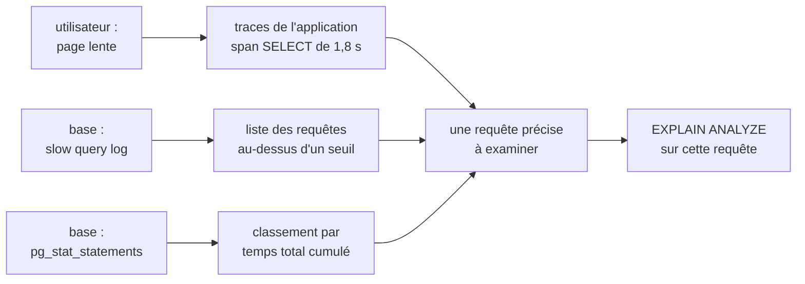

| Source | Ce qu'elle montre | Réglage (exemple) |
|---|---|---|
| traces (OpenTelemetry, APM) | quelle page ou quel appel est lent, et quelle requête SQL dans cet appel | instrumentation du driver ou de l'ORM |
| slow query log | chaque requête plus longue qu'un seuil, avec son texte | MySQL : `slow_query_log = ON`, `long_query_time = 1` ; PostgreSQL : `log_min_duration_statement = 1000` (ms) |
| `pg_stat_statements` (PostgreSQL), `performance_schema` (MySQL) | toutes les requêtes regroupées par forme, avec nombre d'appels et temps cumulé | extension à activer dans `shared_preload_libraries` |
| `auto_explain` (PostgreSQL) | le plan d'exécution des requêtes lentes, écrit dans les logs | `auto_explain.log_min_duration = 1000` |

```sql
-- Bien : classer les requêtes par temps total cumulé, pas par durée moyenne
SELECT calls,
       round(total_exec_time) AS total_ms,
       round(mean_exec_time, 1) AS mean_ms,
       left(query, 60) AS query
FROM pg_stat_statements
ORDER BY total_exec_time DESC
LIMIT 3;
```
```
 calls   | total_ms | mean_ms | query
---------+----------+---------+------------------------------------------------------------
 2100000 |  6300000 |     3.0 | SELECT * FROM orders WHERE customer_id = $1
      40 |    96000 |  2400.0 | SELECT country, SUM(total_cents) FROM orders GROUP BY coun
    9000 |    45000 |     5.0 | UPDATE orders SET status = $1 WHERE id = $2
```
Chiffres d'exemple. La requête en tête ne prend que 3 ms, mais elle tourne 2 millions de fois : c'est elle qui occupe la base. Le rapport à 2,4 s se voit davantage dans le slow query log, mais pèse 65 fois moins.

!!! noob "As noob"
    Une requête lente n'est pas forcément la plus coûteuse. Classe d'abord par **temps total** (durée moyenne x nombre d'appels) : gagner 2 ms sur une requête appelée un million de fois rapporte plus que gagner 2 s sur un rapport lancé une fois par jour.

:material-book-open-variant: Doc de référence : [PostgreSQL, pg_stat_statements](https://www.postgresql.org/docs/current/pgstatstatements.html) (version 18, 2025) ; [MySQL, The Slow Query Log](https://dev.mysql.com/doc/refman/8.4/en/slow-query-log.html) (MySQL 8.4) ; [PostgreSQL, auto_explain](https://www.postgresql.org/docs/current/auto-explain.html) (version 18, 2025)
{ .doc-ref }

### EXPLAIN
<span class="pill pill-status pill-status-ok" title="Toujours valable, vérifié en novembre 2026">Valable · 11/2026</span>

`EXPLAIN` montre comment la base compte exécuter la <span class="term" data-term="db-query">requête</span>, sans l'exécuter.
```sql
-- Exemple : voir le plan prévu, sans exécuter la requête
EXPLAIN SELECT * FROM orders WHERE customer_id = 7;
```
```
type: ALL    rows: 2 400 000     la base lit toute la table : pas d'index utilisé
```
Après `CREATE INDEX idx_orders_customer ON orders (customer_id);` :
```
type: ref    rows: 14            la base va directement aux 14 lignes du client
```
`EXPLAIN ANALYZE` (PostgreSQL, MySQL 8) l'exécute vraiment et donne les temps réels.

Les sorties ci-dessus sont celles de MySQL. PostgreSQL dit la même chose avec d'autres mots :

| MySQL | PostgreSQL | Ce que ça veut dire |
|---|---|---|
| `type: ALL` | `Seq Scan on orders` | lecture de toute la table, ligne par ligne |
| `type: ref` | `Index Scan using idx_orders_customer` | accès direct par l'index |
| `rows: 14` | `rows=14` | estimation du nombre de lignes, pas un compte exact |

:material-book-open-variant: Doc de référence : [PostgreSQL, Using EXPLAIN](https://www.postgresql.org/docs/current/using-explain.html) (version 18, 2025) ; [MySQL, Optimizing Queries with EXPLAIN](https://dev.mysql.com/doc/refman/8.4/en/using-explain.html) (MySQL 8.4)
{ .doc-ref }

### Quand un index aide
<span class="pill pill-status pill-status-ok" title="Toujours valable, vérifié en novembre 2026">Valable · 11/2026</span>

Un index B-tree, le type par défaut de PostgreSQL et de MySQL (InnoDB), est un arbre trié. Pour `WHERE customer_id = 7`, la base descend de la racine jusqu'à la bonne feuille en quelques lectures, au lieu de parcourir toute la table. Les feuilles sont chaînées entre elles (pointillés), ce qui sert aussi aux plages (`BETWEEN`, `>=`) et à `ORDER BY`.

!!! noob "As noob"
    Un index, c'est l'index à la fin d'un livre : pour trouver « transaction », je vais à la lettre T puis à la bonne page, au lieu de lire les 800 pages. En échange, chaque page ajoutée oblige à remettre l'index à jour. La phrase à retenir : **un index accélère les lectures qui filtrent sur sa colonne et ralentit un peu chaque écriture.**

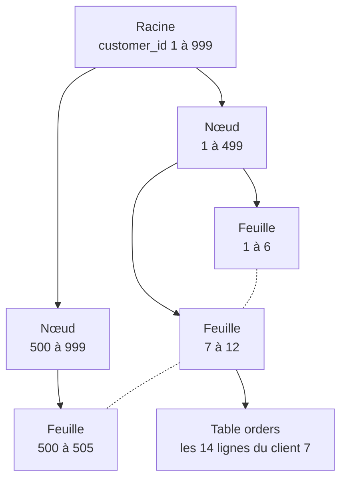

| Situation | <span class="term" data-term="db-index">Index</span> utile ? |
|---|---|
| mes requêtes filtrent, joignent ou trient souvent sur la même colonne, comme `customer_id` pour afficher les commandes d'un client | oui |
| la colonne n'a que quelques valeurs différentes, comme `status` qui vaut `paid`, `pending` ou `cancelled` : chaque valeur couvre une grosse part de la table | souvent peu utile seul |
| la table ne fait que quelques centaines de lignes, la lire en entier est déjà instantané | inutile |
| la table reçoit surtout des écritures et peu de lectures, comme des <span class="term" data-term="logs">logs</span> ou des événements | chaque index ralentit les écritures |
| ma requête passe la colonne dans une fonction avant de comparer, comme `WHERE LOWER(email) = '...'` | l'index sur `email` n'est **pas** utilisé, à cause de la fonction |
| je cherche une fin de texte, comme tous les e-mails en `WHERE email LIKE '%@example.com'` | pas utilisé (le `%` au début empêche) |

:material-book-open-variant: Doc de référence : [Markus Winand, Anatomy of an SQL Index](https://use-the-index-luke.com/sql/anatomy) (consultée en novembre 2026) ; [PostgreSQL, Index Types](https://www.postgresql.org/docs/current/indexes-types.html) (version 18, 2025)
{ .doc-ref }

### Rendre une requête rapide : la boucle
<span class="pill pill-status pill-status-ok" title="Toujours valable, vérifié en novembre 2026">Valable · 11/2026</span>

On n'optimise pas au jugé : on mesure, on change **une seule chose**, on remesure la même requête avec les mêmes paramètres.

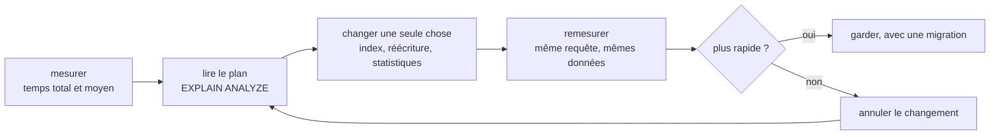

Avant et après, en PostgreSQL :
```
EXPLAIN ANALYZE SELECT id, total_cents FROM orders WHERE customer_id = 7 ORDER BY created_at DESC LIMIT 10;

Limit  (actual time=812.4..812.4 rows=10)
  ->  Sort  (actual time=812.4..812.4 rows=10)
        ->  Seq Scan on orders  (actual time=0.1..809.9 rows=14)
              Filter: (customer_id = 7)
              Rows Removed by Filter: 2399986
Execution Time: 812.6 ms
```
`CREATE INDEX CONCURRENTLY idx_orders_customer_created ON orders (customer_id, created_at DESC);`
```
Limit  (actual time=0.04..0.06 rows=10)
  ->  Index Scan using idx_orders_customer_created on orders  (actual time=0.04..0.05 rows=10)
        Index Cond: (customer_id = 7)
Execution Time: 0.1 ms
```
L'index sur deux colonnes sert à la fois au filtre et au tri : plus de lecture de toute la table, plus de tri.

| Ce que je vois dans le plan | Ce que ça veut dire | Ce que j'essaie |
|---|---|---|
| `Seq Scan` avec beaucoup de `Rows Removed by Filter` | la table est lue en entier pour garder peu de lignes | un index sur la colonne du filtre |
| `Sort` juste après un scan, avec `LIMIT` | toutes les lignes sont triées pour en garder 10 | un index qui suit l'ordre du tri |
| `rows=` estimé très loin du `rows=` réel | les statistiques sont fausses, le plan choisi aussi | `ANALYZE orders;` puis relire le plan |
| `Sort Method: external merge  Disk` | le tri déborde de la mémoire sur le disque | réduire les lignes avant le tri, ou augmenter `work_mem` pour cette requête |
| `Nested Loop` avec des milliers de boucles | une jointure faite ligne par ligne | un index sur la colonne de jointure, ou une réécriture |
| aucune étape lente, mais beaucoup d'appels | la requête est rapide, c'est l'application qui l'appelle trop | regrouper les appels (voir [N+1](#le-probleme-n1)), ajouter un cache |

!!! noob "As noob"
    `EXPLAIN` est l'itinéraire que le GPS prévoit, `EXPLAIN ANALYZE` est le trajet réellement fait, chrono en main. Je cherche l'étape où le temps explose, je la corrige, puis je refais le même trajet pour vérifier.

:material-book-open-variant: Doc de référence : [PostgreSQL, Performance Tips](https://www.postgresql.org/docs/current/performance-tips.html) (version 18, 2025) ; [Markus Winand, Use The Index, Luke](https://use-the-index-luke.com/) (consultée en novembre 2026)
{ .doc-ref }

### Le problème N+1
<span class="pill pill-status pill-status-ok" title="Toujours valable, vérifié en novembre 2026">Valable · 11/2026</span>

```python
# À éviter : une requête par commande, 101 allers-retours (N+1)
orders = db.query("SELECT * FROM orders LIMIT 100")
for order in orders:
    customer = db.query("SELECT * FROM customers WHERE id = %s", order.customer_id)
```
1 requête pour les commandes, puis 100 pour les clients : 101 <span class="term" data-term="round-trip">allers-retours</span>. Une seule requête avec `JOIN` fait la même chose. Les <span class="term" data-term="orm">ORM</span> (SQLAlchemy, Doctrine, Prisma) le provoquent facilement : à surveiller dans les <span class="term" data-term="trace-distributed">traces</span>, où l'on voit 100 <span class="term" data-term="span">spans</span> `SELECT` identiques.

*SQLAlchemy : complémentaire de Alembic*
{ .tool-rel }


!!! noob "As noob"
    C'est comme aller au supermarché une fois pour lire la liste de courses, puis faire 100 allers-retours, un par article, au lieu de tout prendre en un passage. Chaque trajet est court, c'est leur nombre qui coûte. La phrase à retenir : **une requête par élément d'une liste, c'est un N+1 : on regroupe en une seule requête (`JOIN` ou `IN`).**

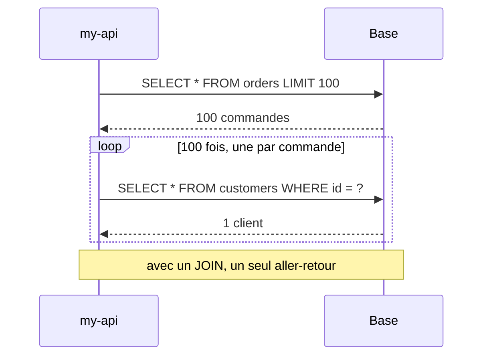

:material-book-open-variant: Doc de référence : [Markus Winand, Nested Loops and the N+1 problem](https://use-the-index-luke.com/sql/join/nested-loops-join-n1-problem) (consultée en novembre 2026)
{ .doc-ref }

## Faire grandir une base de données

<a class="pill pill-scope pill-scope-system" href="../architecture/#carte-des-echelles">Échelle · Système</a> <a class="pill pill-scope pill-scope-infra" href="../architecture/#carte-des-echelles">Échelle · Infrastructure</a>

<a class="pill pill-practice" href="../livraison/#concevoir-avant-de-coder">Pratique · Conception technique</a>

Une base « sature » quand elle ne suit plus : requêtes de plus en plus lentes, processeur à 90 %, disque plein, trop de connexions. La tentation est de sauter tout de suite à la solution la plus impressionnante (répartir les données sur plusieurs machines). En pratique, on monte une échelle : on commence par ce qui coûte peu et se défait facilement, et on ne passe à l'étage suivant que si les mesures le demandent.

### Deux sens pour « vertical » et « horizontal »

Les deux mots servent pour deux choses différentes. Les confondre est l'erreur la plus courante.

| | Vertical | Horizontal |
|---|---|---|
| **La machine** | <span class="term" data-term="vertical-scaling">scale up</span> : la même base sur une machine plus grosse (plus de processeurs, de mémoire, un disque plus rapide) | <span class="term" data-term="horizontal-scaling">scale out</span> : plusieurs machines (des copies en lecture, ou des morceaux de données sur chaque machine) |
| **Les données** | <span class="term" data-term="vertical-partitioning">partitionnement vertical</span> : découper par colonnes ou par domaine (les colonnes lourdes dans une autre table, le catalogue et les commandes dans deux bases) | partitionnement horizontal : découper par lignes (les commandes d'octobre d'un côté, celles de novembre de l'autre) |

Le partitionnement horizontal peut rester sur une seule machine (partitionnement de table) ou s'étaler sur plusieurs : c'est alors le <span class="term" data-term="sharding">sharding</span>.

### L'échelle, du moins cher au plus cher

| Étape | Ce qu'elle règle | Coût | Retour arrière |
|---|---|---|---|
| 1. Requêtes et index | lenteurs dues à une requête mal écrite ou sans index | faible | facile |
| 2. Pooler de connexions | trop de connexions ouvertes | faible | facile |
| 3. Cache | les mêmes lectures répétées | moyen (invalidation) | facile |
| 4. Machine plus grosse | processeur, mémoire ou disque au maximum | argent, un redémarrage | facile |
| 5. Réplicas en lecture | beaucoup plus de lectures que d'écritures | moyen (données en retard) | facile |
| 6. Partitionnement de table | tables énormes, index lourds | moyen | possible |
| 7. Archivage des données froides | volume qui grossit sans être lu | moyen | possible |
| 8. Sharding | écritures ou volume au-delà de la plus grosse machine | très élevé | presque impossible |

### Requêtes, index, connexions et cache
<span class="pill pill-status pill-status-ok" title="Toujours valable, vérifié en novembre 2026">Valable · 11/2026</span>

Avant de payer une machine, vérifier ce qu'elle fait. La section [Performances](#performances) plus haut couvre l'essentiel : `EXPLAIN`, un index manquant, le problème N+1. Sur PostgreSQL, l'extension `pg_stat_statements` liste les requêtes qui consomment le plus de temps au total ; souvent, trois requêtes font la moitié de la charge.

```sql
-- Exemple : les 3 requêtes qui consomment le plus de temps au total
SELECT calls, round(total_exec_time) AS total_ms, round(mean_exec_time) AS mean_ms, query
FROM pg_stat_statements ORDER BY total_exec_time DESC LIMIT 3;
```
```
 calls  | total_ms | mean_ms | query
--------+----------+---------+------------------------------------------------
 912000 |  1824000 |       2 | SELECT * FROM orders WHERE customer_id = $1
   1400 |   980000 |     700 | SELECT ... FROM invoices JOIN orders ... GROUP BY
     12 |   310000 |   25833 | UPDATE products SET stock = ...
```
La première est rapide mais appelée très souvent (un N+1 probable), la deuxième est lente à chaque appel (un `EXPLAIN ANALYZE` s'impose). Chiffres d'exemple ; les colonnes `total_exec_time` et `mean_exec_time` sont celles de PostgreSQL 13 et plus (avant : `total_time`, `mean_time`).

Ensuite, les connexions. Chaque connexion PostgreSQL est un processus qui coûte de la mémoire. Vingt instances de my-api avec 50 connexions chacune, cela fait 1 000 connexions (exemple). Un <span class="term" data-term="connection-pooler">pooler de connexions</span> (PgBouncer, ou celui de l'hébergeur) les partage :

```
my-api (20 instances x 50 connexions) ──> PgBouncer ──> PostgreSQL (100 connexions réelles)
```

Enfin, un <span class="term" data-term="cache-data">cache</span> (Redis, ou la mémoire de l'application) évite de relire cent fois la même fiche produit. Le prix : décider quand la donnée en cache devient fausse.

*Redis : complémentaire de PostgreSQL, MySQL*
{ .tool-rel }


:material-book-open-variant: Doc de référence : [PostgreSQL, pg_stat_statements](https://www.postgresql.org/docs/current/pgstatstatements.html) (version 18, 2025)
{ .doc-ref }

### Pooler et proxy de base de données
<span class="pill pill-status pill-status-ok" title="Toujours valable, vérifié en novembre 2026">Valable · 11/2026</span>

Le pooler de la section précédente ne fait qu'une chose : partager les connexions. Un <span class="term" data-term="database-proxy">proxy de base de données</span> se place au même endroit, entre l'application et la base, mais comprend les requêtes : il envoie les lectures aux réplicas et les écritures au primaire, bascule seul vers un nouveau primaire, peut bloquer ou réécrire une requête.

Un pooler seul fait la partie gauche du dessin ; un proxy ajoute le tri entre primaire et réplicas :

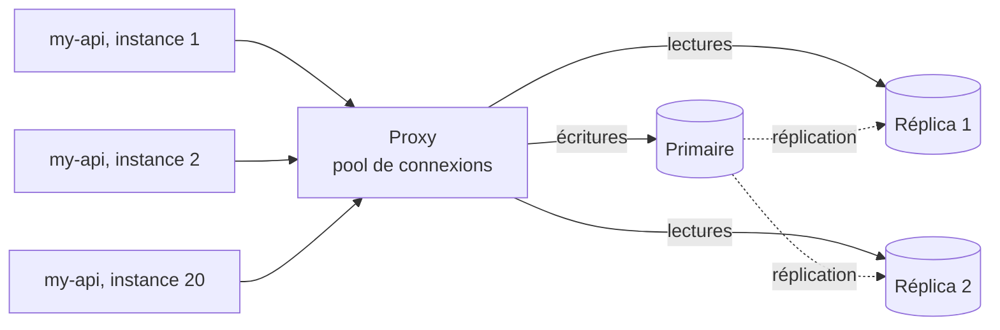

| Outil | Pour quelle base | Ce qu'il fait |
|---|---|---|
| PgBouncer | PostgreSQL | pooler léger, rien d'autre |
| ProxySQL | MySQL, MariaDB | pooler, routage lecture/écriture par règles, cache de requêtes, bascule |
| Pgpool-II, PgCat | PostgreSQL | pooler et répartition des lectures (à vérifier selon la version) |
| proxy de l'hébergeur (RDS Proxy, connecteur Cloud SQL) | base managée | pooler ou connexion sécurisée, géré par l'hébergeur (fonctions à vérifier) |

**Quand** : j'ai beaucoup d'instances de my-api ou de fonctions serverless, et chacune ouvre ses propres connexions ; la base refuse des connexions (`too many connections`) alors que son processeur est calme ; ou j'ai des réplicas en lecture que l'application ne sait pas utiliser seule. **Pas encore** : mon application tourne sur quelques instances avec un pool interne bien réglé (celui de l'ORM ou du pilote) : un composant de plus à surveiller ne m'apporte rien.

**Pourquoi** : une connexion PostgreSQL coûte un processus et plusieurs mégaoctets de mémoire ; mille connexions inactives pèsent autant que des requêtes. Le gain : la base garde un nombre de connexions fixe quoi que fasse l'application. Le coût : un point de passage de plus (à doubler pour ne pas créer un <span class="term" data-term="spof">point de défaillance unique</span>), une latence de quelques dixièmes de milliseconde (ordre de grandeur, à vérifier), et des fonctions de session qui cassent selon le mode.

**Comment**, avec PgBouncer : le **mode** décide quand une connexion réelle est rendue au pool.

*PgBouncer : complémentaire de PostgreSQL*
{ .tool-rel }


| Mode | Connexion rendue | Économie | Ce qui casse |
|---|---|---|---|
| `session` | quand le client se déconnecte | faible | rien |
| `transaction` | à la fin de chaque transaction | forte | `SET` de session, verrous consultatifs, `LISTEN`, tables temporaires ; requêtes préparées avant PgBouncer 1.21 (2023, à vérifier) |
| `statement` | après chaque requête | maximale | toute transaction de plusieurs requêtes |

```ini
# Exemple : la base vers laquelle PgBouncer relaie les connexions
[databases]
orders = host=orders-db.internal port=5432 dbname=orders

# Exemple : mode transaction, 2 000 connexions client pour 50 connexions réelles
[pgbouncer]
listen_port = 6432
pool_mode = transaction
max_client_conn = 2000
default_pool_size = 50
```
Les instances de my-api se connectent au port 6432 au lieu de 5432 ; 2 000 connexions côté application deviennent 50 connexions réelles par couple base et utilisateur (valeurs d'exemple).

Avec ProxySQL, le routage se configure par des règles dans son interface d'administration, qui parle le protocole MySQL. Ici, les `SELECT ... FOR UPDATE` vont au primaire (groupe 10), les autres `SELECT` aux réplicas (groupe 20), tout le reste au groupe par défaut de l'utilisateur, le primaire :
```sql
-- Exemple : FOR UPDATE vers le primaire (groupe 10), autres SELECT vers les réplicas (20)
INSERT INTO mysql_query_rules (rule_id, active, match_digest, destination_hostgroup, apply)
VALUES (1, 1, '^SELECT.*FOR UPDATE', 10, 1),
       (2, 1, '^SELECT', 20, 1);
-- Exemple : appliquer les règles tout de suite, puis les garder après un redémarrage
LOAD MYSQL QUERY RULES TO RUNTIME;
SAVE MYSQL QUERY RULES TO DISK;
```
Le piège : une lecture juste après une écriture part vers un réplica en retard, et l'utilisateur ne voit pas ce qu'il vient d'enregistrer (voir [Des réplicas en lecture](#des-replicas-en-lecture)). Les lectures qui doivent voir la dernière écriture restent au primaire, par une règle ou un commentaire dans la requête.

### Une machine plus grosse
<span class="pill pill-status pill-status-ok" title="Toujours valable, vérifié en novembre 2026">Valable · 11/2026</span>

Passer de 16 à 32 processeurs se fait en un redémarrage chez la plupart des hébergeurs, sans changer une ligne de code. C'est souvent le meilleur rapport effort/gain, tant qu'une machine plus grosse existe. Limite : le goulot n'est pas toujours le processeur. Si les requêtes attendent des verrous (<span class="term" data-term="lock-contention">contention sur les verrous</span>), doubler la machine ne change presque rien.

### Des réplicas en lecture
<span class="pill pill-status pill-status-ok" title="Toujours valable, vérifié en novembre 2026">Valable · 11/2026</span>

Un <span class="term" data-term="read-replica">réplica en lecture</span> est une copie de la base, tenue à jour par <span class="term" data-term="replication">réplication</span>, qui répond aux lectures. Toutes les écritures vont toujours sur la base principale. Le piège : la copie a du retard, le <span class="term" data-term="replication-lag">retard de réplication</span>.

!!! noob "As noob"
    Un réplica, c'est la photocopie d'un registre tenue à jour par un coursier : on peut la consulter à plusieurs pour soulager l'original, mais le coursier a toujours un peu de retard, et ce qu'on vient d'écrire dans l'original peut ne pas encore y figurer. La phrase à retenir : **lire sur un réplica, c'est accepter de lire une donnée un peu ancienne.**

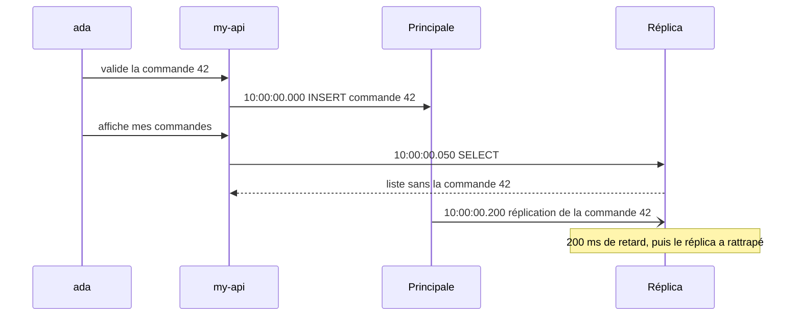

Parade : lire sur la principale juste après une écriture de l'utilisateur (« lire ses propres écritures »), et surveiller le retard comme une métrique à part entière. Côté test : un test qui écrit puis relit via un réplica peut échouer de façon aléatoire.

:material-book-open-variant: Doc de référence : [PostgreSQL, High Availability, Load Balancing, and Replication](https://www.postgresql.org/docs/current/high-availability.html) (version 18, 2025) ; [MySQL, Replication](https://dev.mysql.com/doc/refman/8.4/en/replication.html) (MySQL 8.4)
{ .doc-ref }

### Partitionner une table
<span class="pill pill-status pill-status-ok" title="Toujours valable, vérifié en novembre 2026">Valable · 11/2026</span>

Le <span class="term" data-term="table-partitioning">partitionnement de table</span> découpe une grosse table en plusieurs tables physiques, sur la même machine. L'application continue d'écrire `SELECT ... FROM orders` ; la base ne lit que les partitions concernées. PostgreSQL le fait nativement depuis la version 10 (2017), avec le partitionnement « déclaratif » :

!!! noob "As noob"
    Partitionner, c'est ranger les factures dans un classeur à onglets par mois au lieu d'un seul tas : pour novembre, je n'ouvre que l'onglet novembre. Tout reste dans le même meuble (la même machine), et l'application voit toujours un seul classeur. La phrase à retenir : **le partitionnement n'aide que si les requêtes filtrent sur la colonne de découpage.**

```sql
-- Exemple : table mère partitionnée par date, created_at fait partie de la clé primaire
CREATE TABLE orders (
    id           bigint      NOT NULL,
    customer_id  bigint      NOT NULL,
    status       text        NOT NULL,
    total_cents  bigint      NOT NULL,
    created_at   timestamptz NOT NULL,
    PRIMARY KEY (id, created_at)
) PARTITION BY RANGE (created_at);

-- Exemple : une partition par mois, créée à l'avance
CREATE TABLE orders_2026_10 PARTITION OF orders
    FOR VALUES FROM ('2026-10-01') TO ('2026-11-01');
CREATE TABLE orders_2026_11 PARTITION OF orders
    FOR VALUES FROM ('2026-11-01') TO ('2026-12-01');
```

```sql
-- Bien : le filtre porte sur la colonne de partition, seule novembre est lue
EXPLAIN SELECT * FROM orders WHERE created_at >= '2026-11-01';
```
```
Seq Scan on orders_2026_11      une seule partition lue, octobre est ignoré
```

Ce tri automatique s'appelle l'<span class="term" data-term="partition-pruning">élagage de partitions</span>. Deux règles : la colonne de partition doit faire partie de la clé primaire, et les requêtes doivent filtrer sur elle, sinon la base lit toutes les partitions. Il faut aussi créer les partitions à l'avance (un job mensuel, ou l'extension `pg_partman`).

### Archiver les données froides
<span class="pill pill-status pill-status-ok" title="Toujours valable, vérifié en novembre 2026">Valable · 11/2026</span>

Les <span class="term" data-term="cold-data">données froides</span> (commandes de plus de deux ans, journaux passés) alourdissent les index et les sauvegardes sans être lues. Avec une table partitionnée par mois, archiver devient simple :

```sql
-- Bien : détacher une partition pour l'archiver, sans bloquer les requêtes en cours
ALTER TABLE orders DETACH PARTITION orders_2024_01 CONCURRENTLY;
```

La partition détachée devient une table normale, que l'on exporte vers un stockage moins cher puis que l'on supprime. `DETACH ... CONCURRENTLY` existe depuis PostgreSQL 14 (2021) et ne bloque pas les requêtes en cours. Sans partitions, il faut un `DELETE` par lots, bien plus lent.

### Sharder, en dernier
<span class="pill pill-status pill-status-ok" title="Toujours valable, vérifié en novembre 2026">Valable · 11/2026</span>

Le sharding répartit les lignes d'une même table sur plusieurs bases. C'est la seule étape qui augmente vraiment la capacité d'**écriture**, et la plus difficile à défaire. Quatre points décident de son succès.

!!! noob "As noob"
    Sharder, c'est ouvrir plusieurs agences au lieu d'agrandir le siège : chaque client est rattaché à une agence selon une règle (son numéro, par exemple). Ça multiplie les guichets, mais toute question qui concerne tous les clients oblige à appeler toutes les agences. La phrase à retenir : **le sharding ajoute de la capacité d'écriture, au prix de requêtes et de transactions entre machines bien plus compliquées.**

**La clé de sharding.** La <span class="term" data-term="partition-key">clé de partition</span> décide sur quelle base va chaque ligne. On la choisit d'après la requête dominante : si 95 % des requêtes filtrent sur `customer_id` (exemple), c'est elle. Une fois choisie, changer de clé revient à réécrire toutes les données.

**Le shard chaud.** Si un client fait 15 % des commandes, son shard sature pendant que les autres dorment : c'est une <span class="term" data-term="hot-key">clé chaude</span>. On lui donne une base dédiée, ou on ajoute un deuxième élément à la clé.

**Les requêtes inter-shards.** Une jointure ou un rapport sur tous les clients devient une <span class="term" data-term="cross-shard-query">requête inter-shards</span> : interroger chaque base puis fusionner. Les transactions entre deux shards perdent les garanties ACID simples. Les rapports partent donc vers un <span class="term" data-term="data-warehouse">entrepôt de données</span>.

**Le repartitionnement.** Passer de 4 à 8 bases impose de déplacer des données : le <span class="term" data-term="resharding">repartitionnement</span>. L'astuce classique : beaucoup de <span class="term" data-term="logical-shard">shards logiques</span> (256, par exemple) répartis sur peu de bases, et une <span class="term" data-term="shard-router">couche de routage</span> qui tient la table de correspondance. On déplace alors des shards entiers, sans recalculer la place de chaque ligne.

```python
# Bien : beaucoup de shards logiques sur peu de bases, déplaçables en bloc
LOGICAL_SHARDS = 256

# Exemple : le shard logique se calcule à partir de la clé de sharding
def logical_shard(customer_id: int) -> int:
    return customer_id % LOGICAL_SHARDS

# Exemple : table de placement, 64 shards par base ; passer à 8 bases ne change qu'elle
placement = {shard: f"orders-db-{shard // 64}" for shard in range(LOGICAL_SHARDS)}
```

Le trajet d'une requête pour le client 1234 : la couche de routage calcule le shard logique, puis la table de placement donne la base. Passer de 4 à 8 bases ne change que cette table.

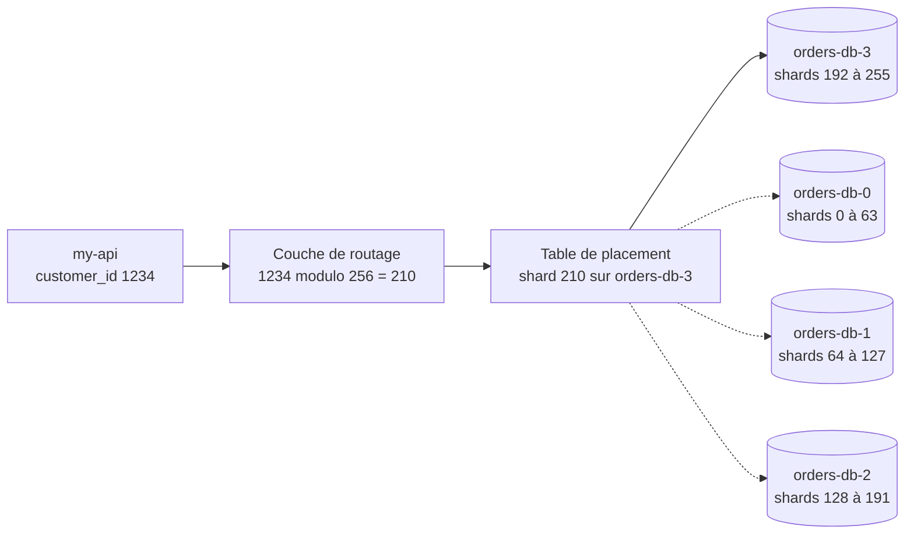

Plutôt que d'écrire ce routage soi-même, des outils le fournissent au-dessus d'une base connue : Vitess pour MySQL, Citus pour PostgreSQL. Autre option, le <span class="term" data-term="distributed-sql">SQL distribué</span> (CockroachDB, YugabyteDB, Spanner) : la base répartit et rééquilibre seule, avec des transactions entre machines, au prix d'une latence d'écriture plus élevée et d'une compatibilité SQL incomplète (à vérifier pour chaque produit).

*Vitess : concurrent en partie de Citus, CockroachDB, YugabyteDB, Spanner ; complémentaire de MySQL*<br>
*Citus : concurrent en partie de Vitess, CockroachDB, YugabyteDB, Spanner ; complémentaire de PostgreSQL*<br>
*CockroachDB : concurrent de YugabyteDB, Spanner ; concurrent en partie de Vitess, Citus*<br>
*YugabyteDB : concurrent de CockroachDB, Spanner*<br>
*Spanner : concurrent de CockroachDB, YugabyteDB*
{ .tool-rel }


### Je veux... j'utilise...

| Je veux... | J'utilise... |
|---|---|
| savoir quelle requête occupe vraiment la base, avant de toucher à quoi que ce soit | `pg_stat_statements`, puis `EXPLAIN ANALYZE` |
| lancer plus d'instances de my-api sans que la base refuse les connexions avec `too many connections` | un pooler de connexions (PgBouncer) |
| envoyer les lectures aux réplicas et les écritures au primaire, sans changer le code de l'application | un proxy de base de données (ProxySQL pour MySQL) |
| ne plus relire cent fois la même donnée, comme la même fiche produit affichée à chaque visite | un cache, avec une règle d'invalidation |
| gagner de la marge vite, sans toucher au code, parce que le processeur ou la mémoire sont au maximum | une machine plus grosse |
| tenir beaucoup plus de lectures que d'écritures, comme un catalogue consulté mille fois pour une commande passée | des réplicas en lecture, en gérant le retard |
| alléger une table énorme, comme des années de commandes que les requêtes filtrent presque toujours par date | le partitionnement de table, par date le plus souvent |
| me débarrasser des vieilles données que plus personne ne lit, comme les commandes de plus de deux ans | détacher et archiver les partitions anciennes |
| que les rapports lourds ne ralentissent plus la base dont l'application a besoin | un entrepôt de données alimenté en continu |
| écrire plus que ce que la plus grosse machine peut encaisser | le sharding (Vitess, Citus) ou le SQL distribué |

Références : documentation PostgreSQL, chapitre [Table Partitioning](https://www.postgresql.org/docs/current/ddl-partitioning.html) (version 18, 2025) ; Martin Kleppmann, « Designing Data-Intensive Applications », chapitres 5 et 6 (2017) ; [PgBouncer, documentation de configuration](https://www.pgbouncer.org/config.html) et [ProxySQL, règles de requêtes](https://proxysql.com/documentation/proxysql-read-write-split-howto/) (dates de publication non indiquées, à vérifier) ; [Vitess](https://vitess.io/docs/) et [Citus](https://docs.citusdata.com/) (dates de publication non indiquées, à vérifier).

## Migrer un schéma sans interruption

<a class="pill pill-scope pill-scope-app" href="../architecture/#carte-des-echelles">Échelle · Application</a> <a class="pill pill-scope pill-scope-infra" href="../architecture/#carte-des-echelles">Échelle · Infrastructure</a>

<a class="pill pill-practice" href="../livraison/#livraison-et-deploiement-continus">Pratique · Déploiement continu</a>
<a class="pill pill-dora" href="https://dora.dev/capabilities/database-change-management/">DORA · Database change management</a>

Le problème : mon équipe livre en <span class="term" data-term="continuous-deployment">déploiement continu</span> progressif, donc pendant quelques minutes l'ancienne et la nouvelle version de l'application tournent **en même temps** sur le même schéma. Si ma migration casse l'une des deux, par exemple en renommant une colonne que l'ancienne version lit encore, la production plante. Et si ma migration pose un verrou sur une grosse table, toutes les requêtes sur cette table attendent, donc l'application semble figée.

### Expand / contract
<span class="pill pill-status pill-status-ok" title="Toujours valable, vérifié en novembre 2026">Valable · 11/2026</span>

L'<span class="term" data-term="expand-contract">expand / contract</span> (ou *parallel change*, décrit par Danilo Sato en 2014) découpe un changement cassant en étapes que les deux versions acceptent :

1. **Expand** : ajouter le nouveau à côté de l'ancien ;
2. **Migrate** : écrire dans les deux, recopier l'existant, basculer les lectures ;
3. **Contract** : retirer l'ancien, quand plus rien ne s'en sert.

Chaque étape est un déploiement séparé, réversible jusqu'au contract.

!!! noob "As noob"
    C'est remplacer un pont sans couper la route : on construit le nouveau à côté, on fait passer les voitures sur les deux, puis sur le nouveau seul, et on démolit l'ancien quand plus personne ne l'emprunte. La phrase à retenir : **jamais de changement cassant en une fois : ajouter, basculer, puis retirer.**

Appliqué à l'exemple ci-dessous, chaque case est un déploiement :

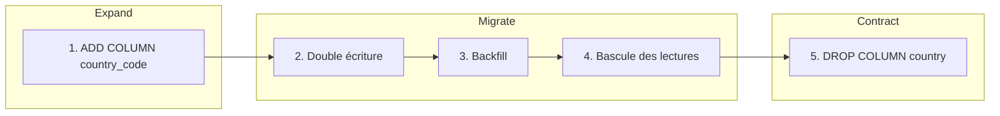

### Exemple : renommer `customers.country` en `customers.country_code`

`ALTER TABLE customers RENAME COLUMN country TO country_code;` est instantané, mais les instances encore en ancienne version lisent `country` et plantent à la seconde où il passe. À la place :

| Déploiement | Base | Application |
|---|---|---|
| 1. Expand | `ALTER TABLE customers ADD COLUMN country_code text;` | inchangée |
| 2. Double écriture | aucun changement | écrit `country` et `country_code`, lit `country` |
| 3. Backfill | recopie par lots (ci-dessous) | inchangée |
| 4. Bascule des lectures | aucun changement | lit `country_code` (derrière un <span class="term" data-term="feature-flag">feature flag</span>), écrit les deux |
| 5. Contract | `ALTER TABLE customers DROP COLUMN country;` | n'écrit plus que `country_code` |

L'étape 2 côté application, dans la même requête :
```python
# Ce qui change : écrit aussi country_code, en plus de country, dans la même requête
def update_country(conn, customer_id: int, code: str) -> None:
    conn.execute(
        "UPDATE customers SET country = %s, country_code = %s WHERE id = %s",
        (code, code, customer_id),
    )
```
Si la version 1 (qui n'écrit que `country`) tourne encore pendant le déploiement, ses écritures laissent `country_code` vide : c'est le backfill de l'étape 3 qui rattrape ces lignes.

Entre l'étape 4 et l'étape 5, on attend que plus aucune version déployée ne lise `country` (quelques jours stables, par exemple).

### Backfill par lots
<span class="pill pill-status pill-status-ok" title="Toujours valable, vérifié en novembre 2026">Valable · 11/2026</span>

Le <span class="term" data-term="backfill">backfill</span> recopie les lignes existantes. Un seul `UPDATE` sur 40 millions de lignes (exemple) tiendrait des verrous longtemps et ferait exploser le retard des réplicas. On découpe :

```sql
-- Bien : recopie par lots de 5 000 lignes, répétée jusqu'à zéro ligne modifiée
UPDATE customers
SET country_code = country
WHERE id IN (
    SELECT id FROM customers
    WHERE country_code IS NULL AND country IS NOT NULL
    ORDER BY id
    LIMIT 5000
);
```

Un job répète cette requête, avec une courte pause entre les lots, jusqu'à zéro ligne modifiée. Puis une vérification : `SELECT COUNT(*) FROM customers WHERE country_code IS DISTINCT FROM country;` doit renvoyer 0 avant l'étape 4. `IS DISTINCT FROM` compare en traitant `NULL` comme une valeur : `NULL = 'FR'` donne `NULL` (la ligne serait oubliée), alors que `NULL IS DISTINCT FROM 'FR'` donne `true` (la ligne est comptée).

### Les verrous : lock_timeout
<span class="pill pill-status pill-status-ok" title="Toujours valable, vérifié en novembre 2026">Valable · 11/2026</span>

Un `ALTER TABLE` demande un <span class="term" data-term="db-lock">verrou</span> exclusif. S'il attend derrière une longue requête, toutes les requêtes qui arrivent après lui attendent aussi : la table semble bloquée, alors que la migration n'a encore rien fait. Le <span class="term" data-term="lock-timeout">délai d'attente de verrou</span> coupe court :

!!! noob "As noob"
    Je pense à une file au guichet : la migration veut le guichet pour elle seule, attend derrière un client très long, et tous ceux qui arrivent derrière elle attendent aussi, même ceux qui n'en avaient que pour une seconde. `lock_timeout` lui dit : « si tu n'as pas le guichet en 2 secondes, sors de la file et reviens plus tard ». La phrase à retenir : **une migration qui attend un verrou bloque tout le monde derrière elle.**

```sql
-- Bien : abandonner si le verrou n'est pas obtenu en 2 secondes
SET lock_timeout = '2s';
-- Exemple : l'étape 1 (expand), ajout de la nouvelle colonne
ALTER TABLE customers ADD COLUMN country_code text;
```

Si le verrou n'est pas obtenu en 2 secondes, la migration échoue proprement et on la relance plus tard. Mieux vaut une migration qui échoue qu'une production figée.

La file d'attente des verrous, et ce que `lock_timeout` y change :

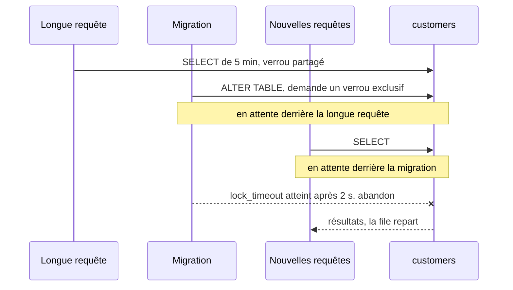

:material-book-open-variant: Doc de référence : [PostgreSQL, Explicit Locking](https://www.postgresql.org/docs/current/explicit-locking.html) (version 18, 2025) ; [PostgreSQL, Client Connection Defaults (lock_timeout)](https://www.postgresql.org/docs/current/runtime-config-client.html) (version 18, 2025)
{ .doc-ref }

### Index et contraintes sans bloquer
<span class="pill pill-status pill-status-ok" title="Toujours valable, vérifié en novembre 2026">Valable · 11/2026</span>

Un `CREATE INDEX` classique bloque les écritures sur la table pendant toute sa construction. La version sans blocage :

```sql
-- Bien : construit l'index sans bloquer les écritures
CREATE INDEX CONCURRENTLY idx_customers_country_code ON customers (country_code);
```

Elle est plus lente, ne peut pas tourner dans une transaction, et laisse un index marqué `INVALID` si elle échoue : il faut le supprimer et recommencer.

Pour une contrainte, même idée en deux temps, avec une <span class="term" data-term="not-valid-constraint">contrainte NOT VALID</span> :

```sql
-- Bien : instantané, la contrainte vaut pour les nouvelles écritures seulement
ALTER TABLE customers
    ADD CONSTRAINT customers_country_code_not_null CHECK (country_code IS NOT NULL) NOT VALID;

-- Bien : vérifie ensuite les lignes existantes, avec un verrou léger
ALTER TABLE customers VALIDATE CONSTRAINT customers_country_code_not_null;
```

La première commande est instantanée et s'applique aux nouvelles écritures ; la seconde vérifie les lignes existantes avec un verrou léger, qui laisse passer lectures et écritures. Depuis PostgreSQL 12 (2019), un `SET NOT NULL` posé ensuite réutilise cette contrainte validée et ne relit pas la table (à vérifier sur ma version).

### Outils de migration de schéma
<span class="pill pill-status pill-status-ok" title="Toujours valable, vérifié en novembre 2026">Valable · 11/2026</span>

Les étapes ci-dessus disent **quoi** changer et dans quel ordre. Un <span class="term" data-term="schema-migration-tool">outil de migration de schéma</span> s'occupe de **quand** et **où** : il range chaque changement dans un fichier versionné, retient dans une table de la base lesquels sont déjà passés, et applique les suivants dans l'ordre, de la même façon en local, en recette et en production.

| Outil | Écosystème | Format des migrations | Table d'historique |
|---|---|---|---|
| Flyway | Java, ou n'importe quel langage par sa CLI | fichiers SQL numérotés (`V7__add_country_code.sql`) | `flyway_schema_history` |
| Liquibase | Java, ou CLI | *changesets* en SQL, YAML, XML ou JSON, avec retour arrière et préconditions | `databasechangelog` |
| Alembic | Python, avec SQLAlchemy | fichiers Python chaînés (`down_revision`), génération automatique à partir des modèles | `alembic_version` |
| Doctrine Migrations | PHP, souvent avec Symfony | classes PHP, générées par différence avec les entités | `doctrine_migration_versions` |

D'autres frameworks ont le leur (Rails, Django, Laravel, Prisma) : même principe.

**Quand** : dès qu'une base vit plus longtemps qu'un prototype et existe dans plus d'un environnement. **Pas** : pour des données de test (c'est le rôle des jeux de données), ni pour un entrepôt de données dont les tables sont reconstruites par l'outil de transformation (dbt, voir [Données et décision](donnees-decision.md#plateforme-de-donnees)).

*dbt : complémentaire de Airflow, Fivetran, Airbyte, BigQuery, Snowflake*
{ .tool-rel }


**Pourquoi** : sans outil, chacun lance ses `ALTER` à la main, et personne ne sait si la recette a le même schéma que la production. Le gain : l'état du schéma est lisible dans Git, rejouable sur une <span class="term" data-term="throwaway-database">base jetable</span>, et vérifié en CI. Le coût : une discipline (ne jamais modifier une migration déjà appliquée : Flyway et Liquibase comparent une somme de contrôle et refusent de continuer) et une décision sur le moment où les migrations tournent.

*Flyway : concurrent de Liquibase, Alembic*<br>
*Liquibase : concurrent de Flyway, Alembic*
{ .tool-rel }


**Comment** : l'étape 1 de l'exemple (expand), écrite pour Alembic.

*Alembic : concurrent de Flyway, Liquibase ; complémentaire de SQLAlchemy*
{ .tool-rel }

```python
"""Add customers.country_code.

Revision ID: 3f2a9c1d7b10
Revises: 9b41e0c2d5aa
"""
import sqlalchemy as sa
from alembic import op

# Exemple : chaînage avec la migration précédente
revision = "3f2a9c1d7b10"
down_revision = "9b41e0c2d5aa"


# Bien : lock_timeout avant l'ALTER, nouvelle colonne nullable (expand)
def upgrade() -> None:
    op.execute("SET lock_timeout = '2s'")
    op.add_column("customers", sa.Column("country_code", sa.Text(), nullable=True))


# Exemple : retour arrière, retirer la colonne
def downgrade() -> None:
    op.drop_column("customers", "country_code")
```
La même chose pour Flyway tient dans un fichier `V7__add_customers_country_code.sql` qui contient les deux lignes SQL de l'étape 1 :
```
$ flyway migrate
Successfully validated 7 migrations
Current version of schema "public": 6
Migrating schema "public" to version "7 - add customers country code"
Successfully applied 1 migration to schema "public", now at version v7
```
(Sortie illustrative, à vérifier selon la version.)

Ce que l'outil ne fait pas, et les règles qui vont avec :

- **il ne rend pas une migration sans interruption** : il l'exécute. Chaque étape d'expand / contract reste une migration séparée, livrée dans un déploiement séparé ;
- **lancer les migrations une seule fois**, dans une étape dédiée du déploiement (un job avant la mise à jour des instances), pas au démarrage de chaque instance ; Flyway et Liquibase posent un verrou pour éviter deux exécutions en même temps, mais un démarrage bloqué derrière une longue migration fait échouer les sondes de santé ;
- **les opérations qui refusent les transactions** (`CREATE INDEX CONCURRENTLY`) demandent une option : `autocommit_block()` dans Alembic, une migration non transactionnelle dans Flyway (à vérifier selon la version) ;
- **le retour arrière par `downgrade` est souvent illusoire** une fois que des données ont été écrites : on prépare plutôt une migration corrective vers l'avant ;
- **en CI**, appliquer toutes les migrations sur une base vide, puis vérifier que le schéma obtenu correspond aux modèles (`alembic check`, `doctrine:schema:validate`).

### Je veux... j'utilise...

| Je veux... | J'utilise... |
|---|---|
| renommer une colonne ou changer son type alors que l'ancienne version de l'application la lit encore, comme `country` qui devient `country_code` | expand / contract en plusieurs déploiements |
| remplir une nouvelle colonne sur des millions de lignes existantes, sans bloquer la table ni faire décrocher les réplicas | un backfill par lots, puis une requête de vérification |
| qu'une migration coincée derrière une longue requête ne fige pas toute la production | `SET lock_timeout` avant chaque `ALTER` |
| ajouter un index sur une grosse table pendant que l'application continue d'y écrire | `CREATE INDEX CONCURRENTLY` |
| ajouter une contrainte sur une grosse table sans la bloquer le temps de relire toutes les lignes | `NOT VALID`, puis `VALIDATE CONSTRAINT` |
| que le schéma soit le même en local, en recette et en production, et savoir quels changements sont déjà passés | un outil de migration : Flyway, Liquibase, Alembic, Doctrine Migrations |
| que les migrations ne tournent qu'une fois, même quand vingt instances démarrent en même temps | un job dédié avant le déploiement des instances |
| déménager toutes les données vers une autre base pendant que l'application continue de tourner | du <span class="term" data-term="cdc">CDC</span> plutôt qu'une <span class="term" data-term="dual-write">double écriture</span> codée dans l'application |

Références : Danilo Sato, [« ParallelChange »](https://martinfowler.com/bliki/ParallelChange.html) (2014) ; Scott Ambler et Pramod Sadalage, « Refactoring Databases » (2006) ; documentation PostgreSQL, [CREATE INDEX](https://www.postgresql.org/docs/current/sql-createindex.html) et [ALTER TABLE](https://www.postgresql.org/docs/current/sql-altertable.html) (version 18, 2025) ; documentations de [Flyway](https://documentation.red-gate.com/flyway), [Liquibase](https://docs.liquibase.com/), [Alembic](https://alembic.sqlalchemy.org/) et [Doctrine Migrations](https://www.doctrine-project.org/projects/migrations.html) (dates de publication non indiquées, à vérifier).

## Les pièges qui faussent les résultats

<a class="pill pill-scope pill-scope-code" href="../architecture/#carte-des-echelles">Échelle · Code</a>

### NULL ne se compare pas avec =
```sql
-- À éviter : = NULL ne vaut jamais vrai
WHERE delivered_at = NULL        ne renvoie jamais rien
-- Bien : IS NULL teste l'absence de valeur
WHERE delivered_at IS NULL       correct
```
Et `WHERE status != 'paid'` **exclut** les <span class="term" data-term="db-row">lignes</span> où `status` est `NULL`.

:material-book-open-variant: Doc de référence : [PostgreSQL, Comparison Functions and Operators](https://www.postgresql.org/docs/current/functions-comparison.html) (version 18, 2025) ; [MySQL, Working with NULL Values](https://dev.mysql.com/doc/refman/8.4/en/working-with-null.html) (MySQL 8.4)
{ .doc-ref }

### Les dates et les fuseaux horaires
```sql
-- À éviter : ne renvoie que les commandes de minuit pile
WHERE created_at BETWEEN '2026-10-20' AND '2026-10-20'
```
Ne renvoie que les commandes de minuit pile : `'2026-10-20'` veut dire `2026-10-20 00:00:00`. Écrire plutôt :
```sql
-- Ce qui change : fin exclue au lendemain, toute la journée est prise
WHERE created_at >= '2026-10-20' AND created_at < '2026-10-21'
```
Et savoir si les dates sont stockées en <span class="term" data-term="utc">UTC</span> ou en heure locale : une commande passée à 0 h 30 heure de Paris est encore le 19 en UTC.

:material-book-open-variant: Doc de référence : [PostgreSQL, Date/Time Types](https://www.postgresql.org/docs/current/datatype-datetime.html) (version 18, 2025) ; [MySQL, Time Zone Support](https://dev.mysql.com/doc/refman/8.4/en/time-zone-support.html) (MySQL 8.4)
{ .doc-ref }

### L'argent
Jamais en `FLOAT` : `0.1 + 0.2` ne fait pas exactement `0.3`. En centimes entiers (`total_cents INT`) ou en `DECIMAL(12, 2)`.

:material-book-open-variant: Doc de référence : [PostgreSQL, Numeric Types](https://www.postgresql.org/docs/current/datatype-numeric.html) (version 18, 2025) ; [MySQL, Fixed-Point Types](https://dev.mysql.com/doc/refman/8.4/en/fixed-point-types.html) (MySQL 8.4)
{ .doc-ref }

### Comparer des textes
Selon la base et sa configuration (« <span class="term" data-term="collation">collation</span> »), `'Ada' = 'ada'` peut être vrai (MySQL par défaut) ou faux (PostgreSQL). Un test qui passe sur l'un peut échouer sur l'autre.

:material-book-open-variant: Doc de référence : [PostgreSQL, Collation Support](https://www.postgresql.org/docs/current/collation.html) (version 18, 2025) ; [MySQL, Character Sets and Collations in General](https://dev.mysql.com/doc/refman/8.4/en/charset-general.html) (MySQL 8.4)
{ .doc-ref }

## Sécurité : l'injection SQL

<a class="pill pill-scope pill-scope-code" href="../architecture/#carte-des-echelles">Échelle · Code</a> <span class="pill pill-status pill-status-ok" title="Toujours valable, vérifié en novembre 2026">Valable · 11/2026</span>

Mon code construit une <span class="term" data-term="db-query">requête</span> en collant dedans un texte tapé par l'utilisateur, comme l'e-mail d'un formulaire de recherche. Cet utilisateur peut alors taper du SQL à la place de l'e-mail, et réécrire ma requête.
```python
# À éviter : la saisie est collée dans le texte de la requête
email = request.args["email"]
db.query(f"SELECT * FROM customers WHERE email = '{email}'")
```
Si l'utilisateur envoie `' OR '1'='1`, la requête devient :
```sql
-- Exemple : la requête obtenue, elle renvoie tous les clients
SELECT * FROM customers WHERE email = '' OR '1'='1'
```
et renvoie **tous** les clients.

La parade : les <span class="term" data-term="parameterized-query">requêtes paramétrées</span>. La base reçoit la requête et la valeur séparément, la valeur ne peut jamais devenir du SQL.

!!! noob "As noob"
    C'est la différence entre dicter une lettre à quelqu'un qui recopie tout ce que je dis, y compris « et ajoute un virement de 1 000 € », et lui tendre un formulaire dont la case « nom » ne peut contenir qu'un nom. Avec une requête paramétrée, la valeur reste dans sa case, quoi qu'elle contienne. La phrase à retenir : **ne jamais coller une saisie utilisateur dans le texte d'une requête.**

```python
# Ce qui change : requête paramétrée, valeur envoyée séparément, elle reste une donnée
db.query("SELECT * FROM customers WHERE email = %s", (email,))
```

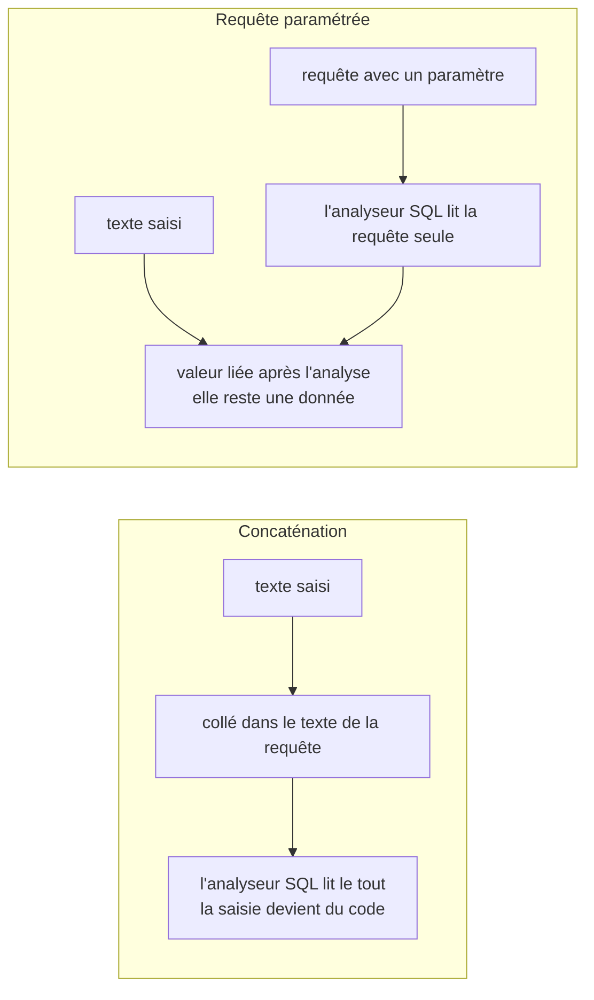

:material-book-open-variant: Doc de référence : [OWASP, SQL Injection Prevention Cheat Sheet](https://cheatsheetseries.owasp.org/cheatsheets/SQL_Injection_Prevention_Cheat_Sheet.html) (consultée en novembre 2026) ; [OWASP, Query Parameterization Cheat Sheet](https://cheatsheetseries.owasp.org/cheatsheets/Query_Parameterization_Cheat_Sheet.html) (consultée en novembre 2026)
{ .doc-ref }

## SQL pour la QA

<a class="pill pill-scope pill-scope-code" href="../architecture/#carte-des-echelles">Échelle · Code</a>

| Je veux... | Requête type |
|---|---|
| trouver un client qui n'a encore rien commandé, pour tester le parcours « première commande » | `LEFT JOIN orders ... WHERE o.id IS NULL LIMIT 1` |
| vérifier qu'un clic sur « Commander » a créé une seule ligne, et pas deux à cause d'un double envoi | `SELECT COUNT(*) ... WHERE order_id = 42` égal à 1 |
| trouver des données incohérentes, comme une commande enregistrée sans aucun article | `LEFT JOIN order_items ... WHERE i.id IS NULL` |
| repérer des doublons, comme deux clients avec le même e-mail | `GROUP BY ... HAVING COUNT(*) > 1` |
| savoir combien de commandes sont dans chaque statut, pour choisir mes données de test | `GROUP BY status` |
| voir combien de lignes une modification toucherait, sans rien changer pour de vrai | `BEGIN; UPDATE ...; SELECT ...; ROLLBACK;` |
| comprendre pourquoi une page qui lit la base est lente | `EXPLAIN` puis vérifier les index |

Bonnes pratiques :
- sur un <span class="term" data-term="shared-environment">environnement partagé</span>, d'autres testeurs et d'autres tests utilisent les mêmes données : je **lis** plutôt que d'écrire, et je ne modifie jamais une donnée qu'un autre test utilise, sinon c'est son test qui échoue sans raison apparente ;
- dans les <span class="term" data-term="automated-test">tests automatisés</span>, j'utilise une <span class="term" data-term="throwaway-database">base jetable</span> par session (<span class="term" data-term="testcontainers">Testcontainers</span>) et je fais créer à chaque test ses propres données, pour qu'aucun test ne dépende de ce qu'un autre a laissé ;
- pour explorer, je me connecte avec un <span class="term" data-term="read-only-account">compte en lecture seule</span> : une erreur de frappe, comme un `DELETE` sans `WHERE`, ne pourra rien casser.

*Testcontainers : complémentaire de pytest*
{ .tool-rel }


:material-book-open-variant: Doc de référence : [Testcontainers](https://testcontainers.com/) (consultée en novembre 2026) ; [PostgreSQL, GRANT](https://www.postgresql.org/docs/current/sql-grant.html) (version 18, 2025)
{ .doc-ref }

## Pièges à éviter

- **UPDATE ou DELETE lancé à l'aveugle** : j'exécute un `UPDATE` ou un `DELETE` sans avoir compté les lignes visées, ou j'oublie le `WHERE`. Toute la table est modifiée d'un coup. Je lance d'abord le même `WHERE` dans un `SELECT COUNT(*)`, dans une transaction que je peux annuler par `ROLLBACK` ([voir la transaction](#essayer-avant-de-valider-la-transaction)).
- **Somme après une jointure** : je fais un `SUM(o.total_cents)` après un `JOIN` sur les articles. Une commande de 3 articles compte 3 fois, donc le total est faux. Je fais la somme sur `orders` seule, ou j'agrège les articles avant la jointure ([voir le piège de la multiplication](#le-piege-de-la-multiplication)).
- **Comparer avec NULL** : j'écris `WHERE delivered_at = NULL`, ou je compte sur `status != 'paid'` pour tout prendre sauf les commandes payées. La première ne renvoie jamais rien, la seconde oublie les lignes où `status` est `NULL`. J'utilise `IS NULL` et `IS DISTINCT FROM` ([voir NULL](#null-ne-se-compare-pas-avec)).
- **N+1 caché par l'ORM** : je boucle sur une liste et je laisse l'ORM charger chaque élément lié. 100 commandes font 101 allers-retours vers la base. Je regroupe en une seule requête avec `JOIN` ou `IN`, et je surveille les spans `SELECT` répétés dans les traces ([voir le problème N+1](#le-probleme-n1)).
- **Optimiser au jugé** : je m'attaque à la requête la plus lente du slow query log, ou je change trois choses à la fois. Je rate la requête de 3 ms appelée 2 millions de fois, et je ne sais pas quel changement a aidé. Je classe par temps total, je change une seule chose et je remesure ([voir trouver les requêtes lentes](#trouver-les-requetes-lentes), [la boucle](#rendre-une-requete-rapide-la-boucle)).
- **Renommer une colonne en une seule migration** : je lance `RENAME COLUMN` pendant un déploiement progressif. Les instances encore en ancienne version lisent l'ancien nom et plantent à la seconde où la migration passe. Je découpe en expand / contract, un déploiement par étape ([voir expand / contract](#expand-contract)).
- **Saisie collée dans la requête** : je construis la requête en y collant le texte tapé par l'utilisateur. Avec `' OR '1'='1`, il récupère tous les clients. J'utilise toujours des requêtes paramétrées ([voir l'injection SQL](#securite-linjection-sql)).
- **Sharder trop tôt** : je répartis les données sur plusieurs bases dès les premières lenteurs. Je paie la complexité des requêtes inter-shards pour un problème qu'un index ou un réplica aurait réglé, et le retour arrière est presque impossible. Je monte l'échelle marche par marche, sur mesure ([voir l'échelle](#lechelle-du-moins-cher-au-plus-cher)).

## Ce qu'on demande en entretien

Les questions typiques :

- « Quelle différence entre INNER JOIN et LEFT JOIN ? », « Comment trouver les clients qui n'ont jamais commandé ? » Pour répondre : je donne le nombre de lignes renvoyées sur un petit exemple, puis le motif `LEFT JOIN ... IS NULL` ([Joindre des tables](#joindre-des-tables), [Trouver ce qui manque](#trouver-ce-qui-manque-left-join-is-null)).
- « WHERE ou HAVING ? », « Comment trouver des doublons ? » Pour répondre : je rappelle que `WHERE` filtre les lignes avant le regroupement et `HAVING` les groupes après, avec `GROUP BY ... HAVING COUNT(*) > 1` ([HAVING : filtrer après le regroupement](#having-filtrer-apres-le-regroupement)).
- « Comment trouves-tu le deuxième plus gros montant, ou les trois dernières commandes de chaque client ? » Pour répondre : j'utilise une fonction de fenêtre, `ROW_NUMBER() OVER (PARTITION BY customer_id ORDER BY created_at DESC)`, puis je garde les rangs voulus dans une requête englobante, parce qu'un `WHERE` ne peut pas filtrer sur le rang directement ([Fonctions de fenêtre](#fonctions-de-fenetre)).
- « Une page est lente à cause de la base, que fais-tu ? », « Qu'est-ce qu'un index, et quand ne sert-il à rien ? », « Qu'est-ce que le problème N+1 ? » Pour répondre : je déroule mesurer, lire le plan avec `EXPLAIN ANALYZE`, changer une seule chose, remesurer ([Performances](#performances), [Le problème N+1](#le-probleme-n1)), et [Les pièges côté serveur de GraphQL](api-rest-async.md#les-pieges-cote-serveur).
- « Comment vérifies-tu en base l'effet d'un test ? », « Qu'est-ce qu'une transaction, que veut dire ACID ? » Pour répondre : je montre le `BEGIN ... ROLLBACK` et les requêtes types de la QA ([Ce qu'une transaction garantit (ACID)](#ce-quune-transaction-garantit-acid), [SQL pour la QA](#sql-pour-la-qa)).
- « Comment te protèges-tu de l'injection SQL ? » Pour répondre : je montre la requête concaténée, la saisie `' OR '1'='1`, puis la requête paramétrée ([Sécurité : l'injection SQL](#securite-linjection-sql)).
- « Ta base sature, que fais-tu ? », « Comment renommer une colonne sans interruption ? » Pour répondre : je monte l'échelle du moins cher au plus cher, puis je déroule expand / contract ([Faire grandir une base de données](#faire-grandir-une-base-de-donnees), [Migrer un schéma sans interruption](#migrer-un-schema-sans-interruption)).

Ce qui fait une bonne réponse : écrire la requête sur un petit jeu de données, dire combien de lignes elle renvoie, puis citer le piège qui la fausserait (`NULL`, multiplication, fuseau horaire).
