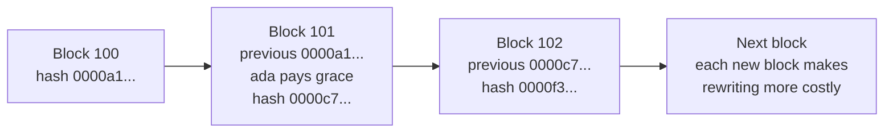

# Seminal texts: white papers, papers and reference books

!!! warning "Disclaimer"
    These notes are personal cheat sheets, not a source of truth. They reflect my own understanding and choices: their content remains subjective, despite the quotes and references it contains. It may be incomplete, simplified, inaccurate or outdated. Always check the official documentation before applying it. This content is provided as is, without any warranty: you use it at your own risk.

!!! abstract "Scales"
    The colored badges under the headings say at which scale a notion applies:

    - <span class="pill pill-scope pill-scope-code">Code</span> the classes, functions and modules of one program;
    - <span class="pill pill-scope pill-scope-app">Application</span> one service or application and its internal split;
    - <span class="pill pill-scope pill-scope-system">System</span> several services talking to each other over the network;
    - <span class="pill pill-scope pill-scope-infra">Infrastructure</span> servers, network, zones and clusters, physical or virtual;
    - <span class="pill pill-scope pill-scope-enterprise">Enterprise</span> the whole information system and its organization.

    Details and ambiguous words: [map of scales](architecture.md#map-of-scales).

The pages of this reminder keep citing the same texts: a 1972 paper on modules, a cloud vendor's <span class="term" data-term="white-paper">white paper</span>, an <span class="term" data-term="rfc-document">RFC</span>, a NIST <span class="term" data-term="technical-standard">standard</span>, a manifesto signed by seventeen people. This page gathers them as general IT culture: what each text says, why it still matters, how to cite it in one sentence in an interview, and where it is used elsewhere in the reminder.

The laws that carry a name (Conway, Brooks, Hyrum, Goodhart...) are explained on the [Laws and principles](lois-et-principes.md) page; here, we talk about the original text. Company and management culture (books on organizations, strategy, leadership) is on the [Company culture](culture-entreprise.md) page.

!!! info "Page written in November 2026"
    The publication dates of old texts are stable. The editions of annual reports, Top 10 lists and vendor white papers change: every date marked "to check" was not verified against the original source.

## Terminology

**White paper**: a document that presents a problem and a solution. The word covers two very different genres:

- the **commercial white paper** from a vendor, which explains a problem to lead to its product ("Five reasons to switch to our observability platform"); useful to understand an offer, never neutral;
- the **technical white paper**, which describes a design or a reference framework in detail: the Bitcoin white paper (2008), the AWS Well-Architected white papers (since 2015, to check), the CNCF Platforms White Paper (2023, to check). It is not reviewed by independent peers: its value depends on its author and on what they have done since.

**Research paper**: a text that presents a result (an algorithm, a proof, a measurement, a system) and submits it to **peer review**: other researchers, often anonymous, accept it, reject it or ask for changes before it is published in a journal (Communications of the ACM, ACM TOCS) or at a conference (SOSP, OSDI, NeurIPS). A **preprint** is put online before this review, most often on **arXiv** (an open archive run by Cornell University since 1991): in AI, most papers circulate this way first. Large companies also publish **industry papers**: they describe a system already in production (GFS, Dynamo, Spanner), reviewed by a conference's peers, but nobody outside can reproduce the experiment.

**RFC (Request for Comments)**: a numbered document published by the IETF (Internet Engineering Task Force) and a few other bodies, which describes an Internet protocol or practice. A published RFC is never modified: a new one is published that makes it obsolete (RFC 9110 from 2022 replaces the HTTP RFCs from 2014). Each RFC has a **status**: Internet Standard or Proposed Standard (the protocol is the reference), Best Current Practice (a good practice), Informational or Experimental (no obligation). So not every RFC is a standard.

**Standard**: a text adopted by an official body, with a consultation process. **ISO** (International Organization for Standardization) publishes standards that are often paid (ISO/IEC 25010 on software quality, 2023 revision). **NIST** (the US federal standards agency) publishes its Special Publications for free, the **NIST SP** (SP 800-207 on zero trust, 2020). A community list like the OWASP Top 10 is not a standard: it is an awareness document, and it is cited as such.

**Manifesto**: a statement of values signed by a group, short and deliberately general (Agile Manifesto, 2001; Threat Modeling Manifesto, 2020). It proves nothing: it gives a direction and a shared vocabulary.

**Reference book**: a book that sums up a field and that everyone cites ("The Mythical Man-Month", "Designing Data-Intensive Applications"). It ages through its examples, rarely through its ideas: check the edition.

Example: reading a paper citation like an identity card.

```
DeCandia et al., "Dynamo: Amazon's Highly Available Key-value Store", SOSP 2007
│           │                                                          │    │
│           │                                                          │    └ year: the system described dates from then, not today's product
│           │                                                          └ peer-reviewed conference (Symposium on Operating Systems Principles)
│           └ exact title: the one you type into a search engine
└ first author, "et al." = several co-authors
```

Judging a text's reliability before citing it:

| Genre | Who publishes | Reviewed by | The risk | How to cite it |
|---|---|---|---|---|
| research paper | researchers, universities | anonymous peers | result superseded by a newer paper | author, title, venue, year |
| arXiv preprint | any researcher | nobody yet | unconfirmed result | saying so: "preprint, not peer reviewed" |
| industry paper | a company's team | peers, with no possible reproduction | only describes the system of the time | "the 2007 paper, not today's product" |
| RFC | IETF | working group, consensus | Informational status taken for a standard | number, status, year |
| standard | ISO, NIST | public consultation | obsolete version | number, revision, year |
| vendor white paper | a company | nobody outside | marketing, unverifiable figures | "vendor X's white paper" |
| manifesto, book | authors | publisher, readers | dated examples | author, title, edition |

| I want... | I look for... |
|---|---|
| I have to convince my team that an idea rests on solid ground, not on a trendy blog post | the peer-reviewed paper, or the reference book |
| I need to know exactly how a protocol behaves, like what an HTTP server must do with a malformed request | the RFC in force (and check it is not obsolete) |
| an audit or a customer asks me to prove I meet a requirement, like a zero trust architecture | the standard, with its revision number |
| I want to understand what a cloud vendor sells before a meeting with them | its white paper, knowing that it sells |
| I follow a topic that moves every month, like AI, where papers circulate before any review | preprints, flagging them as such |

## Where to start

Eight reads, if I had to keep only eight depending on my role. The other texts on the page connect to them.

| Profile | Text | Why first |
|---|---|---|
| everyone | Melvin Conway, "How Do Committees Invent?" (1968) | two pages, and the question of teams comes back in every architecture decision |
| everyone | Frederick Brooks, "No Silver Bullet" (1986) | protects against the promise of the next miracle tool, AI included |
| architect | Martin Kleppmann, "Designing Data-Intensive Applications" (2017) | replication, partitioning, transactions, streams: the whole vocabulary of data systems |
| architect | David Parnas, "On the Criteria To Be Used in Decomposing Systems into Modules" (1972) | the decomposition rule that still works for modules and microservices |
| staff | Google, "Site Reliability Engineering" (2016) | SLOs, error budget, postmortem: the shared language between product and operations |
| staff, DevX | Forsgren, Humble and Kim, "Accelerate" (2018) | links delivery practices to performance, with a method |
| QA | John Allspaw, "Blameless PostMortems and a Just Culture" (2012) | a short post that changes how I handle a bug that escaped to production |
| DevX | CNCF, "Platforms White Paper" (2023, to check) | a shared definition of the internal platform seen as a product |

## Reference authors

A text is easier to understand when I know who wrote it. Knowing who Martin Fowler or Lisa Crispin is helps in three ways:

- **finding the rest of their work**: an author who wrote a good book often keeps a blog, gives talks and has published other texts on the same topic;
- **judging context and date**: advice written in 2002 for monolithic enterprise applications does not apply as is to a service architecture in 2026;
- **not quoting an idea out of its era**: Fowler's test pyramid (2012) answered slow and brittle UI suites; quoting it against a modern front end without saying so makes it say something else.

**When to use it.** I am preparing an interview and want two or three solid references per topic. I am taking a new role (architect, staff, QA) and do not know whom to read. Or, in a design review, my team applies a rule without knowing where it comes from, and I want to find its origin.

**How.** I pick two or three people in line with my role, read their main text ("Read first" column), then follow their blog or site to see how their thinking evolved. No need to read everything: knowing three authors well beats quoting twenty titles.

Book dates are those of the first edition unless stated otherwise. Dates marked "to check" were not checked against the original source.

### Architecture and design

| Person | Known for (with dates) | Read first | For which role |
|---|---|---|---|
| Martin Fowler | "Refactoring" (1999, second edition in 2018, examples in JavaScript), "Patterns of Enterprise Application Architecture" (2002), the bliki on martinfowler.com (kept since the early 2000s, to check), the "Microservices" article with James Lewis (2014) | his [software architecture guide](https://martinfowler.com/architecture/) (publication date not given), which gathers his articles by topic | architect, staff, developer |
| Eric Evans | "Domain-Driven Design" (2003), the <span class="term" data-term="bounded-context">bounded context</span> | the book, starting with the strategic part (contexts, context map) | architect |
| Vaughn Vernon | "Implementing Domain-Driven Design" (2013), "Domain-Driven Design Distilled" (2016) | "Domain-Driven Design Distilled" (2016), short, before Evans's book | architect, developer |
| Sam Newman | "Building Microservices" (2015, second edition in 2021), "Monolith to Microservices" (2019), the Backends For Frontends pattern (2015) | "Monolith to Microservices" (2019) if I start from a monolith | architect, staff |
| Chris Richardson | "Microservices Patterns" (2018), the online catalogue microservices.io (creation date to check): saga, outbox | the microservices.io catalogue, one pattern at a time | architect, developer |
| Gregor Hohpe and Bobby Woolf | "Enterprise Integration Patterns" (2003); Hohpe alone: "The Software Architect Elevator" (2020) | "Enterprise Integration Patterns", for the messaging vocabulary | architect |
| Martin Kleppmann | "Designing Data-Intensive Applications" (2017), research on CRDTs and local-first software | the book (a second edition is announced, to check) | architect, staff |
| Neal Ford and Mark Richards | "Fundamentals of Software Architecture" (2020), "Software Architecture: The Hard Parts" (2021, with Pramod Sadalage and Zhamak Dehghani); Ford, Parsons and Kua: "Building Evolutionary Architectures" (2017) | "Fundamentals of Software Architecture" (2020) | architect |
| Simon Brown | the <span class="term" data-term="c4-model">C4 model</span> (c4model.com, creation date to check), "Software Architecture for Developers" (date to check) | the c4model.com site | architect, developer |
| Alistair Cockburn | <span class="term" data-term="hexagonal-architecture">hexagonal architecture</span> (2005), "Writing Effective Use Cases" (2000), signatory of the Agile Manifesto (2001) | the "Hexagonal Architecture" article (2005) | architect, developer |
| Michael Nygard | "Release It!" (2007, second edition in 2018), the ADR format (2011) | "Release It!", chapters on stability patterns | architect, staff |
| Unmesh Joshi | "Patterns of Distributed Systems" (2023), first published as a series on martinfowler.com | the book, or the online series: replication, quorum, leader, log | architect, staff |
| Zhamak Dehghani | <span class="term" data-term="data-mesh">data mesh</span>, article "How to Move Beyond a Monolithic Data Lake to a Distributed Data Mesh" (2019, on martinfowler.com), book "Data Mesh" (2022, to check) | the 2019 article | architect, staff (data) |
| Cam Jackson | the "Micro Frontends" article (2019, on martinfowler.com), which popularised <span class="term" data-term="micro-frontend">micro frontends</span> | the article, with its warnings about the cost | architect (front end) |
| David Parnas | "On the Criteria To Be Used in Decomposing Systems into Modules" (1972), <span class="term" data-term="information-hiding">information hiding</span> | the 1972 paper (a few pages) | everyone |

### Code and craft

| Person | Known for (with dates) | Read first | For which role |
|---|---|---|---|
| Kent Beck | Extreme Programming ("Extreme Programming Explained", 1999), <span class="term" data-term="tdd">TDD</span> ("Test-Driven Development: By Example", 2002), signatory of the Agile Manifesto (2001), "Tidy First?" (2023) | "Test-Driven Development: By Example" (2002) | developer, QA |
| Martin Fowler | "Refactoring" (1999, then 2018): the catalogue of <span class="term" data-term="refactoring">refactorings</span> and code smells | the second edition (2018) | developer |
| Robert C. Martin | the <span class="term" data-term="solid">SOLID</span> principles (gathered around 2000, named around 2004 by Michael Feathers, to check), "Clean Code" (2008), "Clean Architecture" (2017) | "Clean Architecture" (2017) for the dependency rule; read "Clean Code" with distance, some advice is debated | developer, architect |
| Michael Feathers | "Working Effectively with Legacy Code" (2004): <span class="term" data-term="legacy-code">legacy code</span> as code without tests, seams | the book, chapter by chapter depending on the problem | developer, QA, staff |
| Dan North | "Introducing BDD" (2006), "CUPID: for joyful coding" (2022) | both articles, short | developer, QA |
| Kent C. Dodds | the testing trophy (2018), Testing Library (date to check), "AHA Programming" (publication date not given) | "The Testing Trophy and Testing Classifications" (2021) | front-end developer, QA |

### Delivery, DevOps and SRE

| Person | Known for (with dates) | Read first | For which role |
|---|---|---|---|
| Jez Humble and Dave Farley | "Continuous Delivery" (2010); Farley alone: "Modern Software Engineering" (2021) | "Continuous Delivery" (2010), chapter on the deployment pipeline | DevX, staff, QA |
| Nicole Forsgren | "Accelerate" (2018, with Jez Humble and Gene Kim), the DORA reports, the SPACE framework (2021, with other authors) | "Accelerate" (2018) | staff, DevX, manager |
| Gene Kim | "The Phoenix Project" (2013, a novel, with Kevin Behr and George Spafford), "The DevOps Handbook" (2016, with other authors) | "The Phoenix Project" for the intuition, "The DevOps Handbook" for practice | DevX, manager |
| Betsy Beyer, Chris Jones, Jennifer Petoff and Niall Richard Murphy (editors) | "Site Reliability Engineering" (Google, 2016), followed by "The Site Reliability Workbook" (2018) | the chapters on SLOs and the error budget, free on sre.google | staff, architect, DevX |
| Charity Majors | <span class="term" data-term="observability">observability</span> through rich events ("Observability Engineering", 2022, with Liz Fong-Jones and George Miranda), "The Engineer/Manager Pendulum" (2017) | her blog charity.wtf, then the book | staff, DevX |
| Michael Nygard | "Release It!" (2007): see above, it is also an operations book | "Release It!", chapters on cascading failures | staff, DevX |

### Testing and quality

| Person | Known for (with dates) | Read first | For which role |
|---|---|---|---|
| Lisa Crispin and Janet Gregory | "Agile Testing" (2009), "More Agile Testing" (2014), the <span class="term" data-term="agile-testing-quadrants">agile testing quadrants</span> (taken from Brian Marick) | "Agile Testing" (2009) | QA, manager |
| James Bach | Rapid Software Testing (successive versions since the late 1990s, date to check), structured <span class="term" data-term="exploratory-testing">exploratory testing</span>, "Lessons Learned in Software Testing" (2001, with Cem Kaner and Bret Pettichord) | the satisfice.com site, then "Lessons Learned in Software Testing" | QA |
| Michael Bolton | co-author of Rapid Software Testing with James Bach, the testing versus checking distinction ("Testing and Checking Refined", 2013, with Bach) | the 2013 article | QA |
| Cem Kaner | "Testing Computer Software" (1988, with Jack Falk and Hung Quoc Nguyen, dates to check), the BBST courses (date to check); the term "exploratory testing" is attributed to him (1980s, to check) | "Lessons Learned in Software Testing" (2001) | QA |
| Elisabeth Hendrickson | "Explore It!" (2013), exploratory testing charters | "Explore It!" (2013) | QA, developer |
| Gojko Adzic | "Specification by Example" (2011), "Impact Mapping" (2012) | "Specification by Example" (2011) | QA, developer, product owner |
| Dan North | <span class="term" data-term="bdd">BDD</span> ("Introducing BDD", 2006): see above | "Introducing BDD" (2006) | QA |
| Martin Fowler | "TestPyramid" ([bliki article, 2012](https://martinfowler.com/bliki/TestPyramid.html)), after Mike Cohn's pyramid (2009, to check) | the 2012 article, short; then Kent C. Dodds's trophy for the counterpoint | QA, developer |

### Organisation and leadership

| Person | Known for (with dates) | Read first | For which role |
|---|---|---|---|
| Melvin Conway | "How Do Committees Invent?" (1968), <span class="term" data-term="conway-law">Conway's law</span> | the article (two pages) | everyone |
| Fred Brooks | "The Mythical Man-Month" (1975, anniversary edition in 1995), "No Silver Bullet" (1986) | "No Silver Bullet" (1986) | everyone |
| Matthew Skelton and Manuel Pais | "Team Topologies" (2019): four team types, including the <span class="term" data-term="stream-aligned-team">stream-aligned team</span>, and three interaction modes | the book, or the teamtopologies.com site | staff, architect, manager, DevX |
| Will Larson | "An Elegant Puzzle" (2019), "Staff Engineer: Leadership beyond the management track" (2021), his blog lethain.com | "Staff Engineer" (2021) for the archetypes | staff, manager |
| Tanya Reilly | "The Staff Engineer's Path" (2022) | the book | staff |
| Camille Fournier | "The Manager's Path" (2017) | the book | manager, staff torn between the two tracks |
| Charity Majors | "The Engineer/Manager Pendulum" (2017): see above | the 2017 post, on charity.wtf | staff, manager |

### Whom to read for which need

| I need to... | I read first | Then |
|---|---|---|
| my team wants to pull services out of a monolith that has grown too big to evolve calmly | Sam Newman (2019), Eric Evans (2003) | Chris Richardson (2018) for distributed data |
| I work on a system spread over several machines and do not understand why two copies of the data diverge | Martin Kleppmann (2017) | Unmesh Joshi (2023), Michael Nygard (2007) |
| I inherit old code without a single test, that nobody dares to change | Michael Feathers (2004) | Martin Fowler, "Refactoring" (2018) |
| I have to decide, for a whole team, which tests to write and at which level | Lisa Crispin and Janet Gregory (2009) | Martin Fowler (2012) then Kent C. Dodds (2018) for the shape of the suite |
| I want to learn to test without a script, exploring a feature to find what nobody anticipated | Elisabeth Hendrickson (2013) | James Bach and Michael Bolton (2013) |
| the business and the developers understand a rule differently, and I want shared examples that become tests | Gojko Adzic (2011) | Dan North (2006) |
| my team's releases are rare, long and stressful | Jez Humble and Dave Farley (2010) | Nicole Forsgren et al. (2018) |
| I have to agree with product on how many failures my service is allowed | Google's SRE book (2016) | Charity Majors et al. (2022) |
| I have to split or reorganize teams around a system | Matthew Skelton and Manuel Pais (2019) | Melvin Conway (1968) |
| I want to move toward a staff engineer or manager role, and I hesitate between the two | Will Larson (2021), Tanya Reilly (2022) | Camille Fournier (2017) |
| I have to document an architecture so newcomers understand the choices made | Simon Brown (C4) | Michael Nygard (ADR, 2011) |

## Timeline

The texts on this page, in order. The most used ideas today (modules, consensus, sagas) are often more than thirty years old.

```
1968  Conway (organization and system), Dijkstra (goto)
1972  Parnas (information hiding)
1975  Brooks (The Mythical Man-Month), Saltzer and Schroeder (security)
1978  Lamport (logical clocks)
1984  Saltzer, Reed and Clark (end-to-end)
1986  Brooks (No Silver Bullet)
1987  Garcia-Molina and Salem (sagas)
1994  fallacies of distributed computing, Design Patterns (GoF)
1998  Paxos (published), 2001: Paxos Made Simple
2000  Brewer (CAP), Fielding (REST)
2001  Agile Manifesto
2002  Gilbert and Lynch (CAP proof), Beck (TDD)
2003  GFS, Evans (DDD), Hohpe and Woolf, OWASP Top 10 (1st edition)
2004  MapReduce, Fowler (strangler fig)
2006  Bigtable
2007  Dynamo, Nygard (Release It!)
2008  Bitcoin
2010  Humble and Farley (Continuous Delivery)
2011  Kafka, Twelve-Factor, Nygard (ADR)
2012  Spanner, Abadi (PACELC), Allspaw (blameless postmortem)
2014  Raft, Lewis and Fowler (microservices), first DORA report (to check)
2015  AWS Well-Architected (to check)
2016  Site Reliability Engineering (Google)
2017  Attention Is All You Need, Kleppmann (DDIA)
2018  Accelerate
2020  NIST SP 800-207, RAG
2023  CNCF Platforms White Paper, AWS cell-based architecture (to check)
```

## Software engineering and organization

<a class="pill pill-scope pill-scope-code" href="../architecture/#map-of-scales">Scale · Code</a> <a class="pill pill-scope pill-scope-app" href="../architecture/#map-of-scales">Scale · Application</a>

### Conway, "How Do Committees Invent?" (1968)

**What it says.** Published in Datamation magazine in April 1968: an organization that designs a system produces a structure that copies its own communication structure. Frederick Brooks named it <span class="term" data-term="conway-law">Conway's law</span> in 1975.
**Why it still matters.** It is the basis of the "inverse Conway maneuver": organize teams according to the architecture I want.
**Cite it in an interview.** "Before drawing the services, I look at the teams: according to Conway (1968), the system will end up resembling them."
**In this reminder.** [Conway's law](architecture.md#conways-law).

### Dijkstra, "Go To Statement Considered Harmful" (1968)

**What it says.** A letter from Edsger Dijkstra to Communications of the ACM (March 1968), whose title was chosen by the editor Niklaus Wirth: `goto` makes the link between the program text and its execution impossible to follow; structures are needed (sequence, condition, loop).
**Why it still matters.** It is the popular birth certificate of structured programming, and the title created a genre: dozens of "... Considered Harmful" papers followed.
**Cite it in an interview.** "Dijkstra's real point in 1968 is that you must be able to read a program and know where you are in its execution; it is the same argument against nested callbacks or untraced events."
**In this reminder.** Dijkstra appears for [separation of concerns](principes-conception.md#separation-of-concerns-cohesion-and-coupling) (1974); the `goto` letter is not cited elsewhere yet.

### Parnas, "On the Criteria To Be Used in Decomposing Systems into Modules" (1972)

**What it says.** Communications of the ACM, December 1972. On the same small program, David Parnas compares two decompositions: by processing steps, or by decisions likely to change. The second, <span class="term" data-term="information-hiding">information hiding</span>, holds up much better to change.
**Why it still matters.** I am splitting a system into modules or services. A good module hides a decision that may change (a format, a provider, an algorithm), like a payment module that hides which provider was chosen. A bad one splits a flow into steps that all change together, so every change touches all the modules at once.
**Cite it in an interview.** "I decompose following Parnas (1972): each module hides a decision that may change, not a processing step."

### Brooks, "The Mythical Man-Month" (1975)

**What it says.** A collection of essays by Frederick Brooks, drawn from his experience on IBM's OS/360 operating system. It contains Brooks's law (adding people to a late project makes it later), the <span class="term" data-term="second-system-effect">second-system effect</span>, conceptual integrity and "plan to throw one away". Anniversary edition in 1995, which adds "No Silver Bullet".
**Why it still matters.** The coordination costs it describes have not changed: they explain why a full rewrite almost always overruns.
**Cite it in an interview.** "Brooks wrote it in 1975: the second version of a system is the most dangerous, because you put in everything you had postponed."

### Brooks, "No Silver Bullet" (1986)

**What it says.** Presented at the IFIP congress in 1986, reprinted in IEEE Computer in 1987: no single technique will give a tenfold gain within ten years, because most of the difficulty is <span class="term" data-term="essential-complexity">essential complexity</span> (that of the problem), not <span class="term" data-term="accidental-complexity">accidental complexity</span> (that of the tools).
**Why it still matters.** Each wave of tools (high-level languages, objects, cloud, AI assistants) reduces the accidental part; none removes the essential part.
**Cite it in an interview.** "As Brooks said in 1986, a tool removes accidental complexity; the complexity of the business still has to be designed."

**Example.** Essential complexity: an invoice that applies a different VAT per country, stackable discounts and credit notes; no tool makes these rules disappear, they must be designed. Accidental complexity: hand-writing the JSON serialization of that invoice, or managing its memory in C; a better tool (a library, a garbage-collected language) removes it.

:material-book-open-variant: Reference docs: [Frederick Brooks, No Silver Bullet, UNC TR86-020](https://www.cs.unc.edu/techreports/86-020.pdf) (1986)
{ .doc-ref }

### Gamma, Helm, Johnson and Vlissides, "Design Patterns" (1994)

**What it says.** The book by the so-called "Gang of Four" (GoF) catalogues twenty-three object-oriented design patterns (Strategy, Observer, Factory...), each with its intent, structure and consequences. It also sets two rules: program to an interface, and favour composition over inheritance.
**Why it still matters.** The pattern names have become a code review vocabulary; some are built into languages (iterators, first-class functions), which makes others less useful.
**Cite it in an interview.** "What I mostly keep from the GoF (1994) is the rule 'composition over inheritance'; the catalogue is for naming a solution, not for adding one."
**In this reminder.** [Design patterns](design-patterns.md), [Composition over inheritance](principes-conception.md#composition-over-inheritance).

### The Agile Manifesto (2001)

**What it says.** Written by seventeen practitioners who met in Snowbird (Utah) in February 2001: four values (individuals and interactions, working software, customer collaboration, responding to change, each preferred over its opposite) and twelve principles.
**Why it still matters.** Many so-called agile methods have lost sight of the text; rereading it (one page) helps tell the spirit from the ritual.
**Cite it in an interview.** "The manifesto says 'over', not 'instead of': documentation and plans keep their value, just less than working software."
**In this reminder.** Not cited elsewhere as a text; the team rituals that claim it belong to company culture, linked at the top of the page.

### Beck, "Test-Driven Development: By Example" (2002)

**What it says.** Kent Beck's book describes the red, green, refactor cycle: write a failing test, make it pass with the simplest code, then clean up. It starts with a list of scenarios turned one by one into tests.
**Why it still matters.** TDD remains the reference for designing in small steps; even without practising it to the letter, its test list is a good way to start a task.
**Cite it in an interview.** "I use Beck's TDD (2002) when the business rule is clear and the regression risk is high; to explore an unknown API, I first build a throwaway prototype."
**In this reminder.** The [Quality](qualite.md) page.

### Evans, "Domain-Driven Design" (2003)

**What it says.** Eric Evans's book proposes modeling the software on the business domain: a language shared with the experts, models valid only within a <span class="term" data-term="bounded-context">bounded context</span>, and a map of the relationships between contexts.
**Why it still matters.** The so-called strategic part (bounded contexts, context map, anti-corruption layer) has become the main tool for splitting a monolith into services.
**Cite it in an interview.** "I look for service boundaries where the vocabulary changes meaning: that is Evans's bounded context (2003)."
**In this reminder.** [Domain-Driven Design](architecture.md#domain-driven-design).

:material-book-open-variant: Reference docs: [Eric Evans, Domain-Driven Design Reference](https://www.domainlanguage.com/ddd/reference/) (2015)
{ .doc-ref }

## Distributed systems: the foundations

<a class="pill pill-scope pill-scope-system" href="../architecture/#map-of-scales">Scale · System</a> <a class="pill pill-scope pill-scope-infra" href="../architecture/#map-of-scales">Scale · Infrastructure</a>

### Lamport, "Time, Clocks, and the Ordering of Events in a Distributed System" (1978)

**What it says.** Communications of the ACM, July 1978. Without a shared clock, only events linked by a cause relationship ("happened before") can be ordered. Leslie Lamport proposes <span class="term" data-term="lamport-clock">logical clocks</span> to get a consistent order.
**Why it still matters.** Every replication, every event log and every "which event came first" debate relies on these ideas. Lamport received the Turing Award in 2013.
**Cite it in an interview.** "I never sort events from two machines by their time: since Lamport (1978), we know only causal order is reliable."
**In this reminder.** [Clocks and event order](architecture.md#clocks-and-event-order).

!!! noob "As noob"
    Two people timestamp their messages with watches that are never quite right: comparing the times does not tell who wrote first. But a reply always comes after the question it answers. Lamport's logical clocks are counters that at least respect that order. The takeaway: **between machines, trust cause and effect, not the displayed time.**

### Saltzer, Reed and Clark, "End-to-End Arguments in System Design" (1984)

**What it says.** ACM Transactions on Computer Systems, November 1984 (a first version dates from 1981). The <span class="term" data-term="end-to-end-principle">end-to-end principle</span>: a guarantee such as "the file arrived intact" can only be fully ensured by the endpoints; lower layers only optimize.
**Why it still matters.** It is the justification of the Internet's architecture (a simple network, intelligence at the edges) and of an everyday rule: even with an "exactly once" broker, the consumer must stay idempotent.
**Cite it in an interview.** "Following the end-to-end argument (Saltzer, Reed and Clark, 1984), I check integrity at the application level, whatever the transport promises."
**In this reminder.** Not cited elsewhere yet; the closest application is [idempotency](architecture.md#idempotency).

!!! noob "As noob"
    The carrier can pack a parcel well and handle it with care, but only the recipient, by opening it, can check that the vase is not broken. The layers in between improve the odds, only the ends can guarantee. The takeaway: **the check that counts happens where the data is used.**

### Garcia-Molina and Salem, "Sagas" (1987)

**What it says.** ACM SIGMOD 1987. A long transaction that would lock the database is split into short transactions, each with a compensating transaction that undoes its effect if the rest fails.
**Why it still matters.** Written for a single database, the idea became the microservices <span class="term" data-term="saga-pattern">saga</span>, where no transaction spans several services.
**Cite it in an interview.** "For an order that touches payment and stock, I use a saga in the sense of Garcia-Molina and Salem (1987): local steps, each with its compensation."
**In this reminder.** [Orchestrated or choreographed saga](architecture.md#orchestrated-or-choreographed-saga).

:material-book-open-variant: Reference docs: [Garcia-Molina and Salem, Sagas](https://www.cs.cornell.edu/andru/cs711/2002fa/reading/sagas.pdf) (1987)
{ .doc-ref }

### The fallacies of distributed computing (1994)

**What it says.** Not a paper but a list passed on orally at Sun Microsystems: L. Peter Deutsch phrased seven of them around 1994, James Gosling added the eighth around 1997 (dates to check). They are the <span class="term" data-term="distributed-computing-fallacies">fallacies</span> I make when writing a network call: the network is reliable, latency is zero, and so on.
**Why it still matters.** My code calls another service like a local function, and the day the network slows down, the call waits forever. Each resilience pattern answers one of these fallacies: the timeout answers "latency is zero", the retry and the circuit breaker answer "the network is reliable".
**Cite it in an interview.** "I reread the list of the eight fallacies before every design review: most of the outages I have seen come from it."
**In this reminder.** [The eight fallacies](architecture.md#the-eight-fallacies).

:material-book-open-variant: Reference docs: [Wikipedia, Fallacies of distributed computing](https://en.wikipedia.org/wiki/Fallacies_of_distributed_computing) (accessed November 2026)
{ .doc-ref }

### Lamport, Paxos (1998 and 2001)

**What it says.** "The Part-Time Parliament" (ACM TOCS, 1998, written around 1990) describes a <span class="term" data-term="consensus-algorithm">consensus algorithm</span> in the form of an imaginary Greek parliament; nobody understood it, hence "Paxos Made Simple" (2001), which explains it in two pages of prose.
**Why it still matters.** It is the theoretical basis of consensus in the presence of failures; Chubby (Google, 2006) and Spanner use it.
**Cite it in an interview.** "Paxos proves that a majority of machines can agree despite failures; in practice, I use a tool that implements it, I do not write it."
**In this reminder.** [Consensus and leader election](architecture.md#consensus-and-leader-election).

!!! noob "As noob"
    A group of friends picks a restaurant by text message, while some phones die and some messages arrive late. A consensus algorithm is a voting rule that guarantees they never end up in two different restaurants, as long as a majority can still be reached. The takeaway: **consensus means agreeing once and for all despite failures, thanks to the majority.**

### Brewer (2000), then Gilbert and Lynch (2002): the CAP theorem

**What it says.** Eric Brewer states a conjecture in a keynote at the PODC 2000 symposium ("Towards Robust Distributed Systems"); Seth Gilbert and Nancy Lynch prove it in 2002 (ACM SIGACT News). The <span class="term" data-term="cap-theorem">CAP theorem</span>: during a <span class="term" data-term="network-partition">network partition</span>, a system chooses between consistency and availability. Brewer himself nuanced it in "CAP Twelve Years Later" (IEEE Computer, 2012).
**Why it still matters.** It is the question asked in almost every architect interview, often badly phrased ("pick two out of three").
**Cite it in an interview.** "CAP does not say 'two out of three': you do not choose the partition, the choice is C or A during the split, and Brewer himself clarified it in 2012."
**In this reminder.** [CAP and PACELC](architecture.md#cap-and-pacelc).

!!! noob "As noob"
    Two branches of a bank whose line to each other is cut: a customer asks one of them for their balance. Either the branch refuses to answer until it can check with the other one (consistency), or it answers with what it knows, at the risk of missing a withdrawal made at the other branch (availability). The takeaway: **I do not choose the cut; what I choose is to refuse, or to risk an outdated answer, while it lasts.**

:material-book-open-variant: Reference docs: [Eric Brewer, Towards Robust Distributed Systems](https://people.eecs.berkeley.edu/~brewer/cs262b-2004/PODC-keynote.pdf) (2000)
{ .doc-ref }

### Abadi, PACELC (2012)

**What it says.** Daniel Abadi, "Consistency Tradeoffs in Modern Distributed Database System Design" (IEEE Computer, 2012, the idea was already on his blog in 2010, to check). <span class="term" data-term="pacelc">PACELC</span> adds the normal case: without a partition, a database chooses between latency and consistency.
**Why it still matters.** Partitions are rare, latency is permanent: PACELC describes the trade-off I pay every day.
**Cite it in an interview.** "CAP is about the failure; PACELC (Abadi, 2012) is about the rest of the time, when you pay for every consistent write in latency."
**In this reminder.** [CAP and PACELC](architecture.md#cap-and-pacelc).

:material-book-open-variant: Reference docs: [Daniel Abadi, Consistency Tradeoffs in Modern Distributed Database System Design](https://www.cs.umd.edu/~abadi/papers/abadi-pacelc.pdf) (2012)
{ .doc-ref }

### Ongaro and Ousterhout, Raft (2014)

**What it says.** "In Search of an Understandable Consensus Algorithm", USENIX ATC 2014 (best paper award). Raft achieves the guarantees of Paxos with an explicit split: <span class="term" data-term="leader-election">leader election</span>, log replication, safety. It was designed to be taught.
**Why it still matters.** etcd (hence Kubernetes), Consul and Kafka's KRaft mode rely on Raft.
**Cite it in an interview.** "When I hear 'the etcd cluster lost quorum', I think Raft (2014): no majority, no more writes, by design."
**In this reminder.** [Consensus and leader election](architecture.md#consensus-and-leader-election).

## Data at scale: the web giants' papers

<a class="pill pill-scope pill-scope-system" href="../architecture/#map-of-scales">Scale · System</a> <a class="pill pill-scope pill-scope-infra" href="../architecture/#map-of-scales">Scale · Infrastructure</a>

Between 2003 and 2012, Google, Amazon and LinkedIn described their internal systems in industry papers submitted to the <span class="term" data-term="peer-review">peer review</span> of the SOSP and OSDI conferences. These papers inspired most of the open source databases and tools of the following decade. They describe the system of the time: the product sold today under a similar name can be very different.

### Ghemawat, Gobioff and Leung, "The Google File System" (2003)

**What it says.** SOSP 2003. A file system distributed over thousands of ordinary machines, where failure is the norm: large blocks replicated three times, a single master for the metadata.
**Why it still matters.** It inspired HDFS (Hadoop) and the idea of designing for failure instead of avoiding it.
**Cite it in an interview.** "GFS (2003) set the principle: on ordinary hardware, a machine failure is a normal event, not an exception."
**In this reminder.** Not cited elsewhere yet.

### Dean and Ghemawat, "MapReduce" (2004)

<span class="pill pill-status pill-status-obsolete" title="Replaced by Spark and modern data warehouses: only the process in parallel, then aggregate split remains the basis">Obsolete · 11/2026</span>

**What it says.** OSDI 2004. A programming model in two functions (map, then reduce) that makes it possible to process terabytes on a cluster while the framework handles distribution and failures.
**Why it still matters.** Hadoop (2006) is its open source version; Spark and modern data warehouses replaced it, but the "process in parallel, then aggregate" split remains the basis.
**Cite it in an interview.** "MapReduce (2004) showed that distribution could be hidden behind two functions; the tools changed, the idea stayed."
**In this reminder.** Not cited elsewhere yet.

### Chang et al., "Bigtable" (2006)

**What it says.** OSDI 2006. A giant table, sorted by key, where each row can have thousands of columns grouped in families, automatically spread over servers.
**Why it still matters.** It is the ancestor of the so-called "wide-column" databases: HBase, and Cassandra's data model.
**Cite it in an interview.** "Cassandra is often summed up this way: Dynamo's distribution with Bigtable's data model (2006)."

### DeCandia et al., "Dynamo: Amazon's Highly Available Key-value Store" (2007)

**What it says.** SOSP 2007. A key-value store where the shopping cart must always accept a write, even if it means reconciling later: <span class="term" data-term="consistent-hashing">consistent hashing</span>, <span class="term" data-term="vector-clock">vector clocks</span>, tunable <span class="term" data-term="quorum">quorums</span> (R + W > N), background repair.
**Why it still matters.** It popularized deliberate eventual consistency and inspired Cassandra and Riak. DynamoDB (2012) is a different service, which keeps only part of these choices.
**Cite it in an interview.** "In a Dynamo-style database (2007) with three copies, I tune reads and writes so that R + W > N when consistency matters."
**In this reminder.** [Replication and quorum](architecture.md#replication-and-quorum).

**Example.** Consistent hashing places nodes and keys on a ring: each key goes to the first node found clockwise. Vector clocks count writes per node, to spot two versions written in parallel.

```
ring 0 to 299, nodes A(0) B(100) C(200): key "cart:ada" hashed to 150 goes to C
adding D(250): only keys between 200 and 250 move from A to D (about 1/N of the keys)
with hash % N, almost every key would have changed node

ada's cart, two concurrent writes on two nodes:
  node A adds a book : version {A:1}
  node B adds a cable: version {B:1}
neither version contains the other: Dynamo keeps both (siblings), the next read merges them
```

<figure class="diagram"><svg viewBox="0 0 220 200" role="img" aria-label="Consistent hashing: adding D only moves the keys between 200 and 250"><circle class="set" cx="110" cy="100" r="70"/><path class="set" style="stroke-width:6;stroke-opacity:0.45" d="M 49.4 135.0 A 70 70 0 0 1 49.4 65.0"/><circle class="layer layer-3" cx="110.0" cy="30.0" r="6"/><text class="label-strong" x="110.0" y="17.0" text-anchor="middle">A (0)</text><circle class="layer layer-3" cx="170.6" cy="135.0" r="6"/><text class="label-strong" x="196.6" y="153.0" text-anchor="middle">B (100)</text><circle class="layer layer-3" cx="49.4" cy="135.0" r="6"/><text class="label-strong" x="23.4" y="153.0" text-anchor="middle">C (200)</text><circle class="layer layer-1" cx="49.4" cy="65.0" r="6"/><text class="label-strong" x="23.4" y="53.0" text-anchor="middle">D (250)</text><circle class="hit" cx="110.0" cy="170.0" r="3.5"/><text x="110.0" y="152.0" text-anchor="middle">cart:ada (150)</text><text x="110" y="103" text-anchor="middle">clockwise</text></svg><figcaption>Consistent hashing: adding D only moves the keys between 200 and 250</figcaption></figure>

### Kreps, Narkhede and Rao, "Kafka: a Distributed Messaging System for Log Processing" (2011)

**What it says.** NetDB 2011 workshop, by the LinkedIn team. <span class="term" data-term="kafka">Kafka</span> treats messages as an append-only log, kept and reread by each consumer at its own pace, instead of a queue that deletes the message once read. Jay Kreps extended the idea in the post "The Log: What every software engineer should know about real-time data's unifying abstraction" (2013).
**Why it still matters.** The retained log has become the backbone of event sourcing, CDC and streaming.
**Cite it in an interview.** "Kafka is not a queue: it is a log you reread, which lets you replay history, as Kreps described as early as 2011."

### Corbett et al., "Spanner: Google's Globally-Distributed Database" (2012)

**What it says.** OSDI 2012. An SQL database spread over several continents with strongly consistent transactions, thanks to TrueTime: GPS and atomic clocks that give the time with a bounded uncertainty interval, which the database waits out before committing.
**Why it still matters.** It showed that strong consistency at global scale was possible by paying in latency; CockroachDB and YugabyteDB draw on it (<span class="term" data-term="distributed-sql">distributed SQL</span>).
**Cite it in an interview.** "Spanner (2012) does not contradict CAP: it chooses consistency and reduces the risk of partition with a private network and very precise clocks."
**In this reminder.** [Sharding, last](sql.md#sharding-last).

### Kleppmann, "Designing Data-Intensive Applications" (2017)

**What it says.** Martin Kleppmann's book (O'Reilly) connects all the papers above: data models, storage, replication, partitioning, transactions and isolation levels, consensus, batch and stream processing. A second edition has been announced (to check).
**Why it still matters.** It is the most cited reference in system design interviews, because it explains the trade-offs instead of praising a tool.
**Cite it in an interview.** "To choose an isolation level, I rely on chapter 7 of Kleppmann (2017): each level lets specific anomalies through."
**In this reminder.** [Sharding, last](sql.md#sharding-last).

:material-book-open-variant: Reference docs: [Designing Data-Intensive Applications](https://dataintensive.net/) (accessed November 2026)
{ .doc-ref }

## Reliability and operations

<a class="pill pill-scope pill-scope-system" href="../architecture/#map-of-scales">Scale · System</a> <a class="pill pill-scope pill-scope-infra" href="../architecture/#map-of-scales">Scale · Infrastructure</a>

### Nygard, "Release It!" (2007)

**What it says.** Michael Nygard's book (Pragmatic Bookshelf, second edition in 2018) tells real outages and draws antipatterns from them (integration points, cascading failures, unexpected users) and stability patterns: timeouts, <span class="term" data-term="circuit-breaker">circuit breaker</span>, bulkheads, load shedding.
**Why it still matters.** Today's resilience libraries implement his patterns almost exactly.
**Cite it in an interview.** "On every synchronous call, I put Nygard's three defences (2007): timeout, circuit breaker, bulkhead."
**In this reminder.** [Resilience](architecture.md#resilience).

:material-book-open-variant: Reference docs: [Pragmatic Bookshelf, Release It! Second Edition](https://pragprog.com/titles/mnee2/release-it-second-edition/) (2018)
{ .doc-ref }

### Allspaw, "Blameless PostMortems and a Just Culture" (2012)

**What it says.** A post on Etsy's engineering blog (May 2012). If people risk a sanction, they hide the details, and the organization learns nothing; a <span class="term" data-term="blameless">blameless</span> postmortem looks for why the action seemed reasonable at the time.
**Why it still matters.** It is the short reference on incident culture, taken up by Google's SRE book.
**Cite it in an interview.** "I ask Allspaw's question (2012): why did this action make sense at that moment?"
**In this reminder.** [The blameless postmortem](incidents.md#the-blameless-postmortem).

### Beyer et al., "Site Reliability Engineering" (2016)

**What it says.** Google's book (O'Reilly), free to read on sre.google. It defines SLIs, <span class="term" data-term="slo">SLOs</span> and the <span class="term" data-term="error-budget">error budget</span>, <span class="term" data-term="toil">toil</span> (repetitive manual work, capped at 50% of the time), the <span class="term" data-term="golden-signals">four golden signals</span>, incident management and postmortem culture. Followed by "The Site Reliability Workbook" (2018).
**Why it still matters.** It gave reliability a shared vocabulary: an SLO is negotiated with product, the error budget arbitrates between speed and stability.
**Cite it in an interview.** "I use the error budget in the sense of the SRE book (2016): as long as there is budget left, we ship; when it is spent, we stabilize."
**In this reminder.** [The blameless postmortem](incidents.md#the-blameless-postmortem), [Roles during the incident](incidents.md#roles-during-the-incident), [toil on the DevX page](devx.md#terminology).

**Example.** An <span class="term" data-term="sli">SLI</span> (service level indicator) measures what the user experiences, for example the share of successful requests. The four golden signals, applied to orders-service (example figures):

- **latency**: response time of `POST /orders`, p99 at 450 ms;
- **traffic**: 120 requests per second;
- **errors**: 0.3% of 5xx responses;
- **saturation**: how full the most constrained resource is, here the database connection pool, 85% busy.

Details in [SLI, SLO, error budget](observabilite.md#sli-slo-error-budget).

## Architecture and cloud

<a class="pill pill-scope pill-scope-system" href="../architecture/#map-of-scales">Scale · System</a> <a class="pill pill-scope pill-scope-enterprise" href="../architecture/#map-of-scales">Scale · Enterprise</a>

### Fielding, dissertation on REST (2000)

**What it says.** Roy Fielding's doctoral dissertation (University of California, Irvine, 2000), whose chapter 5 defines the REST architectural style: resources identified by URLs, a uniform interface, stateless exchanges, cacheable responses. Fielding was also one of the authors of the HTTP/1.1 specification.
**Why it still matters.** Most so-called REST APIs apply only part of it (rarely hypermedia links); knowing the text lets me say precisely what I take and what I leave.
**Cite it in an interview.** "My API is 'REST in the common sense': resources and HTTP verbs, without the hypermedia links that Fielding's dissertation (2000) requires."
**In this reminder.** [REST](api-rest-async.md#rest).

**Example.** Hypermedia links (<span class="term" data-term="hateoas">HATEOAS</span>, "hypermedia as the engine of application state"): the response tells the client what it can do next.

```json
{
  "id": 42,
  "status": "pending",
  "links": {
    "self": {"href": "/orders/42"},
    "cancel": {"href": "/orders/42/cancel", "method": "POST"},
    "pay": {"href": "/orders/42/payment", "method": "POST"}
  }
}
```

The client follows links instead of building URLs: once the order is paid, the server removes `pay` and `cancel`, and the client hides those buttons without knowing the business rule.

### Hohpe and Woolf, "Enterprise Integration Patterns" (2003)

**What it says.** Gregor Hohpe and Bobby Woolf's book names sixty-five messaging patterns: point-to-point or <span class="term" data-term="publish-subscribe">publish-subscribe</span> channel, router, translator, dead letter channel, idempotent receiver...
**Why it still matters.** I have to describe an asynchronous flow to my team before even choosing between RabbitMQ and Kafka: this vocabulary lets me do it, and it shows up as is in brokers and integration frameworks.
**Cite it in an interview.** "To choose between RabbitMQ and Kafka, I start from Hohpe and Woolf's patterns (2003): point-to-point queue or publish-subscribe, then I choose the tool."

**Example.** Point-to-point: a message put on the `invoices` queue is processed by only one of the three billing-service workers. Publish-subscribe: the `order.created` event published on a topic is received by billing-service and by notification-service, each with its own copy. Details in [Queue or topic](api-rest-async.md#queue-or-topic).

:material-book-open-variant: Reference docs: [Enterprise Integration Patterns](https://www.enterpriseintegrationpatterns.com/) (accessed November 2026)
{ .doc-ref }

### Fowler, "Strangler Fig Application" (2004)

**What it says.** An article on Martin Fowler's site (2004, rewritten since, to check): like the strangler fig that grows around a tree, the new system is built around the old one and functions are moved over one by one, until the old one can be switched off.
**Why it still matters.** My team wants to replace an old system without rewriting everything at once: it is the standard alternative to the full rewrite, whose dangers Brooks showed.
**Cite it in an interview.** "I would modernize with a <span class="term" data-term="strangler-fig">strangler fig</span> (Fowler, 2004): one route after another, the old system stays in service until the end."

### Wiggins, "The Twelve-Factor App" (2011)

**What it says.** Twelve rules published by Adam Wiggins (Heroku) for applications that are easy to deploy: configuration in the environment, stateless processes, declared dependencies, logs as streams, <span class="term" data-term="dev-prod-parity">dev/prod parity</span>...
**Why it still matters.** I want to run my application in containers on Kubernetes: the platform assumes these rules, for example that an instance can be destroyed at any time without loss, because nothing is kept locally. So they serve as a checklist for a "cloud-ready" application. The text became an open project in 2024 (to check).
**Cite it in an interview.** "Before containerizing, I check the Twelve-Factor factors (2011), especially configuration through environment variables and no local state."

### Nygard, "Documenting Architecture Decisions" (2011)

**What it says.** A post by Michael Nygard (November 2011) that proposes the <span class="term" data-term="adr">ADR</span>: one short page per architecture decision, with its context, the decision, its status and its consequences, kept in the code repository.
**Why it still matters.** The format has been adopted almost everywhere, because it answers the question I ask two years later: why did we do this?
**Cite it in an interview.** "Every decision that is hard to undo has its ADR in Nygard's format (2011), reviewed in an MR like the code."
**In this reminder.** [ADR](architecture.md#adr), [Design before coding](livraison.md#design-before-coding).

### Lewis and Fowler, "Microservices" (2014)

**What it says.** An article by James Lewis and Martin Fowler (March 2014) that describes nine common characteristics of <span class="term" data-term="microservice">microservices</span>: split by business capability, product teams, "smart endpoints and dumb pipes", decentralized governance and data, design for failure...
**Why it still matters.** It is the most cited definition of the style, with its warnings: distribution is expensive, and Fowler advises elsewhere to start with a monolith.
**Cite it in an interview.** "Lewis and Fowler's definition (2014) is as organizational as it is technical: one service per business capability, owned by one team."
**In this reminder.** [Microservices](architecture.md#microservices).

### AWS Well-Architected Framework (2015)

**What it says.** A set of Amazon Web Services <span class="term" data-term="white-paper">white papers</span> (first published in 2015, to check) that assesses an architecture against pillars: operational excellence, security, reliability, performance efficiency, cost optimization, and sustainability added in 2021. Azure and Google Cloud published equivalent frameworks.
**Why it still matters.** It is a free architecture review grid, useful even outside AWS; but it is also a vendor document, which leads to its services.
**Cite it in an interview.** "For an architecture review, I reuse the Well-Architected pillars as a list of questions, without adopting the vendor-specific solutions."
The AWS white paper "Disaster Recovery of Workloads on AWS" (2021) is cited in [Recovery strategies](architecture.md#recovery-strategies).

### AWS, "Reducing the Scope of Impact with Cell-Based Architecture" (2023)

**What it says.** A white paper in the Well-Architected collection (2023, to check): split the system into complete, independent cells, each serving part of the customers, with a thin router in front, to bound the <span class="term" data-term="blast-radius">blast radius</span> of an outage or a bad deployment.
**Why it still matters.** <span class="term" data-term="cell-based-architecture">Cell-based architecture</span> is the industry's answer to outages that hit every customer of a region at once.
**Cite it in an interview.** "When an outage must not hit every customer, I think cells, as the 2023 AWS white paper describes: you deploy cell by cell."
**In this reminder.** [Cell-based architecture](architecture.md#cell-based-architecture).

### CNCF, "Platforms White Paper" (2023)

**What it says.** Published by the TAG App Delivery group of the Cloud Native Computing Foundation (2023, to check): what an <span class="term" data-term="internal-developer-platform">internal platform</span> is, why to treat it as a product, its attributes (self-service, documented, optional and composable, secure by default) and its capabilities.
**Why it still matters.** It is a neutral definition, which sells no tool, in a field saturated with marketing.
**Cite it in an interview.** "I rely on the CNCF white paper (2023): a platform is a product, with users, a roadmap and voluntary adoption."
**In this reminder.** [Platform engineering](devx.md#platform-engineering-the-platform-as-a-product).

## Delivery and DevOps

<a class="pill pill-scope pill-scope-system" href="../architecture/#map-of-scales">Scale · System</a> <a class="pill pill-scope pill-scope-infra" href="../architecture/#map-of-scales">Scale · Infrastructure</a>

### Humble and Farley, "Continuous Delivery" (2010)

**What it says.** Jez Humble and David Farley's book (Addison-Wesley) describes the deployment pipeline: each change goes through a series of automated stages, and any version that comes out is ready for production.
**Why it still matters.** It set the vocabulary (continuous delivery, deployment pipeline) that CI/CD tools use.
**Cite it in an interview.** "Humble and Farley's test (2010): can you put any version of main into production, at any time, without stress?"
**In this reminder.** [Delivery and engineering practices](livraison.md).

:material-book-open-variant: Reference docs: [Jez Humble, continuousdelivery.com](https://continuousdelivery.com/) (accessed November 2026)
{ .doc-ref }

### The "State of DevOps" reports (since 2014)

**What it says.** An annual survey of thousands of professionals, run by the DORA team (DevOps Research and Assessment) with Puppet from 2014 to 2017, then within Google Cloud since 2018 (dates to check). Each report links practices to delivery performance; recent editions study the effect of AI assistants.
**Why it still matters.** It is the source of the <span class="term" data-term="dora-metrics">DORA metrics</span> and of the performance levels teams compare against. [Take with caution: self-reported data, from a survey and not from system measurements, and the level thresholds change from one edition to the next.]
**Cite it in an interview.** "I cite the year's DORA report for trends, not to rank my team: the thresholds move and the answers are self-reported."
**In this reminder.** [Measuring delivery: DORA](livraison.md#measuring-delivery-dora).

### Forsgren, Humble and Kim, "Accelerate" (2018)

**What it says.** The book explains the method and results of the 2014 to 2017 reports: four metrics (deployment frequency, lead time for changes, change failure rate, time to restore) and twenty-four capabilities that improve them, from trunk-based development to team culture.
**Why it still matters.** It showed that speed and stability go together, which ended many "let's slow down to be safer" debates.
**Cite it in an interview.** "Accelerate (2018) shows that teams that ship often also fail less; I measure the four metrics together, never one alone."
**In this reminder.** [Measuring delivery: DORA](livraison.md#measuring-delivery-dora).

:material-book-open-variant: Reference docs: [IT Revolution, Accelerate](https://itrevolution.com/product/accelerate/) (2018)
{ .doc-ref }

## Security

<a class="pill pill-scope pill-scope-system" href="../architecture/#map-of-scales">Scale · System</a>

### Saltzer and Schroeder, "The Protection of Information in Computer Systems" (1975)

**What it says.** Proceedings of the IEEE, September 1975. Eight security design principles, including economy of mechanism, fail-safe defaults, complete mediation, open design and <span class="term" data-term="least-privilege">least privilege</span>.
**Why it still matters.** Almost every modern recommendation (zero trust, access reviews, secure by default) is a variation of them.
**Cite it in an interview.** "Least privilege comes from Saltzer and Schroeder (1975): each component has only the rights it needs, and nothing is granted by default."

### OWASP Top 10 (since 2003)

**What it says.** The list of the ten most frequent risk categories of web applications, published by the OWASP foundation: editions 2003, 2004, 2007, 2010, 2013, 2017, 2021, and a 2025 edition (to check). Broken access control has been at the top since 2021. Derived lists cover APIs (2023 edition) and LLM-based applications (2025 edition).
**Why it still matters.** It is the best-known grid for training a team and steering security tests. It is not a <span class="term" data-term="technical-standard">standard</span>: for verifiable requirements, OWASP publishes the ASVS.
**Cite it in an interview.** "I use it as an awareness list, not as a compliance framework: that is what the ASVS is for."
**In this reminder.** [The most common API vulnerabilities](securite.md#the-most-common-api-vulnerabilities).

### NIST SP 800-207, "Zero Trust Architecture" (2020)

**What it says.** A NIST publication (August 2020): no implicit trust based on network location. Every access is authenticated and authorized, per session, by a decision point that evaluates identity, device state and context.
**Why it still matters.** It is the reference definition of <span class="term" data-term="zero-trust">zero trust</span>, a word that became a sales argument; citing the text brings me back to what it really requires.
**Cite it in an interview.** "In the sense of NIST SP 800-207 (2020), being on the internal network grants no rights: every call between services is authenticated."
**In this reminder.** [Zero trust and service-to-service identity](securite.md#zero-trust-and-service-to-service-identity).

## An archetypal white paper

### Nakamoto, "Bitcoin: A Peer-to-Peer Electronic Cash System" (2008)

**What it says.** Nine pages posted on 31 October 2008 to a cryptography mailing list, under the pseudonym Satoshi Nakamoto: a payment system with no trusted third party, where <span class="term" data-term="double-spend">double spending</span> is prevented by a chain of timestamped blocks and a <span class="term" data-term="proof-of-work">proof of work</span>.
**Why it still matters.** It is the archetype of the technical <span class="term" data-term="white-paper">white paper</span>: short, self-published, never peer reviewed, and yet the origin of a whole field. It also shows the drift of the genre: after 2017, hundreds of cryptocurrency "white papers" were used to raise funds on a promise. [Take with caution: a white paper, even a famous one, offers no review guarantee.]
**Cite it in an interview.** "The Bitcoin white paper (2008) proves that an unreviewed text can be foundational; that is precisely why I always check who publishes a white paper before citing it."
**In this reminder.** Not cited elsewhere; it serves here as an example of the genre defined in [Terminology](#terminology).

**Example.** Double spending: spending the same digital coin twice, since it is only copyable data. The blockchain is a public ledger where each block contains the fingerprint (hash) of the previous one. Proof of work forces miners to search, by trial and error, for a number that gives the block a fingerprint starting with several zeros: it costs computing power, so rewriting history is expensive.

```
ada sends the same coin to grace and to a merchant, at the same moment
block 101 keeps the first transaction, the second is rejected as a double spend
to cancel the payment to grace, one would have to redo the proof of work of block 101 and every later block, faster than the rest of the network
```



## AI

### Vaswani et al., "Attention Is All You Need" (2017)

**What it says.** arXiv preprint in June 2017, then the NeurIPS 2017 conference, by a Google team. The Transformer architecture replaces recurrent networks with the <span class="term" data-term="attention-llm">attention</span> mechanism alone, which allows training in parallel on huge volumes of text.
**Why it still matters.** All current <span class="term" data-term="llm">LLMs</span> (the GPT, Claude, Gemini, Llama families) descend from this architecture.
**Cite it in an interview.** "The 'T' in GPT is the 2017 Transformer: attention also explains why a context that is too long dilutes the important instructions."
**In this reminder.** [LLM](ia-agents.md#llm-large-language-model).

!!! noob "As noob"
    To understand "she put the box on the table because it was heavy", I look at the other words of the sentence to work out what "it" refers to. Attention does exactly that: each word looks at all the others and decides which ones matter to it. Doing this for every word at once, instead of reading word after word, made training on huge volumes possible. The takeaway: **the Transformer reads the whole text at once and weighs each word against the others.**

### Lewis et al., "Retrieval-Augmented Generation for Knowledge-Intensive NLP Tasks" (2020)

**What it says.** arXiv preprint in May 2020, then NeurIPS 2020, by a team from Facebook AI Research and universities. The model first searches for relevant passages in a document index, then generates its answer from them: that is <span class="term" data-term="rag">RAG</span>.
**Why it still matters.** The name was taken up for any "retrieve then generate" architecture, even one far from the paper's model, and it is the classic answer to <span class="term" data-term="hallucination">hallucinations</span> on private data.
**Cite it in an interview.** "RAG in the sense of Lewis et al. (2020) means giving the model sources it can cite, rather than relying on what it memorized during training."
**In this reminder.** [RAG](ia-agents.md#rag-retrieval-augmented-generation).

## Pitfalls to avoid

- **Quoting a commercial white paper as a neutral source**: I reuse a "five reasons" commercial white paper to justify a tool choice. The document leads to the vendor's product, and my decision rests on a sales pitch. I first check who publishes and what the author has done since ([see Terminology](#terminology)).
- **Taking a preprint for a reviewed result**: I quote an arXiv article as an established fact. Nobody outside has reviewed it yet, and the result may be corrected or withdrawn. I say "preprint" when I quote it, and I look for the version published in a journal or a conference.
- **Reciting CAP as "two out of three"**: I say a database "picks C and A". The partition is not a choice, and an informed reviewer sees right away that I have not read the text. I say: during a cut, it is C or A, and the rest of the time PACELC describes the latency versus consistency tradeoff ([see the CAP theorem](#brewer-2000-then-gilbert-and-lynch-2002-the-cap-theorem)).
- **Ranking my team with this year's DORA report**: I compare our numbers to the "elite" thresholds of one edition. Answers are self-reported and thresholds change from one edition to the next, so the ranking means little. I quote the report for trends and track our own metrics over time ([see State of DevOps](#the-state-of-devops-reports-since-2014)).
- **Using the OWASP Top 10 as a compliance framework**: I tick the ten categories and declare the application secure. It is not a standard: verifiable requirements are missing, and flaws outside the list slip through. I use it to raise awareness and steer tests, and I take the ASVS for requirements ([see OWASP Top 10](#owasp-top-10-since-2003)).
- **Calling any HTTP API REST**: I claim my API is REST while it has no hypermedia links. The discussion starts on a misunderstanding as soon as someone knows the dissertation. I say precisely what I take (resources, HTTP verbs) and what I leave out ([see Fielding's dissertation](#fielding-dissertation-on-rest-2000)).
- **Adding patterns because the book describes them**: I slip in a factory or an observer where a function would do. The code gets heavier without solving any problem. The GoF catalogue is for naming a solution, not for adding one ([see Design Patterns](#gamma-helm-johnson-and-vlissides-design-patterns-1994)).

## What interviews ask

The typical questions:

- "Which technical book or paper influenced you most, and what did it change in how you work?" How I answer: I pick a text I really read and quote a precise idea, with the "Cite it in an interview" line of its entry ([Where to start](#where-to-start)).
- "Explain the CAP theorem", "Is your database CP or AP?" How I answer: I explain that during a network partition a distributed system chooses between consistency and availability, and that PACELC adds the trade-off between latency and consistency outside partitions ([The CAP theorem](#brewer-2000-then-gilbert-and-lynch-2002-the-cap-theorem), [PACELC](#abadi-pacelc-2012), and [CAP and PACELC](architecture.md#cap-and-pacelc)).
- "Is your API really REST?" How I answer: I rely on Fielding's dissertation and say what I apply and what I leave out ([Fielding's dissertation](#fielding-dissertation-on-rest-2000)).
- "How do you split a monolith into services?" How I answer: I cite Evans for the boundaries, Lewis and Fowler for the definition, and Strangler Fig for the gradual migration ([Evans](#evans-domain-driven-design-2003), [Lewis and Fowler](#lewis-and-fowler-microservices-2014), [Strangler Fig](#fowler-strangler-fig-application-2004)).
- "How do you measure your team's delivery performance?" How I answer: I cite the four metrics from Accelerate and the State of DevOps reports, and their limits ([Accelerate](#forsgren-humble-and-kim-accelerate-2018), [State of DevOps](#the-state-of-devops-reports-since-2014), and [Measuring delivery: DORA](livraison.md#measuring-delivery-dora)).
- "What is zero trust?", "How do you steer security testing for an API?" How I answer: I rely on NIST SP 800-207 for zero trust and on the OWASP Top 10 to choose what to test first ([NIST SP 800-207](#nist-sp-800-207-zero-trust-architecture-2020), [OWASP Top 10](#owasp-top-10-since-2003), and [Zero trust and service-to-service identity](securite.md#zero-trust-and-service-to-service-identity)).

What makes a good answer: quote the author and the year, sum up the idea in one sentence and say what it changes in real work, without reciting the text.

## What to read in which situation

| I want... | I read... |
|---|---|
| in code review, I want to name the solution I propose in one word, like "a Strategy here" | Gamma et al. (1994) |
| I have to design how my services exchange messages, for example a created order that must notify billing and notifications | Hohpe and Woolf (2003), then the Kafka paper (2011) |
| I want the team to still know, two years from now, why it chose a given database or split | Nygard (2011) |
| my team wants to split a monolith into modules or services and looks for where to draw the boundaries | Parnas (1972), then Evans (2003), then Lewis and Fowler (2014) |
| I have to convince management to reorganize the teams before redrawing the architecture | Conway (1968) |
| my team wants to rewrite everything from scratch, and I want to show the risk and propose another path | Brooks (1975) for the risk, Fowler (2004) for the strangler fig |
| in an interview, I get a question about CAP and want to avoid reciting "two out of three" | Gilbert and Lynch (2002), Brewer (2012), Abadi (2012) |
| my etcd cluster suddenly refuses writes after losing two nodes out of three | Raft (2014) |
| I have to choose a database or an isolation level, and every vendor promises me everything | Kleppmann (2017), then the paper of the target system (Dynamo, Bigtable, Spanner) |
| an order must charge the payment and reserve the stock in two different services, with no shared transaction | Garcia-Molina and Salem (1987) |
| I have to put back in order events coming from several machines, whose clocks disagree | Lamport (1978) |
| my service goes down every time one of its dependencies slows down or crashes | Nygard (2007), the SRE book (2016) |
| after each incident, my team looks for a culprit, and people end up hiding the details | Allspaw (2012), the "Postmortem Culture" chapter of the SRE book (2016) |
| management wants to know whether the team delivers well, and I look for serious measures rather than a count of closed tickets | Accelerate (2018) and the latest State of DevOps report |
| I have to put an application in containers and want to know what will get stuck, like hardcoded config or files kept locally | Twelve-Factor (2011) |
| my company wants to launch an internal developer platform, and everyone has a different definition of it | CNCF Platforms White Paper (2023) |
| an outage or a bad deployment must only hit part of the customers, not all of them at once | AWS white paper on cell-based architecture (2023) |
| I have to secure calls between services, while today anything coming from the internal network is accepted | NIST SP 800-207 (2020), Saltzer and Schroeder (1975) |
| I have to train my team on the most common vulnerabilities of web applications and APIs | OWASP Top 10 and OWASP API Security Top 10 |
| I have to explain to non-specialists what an LLM is and why a RAG is added to it | Vaswani et al. (2017), Lewis et al. (2020) |
| I hesitate to cite a document found online and want to know whether it is reliable | the [Terminology](#terminology) section of this page: who publishes, reviewed or not, which date |

## Sources

Links to the official copies or those hosted by the authors, accessed in November 2026; books have no link.

- [Melvin Conway, "How Do Committees Invent?", Datamation (1968)](https://www.melconway.com/Home/Committees_Paper.html)
- [Edsger Dijkstra, "Go To Statement Considered Harmful", Communications of the ACM (1968)](https://dl.acm.org/doi/10.1145/362929.362947)
- [David Parnas, "On the Criteria To Be Used in Decomposing Systems into Modules", Communications of the ACM (1972)](https://dl.acm.org/doi/10.1145/361598.361623)
- Frederick Brooks, "The Mythical Man-Month" (1975, anniversary edition 1995)
- Frederick Brooks, "No Silver Bullet: Essence and Accidents of Software Engineering", IFIP (1986), IEEE Computer (1987)
- [Manifesto for Agile Software Development (2001)](https://agilemanifesto.org/)
- Erich Gamma, Richard Helm, Ralph Johnson and John Vlissides, "Design Patterns: Elements of Reusable Object-Oriented Software" (1994)
- Kent Beck, "Test-Driven Development: By Example" (2002)
- Eric Evans, "Domain-Driven Design" (2003)
- [Leslie Lamport, "Time, Clocks, and the Ordering of Events in a Distributed System" (1978)](https://lamport.azurewebsites.net/pubs/time-clocks.pdf)
- [Jerome Saltzer, David Reed and David Clark, "End-to-End Arguments in System Design" (1984)](https://web.mit.edu/Saltzer/www/publications/endtoend/endtoend.pdf)
- Hector Garcia-Molina and Kenneth Salem, "Sagas", ACM SIGMOD (1987)
- [Leslie Lamport, "The Part-Time Parliament" (1998)](https://lamport.azurewebsites.net/pubs/lamport-paxos.pdf)
- [Leslie Lamport, "Paxos Made Simple" (2001)](https://lamport.azurewebsites.net/pubs/paxos-simple.pdf)
- [Diego Ongaro and John Ousterhout, "In Search of an Understandable Consensus Algorithm" (2014)](https://raft.github.io/raft.pdf)
- Eric Brewer, "Towards Robust Distributed Systems", PODC keynote (2000)
- [Seth Gilbert and Nancy Lynch, "Brewer's Conjecture and the Feasibility of Consistent, Available, Partition-Tolerant Web Services" (2002)](https://dl.acm.org/doi/10.1145/564585.564601)
- [Eric Brewer, "CAP Twelve Years Later: How the "Rules" Have Changed", IEEE Computer (2012)](https://www.infoq.com/articles/cap-twelve-years-later-how-the-rules-have-changed/)
- Daniel Abadi, "Consistency Tradeoffs in Modern Distributed Database System Design", IEEE Computer (2012)
- [Sanjay Ghemawat, Howard Gobioff and Shun-Tak Leung, "The Google File System" (2003)](https://research.google/pubs/the-google-file-system/)
- [Jeffrey Dean and Sanjay Ghemawat, "MapReduce: Simplified Data Processing on Large Clusters" (2004)](https://research.google/pubs/mapreduce-simplified-data-processing-on-large-clusters/)
- [Fay Chang et al., "Bigtable: A Distributed Storage System for Structured Data" (2006)](https://research.google/pubs/bigtable-a-distributed-storage-system-for-structured-data/)
- [Giuseppe DeCandia et al., "Dynamo: Amazon's Highly Available Key-value Store" (2007)](https://www.allthingsdistributed.com/files/amazon-dynamo-sosp2007.pdf)
- Jay Kreps, Neha Narkhede and Jun Rao, "Kafka: a Distributed Messaging System for Log Processing", NetDB (2011)
- [Jay Kreps, "The Log: What every software engineer should know about real-time data's unifying abstraction" (2013)](https://engineering.linkedin.com/distributed-systems/log-what-every-software-engineer-should-know-about-real-time-datas-unifying)
- [James Corbett et al., "Spanner: Google's Globally-Distributed Database" (2012)](https://research.google/pubs/spanner-googles-globally-distributed-database-2/)
- Martin Kleppmann, "Designing Data-Intensive Applications" (2017)
- Michael Nygard, "Release It!" (2007, second edition 2018)
- [John Allspaw, "Blameless PostMortems and a Just Culture" (2012)](https://www.etsy.com/codeascraft/blameless-postmortems)
- [Betsy Beyer et al., "Site Reliability Engineering" (2016)](https://sre.google/sre-book/table-of-contents/)
- [Martin Fowler, "Strangler Fig Application" (2004)](https://martinfowler.com/bliki/StranglerFigApplication.html)
- [Adam Wiggins, "The Twelve-Factor App" (2011)](https://12factor.net/)
- [Roy Fielding, "Architectural Styles and the Design of Network-based Software Architectures", dissertation (2000)](https://ics.uci.edu/~fielding/pubs/dissertation/top.htm)
- Gregor Hohpe and Bobby Woolf, "Enterprise Integration Patterns" (2003)
- [Michael Nygard, "Documenting Architecture Decisions" (2011)](https://cognitect.com/blog/2011/11/15/documenting-architecture-decisions)
- [James Lewis and Martin Fowler, "Microservices" (2014)](https://martinfowler.com/articles/microservices.html)
- [AWS Well-Architected Framework (first published 2015, to check)](https://docs.aws.amazon.com/wellarchitected/latest/framework/welcome.html)
- [AWS, "Reducing the Scope of Impact with Cell-Based Architecture" (2023, to check)](https://docs.aws.amazon.com/wellarchitected/latest/reducing-scope-of-impact-with-cell-based-architecture/reducing-scope-of-impact-with-cell-based-architecture.html)
- [CNCF TAG App Delivery, "Platforms White Paper" (2023, to check)](https://tag-app-delivery.cncf.io/whitepapers/platforms/)
- Jez Humble and David Farley, "Continuous Delivery" (2010)
- [DORA, "State of DevOps" reports (since 2014)](https://dora.dev/research/)
- Nicole Forsgren, Jez Humble and Gene Kim, "Accelerate" (2018)
- [Jerome Saltzer and Michael Schroeder, "The Protection of Information in Computer Systems" (1975)](https://web.mit.edu/Saltzer/www/publications/protection/)
- [OWASP Top 10 (2021 edition, 2025 edition to check)](https://owasp.org/www-project-top-ten/)
- [NIST SP 800-207, "Zero Trust Architecture" (August 2020)](https://csrc.nist.gov/pubs/sp/800/207/final)
- [Satoshi Nakamoto, "Bitcoin: A Peer-to-Peer Electronic Cash System" (2008)](https://bitcoin.org/bitcoin.pdf)
- [Ashish Vaswani et al., "Attention Is All You Need" (2017)](https://arxiv.org/abs/1706.03762)
- [Patrick Lewis et al., "Retrieval-Augmented Generation for Knowledge-Intensive NLP Tasks" (2020)](https://arxiv.org/abs/2005.11401)
- [IETF, "RFCs" (page accessed in November 2026)](https://www.ietf.org/process/rfcs/)
