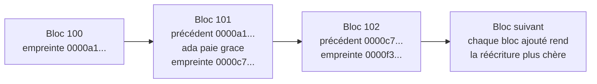

# Textes fondateurs : livres blancs, articles et ouvrages de référence

!!! warning "Avertissement"
    Ces notes sont des pense-bêtes personnels, pas une source de vérité. Elles reflètent ma compréhension et mes choix : leur contenu reste subjectif, malgré les citations et les références qu'il contient. Il peut être incomplet, simplifié, inexact ou dépassé. Vérifiez toujours dans la documentation officielle avant de l'appliquer. Ce contenu est fourni tel quel, sans aucune garantie : son utilisation se fait sous votre seule responsabilité.

!!! abstract "Les échelles"
    Les pastilles de couleur sous les titres disent à quelle échelle une notion s'applique :

    - <span class="pill pill-scope pill-scope-code">Code</span> les classes, fonctions et modules d'un programme ;
    - <span class="pill pill-scope pill-scope-app">Application</span> un service ou une application et son découpage interne ;
    - <span class="pill pill-scope pill-scope-system">Système</span> plusieurs services qui communiquent par le réseau ;
    - <span class="pill pill-scope pill-scope-infra">Infrastructure</span> les serveurs, le réseau, les zones et les clusters, physiques ou virtuels ;
    - <span class="pill pill-scope pill-scope-enterprise">Entreprise</span> le système d'information entier et son organisation.

    Détail et mots ambigus : [carte des échelles](architecture.md#carte-des-echelles).

Les pages de ce pense-bête citent sans cesse les mêmes textes : un article de 1972 sur les modules, un <span class="term" data-term="white-paper">livre blanc</span> d'un fournisseur cloud, une <span class="term" data-term="rfc-document">RFC</span>, une <span class="term" data-term="technical-standard">norme</span> du NIST, un manifeste signé par dix-sept personnes. Cette page les rassemble pour la culture générale : ce que dit chaque texte, pourquoi il compte encore, comment le citer en une phrase en entretien, et où il sert ailleurs dans le pense-bête.

Les lois qui portent un nom (Conway, Brooks, Hyrum, Goodhart...) sont expliquées sur la page [Lois et principes](lois-et-principes.md) ; ici, on parle du texte d'origine. La culture d'entreprise et de management (livres sur les organisations, la stratégie, le leadership) est sur la page [Culture d'entreprise](culture-entreprise.md).

!!! info "Page écrite en novembre 2026"
    Les dates de publication des textes anciens sont stables. Les éditions des rapports annuels, des Top 10 et des livres blancs de fournisseurs changent : chaque date marquée « à vérifier » n'a pas été contrôlée sur la source d'origine.

## Vocabulaire

**Livre blanc (white paper)** : un document qui présente un problème et une solution. Le mot recouvre deux genres très différents :

- le **livre blanc commercial** d'un éditeur, qui explique un problème pour amener à son produit (« Cinq raisons de passer à notre plateforme d'observabilité ») ; utile pour comprendre une offre, jamais neutre ;
- le **livre blanc technique**, qui décrit une conception ou un cadre de référence en détail : le livre blanc Bitcoin (2008), les livres blancs AWS Well-Architected (depuis 2015, à vérifier), le CNCF Platforms White Paper (2023, à vérifier). Il n'est pas relu par des pairs indépendants : sa valeur dépend de son auteur et de ce qu'il a fait depuis.

**Article de recherche (paper)** : un texte qui présente un résultat (un algorithme, une preuve, une mesure, un système) et le soumet à la **relecture par les pairs** : d'autres chercheurs, souvent anonymes, l'acceptent, le refusent ou demandent des corrections avant publication dans une revue (Communications of the ACM, ACM TOCS) ou une conférence (SOSP, OSDI, NeurIPS). Une **prépublication** (preprint) est mise en ligne avant cette relecture, le plus souvent sur **arXiv** (archive ouverte gérée par l'université Cornell depuis 1991) : en IA, la plupart des articles circulent d'abord ainsi. Les grandes entreprises publient aussi des **articles industriels** : elles décrivent un système déjà en production (GFS, Dynamo, Spanner), relus par les pairs d'une conférence, mais sans que personne d'extérieur puisse reproduire l'expérience.

**RFC (Request for Comments)** : un document numéroté publié par l'IETF (Internet Engineering Task Force) et quelques autres organismes, qui décrit un protocole ou une pratique d'Internet. Une RFC publiée n'est jamais modifiée : on en publie une nouvelle qui la rend obsolète (RFC 9110 de 2022 remplace les RFC HTTP de 2014). Chaque RFC a un **statut** : Internet Standard ou Proposed Standard (le protocole fait référence), Best Current Practice (une bonne pratique), Informational ou Experimental (aucune obligation). Toutes les RFC ne sont donc pas des standards.

**Norme** : un texte adopté par un organisme officiel, avec un processus de consultation. L'**ISO** (Organisation internationale de normalisation) publie des normes souvent payantes (ISO/IEC 25010 sur la qualité logicielle, révision 2023). Le **NIST** (agence fédérale américaine de normalisation) publie gratuitement ses Special Publications, les **NIST SP** (SP 800-207 sur le zero trust, 2020). Une liste communautaire comme l'OWASP Top 10 n'est pas une norme : c'est un document de sensibilisation, qu'on cite comme tel.

**Manifeste** : une déclaration de valeurs signée par un groupe, courte et volontairement générale (Manifeste agile, 2001 ; Threat Modeling Manifesto, 2020). Il ne prouve rien : il donne une direction et un vocabulaire commun.

**Ouvrage de référence** : un livre qui synthétise un domaine et que tout le monde cite (« The Mythical Man-Month », « Designing Data-Intensive Applications »). Il vieillit par les exemples, rarement par les idées : on vérifie l'édition.

Exemple : lire une citation d'article comme une fiche d'identité.

```
DeCandia et al., « Dynamo: Amazon's Highly Available Key-value Store », SOSP 2007
│           │                                                          │    │
│           │                                                          │    └ année : le système décrit date de là, pas le produit actuel
│           │                                                          └ conférence relue par les pairs (Symposium on Operating Systems Principles)
│           └ titre exact : c'est lui qu'on tape dans un moteur de recherche
└ premier auteur, « et al. » = plusieurs coauteurs
```

Juger la fiabilité d'un texte avant de le citer :

| Genre | Qui publie | Relu par | Le risque | Comment le citer |
|---|---|---|---|---|
| article de recherche | chercheurs, universités | pairs anonymes | résultat dépassé par un article plus récent | auteur, titre, lieu, année |
| prépublication arXiv | n'importe quel chercheur | personne encore | résultat non confirmé | en le disant : « prépublication, non relue » |
| article industriel | équipe d'une entreprise | pairs, sans reproduction possible | ne décrit que le système de l'époque | « l'article de 2007, pas le produit d'aujourd'hui » |
| RFC | IETF | groupe de travail, consensus | statut Informational pris pour un standard | numéro, statut, année |
| norme | ISO, NIST | consultation publique | version obsolète | numéro, révision, année |
| livre blanc d'éditeur | une entreprise | personne d'extérieur | marketing, chiffres non vérifiables | « le livre blanc de tel fournisseur » |
| manifeste, livre | auteurs | éditeur, lecteurs | exemples datés | auteur, titre, édition |

| Je veux... | Je cherche... |
|---|---|
| je dois convaincre mon équipe qu'une idée repose sur du solide, et pas sur un billet de blog à la mode | l'article relu par les pairs, ou l'ouvrage de référence |
| je dois savoir exactement comment un protocole se comporte, comme ce qu'un serveur HTTP doit faire d'une requête mal formée | la RFC en vigueur (et vérifier qu'elle n'est pas obsolète) |
| un audit ou un client me demande de prouver que je respecte une exigence, comme une architecture zero trust | la norme, avec son numéro de révision |
| je veux comprendre ce que vend un fournisseur cloud avant une réunion avec lui | son livre blanc, en sachant qu'il vend |
| je suis de près un sujet qui bouge chaque mois, comme l'IA, où les articles circulent avant toute relecture | les prépublications, en les signalant comme telles |

## Par où commencer

Huit lectures, si l'on ne devait en garder que huit selon son rôle. Les autres textes de la page s'y rattachent.

| Profil | Texte | Pourquoi d'abord |
|---|---|---|
| tous | Melvin Conway, « How Do Committees Invent? » (1968) | deux pages, et la question des équipes revient dans chaque décision d'architecture |
| tous | Frederick Brooks, « No Silver Bullet » (1986) | protège contre la promesse du prochain outil miracle, y compris l'IA |
| architecte | Martin Kleppmann, « Designing Data-Intensive Applications » (2017) | réplication, partitionnement, transactions, flux : tout le vocabulaire des systèmes de données |
| architecte | David Parnas, « On the Criteria To Be Used in Decomposing Systems into Modules » (1972) | la règle de découpage qui sert encore pour les modules et les microservices |
| staff | Google, « Site Reliability Engineering » (2016) | SLO, budget d'erreur, postmortem : la langue commune entre produit et exploitation |
| staff, DevX | Forsgren, Humble et Kim, « Accelerate » (2018) | relie les pratiques de livraison à la performance, avec une méthode |
| QA | John Allspaw, « Blameless PostMortems and a Just Culture » (2012) | un billet court qui change la façon de traiter un bug échappé en production |
| DevX | CNCF, « Platforms White Paper » (2023, à vérifier) | une définition partagée de la plateforme interne vue comme un produit |

## Auteurs de référence

Un texte se comprend mieux quand on connaît la personne qui l'a écrit. Savoir qui est Martin Fowler ou Lisa Crispin sert à trois choses :

- **trouver le reste de son travail** : un auteur qui a écrit un bon livre tient souvent un blog, donne des conférences et a publié d'autres textes sur le même sujet ;
- **juger le contexte et la date** : un conseil écrit en 2002 pour des applications d'entreprise monolithiques ne s'applique pas tel quel à une architecture de services en 2026 ;
- **ne pas citer une idée hors de son époque** : la pyramide des tests de Fowler (2012) répondait à des suites d'interface lentes et fragiles ; la citer contre un front-end moderne sans le dire, c'est lui faire dire autre chose.

**Quand s'en servir.** Je prépare un entretien et je veux deux ou trois références solides par thème. Je prends un nouveau rôle (architecte, staff, QA) et je ne sais pas qui lire. Ou, en revue de conception, mon équipe applique une règle sans savoir d'où elle vient, et je veux retrouver son origine.

**Comment.** Je choisis deux ou trois personnes dans la ligne de mon rôle, je lis leur texte principal (colonne « Lire d'abord »), puis je suis leur blog ou leur site pour voir comment leur pensée a évolué. Inutile de tout lire : mieux vaut connaître à fond trois auteurs que citer vingt titres.

Les dates des livres sont celles de la première édition, sauf mention contraire. Les dates marquées « à vérifier » n'ont pas été contrôlées sur la source d'origine.

### Architecture et conception

| Personne | Connu pour (avec dates) | Lire d'abord | Pour quel rôle |
|---|---|---|---|
| Martin Fowler | « Refactoring » (1999, deuxième édition en 2018, exemples en JavaScript), « Patterns of Enterprise Application Architecture » (2002), le bliki de martinfowler.com (tenu depuis le début des années 2000, à vérifier), l'article « Microservices » avec James Lewis (2014) | son [guide de l'architecture logicielle](https://martinfowler.com/architecture/) (date de publication non indiquée), qui rassemble ses articles par thème | architecte, staff, développeur |
| Eric Evans | « Domain-Driven Design » (2003), le <span class="term" data-term="bounded-context">contexte borné</span> | le livre, en commençant par la partie stratégique (contextes, carte de contextes) | architecte |
| Vaughn Vernon | « Implementing Domain-Driven Design » (2013), « Domain-Driven Design Distilled » (2016) | « Domain-Driven Design Distilled » (2016), court, avant le livre d'Evans | architecte, développeur |
| Sam Newman | « Building Microservices » (2015, deuxième édition en 2021), « Monolith to Microservices » (2019), le pattern Backends For Frontends (2015) | « Monolith to Microservices » (2019) si l'on part d'un monolithe | architecte, staff |
| Chris Richardson | « Microservices Patterns » (2018), le catalogue en ligne microservices.io (date de création à vérifier) : saga, outbox | le catalogue microservices.io, pattern par pattern | architecte, développeur |
| Gregor Hohpe et Bobby Woolf | « Enterprise Integration Patterns » (2003) ; Hohpe seul : « The Software Architect Elevator » (2020) | « Enterprise Integration Patterns », pour le vocabulaire de la messagerie | architecte |
| Martin Kleppmann | « Designing Data-Intensive Applications » (2017), recherche sur les CRDT et le logiciel local-first | le livre (une deuxième édition est annoncée, à vérifier) | architecte, staff |
| Neal Ford et Mark Richards | « Fundamentals of Software Architecture » (2020), « Software Architecture: The Hard Parts » (2021, avec Pramod Sadalage et Zhamak Dehghani) ; Ford, Parsons et Kua : « Building Evolutionary Architectures » (2017) | « Fundamentals of Software Architecture » (2020) | architecte |
| Simon Brown | le <span class="term" data-term="c4-model">modèle C4</span> (site c4model.com, date de création à vérifier), « Software Architecture for Developers » (date à vérifier) | le site c4model.com | architecte, développeur |
| Alistair Cockburn | l'<span class="term" data-term="hexagonal-architecture">architecture hexagonale</span> (2005), « Writing Effective Use Cases » (2000), signataire du Manifeste agile (2001) | l'article « Hexagonal Architecture » (2005) | architecte, développeur |
| Michael Nygard | « Release It! » (2007, deuxième édition en 2018), le format ADR (2011) | « Release It! », chapitres sur les patterns de stabilité | architecte, staff |
| Unmesh Joshi | « Patterns of Distributed Systems » (2023), d'abord publié en série sur martinfowler.com | le livre, ou la série en ligne : réplication, quorum, leader, journal | architecte, staff |
| Zhamak Dehghani | le <span class="term" data-term="data-mesh">data mesh</span>, article « How to Move Beyond a Monolithic Data Lake to a Distributed Data Mesh » (2019, sur martinfowler.com), livre « Data Mesh » (2022, à vérifier) | l'article de 2019 | architecte, staff (données) |
| Cam Jackson | l'article « Micro Frontends » (2019, sur martinfowler.com), qui popularise les <span class="term" data-term="micro-frontend">micro-frontends</span> | l'article, avec ses avertissements sur le coût | architecte (front-end) |
| David Parnas | « On the Criteria To Be Used in Decomposing Systems into Modules » (1972), le <span class="term" data-term="information-hiding">masquage d'information</span> | l'article de 1972 (quelques pages) | tous |

Où ils servent dans ce pense-bête : [Architecture](architecture.md) (DDD, microservices, architecture hexagonale, C4, ADR, résilience), [API REST et asynchrone](api-rest-async.md) (sagas et outbox de Richardson).

### Code et savoir-faire

| Personne | Connu pour (avec dates) | Lire d'abord | Pour quel rôle |
|---|---|---|---|
| Kent Beck | l'Extreme Programming (« Extreme Programming Explained », 1999), le <span class="term" data-term="tdd">TDD</span> (« Test-Driven Development: By Example », 2002), signataire du Manifeste agile (2001), « Tidy First? » (2023) | « Test-Driven Development: By Example » (2002) | développeur, QA |
| Martin Fowler | « Refactoring » (1999, puis 2018) : le catalogue des <span class="term" data-term="refactoring">refactorings</span> et des « code smells » | la deuxième édition (2018) | développeur |
| Robert C. Martin | les principes <span class="term" data-term="solid">SOLID</span> (regroupés vers 2000, nom donné vers 2004 par Michael Feathers, à vérifier), « Clean Code » (2008), « Clean Architecture » (2017) | « Clean Architecture » (2017) pour la règle de dépendance ; « Clean Code » à lire avec recul, certains conseils sont discutés | développeur, architecte |
| Michael Feathers | « Working Effectively with Legacy Code » (2004) : le <span class="term" data-term="legacy-code">code legacy</span> comme code sans tests, les points de jonction (seams) | le livre, chapitre par chapitre selon le problème | développeur, QA, staff |
| Dan North | « Introducing BDD » (2006), « CUPID: for joyful coding » (2022) | les deux articles, courts | développeur, QA |
| Kent C. Dodds | le trophée des tests (2018), Testing Library (date à vérifier), « AHA Programming » (date de publication non indiquée) | « The Testing Trophy and Testing Classifications » (2021) | développeur front-end, QA |

Où ils servent : [Principes de conception](principes-conception.md), [Design patterns](design-patterns.md), [Qualité](qualite.md).

### Livraison, DevOps et SRE

| Personne | Connu pour (avec dates) | Lire d'abord | Pour quel rôle |
|---|---|---|---|
| Jez Humble et Dave Farley | « Continuous Delivery » (2010) ; Farley seul : « Modern Software Engineering » (2021) | « Continuous Delivery » (2010), chapitre sur le pipeline de déploiement | DevX, staff, QA |
| Nicole Forsgren | « Accelerate » (2018, avec Jez Humble et Gene Kim), les rapports DORA, le cadre SPACE (2021, avec d'autres auteurs) | « Accelerate » (2018) | staff, DevX, manager |
| Gene Kim | « The Phoenix Project » (2013, roman, avec Kevin Behr et George Spafford), « The DevOps Handbook » (2016, avec d'autres auteurs) | « The Phoenix Project » pour l'intuition, « The DevOps Handbook » pour la pratique | DevX, manager |
| Betsy Beyer, Chris Jones, Jennifer Petoff et Niall Richard Murphy (éditeurs) | « Site Reliability Engineering » (Google, 2016), suivi de « The Site Reliability Workbook » (2018) | les chapitres sur les SLO et le budget d'erreur, gratuits sur sre.google | staff, architecte, DevX |
| Charity Majors | l'<span class="term" data-term="observability">observabilité</span> par événements riches (« Observability Engineering », 2022, avec Liz Fong-Jones et George Miranda), « The Engineer/Manager Pendulum » (2017) | son blog charity.wtf, puis le livre | staff, DevX |
| Michael Nygard | « Release It! » (2007) : voir plus haut, c'est aussi un livre d'exploitation | « Release It! », chapitres sur les pannes en cascade | staff, DevX |

Où ils servent : [Livraison](livraison.md), [Observabilité](observabilite.md), [Incidents](incidents.md), [DevX](devx.md).

### Test et qualité

| Personne | Connu pour (avec dates) | Lire d'abord | Pour quel rôle |
|---|---|---|---|
| Lisa Crispin et Janet Gregory | « Agile Testing » (2009), « More Agile Testing » (2014), les <span class="term" data-term="agile-testing-quadrants">quadrants du test agile</span> (repris de Brian Marick) | « Agile Testing » (2009) | QA, manager |
| James Bach | Rapid Software Testing (versions successives depuis la fin des années 1990, date à vérifier), le <span class="term" data-term="exploratory-testing">test exploratoire</span> structuré, « Lessons Learned in Software Testing » (2001, avec Cem Kaner et Bret Pettichord) | le site satisfice.com, puis « Lessons Learned in Software Testing » | QA |
| Michael Bolton | coauteur de Rapid Software Testing avec James Bach, la distinction test et check (« Testing and Checking Refined », 2013, avec Bach) | l'article de 2013 | QA |
| Cem Kaner | « Testing Computer Software » (1988, avec Jack Falk et Hung Quoc Nguyen, dates à vérifier), les cours BBST (date à vérifier) ; on lui attribue le terme « exploratory testing » (années 1980, à vérifier) | « Lessons Learned in Software Testing » (2001) | QA |
| Elisabeth Hendrickson | « Explore It! » (2013), les chartes de test exploratoire | « Explore It! » (2013) | QA, développeur |
| Gojko Adzic | « Specification by Example » (2011), « Impact Mapping » (2012) | « Specification by Example » (2011) | QA, développeur, product owner |
| Dan North | le <span class="term" data-term="bdd">BDD</span> (« Introducing BDD », 2006) : voir plus haut | « Introducing BDD » (2006) | QA |
| Martin Fowler | « TestPyramid » ([article du bliki, 2012](https://martinfowler.com/bliki/TestPyramid.html)), d'après la pyramide de Mike Cohn (2009, à vérifier) | l'article de 2012, court ; puis le trophée de Kent C. Dodds pour le contrepoint | QA, développeur |

Où ils servent : [Qualité](qualite.md) (la <span class="term" data-term="test-pyramid">pyramide des tests</span>, les quadrants), [Veille](veille.md).

### Organisation et leadership

| Personne | Connu pour (avec dates) | Lire d'abord | Pour quel rôle |
|---|---|---|---|
| Melvin Conway | « How Do Committees Invent? » (1968), la <span class="term" data-term="conway-law">loi de Conway</span> | l'article (deux pages) | tous |
| Fred Brooks | « The Mythical Man-Month » (1975, édition anniversaire en 1995), « No Silver Bullet » (1986) | « No Silver Bullet » (1986) | tous |
| Matthew Skelton et Manuel Pais | « Team Topologies » (2019) : quatre types d'équipes, dont l'<span class="term" data-term="stream-aligned-team">équipe alignée sur un flux</span>, et trois modes d'interaction | le livre, ou le site teamtopologies.com | staff, architecte, manager, DevX |
| Will Larson | « An Elegant Puzzle » (2019), « Staff Engineer: Leadership beyond the management track » (2021), son blog lethain.com | « Staff Engineer » (2021) pour les archétypes | staff, manager |
| Tanya Reilly | « The Staff Engineer's Path » (2022) | le livre | staff |
| Camille Fournier | « The Manager's Path » (2017) | le livre | manager, staff qui hésite entre les deux filières |
| Charity Majors | « The Engineer/Manager Pendulum » (2017) : voir plus haut | le billet de 2017, sur charity.wtf | staff, manager |

Où ils servent : [Culture d'entreprise](culture-entreprise.md) (Team Topologies, archétypes staff, filières), [Lois et principes](lois-et-principes.md).

### Qui lire selon le besoin

| J'ai besoin de... | Je lis d'abord | Puis |
|---|---|---|
| mon équipe veut sortir des services d'un monolithe devenu trop gros pour évoluer sereinement | Sam Newman (2019), Eric Evans (2003) | Chris Richardson (2018) pour les données réparties |
| je travaille sur un système réparti sur plusieurs machines et je ne comprends pas pourquoi deux copies des données divergent | Martin Kleppmann (2017) | Unmesh Joshi (2023), Michael Nygard (2007) |
| j'hérite d'un vieux code sans aucun test, que personne n'ose modifier | Michael Feathers (2004) | Martin Fowler, « Refactoring » (2018) |
| je dois décider, pour toute une équipe, quels tests écrire et à quel niveau | Lisa Crispin et Janet Gregory (2009) | Martin Fowler (2012) puis Kent C. Dodds (2018) pour la forme de la suite |
| je veux apprendre à tester sans script, en explorant une fonctionnalité pour trouver ce que personne n'a prévu | Elisabeth Hendrickson (2013) | James Bach et Michael Bolton (2013) |
| le métier et les développeurs ne comprennent pas la même chose d'une règle, et je veux des exemples partagés qui deviennent des tests | Gojko Adzic (2011) | Dan North (2006) |
| les mises en production de mon équipe sont rares, longues et stressantes | Jez Humble et Dave Farley (2010) | Nicole Forsgren et al. (2018) |
| je dois fixer, avec le produit, combien de pannes mon service a le droit d'avoir | le livre SRE de Google (2016) | Charity Majors et al. (2022) |
| je dois découper ou réorganiser des équipes autour d'un système | Matthew Skelton et Manuel Pais (2019) | Melvin Conway (1968) |
| je veux évoluer vers un rôle de staff engineer ou de manager, et j'hésite entre les deux | Will Larson (2021), Tanya Reilly (2022) | Camille Fournier (2017) |
| je dois documenter une architecture pour que les nouveaux venus comprennent les choix faits | Simon Brown (C4) | Michael Nygard (ADR, 2011) |

## Repères chronologiques

Les textes de la page, dans l'ordre. Les idées les plus utilisées aujourd'hui (modules, consensus, sagas) ont souvent plus de trente ans.

```
1968  Conway (organisation et système), Dijkstra (goto)
1972  Parnas (masquage d'information)
1975  Brooks (The Mythical Man-Month), Saltzer et Schroeder (sécurité)
1978  Lamport (horloges logiques)
1984  Saltzer, Reed et Clark (bout en bout)
1986  Brooks (No Silver Bullet)
1987  Garcia-Molina et Salem (sagas)
1994  illusions de l'informatique distribuée, Design Patterns (GoF)
1998  Paxos (publié), 2001 : Paxos Made Simple
2000  Brewer (CAP), Fielding (REST)
2001  Manifeste agile
2002  Gilbert et Lynch (preuve de CAP), Beck (TDD)
2003  GFS, Evans (DDD), Hohpe et Woolf, OWASP Top 10 (1re édition)
2004  MapReduce, Fowler (strangler fig)
2006  Bigtable
2007  Dynamo, Nygard (Release It!)
2008  Bitcoin
2010  Humble et Farley (Continuous Delivery)
2011  Kafka, Twelve-Factor, Nygard (ADR)
2012  Spanner, Abadi (PACELC), Allspaw (postmortem sans coupable)
2014  Raft, Lewis et Fowler (microservices), premier rapport DORA (à vérifier)
2015  AWS Well-Architected (à vérifier)
2016  Site Reliability Engineering (Google)
2017  Attention Is All You Need, Kleppmann (DDIA)
2018  Accelerate
2020  NIST SP 800-207, RAG
2023  CNCF Platforms White Paper, AWS architecture cellulaire (à vérifier)
```

## Génie logiciel et organisation

<a class="pill pill-scope pill-scope-code" href="../architecture/#carte-des-echelles">Échelle · Code</a> <a class="pill pill-scope pill-scope-app" href="../architecture/#carte-des-echelles">Échelle · Application</a>

### Conway, « How Do Committees Invent? » (1968)

**Ce qu'il dit.** Publié dans la revue Datamation en avril 1968 : une organisation qui conçoit un système produit une structure qui copie sa propre structure de communication. Frederick Brooks l'a baptisé <span class="term" data-term="conway-law">loi de Conway</span> en 1975.
**Pourquoi il compte encore.** C'est la base de la « manœuvre de Conway inverse » : organiser les équipes selon l'architecture voulue.
**Citer en entretien.** « Avant de dessiner les services, je regarde les équipes : d'après Conway (1968), le système finira par leur ressembler. »
**Dans ce pense-bête.** [Loi de Conway](architecture.md#loi-de-conway).

### Dijkstra, « Go To Statement Considered Harmful » (1968)

**Ce qu'il dit.** Une lettre de Edsger Dijkstra aux Communications of the ACM (mars 1968), dont le titre a été choisi par l'éditeur Niklaus Wirth : le `goto` rend le lien entre le texte du programme et son exécution impossible à suivre ; il faut des structures (séquence, condition, boucle).
**Pourquoi il compte encore.** C'est l'acte de naissance populaire de la programmation structurée, et le titre a créé un genre : des dizaines d'articles « ... Considered Harmful » ont suivi.
**Citer en entretien.** « Le vrai sujet de Dijkstra en 1968, c'est qu'on doit pouvoir lire un programme et savoir où on en est à l'exécution ; c'est le même argument contre les callbacks imbriqués ou les événements sans trace. »
**Dans ce pense-bête.** Dijkstra apparaît pour la [séparation des préoccupations](principes-conception.md#separation-des-preoccupations-cohesion-et-couplage) (1974) ; la lettre sur le `goto` n'est pas encore citée ailleurs.

### Parnas, « On the Criteria To Be Used in Decomposing Systems into Modules » (1972)

**Ce qu'il dit.** Communications of the ACM, décembre 1972. Sur un même petit programme, David Parnas compare deux découpages : par étapes de traitement, ou par décisions susceptibles de changer. Le second, le <span class="term" data-term="information-hiding">masquage d'information</span>, résiste bien mieux aux évolutions.
**Pourquoi il compte encore.** Je découpe un système en modules ou en services. Un bon module cache une décision qui peut changer (un format, un fournisseur, un algorithme), comme un module de paiement qui cache le fournisseur choisi. Un mauvais découpe un flux en étapes qui changent toutes ensemble, donc chaque évolution touche tous les modules à la fois.
**Citer en entretien.** « Je découpe selon Parnas (1972) : chaque module cache une décision qui peut changer, pas une étape du traitement. »

### Brooks, « The Mythical Man-Month » (1975)

**Ce qu'il dit.** Recueil d'essais de Frederick Brooks, tiré de son expérience sur le système d'exploitation OS/360 d'IBM. On y trouve la loi de Brooks (ajouter des personnes à un projet en retard le retarde encore), l'<span class="term" data-term="second-system-effect">effet second système</span>, l'intégrité conceptuelle et « prévoyez d'en jeter un ». Édition anniversaire en 1995, qui ajoute « No Silver Bullet ».
**Pourquoi il compte encore.** Les coûts de coordination qu'il décrit n'ont pas changé : ils expliquent pourquoi une réécriture complète déborde presque toujours.
**Citer en entretien.** « Brooks l'a écrit en 1975 : la deuxième version d'un système est la plus dangereuse, parce qu'on y met tout ce qu'on avait repoussé. »

### Brooks, « No Silver Bullet » (1986)

**Ce qu'il dit.** Présenté au congrès IFIP en 1986, repris dans IEEE Computer en 1987 : aucune technique ne donnera seule un gain d'un facteur dix en dix ans, parce que la plus grande part de la difficulté est la <span class="term" data-term="essential-complexity">complexité essentielle</span> (celle du problème), pas la <span class="term" data-term="accidental-complexity">complexité accidentelle</span> (celle des outils).
**Pourquoi il compte encore.** Chaque vague d'outils (langages de haut niveau, objets, cloud, assistants IA) réduit l'accidentel ; aucune ne supprime l'essentiel.
**Citer en entretien.** « Comme le disait Brooks en 1986, un outil enlève de la complexité accidentelle ; la complexité du métier, elle, reste à concevoir. »

**Exemple.** Complexité essentielle : une facture qui applique une TVA différente par pays, des remises cumulables et des avoirs ; aucun outil ne fait disparaître ces règles, il faut les concevoir. Complexité accidentelle : écrire à la main la sérialisation JSON de cette facture, ou gérer sa mémoire en C ; un meilleur outil (une bibliothèque, un langage à ramasse-miettes) la supprime.

:material-book-open-variant: Doc de référence : [Frederick Brooks, No Silver Bullet, UNC TR86-020](https://www.cs.unc.edu/techreports/86-020.pdf) (1986)
{ .doc-ref }

### Gamma, Helm, Johnson et Vlissides, « Design Patterns » (1994)

**Ce qu'il dit.** Le livre de ceux qu'on appelle le « Gang of Four » (GoF) catalogue vingt-trois patterns de conception orientée objet (Strategy, Observer, Factory...), chacun avec son intention, sa structure et ses conséquences. Il pose aussi deux règles : programmer pour une interface, et préférer la composition à l'héritage.
**Pourquoi il compte encore.** Les noms des patterns sont devenus un vocabulaire de revue de code ; certains sont intégrés aux langages (itérateurs, fonctions de première classe), ce qui rend d'autres moins utiles.
**Citer en entretien.** « Je retiens surtout du GoF (1994) la règle "composition plutôt qu'héritage" ; le catalogue sert à nommer une solution, pas à en ajouter. »
**Dans ce pense-bête.** [Design patterns](design-patterns.md), [Composition plutôt qu'héritage](principes-conception.md#composition-plutot-quheritage).

### Le Manifeste agile (2001)

**Ce qu'il dit.** Écrit par dix-sept praticiens réunis à Snowbird (Utah) en février 2001 : quatre valeurs (les individus et leurs interactions, un logiciel qui fonctionne, la collaboration avec le client, l'adaptation au changement, chacune préférée à son opposé) et douze principes.
**Pourquoi il compte encore.** Beaucoup de méthodes dites agiles ont perdu le texte de vue ; le relire (une page) aide à distinguer l'esprit du rituel.
**Citer en entretien.** « Le manifeste dit "plutôt que", pas "au lieu de" : la documentation et le plan gardent de la valeur, simplement moins que le logiciel qui fonctionne. »
**Dans ce pense-bête.** Pas cité ailleurs comme texte ; les rituels d'équipe qui s'en réclament relèvent de la culture d'entreprise, liée en haut de page.

### Beck, « Test-Driven Development: By Example » (2002)

**Ce qu'il dit.** Le livre de Kent Beck décrit le cycle rouge, vert, refactorer : écrire un test qui échoue, le faire passer avec le code le plus simple, puis nettoyer. Il commence par une liste de scénarios à transformer un par un en tests.
**Pourquoi il compte encore.** Le TDD reste la référence pour concevoir par petits pas ; même sans le pratiquer à la lettre, sa liste de tests est une bonne façon de démarrer une tâche.
**Citer en entretien.** « J'utilise le TDD de Beck (2002) quand la règle métier est claire et le risque de régression élevé ; pour explorer une API inconnue, je fais d'abord un prototype jetable. »
**Dans ce pense-bête.** page [Qualité](qualite.md).

### Evans, « Domain-Driven Design » (2003)

**Ce qu'il dit.** Le livre d'Eric Evans propose de calquer le logiciel sur le domaine métier : un langage partagé avec les experts, des modèles valables seulement dans un <span class="term" data-term="bounded-context">contexte borné</span>, et une carte des relations entre contextes.
**Pourquoi il compte encore.** La partie dite stratégique (contextes bornés, carte de contextes, couche anti-corruption) est devenue l'outil principal pour découper un monolithe en services.
**Citer en entretien.** « Je cherche les frontières de services là où le vocabulaire change de sens : c'est le contexte borné d'Evans (2003). »
**Dans ce pense-bête.** [Domain-Driven Design](architecture.md#domain-driven-design).

:material-book-open-variant: Doc de référence : [Eric Evans, Domain-Driven Design Reference](https://www.domainlanguage.com/ddd/reference/) (2015)
{ .doc-ref }

## Systèmes distribués : les fondations

<a class="pill pill-scope pill-scope-system" href="../architecture/#carte-des-echelles">Échelle · Système</a> <a class="pill pill-scope pill-scope-infra" href="../architecture/#carte-des-echelles">Échelle · Infrastructure</a>

### Lamport, « Time, Clocks, and the Ordering of Events in a Distributed System » (1978)

**Ce qu'il dit.** Communications of the ACM, juillet 1978. Sans horloge commune, on ne peut ordonner que les événements liés par une relation de cause (« s'est produit avant »). Leslie Lamport propose les <span class="term" data-term="lamport-clock">horloges logiques</span> pour obtenir un ordre cohérent.
**Pourquoi il compte encore.** Toute réplication, tout journal d'événements et tout débat « quel événement est arrivé en premier » s'appuie sur ces idées. Lamport a reçu le prix Turing en 2013.
**Citer en entretien.** « Je ne trie jamais des événements de deux machines par leur heure : depuis Lamport (1978), on sait que seul l'ordre causal est fiable. »
**Dans ce pense-bête.** [Horloges et ordre des événements](architecture.md#horloges-et-ordre-des-evenements).

!!! noob "As noob"
    Deux personnes notent l'heure de leurs messages avec des montres qui ne sont jamais tout à fait à l'heure : comparer les heures ne dit pas qui a écrit en premier. Par contre, une réponse vient forcément après la question à laquelle elle répond. Les horloges logiques de Lamport sont des compteurs qui respectent au moins cet ordre-là. La phrase à retenir : **entre machines, on se fie à la cause, pas à l'heure affichée.**

### Saltzer, Reed et Clark, « End-to-End Arguments in System Design » (1984)

**Ce qu'il dit.** ACM Transactions on Computer Systems, novembre 1984 (une première version date de 1981). Le <span class="term" data-term="end-to-end-principle">principe de bout en bout</span> : une garantie comme « le fichier est arrivé intact » ne peut être assurée complètement que par les extrémités ; les couches basses ne font qu'optimiser.
**Pourquoi il compte encore.** C'est la justification de l'architecture d'Internet (un réseau simple, l'intelligence aux extrémités) et d'une règle quotidienne : même avec un broker « exactly once », le consommateur doit rester idempotent.
**Citer en entretien.** « D'après l'argument de bout en bout (Saltzer, Reed et Clark, 1984), je vérifie l'intégrité côté application, quelles que soient les promesses du transport. »
**Dans ce pense-bête.** Pas encore cité ailleurs ; l'application la plus proche est l'[idempotence](architecture.md#idempotence).

!!! noob "As noob"
    Le transporteur peut bien emballer un colis et le manipuler avec soin, mais seul le destinataire, en l'ouvrant, peut vérifier que le vase n'est pas cassé. Les couches intermédiaires améliorent les chances, seules les extrémités peuvent garantir. La phrase à retenir : **la vérification qui compte se fait chez celui qui utilise la donnée.**

### Garcia-Molina et Salem, « Sagas » (1987)

**Ce qu'il dit.** ACM SIGMOD 1987. Une transaction longue qui bloquerait la base est découpée en transactions courtes, chacune avec une transaction de compensation qui annule son effet si la suite échoue.
**Pourquoi il compte encore.** Écrite pour une seule base, l'idée est devenue la <span class="term" data-term="saga-pattern">saga</span> des microservices, où aucune transaction ne couvre plusieurs services.
**Citer en entretien.** « Pour une commande qui touche paiement et stock, j'utilise une saga au sens de Garcia-Molina et Salem (1987) : des étapes locales, chacune avec sa compensation. »
**Dans ce pense-bête.** [Saga orchestrée ou chorégraphiée](architecture.md#saga-orchestree-ou-choregraphiee).

:material-book-open-variant: Doc de référence : [Garcia-Molina et Salem, Sagas](https://www.cs.cornell.edu/andru/cs711/2002fa/reading/sagas.pdf) (1987)
{ .doc-ref }

### Les illusions de l'informatique distribuée (1994)

**Ce qu'il dit.** Pas un article mais une liste transmise oralement chez Sun Microsystems : L. Peter Deutsch en formule sept vers 1994, James Gosling ajoute la huitième vers 1997 (dates à vérifier). Ce sont les <span class="term" data-term="distributed-computing-fallacies">illusions</span> qu'on fait en écrivant un appel réseau : le réseau est fiable, la latence est nulle, etc.
**Pourquoi il compte encore.** Mon code appelle un autre service comme une fonction locale, et le jour où le réseau ralentit, l'appel attend sans fin. Chaque pattern de résilience répond à l'une de ces illusions : le timeout à « la latence est nulle », le retry et le disjoncteur à « le réseau est fiable ».
**Citer en entretien.** « Je relis la liste des huit illusions avant chaque revue de conception : la plupart des pannes que j'ai vues en sortent. »
**Dans ce pense-bête.** [Les huit illusions](architecture.md#les-huit-illusions).

:material-book-open-variant: Doc de référence : [Wikipédia, Fallacies of distributed computing](https://en.wikipedia.org/wiki/Fallacies_of_distributed_computing) (consultée en novembre 2026)
{ .doc-ref }

### Lamport, Paxos (1998 et 2001)

**Ce qu'il dit.** « The Part-Time Parliament » (ACM TOCS, 1998, écrit vers 1990) décrit un <span class="term" data-term="consensus-algorithm">algorithme de consensus</span> sous la forme d'un parlement grec imaginaire ; personne ne l'a compris, d'où « Paxos Made Simple » (2001), qui l'explique en deux pages de prose.
**Pourquoi il compte encore.** C'est la base théorique du consensus en présence de pannes ; Chubby (Google, 2006) et Spanner l'utilisent.
**Citer en entretien.** « Paxos prouve qu'une majorité de machines peut se mettre d'accord malgré des pannes ; en pratique, j'utilise un outil qui l'implémente, je ne l'écris pas. »
**Dans ce pense-bête.** [Consensus et élection de leader](architecture.md#consensus-et-election-de-leader).

!!! noob "As noob"
    Un groupe d'amis choisit un restaurant par SMS, alors que des téléphones s'éteignent et que des messages arrivent en retard. Un algorithme de consensus est une règle de vote qui garantit qu'ils ne finiront jamais dans deux restaurants différents, tant qu'une majorité reste joignable. La phrase à retenir : **le consensus, c'est se mettre d'accord une fois pour toutes malgré les pannes, grâce à la majorité.**

### Brewer (2000), puis Gilbert et Lynch (2002) : le théorème CAP

**Ce qu'il dit.** Eric Brewer énonce une conjecture lors d'une conférence au symposium PODC 2000 (« Towards Robust Distributed Systems ») ; Seth Gilbert et Nancy Lynch la démontrent en 2002 (ACM SIGACT News). Le <span class="term" data-term="cap-theorem">théorème CAP</span> : pendant une <span class="term" data-term="network-partition">partition réseau</span>, un système choisit entre cohérence et disponibilité. Brewer l'a lui-même nuancé dans « CAP Twelve Years Later » (IEEE Computer, 2012).
**Pourquoi il compte encore.** C'est la question posée dans presque chaque entretien d'architecte, souvent mal formulée (« choisir deux sur trois »).
**Citer en entretien.** « CAP ne dit pas "deux sur trois" : la partition ne se choisit pas, le choix est C ou A pendant la coupure, et Brewer lui-même l'a précisé en 2012. »
**Dans ce pense-bête.** [CAP et PACELC](architecture.md#cap-et-pacelc).

!!! noob "As noob"
    Deux agences d'une banque dont la ligne entre elles est coupée : un client demande son solde à l'une d'elles. Soit l'agence refuse de répondre tant qu'elle ne peut pas vérifier avec l'autre (cohérence), soit elle répond avec ce qu'elle sait, au risque d'ignorer un retrait fait dans l'autre agence (disponibilité). La phrase à retenir : **la coupure, on la subit ; ce qu'on choisit, c'est refuser ou risquer une réponse périmée pendant la coupure.**

:material-book-open-variant: Doc de référence : [Eric Brewer, Towards Robust Distributed Systems](https://people.eecs.berkeley.edu/~brewer/cs262b-2004/PODC-keynote.pdf) (2000)
{ .doc-ref }

### Abadi, PACELC (2012)

**Ce qu'il dit.** Daniel Abadi, « Consistency Tradeoffs in Modern Distributed Database System Design » (IEEE Computer, 2012, l'idée circulait dans son blog dès 2010, à vérifier). <span class="term" data-term="pacelc">PACELC</span> ajoute le cas normal : sans partition, une base choisit entre latence et cohérence.
**Pourquoi il compte encore.** Les partitions sont rares, la latence est permanente : PACELC décrit le compromis qu'on paie tous les jours.
**Citer en entretien.** « CAP parle de la panne ; PACELC (Abadi, 2012) parle du reste du temps, où l'on paie chaque écriture cohérente en latence. »
**Dans ce pense-bête.** [CAP et PACELC](architecture.md#cap-et-pacelc).

:material-book-open-variant: Doc de référence : [Daniel Abadi, Consistency Tradeoffs in Modern Distributed Database System Design](https://www.cs.umd.edu/~abadi/papers/abadi-pacelc.pdf) (2012)
{ .doc-ref }

### Ongaro et Ousterhout, Raft (2014)

**Ce qu'il dit.** « In Search of an Understandable Consensus Algorithm », USENIX ATC 2014 (prix du meilleur article). Raft obtient les garanties de Paxos avec un découpage explicite : <span class="term" data-term="leader-election">élection d'un leader</span>, réplication du journal, sécurité. Il a été conçu pour être enseigné.
**Pourquoi il compte encore.** etcd (donc Kubernetes), Consul et le mode KRaft de Kafka reposent sur Raft.
**Citer en entretien.** « Quand on me dit "le cluster etcd a perdu le quorum", je pense Raft (2014) : sans majorité, plus d'écriture, c'est voulu. »
**Dans ce pense-bête.** [Consensus et élection de leader](architecture.md#consensus-et-election-de-leader).

## Données à grande échelle : les articles des géants du web

<a class="pill pill-scope pill-scope-system" href="../architecture/#carte-des-echelles">Échelle · Système</a> <a class="pill pill-scope pill-scope-infra" href="../architecture/#carte-des-echelles">Échelle · Infrastructure</a>

Entre 2003 et 2012, Google, Amazon et LinkedIn ont décrit leurs systèmes internes dans des articles industriels soumis à la <span class="term" data-term="peer-review">relecture par les pairs</span> des conférences SOSP et OSDI. Ces articles ont inspiré l'essentiel des bases et des outils libres de la décennie suivante. Ils décrivent le système de l'époque : le produit vendu aujourd'hui sous un nom proche peut être très différent.

### Ghemawat, Gobioff et Leung, « The Google File System » (2003)

**Ce qu'il dit.** SOSP 2003. Un système de fichiers distribué sur des milliers de machines ordinaires, où la panne est la norme : gros blocs répliqués trois fois, un maître unique pour les métadonnées.
**Pourquoi il compte encore.** Il a inspiré HDFS (Hadoop) et l'idée qu'on conçoit pour la panne au lieu de l'éviter.
**Citer en entretien.** « GFS (2003) a posé le principe : sur du matériel ordinaire, la panne d'une machine est un événement normal, pas une exception. »
**Dans ce pense-bête.** Pas encore cité ailleurs.

### Dean et Ghemawat, « MapReduce » (2004)

<span class="pill pill-status pill-status-obsolete" title="Remplacé par Spark et les entrepôts de données modernes : seul le découpage « traiter en parallèle, puis agréger » reste la base">Obsolète · 11/2026</span>

**Ce qu'il dit.** OSDI 2004. Un modèle de programmation en deux fonctions (map, puis reduce) qui permet de traiter des téraoctets sur un cluster en laissant le framework gérer la répartition et les pannes.
**Pourquoi il compte encore.** Hadoop (2006) en est la version libre ; Spark et les entrepôts de données modernes l'ont remplacé, mais le découpage « traiter en parallèle, puis agréger » reste la base.
**Citer en entretien.** « MapReduce (2004) a montré qu'on pouvait cacher la distribution derrière deux fonctions ; les outils ont changé, l'idée est restée. »
**Dans ce pense-bête.** Pas encore cité ailleurs.

### Chang et al., « Bigtable » (2006)

**Ce qu'il dit.** OSDI 2006. Une table géante, triée par clé, où chaque ligne peut avoir des milliers de colonnes regroupées en familles, répartie automatiquement sur des serveurs.
**Pourquoi il compte encore.** C'est l'ancêtre des bases dites « orientées colonnes larges » : HBase, et le modèle de données de Cassandra.
**Citer en entretien.** « Cassandra, c'est souvent résumé ainsi : la distribution de Dynamo avec le modèle de données de Bigtable (2006). »

### DeCandia et al., « Dynamo: Amazon's Highly Available Key-value Store » (2007)

**Ce qu'il dit.** SOSP 2007. Un stockage clé-valeur où le panier d'achat doit toujours accepter une écriture, quitte à réconcilier ensuite : <span class="term" data-term="consistent-hashing">hachage cohérent</span>, <span class="term" data-term="vector-clock">horloges vectorielles</span>, <span class="term" data-term="quorum">quorums</span> réglables (R + W > N), réparation en arrière-plan.
**Pourquoi il compte encore.** Il a popularisé la cohérence à terme assumée et inspiré Cassandra et Riak. DynamoDB (2012) est un service différent, qui ne reprend qu'une partie de ces choix.
**Citer en entretien.** « Dans une base de type Dynamo (2007) avec trois copies, je règle lecture et écriture pour que R + W > N quand la cohérence compte. »
**Dans ce pense-bête.** [Réplication et quorum](architecture.md#replication-et-quorum).

**Exemple.** Le hachage cohérent place nœuds et clés sur un anneau : chaque clé va au premier nœud rencontré dans le sens horaire. Les horloges vectorielles comptent les écritures par nœud, pour repérer deux versions écrites en parallèle.

```
anneau 0 à 299, nœuds A(0) B(100) C(200) : la clé "cart:ada" hachée en 150 va sur C
ajout de D(250) : seules les clés entre 200 et 250 passent de A à D (environ 1/N des clés)
avec hash % N, presque toutes les clés auraient changé de nœud

panier de ada, deux écritures concurrentes sur deux nœuds :
  nœud A ajoute un livre : version {A:1}
  nœud B ajoute un câble : version {B:1}
aucune version ne contient l'autre : Dynamo garde les deux (siblings), la lecture suivante fusionne
```

<figure class="diagram"><svg viewBox="0 0 220 200" role="img" aria-label="Hachage cohérent : l'ajout de D ne déplace que les clés entre 200 et 250"><circle class="set" cx="110" cy="100" r="70"/><path class="set" style="stroke-width:6;stroke-opacity:0.45" d="M 49.4 135.0 A 70 70 0 0 1 49.4 65.0"/><circle class="layer layer-3" cx="110.0" cy="30.0" r="6"/><text class="label-strong" x="110.0" y="17.0" text-anchor="middle">A (0)</text><circle class="layer layer-3" cx="170.6" cy="135.0" r="6"/><text class="label-strong" x="196.6" y="153.0" text-anchor="middle">B (100)</text><circle class="layer layer-3" cx="49.4" cy="135.0" r="6"/><text class="label-strong" x="23.4" y="153.0" text-anchor="middle">C (200)</text><circle class="layer layer-1" cx="49.4" cy="65.0" r="6"/><text class="label-strong" x="23.4" y="53.0" text-anchor="middle">D (250)</text><circle class="hit" cx="110.0" cy="170.0" r="3.5"/><text x="110.0" y="152.0" text-anchor="middle">cart:ada (150)</text><text x="110" y="103" text-anchor="middle">sens horaire</text></svg><figcaption>Hachage cohérent : l'ajout de D ne déplace que les clés entre 200 et 250</figcaption></figure>

### Kreps, Narkhede et Rao, « Kafka: a Distributed Messaging System for Log Processing » (2011)

**Ce qu'il dit.** Atelier NetDB 2011, par l'équipe de LinkedIn. <span class="term" data-term="kafka">Kafka</span> traite les messages comme un journal append-only, conservé et relu par chaque consommateur à son rythme, au lieu d'une file qui supprime le message lu. Jay Kreps a prolongé l'idée dans le billet « The Log: What every software engineer should know about real-time data's unifying abstraction » (2013).
**Pourquoi il compte encore.** Le journal conservé est devenu la colonne vertébrale de l'event sourcing, du CDC et du streaming.
**Citer en entretien.** « Kafka n'est pas une file : c'est un journal qu'on relit, ce qui permet de rejouer l'historique, comme le décrit Kreps dès 2011. »

### Corbett et al., « Spanner: Google's Globally-Distributed Database » (2012)

**Ce qu'il dit.** OSDI 2012. Une base SQL répartie sur plusieurs continents avec des transactions fortement cohérentes, grâce à TrueTime : des horloges GPS et atomiques qui donnent l'heure avec un intervalle d'incertitude borné, que la base attend avant de valider.
**Pourquoi il compte encore.** Il a montré qu'on pouvait avoir la cohérence forte à l'échelle mondiale en payant de la latence ; CockroachDB et YugabyteDB s'en inspirent (le <span class="term" data-term="distributed-sql">SQL distribué</span>).
**Citer en entretien.** « Spanner (2012) ne contredit pas CAP : il choisit la cohérence et réduit le risque de partition avec un réseau privé et des horloges très précises. »
**Dans ce pense-bête.** [Sharder, en dernier](sql.md#sharder-en-dernier).

### Kleppmann, « Designing Data-Intensive Applications » (2017)

**Ce qu'il dit.** Le livre de Martin Kleppmann (O'Reilly) relie tous les articles ci-dessus : modèles de données, stockage, réplication, partitionnement, transactions et niveaux d'isolation, consensus, traitement par lots et en flux. Une deuxième édition est annoncée (à vérifier).
**Pourquoi il compte encore.** C'est la référence la plus citée en entretien de conception de système, parce qu'elle explique les compromis au lieu de vanter un outil.
**Citer en entretien.** « Pour le choix d'un niveau d'isolation, je m'appuie sur le chapitre 7 de Kleppmann (2017) : chaque niveau laisse passer des anomalies précises. »
**Dans ce pense-bête.** [Sharder, en dernier](sql.md#sharder-en-dernier).

:material-book-open-variant: Doc de référence : [Designing Data-Intensive Applications](https://dataintensive.net/) (consultée en novembre 2026)
{ .doc-ref }

## Fiabilité et exploitation

<a class="pill pill-scope pill-scope-system" href="../architecture/#carte-des-echelles">Échelle · Système</a> <a class="pill pill-scope pill-scope-infra" href="../architecture/#carte-des-echelles">Échelle · Infrastructure</a>

### Nygard, « Release It! » (2007)

**Ce qu'il dit.** Le livre de Michael Nygard (Pragmatic Bookshelf, deuxième édition en 2018) raconte des pannes réelles et en tire des antipatterns (points d'intégration, pannes en cascade, utilisateurs inattendus) et des patterns de stabilité : timeouts, <span class="term" data-term="circuit-breaker">disjoncteur</span>, cloisons, délestage.
**Pourquoi il compte encore.** Les bibliothèques de résilience actuelles implémentent presque exactement ses patterns.
**Citer en entretien.** « Sur chaque appel synchrone, je mets les trois parades de Nygard (2007) : timeout, disjoncteur, cloison. »
**Dans ce pense-bête.** [Résilience](architecture.md#resilience).

:material-book-open-variant: Doc de référence : [Pragmatic Bookshelf, Release It! Second Edition](https://pragprog.com/titles/mnee2/release-it-second-edition/) (2018)
{ .doc-ref }

### Allspaw, « Blameless PostMortems and a Just Culture » (2012)

**Ce qu'il dit.** Billet du blog d'ingénierie d'Etsy (mai 2012). Si les personnes risquent une sanction, elles cachent les détails, et l'organisation n'apprend rien ; un postmortem <span class="term" data-term="blameless">sans recherche de coupable</span> cherche pourquoi l'action semblait raisonnable sur le moment.
**Pourquoi il compte encore.** C'est la référence courte de la culture d'incident, reprise par le livre SRE de Google.
**Citer en entretien.** « Je pose la question d'Allspaw (2012) : pourquoi cette action paraissait-elle sensée à ce moment-là ? »
**Dans ce pense-bête.** [Le postmortem sans recherche de coupable](incidents.md#le-postmortem-sans-recherche-de-coupable).

### Beyer et al., « Site Reliability Engineering » (2016)

**Ce qu'il dit.** Le livre de Google (O'Reilly), lisible gratuitement sur sre.google. Il définit les SLI, les <span class="term" data-term="slo">SLO</span> et le <span class="term" data-term="error-budget">budget d'erreur</span>, le <span class="term" data-term="toil">toil</span> (le travail manuel répétitif, plafonné à 50 % du temps), les <span class="term" data-term="golden-signals">quatre signaux clés</span>, la gestion d'incident et la culture du postmortem. Suivi de « The Site Reliability Workbook » (2018).
**Pourquoi il compte encore.** Il a donné un vocabulaire commun à la fiabilité : un SLO se négocie avec le produit, le budget d'erreur arbitre entre vitesse et stabilité.
**Citer en entretien.** « J'utilise le budget d'erreur au sens du livre SRE (2016) : tant qu'il reste du budget, on livre ; s'il est épuisé, on stabilise. »
**Dans ce pense-bête.** [Le postmortem sans recherche de coupable](incidents.md#le-postmortem-sans-recherche-de-coupable), [Les rôles pendant l'incident](incidents.md#les-roles-pendant-lincident), [toil sur la page DevX](devx.md#vocabulaire).

**Exemple.** Un <span class="term" data-term="sli">SLI</span> (indicateur de niveau de service) mesure ce que vit l'utilisateur, par exemple la part des requêtes réussies. Les quatre signaux clés, appliqués à orders-service (chiffres d'exemple) :

- **latence** : temps de réponse de `POST /orders`, p99 à 450 ms ;
- **trafic** : 120 requêtes par seconde ;
- **erreurs** : 0,3 % de réponses 5xx ;
- **saturation** : remplissage de la ressource la plus contrainte, ici le pool de connexions à la base, occupé à 85 %.

Détails dans [SLI, SLO, budget d'erreur](observabilite.md#sli-slo-budget-derreur).

## Architecture et cloud

<a class="pill pill-scope pill-scope-system" href="../architecture/#carte-des-echelles">Échelle · Système</a> <a class="pill pill-scope pill-scope-enterprise" href="../architecture/#carte-des-echelles">Échelle · Entreprise</a>

### Fielding, thèse sur REST (2000)

**Ce qu'il dit.** La thèse de doctorat de Roy Fielding (université de Californie à Irvine, 2000), dont le chapitre 5 définit le style d'architecture REST : ressources identifiées par des URL, interface uniforme, échanges sans état, réponses qu'on peut mettre en cache. Fielding était aussi l'un des auteurs de la spécification HTTP/1.1.
**Pourquoi il compte encore.** La plupart des API dites REST n'en appliquent qu'une partie (rarement les liens hypermédias) ; connaître le texte permet de dire précisément ce qu'on prend et ce qu'on laisse.
**Citer en entretien.** « Mon API est "REST au sens courant" : ressources et verbes HTTP, sans les liens hypermédias que la thèse de Fielding (2000) demande. »
**Dans ce pense-bête.** [REST](api-rest-async.md#rest).

**Exemple.** Les liens hypermédias (<span class="term" data-term="hateoas">HATEOAS</span>, « l'hypermédia comme moteur de l'état de l'application ») : la réponse indique au client ce qu'il peut faire ensuite.

```json
{
  "id": 42,
  "status": "pending",
  "links": {
    "self": {"href": "/orders/42"},
    "cancel": {"href": "/orders/42/cancel", "method": "POST"},
    "pay": {"href": "/orders/42/payment", "method": "POST"}
  }
}
```

Le client suit les liens au lieu de construire les URL : une fois la commande payée, le serveur retire `pay` et `cancel`, et le client masque ces boutons sans connaître la règle métier.

### Hohpe et Woolf, « Enterprise Integration Patterns » (2003)

**Ce qu'il dit.** Le livre de Gregor Hohpe et Bobby Woolf nomme soixante-cinq patterns de messagerie : canal point à point ou <span class="term" data-term="publish-subscribe">publication-abonnement</span>, routeur, traducteur, file de lettres mortes, consommateur idempotent...
**Pourquoi il compte encore.** Je dois décrire un flux asynchrone à mon équipe avant même d'avoir choisi entre RabbitMQ et Kafka : ce vocabulaire me le permet, et il se retrouve tel quel dans les brokers et les frameworks d'intégration.
**Citer en entretien.** « Pour choisir entre RabbitMQ et Kafka, je pars des patterns de Hohpe et Woolf (2003) : file point à point ou publication-abonnement, puis je choisis l'outil. »

**Exemple.** Point à point : un message déposé dans la file `invoices` est traité par un seul des trois workers de billing-service. Publication-abonnement : l'événement `order.created` publié sur un sujet est reçu par billing-service et par notification-service, chacun sa copie. Détails dans [File (queue) ou sujet (topic)](api-rest-async.md#file-queue-ou-sujet-topic).

:material-book-open-variant: Doc de référence : [Enterprise Integration Patterns](https://www.enterpriseintegrationpatterns.com/) (consultée en novembre 2026)
{ .doc-ref }

### Fowler, « Strangler Fig Application » (2004)

**Ce qu'il dit.** Un article du site de Martin Fowler (2004, réécrit depuis, à vérifier) : comme le figuier étrangleur qui pousse autour d'un arbre, on construit le nouveau système autour de l'ancien et on lui transfère les fonctions une à une, jusqu'à pouvoir éteindre l'ancien.
**Pourquoi il compte encore.** Mon équipe veut remplacer un vieux système sans tout réécrire d'un coup : c'est l'alternative standard à la réécriture complète, dont Brooks montrait les dangers.
**Citer en entretien.** « Je moderniserais par <span class="term" data-term="strangler-fig">figuier étrangleur</span> (Fowler, 2004) : une route après l'autre, l'ancien système reste en service jusqu'au bout. »

### Wiggins, « The Twelve-Factor App » (2011)

**Ce qu'il dit.** Douze règles publiées par Adam Wiggins (Heroku) pour des applications faciles à déployer : configuration dans l'environnement, processus sans état, dépendances déclarées, logs en flux, <span class="term" data-term="dev-prod-parity">parité dev/prod</span>...
**Pourquoi il compte encore.** Je veux faire tourner mon application dans des conteneurs sur Kubernetes : la plateforme suppose ces règles, par exemple qu'une instance peut être détruite à tout moment sans perte, parce que rien n'est gardé en local. Elles servent donc de liste de contrôle pour une application « prête pour le cloud ». Le texte est devenu un projet ouvert en 2024 (à vérifier).
**Citer en entretien.** « Avant de conteneuriser, je vérifie les facteurs de Twelve-Factor (2011), surtout la configuration par variables d'environnement et l'absence d'état local. »

### Nygard, « Documenting Architecture Decisions » (2011)

**Ce qu'il dit.** Un billet de Michael Nygard (novembre 2011) qui propose l'<span class="term" data-term="adr">ADR</span> : une page courte par décision d'architecture, avec son contexte, la décision, son statut et ses conséquences, gardée dans le dépôt de code.
**Pourquoi il compte encore.** Le format a été repris presque partout, parce qu'il répond à la question qu'on se pose deux ans plus tard : pourquoi a-t-on fait ça ?
**Citer en entretien.** « Toute décision difficile à défaire a son ADR au format Nygard (2011), relu en MR comme le code. »
**Dans ce pense-bête.** [ADR](architecture.md#adr), [Concevoir avant de coder](livraison.md#concevoir-avant-de-coder).

### Lewis et Fowler, « Microservices » (2014)

**Ce qu'il dit.** Un article de James Lewis et Martin Fowler (mars 2014) qui décrit neuf caractéristiques communes des <span class="term" data-term="microservice">microservices</span> : découpage par capacité métier, équipes produit, « smart endpoints and dumb pipes », gouvernance et données décentralisées, conception pour la panne...
**Pourquoi il compte encore.** C'est la définition la plus citée du style, avec ses avertissements : distribuer coûte cher, et Fowler conseille ailleurs de commencer par un monolithe.
**Citer en entretien.** « La définition de Lewis et Fowler (2014) est organisationnelle autant que technique : un service par capacité métier, possédé par une équipe. »
**Dans ce pense-bête.** [Microservices](architecture.md#microservices).

### AWS Well-Architected Framework (2015)

**Ce qu'il dit.** Un ensemble de <span class="term" data-term="white-paper">livres blancs</span> d'Amazon Web Services (premier publié en 2015, à vérifier) qui évalue une architecture selon des piliers : excellence opérationnelle, sécurité, fiabilité, efficacité des performances, optimisation des coûts, et durabilité ajoutée en 2021. Azure et Google Cloud ont publié des cadres équivalents.
**Pourquoi il compte encore.** C'est une grille de revue d'architecture gratuite, utile même hors d'AWS ; mais c'est aussi un document de fournisseur, qui mène vers ses services.
**Citer en entretien.** « Pour une revue d'architecture, je reprends les piliers de Well-Architected comme liste de questions, sans adopter les solutions propres au fournisseur. »
Le livre blanc AWS « Disaster Recovery of Workloads on AWS » (2021) est cité dans [Stratégies de reprise](architecture.md#strategies-de-reprise).

### AWS, « Reducing the Scope of Impact with Cell-Based Architecture » (2023)

**Ce qu'il dit.** Un livre blanc de la collection Well-Architected (2023, à vérifier) : découper le système en cellules complètes et indépendantes, chacune servant une partie des clients, avec un routeur fin devant, pour borner le <span class="term" data-term="blast-radius">rayon d'impact</span> d'une panne ou d'un mauvais déploiement.
**Pourquoi il compte encore.** L'<span class="term" data-term="cell-based-architecture">architecture cellulaire</span> est la réponse de l'industrie aux pannes qui touchent tous les clients d'une région à la fois.
**Citer en entretien.** « Quand une panne ne doit pas toucher tous les clients, je pense cellules, comme le décrit le livre blanc AWS de 2023 : on déploie cellule par cellule. »
**Dans ce pense-bête.** [Architecture cellulaire](architecture.md#architecture-cellulaire).

### CNCF, « Platforms White Paper » (2023)

**Ce qu'il dit.** Publié par le groupe TAG App Delivery de la Cloud Native Computing Foundation (2023, à vérifier) : ce qu'est une <span class="term" data-term="internal-developer-platform">plateforme interne</span>, pourquoi la traiter comme un produit, ses attributs (libre-service, documentée, optionnelle et composable, sûre par défaut) et ses capacités.
**Pourquoi il compte encore.** C'est une définition neutre, qui ne vend aucun outil, dans un domaine saturé de discours commerciaux.
**Citer en entretien.** « Je m'appuie sur le livre blanc de la CNCF (2023) : une plateforme est un produit, avec des utilisateurs, une feuille de route et une adoption volontaire. »
**Dans ce pense-bête.** [Platform engineering](devx.md#platform-engineering-la-plateforme-comme-produit).

## Livraison et DevOps

<a class="pill pill-scope pill-scope-system" href="../architecture/#carte-des-echelles">Échelle · Système</a> <a class="pill pill-scope pill-scope-infra" href="../architecture/#carte-des-echelles">Échelle · Infrastructure</a>

### Humble et Farley, « Continuous Delivery » (2010)

**Ce qu'il dit.** Le livre de Jez Humble et David Farley (Addison-Wesley) décrit le pipeline de déploiement : chaque changement passe par une suite d'étapes automatisées, et toute version qui en sort est prête pour la production.
**Pourquoi il compte encore.** Il a fixé le vocabulaire (livraison continue, pipeline de déploiement) que reprennent les outils de CI/CD.
**Citer en entretien.** « Le test de Humble et Farley (2010) : peut-on mettre en production n'importe quelle version de main, à n'importe quel moment, sans stress ? »
**Dans ce pense-bête.** [Livraison et pratiques d'ingénierie](livraison.md).

:material-book-open-variant: Doc de référence : [Jez Humble, continuousdelivery.com](https://continuousdelivery.com/) (consultée en novembre 2026)
{ .doc-ref }

### Les rapports « State of DevOps » (depuis 2014)

**Ce qu'il dit.** Une enquête annuelle auprès de milliers de professionnels, menée par l'équipe DORA (DevOps Research and Assessment) avec Puppet de 2014 à 2017, puis au sein de Google Cloud depuis 2018 (dates à vérifier). Chaque rapport relie des pratiques à la performance de livraison ; les éditions récentes étudient l'effet des assistants IA.
**Pourquoi il compte encore.** C'est la source des <span class="term" data-term="dora-metrics">métriques DORA</span> et des niveaux de performance que les équipes comparent. [À prendre avec précaution : données déclaratives, issues d'une enquête et non de mesures système, et les seuils des niveaux changent d'une édition à l'autre.]
**Citer en entretien.** « Je cite le rapport DORA de l'année pour les tendances, pas pour classer mon équipe : les seuils bougent et les réponses sont déclaratives. »
**Dans ce pense-bête.** [Mesurer la livraison : DORA](livraison.md#mesurer-la-livraison-dora).

### Forsgren, Humble et Kim, « Accelerate » (2018)

**Ce qu'il dit.** Le livre explique la méthode et les résultats des rapports 2014 à 2017 : quatre métriques (fréquence de déploiement, délai de livraison, taux d'échec des changements, temps de restauration) et vingt-quatre capacités qui les améliorent, du trunk-based development à la culture d'équipe.
**Pourquoi il compte encore.** Il a montré que vitesse et stabilité vont ensemble, ce qui a mis fin à beaucoup de débats « on ralentit pour être plus sûrs ».
**Citer en entretien.** « Accelerate (2018) montre que les équipes qui livrent souvent ont aussi moins d'échecs ; je mesure les quatre métriques ensemble, jamais une seule. »
**Dans ce pense-bête.** [Mesurer la livraison : DORA](livraison.md#mesurer-la-livraison-dora).

:material-book-open-variant: Doc de référence : [IT Revolution, Accelerate](https://itrevolution.com/product/accelerate/) (2018)
{ .doc-ref }

## Sécurité

<a class="pill pill-scope pill-scope-system" href="../architecture/#carte-des-echelles">Échelle · Système</a>

### Saltzer et Schroeder, « The Protection of Information in Computer Systems » (1975)

**Ce qu'il dit.** Proceedings of the IEEE, septembre 1975. Huit principes de conception de la sécurité, dont l'économie de mécanisme, les valeurs par défaut sûres, la médiation complète, la conception ouverte et le <span class="term" data-term="least-privilege">moindre privilège</span>.
**Pourquoi il compte encore.** Presque toutes les recommandations modernes (zero trust, revue des droits, secure by default) en sont des déclinaisons.
**Citer en entretien.** « Le moindre privilège vient de Saltzer et Schroeder (1975) : chaque composant n'a que les droits dont il a besoin, et rien n'est accordé par défaut. »

### OWASP Top 10 (depuis 2003)

**Ce qu'il dit.** La liste des dix catégories de risques les plus fréquents des applications web, publiée par la fondation OWASP : éditions 2003, 2004, 2007, 2010, 2013, 2017, 2021, et une édition 2025 (à vérifier). Le contrôle d'accès défaillant est en tête depuis 2021. Des listes dérivées couvrent les API (édition 2023) et les applications à base de LLM (édition 2025).
**Pourquoi il compte encore.** C'est la grille la plus connue pour former une équipe et orienter des tests de sécurité. Ce n'est pas une <span class="term" data-term="technical-standard">norme</span> : pour des exigences vérifiables, OWASP publie l'ASVS.
**Citer en entretien.** « Je m'en sers comme d'une liste de sensibilisation, pas comme d'un référentiel de conformité : pour ça, il y a l'ASVS. »
**Dans ce pense-bête.** [Les failles les plus courantes des API](securite.md#les-failles-les-plus-courantes-des-api).

### NIST SP 800-207, « Zero Trust Architecture » (2020)

**Ce qu'il dit.** Publication du NIST (août 2020) : aucune confiance implicite liée à la position dans le réseau. Chaque accès est authentifié et autorisé, par session, par un point de décision qui évalue l'identité, l'état de l'appareil et le contexte.
**Pourquoi il compte encore.** C'est la définition de référence du <span class="term" data-term="zero-trust">zero trust</span>, mot devenu un argument commercial ; citer le texte permet de revenir à ce qu'il exige vraiment.
**Citer en entretien.** « Au sens du NIST SP 800-207 (2020), être dans le réseau interne ne donne aucun droit : chaque appel entre services est authentifié. »
**Dans ce pense-bête.** [Zero trust et identité entre services](securite.md#zero-trust-et-identite-entre-services).

## Un livre blanc archétype

### Nakamoto, « Bitcoin: A Peer-to-Peer Electronic Cash System » (2008)

**Ce qu'il dit.** Neuf pages diffusées le 31 octobre 2008 sur une liste de diffusion de cryptographie, sous le pseudonyme Satoshi Nakamoto : un système de paiement sans tiers de confiance, où la <span class="term" data-term="double-spend">double dépense</span> est empêchée par une chaîne de blocs horodatés et une <span class="term" data-term="proof-of-work">preuve de travail</span>.
**Pourquoi il compte encore.** C'est l'archétype du <span class="term" data-term="white-paper">livre blanc</span> technique : court, auto-publié, jamais relu par des pairs, et pourtant à l'origine d'un domaine entier. Il montre aussi la dérive du genre : après 2017, des centaines de « white papers » de cryptomonnaies ont servi à lever des fonds sur une promesse. [À prendre avec précaution : un livre blanc, même célèbre, n'apporte aucune garantie de relecture.]
**Citer en entretien.** « Le livre blanc Bitcoin (2008) prouve qu'un texte non relu peut être fondateur ; c'est justement pour ça que je vérifie toujours qui publie un livre blanc avant de le citer. »
**Dans ce pense-bête.** Pas cité ailleurs ; il sert ici d'exemple du genre défini dans le [Vocabulaire](#vocabulaire).

**Exemple.** La double dépense : dépenser deux fois la même pièce numérique, qui n'est qu'une donnée copiable. La chaîne de blocs (blockchain) est un registre public où chaque bloc contient l'empreinte (hash) du précédent. La preuve de travail oblige à chercher, par essais successifs, un nombre qui donne au bloc une empreinte commençant par plusieurs zéros : cela coûte du calcul, donc réécrire l'histoire coûte cher.

```
ada envoie la même pièce à grace et à un marchand, au même moment
le bloc 101 retient la première transaction, la seconde est rejetée comme double dépense
pour annuler le paiement à grace, il faudrait refaire la preuve de travail du bloc 101 et de tous les suivants, plus vite que le reste du réseau
```



## IA

### Vaswani et al., « Attention Is All You Need » (2017)

**Ce qu'il dit.** Prépublication arXiv en juin 2017, puis conférence NeurIPS 2017, par une équipe de Google. L'architecture Transformer remplace les réseaux récurrents par le seul mécanisme d'<span class="term" data-term="attention-llm">attention</span>, ce qui permet d'entraîner en parallèle sur d'énormes volumes de texte.
**Pourquoi il compte encore.** Tous les <span class="term" data-term="llm">LLM</span> actuels (les familles GPT, Claude, Gemini, Llama) descendent de cette architecture.
**Citer en entretien.** « Le "T" de GPT, c'est le Transformer de 2017 : l'attention explique aussi pourquoi un contexte trop long dilue les consignes importantes. »
**Dans ce pense-bête.** [LLM](ia-agents.md#llm-large-language-model).

!!! noob "As noob"
    Pour comprendre « elle a posé le carton sur la table car il était lourd », on regarde les autres mots de la phrase pour savoir à quoi renvoie « il ». L'attention fait ça : chaque mot regarde tous les autres et décide lesquels comptent pour lui. Le faire pour tous les mots à la fois, au lieu de lire mot après mot, a permis d'entraîner sur des volumes géants. La phrase à retenir : **le Transformer lit tout le texte d'un coup et pèse chaque mot par rapport aux autres.**

### Lewis et al., « Retrieval-Augmented Generation for Knowledge-Intensive NLP Tasks » (2020)

**Ce qu'il dit.** Prépublication arXiv en mai 2020, puis NeurIPS 2020, par une équipe de Facebook AI Research et d'universités. Le modèle cherche d'abord des passages pertinents dans un index de documents, puis génère sa réponse à partir d'eux : c'est le <span class="term" data-term="rag">RAG</span>.
**Pourquoi il compte encore.** Le nom a été repris pour toute architecture « recherche puis génération », même très éloignée du modèle de l'article, et c'est la réponse classique aux <span class="term" data-term="hallucination">hallucinations</span> sur des données privées.
**Citer en entretien.** « Le RAG au sens de Lewis et al. (2020), c'est donner au modèle des sources qu'il peut citer, plutôt que compter sur ce qu'il a mémorisé à l'entraînement. »
**Dans ce pense-bête.** [RAG](ia-agents.md#rag-retrieval-augmented-generation).

## Pièges à éviter

- **Citer un livre blanc commercial comme une source neutre** : je reprends les « cinq raisons » d'un éditeur pour justifier un choix d'outil. Le document mène vers son produit, et ma décision repose sur un argument de vente. Je regarde d'abord qui publie et ce que l'auteur a fait depuis ([voir Vocabulaire](#vocabulaire)).
- **Prendre une prépublication pour un résultat relu** : je cite un article arXiv comme un fait établi. Personne d'extérieur ne l'a encore relu, et le résultat peut être corrigé ou retiré. Je précise « prépublication » quand je le cite, et je cherche la version publiée en revue ou en conférence.
- **Réciter CAP comme « deux sur trois »** : je dis qu'une base « choisit C et A ». La partition ne se choisit pas, et un relecteur averti voit tout de suite que je n'ai pas lu le texte. Je dis : pendant une coupure, c'est C ou A, et le reste du temps PACELC décrit le compromis latence contre cohérence ([voir le théorème CAP](#brewer-2000-puis-gilbert-et-lynch-2002-le-theoreme-cap)).
- **Classer mon équipe avec le rapport DORA de l'année** : je compare nos chiffres aux seuils « élite » d'une édition. Les réponses sont déclaratives et les seuils changent d'une édition à l'autre, donc le classement ne veut pas dire grand-chose. Je cite le rapport pour les tendances et je suis nos propres métriques dans le temps ([voir State of DevOps](#les-rapports-state-of-devops-depuis-2014)).
- **Utiliser l'OWASP Top 10 comme référentiel de conformité** : je coche les dix catégories et je déclare l'application sûre. Ce n'est pas une norme : il manque des exigences vérifiables, et des failles hors liste passent. Je m'en sers pour sensibiliser et orienter les tests, et je prends l'ASVS pour des exigences ([voir OWASP Top 10](#owasp-top-10-depuis-2003)).
- **Appeler REST n'importe quelle API HTTP** : j'affirme que mon API est REST alors qu'elle n'a aucun lien hypermédia. La discussion part sur un malentendu dès qu'un interlocuteur connaît la thèse. Je dis précisément ce que je prends (ressources, verbes HTTP) et ce que je laisse ([voir la thèse de Fielding](#fielding-these-sur-rest-2000)).
- **Ajouter des patterns parce que le livre les décrit** : je glisse une fabrique ou un observateur là où une fonction suffit. Le code s'alourdit sans résoudre de problème. Le catalogue du GoF sert à nommer une solution, pas à en ajouter ([voir Design Patterns](#gamma-helm-johnson-et-vlissides-design-patterns-1994)).

## Ce qu'on demande en entretien

Les questions typiques :

- « Quel livre ou quel article technique t'a le plus marqué, et qu'est-ce qu'il a changé dans ta façon de travailler ? » Pour répondre : je choisis un texte que j'ai vraiment lu et je cite une idée précise, avec la phrase « Citer en entretien » de sa fiche ([Par où commencer](#par-ou-commencer)).
- « Explique le théorème CAP », « Ta base est-elle CP ou AP ? » Pour répondre : j'explique que pendant une coupure réseau un système distribué choisit entre cohérence et disponibilité, et que PACELC ajoute le compromis entre latence et cohérence hors coupure ([Le théorème CAP](#brewer-2000-puis-gilbert-et-lynch-2002-le-theoreme-cap), [PACELC](#abadi-pacelc-2012), et [CAP et PACELC](architecture.md#cap-et-pacelc)).
- « Ton API est-elle vraiment REST ? » Pour répondre : je m'appuie sur la thèse de Fielding et je dis ce que j'applique et ce que je laisse ([La thèse de Fielding](#fielding-these-sur-rest-2000)).
- « Comment découper un monolithe en services ? » Pour répondre : je cite Evans pour les frontières, Lewis et Fowler pour la définition, et Strangler Fig pour la migration progressive ([Evans](#evans-domain-driven-design-2003), [Lewis et Fowler](#lewis-et-fowler-microservices-2014), [Strangler Fig](#fowler-strangler-fig-application-2004)).
- « Comment mesures-tu la performance de livraison de ton équipe ? » Pour répondre : je cite les quatre métriques d'Accelerate et des rapports State of DevOps, et leurs limites ([Accelerate](#forsgren-humble-et-kim-accelerate-2018), [State of DevOps](#les-rapports-state-of-devops-depuis-2014), et [Mesurer la livraison : DORA](livraison.md#mesurer-la-livraison-dora)).
- « Qu'est-ce que le zero trust ? », « Comment orientes-tu les tests de sécurité d'une API ? » Pour répondre : je m'appuie sur le NIST SP 800-207 pour le zero trust et sur l'OWASP Top 10 pour choisir quoi tester en premier ([NIST SP 800-207](#nist-sp-800-207-zero-trust-architecture-2020), [OWASP Top 10](#owasp-top-10-depuis-2003), et [Zero trust et identité entre services](securite.md#zero-trust-et-identite-entre-services)).

Ce qui fait une bonne réponse : citer l'auteur et l'année, résumer l'idée en une phrase et dire ce qu'elle change dans le travail réel, sans réciter le texte.

## Quoi lire dans quelle situation

| Je veux... | Je lis... |
|---|---|
| en revue de code, je veux nommer en un mot la solution que je propose, comme « un Strategy ici » | Gamma et al. (1994) |
| je dois concevoir comment mes services s'échangent des messages, par exemple une commande créée qui doit prévenir la facturation et les notifications | Hohpe et Woolf (2003), puis l'article Kafka (2011) |
| je veux que, dans deux ans, l'équipe sache encore pourquoi elle a choisi telle base ou tel découpage | Nygard (2011) |
| mon équipe veut découper un monolithe en modules ou en services et cherche où tracer les frontières | Parnas (1972), puis Evans (2003), puis Lewis et Fowler (2014) |
| je dois convaincre ma direction de réorganiser les équipes avant de redessiner l'architecture | Conway (1968) |
| mon équipe veut tout réécrire de zéro, et je veux montrer le risque et proposer une autre voie | Brooks (1975) pour le risque, Fowler (2004) pour le figuier étrangleur |
| en entretien, on me pose une question sur CAP et je veux éviter de réciter « deux sur trois » | Gilbert et Lynch (2002), Brewer (2012), Abadi (2012) |
| mon cluster etcd refuse soudain les écritures après la perte de deux nœuds sur trois | Raft (2014) |
| je dois choisir une base de données ou un niveau d'isolation, et chaque fournisseur me promet tout | Kleppmann (2017), puis l'article du système visé (Dynamo, Bigtable, Spanner) |
| une commande doit débiter le paiement et réserver le stock dans deux services différents, sans transaction commune | Garcia-Molina et Salem (1987) |
| je dois remettre dans l'ordre des événements venus de plusieurs machines, dont les horloges ne sont pas d'accord | Lamport (1978) |
| mon service tombe chaque fois qu'une de ses dépendances ralentit ou plante | Nygard (2007), le livre SRE (2016) |
| après chaque incident, mon équipe cherche un coupable, et les gens finissent par cacher les détails | Allspaw (2012), chapitre « Postmortem Culture » du livre SRE (2016) |
| ma direction veut savoir si l'équipe livre bien, et je cherche des mesures sérieuses plutôt qu'un nombre de tickets fermés | Accelerate (2018) et le dernier rapport State of DevOps |
| je dois mettre une application dans des conteneurs et je veux savoir ce qui va coincer, comme une config écrite en dur ou des fichiers gardés en local | Twelve-Factor (2011) |
| mon entreprise veut lancer une plateforme interne pour les développeurs, et chacun en a une définition différente | CNCF Platforms White Paper (2023) |
| une panne ou un mauvais déploiement ne doit toucher qu'une partie des clients, pas tous à la fois | livre blanc AWS sur l'architecture cellulaire (2023) |
| je dois sécuriser les appels entre services, alors qu'aujourd'hui tout ce qui vient du réseau interne est accepté | NIST SP 800-207 (2020), Saltzer et Schroeder (1975) |
| je dois former mon équipe aux failles les plus courantes des applications web et des API | OWASP Top 10 et OWASP API Security Top 10 |
| je dois expliquer à des non-spécialistes ce qu'est un LLM et pourquoi on lui ajoute un RAG | Vaswani et al. (2017), Lewis et al. (2020) |
| j'hésite à citer un document trouvé en ligne et je veux savoir s'il est fiable | la section [Vocabulaire](#vocabulaire) de cette page : qui publie, relu ou non, quelle date |

## Sources

Liens vers les copies officielles ou celles hébergées par les auteurs, consultés en novembre 2026 ; les livres n'ont pas de lien.

- [Melvin Conway, « How Do Committees Invent? », Datamation (1968)](https://www.melconway.com/Home/Committees_Paper.html)
- [Edsger Dijkstra, « Go To Statement Considered Harmful », Communications of the ACM (1968)](https://dl.acm.org/doi/10.1145/362929.362947)
- [David Parnas, « On the Criteria To Be Used in Decomposing Systems into Modules », Communications of the ACM (1972)](https://dl.acm.org/doi/10.1145/361598.361623)
- Frederick Brooks, « The Mythical Man-Month » (1975, édition anniversaire 1995)
- Frederick Brooks, « No Silver Bullet: Essence and Accidents of Software Engineering », IFIP (1986), IEEE Computer (1987)
- [Manifeste pour le développement agile de logiciels (2001)](https://agilemanifesto.org/iso/fr/manifesto.html)
- Erich Gamma, Richard Helm, Ralph Johnson et John Vlissides, « Design Patterns: Elements of Reusable Object-Oriented Software » (1994)
- Kent Beck, « Test-Driven Development: By Example » (2002)
- Eric Evans, « Domain-Driven Design » (2003)
- [Leslie Lamport, « Time, Clocks, and the Ordering of Events in a Distributed System » (1978)](https://lamport.azurewebsites.net/pubs/time-clocks.pdf)
- [Jerome Saltzer, David Reed et David Clark, « End-to-End Arguments in System Design » (1984)](https://web.mit.edu/Saltzer/www/publications/endtoend/endtoend.pdf)
- Hector Garcia-Molina et Kenneth Salem, « Sagas », ACM SIGMOD (1987)
- [Leslie Lamport, « The Part-Time Parliament » (1998)](https://lamport.azurewebsites.net/pubs/lamport-paxos.pdf)
- [Leslie Lamport, « Paxos Made Simple » (2001)](https://lamport.azurewebsites.net/pubs/paxos-simple.pdf)
- [Diego Ongaro et John Ousterhout, « In Search of an Understandable Consensus Algorithm » (2014)](https://raft.github.io/raft.pdf)
- Eric Brewer, « Towards Robust Distributed Systems », keynote PODC (2000)
- [Seth Gilbert et Nancy Lynch, « Brewer's Conjecture and the Feasibility of Consistent, Available, Partition-Tolerant Web Services » (2002)](https://dl.acm.org/doi/10.1145/564585.564601)
- [Eric Brewer, « CAP Twelve Years Later: How the "Rules" Have Changed », IEEE Computer (2012)](https://www.infoq.com/articles/cap-twelve-years-later-how-the-rules-have-changed/)
- Daniel Abadi, « Consistency Tradeoffs in Modern Distributed Database System Design », IEEE Computer (2012)
- [Sanjay Ghemawat, Howard Gobioff et Shun-Tak Leung, « The Google File System » (2003)](https://research.google/pubs/the-google-file-system/)
- [Jeffrey Dean et Sanjay Ghemawat, « MapReduce: Simplified Data Processing on Large Clusters » (2004)](https://research.google/pubs/mapreduce-simplified-data-processing-on-large-clusters/)
- [Fay Chang et al., « Bigtable: A Distributed Storage System for Structured Data » (2006)](https://research.google/pubs/bigtable-a-distributed-storage-system-for-structured-data/)
- [Giuseppe DeCandia et al., « Dynamo: Amazon's Highly Available Key-value Store » (2007)](https://www.allthingsdistributed.com/files/amazon-dynamo-sosp2007.pdf)
- Jay Kreps, Neha Narkhede et Jun Rao, « Kafka: a Distributed Messaging System for Log Processing », NetDB (2011)
- [Jay Kreps, « The Log: What every software engineer should know about real-time data's unifying abstraction » (2013)](https://engineering.linkedin.com/distributed-systems/log-what-every-software-engineer-should-know-about-real-time-datas-unifying)
- [James Corbett et al., « Spanner: Google's Globally-Distributed Database » (2012)](https://research.google/pubs/spanner-googles-globally-distributed-database-2/)
- Martin Kleppmann, « Designing Data-Intensive Applications » (2017)
- Michael Nygard, « Release It! » (2007, deuxième édition 2018)
- [John Allspaw, « Blameless PostMortems and a Just Culture » (2012)](https://www.etsy.com/codeascraft/blameless-postmortems)
- [Betsy Beyer et al., « Site Reliability Engineering » (2016)](https://sre.google/sre-book/table-of-contents/)
- [Martin Fowler, « Strangler Fig Application » (2004)](https://martinfowler.com/bliki/StranglerFigApplication.html)
- [Adam Wiggins, « The Twelve-Factor App » (2011)](https://12factor.net/)
- [Roy Fielding, « Architectural Styles and the Design of Network-based Software Architectures », thèse (2000)](https://ics.uci.edu/~fielding/pubs/dissertation/top.htm)
- Gregor Hohpe et Bobby Woolf, « Enterprise Integration Patterns » (2003)
- [Michael Nygard, « Documenting Architecture Decisions » (2011)](https://cognitect.com/blog/2011/11/15/documenting-architecture-decisions)
- [James Lewis et Martin Fowler, « Microservices » (2014)](https://martinfowler.com/articles/microservices.html)
- [AWS Well-Architected Framework (première publication 2015, à vérifier)](https://docs.aws.amazon.com/wellarchitected/latest/framework/welcome.html)
- [AWS, « Reducing the Scope of Impact with Cell-Based Architecture » (2023, à vérifier)](https://docs.aws.amazon.com/wellarchitected/latest/reducing-scope-of-impact-with-cell-based-architecture/reducing-scope-of-impact-with-cell-based-architecture.html)
- [CNCF TAG App Delivery, « Platforms White Paper » (2023, à vérifier)](https://tag-app-delivery.cncf.io/whitepapers/platforms/)
- Jez Humble et David Farley, « Continuous Delivery » (2010)
- [DORA, rapports « State of DevOps » (depuis 2014)](https://dora.dev/research/)
- Nicole Forsgren, Jez Humble et Gene Kim, « Accelerate » (2018)
- [Jerome Saltzer et Michael Schroeder, « The Protection of Information in Computer Systems » (1975)](https://web.mit.edu/Saltzer/www/publications/protection/)
- [OWASP Top 10 (édition 2021, édition 2025 à vérifier)](https://owasp.org/www-project-top-ten/)
- [NIST SP 800-207, « Zero Trust Architecture » (août 2020)](https://csrc.nist.gov/pubs/sp/800/207/final)
- [Satoshi Nakamoto, « Bitcoin: A Peer-to-Peer Electronic Cash System » (2008)](https://bitcoin.org/bitcoin.pdf)
- [Ashish Vaswani et al., « Attention Is All You Need » (2017)](https://arxiv.org/abs/1706.03762)
- [Patrick Lewis et al., « Retrieval-Augmented Generation for Knowledge-Intensive NLP Tasks » (2020)](https://arxiv.org/abs/2005.11401)
- [IETF, « RFCs » (page consultée en novembre 2026)](https://www.ietf.org/process/rfcs/)
