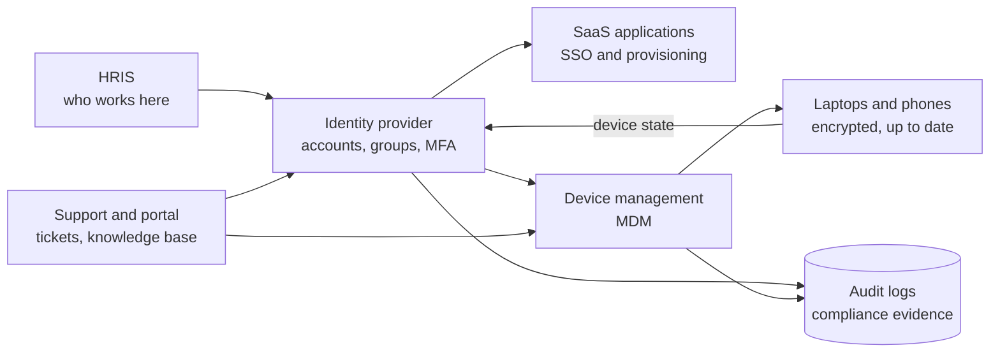
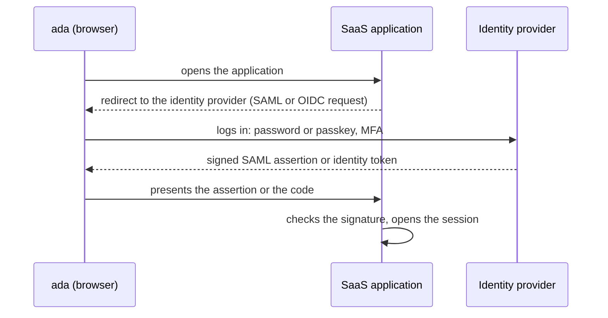
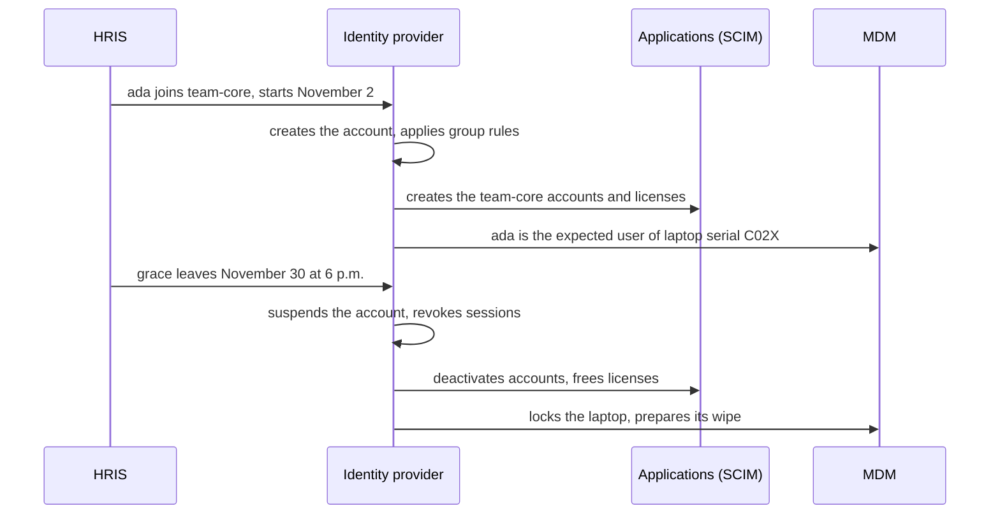
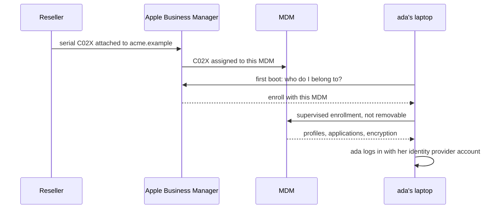
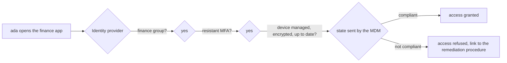
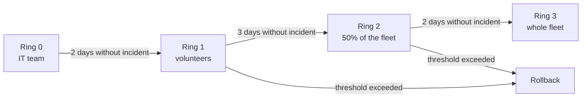
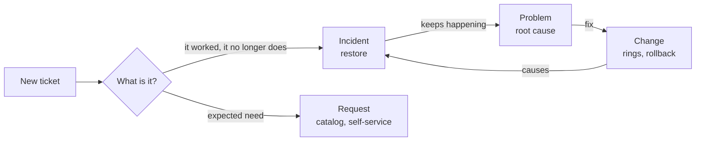
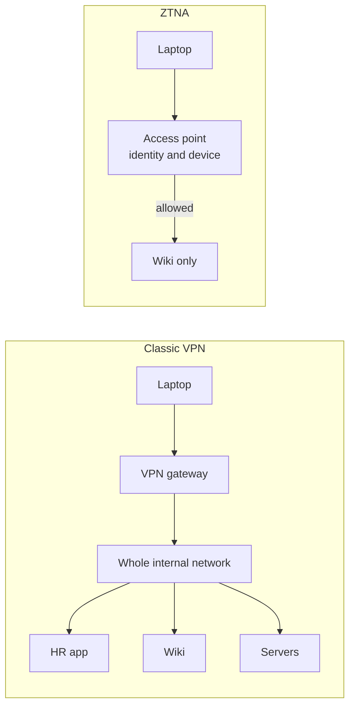

# Workplace engineering and corporate IT

!!! warning "Disclaimer"
    These notes are personal cheat sheets, not a source of truth. They reflect my own understanding and choices: their content remains subjective, despite the quotes and references it contains. It may be incomplete, simplified, inaccurate or outdated. Always check the official documentation before applying it. This content is provided as is, without any warranty: you use it at your own risk.

!!! audience "Who and what for"
    - **Roles**: workplace engineer (or corporate engineer), IT engineer, systems administrator, security engineer, IT support lead, platform engineer taking over internal IT.
    - **Uses**: I prepare a workplace engineer interview; I make sure a new hire, ada, has her encrypted laptop and all her access on the morning of her first day; I cut all of grace's access within an hour on the day she leaves; I put the identity provider configuration in Git so it goes through review; I answer an ISO 27001 auditor who asks for proof that every disk is encrypted.

!!! abstract "Scales"
    The colored badges under the headings say at which scale a notion applies:

    - <span class="pill pill-scope pill-scope-code">Code</span> the classes, functions and modules of one program;
    - <span class="pill pill-scope pill-scope-app">Application</span> one service or application and its internal split;
    - <span class="pill pill-scope pill-scope-system">System</span> several services talking to each other over the network;
    - <span class="pill pill-scope pill-scope-infra">Infrastructure</span> servers, network, zones and clusters, physical or virtual;
    - <span class="pill pill-scope pill-scope-enterprise">Enterprise</span> the whole information system and its organization.

    Details and ambiguous words: [map of scales](architecture.md#map-of-scales).

<span class="term" data-term="workplace-engineering">Workplace engineering</span> (also called *corporate engineering* or *IT engineering*) takes care of everything an employee uses to work, outside the product the company sells: their identity and access, their computer, their online tools (email, documents, video calls), the office network, and support when something breaks. The difference from IT twenty years ago: all of this is managed **as code** (versioned configuration, review, automation, metrics), and employees are treated as the users of an internal product. This page gathers the notions a workplace engineer needs and links them to the pages that already detail them: OAuth and OpenID Connect in [Security](securite.md#oauth-and-openid-connect), zero trust in [Zero trust and service-to-service identity](securite.md#zero-trust-and-service-to-service-identity), progressive deployment in [Delivery](livraison.md#progressive-deployment). The company `acme.example`, the team `team-core` and the people `ada` and `grace` are fictitious. Numbers are examples.

:material-swap-horizontal: The tools mentioned on this page: which ones replace each other, which ones combine? See [Complementary or competing](outils.md#complementary-or-competing).
{ .doc-ref }

## Terminology

**<span class="term" data-term="identity-provider">Identity provider</span> (IdP)**: the service that holds employee accounts and checks their login for every application. Example: Okta, Microsoft Entra ID, Google Cloud Identity.

**<span class="term" data-term="sso">SSO</span>** (*Single Sign-On*): I log in once to the identity provider, and every application recognizes me without asking for a password again.

**<span class="term" data-term="hris">HRIS</span>** (human resources information system): the HR software that knows who is an employee, in which team, with which manager, from when and until when. Example: Workday, BambooHR, Personio.

**<span class="term" data-term="joiner-mover-leaver">Joiner, mover, leaver</span> (JML)**: the three moments in the life of an account: arrival, change of job or team, departure.

**<span class="term" data-term="provisioning">Provisioning</span>**: automatically creating, updating or removing an account in an application. **Deprovisioning** is the removal.

**<span class="term" data-term="mdm">MDM</span>** (*Mobile Device Management*): the service that installs settings, applications and security rules remotely on company computers and phones. Example: Jamf, Microsoft Intune, Kandji.

**<span class="term" data-term="endpoint-device">Endpoint</span>**: a device used by a person: laptop, phone, tablet. Not to be confused with an API endpoint.

**<span class="term" data-term="itsm">ITSM</span>** (*IT Service Management*): the way IT support and services are organized: tickets, request catalog, incident and change management.

**<span class="term" data-term="shadow-it">Shadow IT</span>**: tools a team uses without IT knowing, often paid by credit card. Example: an online survey tool where marketing imported the customer list.

**<span class="term" data-term="sli">SLI</span>** (*Service Level Indicator*): the number I actually measure. Example: the share of new hires who have all their access at 9 a.m. on day one.

**<span class="term" data-term="slo">SLO</span>** (*Service Level Objective*): the internal target the team sets on an SLI. Example: 95% of new hires ready at 9 a.m. on day one.

**<span class="term" data-term="sla">SLA</span>** (*Service Level Agreement*): the contractual promise made to a customer, with a penalty if it is not kept. In internal IT there is often no contract; there is one when support is handed to an outside provider.

| Word | Question it asks | Example |
|---|---|---|
| identity provider | who is this person, and can they log in? | ada logs in once in the morning |
| HRIS | who works here, in which team, until when? | grace leaves the company on November 30 |
| provisioning | in which applications should this person have an account? | account created in the ticketing tool on arrival |
| MDM | is this computer configured and protected as planned? | disk encrypted, updates enforced |
| ITSM | who handles this request, and how fast? | "I need a license for the design tool" |

:material-book-open-variant: Reference docs: [Thomas Limoncelli, Christina Hogan and Strata Chalup, "The Practice of System and Network Administration"](https://the-sysadmin-book.com/) (3rd edition, 2016)
{ .doc-ref }

## The role: workplace engineering

<a class="pill pill-scope pill-scope-enterprise" href="../architecture/#map-of-scales">Scale · Enterprise</a> <span class="pill pill-status pill-status-ok" title="Still valid, checked November 2026">Current · 11/2026</span>

In a 300-person company, every arrival takes about twenty actions: create the account, add it to the right groups, order the computer, configure it, open the licenses, explain the Wi-Fi. If every action is done by hand by whoever is on support duty, mistakes pile up: a new hire waits three days for access to the ticketing tool, a former employee keeps access to the shared drive six months after leaving. Workplace engineering treats these actions as a system to automate and measure, not as a task list.

The role differs from three neighbors:

| Role | What it does day to day | Example of a day |
|---|---|---|
| support (helpdesk) | answers employee requests and outages, one by one | reset the MFA of ada, who changed phones |
| IT operations | runs the existing internal services: printers, Wi-Fi, accounts, licenses | renew the office Wi-Fi certificate |
| security | sets the rules, watches threats, runs investigations | require every disk to be encrypted, investigate a suspicious login |
| workplace engineering | builds and automates the system: identity, device management, applications, metrics | write the rule that adds anyone in `team-core` to the right group, and the test that checks it |

In a small company, one person wears all four hats. The title changes across companies (corporate engineering, IT engineering, enterprise engineering); what matters is the stance: **IT as a product**. The users are the employees, success is measured in their time and their security, and every repeated request signals a missing automation or self-service page.



**When** this role becomes useful: beyond a few dozen employees, or as soon as the company goes through a security audit (ISO 27001, SOC 2), because it then has to prove that every departure cuts access. **Why**: every manual action costs time and opens a gap, and that cost grows with every hire. **How**: I start with the source of truth (the HRIS), then identity, then devices, then applications, and I measure at each step.

!!! noob "As noob"
    The workplace engineer is a theater's stage manager: they do not act in the play, but without them the actors have no dressing room keys, no costume and no lights at the right moment. A good stage manager prepares everything before the troupe arrives and collects the keys at the end of the tour. The takeaway: **employees are my users, and their lost time is my indicator.**

**Risks.** Treating IT as a product without real means gives one more "portal" nobody uses, while support keeps doing everything by hand. The other way round, automating without understanding real cases (an intern, a contractor, an employee who moves country) creates wrong accounts at high speed. I start by watching about ten real arrivals and departures before automating.

:material-book-open-variant: Reference docs: [Thomas Limoncelli, Christina Hogan and Strata Chalup, "The Practice of System and Network Administration"](https://the-sysadmin-book.com/) (3rd edition, 2016)
{ .doc-ref }

!!! maturity "Measuring maturity"
    | Level | What I see in the team |
    |---|---|
    | N1 | a written list of arrival and departure actions exists, even if followed by hand |
    | N2 | accounts, groups and device configuration are created by tools, no longer by clicks |
    | N3 | an arrival or departure entered in the HRIS creates or cuts access without human action |
    | N4 | the team tracks every month the time to prepare a new hire, the delay to cut access at departure and the ticket volume, and picks its work from these numbers |

    **I measure**: the share of tickets that require a repetitive action (read in the ticketing tool, by category) and the delay between the departure date in the HRIS and the actual account cut (read in the identity provider logs).

## Identity: the foundation

<a class="pill pill-scope pill-scope-enterprise" href="../architecture/#map-of-scales">Scale · Enterprise</a>

Everything starts with identity: if I do not know for sure who is an employee today, I can neither grant the right access nor remove it in time. This section covers the identity provider, SSO, provisioning, MFA, the account lifecycle, groups and emergency accounts. The OAuth and OpenID Connect protocols themselves are explained in [Security](securite.md#oauth-and-openid-connect).

### Identity provider and SSO
<span class="pill pill-status pill-status-ok" title="Still valid, checked November 2026">Current · 11/2026</span>

ada uses about thirty online applications. Without <span class="term" data-term="sso">SSO</span>, she has thirty passwords, often the same one, and on the day she leaves thirty accounts must be closed. With an identity provider, every application delegates login to it: ada logs in once, with her MFA, and the applications receive a signed proof of who she is. Disabling her account in the identity provider blocks every new login at once.

*Okta: competes with Microsoft Entra ID, Google Cloud Identity, Keycloak; complements Jamf, Intune*<br>
*Microsoft Entra ID: competes with Okta, Google Cloud Identity; complements Intune*<br>
*Google Cloud Identity: competes with Okta, Microsoft Entra ID; complements Google Workspace*
{ .tool-rel }

Two protocols carry this SSO:

| Protocol | What the application receives | Where I meet it |
|---|---|---|
| <span class="term" data-term="saml">SAML 2.0</span> (OASIS, March 2005) | a signed XML assertion, carried by the browser | older or established business applications: HR tools, expense tools, many SaaS |
| OpenID Connect (OpenID Foundation, 2014) | a JWT identity token, on top of OAuth 2.0 | recent applications, mobile apps, internal tools |

How OpenID Connect, tokens and flows work is in [OpenID Connect: knowing who is logged in](securite.md#openid-connect-oidc-knowing-who-is-logged-in). For a workplace engineer, the practical question is rather: **which applications support SSO, and at what price?** Many vendors keep SSO for their most expensive plan, which pushes some teams to stay on local passwords.



!!! noob "As noob"
    SSO is a festival wristband: I show my ticket and ID once at the gate, then every stage only looks at the wristband. If the wristband is taken away, I cannot get in anywhere. Limit of the picture: a stage that already let me in does not throw me out, hence the question of sessions at departure. The takeaway: **one verified login that every application trusts.**

**Risks.** The identity provider becomes a single point: if it goes down nobody works, and if it is compromised the attacker gets in everywhere. I protect its administrators with phishing-resistant MFA, I keep their number low, and I keep [emergency accounts](#emergency-accounts-break-glass). An application that keeps local accounts next to SSO escapes the cut at departure: I list them and close them.

:material-book-open-variant: Reference docs: [OASIS, "Assertions and Protocols for the OASIS Security Assertion Markup Language (SAML) V2.0"](https://docs.oasis-open.org/security/saml/v2.0/saml-core-2.0-os.pdf) (March 2005); [OpenID Connect Core 1.0](https://openid.net/specs/openid-connect-core-1_0.html) (2014, errata 2023)
{ .doc-ref }

### Automatic provisioning: SCIM
<span class="pill pill-status pill-status-ok" title="Still valid, checked November 2026">Current · 11/2026</span>

SSO says **who** logs in; it does not create the account in the application and does not delete it. Without provisioning, ada logs in to the ticketing tool on day one and gets "account not found"; grace, gone for a month, still has an active account with a paid license. <span class="term" data-term="scim">SCIM</span> (*System for Cross-domain Identity Management*, RFC 7643 and RFC 7644, published in September 2015) is a standard REST API that applications expose so the identity provider creates, updates and deactivates accounts and groups for them.

The identity provider creates ada's account in the `acme.example` ticketing tool:

``` { .http .ex-ref title="Reference · creating an account (RFC 7644)" }
POST /scim/v2/Users HTTP/1.1
Host: tickets.acme.example
Authorization: Bearer <SCIM integration token>
Content-Type: application/scim+json

{
  "schemas": ["urn:ietf:params:scim:schemas:core:2.0:User"],
  "userName": "ada@acme.example",
  "externalId": "hris-10042",
  "name": { "givenName": "Ada", "familyName": "Lovelace" },
  "emails": [{ "value": "ada@acme.example", "primary": true }],
  "active": true
}
```

``` { .http .ex-ref title="Reference · the application's response" }
HTTP/1.1 201 Created
Content-Type: application/scim+json
Location: https://tickets.acme.example/scim/v2/Users/7f3c9a

{
  "schemas": ["urn:ietf:params:scim:schemas:core:2.0:User"],
  "id": "7f3c9a",
  "externalId": "hris-10042",
  "userName": "ada@acme.example",
  "active": true,
  "meta": {
    "resourceType": "User",
    "created": "2026-11-02T07:00:00Z",
    "lastModified": "2026-11-02T07:00:00Z",
    "location": "https://tickets.acme.example/scim/v2/Users/7f3c9a"
  }
}
```

When grace leaves, the identity provider does not delete the account: it deactivates it, which keeps the history and frees the license.

``` { .http .ex-ref title="Reference · deactivation at departure" }
PATCH /scim/v2/Users/5b81e0 HTTP/1.1
Host: tickets.acme.example
Authorization: Bearer <SCIM integration token>
Content-Type: application/scim+json

{
  "schemas": ["urn:ietf:params:scim:api:messages:2.0:PatchOp"],
  "Operations": [{ "op": "replace", "path": "active", "value": false }]
}
```

!!! noob "As noob"
    SSO is the badge that opens the door; SCIM is the HR office that tells every building "ada arrives Monday, prepare her locker" and then "grace leaves Friday, empty hers". Without SCIM, the badge works but the locker does not exist, or still exists after departure. The takeaway: **SSO opens the door, SCIM creates and closes the accounts behind it.**

**When**: as soon as an application paid per license or holding sensitive data is used by more than a few people. **Not** for an application used by three people with no connector: a quarterly access review is enough. **Risks.** Vendors' SCIM implementations vary (attributes not handled, groups ignored, deletion instead of deactivation): I test each connector with a fictitious account before turning it on for everyone. A rule mistake in the identity provider spreads everywhere within minutes: I start with a pilot group.

:material-book-open-variant: Reference docs: [RFC 7643, SCIM Core Schema](https://www.rfc-editor.org/rfc/rfc7643) and [RFC 7644, SCIM Protocol](https://www.rfc-editor.org/rfc/rfc7644) (September 2015); [Okta Developer, "Understanding SCIM"](https://developer.okta.com/docs/concepts/scim/) (accessed November 2026)
{ .doc-ref }

### Debugging a SAML login
<span class="pill pill-status pill-status-ok" title="Still valid, checked November 2026">Current · 11/2026</span>

On Monday morning, ada opens the expense tool and gets "SAML response invalid". The identity provider shows "login successful", the application shows "refused": the fault lies in the <span class="term" data-term="saml-assertion">SAML assertion</span> the browser carries from one to the other. I read it in the identity provider's log, or with a browser extension that displays SAML exchanges, then I compare each field with what the application expects.

``` { .xml .ex-ref title="Reference · the fields of a SAML 2.0 assertion to check (simplified excerpt)" }
<!-- Example: who issued it, for whom, for which application, and for how long -->
<saml:Assertion ID="_a1b2" IssueInstant="2026-11-16T08:59:58Z" Version="2.0">
  <saml:Issuer>https://idp.acme.example</saml:Issuer>
  <ds:Signature>...</ds:Signature>
  <saml:Subject>
    <saml:NameID Format="urn:oasis:names:tc:SAML:1.1:nameid-format:emailAddress">ada@acme.example</saml:NameID>
    <saml:SubjectConfirmation Method="urn:oasis:names:tc:SAML:2.0:cm:bearer">
      <saml:SubjectConfirmationData Recipient="https://expenses.acme.example/saml/acs"
                                    NotOnOrAfter="2026-11-16T09:04:58Z"/>
    </saml:SubjectConfirmation>
  </saml:Subject>
  <saml:Conditions NotBefore="2026-11-16T08:59:58Z" NotOnOrAfter="2026-11-16T09:04:58Z">
    <saml:AudienceRestriction>
      <saml:Audience>https://expenses.acme.example/saml/metadata</saml:Audience>
    </saml:AudienceRestriction>
  </saml:Conditions>
</saml:Assertion>
```

| Message or symptom | Field to look at | Frequent cause | Fix |
|---|---|---|---|
| "assertion expired" or "not yet valid" | `NotBefore`, `NotOnOrAfter` | the application server's clock is a few minutes off the identity provider's (<span class="term" data-term="clock-skew">clock skew</span>) | sync the clock with NTP; keep a tolerance of a few minutes, no more |
| "invalid audience" | `Audience` | the entity ID typed in the identity provider differs from the application's, often by a trailing slash | copy the identifier from the application's metadata |
| "invalid recipient" or "destination mismatch" | `Recipient`, `Destination` | the application's return address (ACS) changed, for example after a domain change | update the ACS address in the identity provider |
| "signature invalid" | `Signature` | the identity provider's signing certificate was renewed, the application keeps the old one | publish the new certificate in the application before the switch |
| "user not found" | `NameID` | different format or value: capital letters, address changed after a name change | align the format, or provision through SCIM with a stable identifier |

The <span class="term" data-term="x509-certificate">certificate</span> that signs assertions expires, often after one to three years depending on the provider (to check in the console). To renew it without an outage: I create the new certificate, publish it in the metadata next to the old one, update each application (those that reread the metadata do it on their own), switch the signature, then remove the old one. I keep the list of SAML applications with their certificate's expiry date, and an alert 30 days before.

**When**: for every login error that hits a single application while the others work. **Why**: the cause is almost always a configuration mismatch readable in the assertion, not an identity provider outage. **Risks.** Raising the clock tolerance to one hour to "fix" it lets a stolen assertion be replayed for longer: I fix the clock. Turning off signature checking to unblock ada lets anyone forge an assertion in her name. A SAML capture holds an assertion that stays valid until it expires: I do not paste it raw into a ticket everyone can read.

:material-book-open-variant: Reference docs: [OASIS, "Assertions and Protocols for the OASIS Security Assertion Markup Language (SAML) V2.0"](https://docs.oasis-open.org/security/saml/v2.0/saml-core-2.0-os.pdf) (March 2005); [Microsoft Learn, "Tutorial: Manage federation certificates"](https://learn.microsoft.com/en-us/entra/identity/enterprise-apps/tutorial-manage-certificates-for-federated-single-sign-on) (accessed November 2026)
{ .doc-ref }

### Phishing-resistant MFA
<span class="pill pill-status pill-status-ok" title="Still valid, checked November 2026">Current · 11/2026</span>

<span class="term" data-term="mfa">MFA</span> adds a second proof to the password. Not all MFA is equal: a code received by SMS or shown by an app can be typed into a fake site, and an "approve" notification can be obtained by sending twenty of them at 2 a.m. until the person taps (MFA fatigue). <span class="term" data-term="phishing-resistant-mfa">Phishing-resistant MFA</span> binds the proof to the real domain name: the hardware key or the <span class="term" data-term="passkey">passkey</span> signs a challenge that contains the site address, so a signature obtained on `acme-example-login.com` is worthless for `acme.example`. This is the principle of FIDO2 and WebAuthn (W3C, Level 1 in 2019, Level 2 in 2021).

| Method | Resists a fake site? | Note |
|---|---|---|
| SMS | no | also hijackable through SIM swapping; keep only as a last resort |
| app code (TOTP) | no | better than SMS, but can be typed into a fake site |
| notification with number matching | partly | limits MFA fatigue, not a fake site relayed live |
| FIDO2 security key | yes | robust, costs one object per person and a spare stock |
| passkey on the managed device | yes | nothing to hand out; check how it syncs between devices |

**When**: first for administrators of the identity provider, the MDM and email, then for everyone. **How**: I first register two resistant methods per administrator, then turn on a rule that refuses weak methods for sensitive applications, then for everyone, group by group.

**Risks.** A person who loses their only key is locked out: I require two registered methods and a recovery procedure checked by the manager or on a video call with ID, never by a simple call to support (that is exactly what <span class="term" data-term="social-engineering">social engineering</span> attacks target, see [Social engineering](cybersecurite.md#social-engineering)).

:material-book-open-variant: Reference docs: [CISA, "Implementing Phishing-Resistant MFA"](https://www.cisa.gov/sites/default/files/publications/fact-sheet-implementing-phishing-resistant-mfa-508c.pdf) (October 2022); [W3C, Web Authentication Level 2](https://www.w3.org/TR/webauthn-2/) (April 2021); [passkeys.dev](https://passkeys.dev/) (accessed November 2026)
{ .doc-ref }

### Misconception: changing passwords every 90 days
<span class="pill pill-status pill-status-obsolete" title="Dropped by NIST SP 800-63B: change the password only on compromise, not on a fixed schedule">Obsolete · 11/2026</span>

Many policies still force a password change every 90 days. NIST SP 800-63B (revision 3 in 2017, confirmed by revision 4 in 2025) asks to stop doing it: people go from `Autumn2026!` to `Winter2026!`, which stops no attacker. The current rule: a long password, checked against a list of already leaked passwords, changed only if it was compromised, and above all phishing-resistant MFA.

:material-book-open-variant: Reference docs: [NIST SP 800-63B-4, Authentication and Authenticator Management](https://csrc.nist.gov/pubs/sp/800/63/b/4/final) (2025)
{ .doc-ref }

### Joiner, mover, leaver: the lifecycle driven by the HRIS
<span class="pill pill-status pill-status-ok" title="Still valid, checked November 2026">Current · 11/2026</span>

The <span class="term" data-term="hris">HRIS</span> is the <span class="term" data-term="source-of-truth">source of truth</span>: HR knows that a person arrives, changes team or leaves. If support creates accounts from a chat message, something will always be forgotten. The principle: the HRIS sends events to the identity provider, which derives the groups, which derive the applications and licenses.



``` { .text .ex-illus title="Illustration · the lifecycle of two accounts" }
joiner (ada, starts Monday November 2)
  D-10  HR enters the arrival in the HRIS: team team-core, manager grace
  D-10  the identity provider creates the account, disabled until D0
  D-7   the laptop is ordered, attached to automated enrollment
  D-1   the account turns on at 6 p.m.; team-core groups and applications created
  D0    ada powers on the laptop, logs in, everything is ready at 9 a.m.

mover (ada moves to team-data on March 1)
  D0    the HRIS changes the team; group team-core removed, team-data added
  D0    access specific to team-core is removed the same day, not "later"

leaver (grace, leaves November 30 at 6 p.m.)
  D0 18:00  account suspended, sessions and tokens revoked
  D0 18:05  application accounts deactivated through SCIM, licenses freed
  D0 18:10  laptop locked remotely if not returned
  D+1       files and mailbox transferred to the manager
  D+30      deletion or archiving according to the retention period
```

The **mover** is the most often missed case: new access gets added and the old access is forgotten. After three team changes, a person holds the rights of three teams. That is privilege creep, the opposite of <span class="term" data-term="least-privilege">least privilege</span>.

**Risks.** If the HRIS is late (departure entered a week after), all the automation is late too: I agree an entry deadline with HR, and I keep a manual emergency action for an immediate departure. A badly filled HRIS field (empty team) can remove all of a person's access: I add a safety rule that blocks a change touching more than N groups and asks for human approval. Contractors and interns are often outside the HRIS: I give them their own source of truth, with a mandatory end date.

:material-book-open-variant: Reference docs: [Microsoft Learn, "Plan an HR-driven provisioning" (Entra ID)](https://learn.microsoft.com/en-us/entra/identity/app-provisioning/plan-cloud-hr-provision) (accessed November 2026)
{ .doc-ref }

### Groups, roles and access reviews
<span class="pill pill-status pill-status-ok" title="Still valid, checked November 2026">Current · 11/2026</span>

I never grant access to a person directly: I grant it to a group, and the person is in the group because an HRIS attribute puts them there (team, job, country). This is the <span class="term" data-term="rbac">RBAC</span> model, detailed in [Modeling permissions](securite.md#modeling-permissions-rbac-abac-rebac). Two kinds of groups:

| Kind of group | Who decides membership | Example |
|---|---|---|
| computed group (by rule) | an HRIS attribute | `team-core`: everyone whose team is team-core |
| on-request group | a request approved by the access owner | `finance-export`: write access to the accounting tool, approved by the finance lead |

On-request groups grow and never shrink. The <span class="term" data-term="access-review">access review</span> fixes that: at a fixed interval, the owner of each sensitive access receives the member list and confirms or removes each line. ISO 27001 and SOC 2 ask to keep the evidence.

``` { .text .ex-illus title="Illustration · quarterly review campaign" }
campaign Q4 2026, access "finance-export", owner: finance lead
  ada      member since 2026-03, last login 3 days ago       confirmed
  grace    member since 2025-01, last login 140 days ago    removed
  bot-erp  service account, owner team-core                confirmed, review again in Q1
result: 1 access removed, evidence exported as CSV for the audit
```

**Risks.** A 400-line review sent to a manager ends with "confirm all". I show the last login, I pre-select removal of access unused for 90 days (example), and I keep reviews for sensitive access.

:material-book-open-variant: Reference docs: [Microsoft Learn, "What are access reviews?" (Entra ID Governance)](https://learn.microsoft.com/en-us/entra/id-governance/access-reviews-overview) (accessed November 2026)
{ .doc-ref }

### Emergency accounts (break-glass)
<span class="pill pill-status pill-status-ok" title="Still valid, checked November 2026">Current · 11/2026</span>

One day, a badly written conditional access rule locks everyone out, administrators included, or the MFA service is down. A <span class="term" data-term="break-glass-account">break-glass account</span> is an administrator account excluded from those rules, kept under lock, used only to repair.

``` { .text .ex-illus title="Illustration · rules for an emergency account" }
- two accounts, not one: if one is locked, the other remains
- not tied to a person or the HRIS; on the provider's default domain, not the federation
- excluded from conditional access rules, protected by FIDO2 keys kept in a safe
- every login triggers an immediate alert to the security team
- tested every quarter: login, check, alert received, written report
```

**Risks.** An emergency account never tested does not work on the day it is needed; an emergency account without an alert is a back door. I test it on a fixed date and check that the alert fires.

:material-book-open-variant: Reference docs: [Microsoft Learn, "Manage emergency access admin accounts"](https://learn.microsoft.com/en-us/entra/identity/role-based-access-control/security-emergency-access) (accessed November 2026)
{ .doc-ref }

### Compromised account: contain, then investigate
<span class="pill pill-status pill-status-ok" title="Still valid, checked November 2026">Current · 11/2026</span>

On a Tuesday at 2 a.m., the identity provider reports a login to grace's account from a country where she does not work, right after twenty refused MFA notifications and then one accepted: this is <span class="term" data-term="mfa-fatigue">MFA fatigue</span>. Her password was probably stolen. Changing the password is not enough: sessions already open, tokens granted to applications and a mail forwarding rule created by the attacker survive that change. The order is always the same: contain, preserve evidence, measure the scope, restore, learn. Roles, communication and the postmortem follow [The lifecycle of an incident](incidents.md#the-lifecycle-of-an-incident).

| Signal | What it suggests |
|---|---|
| <span class="term" data-term="impossible-travel">impossible travel</span>: two logins 30 minutes apart from two continents | stolen password or session |
| a burst of refused MFA notifications, then one accepted | MFA fatigue, the person clicked to make the alerts stop |
| a new rule forwarding mail to an outside address | a quiet copy of the mailbox, often before a payment fraud |
| <span class="term" data-term="oauth-consent">OAuth consent</span> granted to an unknown application that reads the mailbox | an access that survives the password change |

``` { .text .ex-illus title="Illustration · the first hour, in order" }
contain
  T+0     suspend the account, without deleting it: logs and files stay readable
  T+5     revoke sessions and refresh tokens (identity provider and suite)
  T+10    remove recently registered MFA methods and the night's OAuth grants
  T+15    delete the mailbox forwarding and redirect rules
preserve
  T+20    export audit logs (logins, mail, sharing) before they expire
measure the scope
  T+30    list what was read, shared or sent since the first suspicious login
restore
  T+60    new password, phishing-resistant MFA registered on a video call with ID
```

**When**: as soon as a serious signal arrives, without waiting to be sure: suspending a healthy account costs an hour of work, leaving a stolen one open costs far more. **Risks.** Deleting the account erases evidence and breaks file sharing: I suspend. Warning grace by mail on the compromised mailbox warns the attacker too: I call her, or go through her manager. Acting alone damages evidence: the security team leads the investigation, I provide the actions and the logs, following a [runbook](incidents.md#runbooks-and-playbooks) written in advance.

:material-book-open-variant: Reference docs: [NIST SP 800-61 Rev. 3, "Incident Response Recommendations and Considerations for Cybersecurity Risk Management"](https://csrc.nist.gov/pubs/sp/800/61/r3/final) (April 2025); [Microsoft Learn, "Responding to a compromised email account"](https://learn.microsoft.com/en-us/defender-office-365/responding-to-a-compromised-email-account) (accessed November 2026)
{ .doc-ref }

!!! maturity "Measuring maturity"
    | Level | What I see in the team |
    |---|---|
    | N1 | an identity provider and SSO exist for the main applications, accounts are created by hand |
    | N2 | the HRIS feeds the identity provider, groups are computed by rule, SCIM creates and deactivates accounts in the main applications |
    | N3 | a departure entered in the HRIS cuts all access without human action, and weak MFA methods are refused by a rule |
    | N4 | the team tracks the cut-off delay, the number of orphan accounts and the share of applications behind SSO, and access reviews remove rights every quarter |

    **I measure**: the delay between the departure time in the HRIS and the last deactivation in the applications (read in the identity provider logs), and the number of active application accounts with no matching active person in the HRIS (monthly reconciliation).

## Device management

<a class="pill pill-scope pill-scope-infra" href="../architecture/#map-of-scales">Scale · Infrastructure</a> <a class="pill pill-scope pill-scope-enterprise" href="../architecture/#map-of-scales">Scale · Enterprise</a>

A laptop lost on a train holds the mailbox, documents and open sessions. If I do not know it exists, I can neither wipe it nor prove it was encrypted. Device management answers three questions: which devices exist, are they configured as planned, and can I act on them remotely?

### MDM and configuration profiles
<span class="pill pill-status pill-status-ok" title="Still valid, checked November 2026">Current · 11/2026</span>

An <span class="term" data-term="mdm">MDM</span> is a service with which each enrolled device keeps a link: it sends settings, applications and commands (lock, wipe) and receives an inventory in return (model, OS version, encryption). On macOS and iOS, the MDM protocol is defined by Apple and every vendor speaks it; on Windows, Intune uses the management protocol built into the system.

*Jamf: competes with Kandji, Microsoft Intune; complements Okta*<br>
*Microsoft Intune: competes with Jamf, Kandji; complements Microsoft Entra ID, Windows Autopilot*<br>
*Kandji: competes with Jamf, Microsoft Intune*
{ .tool-rel }

A <span class="term" data-term="configuration-profile">configuration profile</span> is a bundle of settings pushed to the device: minimum passcode length, mandatory encryption, Wi-Fi network, certificate, allowed security extension. The user cannot remove it on a supervised device.

!!! noob "As noob"
    The MDM is a hotel's central remote control that sets the heating, the lock and the TV of every room from afar, and sees which rooms have a window open. Profiles are the settings it sends. The takeaway: **the MDM knows which devices exist, configures them and can lock them remotely.**

**Risks.** A wrong profile reaches the whole fleet within minutes: a bad Wi-Fi certificate cuts the network for 300 people. I test every profile on a pilot group ([Rollout rings](#rollout-rings)). An MDM whose link certificate with Apple expires (yearly renewal of the push notification certificate) loses control of every Mac: I put its due date in the team calendar with an alert 30 days before.

:material-book-open-variant: Reference docs: [Apple, "Apple Platform Deployment"](https://support.apple.com/guide/deployment/welcome/web) (accessed November 2026); [Microsoft Learn, "What is Microsoft Intune?"](https://learn.microsoft.com/en-us/intune/intune-service/fundamentals/what-is-intune) (accessed November 2026)
{ .doc-ref }

### Zero-touch enrollment
<span class="pill pill-status pill-status-ok" title="Still valid, checked November 2026">Current · 11/2026</span>

Without automation, someone from support unboxes each laptop, sets it up by hand for two hours and boxes it again. <span class="term" data-term="zero-touch-enrollment">Zero-touch enrollment</span> does the opposite: the device is shipped straight to ada, still in its wrapping; on its first internet connection, it finds out by itself that it belongs to `acme.example` and enrolls in the MDM.

| Platform | Service | What it takes |
|---|---|---|
| Apple (Mac, iPhone, iPad) | Apple Business Manager (2018) with Automated Device Enrollment (formerly DEP, 2014) | devices bought from Apple or an authorized reseller, attached to the company account by serial number |
| Windows | Windows Autopilot (2017) with Intune | the devices' hardware hash registered by the manufacturer or reseller |
| Android | zero-touch enrollment (Android Enterprise) | a partner reseller that registers the devices |



!!! noob "As noob"
    It is a parcel that already knows its return address: wherever it is opened, the laptop "goes home" on first boot and lets itself be configured. Even wiped and resold, it enrolls again with its owner. The takeaway: **the serial number is attached to the company before the device is even delivered.**

**Risks.** A laptop bought elsewhere (on a consumer website) is not attached: it must be added by hand, with more limits. I enforce the purchasing channel. When an employee leaves, if the device is not released properly, it stays attached and cannot be resold: the end-of-life procedure is part of the cycle.

:material-book-open-variant: Reference docs: [Apple, "Automated Device Enrollment and device management"](https://support.apple.com/guide/deployment/automated-device-enrollment-management-dep73069dd57/web) (accessed November 2026); [Microsoft Learn, "Overview of Windows Autopilot"](https://learn.microsoft.com/en-us/autopilot/overview) (accessed November 2026)
{ .doc-ref }

### Apple declarative device management
<span class="pill pill-status pill-status-ok" title="Still valid, checked November 2026">Current · 11/2026</span>

In classic MDM, the server sends orders and keeps polling devices to know whether they changed. With <span class="term" data-term="declarative-device-management">declarative device management</span> (introduced by Apple in 2021 and extended to the Mac in 2022), the server sends a **desired state**; the device applies it on its own, maintains it, and tells the server when its state changes. It is the same idea as in [Kubernetes](kubernetes.md) or GitOps: I describe the result, not the steps.

``` { .json .ex-ref title="Reference · passcode settings declaration (structure from Apple docs, to check)" }
{
  "Type": "com.apple.configuration.passcode.settings",
  "Identifier": "com.acme.example.passcode",
  "ServerToken": "2026-11-01-v3",
  "Payload": {
    "RequirePasscode": true,
    "MinimumLength": 12,
    "MaximumFailedAttempts": 10
  }
}
```

**When**: on a recent Apple fleet, for settings and OS updates (Apple pushes its enforced updates this way). **Risks.** MDM vendors do not yet expose every declaration at the same pace: I check what my tool supports before planning a migration.

:material-book-open-variant: Reference docs: [Apple, "Intro to declarative device management"](https://support.apple.com/guide/deployment/intro-to-declarative-device-management-depb1bab77f8/web) (accessed November 2026); [Apple, WWDC22, "Adopt declarative device management"](https://developer.apple.com/videos/play/wwdc2022/10046/) (2022)
{ .doc-ref }

### Linux and personal devices (BYOD)
<span class="pill pill-status pill-status-ok" title="Still valid, checked November 2026">Current · 11/2026</span>

Developers often ask for Linux. There is no single MDM protocol for Linux: I combine a configuration tool (Ansible, or the Intune Linux agent for some distributions, to check), an inventory agent such as [osquery](#edr-and-osquery) and encryption enforced at install time. **When**: I accept it if I can prove the same controls (encryption, updates, locked screen); otherwise I offer a Mac or a remote development environment.

<span class="term" data-term="byod">BYOD</span> (*Bring Your Own Device*) is using a personal device for work, most often a phone. I do not take full control of a personal phone: I use **user enrollment** (Apple User Enrollment, Android work profile), which separates company data and only allows wiping that data.

**Risks.** Full MDM on a personal device gives the company private data (installed apps, location in some cases) and raises a GDPR and trust problem. BYOD with no control at all leaves company documents on an unlocked phone. The middle way: data separation, and conditional access that refuses sensitive applications to non-compliant devices.

:material-book-open-variant: Reference docs: [Microsoft Learn, "Linux device management in Intune"](https://learn.microsoft.com/en-us/intune/intune-service/fundamentals/deployment-guide-platform-linux) (accessed November 2026)
{ .doc-ref }

!!! maturity "Measuring maturity"
    | Level | What I see in the team |
    |---|---|
    | N1 | a device inventory exists, even in a spreadsheet, and most devices are enrolled in the MDM |
    | N2 | every new device goes through zero-touch enrollment; profiles are the same for a whole group |
    | N3 | a device that falls out of compliance (MDM removed, disk not encrypted) automatically loses access to sensitive applications |
    | N4 | the team tracks device setup time, the share of compliant devices and the time to apply a profile, and picks its work from these numbers |

    **I measure**: the share of active devices enrolled and compliant (read in the MDM), and the time between first power-on and a ready device (read in the enrollment logs).

## Endpoint security

<a class="pill pill-scope pill-scope-infra" href="../architecture/#map-of-scales">Scale · Infrastructure</a>

The workstation is the most frequent entry point for an attack: an opened attachment, a dubious browser extension, an outdated system. This section covers what I enforce on every device and how I check it.

### Disk encryption
<span class="pill pill-status pill-status-ok" title="Still valid, checked November 2026">Current · 11/2026</span>

<span class="term" data-term="disk-encryption">Disk encryption</span> makes the content unreadable without the session password or the security chip: a stolen laptop gives nothing away. FileVault on macOS, BitLocker on Windows, LUKS on Linux. The MDM turns it on and collects the **recovery key**, kept in the MDM, to unlock a device whose user forgot their password.

**Risks.** A recovery key not escrowed turns a forgotten password into lost local data. A key readable by all of support becomes a hole: I limit who reads it and log every read.

:material-book-open-variant: Reference docs: [Apple, "Intro to FileVault"](https://support.apple.com/guide/deployment/intro-to-filevault-dep82064ec40/web) (accessed November 2026); [Microsoft Learn, "BitLocker overview"](https://learn.microsoft.com/en-us/windows/security/operating-system-security/data-protection/bitlocker/) (accessed November 2026)
{ .doc-ref }

### Patching: cadence and deadlines
<span class="pill pill-status pill-status-ok" title="Still valid, checked November 2026">Current · 11/2026</span>

<span class="term" data-term="patch-management">Patch management</span> sets how fast an OS, browser or application update reaches every device. A security fix that waits three weeks for the user to stop clicking "later" leaves a known hole open. NIST SP 800-40 (revision 4, April 2022) recommends treating patching as planned preventive maintenance, with deadlines that depend on risk.

| Kind of fix | Example deadline | How |
|---|---|---|
| actively exploited vulnerability (in the CISA KEV catalog) | 48 h | accelerated rollout, forced restart with notice |
| regular security update | 14 days | rings, then a deadline with forced restart |
| major OS version | 60 to 90 days | pilot, check business applications, then rings |

[Take with caution: example deadlines, to set with the security team according to risk]

**Risks.** Forcing a restart in the middle of a customer call annoys everyone and encourages workarounds: I give notice, a window and a limited number of postponements. Never forcing leaves 10% of the fleet months behind: I measure the share of up-to-date devices at D+14.

:material-book-open-variant: Reference docs: [NIST SP 800-40 Rev. 4, "Guide to Enterprise Patch Management Planning"](https://csrc.nist.gov/pubs/sp/800/40/r4/final) (April 2022); [CISA, Known Exploited Vulnerabilities Catalog](https://www.cisa.gov/known-exploited-vulnerabilities-catalog) (accessed November 2026)
{ .doc-ref }

### EDR and osquery
<span class="pill pill-status pill-status-ok" title="Still valid, checked November 2026">Current · 11/2026</span>

An <span class="term" data-term="edr">EDR</span> (*Endpoint Detection and Response*) is an agent installed on every device that watches processes, files and connections, detects attack behavior (a Word document that launches PowerShell, for example) and can isolate the device from the network. It succeeds the classic antivirus, which only recognized known signatures. Alerts usually go to the security team's <span class="term" data-term="siem">SIEM</span> ([SIEM](securite.md#siem-centralizing-and-correlating-security-logs)).

<span class="term" data-term="osquery">osquery</span> (open-sourced by Facebook in October 2014, handed to the Linux Foundation in 2019) answers another question: **what state is my fleet in?** It exposes the operating system as an SQL database: processes, installed applications, users, encryption. A tool such as Fleet sends the same query to thousands of devices.

*osquery: complements Fleet, EDRs, MDMs*<br>
*Fleet: complements osquery; partly competes with Jamf, Intune for inventory*
{ .tool-rel }

``` { .sql .ex-ref title="Reference · osquery, devices whose disk is not encrypted" }
-- Example: unencrypted volumes (macOS and Linux)
SELECT name, type, encrypted
FROM disk_encryption
WHERE encrypted = 0;
```

``` { .sql .ex-ref title="Reference · osquery, OS and browser version" }
-- Example: OS version
SELECT name, version, build FROM os_version;

-- Example: installed Google Chrome version (macOS)
SELECT name, bundle_short_version
FROM apps
WHERE bundle_identifier = 'com.google.Chrome';
```

**When**: osquery for inventory and compliance ("how many devices still have the vulnerable version?"), EDR to detect and respond to an attack. They complement each other. **Risks.** One more agent on every device uses battery and CPU, and a badly tuned EDR blocks developer tools (compilers, containers): I test with a group of developers before rolling out. These tools see a lot of employee activity: I write down what is collected and who reads it (see [GDPR](#compliance-and-evidence)).

:material-book-open-variant: Reference docs: [osquery documentation](https://osquery.readthedocs.io/en/stable/) (accessed November 2026); [Facebook Engineering, "Introducing osquery"](https://engineering.fb.com/2014/10/29/security/introducing-osquery/) (October 2014)
{ .doc-ref }

### CIS Benchmarks and admin rights
<span class="pill pill-status pill-status-ok" title="Still valid, checked November 2026">Current · 11/2026</span>

I do not reinvent the list of security settings: the <span class="term" data-term="cis-benchmark">CIS Benchmarks</span> (Center for Internet Security) give, for macOS, Windows, Linux and browsers, hundreds of recommended settings in two levels (level 1 reasonable for everyone, level 2 stricter). I start from level 1, write down what I set aside because it breaks a real use, and check compliance with the MDM or osquery.

<span class="term" data-term="local-admin-rights">Local admin rights</span> allow installing anything and turning off protections. Removing them from everyone breaks developers' work; leaving them to everyone cancels a good part of the controls. The options:

| Situation | Choice |
|---|---|
| a sales employee installs applications once a quarter, like a new video call tool | no admin rights, a self-service app catalog in the MDM |
| a developer installs command-line tools several times a week | temporary admin rights on request, logged (for example 30 minutes) |
| a team needs deep system settings, like drivers or virtual machines | permanent admin rights, with EDR and a written justification reviewed every year |

**Risks.** A benchmark applied in full without testing blocks legitimate uses (screen sharing, Bluetooth for a headset) and encourages workarounds. Temporary admin rights without a log are only a formality.

:material-book-open-variant: Reference docs: [CIS Benchmarks](https://www.cisecurity.org/cis-benchmarks) (accessed November 2026)
{ .doc-ref }

### Device trust and conditional access
<span class="pill pill-status pill-status-ok" title="Still valid, checked November 2026">Current · 11/2026</span>

The old model said: "in the office or on the VPN, I trust you". In 2014, Google published BeyondCorp (Rory Ward and Betsy Beyer, "BeyondCorp: A New Approach to Enterprise Security", ;login:, December 2014): access to an application depends on **who** I am and **the state of the device** I use, not on the network I am on. This is [zero trust](securite.md#zero-trust-and-service-to-service-identity) applied to employees.

<span class="term" data-term="device-trust">Device trust</span> is the proof that a device is managed and compliant (enrolled in the MDM, encrypted, up to date, EDR running). <span class="term" data-term="conditional-access">Conditional access</span> is the rule evaluated at each login by the identity provider, combining the person, the device, the application and the risk.

The classic mistake: trust based on the network. An infected laptop plugged in at the office has the same rights as a healthy one.

``` { .yaml .ex-bad title="Avoid" }
# Avoid: trust comes from the network
policy: finance-app
allow:
  - source_network: 10.20.0.0/16   # the office or VPN network
```

The recommended version evaluates the person and the device at every login, wherever it happens.

``` { .yaml .ex-good title="Recommended" }
# Good: trust comes from the person and the device
policy: finance-app
allow:
  - groups: [finance]
    mfa: phishing_resistant
    device:
      managed: true
      disk_encrypted: true
      os_patch_age_days_max: 30
otherwise: deny
```



!!! noob "As noob"
    Before, getting into the building was enough to open every door. With conditional access, each door checks my badge **and** whether I wear the safety gear required for that room, even if I am already inside. The takeaway: **access depends on who I am and the state of my device, not on the network.**

**Risks.** A strict rule turned on all at once blocks the whole company on a Monday morning: I first enable it in "report only" mode, read who would have been blocked, then enforce it group by group, keeping the [emergency accounts](#emergency-accounts-break-glass) out of the rule. A refusal message with no explanation generates hundreds of tickets: it says what to do.

:material-book-open-variant: Reference docs: [Rory Ward and Betsy Beyer, "BeyondCorp: A New Approach to Enterprise Security"](https://research.google/pubs/beyondcorp-a-new-approach-to-enterprise-security/) (;login:, December 2014); [Microsoft Learn, "What is Conditional Access?"](https://learn.microsoft.com/en-us/entra/identity/conditional-access/overview) (accessed November 2026)
{ .doc-ref }

!!! maturity "Measuring maturity"
    | Level | What I see in the team |
    |---|---|
    | N1 | encryption is on and an antivirus or EDR is installed on most devices |
    | N2 | encryption, EDR and patch cadence are enforced by the MDM; a CIS level 1 benchmark is applied with its written exceptions |
    | N3 | a non-compliant device loses access to sensitive applications by itself through conditional access |
    | N4 | the team tracks the share of devices up to date at D+14, the share of compliant devices and the time to fix exploited vulnerabilities, and tunes the rules from these numbers |

    **I measure**: the share of devices with the latest security fix 14 days after its release (read in the MDM or osquery), and the number of logins refused for a non-compliant device (read in the identity provider logs).

## Workplace as code and automation

<a class="pill pill-scope pill-scope-enterprise" href="../architecture/#map-of-scales">Scale · Enterprise</a> <span class="pill pill-status pill-status-ok" title="Still valid, checked November 2026">Current · 11/2026</span>

If the identity provider and MDM configuration lives only in web consoles, nobody knows who changed what, and a wrong click cannot be reviewed. **Workplace as code** applies <span class="term" data-term="infrastructure-as-code">infrastructure as code</span> to internal IT: groups, rules, applications and profiles are described in versioned files, reviewed in a merge request and applied by a tool.

### Configuration in Git
<span class="pill pill-status pill-status-ok" title="Still valid, checked November 2026">Current · 11/2026</span>

Identity providers and several MDMs have a Terraform provider (Okta, Microsoft Entra ID with the `azuread` provider) or their own declarative format (Fleet for osquery). The `hashicorp/googleworkspace` Terraform provider is archived (checked November 2026): for Google Workspace, I check the state of community providers or go through the Admin SDK API.

*Terraform: competes with OpenTofu, Pulumi; partly competes with Crossplane; complements Terragrunt, Packer, Ansible*
{ .tool-rel }

The classic: members added one by one, by hand, and never removed.

``` { .hcl .ex-bad title="Avoid" }
# Avoid: people listed by hand in the group
resource "okta_group" "team_core" {
  name = "team-core"
}

resource "okta_group_memberships" "team_core" {
  group_id = okta_group.team_core.id
  users    = ["00u1ada", "00u2grace", "00u3leo"]
}
```

When ada changes team, nobody thinks of editing this list: she keeps the access. The recommended version computes membership from an attribute coming from the HRIS.

``` { .hcl .ex-good title="Recommended" }
# Good: the group fills itself from the team known to the HRIS
resource "okta_group" "team_core" {
  name        = "team-core"
  description = "Members of team-core, computed from the HRIS"
}

# Good: a rule, not a list of people
resource "okta_group_rule" "team_core_from_hris" {
  name              = "team-core-from-hris"
  status            = "ACTIVE"
  group_assignments = [okta_group.team_core.id]
  expression_type   = "urn:okta:expression:1.0"
  expression_value  = "user.department==\"team-core\""
}
```

Every change goes through a merge request: the CI runs `terraform plan`, a colleague reviews the plan ("1 group added, 0 destroyed"), the merge applies. I also keep a scheduled <span class="term" data-term="configuration-drift">drift</span> check: a nightly `plan` that reports changes made by hand in the console. Before production, I apply the change in a test organization of the identity provider, filled with fictitious accounts (Okta and Entra ID offer them, conditions depend on the licence, to check): a wrong group rule shows up there without touching anyone.

**Risks.** A `terraform destroy` or a renamed resource can delete a group and remove a whole team's access at once: I add `prevent_destroy` on critical resources and read the plan in review. Terraform's API token is a super administrator: I keep it in a [secret manager](securite.md#secret-managers-for-machines-and-for-humans), with rights limited to the managed objects.

:material-book-open-variant: Reference docs: [Terraform Registry, Okta provider](https://registry.terraform.io/providers/okta/okta/latest/docs) (accessed November 2026); [Okta Expression Language](https://developer.okta.com/docs/reference/okta-expression-language/) (accessed November 2026)
{ .doc-ref }

### Scripts against admin APIs
<span class="pill pill-status pill-status-ok" title="Still valid, checked November 2026">Current · 11/2026</span>

Not everything can be described as a desired state: a departure is a sequence of actions in a precise order. I then write a script against the <span class="term" data-term="admin-api">admin APIs</span>: the identity provider API, Microsoft Graph for Microsoft 365, the Admin SDK for Google Workspace. A departure example, with a fictitious `workplace` client that wraps these APIs.

The classic: deactivating the account and stopping there.

``` { .python .ex-bad title="Avoid" }
# Avoid: deactivating the account and calling it done
def offboard(email: str) -> None:
    workplace.idp.deactivate_user(email)
```

Sessions already open in applications stay valid until they expire, sometimes for days; applications without SSO keep their local account; grace's files become orphans. The recommended version follows an order and keeps a trace.

``` { .python .ex-good title="Recommended" }
# Good: a complete departure, in order, logged
def offboard(email: str, manager: str) -> None:
    user = workplace.idp.get_user(email)
    workplace.idp.suspend_user(user.id)
    workplace.idp.revoke_sessions(user.id, include_oauth_tokens=True)
    workplace.mdm.lock_devices(owner=email)
    workplace.mail.transfer_mailbox(email, to=manager)
    workplace.drive.transfer_files(email, to=manager)
    for app in workplace.inventory.apps_without_sso(email):
        workplace.tickets.open(f"Close the local account of {email} in {app}")
    workplace.audit.record("offboarding", user=email, by="offboarding-bot")
```

**Risks.** A script run on the wrong address deletes the wrong person's account: it takes its input from the HRIS, not from a copy-paste, and suspends before deleting. A script that stops halfway leaves a partial state: each step can be rerun with no side effect (idempotent) and a failure opens a ticket. Before the first real run, I start it in <span class="term" data-term="dry-run">dry-run</span> mode: it prints every action it would take, without changing anything, and a colleague reviews that list.

:material-book-open-variant: Reference docs: [Microsoft Graph overview](https://learn.microsoft.com/en-us/graph/overview) (accessed November 2026); [Google, Admin SDK Directory API](https://developers.google.com/workspace/admin/directory/reference/rest) (accessed November 2026); [Okta, User Sessions API](https://developer.okta.com/docs/api/openapi/okta-management/management/tag/UserSessions/) (accessed November 2026)
{ .doc-ref }

### Rollout rings
<span class="pill pill-status pill-status-ok" title="Still valid, checked November 2026">Current · 11/2026</span>

A configuration change on 300 devices or 300 accounts carries the same risk as a production release: if it is wrong, everyone is hit. I apply it in <span class="term" data-term="rollout-ring">rings</span>: the IT team first, then volunteers, then the rest, with an observation period between each. It is [progressive deployment](livraison.md#progressive-deployment) applied to devices; Microsoft uses the same word for Windows updates.

``` { .yaml .ex-illus title="Illustration · ring plan for a new security profile" }
change: profile "firewall on, block incoming connections"
rings:
  - name: ring-0-it          # the IT team, 8 devices
    wait: 2 days
    stop_if: more than 1 related ticket
  - name: ring-1-volunteers  # volunteers from each department, 30 devices
    wait: 3 days
    stop_if: more than 2 related tickets or a broken business tool
  - name: ring-2-broad       # 50% of the fleet
    wait: 2 days
    stop_if: tickets up more than 20% in the network category
  - name: ring-3-all         # the rest
rollback: remove the profile from the group in the MDM
```



**Risks.** A pilot ring with only IT does not represent real uses (accounting, design, traveling sales staff): I put one volunteer per department in it. A pilot without stop criteria written beforehand never stops.

:material-book-open-variant: Reference docs: [Microsoft Learn, "Windows Autopatch overview"](https://learn.microsoft.com/en-us/windows/deployment/windows-autopatch/overview/windows-autopatch-overview) (accessed November 2026)
{ .doc-ref }

!!! maturity "Measuring maturity"
    | Level | What I see in the team |
    |---|---|
    | N1 | configuration changes are written down somewhere, even after the fact |
    | N2 | groups, rules and profiles live in Git and go through a merge request with a reviewed plan |
    | N3 | a manual drift is detected the same night, and each change moves on to the next ring by itself if no threshold is exceeded |
    | N4 | the team tracks the share of configuration managed as code, the rate of rolled-back changes and the tickets generated per change |

    **I measure**: the share of identity provider groups and applications managed by Terraform (comparison between the Terraform state and the API), and the number of drifts detected per week (read in the nightly check job).

## Collaboration tools and SaaS

<a class="pill pill-scope pill-scope-enterprise" href="../architecture/#map-of-scales">Scale · Enterprise</a>

Email, shared documents, video calls and chat are the most used tools in the company, and the ones where most data leaks. Next to them, every team buys its own <span class="term" data-term="saas">SaaS</span>.

### Administering Google Workspace or Microsoft 365
<span class="pill pill-status pill-status-ok" title="Still valid, checked November 2026">Current · 11/2026</span>

*Google Workspace: competes with Microsoft 365; complements Google Cloud Identity*<br>
*Microsoft 365: competes with Google Workspace; complements Microsoft Entra ID, Intune*
{ .tool-rel }

Both suites cover the same needs; the settings that matter to a workplace engineer are the same:

| Setting | Why | Example choice |
|---|---|---|
| external document sharing | an "anyone with the link" link on a salary file is a leak | external sharing off by default, allowed for some groups with a warning |
| connected third-party apps (OAuth) | a "free" extension can ask to read the whole mailbox | allowlist of applications, the others blocked |
| automatic forwarding of mail outside | classic exfiltration technique after a compromise | forbidden, alert on attempt |
| retention period | legal obligation or ongoing litigation | retention rules per content type |
| organizational units or settings groups | interns do not have the same rights as administrators | one unit per population, inherited settings |

**Risks.** A default setting that is too open (public sharing, free third-party apps) is rarely noticed before the incident. A setting that is too closed pushes teams to personal tools: I close what is dangerous and offer an approved path for the real need (a space shared with a partner, for example).

:material-book-open-variant: Reference docs: [Google, Admin SDK Directory API](https://developers.google.com/workspace/admin/directory/reference/rest) (accessed November 2026); [Microsoft Learn, "Remove a former employee"](https://learn.microsoft.com/en-us/microsoft-365/admin/add-users/remove-former-employee) (accessed November 2026)
{ .doc-ref }

### SaaS sprawl and shadow IT
<span class="pill pill-status pill-status-ok" title="Still valid, checked November 2026">Current · 11/2026</span>

Marketing pays for a survey tool with a credit card, imports the customer list into it, and the account stays open after the person who created it leaves: that is <span class="term" data-term="shadow-it">shadow IT</span>. Multiplied across every team, it becomes SaaS sprawl: dozens of tools doing the same thing, without SSO, without an owner, paid twice.

How I find them, without banning:

1. spending: expense reports and card statements, "software" category;
2. "Sign in with Google / Microsoft" logins seen by the identity provider or the suite;
3. OAuth grants given by employees to third-party applications;
4. a SaaS management tool that cross-checks these sources, if the volume justifies it.

Then, for each tool found: an owner, a decision (keep and connect to SSO, replace with the tool already paid for, close) and a yearly review before renewal. **License cost** is tracked by comparing paid licenses with accounts active in the last 30 days.

**Risks.** Banning without offering an alternative moves shadow IT to personal accounts, even less visible. A six-week purchasing process also creates it: I offer a fast path for small tools with no sensitive data.

:material-book-open-variant: Reference docs: [Thomas Limoncelli, Christina Hogan and Strata Chalup, "The Practice of System and Network Administration"](https://the-sysadmin-book.com/) (3rd edition, 2016)
{ .doc-ref }

### Departure: retaining and transferring data
<span class="pill pill-status pill-status-ok" title="Still valid, checked November 2026">Current · 11/2026</span>

On the day grace leaves, her documents, mailbox and calendars hold work the team needs. Deleting the account right away loses that data; keeping it open keeps a way in. The usual path:

| Step | When | Example |
|---|---|---|
| suspend the account, revoke sessions | at the departure time | grace can no longer log in, her devices are signed out |
| transfer file ownership | within the week | grace's documents go to her manager |
| redirect or share the mailbox | a few weeks | auto-reply and delegated access for the manager |
| archive or delete | after the set retention period | 30 to 90 days depending on the policy, except legal hold |

A **legal hold** suspends every deletion while litigation is ongoing: the departure procedure must check it before deleting.

**Risks.** A license kept "just in case" for a suspended account costs every month: I switch to an archive license when the suite allows it. Transferring the whole mailbox to the manager gives access to private or HR exchanges: I limit the transfer to what the policy provides.

:material-book-open-variant: Reference docs: [Google Workspace, "Transfer Drive files to a new owner as an admin"](https://support.google.com/a/answer/1247799?hl=en) (accessed November 2026); [Microsoft Learn, "Remove a former employee"](https://learn.microsoft.com/en-us/microsoft-365/admin/add-users/remove-former-employee) (accessed November 2026)
{ .doc-ref }

### Data loss prevention (DLP)
<span class="pill pill-status pill-status-ok" title="Still valid, checked November 2026">Current · 11/2026</span>

<span class="term" data-term="dlp">DLP</span> (*Data Loss Prevention*) spots sensitive content (card numbers, IBANs, social security numbers) in email, documents and messages, and applies a rule: warn, block external sharing, alert security. **When**: when regulated data flows through office tools. **How**: I start in "audit only" mode to measure false positives, then warn, then block the safest cases.

**Risks.** A rule that is too broad blocks legitimate documents and generates tickets; it ends up turned off. DLP reads the content of exchanges: it is part of the information employees must receive under GDPR.

:material-book-open-variant: Reference docs: [Google Workspace, "Get started with DLP"](https://support.google.com/a/answer/9646351?hl=en) (accessed November 2026); [Microsoft Learn, "Learn about data loss prevention"](https://learn.microsoft.com/en-us/purview/dlp-learn-about-dlp) (accessed November 2026)
{ .doc-ref }

!!! maturity "Measuring maturity"
    | Level | What I see in the team |
    |---|---|
    | N1 | a list of the SaaS in use exists, with an owner for the main ones |
    | N2 | the main SaaS are behind SSO and SCIM; external sharing and third-party apps follow a written rule |
    | N3 | a new SaaS found through spending or OAuth grants creates a review task by itself; inactive licenses are freed automatically |
    | N4 | the team tracks the share of SaaS behind SSO, the cost of unused licenses and the number of duplicate tools, and decides renewals from these numbers |

    **I measure**: the share of known SaaS connected to SSO (inventory compared with the identity provider applications), and the number of paid licenses with no login for 30 days (read in the admin consoles).

## Support and ITSM

<a class="pill pill-scope pill-scope-enterprise" href="../architecture/#map-of-scales">Scale · Enterprise</a>

Support receives everything mixed together: "my Wi-Fi does not work", "I need Figma", "the video call drops since the update", "I am going on maternity leave". Without triage, everything is urgent, and the same questions come back every week.

### ITIL 4: incident, request, problem, change
<span class="pill pill-status pill-status-ok" title="Still valid, checked November 2026">Current · 11/2026</span>

<span class="term" data-term="itil">ITIL</span> is the most widespread IT service management framework; version 4 was published in February 2019 (Axelos, now PeopleCert). I do not need all of ITIL; I need four words that are not handled the same way:

| Type | Definition | Example | What matters |
|---|---|---|---|
| incident | something that worked no longer works | the video call drops for ada | restore fast, even through a workaround |
| <span class="term" data-term="service-request">service request</span> | a normal, expected need | a Figma license, an extra screen | a standard path, ideally self-service |
| problem | the unknown cause of several incidents | the video call drops for 40 people since the audio driver update | find and remove the cause |
| change | a planned modification of the environment | roll out the new Wi-Fi profile | assess the risk, warn, be able to roll back |



!!! noob "As noob"
    At the garage: "my car will not start" is an incident, "I want my winter tires" is a request, "every car of this model has a battery failure" is a problem, and "we replace the battery across the whole series" is a change. Each has its own queue and deadline. The takeaway: **an incident gets repaired, a problem gets explained, a request gets standardized, a change gets prepared.**

For a major outage (email down for the whole company), incident management follows the same rules as for a production service: roles, communication, postmortem ([The lifecycle of an incident](incidents.md#the-lifecycle-of-an-incident), [Severity levels](incidents.md#severity-levels)).

**Risks.** Applying ITIL as a heavy process (an approval board for every profile change) slows everything without reducing risk: ITIL 4 itself insists on adapting to context. Filing a problem as a series of unrelated incidents means applying the same workaround 40 times.

:material-book-open-variant: Reference docs: [PeopleCert, ITIL 4](https://www.peoplecert.org/browse-certifications/it-governance-and-service-management/ITIL-1) (ITIL 4 Foundation published February 2019, accessed November 2026)
{ .doc-ref }

### Ticket queues, self-service portal and knowledge base
<span class="pill pill-status pill-status-ok" title="Still valid, checked November 2026">Current · 11/2026</span>

A well-triaged ticket lands in the right queue with what it takes to handle it. The **self-service portal** offers a catalog of requests as forms ("request access", "report a lost device") that trigger automations, and a <span class="term" data-term="knowledge-base">knowledge base</span> of short answers, written from the most frequent tickets.

``` { .text .ex-illus title="Illustration · one month of tickets by category" }
category                         tickets  share  repetitive action?  action
access to an application            142   31%   yes                  computed group or form with automatic approval
MFA reset                            58   13%   yes                  two methods registered on arrival, verified procedure
hardware (screen, cable, headset)    51   11%   yes                  catalog with delivery
Wi-Fi and network                    37    8%   no                   diagnosis, sometimes a problem
video calls and audio                33    7%   no                   knowledge base article
other                               139   30%   to check             monthly review
```

Example numbers. A third of the tickets ask for access: a sign that computed groups do not cover real needs.

**Risks.** A knowledge base nobody updates gives wrong answers and loses trust: each article has an owner and a review date. A portal that forces a choice among 80 categories gets bypassed by a direct message: I keep an "I don't know" entry triaged by a human.

:material-book-open-variant: Reference docs: [Consortium for Service Innovation, "KCS v6 Practices Guide"](https://library.serviceinnovation.org/KCS/KCS_v6/KCS_v6_Practices_Guide) (2016, to check)
{ .doc-ref }

### Shift left and ChatOps
<span class="pill pill-status pill-status-ok" title="Still valid, checked November 2026">Current · 11/2026</span>

<span class="term" data-term="shift-left-support">Shift left in support</span> means solving each request as early as possible in the chain: first by the person themselves (self-service, article), otherwise at the first level, and only then by an expert. Not to be confused with *shift left* in testing, which moves checks earlier in the development cycle. <span class="term" data-term="chatops">ChatOps</span> (a term popularized at GitHub around 2013, to check) brings these actions into the chat tool: an employee types a command or talks to a bot, and the automation runs with a visible log.

``` { .text .ex-illus title="Illustration · a request handled in chat" }
ada      : /access request figma
bot      : Figma is granted automatically to team-design. You are in team-core,
           I sent the request to grace (access owner).
grace    : [Approve]
bot      : access granted to ada, license assigned, ticket IT-4821 closed.
```

**Risks.** A bot that grants access without approval or log is a comfortable back door: every action is approved by the right owner and traced in the ticketing tool. Misunderstood shift left pushes everything onto employees ("read the docs"): it only works if self-service is really faster than the ticket.

:material-book-open-variant: Reference docs: [Consortium for Service Innovation, "KCS v6 Practices Guide"](https://library.serviceinnovation.org/KCS/KCS_v6/KCS_v6_Practices_Guide) (2016, to check)
{ .doc-ref }

!!! maturity "Measuring maturity"
    | Level | What I see in the team |
    |---|---|
    | N1 | every request goes through a ticketing tool, even if triaged by hand |
    | N2 | incidents, requests, problems and changes are told apart; frequent requests have a form and an article |
    | N3 | standard requests (access, hardware, reset) are executed by an automation after approval, with no action from support |
    | N4 | the team tracks volume per category, the share solved through self-service and satisfaction, and automates first what comes back most |

    **I measure**: the share of requests solved with no human action from support (read in the ticketing tool) and the median resolution time per category.

## Joining and leaving as a product

<a class="pill pill-scope pill-scope-enterprise" href="../architecture/#map-of-scales">Scale · Enterprise</a> <span class="pill pill-status pill-status-ok" title="Still valid, checked November 2026">Current · 11/2026</span>

ada's first day sets the tone for her whole integration. If she spends the morning waiting for a password and the afternoon installing tools, she concludes the company is disorganized. I treat joining and leaving as a product, with a measurable promise: <span class="term" data-term="day-one-readiness">day-one readiness</span>. At 9 a.m. on day one, ada has her encrypted and configured laptop, her account, her MFA to register in two minutes, her team's applications and a welcome message that says where to find help.

| Moment | What ada lives | What I measure |
|---|---|---|
| D-10 | gets an email on her personal address: date, planned hardware, contact | arrival entered in the HRIS at least 10 days before (yes or no) |
| D-3 | the laptop is delivered to her home, still wrapped | delivery confirmed |
| D0, 9 a.m. | powers on the laptop, registers her passkey, everything is ready | ready at 9 a.m. (yes or no), time to a ready device |
| D0 to D5 | requests two more accesses through the portal | number of tickets in the first week |
| D30 | answers three questions about her arrival | blockers mentioned |

For a developer, what comes next (running her first project, first change in production) is described in [Onboarding](devx.md#onboarding) on the Developer Experience page. **Leaving** follows the same logic: a known departure time, a cut-off on time, hardware collected, data transferred, and a check at D+1 that no access remains.

**Risks.** An arrival entered in the HRIS the day before makes the promise impossible, whatever the automation level: the promise includes an entry deadline agreed with HR. A contentious departure (dismissal) requires an immediate cut-off, coordinated with HR and the manager to the hour, not in the evening.

:material-book-open-variant: Reference docs: [Microsoft Learn, "Plan an HR-driven provisioning" (Entra ID)](https://learn.microsoft.com/en-us/entra/identity/app-provisioning/plan-cloud-hr-provision) (accessed November 2026)
{ .doc-ref }

!!! maturity "Measuring maturity"
    | Level | What I see in the team |
    |---|---|
    | N1 | an arrival and departure checklist exists and is followed, even by hand |
    | N2 | the laptop is delivered prepared by zero-touch enrollment and accounts are created from the HRIS |
    | N3 | an arrival or departure runs end to end with no action from support, except handing over the hardware |
    | N4 | the team tracks the share of new hires ready at 9 a.m., first-week tickets and the cut-off delay at departure, and fixes the causes |

    **I measure**: the share of new hires who have all their access at 9 a.m. on day one (support check or short survey the same day) and the number of tickets a new hire opens in their first week.

## Office network

<a class="pill pill-scope pill-scope-infra" href="../architecture/#map-of-scales">Scale · Infrastructure</a> <span class="pill pill-status pill-status-ok" title="Still valid, checked November 2026">Current · 11/2026</span>

The office network matters less than before, since access now depends on identity and device; three topics remain.

| Topic | What it is | Example |
|---|---|---|
| <span class="term" data-term="ieee-8021x">802.1X</span> | the device authenticates to the Wi-Fi or network port with a certificate pushed by the MDM, not with a shared password (IEEE 802.1X standard, 2020 revision) | a managed laptop connects on its own; an unknown device does not get in |
| guest Wi-Fi | a separate network, with no access to the internal network, that only goes out to the internet | visitors and personal devices |
| ZTNA or VPN | how an employee reaches an internal application from outside | see below |

The classic <span class="term" data-term="vpn">VPN</span> puts the computer "inside" the company network: once connected, it often sees much more than the application it needs. <span class="term" data-term="ztna">ZTNA</span> (*Zero Trust Network Access*) publishes each application separately behind an access point that checks the person and the device on every request, in the spirit of [BeyondCorp](#device-trust-and-conditional-access).



**Risks.** A shared Wi-Fi password still circulates two years after the people who knew it left: 802.1X with certificates solves this. A VPN to ZTNA migration always forgets an old application that only works on the internal network: I inventory the flows before turning off the VPN.

:material-book-open-variant: Reference docs: [NIST SP 800-207, Zero Trust Architecture](https://csrc.nist.gov/pubs/sp/800/207/final) (2020); [Microsoft Learn, "Network access" (802.1X and EAP)](https://learn.microsoft.com/en-us/windows-server/networking/technologies/extensible-authentication-protocol/network-access) (accessed November 2026)
{ .doc-ref }

!!! maturity "Measuring maturity"
    | Level | What I see in the team |
    |---|---|
    | N1 | the guest Wi-Fi is separated from the internal network |
    | N2 | managed devices connect through 802.1X with a certificate pushed by the MDM; no more shared Wi-Fi password |
    | N3 | internal applications are published through ZTNA and a non-compliant device is refused with no human action |
    | N4 | the team tracks the number of applications still reachable only through VPN and network incidents, and retires the VPN application by application |

    **I measure**: the number of internal applications still reachable only through VPN (inventory) and the share of internal Wi-Fi connections made with a certificate (read in the network authentication server).

## Compliance and evidence

<a class="pill pill-scope pill-scope-enterprise" href="../architecture/#map-of-scales">Scale · Enterprise</a> <span class="pill pill-status pill-status-ok" title="Still valid, checked November 2026">Current · 11/2026</span>

A customer asks for a SOC 2 report before signing; an ISO 27001 auditor asks "show me that access is removed at departure". The answer cannot be "we are careful": it takes **evidence**, dated, pulled from the systems. The workplace engineer provides most of this evidence, because the controls are about accounts, devices and logs.

| Framework | What it is | Examples of controls that touch the workplace |
|---|---|---|
| <span class="term" data-term="iso-27001">ISO/IEC 27001</span> (2022 edition) | international standard for an information security management system, with certification by a third-party body | access management, user devices, removal of rights at departure, logging |
| <span class="term" data-term="soc2">SOC 2</span> (AICPA, 2017 criteria revised in 2022) | an auditor's report on a service company's controls, often requested by US customers; Type I at a date, Type II over a period | access reviews, MFA, encryption, change management |
| <span class="term" data-term="gdpr">GDPR</span> (regulation 2016/679, applied since May 2018) | protection of personal data, including employees' data | retention period, informing employees about monitoring, minimizing what EDR and MDM collect |

The <span class="term" data-term="audit-log">audit log</span> is the raw material: who logged in, who changed which group, which device was wiped, with time and author. I export it out of the tool that produces it (to the SIEM or write-once storage), because the default retention of consoles is often short.

``` { .json .ex-illus title="Illustration · one normalized audit log line" }
{
  "time": "2026-11-30T18:00:04Z",
  "actor": "offboarding-bot",
  "action": "user.suspend",
  "target": "grace@acme.example",
  "source": "idp",
  "reason": "hris:leaver:2026-11-30T18:00"
}
```

On the GDPR side, employees' data is personal data like any other: what EDR, MDM and DLP collect must be necessary, announced to employees and kept for a limited time. The Article 29 Working Party (opinion 2/2017 on data processing at work, June 2017) and the French CNIL (reference framework on personnel management, November 2019) give the practical rules. The design is detailed in [Personal data and GDPR in the architecture](securite.md#personal-data-and-gdpr-in-the-architecture).

**Risks.** Preparing evidence by hand in the week of the audit costs a lot and misses gaps: I produce evidence continuously (monthly export of access reviews, MDM compliance report). Collecting all device activity "just in case" for security goes beyond what GDPR allows and damages trust: I document what is collected and why.

:material-book-open-variant: Reference docs: [ISO/IEC 27001:2022](https://www.iso.org/standard/27001) (2022, site blocks automated checks, link to check in a browser); [AICPA, SOC 2](https://www.aicpa-cima.com/topic/audit-assurance/audit-and-assurance-greater-than-soc-2) (accessed November 2026); [Article 29 WP, opinion 2/2017 on data processing at work](https://ec.europa.eu/newsroom/article29/items/610169) (June 2017); [CNIL, reference framework on personnel management (in French)](https://www.cnil.fr/sites/cnil/files/atoms/files/referentiel_grh_novembre_2019_0.pdf) (November 2019)
{ .doc-ref }

!!! maturity "Measuring maturity"
    | Level | What I see in the team |
    |---|---|
    | N1 | evidence is gathered by hand before each audit |
    | N2 | audit logs from the identity provider, the MDM and the suite are exported and kept outside the tools |
    | N3 | evidence (access reviews, device compliance, departures) is produced automatically every month, and a gap raises an alert |
    | N4 | the team tracks the number of findings per audit and the time spent preparing an audit, and aims for a preparation of a few hours |

    **I measure**: the number of findings in the last audit (audit report) and the share of controls whose evidence is produced automatically (control register).

## Choosing tools

<a class="pill pill-scope pill-scope-enterprise" href="../architecture/#map-of-scales">Scale · Enterprise</a> <span class="pill pill-status pill-status-ok" title="Still valid, checked November 2026">Current · 11/2026</span>

!!! info "Section written in November 2026"
    Corporate IT products change name, scope and price quickly (Kandji, for example, became Iru, to check). The names given are examples, not recommendations; their features are to check at the time of reading.

| Need | Common tools | What drives the choice | Source reliability |
|---|---|---|---|
| employee identity provider | Okta, Microsoft Entra ID, Google Cloud Identity, JumpCloud | the office suite already in place, the number of applications to connect, the need for a directory for Windows | vendor documentation |
| Mac management | Jamf, Kandji (Iru), Intune, Mosyle | the share of Macs in the fleet, declarative management support | vendor documentation |
| Windows PC management | Intune with Autopilot | often imposed by Microsoft 365 and Entra ID | vendor documentation |
| cross-platform inventory and compliance | osquery with Fleet | mixed fleet with Linux, need for SQL queries and configuration in Git | open source project documentation |
| endpoint detection (EDR) | Microsoft Defender for Endpoint, CrowdStrike Falcon, SentinelOne | the security team that reads the alerts, SIEM integration | vendor documentation, comparisons often paid by them |
| ITSM and portal | Jira Service Management, ServiceNow, Freshservice | company size, the ticketing tool of the technical teams | vendor documentation |
| configuration as code | Terraform or OpenTofu with the Okta and Entra ID providers, Fleet in YAML | what the identity tool exposes through its API | provider registries, to check per version |

*Jira Service Management: competes with ServiceNow, Freshservice; complements Jira*<br>
*CrowdStrike Falcon: competes with Microsoft Defender for Endpoint, SentinelOne; complements osquery*
{ .tool-rel }

| I want... | I use... |
|---|---|
| grace's access cut everywhere at her departure time, without anyone having to remember | the HRIS as source of truth, the identity provider and SCIM |
| ada's laptop to arrive at her home wrapped and configure itself on first boot | zero-touch enrollment (Apple Business Manager or Autopilot) with the MDM |
| to know in one minute how many devices still run a vulnerable browser version | osquery and Fleet, or the MDM inventory |
| to stop an unencrypted laptop from opening the payroll application, even from the office | conditional access with device compliance |
| every group or rule change reviewed before it is applied | configuration in Terraform, reviewed in a merge request |
| to try a new security profile without risking locking everyone out | rollout rings, pilot first |
| employees to get a common license on their own without waiting for support | a self-service portal or a chat command, with owner approval |
| to prove to an auditor that access is removed at departure | exported audit logs and dated access reviews |

:material-book-open-variant: Reference docs: [Fleet, YAML configuration](https://fleetdm.com/docs/configuration/yaml-files) (accessed November 2026)
{ .doc-ref }

## Measuring success

I know my work helps when employees lose less time and access is right, not when one more tool is installed. Before a project, I take a baseline over a month or a quarter: for example the share of new hires ready at 9 a.m., the cut-off delay at departure or the number of "access" tickets. I take the same measure, computed the same way, over the same period afterwards. The guard metric must not get worse: employee satisfaction with IT, or the number of logins wrongly refused, tell whether security hinders more than it protects.

| Solution or situation | Success indicator (SLI) | Likely SLO | Likely SLA |
|---|---|---|---|
| lifecycle driven by the HRIS | delay between the departure time in the HRIS and the deactivation of the last account | 95% of departures in under one hour, 100% in under 24 h | not applicable: no external contract |
| day-one readiness | share of new hires with a ready device and all their access at 9 a.m. on day one | 95% of arrivals entered at least 10 days before | not applicable: no external contract |
| identity provider and SSO | share of logins succeeding with no provider error | 99.9% per month | 99.99% per month, the commitment some hosted providers make to the company (to check in the contract) |
| MDM and compliance | share of active devices enrolled and compliant | 98% | not applicable: no external contract |
| patching | share of devices up to date 14 days after a security fix | 95% | not applicable: no external contract |
| support | time to first response, and resolution time for standard requests | first response under 4 business hours for 90% of tickets | if first-level support is handed to a provider: for example 90% of tickets picked up in under 4 business hours, with a penalty |
| self-service | share of standard requests solved with no action from support | 60% | not applicable: no external contract |
| access reviews | share of sensitive access reviewed in the quarter | 100% | not applicable: no external contract |

[Take with caution: example orders of magnitude, to set with security, HR and the business]

!!! noob "As noob"
    The SLO is the time the canteen sets itself for the meal to be ready, 11:45; the SLA is the written commitment with the catering provider, "ready at noon or a discount on the bill". The canteen always aims earlier than the promise, to keep a margin. The takeaway: **the SLO is my internal target, the SLA is the looser promise, with a penalty, written in a contract.**

## Pitfalls to avoid

| Pitfall | What happens | Solution |
| --- | --- | --- |
| **Accounts created on request**: I create accounts from a manager's message rather than from the HRIS. | Arrivals are late and departures forgotten: active accounts remain months after departure. | I make the HRIS the source of truth and automate the lifecycle ([Joiner, mover, leaver](#joiner-mover-leaver-the-lifecycle-driven-by-the-hris)). |
| **Forgotten mover**: I add the new team's access without removing the old team's. | After three changes, the person holds the rights of three teams. | Groups computed by attribute and access reviews ([Groups, roles and access reviews](#groups-roles-and-access-reviews)). |
| **Deactivating without revoking**: I deactivate the account in the identity provider and stop there. | Open sessions and local accounts remain usable after departure. | I revoke sessions, deactivate through SCIM and list the applications without SSO ([Scripts against admin APIs](#scripts-against-admin-apis)). |
| **SMS MFA for administrators**: I protect the most powerful accounts with the weakest MFA. | A fake site or a SIM swap hands over the keys to the whole company. | Phishing-resistant MFA, two methods per administrator ([MFA](#phishing-resistant-mfa)). |
| **Profile pushed to the whole fleet**: I apply a new profile to every device at once. | A wrong Wi-Fi certificate cuts the network for 300 people the same morning. | Rollout rings with stop criteria ([Rings](#rollout-rings)). |
| **Network-based trust**: I trust everything coming from the office or the VPN. | An infected laptop at the office has the rights of a healthy one. | Conditional access on the person and the device ([Conditional access](#device-trust-and-conditional-access)). |
| **No emergency account**: every administrator is subject to the same conditional access rules. | A wrong rule or an MFA outage locks everyone out. | Two excluded emergency accounts, tested every quarter and alerted on ([Emergency accounts](#emergency-accounts-break-glass)). |
| **Monitoring without a framework**: I collect all device activity "for security". | A GDPR problem and a loss of employee trust. | I document what is collected, why and for how long ([Compliance and evidence](#compliance-and-evidence)). |

## What interviews ask

Typical questions:

- "Someone leaves the company tonight at 6 p.m. Walk me through everything that happens." How to answer: the HRIS triggers, the identity provider suspends and revokes sessions, SCIM deactivates accounts, the MDM locks, data is transferred, applications without SSO are handled, everything is logged; I mention the contentious departure case ([Joiner, mover, leaver](#joiner-mover-leaver-the-lifecycle-driven-by-the-hris), [Departure: retaining and transferring](#departure-retaining-and-transferring-data)).
- "What is the difference between SSO and SCIM? Between SAML and OIDC?" How to answer: SSO says who logs in, SCIM creates and closes accounts; SAML is an XML assertion from 2005, OIDC a JWT token on top of OAuth 2.0 ([Identity provider and SSO](#identity-provider-and-sso), [SCIM](#automatic-provisioning-scim)).
- "How would you get 50 new hires ready on the same Monday?" How to answer: zero-touch enrollment, accounts created from the HRIS ten days before, computed groups, a promise measured at 9 a.m. ([Zero-touch enrollment](#zero-touch-enrollment), [Joining and leaving as a product](#joining-and-leaving-as-a-product)).
- "How do you roll out a new security configuration across the fleet without breaking everything?" How to answer: configuration in Git, plan review, rings with stop criteria written beforehand, "report only" mode for conditional access ([Workplace as code](#workplace-as-code-and-automation), [Rings](#rollout-rings)).
- "What is zero trust for employees? Should we keep the VPN?" How to answer: BeyondCorp, access based on person and device, conditional access, ZTNA application by application, inventory of flows before turning off the VPN ([Device trust](#device-trust-and-conditional-access), [Office network](#office-network)).
- "Which MFA would you choose, and for whom first?" How to answer: phishing-resistant (FIDO2, passkeys), administrators first, two registered methods, a recovery procedure that resists social engineering ([Phishing-resistant MFA](#phishing-resistant-mfa)).
- "How do you know every disk is encrypted?" How to answer: the MDM enforces it and escrows the key, osquery or the MDM report checks it, conditional access refuses an unencrypted device, the evidence is exported for the audit ([Disk encryption](#disk-encryption), [EDR and osquery](#edr-and-osquery)).
- "Support gets 400 tickets a month, how do you bring that down?" How to answer: I triage by category, tell incident, request and problem apart, automate the most frequent requests, write the articles, measure the self-service share ([Support and ITSM](#support-and-itsm)).
- "Teams buy SaaS without going through IT, what do you do?" How to answer: I discover them through spending and OAuth grants, give an owner, connect to SSO or replace, and offer a fast purchasing path ([SaaS sprawl and shadow IT](#saas-sprawl-and-shadow-it)).
- "Developers want admin rights on their laptop, what do you answer?" How to answer: temporary logged rights, EDR, self-service catalog, written exceptions, and a pilot with developers before tightening ([CIS Benchmarks and admin rights](#cis-benchmarks-and-admin-rights)).
- "One application refuses SSO logins since this morning, the others work. How do you investigate?" How to answer: I read the SAML assertion and compare clock, audience, return address, signature and identifier; I mention the certificate renewal ([Debugging a SAML login](#debugging-a-saml-login)).
- "An employee's account is compromised, what do you do in the first hour?" How to answer: suspend, revoke sessions and tokens, remove recent MFA methods, OAuth consents and forwarding rules, export the logs, measure the scope, then restore with security ([Compromised account](#compromised-account-contain-then-investigate)).
- "How do you prepare an ISO 27001 or SOC 2 audit?" How to answer: evidence produced continuously, exported audit logs, dated access reviews, device compliance reports ([Compliance and evidence](#compliance-and-evidence)).

What makes a good answer: start from the person (ada who joins, grace who leaves), walk through the chain end to end, say how I measure it and what happens when a step fails.

The questions by role, with more detailed answers and worked exercises: [Workplace Engineer](../entretiens/workplace-engineer/questions.md).

## Sources

- [OASIS, Security Assertion Markup Language (SAML) V2.0 (March 2005)](https://docs.oasis-open.org/security/saml/v2.0/saml-core-2.0-os.pdf)
- [Rory Ward and Betsy Beyer, "BeyondCorp: A New Approach to Enterprise Security", ;login: (December 2014)](https://research.google/pubs/beyondcorp-a-new-approach-to-enterprise-security/)
- [OpenID Connect Core 1.0 (2014, errata 2023)](https://openid.net/specs/openid-connect-core-1_0.html)
- [Facebook Engineering, "Introducing osquery" (October 2014)](https://engineering.fb.com/2014/10/29/security/introducing-osquery/)
- [RFC 7643, SCIM Core Schema (September 2015)](https://www.rfc-editor.org/rfc/rfc7643)
- [RFC 7644, SCIM Protocol (September 2015)](https://www.rfc-editor.org/rfc/rfc7644)
- [Thomas Limoncelli, Christina Hogan and Strata Chalup, "The Practice of System and Network Administration" (3rd edition, 2016)](https://the-sysadmin-book.com/)
- [Consortium for Service Innovation, "KCS v6 Practices Guide" (2016, to check)](https://library.serviceinnovation.org/KCS/KCS_v6/KCS_v6_Practices_Guide)
- [Article 29 WP, opinion 2/2017 on data processing at work (June 2017)](https://ec.europa.eu/newsroom/article29/items/610169)
- ITIL 4 Foundation, Axelos (February 2019)
- [CNIL, reference framework on personnel management, in French (November 2019)](https://www.cnil.fr/sites/cnil/files/atoms/files/referentiel_grh_novembre_2019_0.pdf)
- [NIST SP 800-207, Zero Trust Architecture (August 2020)](https://csrc.nist.gov/pubs/sp/800/207/final)
- [W3C, Web Authentication Level 2 (April 2021)](https://www.w3.org/TR/webauthn-2/)
- [NIST SP 800-40 Rev. 4, Guide to Enterprise Patch Management Planning (April 2022)](https://csrc.nist.gov/pubs/sp/800/40/r4/final)
- [Apple, WWDC22, "Adopt declarative device management" (2022)](https://developer.apple.com/videos/play/wwdc2022/10046/)
- [CISA, "Implementing Phishing-Resistant MFA" (October 2022)](https://www.cisa.gov/sites/default/files/publications/fact-sheet-implementing-phishing-resistant-mfa-508c.pdf)
- [ISO/IEC 27001:2022 (October 2022)](https://www.iso.org/standard/27001)
- [NIST SP 800-63B-4, Authentication and Authenticator Management (2025)](https://csrc.nist.gov/pubs/sp/800/63/b/4/final)
- [Apple, Apple Platform Deployment (accessed November 2026)](https://support.apple.com/guide/deployment/welcome/web)
- [Microsoft Learn, Windows Autopilot (accessed November 2026)](https://learn.microsoft.com/en-us/autopilot/overview)
- [Microsoft Learn, Conditional Access (accessed November 2026)](https://learn.microsoft.com/en-us/entra/identity/conditional-access/overview)
- [osquery documentation (accessed November 2026)](https://osquery.readthedocs.io/en/stable/)
- [CIS Benchmarks (accessed November 2026)](https://www.cisecurity.org/cis-benchmarks)
- [Terraform Registry, Okta provider (accessed November 2026)](https://registry.terraform.io/providers/okta/okta/latest/docs)
- [AICPA, SOC 2 (accessed November 2026)](https://www.aicpa-cima.com/topic/audit-assurance/audit-and-assurance-greater-than-soc-2)
