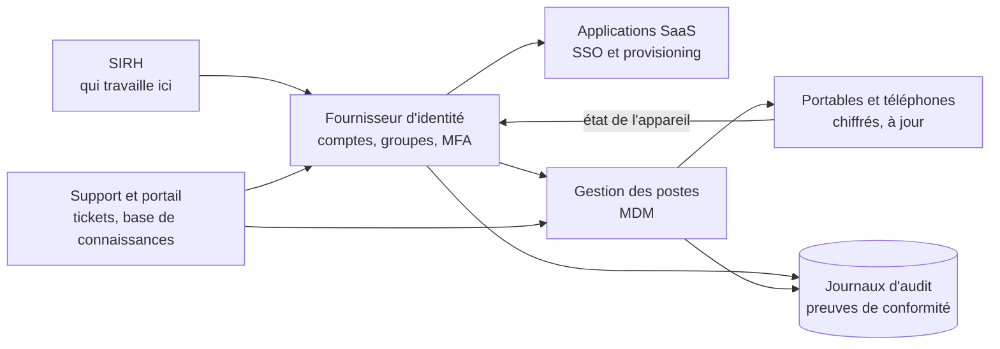
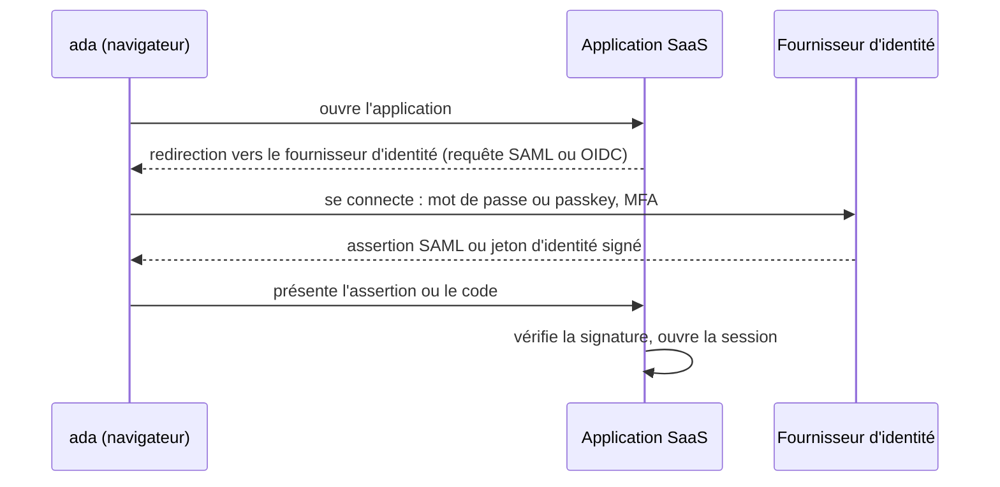
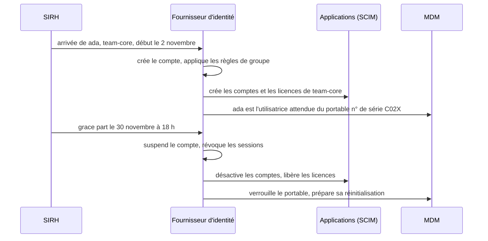
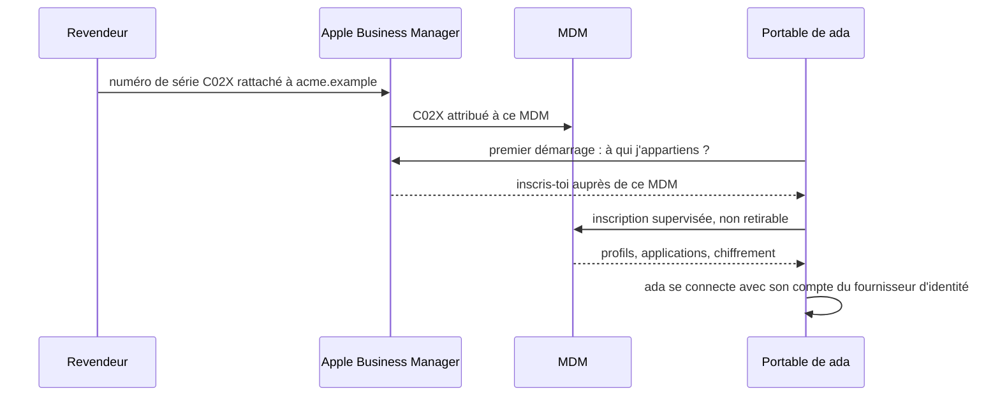
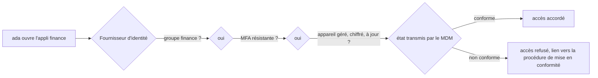
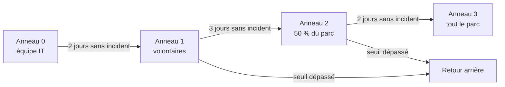
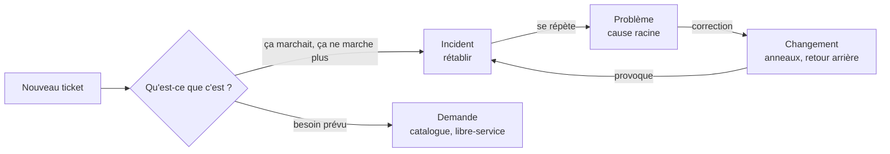
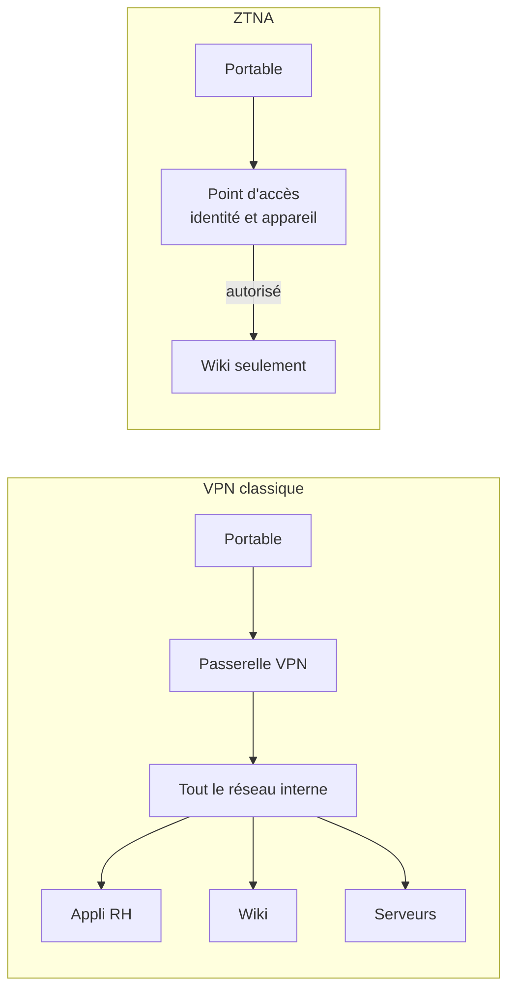

# Workplace engineering et IT d'entreprise

!!! warning "Avertissement"
    Ces notes sont des pense-bêtes personnels, pas une source de vérité. Elles reflètent ma compréhension et mes choix : leur contenu reste subjectif, malgré les citations et les références qu'il contient. Il peut être incomplet, simplifié, inexact ou dépassé. Vérifiez toujours dans la documentation officielle avant de l'appliquer. Ce contenu est fourni tel quel, sans aucune garantie : son utilisation se fait sous votre seule responsabilité.

!!! audience "Pour qui, pour quoi"
    - **Métiers** : workplace engineer (ou corporate engineer), ingénieur IT, administrateur systèmes, ingénieur sécurité, responsable support IT, ingénieur plateforme qui reprend l'IT interne.
    - **Usages** : je prépare un entretien de workplace engineer ; je fais en sorte qu'une nouvelle arrivée, ada, ait son portable chiffré et tous ses accès le matin de son premier jour ; je coupe tous les accès de grace en moins d'une heure le jour de son départ ; je mets la configuration du fournisseur d'identité dans Git pour qu'elle passe en revue ; je réponds à un auditeur ISO 27001 qui demande la preuve que tous les disques sont chiffrés.

!!! abstract "Les échelles"
    Les pastilles de couleur sous les titres disent à quelle échelle une notion s'applique :

    - <span class="pill pill-scope pill-scope-code">Code</span> les classes, fonctions et modules d'un programme ;
    - <span class="pill pill-scope pill-scope-app">Application</span> un service ou une application et son découpage interne ;
    - <span class="pill pill-scope pill-scope-system">Système</span> plusieurs services qui communiquent par le réseau ;
    - <span class="pill pill-scope pill-scope-infra">Infrastructure</span> les serveurs, le réseau, les zones et les clusters, physiques ou virtuels ;
    - <span class="pill pill-scope pill-scope-enterprise">Entreprise</span> le système d'information entier et son organisation.

    Détail et mots ambigus : [carte des échelles](architecture.md#carte-des-echelles).

Le <span class="term" data-term="workplace-engineering">workplace engineering</span> (on dit aussi *corporate engineering* ou *IT engineering*) s'occupe de tout ce qu'un salarié utilise pour travailler, hors du produit vendu par l'entreprise : son identité et ses accès, son ordinateur, ses outils en ligne (messagerie, documents, visio), le réseau du bureau et le support quand quelque chose ne marche pas. La différence avec l'IT d'il y a vingt ans : tout cela est géré **comme du code** (configuration versionnée, revue, automatisation, mesures), et les salariés sont traités comme les utilisateurs d'un produit interne. Cette page rassemble les notions qu'un workplace engineer doit connaître et les relie aux pages qui les détaillent déjà : OAuth et OpenID Connect dans [Sécurité](securite.md#oauth-et-openid-connect), le zero trust dans [Zero trust et identité entre services](securite.md#zero-trust-et-identite-entre-services), le déploiement progressif dans [Livraison](livraison.md#deploiement-progressif). L'entreprise `acme.example`, l'équipe `team-core` et les personnes `ada` et `grace` sont fictives. Les chiffres sont des exemples.

:material-swap-horizontal: Les outils cités dans cette page : lesquels se remplacent, lesquels se combinent ? Voir [Complémentaires ou concurrents](outils.md#complementaires-ou-concurrents).
{ .doc-ref }

## Vocabulaire

**<span class="term" data-term="identity-provider">Fournisseur d'identité</span> (IdP)** : le service qui détient les comptes des salariés et vérifie leur connexion pour toutes les applications. Exemple : Okta, Microsoft Entra ID, Google Cloud Identity.

**<span class="term" data-term="sso">SSO</span>** (*Single Sign-On*, authentification unique) : je me connecte une fois au fournisseur d'identité, et toutes les applications me reconnaissent sans me redemander de mot de passe.

**<span class="term" data-term="hris">SIRH</span>** (système d'information des ressources humaines, *HRIS* en anglais) : le logiciel RH qui sait qui est salarié, dans quelle équipe, avec quel manager, à partir de quand et jusqu'à quand. Exemple : Workday, BambooHR, Personio.

**<span class="term" data-term="joiner-mover-leaver">Joiner, mover, leaver</span> (JML)** : les trois moments de la vie d'un compte : l'arrivée, le changement de poste ou d'équipe, le départ.

**<span class="term" data-term="provisioning">Provisioning</span>** : créer, modifier ou retirer automatiquement un compte dans une application. Le **deprovisioning** est le retrait.

**<span class="term" data-term="mdm">MDM</span>** (*Mobile Device Management*, gestion des appareils) : le service qui installe des réglages, des applications et des règles de sécurité à distance sur les ordinateurs et téléphones de l'entreprise. Exemple : Jamf, Microsoft Intune, Kandji.

**<span class="term" data-term="endpoint-device">Poste de travail (endpoint)</span>** : un appareil utilisé par une personne : portable, téléphone, tablette. À ne pas confondre avec l'endpoint d'une API.

**<span class="term" data-term="itsm">ITSM</span>** (*IT Service Management*) : la façon d'organiser le support et les services IT : tickets, catalogue de demandes, gestion des incidents et des changements.

**<span class="term" data-term="shadow-it">Shadow IT</span>** : les outils qu'une équipe utilise sans que l'IT le sache, souvent payés par carte bancaire. Exemple : un outil de sondage en ligne où le marketing a importé la liste des clients.

**<span class="term" data-term="sli">SLI</span>** (*Service Level Indicator*, indicateur de niveau de service) : le chiffre que je mesure réellement. Exemple : la part des nouveaux arrivants qui ont tous leurs accès à 9 h le premier jour.

**<span class="term" data-term="slo">SLO</span>** (*Service Level Objective*, objectif de niveau de service) : la cible interne que l'équipe se fixe sur un SLI. Exemple : 95 % des arrivants prêts à 9 h le premier jour.

**<span class="term" data-term="sla">SLA</span>** (*Service Level Agreement*, accord de niveau de service) : la promesse contractuelle faite à un client, avec une pénalité si elle n'est pas tenue. En IT interne, il n'y a souvent pas de contrat ; il en existe un quand le support est confié à un prestataire extérieur.

| Mot | Question qu'il pose | Exemple |
|---|---|---|
| fournisseur d'identité | qui est cette personne, et peut-elle se connecter ? | ada se connecte une fois le matin |
| SIRH | qui travaille ici, dans quelle équipe, jusqu'à quand ? | grace quitte l'entreprise le 30 novembre |
| provisioning | dans quelles applications cette personne doit-elle avoir un compte ? | compte créé dans l'outil de tickets à l'arrivée |
| MDM | cet ordinateur est-il configuré et protégé comme prévu ? | disque chiffré, mises à jour imposées |
| ITSM | qui traite cette demande, en combien de temps ? | « j'ai besoin d'une licence de l'outil de dessin » |

:material-book-open-variant: Doc de référence : [Thomas Limoncelli, Christina Hogan et Strata Chalup, « The Practice of System and Network Administration »](https://the-sysadmin-book.com/) (3e édition, 2016)
{ .doc-ref }

## Le métier : workplace engineering

<a class="pill pill-scope pill-scope-enterprise" href="../architecture/#carte-des-echelles">Échelle · Entreprise</a> <span class="pill pill-status pill-status-ok" title="Toujours valable, vérifié en novembre 2026">Valable · 11/2026</span>

Dans une entreprise de 300 personnes, chaque arrivée demande une vingtaine de gestes : créer le compte, l'ajouter aux bons groupes, commander l'ordinateur, le configurer, ouvrir les licences, expliquer le Wi-Fi. Si chaque geste est fait à la main par la personne de garde au support, les erreurs s'accumulent : une arrivante attend trois jours son accès à l'outil de tickets, un ancien salarié garde l'accès au drive partagé six mois après son départ. Le workplace engineering traite ces gestes comme un système à automatiser et à mesurer, pas comme une liste de tâches.

Le métier se distingue de trois voisins :

| Rôle | Ce qu'il fait au quotidien | Exemple de journée |
|---|---|---|
| support (helpdesk) | répond aux demandes et aux pannes des salariés, une par une | réinitialiser la MFA de ada qui a changé de téléphone |
| exploitation IT (IT ops) | fait tourner les services internes existants : imprimantes, Wi-Fi, comptes, licences | renouveler le certificat du Wi-Fi du bureau |
| sécurité | fixe les règles, surveille les menaces, mène les enquêtes | exiger que tous les disques soient chiffrés, enquêter sur une connexion suspecte |
| workplace engineering | construit et automatise le système : identité, gestion des postes, applications, mesures | écrire la règle qui ajoute toute personne de `team-core` au bon groupe, et le test qui le vérifie |

Dans une petite structure, une seule personne porte les quatre casquettes. Le titre change selon les entreprises (corporate engineering, IT engineering, enterprise engineering) ; ce qui compte est la posture : **l'IT comme produit**. Les utilisateurs sont les salariés, la mesure de réussite est leur temps et leur sécurité, et chaque demande répétée est le signe qu'il manque une automatisation ou une page en libre-service.



**Quand** ce rôle devient utile : au-delà de quelques dizaines de salariés, ou dès que l'entreprise passe un audit de sécurité (ISO 27001, SOC 2), parce qu'il faut alors prouver que chaque départ coupe les accès. **Pourquoi** : chaque geste manuel coûte du temps et ouvre une faille, et ce coût grandit avec chaque embauche. **Comment** : je commence par la source de vérité (le SIRH), puis l'identité, puis les postes, puis les applications, et je mesure à chaque étape.

!!! noob "As noob"
    Le workplace engineer, c'est le régisseur d'un théâtre : il ne joue pas la pièce, mais sans lui les comédiens n'ont ni clés de loge, ni costume, ni lumière au bon moment. Un bon régisseur prépare tout avant l'arrivée de la troupe et récupère les clés à la fin de la tournée. La phrase à retenir : **les salariés sont mes utilisateurs, et leur temps perdu est mon indicateur.**

**Risques.** Traiter l'IT comme un produit sans moyens réels donne un « portail » de plus que personne n'utilise, pendant que le support continue à tout faire à la main. À l'inverse, automatiser sans comprendre les cas réels (un stagiaire, un prestataire, un salarié qui change de pays) crée des comptes faux à grande vitesse. Je commence par observer une dizaine d'arrivées et de départs réels avant d'automatiser.

:material-book-open-variant: Doc de référence : [Thomas Limoncelli, Christina Hogan et Strata Chalup, « The Practice of System and Network Administration »](https://the-sysadmin-book.com/) (3e édition, 2016)
{ .doc-ref }

!!! maturity "Mesurer la maturité"
    | Niveau | Ce que j'observe dans l'équipe |
    |---|---|
    | N1 | une liste écrite des gestes d'arrivée et de départ existe, même suivie à la main |
    | N2 | les comptes, les groupes et la configuration des postes sont créés par des outils, plus par des clics |
    | N3 | une arrivée ou un départ saisi dans le SIRH crée ou coupe les accès sans intervention humaine |
    | N4 | l'équipe suit chaque mois le temps de préparation d'un arrivant, le délai de coupure au départ et le volume de tickets, et choisit ses chantiers d'après ces chiffres |

    **Je mesure** : la part des tickets qui demandent un geste répétitif (lue dans l'outil de tickets, par catégorie) et le délai entre la date de départ dans le SIRH et la coupure effective du compte (lu dans les journaux du fournisseur d'identité).

## Identité : le socle

<a class="pill pill-scope pill-scope-enterprise" href="../architecture/#carte-des-echelles">Échelle · Entreprise</a>

Tout part de l'identité : si je ne sais pas avec certitude qui est salarié aujourd'hui, je ne peux ni donner les bons accès, ni les retirer à temps. Cette section couvre le fournisseur d'identité, le SSO, le provisioning, la MFA, le cycle de vie des comptes, les groupes et les comptes de secours. Les protocoles OAuth et OpenID Connect eux-mêmes sont expliqués dans [Sécurité](securite.md#oauth-et-openid-connect).

### Fournisseur d'identité et SSO
<span class="pill pill-status pill-status-ok" title="Toujours valable, vérifié en novembre 2026">Valable · 11/2026</span>

ada utilise une trentaine d'applications en ligne. Sans <span class="term" data-term="sso">SSO</span>, elle a trente mots de passe, souvent le même, et le jour de son départ il faut fermer trente comptes. Avec un fournisseur d'identité, chaque application lui délègue la connexion : ada se connecte une fois, avec sa MFA, et les applications reçoivent une preuve signée de qui elle est. Fermer son compte dans le fournisseur d'identité bloque toutes les nouvelles connexions d'un coup.

*Okta : concurrent de Microsoft Entra ID, Google Cloud Identity, Keycloak ; complémentaire de Jamf, Intune*<br>
*Microsoft Entra ID : concurrent de Okta, Google Cloud Identity ; complémentaire de Intune*<br>
*Google Cloud Identity : concurrent de Okta, Microsoft Entra ID ; complémentaire de Google Workspace*
{ .tool-rel }

Deux protocoles portent ce SSO :

| Protocole | Ce que l'application reçoit | Où on le croise |
|---|---|---|
| <span class="term" data-term="saml">SAML 2.0</span> (OASIS, mars 2005) | une assertion XML signée, transmise par le navigateur | les applications d'entreprise anciennes ou établies : outils RH, notes de frais, beaucoup de SaaS |
| OpenID Connect (OpenID Foundation, 2014) | un jeton d'identité JWT, au-dessus d'OAuth 2.0 | les applications récentes, les applications mobiles, les outils internes |

Le fonctionnement d'OpenID Connect, des jetons et des flux est dans [OpenID Connect : savoir qui est connecté](securite.md#openid-connect-oidc-savoir-qui-est-connecte). Pour un workplace engineer, la question pratique est plutôt : **quelles applications acceptent le SSO, et à quel prix ?** Beaucoup d'éditeurs réservent le SSO à leur offre la plus chère, ce qui pousse certaines équipes à rester sur des mots de passe locaux.



!!! noob "As noob"
    Le SSO, c'est le bracelet d'un festival : je montre une seule fois mon billet et ma pièce d'identité à l'entrée, puis chaque scène regarde seulement le bracelet. Si on me retire le bracelet, je ne rentre plus nulle part. Limite de l'image : une scène qui m'a déjà laissé entrer ne me fait pas sortir pour autant, d'où la question des sessions au départ. La phrase à retenir : **une seule connexion vérifiée, que toutes les applications croient.**

**Risques.** Le fournisseur d'identité devient un point unique : s'il tombe, plus personne ne travaille, et s'il est compromis, l'attaquant entre partout. Je protège ses administrateurs par une MFA résistante au phishing, je limite leur nombre, et je garde des [comptes de secours](#comptes-de-secours-break-glass). Une application qui garde des comptes locaux à côté du SSO échappe à la coupure au départ : je les liste et je les ferme.

:material-book-open-variant: Doc de référence : [OASIS, « Assertions and Protocols for the OASIS Security Assertion Markup Language (SAML) V2.0 »](https://docs.oasis-open.org/security/saml/v2.0/saml-core-2.0-os.pdf) (mars 2005) ; [OpenID Connect Core 1.0](https://openid.net/specs/openid-connect-core-1_0.html) (2014, errata 2023)
{ .doc-ref }

### Provisioning automatique : SCIM
<span class="pill pill-status pill-status-ok" title="Toujours valable, vérifié en novembre 2026">Valable · 11/2026</span>

Le SSO dit **qui** se connecte ; il ne crée pas le compte dans l'application et ne le supprime pas. Sans provisioning, ada se connecte le premier jour à l'outil de tickets et tombe sur « compte inexistant » ; grace, partie depuis un mois, a encore un compte actif avec une licence payée. <span class="term" data-term="scim">SCIM</span> (*System for Cross-domain Identity Management*, RFC 7643 et RFC 7644, publiées en septembre 2015) est une API REST standard que les applications exposent pour que le fournisseur d'identité crée, mette à jour et désactive les comptes et les groupes à leur place.

Le fournisseur d'identité crée le compte de ada dans l'outil de tickets de `acme.example` :

``` { .http .ex-ref title="Référence · création d'un compte (RFC 7644)" }
POST /scim/v2/Users HTTP/1.1
Host: tickets.acme.example
Authorization: Bearer <jeton de l'intégration SCIM>
Content-Type: application/scim+json

{
  "schemas": ["urn:ietf:params:scim:schemas:core:2.0:User"],
  "userName": "ada@acme.example",
  "externalId": "hris-10042",
  "name": { "givenName": "Ada", "familyName": "Lovelace" },
  "emails": [{ "value": "ada@acme.example", "primary": true }],
  "active": true
}
```

``` { .http .ex-ref title="Référence · réponse de l'application" }
HTTP/1.1 201 Created
Content-Type: application/scim+json
Location: https://tickets.acme.example/scim/v2/Users/7f3c9a

{
  "schemas": ["urn:ietf:params:scim:schemas:core:2.0:User"],
  "id": "7f3c9a",
  "externalId": "hris-10042",
  "userName": "ada@acme.example",
  "active": true,
  "meta": {
    "resourceType": "User",
    "created": "2026-11-02T07:00:00Z",
    "lastModified": "2026-11-02T07:00:00Z",
    "location": "https://tickets.acme.example/scim/v2/Users/7f3c9a"
  }
}
```

Au départ de grace, le fournisseur d'identité ne supprime pas le compte : il le désactive, ce qui garde l'historique et libère la licence.

``` { .http .ex-ref title="Référence · désactivation au départ" }
PATCH /scim/v2/Users/5b81e0 HTTP/1.1
Host: tickets.acme.example
Authorization: Bearer <jeton de l'intégration SCIM>
Content-Type: application/scim+json

{
  "schemas": ["urn:ietf:params:scim:api:messages:2.0:PatchOp"],
  "Operations": [{ "op": "replace", "path": "active", "value": false }]
}
```

!!! noob "As noob"
    Le SSO, c'est le badge qui ouvre la porte ; SCIM, c'est le service du personnel qui prévient chaque bâtiment « ada arrive lundi, préparez son casier » puis « grace part vendredi, videz le sien ». Sans SCIM, le badge marche mais le casier n'existe pas, ou existe encore après le départ. La phrase à retenir : **le SSO ouvre la porte, SCIM crée et ferme les comptes derrière.**

**Quand** : dès qu'une application payée par licence ou contenant des données sensibles est utilisée par plus de quelques personnes. **Pas** pour une application utilisée par trois personnes et sans connecteur : une revue d'accès trimestrielle suffit. **Risques.** Les implémentations SCIM des éditeurs varient (attributs non gérés, groupes ignorés, suppression au lieu de désactivation) : je teste chaque connecteur avec un compte fictif avant de l'activer pour tous. Une erreur de règle dans le fournisseur d'identité se propage partout en quelques minutes : je commence par un groupe pilote.

:material-book-open-variant: Doc de référence : [RFC 7643, SCIM Core Schema](https://www.rfc-editor.org/rfc/rfc7643) et [RFC 7644, SCIM Protocol](https://www.rfc-editor.org/rfc/rfc7644) (septembre 2015) ; [Okta Developer, « Understanding SCIM »](https://developer.okta.com/docs/concepts/scim/) (consultée en novembre 2026)
{ .doc-ref }

### Déboguer une connexion SAML
<span class="pill pill-status pill-status-ok" title="Toujours valable, vérifié en novembre 2026">Valable · 11/2026</span>

Lundi matin, ada ouvre l'outil de notes de frais et tombe sur « SAML response invalid ». Le fournisseur d'identité affiche « connexion réussie », l'application affiche « refusée » : la panne est dans l'<span class="term" data-term="saml-assertion">assertion SAML</span> que le navigateur transporte de l'un à l'autre. Je la lis dans le journal du fournisseur d'identité, ou avec une extension de navigateur qui affiche les échanges SAML, puis je compare chaque champ à ce que l'application attend.

``` { .xml .ex-ref title="Référence · les champs d'une assertion SAML 2.0 à vérifier (extrait simplifié)" }
<!-- Exemple : qui a émis, pour qui, pour quelle application, et pendant combien de temps -->
<saml:Assertion ID="_a1b2" IssueInstant="2026-11-16T08:59:58Z" Version="2.0">
  <saml:Issuer>https://idp.acme.example</saml:Issuer>
  <ds:Signature>...</ds:Signature>
  <saml:Subject>
    <saml:NameID Format="urn:oasis:names:tc:SAML:1.1:nameid-format:emailAddress">ada@acme.example</saml:NameID>
    <saml:SubjectConfirmation Method="urn:oasis:names:tc:SAML:2.0:cm:bearer">
      <saml:SubjectConfirmationData Recipient="https://expenses.acme.example/saml/acs"
                                    NotOnOrAfter="2026-11-16T09:04:58Z"/>
    </saml:SubjectConfirmation>
  </saml:Subject>
  <saml:Conditions NotBefore="2026-11-16T08:59:58Z" NotOnOrAfter="2026-11-16T09:04:58Z">
    <saml:AudienceRestriction>
      <saml:Audience>https://expenses.acme.example/saml/metadata</saml:Audience>
    </saml:AudienceRestriction>
  </saml:Conditions>
</saml:Assertion>
```

| Message ou symptôme | Champ à regarder | Cause fréquente | Correction |
|---|---|---|---|
| « assertion expired » ou « not yet valid » | `NotBefore`, `NotOnOrAfter` | l'horloge du serveur de l'application a quelques minutes d'écart avec celle du fournisseur d'identité (<span class="term" data-term="clock-skew">décalage d'horloge</span>) | synchroniser l'horloge par NTP ; garder une tolérance de quelques minutes, pas plus |
| « invalid audience » | `Audience` | l'identifiant d'entité saisi dans le fournisseur d'identité diffère de celui de l'application, souvent d'une barre oblique finale | recopier l'identifiant depuis les métadonnées de l'application |
| « invalid recipient » ou « destination mismatch » | `Recipient`, `Destination` | l'adresse de retour de l'application (ACS) a changé, par exemple après un changement de domaine | mettre à jour l'adresse ACS dans le fournisseur d'identité |
| « signature invalid » | `Signature` | le certificat de signature du fournisseur d'identité a été renouvelé, l'application garde l'ancien | publier le nouveau certificat dans l'application avant la bascule |
| « user not found » | `NameID` | format ou valeur différents : majuscules, adresse changée après un changement de nom | aligner le format, ou provisionner par SCIM avec un identifiant stable |

Le <span class="term" data-term="x509-certificate">certificat</span> qui signe les assertions expire, souvent après un à trois ans selon le fournisseur (à vérifier dans la console). Pour le renouveler sans coupure : je crée le nouveau certificat, je le publie dans les métadonnées à côté de l'ancien, je mets à jour chaque application (celles qui relisent les métadonnées le font seules), je bascule la signature, puis je retire l'ancien. Je tiens la liste des applications SAML avec l'échéance de leur certificat, et une alerte 30 jours avant.

**Quand** : à chaque erreur de connexion qui touche une seule application alors que les autres marchent. **Pourquoi** : la cause est presque toujours un écart de configuration lisible dans l'assertion, pas une panne du fournisseur d'identité. **Risques.** Monter la tolérance d'horloge à une heure pour « réparer » permet de rejouer plus longtemps une assertion volée : je corrige l'horloge. Désactiver la vérification de signature pour débloquer ada laisse n'importe qui fabriquer une assertion à son nom. Une capture SAML contient une assertion valide jusqu'à son expiration : je ne la colle pas brute dans un ticket lisible par tous.

:material-book-open-variant: Doc de référence : [OASIS, « Assertions and Protocols for the OASIS Security Assertion Markup Language (SAML) V2.0 »](https://docs.oasis-open.org/security/saml/v2.0/saml-core-2.0-os.pdf) (mars 2005) ; [Microsoft Learn, « Tutorial: Manage federation certificates »](https://learn.microsoft.com/en-us/entra/identity/enterprise-apps/tutorial-manage-certificates-for-federated-single-sign-on) (consultée en novembre 2026)
{ .doc-ref }

### MFA résistante au phishing
<span class="pill pill-status pill-status-ok" title="Toujours valable, vérifié en novembre 2026">Valable · 11/2026</span>

La <span class="term" data-term="mfa">MFA</span> ajoute une deuxième preuve au mot de passe. Toutes les MFA ne se valent pas : un code reçu par SMS ou affiché par une application se recopie sur un faux site, et une notification « approuver » s'obtient en en envoyant vingt à 2 h du matin jusqu'à ce que la personne clique (fatigue de MFA). Une <span class="term" data-term="phishing-resistant-mfa">MFA résistante au phishing</span> lie la preuve au vrai nom de domaine : la clé physique ou la <span class="term" data-term="passkey">passkey</span> signe un défi qui contient l'adresse du site, donc une signature obtenue sur `acme-example-login.com` ne vaut rien pour `acme.example`. C'est le principe de FIDO2 et de WebAuthn (W3C, niveau 1 en 2019, niveau 2 en 2021).

| Méthode | Résiste à un faux site ? | Remarque |
|---|---|---|
| SMS | non | détournable aussi par échange de carte SIM ; à garder seulement en dernier recours |
| code d'application (TOTP) | non | mieux que le SMS, mais se recopie sur un faux site |
| notification avec saisie d'un nombre | en partie | limite la fatigue de MFA, pas un faux site relayé en direct |
| clé de sécurité FIDO2 | oui | robuste, coûte un objet par personne et un stock de rechange |
| passkey sur l'appareil géré | oui | sans objet à distribuer ; vérifier comment elle se synchronise entre appareils |

**Quand** : en priorité pour les administrateurs du fournisseur d'identité, du MDM et de la messagerie, puis pour tous. **Comment** : j'inscris d'abord deux méthodes résistantes par administrateur, puis j'active une règle qui refuse les méthodes faibles pour les applications sensibles, puis pour tous, groupe par groupe.

**Risques.** Une personne qui perd sa seule clé est bloquée : j'impose deux méthodes inscrites et une procédure de récupération vérifiée par le manager ou en visio avec pièce d'identité, jamais par simple appel au support (c'est exactement ce que visent les attaques par <span class="term" data-term="social-engineering">ingénierie sociale</span>, voir [Ingénierie sociale](cybersecurite.md#ingenierie-sociale)).

:material-book-open-variant: Doc de référence : [CISA, « Implementing Phishing-Resistant MFA »](https://www.cisa.gov/sites/default/files/publications/fact-sheet-implementing-phishing-resistant-mfa-508c.pdf) (octobre 2022) ; [W3C, Web Authentication Level 2](https://www.w3.org/TR/webauthn-2/) (avril 2021) ; [passkeys.dev](https://passkeys.dev/) (consultée en novembre 2026)
{ .doc-ref }

### Idée reçue : changer son mot de passe tous les 90 jours
<span class="pill pill-status pill-status-obsolete" title="Abandonné par le NIST SP 800-63B : changer le mot de passe seulement en cas de compromission, pas à date fixe">Obsolète · 11/2026</span>

Beaucoup de politiques imposent encore un changement de mot de passe tous les 90 jours. Le NIST SP 800-63B (révision 3 en 2017, confirmé par la révision 4 en 2025) demande de ne plus le faire : les gens passent de `Automne2026!` à `Hiver2026!`, ce qui n'arrête aucun attaquant. La règle actuelle : un mot de passe long, vérifié contre une liste de mots de passe déjà fuités, changé seulement s'il a été compromis, et surtout une MFA résistante au phishing.

:material-book-open-variant: Doc de référence : [NIST SP 800-63B-4, Authentication and Authenticator Management](https://csrc.nist.gov/pubs/sp/800/63/b/4/final) (2025)
{ .doc-ref }

### Joiner, mover, leaver : le cycle de vie piloté par le SIRH
<span class="pill pill-status pill-status-ok" title="Toujours valable, vérifié en novembre 2026">Valable · 11/2026</span>

Le <span class="term" data-term="hris">SIRH</span> est la <span class="term" data-term="source-of-truth">source de vérité</span> : c'est la RH qui sait qu'une personne arrive, change d'équipe ou part. Si le support crée les comptes à partir d'un message reçu sur la messagerie, il y aura toujours un oubli. Le principe : le SIRH envoie les événements au fournisseur d'identité, qui en déduit les groupes, qui en déduisent les applications et les licences.



``` { .text .ex-illus title="Illustration · le cycle de vie de deux comptes" }
joiner (ada, arrivée le lundi 2 novembre)
  J-10  la RH saisit l'arrivée dans le SIRH : équipe team-core, manager grace
  J-10  le fournisseur d'identité crée le compte, désactivé jusqu'à J0
  J-7   le portable est commandé, rattaché à l'enrôlement automatique
  J-1   le compte s'active à 18 h ; groupes et applications de team-core créés
  J0    ada allume le portable, se connecte, tout est prêt à 9 h

mover (ada passe dans team-data le 1er mars)
  J0    le SIRH change l'équipe ; le groupe team-core est retiré, team-data ajouté
  J0    les accès propres à team-core sont retirés le jour même, pas « plus tard »

leaver (grace, départ le 30 novembre à 18 h)
  J0 18:00  compte suspendu, sessions et jetons révoqués
  J0 18:05  comptes des applications désactivés par SCIM, licences libérées
  J0 18:10  portable verrouillé à distance s'il n'est pas rendu
  J+1       transfert des fichiers et de la boîte mail au manager
  J+30      suppression ou archivage selon la durée de conservation
```

Le **mover** est le cas le plus souvent raté : on ajoute les nouveaux accès et on oublie d'enlever les anciens. Après trois changements d'équipe, une personne cumule les droits de trois équipes. C'est l'accumulation de droits, l'inverse du <span class="term" data-term="least-privilege">moindre privilège</span>.

**Risques.** Si le SIRH est en retard (départ saisi une semaine après), toute l'automatisation l'est aussi : je fixe avec la RH un délai de saisie, et je garde un geste manuel d'urgence pour un départ immédiat. Un champ mal rempli dans le SIRH (équipe vide) peut retirer tous les accès d'une personne : j'ajoute une règle de sécurité qui bloque un changement touchant plus de N groupes et demande une validation humaine. Les prestataires et stagiaires sont souvent hors du SIRH : je leur donne une source de vérité à eux, avec une date de fin obligatoire.

:material-book-open-variant: Doc de référence : [Microsoft Learn, « Plan an HR-driven provisioning » (Entra ID)](https://learn.microsoft.com/en-us/entra/identity/app-provisioning/plan-cloud-hr-provision) (consultée en novembre 2026)
{ .doc-ref }

### Groupes, rôles et revues d'accès
<span class="pill pill-status pill-status-ok" title="Toujours valable, vérifié en novembre 2026">Valable · 11/2026</span>

Je ne donne jamais un accès à une personne directement : je le donne à un groupe, et la personne est dans le groupe parce qu'un attribut du SIRH l'y place (équipe, métier, pays). C'est le modèle <span class="term" data-term="rbac">RBAC</span>, détaillé dans [Modéliser les droits](securite.md#modeliser-les-droits-rbac-abac-rebac). Deux sortes de groupes :

| Sorte de groupe | Qui décide d'y être | Exemple |
|---|---|---|
| groupe calculé (par règle) | un attribut du SIRH | `team-core` : toutes les personnes dont l'équipe est team-core |
| groupe sur demande | une demande validée par le propriétaire de l'accès | `finance-export` : accès en écriture à l'outil de comptabilité, validé par le responsable financier |

Les groupes sur demande grossissent et ne maigrissent jamais. La <span class="term" data-term="access-review">revue d'accès</span> corrige cela : à intervalle fixe, le propriétaire de chaque accès sensible reçoit la liste des membres et confirme ou retire chaque ligne. ISO 27001 et SOC 2 demandent d'en garder la preuve.

``` { .text .ex-illus title="Illustration · campagne de revue trimestrielle" }
campagne T4 2026, accès « finance-export », propriétaire : responsable financier
  ada      membre depuis 2026-03, dernière connexion il y a 3 jours     confirmé
  grace    membre depuis 2025-01, dernière connexion il y a 140 jours   retiré
  bot-erp  compte de service, propriétaire team-core                   confirmé, à revoir en T1
résultat : 1 accès retiré, preuve exportée au format CSV pour l'audit
```

**Risques.** Une revue de 400 lignes envoyée à un manager se termine par « tout confirmer ». Je montre la dernière connexion, je pré-coche le retrait des accès inutilisés depuis 90 jours (exemple), et je réserve la revue aux accès sensibles.

:material-book-open-variant: Doc de référence : [Microsoft Learn, « What are access reviews? » (Entra ID Governance)](https://learn.microsoft.com/en-us/entra/id-governance/access-reviews-overview) (consultée en novembre 2026)
{ .doc-ref }

### Comptes de secours (break-glass)
<span class="pill pill-status pill-status-ok" title="Toujours valable, vérifié en novembre 2026">Valable · 11/2026</span>

Un jour, une règle d'accès conditionnel mal écrite bloque tout le monde, administrateurs compris, ou le service de MFA est en panne. Un <span class="term" data-term="break-glass-account">compte de secours</span> (*break-glass*, « briser la vitre ») est un compte administrateur exclu de ces règles, gardé sous clé, qui sert uniquement à réparer.

``` { .text .ex-illus title="Illustration · règles d'un compte de secours" }
- deux comptes, pas un : si l'un est bloqué, l'autre reste
- pas rattachés à une personne ni au SIRH ; domaine d'origine du fournisseur, pas la fédération
- exclus des règles d'accès conditionnel, protégés par des clés FIDO2 rangées dans un coffre
- toute connexion déclenche une alerte immédiate à l'équipe sécurité
- testés chaque trimestre : connexion, vérification, alerte reçue, compte-rendu
```

**Risques.** Un compte de secours jamais testé ne marche pas le jour où il sert ; un compte de secours sans alerte est une porte dérobée. Je le teste à date fixe et je vérifie que l'alerte part.

:material-book-open-variant: Doc de référence : [Microsoft Learn, « Manage emergency access admin accounts »](https://learn.microsoft.com/en-us/entra/identity/role-based-access-control/security-emergency-access) (consultée en novembre 2026)
{ .doc-ref }

### Compte compromis : contenir, puis enquêter
<span class="pill pill-status pill-status-ok" title="Toujours valable, vérifié en novembre 2026">Valable · 11/2026</span>

Un mardi à 2 h du matin, le fournisseur d'identité signale une connexion au compte de grace depuis un pays où elle ne travaille pas, juste après vingt notifications MFA refusées puis une acceptée : c'est la <span class="term" data-term="mfa-fatigue">fatigue de MFA</span>. Son mot de passe a sans doute été volé. Changer le mot de passe ne suffit pas : les sessions déjà ouvertes, les jetons accordés à des applications et une règle de transfert de mails créée par l'attaquant survivent à ce changement. L'ordre est toujours le même : contenir, préserver les preuves, mesurer l'étendue, rétablir, apprendre. Les rôles, la communication et le postmortem suivent [Le cycle de vie d'un incident](incidents.md#le-cycle-de-vie-dun-incident).

| Signal | Ce qu'il suggère |
|---|---|
| <span class="term" data-term="impossible-travel">voyage impossible</span> : deux connexions à 30 minutes d'écart depuis deux continents | mot de passe ou session volés |
| rafale de notifications MFA refusées, puis une acceptée | fatigue de MFA, la personne a cliqué pour faire cesser les alertes |
| nouvelle règle de transfert des mails vers une adresse extérieure | copie discrète de la boîte, souvent avant une fraude au virement |
| <span class="term" data-term="oauth-consent">consentement OAuth</span> accordé à une application inconnue qui lit la boîte mail | un accès qui survit au changement de mot de passe |

``` { .text .ex-illus title="Illustration · la première heure, dans l'ordre" }
contenir
  T+0     suspendre le compte, sans le supprimer : journaux et fichiers restent consultables
  T+5     révoquer les sessions et les jetons de rafraîchissement (fournisseur d'identité et suite)
  T+10    retirer les méthodes de MFA inscrites récemment et les autorisations OAuth de la nuit
  T+15    supprimer les règles de transfert et de redirection de la boîte mail
préserver
  T+20    exporter les journaux d'audit (connexions, mails, partages) avant qu'ils n'expirent
mesurer l'étendue
  T+30    lister ce qui a été lu, partagé ou envoyé depuis la première connexion suspecte
rétablir
  T+60    nouveau mot de passe, MFA résistante au phishing inscrite en visio avec pièce d'identité
```

**Quand** : dès qu'un signal sérieux arrive, sans attendre d'être sûr : suspendre un compte sain coûte une heure de travail, laisser un compte volé ouvert coûte bien plus. **Risques.** Supprimer le compte efface des preuves et casse le partage des fichiers : je suspends. Prévenir grace par mail sur la boîte compromise prévient aussi l'attaquant : je l'appelle, ou je passe par son manager. Agir seul abîme les preuves : l'équipe sécurité pilote l'enquête, je fournis les actions et les journaux, en suivant un [runbook](incidents.md#runbooks-et-playbooks) écrit à l'avance.

:material-book-open-variant: Doc de référence : [NIST SP 800-61 Rev. 3, « Incident Response Recommendations and Considerations for Cybersecurity Risk Management »](https://csrc.nist.gov/pubs/sp/800/61/r3/final) (avril 2025) ; [Microsoft Learn, « Responding to a compromised email account »](https://learn.microsoft.com/en-us/defender-office-365/responding-to-a-compromised-email-account) (consultée en novembre 2026)
{ .doc-ref }

!!! maturity "Mesurer la maturité"
    | Niveau | Ce que j'observe dans l'équipe |
    |---|---|
    | N1 | un fournisseur d'identité et le SSO existent pour les principales applications, les comptes sont créés à la main |
    | N2 | le SIRH alimente le fournisseur d'identité, les groupes sont calculés par règle, SCIM crée et désactive les comptes des applications principales |
    | N3 | un départ saisi dans le SIRH coupe tous les accès sans intervention, et les méthodes de MFA faibles sont refusées par une règle |
    | N4 | l'équipe suit le délai de coupure, le nombre de comptes orphelins et la part des applications sous SSO, et les revues d'accès retirent des droits chaque trimestre |

    **Je mesure** : le délai entre l'heure de départ dans le SIRH et la dernière désactivation dans les applications (lu dans les journaux du fournisseur d'identité), et le nombre de comptes actifs dans les applications sans personne active correspondante dans le SIRH (rapprochement mensuel).

## Gestion des appareils

<a class="pill pill-scope pill-scope-infra" href="../architecture/#carte-des-echelles">Échelle · Infrastructure</a> <a class="pill pill-scope pill-scope-enterprise" href="../architecture/#carte-des-echelles">Échelle · Entreprise</a>

Un portable perdu dans un train contient la boîte mail, les documents et des sessions ouvertes. Si je ne sais pas qu'il existe, je ne peux ni l'effacer ni prouver qu'il était chiffré. La gestion des appareils répond à trois questions : quels appareils existent, sont-ils configurés comme prévu, et puis-je agir dessus à distance ?

### MDM et profils de configuration
<span class="pill pill-status pill-status-ok" title="Toujours valable, vérifié en novembre 2026">Valable · 11/2026</span>

Un <span class="term" data-term="mdm">MDM</span> est un service avec lequel chaque appareil inscrit garde un lien : il lui envoie des réglages, des applications, des commandes (verrouiller, effacer) et reçoit en retour un inventaire (modèle, version du système, chiffrement). Sur macOS et iOS, le protocole MDM est défini par Apple et tous les éditeurs le parlent ; sur Windows, Intune utilise le protocole de gestion intégré au système.

*Jamf : concurrent de Kandji, Microsoft Intune ; complémentaire de Okta*<br>
*Microsoft Intune : concurrent de Jamf, Kandji ; complémentaire de Microsoft Entra ID, Windows Autopilot*<br>
*Kandji : concurrent de Jamf, Microsoft Intune*
{ .tool-rel }

Un <span class="term" data-term="configuration-profile">profil de configuration</span> est un paquet de réglages poussé sur l'appareil : longueur minimale du code, chiffrement obligatoire, réseau Wi-Fi, certificat, extension de sécurité autorisée. L'utilisateur ne peut pas le retirer sur un appareil supervisé.

!!! noob "As noob"
    Le MDM, c'est la télécommande centrale d'un hôtel qui règle à distance le chauffage, la serrure et la télé de chaque chambre, et qui voit lesquelles ont la fenêtre ouverte. Les profils sont les réglages qu'elle envoie. La phrase à retenir : **le MDM sait quels appareils existent, les configure et peut les verrouiller à distance.**

**Risques.** Un profil faux part sur tout le parc en quelques minutes : un mauvais certificat Wi-Fi coupe le réseau à 300 personnes. Je teste chaque profil sur un groupe pilote ([Déploiement par anneaux](#deploiement-par-anneaux)). Un MDM dont le certificat de lien avec Apple expire (renouvellement annuel du certificat de notification) perd le contrôle de tous les Mac : je mets son échéance dans le calendrier de l'équipe et une alerte 30 jours avant.

:material-book-open-variant: Doc de référence : [Apple, « Apple Platform Deployment »](https://support.apple.com/guide/deployment/welcome/web) (consultée en novembre 2026) ; [Microsoft Learn, « What is Microsoft Intune? »](https://learn.microsoft.com/en-us/intune/intune-service/fundamentals/what-is-intune) (consultée en novembre 2026)
{ .doc-ref }

### Enrôlement zero-touch
<span class="pill pill-status pill-status-ok" title="Toujours valable, vérifié en novembre 2026">Valable · 11/2026</span>

Sans automatisation, quelqu'un du support déballe chaque portable, l'installe à la main pendant deux heures et le réemballe. L'<span class="term" data-term="zero-touch-enrollment">enrôlement zero-touch</span> fait l'inverse : l'appareil est livré directement chez ada, encore sous film ; à la première connexion à internet, il découvre tout seul qu'il appartient à `acme.example` et s'inscrit au MDM.

| Plateforme | Service | Ce qu'il faut |
|---|---|---|
| Apple (Mac, iPhone, iPad) | Apple Business Manager (2018) avec l'Automated Device Enrollment (ex-DEP, 2014) | des appareils achetés chez Apple ou un revendeur agréé, rattachés au compte de l'entreprise par numéro de série |
| Windows | Windows Autopilot (2017) avec Intune | l'empreinte matérielle des appareils déclarée par le fabricant ou le revendeur |
| Android | zero-touch enrollment (Android Enterprise) | un revendeur partenaire qui déclare les appareils |



!!! noob "As noob"
    C'est un colis qui connaît déjà son adresse de retour : où qu'on l'ouvre, le portable « rentre à la maison » au premier démarrage et se laisse configurer. Même effacé et revendu, il se réinscrit chez son propriétaire. La phrase à retenir : **le numéro de série est rattaché à l'entreprise avant même la livraison.**

**Risques.** Un portable acheté ailleurs (sur un site grand public) n'est pas rattaché : il faut le déclarer à la main, ce qui est plus limité. J'impose le circuit d'achat. Au départ d'un salarié, si l'appareil n'est pas libéré correctement, il reste rattaché et ne peut pas être revendu : la procédure de fin de vie fait partie du cycle.

:material-book-open-variant: Doc de référence : [Apple, « Automated Device Enrollment and device management »](https://support.apple.com/guide/deployment/automated-device-enrollment-management-dep73069dd57/web) (consultée en novembre 2026) ; [Microsoft Learn, « Overview of Windows Autopilot »](https://learn.microsoft.com/en-us/autopilot/overview) (consultée en novembre 2026)
{ .doc-ref }

### Gestion déclarative des appareils Apple
<span class="pill pill-status pill-status-ok" title="Toujours valable, vérifié en novembre 2026">Valable · 11/2026</span>

Dans le MDM classique, le serveur envoie des ordres et interroge sans arrêt les appareils pour savoir s'ils ont changé. Avec la <span class="term" data-term="declarative-device-management">gestion déclarative</span> (*declarative device management*, présentée par Apple en 2021 et étendue au Mac en 2022), le serveur envoie un **état voulu** ; l'appareil l'applique seul, le maintient, et prévient le serveur quand son état change. C'est la même idée qu'en [Kubernetes](kubernetes.md) ou en GitOps : je décris le résultat, pas les étapes.

``` { .json .ex-ref title="Référence · déclaration de réglages du code (structure de la doc Apple, à vérifier)" }
{
  "Type": "com.apple.configuration.passcode.settings",
  "Identifier": "com.acme.example.passcode",
  "ServerToken": "2026-11-01-v3",
  "Payload": {
    "RequirePasscode": true,
    "MinimumLength": 12,
    "MaximumFailedAttempts": 10
  }
}
```

**Quand** : sur un parc Apple récent, pour les réglages et les mises à jour du système (Apple pousse ses mises à jour imposées par cette voie). **Risques.** Les éditeurs de MDM n'exposent pas encore toutes les déclarations au même rythme : je vérifie ce que mon outil supporte avant de planifier une migration.

:material-book-open-variant: Doc de référence : [Apple, « Intro to declarative device management »](https://support.apple.com/guide/deployment/intro-to-declarative-device-management-depb1bab77f8/web) (consultée en novembre 2026) ; [Apple, WWDC22, « Adopt declarative device management »](https://developer.apple.com/videos/play/wwdc2022/10046/) (2022)
{ .doc-ref }

### Linux et appareils personnels (BYOD)
<span class="pill pill-status pill-status-ok" title="Toujours valable, vérifié en novembre 2026">Valable · 11/2026</span>

Les développeurs demandent souvent Linux. Il n'existe pas de protocole MDM unique pour Linux : je combine un outil de configuration (Ansible, ou l'agent Linux d'Intune pour certaines distributions, à vérifier), un agent d'inventaire comme [osquery](#edr-et-osquery) et le chiffrement imposé à l'installation. **Quand** : je l'accepte si je sais prouver les mêmes contrôles (chiffrement, mises à jour, écran verrouillé) ; sinon je propose un Mac ou un environnement de développement distant.

Le <span class="term" data-term="byod">BYOD</span> (*Bring Your Own Device*) est l'usage d'un appareil personnel pour le travail, le plus souvent un téléphone. Je ne prends pas le contrôle complet d'un téléphone personnel : j'utilise l'**inscription utilisateur** (Apple User Enrollment, profil professionnel Android) qui sépare les données de l'entreprise et ne permet d'effacer que celles-ci.

**Risques.** Un MDM complet sur un appareil personnel donne à l'entreprise des données privées (applications installées, localisation selon les cas) et pose un problème de RGPD et de confiance. Un BYOD sans aucun contrôle laisse les documents de l'entreprise sur un téléphone non verrouillé. La voie médiane : séparation des données, et accès conditionnel qui refuse les applications sensibles aux appareils non conformes.

:material-book-open-variant: Doc de référence : [Microsoft Learn, « Linux device management in Intune »](https://learn.microsoft.com/en-us/intune/intune-service/fundamentals/deployment-guide-platform-linux) (consultée en novembre 2026)
{ .doc-ref }

!!! maturity "Mesurer la maturité"
    | Niveau | Ce que j'observe dans l'équipe |
    |---|---|
    | N1 | un inventaire des appareils existe, même dans un tableur, et la plupart sont inscrits au MDM |
    | N2 | tout nouvel appareil passe par l'enrôlement zero-touch ; les profils sont les mêmes pour tout un groupe |
    | N3 | un appareil qui sort de la conformité (MDM retiré, disque non chiffré) perd automatiquement l'accès aux applications sensibles |
    | N4 | l'équipe suit le temps d'installation d'un poste, la part d'appareils conformes et le délai d'application d'un profil, et choisit ses chantiers d'après ces chiffres |

    **Je mesure** : la part des appareils actifs inscrits au MDM et conformes (lue dans le MDM), et le temps entre la première mise sous tension et un poste prêt (lu dans les journaux d'enrôlement).

## Sécurité des postes

<a class="pill pill-scope pill-scope-infra" href="../architecture/#carte-des-echelles">Échelle · Infrastructure</a>

Le poste de travail est la porte d'entrée la plus fréquente d'une attaque : une pièce jointe ouverte, une extension de navigateur douteuse, un système pas à jour. Cette section couvre ce que j'impose sur chaque poste et comment je le vérifie.

### Chiffrement du disque
<span class="pill pill-status pill-status-ok" title="Toujours valable, vérifié en novembre 2026">Valable · 11/2026</span>

Le <span class="term" data-term="disk-encryption">chiffrement du disque</span> rend le contenu illisible sans le mot de passe de session ou la puce de sécurité : un portable volé ne livre rien. FileVault sur macOS, BitLocker sur Windows, LUKS sur Linux. Le MDM l'active et récupère la **clé de récupération**, gardée dans le MDM, pour débloquer un poste dont l'utilisateur a oublié son mot de passe.

**Risques.** Une clé de récupération non séquestrée transforme un oubli de mot de passe en perte des données locales. Une clé consultable par tout le support devient une faille : je limite qui la lit et je journalise chaque lecture.

:material-book-open-variant: Doc de référence : [Apple, « Intro to FileVault »](https://support.apple.com/guide/deployment/intro-to-filevault-dep82064ec40/web) (consultée en novembre 2026) ; [Microsoft Learn, « BitLocker overview »](https://learn.microsoft.com/en-us/windows/security/operating-system-security/data-protection/bitlocker/) (consultée en novembre 2026)
{ .doc-ref }

### Correctifs : cadence et délais
<span class="pill pill-status pill-status-ok" title="Toujours valable, vérifié en novembre 2026">Valable · 11/2026</span>

La <span class="term" data-term="patch-management">gestion des correctifs</span> fixe en combien de temps une mise à jour du système, du navigateur ou d'une application arrive sur tous les postes. Un correctif de sécurité qui attend que l'utilisateur clique sur « plus tard » pendant trois semaines laisse une faille connue ouverte. Le NIST SP 800-40 (révision 4, avril 2022) recommande de traiter les correctifs comme une maintenance préventive planifiée, avec des délais différents selon le risque.

| Type de correctif | Délai d'exemple | Comment |
|---|---|---|
| faille activement exploitée (dans le catalogue KEV de la CISA) | 48 h | déploiement accéléré, redémarrage imposé avec préavis |
| mise à jour de sécurité ordinaire | 14 jours | anneaux, puis échéance avec redémarrage imposé |
| version majeure du système | 60 à 90 jours | pilote, vérification des applications métier, puis anneaux |

[À prendre avec précaution : délais d'exemple, à fixer avec l'équipe sécurité selon le risque]

**Risques.** Imposer un redémarrage en pleine visio client fâche tout le monde et pousse à contourner : je préviens, je laisse une fenêtre et un nombre limité de reports. Ne jamais imposer laisse 10 % du parc des mois en retard : je mesure la part des postes à jour à J+14.

:material-book-open-variant: Doc de référence : [NIST SP 800-40 Rev. 4, « Guide to Enterprise Patch Management Planning »](https://csrc.nist.gov/pubs/sp/800/40/r4/final) (avril 2022) ; [CISA, Known Exploited Vulnerabilities Catalog](https://www.cisa.gov/known-exploited-vulnerabilities-catalog) (consultée en novembre 2026)
{ .doc-ref }

### EDR et osquery
<span class="pill pill-status pill-status-ok" title="Toujours valable, vérifié en novembre 2026">Valable · 11/2026</span>

Un <span class="term" data-term="edr">EDR</span> (*Endpoint Detection and Response*) est un agent installé sur chaque poste qui observe les processus, les fichiers et les connexions, détecte un comportement d'attaque (un document Word qui lance PowerShell, par exemple) et permet d'isoler le poste du réseau. Il succède à l'antivirus classique, qui ne reconnaissait que des signatures connues. Les alertes partent en général vers le <span class="term" data-term="siem">SIEM</span> de l'équipe sécurité ([SIEM](securite.md#siem-centraliser-et-correler-les-journaux-de-securite)).

<span class="term" data-term="osquery">osquery</span> (publié en open source par Facebook en octobre 2014, confié à la Linux Foundation en 2019) répond à une autre question : **dans quel état est mon parc ?** Il expose le système d'exploitation comme une base SQL : processus, applications installées, utilisateurs, chiffrement. Un outil comme Fleet envoie la même requête à des milliers de postes.

*osquery : complémentaire de Fleet, des EDR, des MDM*<br>
*Fleet : complémentaire de osquery ; concurrent en partie de Jamf, Intune pour l'inventaire*
{ .tool-rel }

``` { .sql .ex-ref title="Référence · osquery, postes dont le disque n'est pas chiffré" }
-- Exemple : volumes non chiffrés (macOS et Linux)
SELECT name, type, encrypted
FROM disk_encryption
WHERE encrypted = 0;
```

``` { .sql .ex-ref title="Référence · osquery, version du système et du navigateur" }
-- Exemple : version du système
SELECT name, version, build FROM os_version;

-- Exemple : version de Google Chrome installée (macOS)
SELECT name, bundle_short_version
FROM apps
WHERE bundle_identifier = 'com.google.Chrome';
```

**Quand** : osquery pour l'inventaire et la conformité (« combien de postes ont encore la version vulnérable ? »), l'EDR pour détecter et répondre à une attaque. Les deux se complètent. **Risques.** Un agent de plus sur chaque poste consomme de la batterie et du processeur, et un EDR mal réglé bloque les outils des développeurs (compilateurs, conteneurs) : je teste avec un groupe de développeurs avant de généraliser. Ces outils voient beaucoup de choses sur l'activité des salariés : je fixe par écrit ce qui est collecté et qui le lit (voir [RGPD](#conformite-et-preuves)).

:material-book-open-variant: Doc de référence : [osquery, documentation](https://osquery.readthedocs.io/en/stable/) (consultée en novembre 2026) ; [Facebook Engineering, « Introducing osquery »](https://engineering.fb.com/2014/10/29/security/introducing-osquery/) (octobre 2014)
{ .doc-ref }

### Référentiels CIS et droits administrateur
<span class="pill pill-status pill-status-ok" title="Toujours valable, vérifié en novembre 2026">Valable · 11/2026</span>

Je ne réinvente pas la liste des réglages de sécurité : les <span class="term" data-term="cis-benchmark">CIS Benchmarks</span> (Center for Internet Security) donnent, pour macOS, Windows, Linux et les navigateurs, des centaines de réglages recommandés, en deux niveaux (niveau 1 raisonnable pour tous, niveau 2 plus strict). Je pars du niveau 1, j'écarte par écrit ce qui casse un usage réel, et je vérifie la conformité avec le MDM ou osquery.

Les <span class="term" data-term="local-admin-rights">droits administrateur locaux</span> permettent d'installer n'importe quoi et de désactiver les protections. Les retirer à tous casse le travail des développeurs ; les laisser à tous annule une bonne partie des contrôles. Les options :

| Situation | Choix |
|---|---|
| un salarié du commercial installe des applications une fois par trimestre, comme un nouvel outil de visio | pas de droits admin, un catalogue d'applications en libre-service dans le MDM |
| un développeur installe des outils en ligne de commande plusieurs fois par semaine | droits admin temporaires à la demande, journalisés (par exemple 30 minutes) |
| une équipe a besoin de réglages système profonds, comme des pilotes ou des machines virtuelles | droits admin permanents, avec EDR et justification écrite revue chaque année |

**Risques.** Un référentiel appliqué en entier sans test bloque des usages légitimes (partage d'écran, Bluetooth pour un casque) et pousse au contournement. Des droits admin temporaires sans journal ne sont qu'une formalité.

:material-book-open-variant: Doc de référence : [CIS Benchmarks](https://www.cisecurity.org/cis-benchmarks) (consultée en novembre 2026)
{ .doc-ref }

### Confiance de l'appareil et accès conditionnel
<span class="pill pill-status pill-status-ok" title="Toujours valable, vérifié en novembre 2026">Valable · 11/2026</span>

Le modèle ancien disait : « dans le bureau ou sur le VPN, je te fais confiance ». En 2014, Google publie BeyondCorp (Rory Ward et Betsy Beyer, « BeyondCorp: A New Approach to Enterprise Security », ;login:, décembre 2014) : l'accès à une application dépend de **qui** je suis et de **l'état de l'appareil** que j'utilise, pas du réseau où je me trouve. C'est l'application aux salariés du [zero trust](securite.md#zero-trust-et-identite-entre-services).

La <span class="term" data-term="device-trust">confiance de l'appareil</span> est la preuve qu'un appareil est géré et conforme (inscrit au MDM, chiffré, à jour, EDR actif). L'<span class="term" data-term="conditional-access">accès conditionnel</span> est la règle évaluée à chaque connexion par le fournisseur d'identité, qui combine la personne, l'appareil, l'application et le risque.

Le classique à éviter : la confiance par le réseau. Un portable infecté branché au bureau a les mêmes droits qu'un poste sain.

``` { .yaml .ex-bad title="À éviter" }
# À éviter : la confiance vient du réseau
policy: finance-app
allow:
  - source_network: 10.20.0.0/16   # le réseau du bureau ou du VPN
```

La version recommandée évalue la personne et l'appareil à chaque connexion, où qu'elle soit.

``` { .yaml .ex-good title="Recommandé" }
# Bien : la confiance vient de la personne et de l'appareil
policy: finance-app
allow:
  - groups: [finance]
    mfa: phishing_resistant
    device:
      managed: true
      disk_encrypted: true
      os_patch_age_days_max: 30
otherwise: deny
```



!!! noob "As noob"
    Avant, il suffisait d'être entré dans l'immeuble pour ouvrir toutes les portes. Avec l'accès conditionnel, chaque porte vérifie mon badge **et** regarde si je porte l'équipement de sécurité demandé pour cette pièce, même si je suis déjà à l'intérieur. La phrase à retenir : **l'accès dépend de qui je suis et de l'état de mon appareil, pas du réseau.**

**Risques.** Une règle trop stricte appliquée d'un coup bloque toute l'entreprise un lundi matin : je l'active d'abord en mode « rapport seulement », je lis qui aurait été bloqué, puis je l'applique par groupes, en gardant les [comptes de secours](#comptes-de-secours-break-glass) hors de la règle. Un message de refus sans explication génère des centaines de tickets : il dit quoi faire.

:material-book-open-variant: Doc de référence : [Rory Ward et Betsy Beyer, « BeyondCorp: A New Approach to Enterprise Security »](https://research.google/pubs/beyondcorp-a-new-approach-to-enterprise-security/) (;login:, décembre 2014) ; [Microsoft Learn, « What is Conditional Access? »](https://learn.microsoft.com/en-us/entra/identity/conditional-access/overview) (consultée en novembre 2026)
{ .doc-ref }

!!! maturity "Mesurer la maturité"
    | Niveau | Ce que j'observe dans l'équipe |
    |---|---|
    | N1 | le chiffrement est activé et un antivirus ou EDR est installé sur la plupart des postes |
    | N2 | chiffrement, EDR et cadence de correctifs sont imposés par le MDM ; un référentiel CIS de niveau 1 est appliqué avec ses exceptions écrites |
    | N3 | un poste non conforme perd seul l'accès aux applications sensibles par l'accès conditionnel |
    | N4 | l'équipe suit la part de postes à jour à J+14, la part de postes conformes et le délai de correction des failles exploitées, et ajuste les règles d'après ces chiffres |

    **Je mesure** : la part des postes avec le dernier correctif de sécurité 14 jours après sa sortie (lue dans le MDM ou osquery), et le nombre de connexions refusées pour appareil non conforme (lu dans les journaux du fournisseur d'identité).

## Workplace as code et automatisation

<a class="pill pill-scope pill-scope-enterprise" href="../architecture/#carte-des-echelles">Échelle · Entreprise</a> <span class="pill pill-status pill-status-ok" title="Toujours valable, vérifié en novembre 2026">Valable · 11/2026</span>

Si la configuration du fournisseur d'identité et du MDM ne vit que dans des consoles web, personne ne sait qui a changé quoi, et une erreur de clic ne se relit pas. Le **workplace as code** applique l'<span class="term" data-term="infrastructure-as-code">infrastructure as code</span> à l'IT interne : groupes, règles, applications et profils sont décrits dans des fichiers versionnés, relus en merge request et appliqués par un outil.

### La configuration dans Git
<span class="pill pill-status pill-status-ok" title="Toujours valable, vérifié en novembre 2026">Valable · 11/2026</span>

Les fournisseurs d'identité et plusieurs MDM ont un fournisseur Terraform (Okta, Microsoft Entra ID avec le fournisseur `azuread`) ou un format déclaratif propre (Fleet pour osquery). Le fournisseur Terraform `hashicorp/googleworkspace` est archivé (vérifié en novembre 2026) : pour Google Workspace, je vérifie l'état des fournisseurs communautaires ou je passe par l'API Admin SDK.

*Terraform : concurrent de OpenTofu, Pulumi ; concurrent en partie de Crossplane ; complémentaire de Terragrunt, Packer, Ansible*
{ .tool-rel }

Le classique : des membres ajoutés un par un, à la main, et jamais retirés.

``` { .hcl .ex-bad title="À éviter" }
# À éviter : des personnes listées à la main dans le groupe
resource "okta_group" "team_core" {
  name = "team-core"
}

resource "okta_group_memberships" "team_core" {
  group_id = okta_group.team_core.id
  users    = ["00u1ada", "00u2grace", "00u3leo"]
}
```

Quand ada change d'équipe, personne ne pense à modifier cette liste : elle garde l'accès. La version recommandée calcule l'appartenance à partir d'un attribut venu du SIRH.

``` { .hcl .ex-good title="Recommandé" }
# Bien : le groupe se remplit à partir de l'équipe connue du SIRH
resource "okta_group" "team_core" {
  name        = "team-core"
  description = "Membres de team-core, calculé depuis le SIRH"
}

# Bien : une règle, pas une liste de personnes
resource "okta_group_rule" "team_core_from_hris" {
  name              = "team-core-from-hris"
  status            = "ACTIVE"
  group_assignments = [okta_group.team_core.id]
  expression_type   = "urn:okta:expression:1.0"
  expression_value  = "user.department==\"team-core\""
}
```

Chaque changement passe par une merge request : la CI lance `terraform plan`, un collègue relit le plan (« 1 groupe ajouté, 0 détruit »), la fusion applique. Je garde aussi une vérification de <span class="term" data-term="configuration-drift">dérive</span> planifiée : un `plan` chaque nuit qui signale les changements faits à la main dans la console. Avant la production, j'applique le changement dans une organisation de test du fournisseur d'identité, peuplée de comptes fictifs (Okta et Entra ID en proposent, conditions selon la licence, à vérifier) : une règle de groupe fausse s'y voit sans toucher personne.

**Risques.** Un `terraform destroy` ou une ressource renommée peut supprimer un groupe et retirer d'un coup l'accès de toute une équipe : j'ajoute `prevent_destroy` sur les ressources critiques et je lis le plan en revue. Le jeton d'API de Terraform est un super-administrateur : je le range dans un [gestionnaire de secrets](securite.md#gestionnaires-de-secrets-pour-les-machines-et-pour-les-humains), avec des droits limités aux objets gérés.

:material-book-open-variant: Doc de référence : [Terraform Registry, fournisseur Okta](https://registry.terraform.io/providers/okta/okta/latest/docs) (consultée en novembre 2026) ; [Okta Expression Language](https://developer.okta.com/docs/reference/okta-expression-language/) (consultée en novembre 2026)
{ .doc-ref }

### Scripts sur les API d'administration
<span class="pill pill-status pill-status-ok" title="Toujours valable, vérifié en novembre 2026">Valable · 11/2026</span>

Tout ne se décrit pas en état voulu : un départ est une suite d'actions dans un ordre précis. J'écris alors un script contre les <span class="term" data-term="admin-api">API d'administration</span> : l'API du fournisseur d'identité, Microsoft Graph pour Microsoft 365, l'Admin SDK pour Google Workspace. Exemple de départ, avec un client fictif `workplace` qui enveloppe ces API.

Le classique : désactiver le compte et s'arrêter là.

``` { .python .ex-bad title="À éviter" }
# À éviter : désactiver le compte et considérer que c'est fini
def offboard(email: str) -> None:
    workplace.idp.deactivate_user(email)
```

Les sessions déjà ouvertes dans les applications restent valides jusqu'à leur expiration, parfois des jours ; les applications sans SSO gardent leur compte local ; les fichiers de grace deviennent orphelins. La version recommandée suit un ordre et garde une trace.

``` { .python .ex-good title="Recommandé" }
# Bien : un départ complet, dans l'ordre, journalisé
def offboard(email: str, manager: str) -> None:
    user = workplace.idp.get_user(email)
    workplace.idp.suspend_user(user.id)
    workplace.idp.revoke_sessions(user.id, include_oauth_tokens=True)
    workplace.mdm.lock_devices(owner=email)
    workplace.mail.transfer_mailbox(email, to=manager)
    workplace.drive.transfer_files(email, to=manager)
    for app in workplace.inventory.apps_without_sso(email):
        workplace.tickets.open(f"Fermer le compte local de {email} dans {app}")
    workplace.audit.record("offboarding", user=email, by="offboarding-bot")
```

**Risques.** Un script lancé sur la mauvaise adresse supprime le compte de la mauvaise personne : il prend son entrée du SIRH, pas d'un copier-coller, et suspend avant de supprimer. Un script qui s'arrête à mi-chemin laisse un état partiel : chaque étape est rejouable sans effet de bord (idempotente) et l'échec ouvre un ticket. Avant la première exécution réelle, je le lance en <span class="term" data-term="dry-run">mode simulation</span> (*dry-run*) : il affiche chaque action qu'il ferait, sans rien modifier, et un collègue relit cette liste.

:material-book-open-variant: Doc de référence : [Microsoft Graph, vue d'ensemble](https://learn.microsoft.com/en-us/graph/overview) (consultée en novembre 2026) ; [Google, Admin SDK Directory API](https://developers.google.com/workspace/admin/directory/reference/rest) (consultée en novembre 2026) ; [Okta, API User Sessions](https://developer.okta.com/docs/api/openapi/okta-management/management/tag/UserSessions/) (consultée en novembre 2026)
{ .doc-ref }

### Déploiement par anneaux
<span class="pill pill-status pill-status-ok" title="Toujours valable, vérifié en novembre 2026">Valable · 11/2026</span>

Un changement de configuration sur 300 postes ou 300 comptes a le même risque qu'une mise en production : si c'est faux, tout le monde est touché. Je l'applique par <span class="term" data-term="rollout-ring">anneaux</span> : l'équipe IT d'abord, puis des volontaires, puis le reste, avec un temps d'observation entre chaque. C'est le [déploiement progressif](livraison.md#deploiement-progressif) appliqué aux postes ; Microsoft utilise le même mot pour les mises à jour Windows.

``` { .yaml .ex-illus title="Illustration · plan d'anneaux pour un nouveau profil de sécurité" }
change: profil « pare-feu activé, blocage des connexions entrantes »
rings:
  - name: ring-0-it          # l'équipe IT, 8 postes
    wait: 2 jours
    stop_if: plus de 1 ticket lié
  - name: ring-1-volunteers  # volontaires de chaque service, 30 postes
    wait: 3 jours
    stop_if: plus de 2 tickets liés ou un outil métier cassé
  - name: ring-2-broad       # 50 % du parc
    wait: 2 jours
    stop_if: hausse des tickets de plus de 20 % sur la catégorie réseau
  - name: ring-3-all         # le reste
rollback: retirer le profil du groupe concerné dans le MDM
```



**Risques.** Un anneau pilote qui ne contient que l'IT ne représente pas les usages réels (la compta, le design, les commerciaux en déplacement) : j'y mets un volontaire par service. Un pilote sans critère d'arrêt écrit avant ne s'arrête jamais.

:material-book-open-variant: Doc de référence : [Microsoft Learn, « Windows Autopatch overview »](https://learn.microsoft.com/en-us/windows/deployment/windows-autopatch/overview/windows-autopatch-overview) (consultée en novembre 2026)
{ .doc-ref }

!!! maturity "Mesurer la maturité"
    | Niveau | Ce que j'observe dans l'équipe |
    |---|---|
    | N1 | les changements de configuration sont notés quelque part, même après coup |
    | N2 | groupes, règles et profils vivent dans Git et passent par une merge request avec un plan relu |
    | N3 | une dérive faite à la main est détectée la nuit même, et chaque changement passe seul d'un anneau au suivant si aucun seuil n'est dépassé |
    | N4 | l'équipe suit la part de la configuration gérée en code, le taux de changements annulés et les tickets générés par changement |

    **Je mesure** : la part des groupes et applications du fournisseur d'identité gérés par Terraform (comparaison entre l'état Terraform et l'API), et le nombre de dérives détectées par semaine (lu dans le job de vérification nocturne).

## Outils collaboratifs et SaaS

<a class="pill pill-scope pill-scope-enterprise" href="../architecture/#carte-des-echelles">Échelle · Entreprise</a>

La messagerie, les documents partagés, la visio et le chat sont les outils les plus utilisés de l'entreprise, et ceux où fuient le plus de données. À côté, chaque équipe achète ses propres <span class="term" data-term="saas">SaaS</span>.

### Administrer Google Workspace ou Microsoft 365
<span class="pill pill-status pill-status-ok" title="Toujours valable, vérifié en novembre 2026">Valable · 11/2026</span>

*Google Workspace : concurrent de Microsoft 365 ; complémentaire de Google Cloud Identity*<br>
*Microsoft 365 : concurrent de Google Workspace ; complémentaire de Microsoft Entra ID, Intune*
{ .tool-rel }

Les deux suites couvrent les mêmes besoins ; les réglages qui comptent pour un workplace engineer sont les mêmes :

| Réglage | Pourquoi | Exemple de choix |
|---|---|---|
| partage externe des documents | un lien « tout le monde avec le lien » sur un fichier de salaires est une fuite | partage externe interdit par défaut, autorisé pour certains groupes avec avertissement |
| applications tierces connectées (OAuth) | une extension « gratuite » peut demander la lecture de toute la boîte mail | liste d'applications autorisées, les autres bloquées |
| transfert automatique des mails vers l'extérieur | technique classique d'exfiltration après une compromission | interdit, alerte en cas de tentative |
| durée de conservation | obligation légale ou contentieux en cours | règles de conservation par type de contenu |
| unités organisationnelles ou groupes de réglages | les stagiaires n'ont pas les mêmes droits que les administrateurs | une unité par population, réglages hérités |

**Risques.** Un réglage par défaut trop ouvert (partage public, applications tierces libres) est rarement remarqué avant l'incident. Un réglage trop fermé pousse les équipes vers des outils personnels : je ferme ce qui est dangereux, et j'offre une voie validée pour le besoin réel (un espace partagé avec un partenaire, par exemple).

:material-book-open-variant: Doc de référence : [Google, Admin SDK Directory API](https://developers.google.com/workspace/admin/directory/reference/rest) (consultée en novembre 2026) ; [Microsoft Learn, « Remove a former employee »](https://learn.microsoft.com/en-us/microsoft-365/admin/add-users/remove-former-employee) (consultée en novembre 2026)
{ .doc-ref }

### Prolifération SaaS et shadow IT
<span class="pill pill-status pill-status-ok" title="Toujours valable, vérifié en novembre 2026">Valable · 11/2026</span>

Le marketing paie un outil de sondage sur une carte bancaire, y importe la liste des clients, et le compte reste ouvert après le départ de la personne qui l'a créé : c'est le <span class="term" data-term="shadow-it">shadow IT</span>. Multiplié par toutes les équipes, on parle de prolifération SaaS : des dizaines d'outils qui font la même chose, sans SSO, sans propriétaire, payés en double.

Comment je les trouve, sans interdire :

1. les dépenses : notes de frais et relevés de cartes, catégorie « logiciel » ;
2. les connexions « Se connecter avec Google / Microsoft » vues par le fournisseur d'identité ou la suite ;
3. les autorisations OAuth accordées par les salariés à des applications tierces ;
4. un outil de gestion des SaaS (SaaS management) qui croise ces sources, si le volume le justifie.

Puis, pour chaque outil trouvé : un propriétaire, une décision (garder et brancher au SSO, remplacer par l'outil déjà payé, fermer) et une revue annuelle avant renouvellement. Le **coût des licences** se suit en comparant licences payées et comptes actifs dans les 30 derniers jours.

**Risques.** Interdire sans proposer d'alternative déplace le shadow IT vers des comptes personnels, encore moins visibles. Une procédure d'achat de six semaines en crée aussi : je propose une voie rapide pour les petits outils sans données sensibles.

:material-book-open-variant: Doc de référence : [Thomas Limoncelli, Christina Hogan et Strata Chalup, « The Practice of System and Network Administration »](https://the-sysadmin-book.com/) (3e édition, 2016)
{ .doc-ref }

### Départ : conserver et transférer les données
<span class="pill pill-status pill-status-ok" title="Toujours valable, vérifié en novembre 2026">Valable · 11/2026</span>

Le jour où grace part, ses documents, sa boîte mail et ses agendas contiennent du travail dont l'équipe a besoin. Supprimer le compte tout de suite perd ces données ; le garder ouvert garde une porte d'entrée. La voie habituelle :

| Étape | Quand | Exemple |
|---|---|---|
| suspendre le compte, révoquer les sessions | à l'heure du départ | grace ne peut plus se connecter, ses appareils sont déconnectés |
| transférer la propriété des fichiers | dans la semaine | les documents de grace passent à son manager |
| rediriger ou partager la boîte mail | quelques semaines | réponse automatique et accès délégué au manager |
| archiver ou supprimer | après la durée de conservation fixée | 30 à 90 jours selon la politique, sauf conservation légale |

Une **conservation légale** (*legal hold*) suspend toute suppression quand un contentieux est en cours : la procédure de départ doit la vérifier avant de supprimer.

**Risques.** Une licence gardée « au cas où » pour un compte suspendu coûte chaque mois : je bascule vers une licence d'archivage quand la suite le permet. Transférer toute la boîte mail au manager donne accès à des échanges privés ou RH : je limite le transfert à ce que la politique prévoit.

:material-book-open-variant: Doc de référence : [Google Workspace, « Transfer Drive files to a new owner as an admin »](https://support.google.com/a/answer/1247799?hl=en) (consultée en novembre 2026) ; [Microsoft Learn, « Remove a former employee »](https://learn.microsoft.com/en-us/microsoft-365/admin/add-users/remove-former-employee) (consultée en novembre 2026)
{ .doc-ref }

### Prévention des fuites de données (DLP)
<span class="pill pill-status pill-status-ok" title="Toujours valable, vérifié en novembre 2026">Valable · 11/2026</span>

La <span class="term" data-term="dlp">DLP</span> (*Data Loss Prevention*) repère les contenus sensibles (numéros de carte, IBAN, numéros de sécurité sociale) dans les mails, les documents et les messages, et applique une règle : avertir, bloquer le partage externe, alerter la sécurité. **Quand** : quand des données réglementées circulent dans les outils de bureau. **Comment** : je commence en mode « audit seulement » pour mesurer les faux positifs, puis j'avertis, puis je bloque les cas les plus sûrs.

**Risques.** Une règle trop large bloque des documents légitimes et génère des tickets ; elle finit désactivée. Une DLP lit le contenu des échanges : elle entre dans l'information des salariés exigée par le RGPD.

:material-book-open-variant: Doc de référence : [Google Workspace, « Get started with DLP »](https://support.google.com/a/answer/9646351?hl=en) (consultée en novembre 2026) ; [Microsoft Learn, « Learn about data loss prevention »](https://learn.microsoft.com/en-us/purview/dlp-learn-about-dlp) (consultée en novembre 2026)
{ .doc-ref }

!!! maturity "Mesurer la maturité"
    | Niveau | Ce que j'observe dans l'équipe |
    |---|---|
    | N1 | une liste des SaaS utilisés existe, avec un propriétaire pour les principaux |
    | N2 | les SaaS principaux sont sous SSO et SCIM ; le partage externe et les applications tierces suivent une règle écrite |
    | N3 | un nouveau SaaS découvert par les dépenses ou les connexions OAuth crée seul une tâche de revue ; les licences inactives sont libérées automatiquement |
    | N4 | l'équipe suit la part des SaaS sous SSO, le coût des licences inutilisées et le nombre d'outils en doublon, et décide les renouvellements d'après ces chiffres |

    **Je mesure** : la part des SaaS connus branchés au SSO (inventaire comparé aux applications du fournisseur d'identité), et le nombre de licences payées sans connexion depuis 30 jours (lu dans les consoles d'administration).

## Support et ITSM

<a class="pill pill-scope pill-scope-enterprise" href="../architecture/#carte-des-echelles">Échelle · Entreprise</a>

Le support reçoit tout en vrac : « mon Wi-Fi ne marche pas », « j'ai besoin de Figma », « la visio coupe depuis la mise à jour », « je pars en congé maternité ». Sans tri, tout est urgent, et les mêmes questions reviennent chaque semaine.

### ITIL 4 : incident, demande, problème, changement
<span class="pill pill-status pill-status-ok" title="Toujours valable, vérifié en novembre 2026">Valable · 11/2026</span>

<span class="term" data-term="itil">ITIL</span> est le référentiel de gestion des services IT le plus répandu ; sa version 4 est publiée en février 2019 (Axelos, aujourd'hui PeopleCert). Je n'ai pas besoin de tout ITIL ; j'ai besoin de quatre mots qui ne se traitent pas pareil :

| Type | Définition | Exemple | Ce qui compte |
|---|---|---|---|
| incident | quelque chose qui marchait ne marche plus | la visio coupe pour ada | rétablir vite, même par contournement |
| <span class="term" data-term="service-request">demande de service</span> | un besoin normal et prévu | une licence Figma, un écran supplémentaire | un circuit standard, idéalement en libre-service |
| problème | la cause inconnue de plusieurs incidents | la visio coupe chez 40 personnes depuis la mise à jour du pilote audio | trouver et supprimer la cause |
| changement | une modification planifiée de l'environnement | déployer le nouveau profil Wi-Fi | évaluer le risque, prévenir, pouvoir revenir en arrière |



!!! noob "As noob"
    Au garage : « ma voiture ne démarre plus » est un incident, « je veux mes pneus neige » est une demande, « toutes les voitures de ce modèle tombent en panne de batterie » est un problème, et « on change la batterie de toute la série » est un changement. Chacun a sa file et son délai. La phrase à retenir : **un incident se répare, un problème s'explique, une demande se standardise, un changement se prépare.**

Pour une panne majeure (la messagerie tombe pour toute l'entreprise), la gestion d'incident suit les mêmes règles que pour un service en production : rôles, communication, postmortem ([Le cycle de vie d'un incident](incidents.md#le-cycle-de-vie-dun-incident), [Niveaux de sévérité](incidents.md#niveaux-de-severite)).

**Risques.** Appliquer ITIL comme un processus lourd (comité d'approbation pour chaque changement de profil) ralentit tout sans réduire le risque : ITIL 4 lui-même insiste sur l'adaptation au contexte. Ranger un problème comme une série d'incidents sans lien fait refaire le même contournement 40 fois.

:material-book-open-variant: Doc de référence : [PeopleCert, ITIL 4](https://www.peoplecert.org/browse-certifications/it-governance-and-service-management/ITIL-1) (ITIL 4 Foundation publié en février 2019, consultée en novembre 2026)
{ .doc-ref }

### Files de tickets, portail en libre-service et base de connaissances
<span class="pill pill-status pill-status-ok" title="Toujours valable, vérifié en novembre 2026">Valable · 11/2026</span>

Un ticket bien trié arrive dans la bonne file avec ce qu'il faut pour le traiter. Le **portail en libre-service** propose un catalogue de demandes sous forme de formulaires (« demander un accès », « signaler une perte d'appareil ») qui déclenchent des automatisations, et une <span class="term" data-term="knowledge-base">base de connaissances</span> de réponses courtes, écrites à partir des tickets les plus fréquents.

``` { .text .ex-illus title="Illustration · un mois de tickets trié par catégorie" }
catégorie                        tickets  part  geste répétitif ?  action
accès à une application             142   31 %  oui                 groupe calculé ou formulaire avec validation automatique
réinitialisation de MFA              58   13 %  oui                 deux méthodes inscrites à l'arrivée, procédure vérifiée
matériel (écran, câble, casque)      51   11 %  oui                 catalogue avec livraison
Wi-Fi et réseau                      37    8 %  non                 diagnostic, parfois un problème
visio et audio                       33    7 %  non                 article de la base de connaissances
autres                              139   30 %  à voir              revue mensuelle
```

Chiffres d'exemple. Un tiers des tickets demande un accès : c'est un signal que les groupes calculés ne couvrent pas les besoins réels.

**Risques.** Une base de connaissances que personne ne met à jour donne de mauvaises réponses et perd la confiance : chaque article a un propriétaire et une date de relecture. Un portail qui oblige à choisir parmi 80 catégories est contourné par un message direct : je garde une entrée « je ne sais pas » triée par un humain.

:material-book-open-variant: Doc de référence : [Consortium for Service Innovation, « KCS v6 Practices Guide »](https://library.serviceinnovation.org/KCS/KCS_v6/KCS_v6_Practices_Guide) (2016, à vérifier)
{ .doc-ref }

### Shift left et ChatOps
<span class="pill pill-status pill-status-ok" title="Toujours valable, vérifié en novembre 2026">Valable · 11/2026</span>

Le <span class="term" data-term="shift-left-support">shift left du support</span> consiste à résoudre chaque demande le plus tôt possible dans la chaîne : d'abord par la personne elle-même (libre-service, article), sinon au premier niveau, et seulement ensuite par un expert. À ne pas confondre avec le *shift left* des tests, qui avance les vérifications dans le cycle de développement. Le <span class="term" data-term="chatops">ChatOps</span> (terme popularisé chez GitHub vers 2013, à vérifier) amène ces actions dans l'outil de discussion : un salarié tape une commande ou parle à un bot, et l'automatisation s'exécute avec un journal visible.

``` { .text .ex-illus title="Illustration · une demande traitée dans le chat" }
ada      : /access request figma
bot      : Figma est accordé automatiquement à team-design. Tu es dans team-core,
           j'ai envoyé la demande à grace (propriétaire de l'accès).
grace    : [Approuver]
bot      : accès accordé à ada, licence attribuée, ticket IT-4821 fermé.
```

**Risques.** Un bot qui accorde des accès sans validation ni journal est une porte dérobée confortable : chaque action est approuvée par le bon propriétaire et tracée dans l'outil de tickets. Le shift left mal compris rejette tout sur les salariés (« lis la doc ») : il ne marche que si le libre-service est vraiment plus rapide que le ticket.

:material-book-open-variant: Doc de référence : [Consortium for Service Innovation, « KCS v6 Practices Guide »](https://library.serviceinnovation.org/KCS/KCS_v6/KCS_v6_Practices_Guide) (2016, à vérifier)
{ .doc-ref }

!!! maturity "Mesurer la maturité"
    | Niveau | Ce que j'observe dans l'équipe |
    |---|---|
    | N1 | toutes les demandes passent par un outil de tickets, même trié à la main |
    | N2 | incidents, demandes, problèmes et changements sont distingués ; les demandes fréquentes ont un formulaire et un article |
    | N3 | les demandes standard (accès, matériel, réinitialisation) sont exécutées par une automatisation après validation, sans geste du support |
    | N4 | l'équipe suit le volume par catégorie, la part résolue en libre-service et la satisfaction, et automatise d'abord ce qui revient le plus |

    **Je mesure** : la part des demandes résolues sans intervention humaine du support (lue dans l'outil de tickets) et le délai médian de résolution par catégorie.

## Arrivée et départ comme un produit

<a class="pill pill-scope pill-scope-enterprise" href="../architecture/#carte-des-echelles">Échelle · Entreprise</a> <span class="pill pill-status pill-status-ok" title="Toujours valable, vérifié en novembre 2026">Valable · 11/2026</span>

Le premier jour d'ada donne le ton de toute son intégration. Si elle passe la matinée à attendre un mot de passe et l'après-midi à installer des outils, elle en conclut que l'entreprise est désorganisée. Je traite l'arrivée et le départ comme un produit, avec une promesse mesurable : la <span class="term" data-term="day-one-readiness">préparation du premier jour</span>. À 9 h le premier jour, ada a son portable chiffré et configuré, son compte, sa MFA à inscrire en deux minutes, les applications de son équipe et un message d'accueil qui dit où trouver de l'aide.

| Moment | Ce que vit ada | Ce que je mesure |
|---|---|---|
| J-10 | reçoit un mail sur son adresse personnelle : date, matériel prévu, contact | arrivée saisie dans le SIRH au moins 10 jours avant (oui ou non) |
| J-3 | le portable est livré chez elle, encore emballé | livraison confirmée |
| J0, 9 h | allume le portable, inscrit sa passkey, tout est prêt | prête à 9 h (oui ou non), temps jusqu'au poste prêt |
| J0 à J5 | demande deux accès en plus via le portail | nombre de tickets dans la première semaine |
| J30 | répond à trois questions sur son arrivée | blocages cités |

Pour une développeuse, la suite (lancer son premier projet, premier changement en production) est décrite dans [Onboarding](devx.md#onboarding) de la page Developer Experience. Le **départ** suit la même logique : une heure de départ connue, une coupure à l'heure, le matériel récupéré, les données transférées, et une vérification à J+1 qu'il ne reste aucun accès.

**Risques.** Une arrivée saisie la veille dans le SIRH rend la promesse impossible, quel que soit le niveau d'automatisation : la promesse inclut un délai de saisie convenu avec la RH. Un départ conflictuel (licenciement) demande une coupure immédiate, coordonnée avec la RH et le manager à l'heure près, pas le soir.

:material-book-open-variant: Doc de référence : [Microsoft Learn, « Plan an HR-driven provisioning » (Entra ID)](https://learn.microsoft.com/en-us/entra/identity/app-provisioning/plan-cloud-hr-provision) (consultée en novembre 2026)
{ .doc-ref }

!!! maturity "Mesurer la maturité"
    | Niveau | Ce que j'observe dans l'équipe |
    |---|---|
    | N1 | une liste de contrôle d'arrivée et de départ existe et est suivie, même à la main |
    | N2 | le portable est livré préparé par l'enrôlement zero-touch et les comptes sont créés depuis le SIRH |
    | N3 | une arrivée ou un départ se déroule de bout en bout sans geste du support, sauf la remise du matériel |
    | N4 | l'équipe suit la part d'arrivants prêts à 9 h, les tickets de la première semaine et le délai de coupure au départ, et corrige les causes |

    **Je mesure** : la part des arrivants qui ont tous leurs accès à 9 h le premier jour (relevé du support ou court sondage le jour même) et le nombre de tickets ouverts par un arrivant dans sa première semaine.

## Réseau du bureau

<a class="pill pill-scope pill-scope-infra" href="../architecture/#carte-des-echelles">Échelle · Infrastructure</a> <span class="pill pill-status pill-status-ok" title="Toujours valable, vérifié en novembre 2026">Valable · 11/2026</span>

Le réseau du bureau compte moins qu'avant, puisque l'accès dépend désormais de l'identité et de l'appareil ; il reste trois sujets.

| Sujet | Ce que c'est | Exemple |
|---|---|---|
| <span class="term" data-term="ieee-8021x">802.1X</span> | l'appareil s'authentifie au Wi-Fi ou au port réseau avec un certificat poussé par le MDM, pas avec un mot de passe partagé (norme IEEE 802.1X, révision 2020) | un portable géré se connecte seul ; un appareil inconnu n'entre pas |
| Wi-Fi invité | un réseau séparé, sans accès au réseau interne, qui sort seulement vers internet | les visiteurs et les appareils personnels |
| ZTNA ou VPN | comment un salarié atteint une application interne depuis l'extérieur | voir ci-dessous |

Le <span class="term" data-term="vpn">VPN</span> classique met l'ordinateur « dans » le réseau de l'entreprise : une fois connecté, il voit souvent bien plus que l'application dont il a besoin. Le <span class="term" data-term="ztna">ZTNA</span> (*Zero Trust Network Access*) publie chaque application séparément derrière un point d'accès qui vérifie la personne et l'appareil à chaque requête, dans l'esprit de [BeyondCorp](#confiance-de-lappareil-et-acces-conditionnel).



**Risques.** Un mot de passe Wi-Fi partagé circule encore deux ans après le départ des personnes qui le connaissaient : 802.1X avec certificats règle le problème. Une migration VPN vers ZTNA oublie toujours une application ancienne qui ne marche qu'en réseau interne : j'inventorie les flux avant de couper le VPN.

:material-book-open-variant: Doc de référence : [NIST SP 800-207, Zero Trust Architecture](https://csrc.nist.gov/pubs/sp/800/207/final) (2020) ; [Microsoft Learn, « Network access » (802.1X et EAP)](https://learn.microsoft.com/en-us/windows-server/networking/technologies/extensible-authentication-protocol/network-access) (consultée en novembre 2026)
{ .doc-ref }

!!! maturity "Mesurer la maturité"
    | Niveau | Ce que j'observe dans l'équipe |
    |---|---|
    | N1 | le Wi-Fi invité est séparé du réseau interne |
    | N2 | les appareils gérés se connectent par 802.1X avec un certificat poussé par le MDM ; plus de mot de passe Wi-Fi partagé |
    | N3 | les applications internes sont publiées par ZTNA et un appareil non conforme est refusé sans geste humain |
    | N4 | l'équipe suit le nombre d'applications encore accessibles seulement par VPN et les incidents réseau, et retire le VPN application par application |

    **Je mesure** : le nombre d'applications internes encore joignables uniquement par VPN (inventaire) et la part des connexions Wi-Fi internes faites par certificat (lue dans le serveur d'authentification réseau).

## Conformité et preuves

<a class="pill pill-scope pill-scope-enterprise" href="../architecture/#carte-des-echelles">Échelle · Entreprise</a> <span class="pill pill-status pill-status-ok" title="Toujours valable, vérifié en novembre 2026">Valable · 11/2026</span>

Un client demande un rapport SOC 2 avant de signer ; un auditeur ISO 27001 demande « montrez-moi que les accès sont retirés au départ ». La réponse ne peut pas être « on fait attention » : il faut une **preuve**, datée, tirée des systèmes. Le workplace engineer fournit la plus grande partie de ces preuves, parce que les contrôles portent sur les comptes, les appareils et les journaux.

| Référentiel | Ce que c'est | Exemples de contrôles qui touchent le workplace |
|---|---|---|
| <span class="term" data-term="iso-27001">ISO/IEC 27001</span> (édition 2022) | norme internationale de système de management de la sécurité de l'information, avec certification par un organisme tiers | gestion des accès, appareils des utilisateurs, retrait des droits au départ, journalisation |
| <span class="term" data-term="soc2">SOC 2</span> (AICPA, critères de 2017 révisés en 2022) | rapport d'un auditeur sur les contrôles d'une entreprise de services, très demandé par les clients américains ; Type I à une date, Type II sur une période | revues d'accès, MFA, chiffrement, gestion des changements |
| <span class="term" data-term="gdpr">RGPD</span> (règlement 2016/679, appliqué depuis mai 2018) | protection des données personnelles, y compris celles des salariés | durée de conservation, information des salariés sur la surveillance, minimisation de ce que collectent EDR et MDM |

Le <span class="term" data-term="audit-log">journal d'audit</span> est la matière première : qui s'est connecté, qui a changé quel groupe, quel appareil a été effacé, avec l'heure et l'auteur. Je l'exporte hors de l'outil qui le produit (vers le SIEM ou un stockage en écriture seule), parce que la conservation par défaut des consoles est souvent courte.

``` { .json .ex-illus title="Illustration · une ligne de journal d'audit normalisée" }
{
  "time": "2026-11-30T18:00:04Z",
  "actor": "offboarding-bot",
  "action": "user.suspend",
  "target": "grace@acme.example",
  "source": "idp",
  "reason": "hris:leaver:2026-11-30T18:00"
}
```

Côté RGPD, les données des salariés sont des données personnelles comme les autres : ce que collectent l'EDR, le MDM et la DLP doit être nécessaire, annoncé aux salariés et conservé une durée limitée. Le groupe de travail Article 29 (avis 2/2017 sur le traitement des données au travail, juin 2017) et la CNIL (référentiel sur la gestion du personnel, novembre 2019) donnent les règles pratiques. La conception est détaillée dans [Données personnelles et RGPD dans l'architecture](securite.md#donnees-personnelles-et-rgpd-dans-larchitecture).

**Risques.** Préparer les preuves la semaine de l'audit, à la main, coûte cher et rate des trous : je produis les preuves en continu (export mensuel des revues d'accès, rapport de conformité du MDM). Collecter « au cas où » toute l'activité des postes pour la sécurité dépasse ce que le RGPD permet et abîme la confiance : je documente ce qui est collecté et pourquoi.

:material-book-open-variant: Doc de référence : [ISO/IEC 27001:2022](https://www.iso.org/standard/27001) (2022, site qui bloque les vérifications automatiques, lien à vérifier dans un navigateur) ; [AICPA, SOC 2](https://www.aicpa-cima.com/topic/audit-assurance/audit-and-assurance-greater-than-soc-2) (consultée en novembre 2026) ; [Article 29 WP, avis 2/2017 sur le traitement des données au travail](https://ec.europa.eu/newsroom/article29/items/610169) (juin 2017) ; [CNIL, référentiel relatif à la gestion du personnel](https://www.cnil.fr/sites/cnil/files/atoms/files/referentiel_grh_novembre_2019_0.pdf) (novembre 2019)
{ .doc-ref }

!!! maturity "Mesurer la maturité"
    | Niveau | Ce que j'observe dans l'équipe |
    |---|---|
    | N1 | les preuves sont rassemblées à la main avant chaque audit |
    | N2 | les journaux d'audit du fournisseur d'identité, du MDM et de la suite sont exportés et conservés hors des outils |
    | N3 | les preuves (revues d'accès, conformité des postes, départs) sont produites automatiquement chaque mois, et un écart crée une alerte |
    | N4 | l'équipe suit le nombre d'écarts relevés par audit et le temps passé à préparer un audit, et vise une préparation en quelques heures |

    **Je mesure** : le nombre d'écarts relevés au dernier audit (rapport d'audit) et la part des contrôles dont la preuve est produite automatiquement (registre des contrôles).

## Choisir ses outils

<a class="pill pill-scope pill-scope-enterprise" href="../architecture/#carte-des-echelles">Échelle · Entreprise</a> <span class="pill pill-status pill-status-ok" title="Toujours valable, vérifié en novembre 2026">Valable · 11/2026</span>

!!! info "Section rédigée en novembre 2026"
    Les produits de l'IT d'entreprise changent vite de nom, de périmètre et de prix (Kandji est par exemple devenu Iru, à vérifier). Les noms cités sont des exemples, pas des recommandations ; leurs fonctions sont à vérifier au moment de la lecture.

| Besoin | Outils courants | Ce qui oriente le choix | Fiabilité de la source |
|---|---|---|---|
| fournisseur d'identité des salariés | Okta, Microsoft Entra ID, Google Cloud Identity, JumpCloud | la suite bureautique déjà en place, le nombre d'applications à brancher, le besoin d'un annuaire pour Windows | documentation des éditeurs |
| gestion des Mac | Jamf, Kandji (Iru), Intune, Mosyle | la part de Mac dans le parc, la gestion déclarative supportée | documentation des éditeurs |
| gestion des PC Windows | Intune avec Autopilot | souvent imposé par Microsoft 365 et Entra ID | documentation de l'éditeur |
| inventaire et conformité multi-plateforme | osquery avec Fleet | parc mixte avec Linux, besoin de requêtes SQL et de configuration en Git | documentation du projet open source |
| détection sur les postes (EDR) | Microsoft Defender for Endpoint, CrowdStrike Falcon, SentinelOne | l'équipe sécurité qui lit les alertes, l'intégration au SIEM | documentation des éditeurs, comparatifs souvent payés par eux |
| ITSM et portail | Jira Service Management, ServiceNow, Freshservice | la taille de l'entreprise, l'outil de tickets des équipes techniques | documentation des éditeurs |
| configuration en code | Terraform ou OpenTofu avec les fournisseurs Okta et Entra ID, Fleet en YAML | ce que l'outil d'identité expose en API | registres de fournisseurs, à vérifier par version |

*Jira Service Management : concurrent de ServiceNow, Freshservice ; complémentaire de Jira*<br>
*CrowdStrike Falcon : concurrent de Microsoft Defender for Endpoint, SentinelOne ; complémentaire de osquery*
{ .tool-rel }

| Je veux... | J'utilise... |
|---|---|
| que les accès de grace soient coupés partout à l'heure de son départ, sans que quelqu'un y pense | le SIRH comme source de vérité, le fournisseur d'identité et SCIM |
| que le portable de ada arrive chez elle emballé et se configure seul au premier démarrage | l'enrôlement zero-touch (Apple Business Manager ou Autopilot) avec le MDM |
| savoir en une minute combien de postes ont encore une version vulnérable du navigateur | osquery et Fleet, ou l'inventaire du MDM |
| empêcher qu'un portable non chiffré ouvre l'application de paie, même depuis le bureau | l'accès conditionnel avec la conformité de l'appareil |
| que tout changement de groupe ou de règle soit relu avant d'être appliqué | la configuration en Terraform, revue en merge request |
| essayer un nouveau profil de sécurité sans risquer de bloquer tout le monde | le déploiement par anneaux, pilote d'abord |
| que les salariés obtiennent seuls une licence courante sans attendre le support | un portail en libre-service ou une commande dans le chat, avec validation du propriétaire |
| prouver à un auditeur que les accès sont retirés au départ | les journaux d'audit exportés et les revues d'accès datées |

:material-book-open-variant: Doc de référence : [Fleet, configuration en YAML](https://fleetdm.com/docs/configuration/yaml-files) (consultée en novembre 2026)
{ .doc-ref }

## Mesurer le succès

Je sais que mon travail sert quand les salariés perdent moins de temps et que les accès sont justes, pas quand un outil de plus est installé. Avant un chantier, je relève une mesure de départ sur un mois ou un trimestre : par exemple la part des arrivants prêts à 9 h, le délai de coupure au départ ou le nombre de tickets « accès ». Je reprends la même mesure, calculée de la même façon, sur la même durée après. La métrique garde-fou ne doit pas se dégrader : la satisfaction des salariés envers l'IT, ou le nombre de connexions refusées à tort, disent si la sécurité gêne plus qu'elle ne protège.

| Solution ou situation | Indicateur de succès (SLI) | SLO probable | SLA probable |
|---|---|---|---|
| cycle de vie piloté par le SIRH | délai entre l'heure de départ dans le SIRH et la désactivation du dernier compte | 95 % des départs en moins d'une heure, 100 % en moins de 24 h | sans objet : pas de contrat externe |
| préparation du premier jour | part des arrivants avec poste prêt et tous leurs accès à 9 h le premier jour | 95 % des arrivées saisies au moins 10 jours avant | sans objet : pas de contrat externe |
| fournisseur d'identité et SSO | part des connexions réussies sans erreur du fournisseur | 99,9 % par mois | 99,99 % par mois, l'engagement que certains fournisseurs hébergés prennent envers l'entreprise (à vérifier dans le contrat) |
| MDM et conformité | part des postes actifs inscrits et conformes | 98 % | sans objet : pas de contrat externe |
| correctifs | part des postes à jour 14 jours après un correctif de sécurité | 95 % | sans objet : pas de contrat externe |
| support | délai de première réponse, et délai de résolution des demandes standard | première réponse sous 4 h ouvrées pour 90 % des tickets | si le support de premier niveau est confié à un prestataire : par exemple 90 % des tickets pris en charge en moins de 4 h ouvrées, avec pénalité |
| libre-service | part des demandes standard résolues sans geste du support | 60 % | sans objet : pas de contrat externe |
| revues d'accès | part des accès sensibles revus dans le trimestre | 100 % | sans objet : pas de contrat externe |

[À prendre avec précaution : ordres de grandeur d'exemple, à fixer avec la sécurité, la RH et le métier]

!!! noob "As noob"
    Le SLO, c'est l'heure que la cantine se fixe pour que le repas soit prêt, 11 h 45 ; le SLA, c'est l'engagement écrit avec le prestataire de restauration, « prêt à midi ou remise sur la facture ». La cantine vise toujours plus tôt que la promesse, pour garder de la marge. La phrase à retenir : **le SLO est ma cible interne, le SLA est la promesse plus lâche, avec pénalité, écrite dans un contrat.**

## Pièges à éviter

| Piège | Ce qui se passe | Solution |
| --- | --- | --- |
| **Comptes créés à la demande** : je crée les comptes à partir d'un message de manager plutôt que du SIRH. | Les arrivées sont en retard et les départs oubliés : des comptes actifs restent des mois après le départ. | Je fais du SIRH la source de vérité et j'automatise le cycle de vie ([Joiner, mover, leaver](#joiner-mover-leaver-le-cycle-de-vie-pilote-par-le-sirh)). |
| **Mover oublié** : j'ajoute les accès de la nouvelle équipe sans retirer ceux de l'ancienne. | Après trois changements, la personne cumule les droits de trois équipes. | Des groupes calculés par attribut et des revues d'accès ([Groupes, rôles et revues d'accès](#groupes-roles-et-revues-dacces)). |
| **Désactiver sans révoquer** : je désactive le compte dans le fournisseur d'identité et je m'arrête là. | Les sessions ouvertes et les comptes locaux restent utilisables après le départ. | Je révoque les sessions, je désactive par SCIM et je liste les applications sans SSO ([Scripts sur les API](#scripts-sur-les-api-dadministration)). |
| **MFA par SMS pour les administrateurs** : je protège les comptes les plus puissants avec la MFA la plus faible. | Un faux site ou un échange de carte SIM donne les clés de toute l'entreprise. | MFA résistante au phishing, deux méthodes par administrateur ([MFA](#mfa-resistante-au-phishing)). |
| **Profil poussé à tout le parc** : j'applique un nouveau profil à tous les postes d'un coup. | Un certificat Wi-Fi faux coupe le réseau à 300 personnes le même matin. | Le déploiement par anneaux avec critères d'arrêt ([Anneaux](#deploiement-par-anneaux)). |
| **Confiance par le réseau** : je fais confiance à tout ce qui vient du bureau ou du VPN. | Un portable infecté au bureau a les droits d'un poste sain. | L'accès conditionnel sur la personne et l'appareil ([Accès conditionnel](#confiance-de-lappareil-et-acces-conditionnel)). |
| **Aucun compte de secours** : tous les administrateurs sont soumis aux mêmes règles d'accès conditionnel. | Une règle fausse ou une panne de MFA enferme tout le monde dehors. | Deux comptes de secours exclus, testés chaque trimestre et alertés ([Comptes de secours](#comptes-de-secours-break-glass)). |
| **Surveillance sans cadre** : je collecte toute l'activité des postes « pour la sécurité ». | Un problème de RGPD et une perte de confiance des salariés. | Je documente ce qui est collecté, pourquoi et combien de temps ([Conformité et preuves](#conformite-et-preuves)). |

## Ce qu'on demande en entretien

Les questions typiques :

- « Une personne quitte l'entreprise ce soir à 18 h. Décris tout ce qui se passe. » Pour répondre : le SIRH déclenche, le fournisseur d'identité suspend et révoque les sessions, SCIM désactive les comptes, le MDM verrouille, les données sont transférées, les applications sans SSO sont traitées, tout est journalisé ; je cite le cas du départ conflictuel ([Joiner, mover, leaver](#joiner-mover-leaver-le-cycle-de-vie-pilote-par-le-sirh), [Départ : conserver et transférer](#depart-conserver-et-transferer-les-donnees)).
- « Quelle différence entre SSO et SCIM ? Entre SAML et OIDC ? » Pour répondre : le SSO dit qui se connecte, SCIM crée et ferme les comptes ; SAML est une assertion XML de 2005, OIDC un jeton JWT au-dessus d'OAuth 2.0 ([Fournisseur d'identité et SSO](#fournisseur-didentite-et-sso), [SCIM](#provisioning-automatique-scim)).
- « Comment ferais-tu pour que 50 nouveaux arrivants soient prêts le même lundi ? » Pour répondre : enrôlement zero-touch, comptes créés depuis le SIRH dix jours avant, groupes calculés, promesse mesurée à 9 h ([Enrôlement zero-touch](#enrolement-zero-touch), [Arrivée et départ comme un produit](#arrivee-et-depart-comme-un-produit)).
- « Comment déploies-tu une nouvelle configuration de sécurité sur tout le parc sans tout casser ? » Pour répondre : configuration en Git, revue du plan, anneaux avec critères d'arrêt écrits avant, mode « rapport seulement » pour l'accès conditionnel ([Workplace as code](#workplace-as-code-et-automatisation), [Anneaux](#deploiement-par-anneaux)).
- « Qu'est-ce que le zero trust pour les salariés ? Faut-il garder le VPN ? » Pour répondre : BeyondCorp, accès selon la personne et l'appareil, accès conditionnel, ZTNA application par application, inventaire des flux avant de couper le VPN ([Confiance de l'appareil](#confiance-de-lappareil-et-acces-conditionnel), [Réseau du bureau](#reseau-du-bureau)).
- « Quelle MFA choisirais-tu, et pour qui en premier ? » Pour répondre : résistante au phishing (FIDO2, passkeys), administrateurs d'abord, deux méthodes inscrites, procédure de récupération qui résiste à l'ingénierie sociale ([MFA résistante au phishing](#mfa-resistante-au-phishing)).
- « Comment sais-tu que tous les disques sont chiffrés ? » Pour répondre : le MDM impose et séquestre la clé, osquery ou le rapport du MDM le vérifie, l'accès conditionnel refuse un poste non chiffré, la preuve est exportée pour l'audit ([Chiffrement du disque](#chiffrement-du-disque), [EDR et osquery](#edr-et-osquery)).
- « Le support reçoit 400 tickets par mois, comment les fais-tu baisser ? » Pour répondre : je trie par catégorie, je distingue incident, demande et problème, j'automatise les demandes les plus fréquentes, j'écris les articles, je mesure la part en libre-service ([Support et ITSM](#support-et-itsm)).
- « Les équipes achètent des SaaS sans passer par l'IT, que fais-tu ? » Pour répondre : je les découvre par les dépenses et les connexions OAuth, je donne un propriétaire, je branche au SSO ou je remplace, et j'offre une voie d'achat rapide ([Prolifération SaaS et shadow IT](#proliferation-saas-et-shadow-it)).
- « Les développeurs veulent être administrateurs de leur poste, que réponds-tu ? » Pour répondre : droits temporaires journalisés, EDR, catalogue en libre-service, exceptions écrites, et un pilote avec des développeurs avant de serrer ([Référentiels CIS et droits administrateur](#referentiels-cis-et-droits-administrateur)).
- « Une application refuse la connexion SSO depuis ce matin, les autres marchent. Comment cherches-tu ? » Pour répondre : je lis l'assertion SAML et je compare horloge, audience, adresse de retour, signature et identifiant ; je cite le renouvellement du certificat ([Déboguer une connexion SAML](#deboguer-une-connexion-saml)).
- « Le compte d'une salariée est compromis, que fais-tu dans la première heure ? » Pour répondre : suspendre, révoquer sessions et jetons, retirer MFA récentes, consentements OAuth et règles de transfert, exporter les journaux, mesurer l'étendue, puis rétablir avec la sécurité ([Compte compromis](#compte-compromis-contenir-puis-enqueter)).
- « Comment prépares-tu un audit ISO 27001 ou SOC 2 ? » Pour répondre : preuves produites en continu, journaux d'audit exportés, revues d'accès datées, rapports de conformité des postes ([Conformité et preuves](#conformite-et-preuves)).

Ce qui fait une bonne réponse : partir de la personne (ada qui arrive, grace qui part), dérouler la chaîne de bout en bout, dire comment je la mesure et ce qui se passe quand une étape échoue.

Les questions par métier, avec des réponses plus détaillées et des exercices corrigés : [Workplace Engineer](../entretiens/workplace-engineer/questions.md).

## Sources

- [OASIS, Security Assertion Markup Language (SAML) V2.0 (mars 2005)](https://docs.oasis-open.org/security/saml/v2.0/saml-core-2.0-os.pdf)
- [Rory Ward et Betsy Beyer, « BeyondCorp: A New Approach to Enterprise Security », ;login: (décembre 2014)](https://research.google/pubs/beyondcorp-a-new-approach-to-enterprise-security/)
- [OpenID Connect Core 1.0 (2014, errata 2023)](https://openid.net/specs/openid-connect-core-1_0.html)
- [Facebook Engineering, « Introducing osquery » (octobre 2014)](https://engineering.fb.com/2014/10/29/security/introducing-osquery/)
- [RFC 7643, SCIM Core Schema (septembre 2015)](https://www.rfc-editor.org/rfc/rfc7643)
- [RFC 7644, SCIM Protocol (septembre 2015)](https://www.rfc-editor.org/rfc/rfc7644)
- [Thomas Limoncelli, Christina Hogan et Strata Chalup, « The Practice of System and Network Administration » (3e édition, 2016)](https://the-sysadmin-book.com/)
- [Consortium for Service Innovation, « KCS v6 Practices Guide » (2016, à vérifier)](https://library.serviceinnovation.org/KCS/KCS_v6/KCS_v6_Practices_Guide)
- [Article 29 WP, avis 2/2017 sur le traitement des données au travail (juin 2017)](https://ec.europa.eu/newsroom/article29/items/610169)
- ITIL 4 Foundation, Axelos (février 2019)
- [CNIL, référentiel relatif à la gestion du personnel (novembre 2019)](https://www.cnil.fr/sites/cnil/files/atoms/files/referentiel_grh_novembre_2019_0.pdf)
- [NIST SP 800-207, Zero Trust Architecture (août 2020)](https://csrc.nist.gov/pubs/sp/800/207/final)
- [W3C, Web Authentication Level 2 (avril 2021)](https://www.w3.org/TR/webauthn-2/)
- [NIST SP 800-40 Rev. 4, Guide to Enterprise Patch Management Planning (avril 2022)](https://csrc.nist.gov/pubs/sp/800/40/r4/final)
- [Apple, WWDC22, « Adopt declarative device management » (2022)](https://developer.apple.com/videos/play/wwdc2022/10046/)
- [CISA, « Implementing Phishing-Resistant MFA » (octobre 2022)](https://www.cisa.gov/sites/default/files/publications/fact-sheet-implementing-phishing-resistant-mfa-508c.pdf)
- [ISO/IEC 27001:2022 (octobre 2022)](https://www.iso.org/standard/27001)
- [NIST SP 800-63B-4, Authentication and Authenticator Management (2025)](https://csrc.nist.gov/pubs/sp/800/63/b/4/final)
- [Apple, Apple Platform Deployment (consultée en novembre 2026)](https://support.apple.com/guide/deployment/welcome/web)
- [Microsoft Learn, Windows Autopilot (consultée en novembre 2026)](https://learn.microsoft.com/en-us/autopilot/overview)
- [Microsoft Learn, Conditional Access (consultée en novembre 2026)](https://learn.microsoft.com/en-us/entra/identity/conditional-access/overview)
- [osquery, documentation (consultée en novembre 2026)](https://osquery.readthedocs.io/en/stable/)
- [CIS Benchmarks (consultée en novembre 2026)](https://www.cisecurity.org/cis-benchmarks)
- [Terraform Registry, fournisseur Okta (consultée en novembre 2026)](https://registry.terraform.io/providers/okta/okta/latest/docs)
- [AICPA, SOC 2 (consultée en novembre 2026)](https://www.aicpa-cima.com/topic/audit-assurance/audit-and-assurance-greater-than-soc-2)
